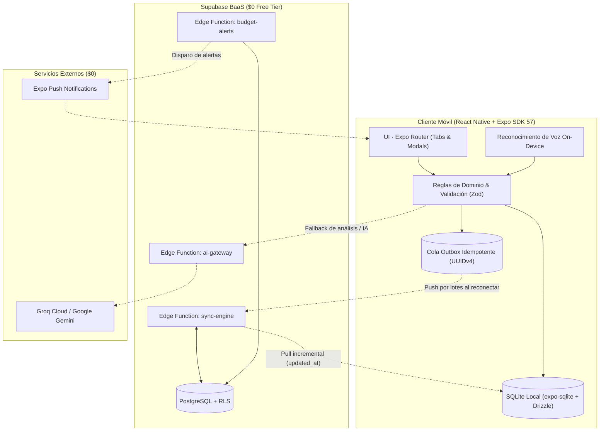

<div align="center">

# AhorRaso

**Gestión financiera personal para jóvenes y universitarios**
*Registra, controla y ahorra sin excusas — offline-first, comandos por voz, alertas de presupuesto y recomendaciones inteligentes.*

<br/>

<!-- Technology Badges -->
[](https://reactnative.dev)
[](https://expo.dev)
[](https://www.typescriptlang.org)
[](https://orm.drizzle.team)
[](https://orm.drizzle.team)
[](https://supabase.com)

</div>

---

## Índice

1. [Descripción del Proyecto](#-descripción-del-proyecto)
2. [Características Principales](#-características-principales)
3. [Diseño y Prototipos en Google Stitch](#-diseño-y-prototipos-en-google-stitch)
4. [Arquitectura Técnica](#-arquitectura-técnica)
5. [Estructura del Proyecto](#-estructura-del-proyecto)
6. [Instalación y Puesta en Marcha](#-instalación-y-puesta-en-marcha)
7. [Configuración de Stitch MCP (Opcional)](#-configuración-de-stitch-mcp-opcional)
8. [Equipo de Desarrollo](#-equipo-de-desarrollo)
9. [Documentación del Repositorio](#-documentación-del-repositorio)
10. [Licencia](#-licencia)

---

## Descripción del Proyecto

**AhorRaso** es una aplicación móvil diseñada específicamente para jóvenes y estudiantes universitarios que buscan tomar control de sus finanzas personales, reducir sus gastos hormiga y alcanzar metas de ahorro reales sin fricción.

La plataforma resuelve los problemas más comunes de la gestión financiera manual:
- **Latencia cero:** El registro de movimientos y la carga del dashboard se ejecutan en milisegundos directamente sobre una base de datos local embebida.
- **Funcionamiento 100% Offline-First:** Se puede operar sin conexión a internet en combis, campus universitarios o zonas de baja cobertura, encolando los cambios de forma idempotente.
- **Registro multimodal:** Soporta registro manual ultrarrápido con montos hero, chips de incremento (`+5`, `+10`, `+20`) y registro hands-free por comandos de voz on-device.
- **Restricción de presupuesto $0 USD:** Todo el stack tecnológico utiliza herramientas *Open Source* y planes *Free Tier* verificados (Supabase, Groq, Gemini API, EAS, PostHog).

---

## Características Principales

### 💳 Registro Rápido de Gastos e Ingresos
- Formulario hero optimizado para registrar un movimiento en menos de 5 segundos.
- Montos calculados exactamente en centavos de sol (`S/`) para evitar errores de precisión de punto flotante.
- Selección ágil entre métodos de pago locales (**Efectivo** y billeteras digitales como **Yape / Plin**).
- Impacto de saldo en tiempo real: cálculo preventivo que muestra el saldo restante antes de confirmar la transacción.

### 🎙️ Registro de Gastos por Voz (Speech-to-Text On-Device)
- Reconocimiento de voz local mediante APIs del sistema operativo sin enviar grabaciones a servidores externos ($0 costo, máxima privacidad).
- Extracción heurística y por expresiones regulares de monto, categoría y fecha.
- Fallback automático hacia el gateway de IA solo en casos de baja confianza.

### 🏷️ Categorización Inteligente y Creación In-Flow
- Categorías organizadas con colores dinámicos e iconos de Lucide.
- Catálogo inicial con 16 categorías protegidas (10 de gasto y 6 de ingreso), sembrado idempotente que nunca duplica ni pisa categorías del usuario.
- Creación de categorías personalizadas directamente dentro del flujo de gasto sin abandonar la pantalla.
- Pantalla de gestión de categorías (`/categories`): crear, renombrar, recolorear y eliminar categorías propias.
- Las categorías por defecto del sistema son protegidas: no pueden editarse ni eliminarse.
- Política de eliminación **restringida**: una categoría con movimientos asociados no se elimina; la app informa cuántos movimientos hay que reasignar antes.
- Reasignación de categoría desde el historial de movimientos (`RF-004`), con validación de tipo (ingreso/gasto) en la capa de datos.
- Sugerencia automática de iconos contextualizada al entorno universitario peruano (*combi*, *menú*, *fotocopias*, *chelas*, etc.).

### 🧾 Historial de Movimientos con Filtros (`RF-009` / `HU-05`)
- Listado cronológico unificado de ingresos y gastos, con totales del conjunto filtrado (ingresos, egresos y neto).
- Filtros combinables: rango de fechas con atajos (*Hoy*, *Últimos 7 días*, *Este mes*, *Mes pasado*), categoría, tipo de movimiento, rango de monto y establecimiento.
- Búsqueda de texto libre por comercio, nota o fuente del ingreso.
- Paginación **keyset** por cursor en la capa de datos (páginas estables ante inserciones nuevas) con scroll infinito y botón "Cargar más" en la UI.
- Validación de filtros en el dominio (formato de fechas y coherencia de rangos) con errores tipados que la UI traduce a mensajes legibles.

### 📊 Presupuestos Dinámicos y Alertas de Sobregiro
- Configuración de topes mensuales y semanales por categoría.
- Alertas proactivas automáticas al alcanzar el 80% y 100% del presupuesto asignado.
- Comparativa visual de gastos ejecutados versus disponible.

### 🎯 Metas de Ahorro con Proyección
- Definición de objetivos con montos meta y fechas estimadas.
- Cálculo de ahorro periódico sugerido y simulación de escenarios de cumplimiento.

### 🤖 Asesor Financiero con IA ($0 Gateway)
- Motor centralizado en Edge Functions con Groq Cloud (`Llama-3.3-70b` / `Qwen`) como proveedor primario y Google Gemini como fallback.
- Detección de patrones de consumo y generación de recomendaciones contextuales de ahorro.

### 🔒 Seguridad Local y Privacidad
- Aislamiento estricto de datos con *Row Level Security* (RLS) en base de datos.
- Bloqueo y autenticación local mediante PIN numérico y biometría (Face ID / Huella digital).

---

## Diseño y Prototipos en Google Stitch

El sistema de diseño, pantallas y flujos de usuario se basan en los mocks oficiales del proyecto en **Google Stitch**:

> 🔗 **Enlace al proyecto Stitch:** [stitch.withgoogle.com/projects/17338312379497379811](https://stitch.withgoogle.com/projects/17338312379497379811)  
> **Project ID:** `17338312379497379811`

### Sistema de Tokens (Dark Mode)
* **Primary (Acciones principales / confirmación):** `#0EA371`
* **Secondary (Ahorro / saldo disponible):** `#10B981`
* **Tertiary / Alertas (Gastos y advertencias):** `#DF6C6B`
* **Background:** `#0D0D0F`
* **Surface 1 (Cards base):** `#18181B`
* **Surface 2 (Inputs y elevación):** `#1F1F23`
* **Líneas y bordes:** `#2A2A2F`
* **Tipografías:**
  - **Manrope:** Encabezados y cifras hero de alto impacto.
  - **Hanken Grotesk:** Textos de lectura, botones y formularios.
  - **JetBrains Mono:** Cifras monetarias, prefijos (`S/`) y fechas.

---

## Arquitectura Técnica

El proyecto sigue una arquitectura **Clean Architecture ligera + Feature-First** bajo el paradigma **Local-First con sincronización diferida** (especificado en [`docs/ARQUITECTURA_TECNICA.md`](docs/ARQUITECTURA_TECNICA.md)):



### Patrón Outbox & Resiliencia
1. **Escritura síncrona inmediata:** Cada gasto, categoría o movimiento se inserta en SQLite y en la tabla `outbox` en menos de 50 ms.
2. **Idempotencia:** Toda entidad utiliza claves primarias UUIDv4 generadas por el cliente, garantizando que reintentos de red no produzcan registros duplicados.
3. **Sincronización bidireccional:** El motor procesa la cola de salida en lotes hacia Supabase y descarga los cambios remotos (`updated_at > last_sync`) mediante paginación por cursores.

---

## Estructura del Proyecto

```
AhorRaso/
├── .agents/skills/            # Skills y guías de desarrollo Expo/EAS
├── apps/
│   └── mobile/                # Código fuente de la aplicación móvil Expo
│       ├── assets/            # Iconos de aplicación y splash screen
│       └── src/
│           ├── app/           # Rutas basadas en archivos (Expo Router)
│           │   ├── (tabs)/    # Tabs: index, history, new-action (+), budgets, profile
│           │   ├── _layout.tsx# Layout raíz y configuración de modales
│           │   ├── categories.tsx # Pantalla de gestión de categorías (RF-005)
│           │   └── new-expense.tsx # Modal de registro de gasto
│           ├── core/          # Núcleo compartido del sistema
│           │   ├── db/        # Drizzle schema, cliente SQLite, outbox, init & seeds
│           │   ├── dev/       # Constantes y mocks de desarrollo (DEV_USER_ID)
│           │   ├── theme/     # Tokens de color, tipografía, espaciado e iconos
│           │   └── ui/        # Componentes base (Icon de Lucide, Placeholders)
│           └── features/      # Módulos por dominio de negocio (Feature-First)
│               ├── categories/# Selector de categoría, creación in-flow y gestión (RF-004/RF-005)
│               └── transactions/# Repositorio de transacciones, esquemas Zod, historial
│                              # con filtros/paginación keyset (RF-009) y UI de registro
│       ├── test/               # Infraestructura de pruebas (mocks de Expo/SQLite y helpers)
│       ├── jest.config.js      # Configuración de Jest (ts-jest + node:sqlite)
├── docs/
│   ├── ARQUITECTURA_TECNICA.md# Arquitectura a detalle, límites $0 y diagramas
│   ├── CATALOGO_REQUISITOS.md # Catálogo oficial de requerimientos funcionales y no funcionales
│   └── OPERACIONES.md         # Manual de operaciones, migraciones y convenciones
├── README.md
```

---

## Instalación y Puesta en Marcha

### Requisitos Previos
* **Node.js** v20 LTS o superior
* **npm** v10 o superior (o `pnpm` / `yarn`)
* **Dispositivo móvil** con la aplicación **Expo Go** instalada (Android o iOS), o un emulador configurado en Android Studio / Xcode.

### Pasos de Instalación

1. **Clonar el repositorio:**
   ```bash
   git clone https://github.com/<tu-organizacion>/AhorRaso.git
   cd AhorRaso
   ```

2. **Instalar dependencias del proyecto móvil:**
   ```bash
   cd apps/mobile
   npm install
   ```

3. **Iniciar el entorno de desarrollo:**
   ```bash
   npx expo start
   ```

4. **Visualizar la aplicación:**
   - **En dispositivo físico:** Escanea el código QR que aparece en la terminal usando la cámara (iOS) o la app **Expo Go** (Android).
   - **En emulador Android:** Presiona la tecla `a` en la terminal.
   - **En simulador iOS (macOS):** Presiona la tecla `i` en la terminal.

### Verificación (pruebas, tipos y lint)

Desde `apps/mobile`:

```bash
npm test            # Suite Jest: dominio + repositorios (SQLite en memoria)
npm run typecheck   # TypeScript estricto sin emitir (npx tsc --noEmit)
npm run lint        # ESLint con la config oficial de Expo
```

Las pruebas unitarias de dominio son puras (sin mocks) y las de integración corren
sobre SQLite real en memoria vía `node:sqlite` (Node ≥ 22), por lo que no requieren
emulador ni dispositivo.
   - **En navegador web:** Presiona la tecla `w` en la terminal.

---

## Configuración de Stitch MCP (Opcional)

Si utilizas asistentes o agentes de desarrollo impulsados por IA (como Antigravity, Claude Code o Cursor), puedes conectar el servidor MCP de Google Stitch para consultar e interactuar con los mocks oficiales de diseño directamente en tu flujo de trabajo.

> ⚠️ **Seguridad:** La configuración de MCP contiene rutas locales y claves personales. **Nunca se commitea en el repositorio Git**.

Agrega la configuración en tu archivo `mcp_config.json` local:

```json
{
  "mcpServers": {
    "stitch": {
      "command": "npx",
      "args": [
        "-y",
        "@google/stitch-mcp"
      ],
      "env": {
        "STITCH_API_KEY": "<TU_API_KEY_DE_STITCH>",
        "STITCH_PROJECT_ID": "17338312379497379811"
      }
    }
  }
}
```

---

## Equipo de Desarrollo

El proyecto está organizado en 3 roles de desarrollo full-stack con fronteras modulares claras:

| Desarrollador | Módulos y Responsabilidades |
| :--- | :--- |
| **Dev A** | **Transacciones & Categorías:** Persistencia offline local (SQLite + Drizzle), cola Outbox, formulario de gastos (`RF-002`), gestión de categorías (`RF-004`/`RF-005`), navegación shell, dashboard base e historial (`RF-008`/`RF-009`). |
| **Dev B** | **Presupuestos & Metas:** Motor de presupuestos por categoría y periodo (`RF-006`), alertas automáticas de sobregiro (`RF-010`/`RF-011`) y proyección de metas de ahorro (`RF-007`). |
| **Dev C** | **Voz, IA & Seguridad:** Módulo de voz Speech-to-Text on-device (`RF-003`), Edge Functions del AI Gateway con Groq/Gemini (`RF-012`/`RF-013`) y autenticación local por PIN y biometría (`RF-018`). |

---

## Documentación del Repositorio

* [`docs/ARQUITECTURA_TECNICA.md`](docs/ARQUITECTURA_TECNICA.md): Especificación detallada de arquitectura, límites de cuotas de free tier y análisis de riesgos.
* [`docs/CATALOGO_REQUISITOS.md`](docs/CATALOGO_REQUISITOS.md): Matriz de requerimientos funcionales (RF) y no funcionales (RNF).
* [`docs/OPERACIONES.md`](docs/OPERACIONES.md): Convenciones de código, runbooks de migración y monitoreo.

---

## Licencia

Este proyecto está bajo la Licencia **MIT**. Consulta el archivo `LICENSE` para más información.
