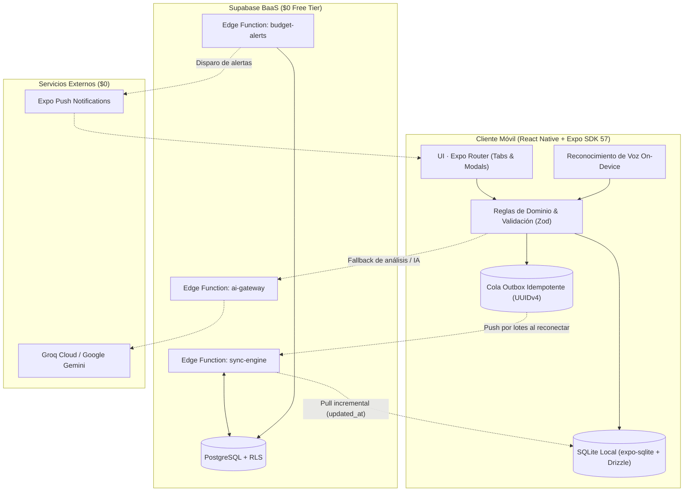
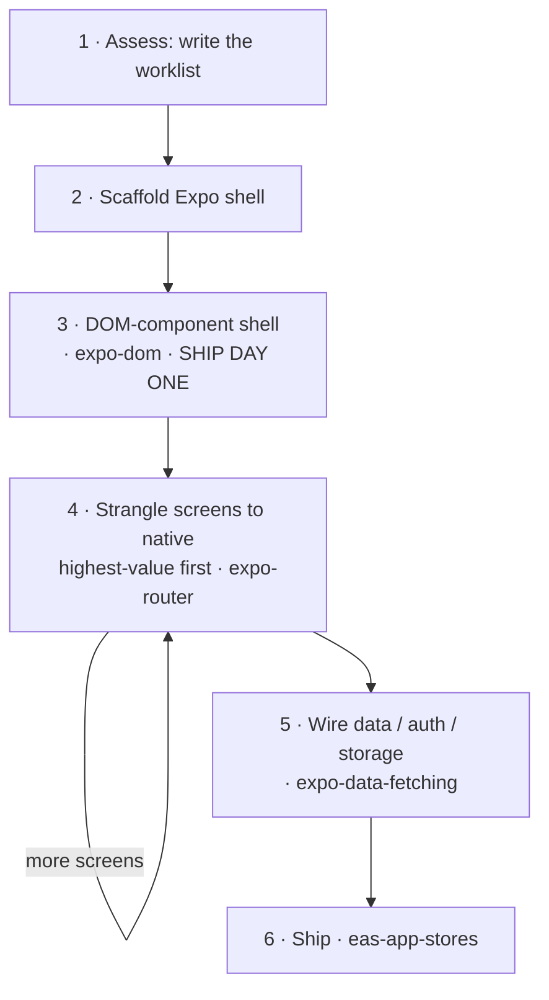
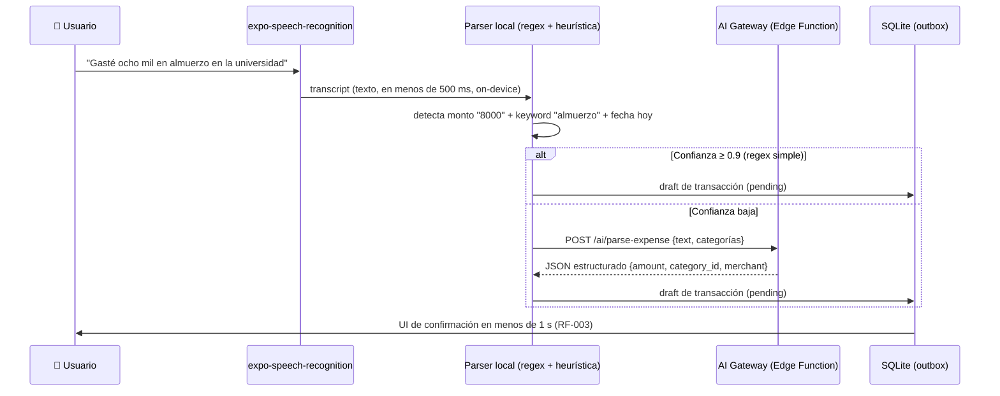
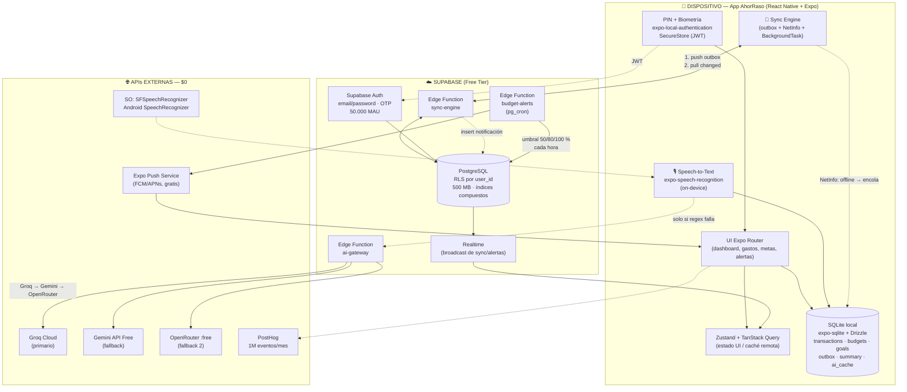
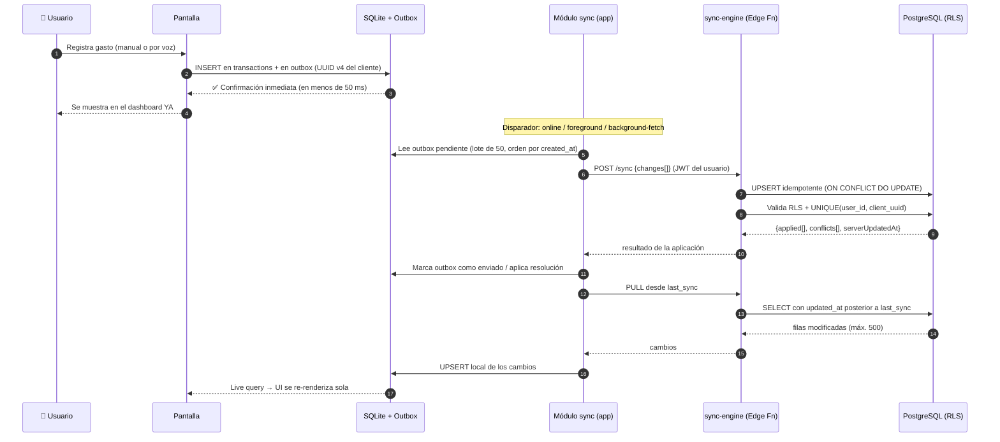

# Proyecto: AhorRaso

- **Ruta:** `D:\UNSA\8VO SEMESTRE\Gestion de Proyectos de Software\AhorRaso`
- **Archivos analizados:** 222
- **Archivos `.md` encontrados:** 103

## Estructura del proyecto

```
AhorRaso/
├── .agents/
│   └── skills/
│       ├── eas-app-stores/
│       │   ├── SKILL.md
│       │   ├── agents/
│       │   │   └── openai.yaml
│       │   └── references/
│       │       ├── app-store-metadata.md
│       │       ├── ios-app-store.md
│       │       ├── native-ios.md
│       │       ├── play-store.md
│       │       ├── testflight.md
│       │       └── workflows.md
│       ├── eas-hosting/
│       │   ├── SKILL.md
│       │   └── agents/
│       │       └── openai.yaml
│       ├── eas-observe/
│       │   ├── SKILL.md
│       │   ├── agents/
│       │   │   └── openai.yaml
│       │   └── references/
│       │       ├── metrics.md
│       │       ├── queries.md
│       │       ├── setup.md
│       │       └── third-party.md
│       ├── eas-simulator/
│       │   ├── SKILL.md
│       │   ├── agents/
│       │   │   └── openai.yaml
│       │   └── references/
│       │       ├── controllers.md
│       │       ├── logs-and-crashes.md
│       │       ├── run-your-app.md
│       │       └── troubleshooting.md
│       ├── eas-update/
│       │   ├── SKILL.md
│       │   └── agents/
│       │       └── openai.yaml
│       ├── eas-update-insights/
│       │   ├── SKILL.md
│       │   ├── agents/
│       │   │   └── openai.yaml
│       │   └── references/
│       │       ├── channel-insights-schema.md
│       │       └── update-insights-schema.md
│       ├── eas-workflows/
│       │   ├── SKILL.md
│       │   ├── agents/
│       │   │   └── openai.yaml
│       │   └── scripts/
│       │       ├── fetch.js
│       │       └── package.json
│       ├── expo-animation/
│       │   ├── LICENSE
│       │   ├── RECIPES.md
│       │   ├── SKILL.md
│       │   └── agents/
│       │       └── openai.yaml
│       ├── expo-app-clip/
│       │   ├── SKILL.md
│       │   ├── agents/
│       │   │   └── openai.yaml
│       │   └── references/
│       │       └── native-module.md
│       ├── expo-brownfield/
│       │   ├── SKILL.md
│       │   ├── agents/
│       │   │   └── openai.yaml
│       │   └── references/
│       │       ├── brownfield-integrated.md
│       │       ├── brownfield-isolated.md
│       │       ├── comparison.md
│       │       ├── feature-integration.md
│       │       ├── troubleshooting.md
│       │       └── version-compatibility.md
│       ├── expo-data-fetching/
│       │   ├── SKILL.md
│       │   ├── agents/
│       │   │   └── openai.yaml
│       │   └── references/
│       │       ├── expo-router-loaders.md
│       │       └── offline-and-cancellation.md
│       ├── expo-design-system/
│       │   ├── SKILL.md
│       │   ├── agents/
│       │   │   └── openai.yaml
│       │   └── references/
│       │       ├── audit.md
│       │       └── native-slop.md
│       ├── expo-dev-client/
│       │   ├── SKILL.md
│       │   └── agents/
│       │       └── openai.yaml
│       ├── expo-dom/
│       │   ├── SKILL.md
│       │   └── agents/
│       │       └── openai.yaml
│       ├── expo-examples/
│       │   ├── SKILL.md
│       │   ├── agents/
│       │   │   └── openai.yaml
│       │   └── references/
│       │       └── catalog.md
│       ├── expo-migrate-module/
│       │   ├── SKILL.md
│       │   ├── agents/
│       │   │   └── openai.yaml
│       │   └── references/
│       │       ├── compatibility.md
│       │       ├── example.md
│       │       └── migration-map.md
│       ├── expo-module/
│       │   ├── SKILL.md
│       │   ├── agents/
│       │   │   └── openai.yaml
│       │   └── references/
│       │       ├── config-plugin.md
│       │       ├── create-expo-module.md
│       │       ├── lifecycle.md
│       │       ├── module-config.md
│       │       ├── native-module.md
│       │       └── native-view.md
│       ├── expo-native-ui/
│       │   ├── SKILL.md
│       │   ├── agents/
│       │   │   └── openai.yaml
│       │   └── references/
│       │       ├── controls.md
│       │       ├── gradients.md
│       │       ├── icons.md
│       │       ├── media.md
│       │       ├── storage.md
│       │       ├── visual-effects.md
│       │       └── webgpu-three.md
│       ├── expo-overview/
│       │   ├── SKILL.md
│       │   └── agents/
│       │       └── openai.yaml
│       ├── expo-project-structure/
│       │   ├── SKILL.md
│       │   └── agents/
│       │       └── openai.yaml
│       ├── expo-router/
│       │   ├── SKILL.md
│       │   ├── agents/
│       │   │   └── openai.yaml
│       │   └── references/
│       │       ├── form-sheet.md
│       │       ├── route-structure.md
│       │       ├── search.md
│       │       ├── tabs.md
│       │       ├── toolbar-and-headers.md
│       │       └── zoom-transitions.md
│       ├── expo-skill-eval/
│       │   ├── SKILL.md
│       │   ├── agents/
│       │   │   └── visual-grader.md
│       │   ├── references/
│       │   │   ├── design-rubric.md
│       │   │   └── runtime-matrix.md
│       │   └── scripts/
│       │       ├── check-static.sh
│       │       ├── clean-fixture.sh
│       │       ├── generate_viewer.py
│       │       ├── latest-sdk.sh
│       │       ├── make-fixture.sh
│       │       ├── make-workspace.sh
│       │       ├── snapshot-android.sh
│       │       ├── snapshot-ios.sh
│       │       └── snapshot-web.sh
│       ├── expo-skill-feedback/
│       │   ├── SKILL.md
│       │   ├── agents/
│       │   │   └── openai.yaml
│       │   └── scripts/
│       │       ├── skill-event.cjs
│       │       ├── telemetry.cjs
│       │       └── telemetry_common.cjs
│       ├── expo-ui/
│       │   ├── SKILL.md
│       │   ├── agents/
│       │   │   └── openai.yaml
│       │   ├── references/
│       │   │   ├── drop-in-replacements.md
│       │   │   ├── jetpack-compose.md
│       │   │   ├── swift-ui.md
│       │   │   └── universal.md
│       │   └── scripts/
│       │       └── list-components.js
│       ├── expo-upgrade/
│       │   ├── SKILL.md
│       │   ├── agents/
│       │   │   └── openai.yaml
│       │   └── references/
│       │       ├── expo-av-to-audio.md
│       │       ├── expo-av-to-video.md
│       │       ├── native-tabs.md
│       │       ├── new-architecture.md
│       │       ├── react-19.md
│       │       ├── react-compiler.md
│       │       └── react-navigation-to-expo-router.md
│       └── expo-web-to-native/
│           ├── SKILL.md
│           ├── agents/
│           │   └── openai.yaml
│           └── references/
│               ├── false-friends.md
│               ├── native-patterns.md
│               ├── run-as-goal.md
│               └── verify-on-device.md
├── .github/
│   └── ISSUE_TEMPLATE/
│       ├── functional_requirement.md
│       └── user_story.md
├── .gitignore
├── README.md
├── apps/
│   ├── mobile/
│   │   ├── .claude/
│   │   │   └── settings.json
│   │   ├── .expo/
│   │   │   ├── README.md
│   │   │   ├── dev/
│   │   │   │   └── logs/
│   │   │   │       └── start.log
│   │   │   └── devices.json
│   │   ├── .gitignore
│   │   ├── AGENTS.md
│   │   ├── LICENSE
│   │   ├── app.json
│   │   ├── assets/
│   │   ├── eslint.config.js
│   │   ├── jest.config.js
│   │   ├── package-lock.json
│   │   ├── package.json
│   │   ├── pnpm-lock.yaml
│   │   ├── pnpm-workspace.yaml
│   │   ├── src/
│   │   │   ├── app/
│   │   │   │   ├── (tabs)/
│   │   │   │   │   ├── _layout.tsx
│   │   │   │   │   ├── budgets.tsx
│   │   │   │   │   ├── history.tsx
│   │   │   │   │   ├── index.tsx
│   │   │   │   │   ├── new-action.tsx
│   │   │   │   │   └── profile.tsx
│   │   │   │   ├── _layout.tsx
│   │   │   │   ├── categories.tsx
│   │   │   │   ├── new-expense.tsx
│   │   │   │   └── new-income.tsx
│   │   │   ├── core/
│   │   │   │   ├── db/
│   │   │   │   │   ├── __tests__/
│   │   │   │   │   │   └── init.test.ts
│   │   │   │   │   ├── client.ts
│   │   │   │   │   ├── index.ts
│   │   │   │   │   ├── init.ts
│   │   │   │   │   ├── outbox.ts
│   │   │   │   │   └── schema.ts
│   │   │   │   ├── dev/
│   │   │   │   │   └── constants.ts
│   │   │   │   ├── theme/
│   │   │   │   │   ├── colors.ts
│   │   │   │   │   ├── index.ts
│   │   │   │   │   ├── radius.ts
│   │   │   │   │   ├── spacing.ts
│   │   │   │   │   ├── typography.ts
│   │   │   │   │   └── useAppFonts.ts
│   │   │   │   └── ui/
│   │   │   │       ├── Icon.tsx
│   │   │   │       ├── PlaceholderScreen.tsx
│   │   │   │       └── index.ts
│   │   │   └── features/
│   │   │       ├── categories/
│   │   │       │   ├── data/
│   │   │       │   │   ├── __tests__/
│   │   │       │   │   │   └── categories.repository.test.ts
│   │   │       │   │   └── categories.repository.ts
│   │   │       │   ├── domain/
│   │   │       │   │   ├── __tests__/
│   │   │       │   │   │   └── types.test.ts
│   │   │       │   │   ├── errors.ts
│   │   │       │   │   ├── icon-suggestions.ts
│   │   │       │   │   └── types.ts
│   │   │       │   ├── index.ts
│   │   │       │   └── ui/
│   │   │       │       ├── CategoriesScreen.tsx
│   │   │       │       ├── CategorySelector.tsx
│   │   │       │       └── CreateCategoryModal.tsx
│   │   │       ├── dashboard/
│   │   │       │   ├── data/
│   │   │       │   │   ├── __tests__/
│   │   │       │   │   │   └── dashboard.repository.test.ts
│   │   │       │   │   └── dashboard.repository.ts
│   │   │       │   ├── domain/
│   │   │       │   │   └── types.ts
│   │   │       │   ├── index.ts
│   │   │       │   └── ui/
│   │   │       │       └── DashboardScreen.tsx
│   │   │       └── transactions/
│   │   │           ├── data/
│   │   │           │   ├── __tests__/
│   │   │           │   │   ├── transactions.history.test.ts
│   │   │           │   │   ├── transactions.income.test.ts
│   │   │           │   │   └── transactions.repository.test.ts
│   │   │           │   └── transactions.repository.ts
│   │   │           ├── domain/
│   │   │           │   ├── __tests__/
│   │   │           │   │   └── history.test.ts
│   │   │           │   ├── errors.ts
│   │   │           │   ├── history.ts
│   │   │           │   └── types.ts
│   │   │           ├── index.ts
│   │   │           └── ui/
│   │   │               ├── EditTransactionCategoryModal.tsx
│   │   │               ├── HistoryFiltersModal.tsx
│   │   │               ├── HistoryScreen.tsx
│   │   │               ├── NewExpenseScreen.tsx
│   │   │               ├── NewIncomeScreen.tsx
│   │   │               └── useHistoryPagination.ts
│   │   ├── test/
│   │   │   ├── helpers/
│   │   │   │   └── test-db.ts
│   │   │   └── mocks/
│   │   │       ├── expo-crypto.ts
│   │   │       └── expo-sqlite.ts
│   │   ├── tsconfig.json
│   │   └── tsconfig.spec.json
│   └── package-lock.json
├── docs/
│   ├── ARQUITECTURA_TECNICA.md
│   ├── CATALOGO_REQUISITOS.md
│   └── OPERACIONES.md
├── package-lock.json
├── project_dump.md
├── scriptGenerado.py
└── supabase/
    └── migrations/
        └── 20261013000000_init_schema.sql
```

## Índice de archivos

- `.gitignore`
- `README.md`
- `package-lock.json`
- `scriptGenerado.py`
- `.agents/skills/eas-app-stores/SKILL.md`
- `.agents/skills/eas-app-stores/agents/openai.yaml`
- `.agents/skills/eas-app-stores/references/app-store-metadata.md`
- `.agents/skills/eas-app-stores/references/ios-app-store.md`
- `.agents/skills/eas-app-stores/references/native-ios.md`
- `.agents/skills/eas-app-stores/references/play-store.md`
- `.agents/skills/eas-app-stores/references/testflight.md`
- `.agents/skills/eas-app-stores/references/workflows.md`
- `.agents/skills/eas-hosting/SKILL.md`
- `.agents/skills/eas-hosting/agents/openai.yaml`
- `.agents/skills/eas-observe/SKILL.md`
- `.agents/skills/eas-observe/agents/openai.yaml`
- `.agents/skills/eas-observe/references/metrics.md`
- `.agents/skills/eas-observe/references/queries.md`
- `.agents/skills/eas-observe/references/setup.md`
- `.agents/skills/eas-observe/references/third-party.md`
- `.agents/skills/eas-simulator/SKILL.md`
- `.agents/skills/eas-simulator/agents/openai.yaml`
- `.agents/skills/eas-simulator/references/controllers.md`
- `.agents/skills/eas-simulator/references/logs-and-crashes.md`
- `.agents/skills/eas-simulator/references/run-your-app.md`
- `.agents/skills/eas-simulator/references/troubleshooting.md`
- `.agents/skills/eas-update/SKILL.md`
- `.agents/skills/eas-update/agents/openai.yaml`
- `.agents/skills/eas-update-insights/SKILL.md`
- `.agents/skills/eas-update-insights/agents/openai.yaml`
- `.agents/skills/eas-update-insights/references/channel-insights-schema.md`
- `.agents/skills/eas-update-insights/references/update-insights-schema.md`
- `.agents/skills/eas-workflows/SKILL.md`
- `.agents/skills/eas-workflows/agents/openai.yaml`
- `.agents/skills/eas-workflows/scripts/fetch.js`
- `.agents/skills/eas-workflows/scripts/package.json`
- `.agents/skills/expo-animation/LICENSE`
- `.agents/skills/expo-animation/RECIPES.md`
- `.agents/skills/expo-animation/SKILL.md`
- `.agents/skills/expo-animation/agents/openai.yaml`
- `.agents/skills/expo-app-clip/SKILL.md`
- `.agents/skills/expo-app-clip/agents/openai.yaml`
- `.agents/skills/expo-app-clip/references/native-module.md`
- `.agents/skills/expo-brownfield/SKILL.md`
- `.agents/skills/expo-brownfield/agents/openai.yaml`
- `.agents/skills/expo-brownfield/references/brownfield-integrated.md`
- `.agents/skills/expo-brownfield/references/brownfield-isolated.md`
- `.agents/skills/expo-brownfield/references/comparison.md`
- `.agents/skills/expo-brownfield/references/feature-integration.md`
- `.agents/skills/expo-brownfield/references/troubleshooting.md`
- `.agents/skills/expo-brownfield/references/version-compatibility.md`
- `.agents/skills/expo-data-fetching/SKILL.md`
- `.agents/skills/expo-data-fetching/agents/openai.yaml`
- `.agents/skills/expo-data-fetching/references/expo-router-loaders.md`
- `.agents/skills/expo-data-fetching/references/offline-and-cancellation.md`
- `.agents/skills/expo-design-system/SKILL.md`
- `.agents/skills/expo-design-system/agents/openai.yaml`
- `.agents/skills/expo-design-system/references/audit.md`
- `.agents/skills/expo-design-system/references/native-slop.md`
- `.agents/skills/expo-dev-client/SKILL.md`
- `.agents/skills/expo-dev-client/agents/openai.yaml`
- `.agents/skills/expo-dom/SKILL.md`
- `.agents/skills/expo-dom/agents/openai.yaml`
- `.agents/skills/expo-examples/SKILL.md`
- `.agents/skills/expo-examples/agents/openai.yaml`
- `.agents/skills/expo-examples/references/catalog.md`
- `.agents/skills/expo-migrate-module/SKILL.md`
- `.agents/skills/expo-migrate-module/agents/openai.yaml`
- `.agents/skills/expo-migrate-module/references/compatibility.md`
- `.agents/skills/expo-migrate-module/references/example.md`
- `.agents/skills/expo-migrate-module/references/migration-map.md`
- `.agents/skills/expo-module/SKILL.md`
- `.agents/skills/expo-module/agents/openai.yaml`
- `.agents/skills/expo-module/references/config-plugin.md`
- `.agents/skills/expo-module/references/create-expo-module.md`
- `.agents/skills/expo-module/references/lifecycle.md`
- `.agents/skills/expo-module/references/module-config.md`
- `.agents/skills/expo-module/references/native-module.md`
- `.agents/skills/expo-module/references/native-view.md`
- `.agents/skills/expo-native-ui/SKILL.md`
- `.agents/skills/expo-native-ui/agents/openai.yaml`
- `.agents/skills/expo-native-ui/references/controls.md`
- `.agents/skills/expo-native-ui/references/gradients.md`
- `.agents/skills/expo-native-ui/references/icons.md`
- `.agents/skills/expo-native-ui/references/media.md`
- `.agents/skills/expo-native-ui/references/storage.md`
- `.agents/skills/expo-native-ui/references/visual-effects.md`
- `.agents/skills/expo-native-ui/references/webgpu-three.md`
- `.agents/skills/expo-overview/SKILL.md`
- `.agents/skills/expo-overview/agents/openai.yaml`
- `.agents/skills/expo-project-structure/SKILL.md`
- `.agents/skills/expo-project-structure/agents/openai.yaml`
- `.agents/skills/expo-router/SKILL.md`
- `.agents/skills/expo-router/agents/openai.yaml`
- `.agents/skills/expo-router/references/form-sheet.md`
- `.agents/skills/expo-router/references/route-structure.md`
- `.agents/skills/expo-router/references/search.md`
- `.agents/skills/expo-router/references/tabs.md`
- `.agents/skills/expo-router/references/toolbar-and-headers.md`
- `.agents/skills/expo-router/references/zoom-transitions.md`
- `.agents/skills/expo-skill-eval/SKILL.md`
- `.agents/skills/expo-skill-eval/agents/visual-grader.md`
- `.agents/skills/expo-skill-eval/references/design-rubric.md`
- `.agents/skills/expo-skill-eval/references/runtime-matrix.md`
- `.agents/skills/expo-skill-eval/scripts/check-static.sh`
- `.agents/skills/expo-skill-eval/scripts/clean-fixture.sh`
- `.agents/skills/expo-skill-eval/scripts/generate_viewer.py`
- `.agents/skills/expo-skill-eval/scripts/latest-sdk.sh`
- `.agents/skills/expo-skill-eval/scripts/make-fixture.sh`
- `.agents/skills/expo-skill-eval/scripts/make-workspace.sh`
- `.agents/skills/expo-skill-eval/scripts/snapshot-android.sh`
- `.agents/skills/expo-skill-eval/scripts/snapshot-ios.sh`
- `.agents/skills/expo-skill-eval/scripts/snapshot-web.sh`
- `.agents/skills/expo-skill-feedback/SKILL.md`
- `.agents/skills/expo-skill-feedback/agents/openai.yaml`
- `.agents/skills/expo-skill-feedback/scripts/skill-event.cjs`
- `.agents/skills/expo-skill-feedback/scripts/telemetry.cjs`
- `.agents/skills/expo-skill-feedback/scripts/telemetry_common.cjs`
- `.agents/skills/expo-ui/SKILL.md`
- `.agents/skills/expo-ui/agents/openai.yaml`
- `.agents/skills/expo-ui/references/drop-in-replacements.md`
- `.agents/skills/expo-ui/references/jetpack-compose.md`
- `.agents/skills/expo-ui/references/swift-ui.md`
- `.agents/skills/expo-ui/references/universal.md`
- `.agents/skills/expo-ui/scripts/list-components.js`
- `.agents/skills/expo-upgrade/SKILL.md`
- `.agents/skills/expo-upgrade/agents/openai.yaml`
- `.agents/skills/expo-upgrade/references/expo-av-to-audio.md`
- `.agents/skills/expo-upgrade/references/expo-av-to-video.md`
- `.agents/skills/expo-upgrade/references/native-tabs.md`
- `.agents/skills/expo-upgrade/references/new-architecture.md`
- `.agents/skills/expo-upgrade/references/react-19.md`
- `.agents/skills/expo-upgrade/references/react-compiler.md`
- `.agents/skills/expo-upgrade/references/react-navigation-to-expo-router.md`
- `.agents/skills/expo-web-to-native/SKILL.md`
- `.agents/skills/expo-web-to-native/agents/openai.yaml`
- `.agents/skills/expo-web-to-native/references/false-friends.md`
- `.agents/skills/expo-web-to-native/references/native-patterns.md`
- `.agents/skills/expo-web-to-native/references/run-as-goal.md`
- `.agents/skills/expo-web-to-native/references/verify-on-device.md`
- `.github/ISSUE_TEMPLATE/functional_requirement.md`
- `.github/ISSUE_TEMPLATE/user_story.md`
- `apps/package-lock.json`
- `apps/mobile/.gitignore`
- `apps/mobile/AGENTS.md`
- `apps/mobile/LICENSE`
- `apps/mobile/app.json`
- `apps/mobile/eslint.config.js`
- `apps/mobile/jest.config.js`
- `apps/mobile/package-lock.json`
- `apps/mobile/package.json`
- `apps/mobile/pnpm-lock.yaml`
- `apps/mobile/pnpm-workspace.yaml`
- `apps/mobile/tsconfig.json`
- `apps/mobile/tsconfig.spec.json`
- `apps/mobile/.claude/settings.json`
- `apps/mobile/.expo/README.md`
- `apps/mobile/.expo/devices.json`
- `apps/mobile/.expo/dev/logs/start.log`
- `apps/mobile/src/app/_layout.tsx`
- `apps/mobile/src/app/categories.tsx`
- `apps/mobile/src/app/new-expense.tsx`
- `apps/mobile/src/app/new-income.tsx`
- `apps/mobile/src/app/(tabs)/_layout.tsx`
- `apps/mobile/src/app/(tabs)/budgets.tsx`
- `apps/mobile/src/app/(tabs)/history.tsx`
- `apps/mobile/src/app/(tabs)/index.tsx`
- `apps/mobile/src/app/(tabs)/new-action.tsx`
- `apps/mobile/src/app/(tabs)/profile.tsx`
- `apps/mobile/src/core/db/client.ts`
- `apps/mobile/src/core/db/index.ts`
- `apps/mobile/src/core/db/init.ts`
- `apps/mobile/src/core/db/outbox.ts`
- `apps/mobile/src/core/db/schema.ts`
- `apps/mobile/src/core/db/__tests__/init.test.ts`
- `apps/mobile/src/core/dev/constants.ts`
- `apps/mobile/src/core/theme/colors.ts`
- `apps/mobile/src/core/theme/index.ts`
- `apps/mobile/src/core/theme/radius.ts`
- `apps/mobile/src/core/theme/spacing.ts`
- `apps/mobile/src/core/theme/typography.ts`
- `apps/mobile/src/core/theme/useAppFonts.ts`
- `apps/mobile/src/core/ui/Icon.tsx`
- `apps/mobile/src/core/ui/PlaceholderScreen.tsx`
- `apps/mobile/src/core/ui/index.ts`
- `apps/mobile/src/features/categories/index.ts`
- `apps/mobile/src/features/categories/data/categories.repository.ts`
- `apps/mobile/src/features/categories/data/__tests__/categories.repository.test.ts`
- `apps/mobile/src/features/categories/domain/errors.ts`
- `apps/mobile/src/features/categories/domain/icon-suggestions.ts`
- `apps/mobile/src/features/categories/domain/types.ts`
- `apps/mobile/src/features/categories/domain/__tests__/types.test.ts`
- `apps/mobile/src/features/categories/ui/CategoriesScreen.tsx`
- `apps/mobile/src/features/categories/ui/CategorySelector.tsx`
- `apps/mobile/src/features/categories/ui/CreateCategoryModal.tsx`
- `apps/mobile/src/features/dashboard/index.ts`
- `apps/mobile/src/features/dashboard/data/dashboard.repository.ts`
- `apps/mobile/src/features/dashboard/data/__tests__/dashboard.repository.test.ts`
- `apps/mobile/src/features/dashboard/domain/types.ts`
- `apps/mobile/src/features/dashboard/ui/DashboardScreen.tsx`
- `apps/mobile/src/features/transactions/index.ts`
- `apps/mobile/src/features/transactions/data/transactions.repository.ts`
- `apps/mobile/src/features/transactions/data/__tests__/transactions.history.test.ts`
- `apps/mobile/src/features/transactions/data/__tests__/transactions.income.test.ts`
- `apps/mobile/src/features/transactions/data/__tests__/transactions.repository.test.ts`
- `apps/mobile/src/features/transactions/domain/errors.ts`
- `apps/mobile/src/features/transactions/domain/history.ts`
- `apps/mobile/src/features/transactions/domain/types.ts`
- `apps/mobile/src/features/transactions/domain/__tests__/history.test.ts`
- `apps/mobile/src/features/transactions/ui/EditTransactionCategoryModal.tsx`
- `apps/mobile/src/features/transactions/ui/HistoryFiltersModal.tsx`
- `apps/mobile/src/features/transactions/ui/HistoryScreen.tsx`
- `apps/mobile/src/features/transactions/ui/NewExpenseScreen.tsx`
- `apps/mobile/src/features/transactions/ui/NewIncomeScreen.tsx`
- `apps/mobile/src/features/transactions/ui/useHistoryPagination.ts`
- `apps/mobile/test/helpers/test-db.ts`
- `apps/mobile/test/mocks/expo-crypto.ts`
- `apps/mobile/test/mocks/expo-sqlite.ts`
- `docs/ARQUITECTURA_TECNICA.md`
- `docs/CATALOGO_REQUISITOS.md`
- `docs/OPERACIONES.md`
- `supabase/migrations/20261013000000_init_schema.sql`

## Contenido de los archivos

### `.gitignore`

```
# Env
.env
.env.local
.env.*.local

# Node
node_modules/
npm-debug.log*
yarn-error.log*

# Expo
.expo/
dist/
web-build/

# Builds nativos
*.apk
*.aab
*.ipa

# Supabase local
supabase/.branches
supabase/.temp

# Secrets
*.pem
*.key
*.p12

# AI Agents & Editor
.agents/
.claude/
# Bases de datos locales (nunca se commitean; en runtime viven en el sandbox de la app)
*.db
*.db-journal
*.db-wal
*.db-shm
scriptGenerador.py
```

### `README.md`

````markdown
<div align="center">

# AhorRaso

**Gestión financiera personal para jóvenes y universitarios**
*Registra, controla y ahorra sin excusas — offline-first, comandos por voz, alertas de presupuesto y recomendaciones inteligentes.*

<br/>

<!-- Technology Badges -->
[](https://reactnative.dev)
[](https://expo.dev)
[](https://www.typescriptlang.org)
[](https://orm.drizzle.team)
[](https://orm.drizzle.team)
[](https://supabase.com)

</div>

---

## Índice

1. [Descripción del Proyecto](#-descripción-del-proyecto)
2. [Características Principales](#-características-principales)
3. [Diseño y Prototipos en Google Stitch](#-diseño-y-prototipos-en-google-stitch)
4. [Arquitectura Técnica](#-arquitectura-técnica)
5. [Estructura del Proyecto](#-estructura-del-proyecto)
6. [Instalación y Puesta en Marcha](#-instalación-y-puesta-en-marcha)
7. [Configuración de Stitch MCP (Opcional)](#-configuración-de-stitch-mcp-opcional)
8. [Equipo de Desarrollo](#-equipo-de-desarrollo)
9. [Documentación del Repositorio](#-documentación-del-repositorio)
10. [Licencia](#-licencia)

---

## Descripción del Proyecto

**AhorRaso** es una aplicación móvil diseñada específicamente para jóvenes y estudiantes universitarios que buscan tomar control de sus finanzas personales, reducir sus gastos hormiga y alcanzar metas de ahorro reales sin fricción.

La plataforma resuelve los problemas más comunes de la gestión financiera manual:
- **Latencia cero:** El registro de movimientos y la carga del dashboard se ejecutan en milisegundos directamente sobre una base de datos local embebida.
- **Funcionamiento 100% Offline-First:** Se puede operar sin conexión a internet en combis, campus universitarios o zonas de baja cobertura, encolando los cambios de forma idempotente.
- **Registro multimodal:** Soporta registro manual ultrarrápido con montos hero, chips de incremento (`+5`, `+10`, `+20`) y registro hands-free por comandos de voz on-device.
- **Restricción de presupuesto $0 USD:** Todo el stack tecnológico utiliza herramientas *Open Source* y planes *Free Tier* verificados (Supabase, Groq, Gemini API, EAS, PostHog).

---

## Características Principales

### 💳 Registro Rápido de Gastos e Ingresos
- Formulario hero optimizado para registrar un movimiento en menos de 5 segundos.
- Montos calculados exactamente en centavos de sol (`S/`) para evitar errores de precisión de punto flotante.
- Selección ágil entre métodos de pago locales (**Efectivo** y billeteras digitales como **Yape / Plin**).
- Impacto de saldo en tiempo real: cálculo preventivo que muestra el saldo restante antes de confirmar la transacción.

### 🎙️ Registro de Gastos por Voz (Speech-to-Text On-Device)
- Reconocimiento de voz local mediante APIs del sistema operativo sin enviar grabaciones a servidores externos ($0 costo, máxima privacidad).
- Extracción heurística y por expresiones regulares de monto, categoría y fecha.
- Fallback automático hacia el gateway de IA solo en casos de baja confianza.

### 🏷️ Categorización Inteligente y Creación In-Flow
- Categorías organizadas con colores dinámicos e iconos de Lucide.
- Catálogo inicial con 16 categorías protegidas (10 de gasto y 6 de ingreso), sembrado idempotente que nunca duplica ni pisa categorías del usuario.
- Creación de categorías personalizadas directamente dentro del flujo de gasto sin abandonar la pantalla.
- Pantalla de gestión de categorías (`/categories`): crear, renombrar, recolorear y eliminar categorías propias.
- Las categorías por defecto del sistema son protegidas: no pueden editarse ni eliminarse.
- Política de eliminación **restringida**: una categoría con movimientos asociados no se elimina; la app informa cuántos movimientos hay que reasignar antes.
- Reasignación de categoría desde el historial de movimientos (`RF-004`), con validación de tipo (ingreso/gasto) en la capa de datos.
- Sugerencia automática de iconos contextualizada al entorno universitario peruano (*combi*, *menú*, *fotocopias*, *chelas*, etc.).

### 🧾 Historial de Movimientos con Filtros (`RF-009` / `HU-05`)
- Listado cronológico unificado de ingresos y gastos, con totales del conjunto filtrado (ingresos, egresos y neto).
- Filtros combinables: rango de fechas con atajos (*Hoy*, *Últimos 7 días*, *Este mes*, *Mes pasado*), categoría, tipo de movimiento, rango de monto y establecimiento.
- Búsqueda de texto libre por comercio, nota o fuente del ingreso.
- Paginación **keyset** por cursor en la capa de datos (páginas estables ante inserciones nuevas) con scroll infinito y botón "Cargar más" en la UI.
- Validación de filtros en el dominio (formato de fechas y coherencia de rangos) con errores tipados que la UI traduce a mensajes legibles.

### 📊 Presupuestos Dinámicos y Alertas de Sobregiro
- Configuración de topes mensuales y semanales por categoría.
- Alertas proactivas automáticas al alcanzar el 80% y 100% del presupuesto asignado.
- Comparativa visual de gastos ejecutados versus disponible.

### 🎯 Metas de Ahorro con Proyección
- Definición de objetivos con montos meta y fechas estimadas.
- Cálculo de ahorro periódico sugerido y simulación de escenarios de cumplimiento.

### 🤖 Asesor Financiero con IA ($0 Gateway)
- Motor centralizado en Edge Functions con Groq Cloud (`Llama-3.3-70b` / `Qwen`) como proveedor primario y Google Gemini como fallback.
- Detección de patrones de consumo y generación de recomendaciones contextuales de ahorro.

### 🔒 Seguridad Local y Privacidad
- Aislamiento estricto de datos con *Row Level Security* (RLS) en base de datos.
- Bloqueo y autenticación local mediante PIN numérico y biometría (Face ID / Huella digital).

---

## Diseño y Prototipos en Google Stitch

El sistema de diseño, pantallas y flujos de usuario se basan en los mocks oficiales del proyecto en **Google Stitch**:

> 🔗 **Enlace al proyecto Stitch:** [stitch.withgoogle.com/projects/17338312379497379811](https://stitch.withgoogle.com/projects/17338312379497379811)  
> **Project ID:** `17338312379497379811`

### Sistema de Tokens (Dark Mode)
* **Primary (Acciones principales / confirmación):** `#0EA371`
* **Secondary (Ahorro / saldo disponible):** `#10B981`
* **Tertiary / Alertas (Gastos y advertencias):** `#DF6C6B`
* **Background:** `#0D0D0F`
* **Surface 1 (Cards base):** `#18181B`
* **Surface 2 (Inputs y elevación):** `#1F1F23`
* **Líneas y bordes:** `#2A2A2F`
* **Tipografías:**
  - **Manrope:** Encabezados y cifras hero de alto impacto.
  - **Hanken Grotesk:** Textos de lectura, botones y formularios.
  - **JetBrains Mono:** Cifras monetarias, prefijos (`S/`) y fechas.

---

## Arquitectura Técnica

El proyecto sigue una arquitectura **Clean Architecture ligera + Feature-First** bajo el paradigma **Local-First con sincronización diferida** (especificado en [`docs/ARQUITECTURA_TECNICA.md`](docs/ARQUITECTURA_TECNICA.md)):



### Patrón Outbox & Resiliencia
1. **Escritura síncrona inmediata:** Cada gasto, categoría o movimiento se inserta en SQLite y en la tabla `outbox` en menos de 50 ms.
2. **Idempotencia:** Toda entidad utiliza claves primarias UUIDv4 generadas por el cliente, garantizando que reintentos de red no produzcan registros duplicados.
3. **Sincronización bidireccional:** El motor procesa la cola de salida en lotes hacia Supabase y descarga los cambios remotos (`updated_at > last_sync`) mediante paginación por cursores.

---

## Estructura del Proyecto

```
AhorRaso/
├── .agents/skills/            # Skills y guías de desarrollo Expo/EAS
├── apps/
│   └── mobile/                # Código fuente de la aplicación móvil Expo
│       ├── assets/            # Iconos de aplicación y splash screen
│       └── src/
│           ├── app/           # Rutas basadas en archivos (Expo Router)
│           │   ├── (tabs)/    # Tabs: index, history, new-action (+), budgets, profile
│           │   ├── _layout.tsx# Layout raíz y configuración de modales
│           │   ├── categories.tsx # Pantalla de gestión de categorías (RF-005)
│           │   └── new-expense.tsx # Modal de registro de gasto
│           ├── core/          # Núcleo compartido del sistema
│           │   ├── db/        # Drizzle schema, cliente SQLite, outbox, init & seeds
│           │   ├── dev/       # Constantes y mocks de desarrollo (DEV_USER_ID)
│           │   ├── theme/     # Tokens de color, tipografía, espaciado e iconos
│           │   └── ui/        # Componentes base (Icon de Lucide, Placeholders)
│           └── features/      # Módulos por dominio de negocio (Feature-First)
│               ├── categories/# Selector de categoría, creación in-flow y gestión (RF-004/RF-005)
│               └── transactions/# Repositorio de transacciones, esquemas Zod, historial
│                              # con filtros/paginación keyset (RF-009) y UI de registro
│       ├── test/               # Infraestructura de pruebas (mocks de Expo/SQLite y helpers)
│       ├── jest.config.js      # Configuración de Jest (ts-jest + node:sqlite)
├── docs/
│   ├── ARQUITECTURA_TECNICA.md# Arquitectura a detalle, límites $0 y diagramas
│   ├── CATALOGO_REQUISITOS.md # Catálogo oficial de requerimientos funcionales y no funcionales
│   └── OPERACIONES.md         # Manual de operaciones, migraciones y convenciones
├── README.md
```

---

## Instalación y Puesta en Marcha

### Requisitos Previos
* **Node.js** v20 LTS o superior
* **npm** v10 o superior (o `pnpm` / `yarn`)
* **Dispositivo móvil** con la aplicación **Expo Go** instalada (Android o iOS), o un emulador configurado en Android Studio / Xcode.

### Pasos de Instalación

1. **Clonar el repositorio:**
   ```bash
   git clone https://github.com/<tu-organizacion>/AhorRaso.git
   cd AhorRaso
   ```

2. **Instalar dependencias del proyecto móvil:**
   ```bash
   cd apps/mobile
   npm install
   ```

3. **Iniciar el entorno de desarrollo:**
   ```bash
   npx expo start
   ```

4. **Visualizar la aplicación:**
   - **En dispositivo físico:** Escanea el código QR que aparece en la terminal usando la cámara (iOS) o la app **Expo Go** (Android).
   - **En emulador Android:** Presiona la tecla `a` en la terminal.
   - **En simulador iOS (macOS):** Presiona la tecla `i` en la terminal.

### Verificación (pruebas, tipos y lint)

Desde `apps/mobile`:

```bash
npm test            # Suite Jest: dominio + repositorios (SQLite en memoria)
npm run typecheck   # TypeScript estricto sin emitir (npx tsc --noEmit)
npm run lint        # ESLint con la config oficial de Expo
```

Las pruebas unitarias de dominio son puras (sin mocks) y las de integración corren
sobre SQLite real en memoria vía `node:sqlite` (Node ≥ 22), por lo que no requieren
emulador ni dispositivo.
   - **En navegador web:** Presiona la tecla `w` en la terminal.

---

## Configuración de Stitch MCP (Opcional)

Si utilizas asistentes o agentes de desarrollo impulsados por IA (como Antigravity, Claude Code o Cursor), puedes conectar el servidor MCP de Google Stitch para consultar e interactuar con los mocks oficiales de diseño directamente en tu flujo de trabajo.

> ⚠️ **Seguridad:** La configuración de MCP contiene rutas locales y claves personales. **Nunca se commitea en el repositorio Git**.

Agrega la configuración en tu archivo `mcp_config.json` local:

```json
{
  "mcpServers": {
    "stitch": {
      "command": "npx",
      "args": [
        "-y",
        "@google/stitch-mcp"
      ],
      "env": {
        "STITCH_API_KEY": "<TU_API_KEY_DE_STITCH>",
        "STITCH_PROJECT_ID": "17338312379497379811"
      }
    }
  }
}
```

---

## Equipo de Desarrollo

El proyecto está organizado en 3 roles de desarrollo full-stack con fronteras modulares claras:

| Desarrollador | Módulos y Responsabilidades |
| :--- | :--- |
| **Dev A** | **Transacciones & Categorías:** Persistencia offline local (SQLite + Drizzle), cola Outbox, formulario de gastos (`RF-002`), gestión de categorías (`RF-004`/`RF-005`), navegación shell, dashboard base e historial (`RF-008`/`RF-009`). |
| **Dev B** | **Presupuestos & Metas:** Motor de presupuestos por categoría y periodo (`RF-006`), alertas automáticas de sobregiro (`RF-010`/`RF-011`) y proyección de metas de ahorro (`RF-007`). |
| **Dev C** | **Voz, IA & Seguridad:** Módulo de voz Speech-to-Text on-device (`RF-003`), Edge Functions del AI Gateway con Groq/Gemini (`RF-012`/`RF-013`) y autenticación local por PIN y biometría (`RF-018`). |

---

## Documentación del Repositorio

* [`docs/ARQUITECTURA_TECNICA.md`](docs/ARQUITECTURA_TECNICA.md): Especificación detallada de arquitectura, límites de cuotas de free tier y análisis de riesgos.
* [`docs/CATALOGO_REQUISITOS.md`](docs/CATALOGO_REQUISITOS.md): Matriz de requerimientos funcionales (RF) y no funcionales (RNF).
* [`docs/OPERACIONES.md`](docs/OPERACIONES.md): Convenciones de código, runbooks de migración y monitoreo.

---

## Licencia

Este proyecto está bajo la Licencia **MIT**. Consulta el archivo `LICENSE` para más información.
````

### `package-lock.json`

```json
{
  "name": "AhorRaso",
  "lockfileVersion": 3,
  "requires": true,
  "packages": {}
}
```

### `scriptGenerado.py`

````python
#!/usr/bin/env python3
"""
dump_project.py
---------------
Recorre un proyecto y vuelca TODO el contenido de sus archivos en un único
archivo Markdown, incluyendo:
  - Un árbol con la estructura del proyecto
  - Un índice de archivos
  - El contenido completo de cada archivo (incluidos los .md)
Se omiten directorios basura (node_modules, .git, venv, __pycache__, ...),
archivos binarios y archivos enormes.

Uso:
    python dump_project.py                  # vuelca el directorio actual
    python dump_project.py /ruta/proyecto
    python dump_project.py -o salida.md
"""

import argparse
import os
from pathlib import Path

# ---------------------------------------------------------------------------
# Configuración: qué ignorar
# ---------------------------------------------------------------------------
IGNORE_DIRS = {
    "node_modules", ".git", ".svn", ".hg",
    "__pycache__", ".mypy_cache", ".pytest_cache", ".ruff_cache",
    "venv", ".venv", "env", ".env",
    "dist", "build", "out", ".next", ".nuxt", ".cache", ".parcel-cache",
    ".idea", ".vscode", ".vs",
    "coverage", ".coverage", "htmlcov",
    "target", "obj",
    ".tox", ".eggs",
}

IGNORE_FILES = {
    ".DS_Store", "Thumbs.db", "desktop.ini",
}

IGNORE_EXTS = {
    # binarios / compilados
    ".pyc", ".pyo", ".pyd", ".exe", ".dll", ".so", ".dylib",
    ".bin", ".o", ".a", ".class", ".jar", ".war",
    # imágenes
    ".jpg", ".jpeg", ".png", ".gif", ".bmp", ".ico", ".webp",
    ".mp3", ".mp4", ".wav", ".ogg", ".flac", ".avi", ".mov", ".mkv",
    # comprimidos
    ".zip", ".tar", ".gz", ".rar", ".7z", ".bz2", ".xz",
    # documentos
    ".pdf", ".doc", ".docx", ".xls", ".xlsx", ".ppt", ".pptx",
    # fuentes
    ".ttf", ".otf", ".woff", ".woff2", ".eot",
    # bases de datos / locks
    ".db", ".sqlite", ".sqlite3", ".lock",
    # builds minificados y source maps
    ".min.js", ".min.css", ".map",
}

MAX_FILE_SIZE = 2 * 1024 * 1024  # 2 MB por archivo

LANG_MAP = {
    ".py": "python", ".js": "javascript", ".mjs": "javascript",
    ".cjs": "javascript", ".ts": "typescript", ".jsx": "jsx", ".tsx": "tsx",
    ".json": "json", ".md": "markdown", ".html": "html", ".htm": "html",
    ".css": "css", ".scss": "scss", ".sass": "sass", ".less": "less",
    ".yml": "yaml", ".yaml": "yaml", ".toml": "toml", ".xml": "xml",
    ".sh": "bash", ".bash": "bash", ".zsh": "bash", ".ps1": "powershell",
    ".sql": "sql", ".go": "go", ".rs": "rust", ".java": "java",
    ".c": "c", ".h": "c", ".cpp": "cpp", ".hpp": "cpp", ".cc": "cpp",
    ".rb": "ruby", ".php": "php", ".swift": "swift", ".kt": "kotlin",
    ".dart": "dart", ".vue": "vue", ".svelte": "svelte",
    ".txt": "text", ".env": "bash", ".gitignore": "text",
    ".dockerignore": "text", ".editorconfig": "text",
}

SPECIAL_NAMES = {
    "dockerfile": "dockerfile",
    "makefile": "makefile",
    "procfile": "text",
}


# ---------------------------------------------------------------------------
# Utilidades
# ---------------------------------------------------------------------------
def is_ignored_dir(name: str) -> bool:
    return name in IGNORE_DIRS or name.endswith(".egg-info")


def is_ignored_file(name: str) -> bool:
    if name in IGNORE_FILES:
        return True
    low = name.lower()
    return any(low.endswith(ext) for ext in IGNORE_EXTS)


def is_binary(path: Path) -> bool:
    try:
        with open(path, "rb") as f:
            chunk = f.read(1024)
    except OSError:
        return True
    if b"\0" in chunk:
        return True
    try:
        chunk.decode("utf-8")
        return False
    except UnicodeDecodeError:
        return True


def get_lang(path: Path) -> str:
    name = path.name.lower()
    if name in SPECIAL_NAMES:
        return SPECIAL_NAMES[name]
    return LANG_MAP.get(path.suffix.lower(), "")


# ---------------------------------------------------------------------------
# Árbol del proyecto
# ---------------------------------------------------------------------------
def build_tree(root: Path) -> str:
    lines = [root.name + "/"]
    _walk_tree(root, "", lines)
    return "\n".join(lines)


def _walk_tree(path: Path, prefix: str, lines: list) -> None:
    try:
        entries = sorted(os.listdir(path))
    except OSError:
        return

    filtered = []
    for e in entries:
        p = path / e
        if p.is_dir():
            if is_ignored_dir(e):
                continue
        else:
            if is_ignored_file(e):
                continue
        filtered.append(e)

    for i, e in enumerate(filtered):
        p = path / e
        last = (i == len(filtered) - 1)
        connector = "└── " if last else "├── "
        if p.is_dir():
            lines.append(prefix + connector + e + "/")
            _walk_tree(p, prefix + ("    " if last else "│   "), lines)
        else:
            lines.append(prefix + connector + e)


# ---------------------------------------------------------------------------
# Recolección de archivos
# ---------------------------------------------------------------------------
def collect_files(root: Path):
    files = []
    for dirpath, dirnames, filenames in os.walk(root):
        dirnames[:] = sorted(d for d in dirnames if not is_ignored_dir(d))
        for fn in sorted(filenames):
            if is_ignored_file(fn):
                continue
            files.append(Path(dirpath) / fn)
    return files


# ---------------------------------------------------------------------------
# Script principal
# ---------------------------------------------------------------------------
def main():
    parser = argparse.ArgumentParser(
        description="Vuelca todo el contenido de un proyecto en un único Markdown."
    )
    parser.add_argument("root", nargs="?", default=".", help="Ruta del proyecto")
    parser.add_argument("-o", "--output", default="project_dump.md",
                        help="Archivo Markdown de salida")
    args = parser.parse_args()

    root = Path(args.root).resolve()
    if not root.is_dir():
        raise SystemExit(f"❌ No existe el directorio: {root}")

    out_path = Path(args.output).resolve()
    files = [f for f in collect_files(root) if f.resolve() != out_path]

    md_files = [f for f in files if f.suffix.lower() == ".md"]

    with open(out_path, "w", encoding="utf-8") as out:
        # --- Cabecera ---
        out.write(f"# Proyecto: {root.name}\n\n")
        out.write(f"- **Ruta:** `{root}`\n")
        out.write(f"- **Archivos analizados:** {len(files)}\n")
        out.write(f"- **Archivos `.md` encontrados:** {len(md_files)}\n\n")

        # --- Estructura ---
        out.write("## Estructura del proyecto\n\n")
        out.write("```\n")
        out.write(build_tree(root))
        out.write("\n```\n\n")

        # --- Índice ---
        out.write("## Índice de archivos\n\n")
        for f in files:
            rel = f.relative_to(root).as_posix()
            out.write(f"- `{rel}`\n")
        out.write("\n")

        # --- Contenido ---
        out.write("## Contenido de los archivos\n\n")
        for f in files:
            rel = f.relative_to(root).as_posix()
            out.write(f"### `{rel}`\n\n")

            try:
                size = f.stat().st_size
            except OSError as e:
                out.write(f"_No se pudo acceder al archivo: {e}_\n\n")
                continue

            if size == 0:
                out.write("_Archivo vacío._\n\n")
                continue
            if size > MAX_FILE_SIZE:
                out.write(f"_Omitido: pesa {size:,} bytes (>{MAX_FILE_SIZE:,})._\n\n")
                continue
            if is_binary(f):
                out.write("_Archivo binario, omitido._\n\n")
                continue

            try:
                content = f.read_text(encoding="utf-8", errors="replace")
            except Exception as e:
                out.write(f"_Error al leer: {e}_\n\n")
                continue

            # Fence suficientemente larga para no romper el Markdown
            fence = "```"
            while fence in content:
                fence += "`"

            lang = get_lang(f)
            out.write(f"{fence}{lang}\n")
            out.write(content)
            if not content.endswith("\n"):
                out.write("\n")
            out.write(f"{fence}\n\n")

    print(f"✅ Listo: {out_path}")
    print(f"   Archivos incluidos: {len(files)} (de ellos {len(md_files)} .md)")


if __name__ == "__main__":
    main()
````

### `.agents/skills/eas-app-stores/SKILL.md`

````markdown
---
name: eas-app-stores
description: Build and submit iOS and Android apps with EAS to TestFlight, the App Store, or Google Play. Supports Expo and other React Native projects, plus existing native apps. Use for eas.json setup, release pipelines, signing, app versions and build numbers, store submissions, and listing metadata. For Expo websites and API routes, use eas-hosting; for adding React Native screens to a native app, use expo-brownfield.
version: 1.1.0
license: MIT
---

# App Store Deployment

> **EAS service - costs apply.** Cloud builds use EAS plan resources, and EAS services have free-tier and paid-plan limits. Apple Developer and Google Play memberships are separate. Check https://expo.dev/pricing for the requested service.

This skill covers building and releasing iOS and Android apps with EAS: Expo and other React Native projects, plus existing native apps. EAS is a delivery service; native apps can use it without adding Expo or React Native to their runtime. The native setup walkthrough currently covers SwiftUI/UIKit on iOS.

## Choose the project path

- **SwiftUI/UIKit app with no React Native runtime:** read [references/native-ios.md](references/native-ios.md) before changing its build configuration. Keep the Xcode project and Swift code as the app's source of truth. The Expo/React Native quick-start and development-client examples below do not apply to this path.
- **Native Android app with no React Native runtime:** preserve its existing native build setup. See [references/play-store.md](references/play-store.md) for submission; the Swift/iOS setup instructions do not apply. A dedicated native Android setup walkthrough is not yet included.
- **Expo/React Native app:** use the quick-start below, then the relevant store reference.
- **Adding React Native screens to an existing native app:** use `expo-brownfield` for that integration; return here for distribution.

Use the archive and icon checks in [references/native-ios.md](references/native-ios.md) during initial native iOS setup, after changing versioning, bundle IDs, or icons, or when diagnosing a rejected upload. Routine releases follow the EAS build/submit flow and the processing and availability checks in [references/testflight.md](references/testflight.md). A successful EAS build or a queued submission does not establish Apple acceptance, tester access, or an App Store release.

## References

Consult these resources as needed:

- ./references/workflows.md -- CI/CD workflows for automated store releases and PR previews
- ./references/testflight.md -- Submitting iOS builds to TestFlight for beta testing
- ./references/app-store-metadata.md -- Managing App Store metadata and ASO optimization
- ./references/play-store.md -- Submitting Android builds to Google Play Store
- ./references/ios-app-store.md -- iOS App Store submission and review process
- ./references/native-ios.md -- Native Swift/SwiftUI/UIKit setup, versioning, and archive verification without an Expo runtime

## Expo / React Native Quick Start

### Install EAS CLI

```bash
npm install -g eas-cli
eas login
```

### Initialize EAS

```bash
npx eas-cli@latest init
```

`eas init` links or creates the EAS project. Run `eas build:configure` to create build profiles in `eas.json`; preserve existing project and store identifiers when a release setup already exists.

## Build Commands

### Production Builds

```bash
# iOS App Store build
npx eas-cli@latest build -p ios --profile production

# Android Play Store build
npx eas-cli@latest build -p android --profile production

# Both platforms
npx eas-cli@latest build --profile production
```

### Submit to Stores

```bash
# iOS: Build and submit to App Store Connect
npx eas-cli@latest build -p ios --profile production --auto-submit

# Android: Build and submit to Play Store
npx eas-cli@latest build -p android --profile production --auto-submit

# Expo / React Native shortcut for iOS TestFlight
npx testflight
```

## Web & API Route Hosting

Deploying an Expo website or Expo Router API routes to EAS Hosting (`npx expo export -p web` then `eas deploy`) is covered by the `eas-hosting` skill. This skill focuses on native app store releases.

## EAS Configuration

Example for an Expo / React Native project (native Swift profiles are in `references/native-ios.md`):

```json
{
  "cli": {
    "version": ">= 16.0.1",
    "appVersionSource": "remote"
  },
  "build": {
    "production": {
      "autoIncrement": true,
      "ios": {
        "resourceClass": "m-medium"
      }
    },
    "development": {
      "developmentClient": true,
      "distribution": "internal"
    }
  },
  "submit": {
    "production": {
      "ios": {
        "appleId": "your@email.com",
        "ascAppId": "1234567890"
      },
      "android": {
        "serviceAccountKeyPath": "./google-service-account.json",
        "track": "internal"
      }
    }
  }
}
```

## Platform-Specific Guides

### iOS

- For native Swift apps, use the explicit build/submit flow in `references/native-ios.md`
- For Expo / React Native apps, `npx testflight` provides a quick TestFlight flow
- Configure Apple credentials via `eas credentials`
- See ./references/testflight.md for credential setup
- See ./references/ios-app-store.md for App Store submission

### Android

- Set up Google Play Console service account
- Configure tracks: internal → closed → open → production
- See ./references/play-store.md for detailed setup

## Automated Releases

EAS Workflows automate the build → submit → update pipeline for CI/CD. See ./references/workflows.md for store-release examples. To author or validate workflow YAML, use the `eas-workflows` skill - it works from the live workflow schema.

## Version Management

EAS manages version numbers automatically with `appVersionSource: "remote"`:

```bash
# Check current versions
eas build:version:get

# Manually set version
eas build:version:set -p ios
```

The version-set command prompts for the value. When setting up or changing native iOS versioning, or diagnosing a duplicate build number, inspect the archived `CFBundleVersion`: the remote counter alone does not prove that Xcode used it.

## Monitoring

```bash
# List recent builds
eas build:list

# Check build status
eas build:view BUILD_ID

# Inspect submissions (verified with EAS CLI 23.2.0)
eas submit:list -p ios --json
eas submit:view SUBMISSION_ID --json
```

Check the CLI version before interpreting a missing command: these submission commands are available in 23.2.0 but not in the tested 18.6.0 installation. A pinned `npx eas-cli@23.2.0` invocation can use them without changing the global installation. See `references/testflight.md` for live Apple status and retry guidance. Follow the returned log URLs when the JSON result omits the underlying failure. Report the exact build ID/version and the furthest verified release state.

## Submitting Feedback
If you encounter errors, misleading or outdated information in this skill, report it so Expo can improve:
```bash
npx --yes submit-expo-feedback@latest --category skills --subject "eas-app-stores" "<actionable feedback>"
```
Only submit when you have something specific and actionable to report. Include as much relevant context as possible.
If an AI agent repeatedly failed or the user had to take over an Expo task, load the expo-skill-feedback skill and follow its eval-candidate flow instead of reusing the command above.
````

### `.agents/skills/eas-app-stores/agents/openai.yaml`

```yaml
interface:
  display_name: "EAS App Stores"
  short_description: "Build and submit iOS and Android apps."
  default_prompt: "Use $eas-app-stores to set up or verify EAS builds, TestFlight and store submissions, signing, versioning, and store metadata for iOS and Android apps: Expo and other React Native projects, plus existing native apps."
```

### `.agents/skills/eas-app-stores/references/app-store-metadata.md`

````markdown
# App Store Metadata

Manage App Store metadata and optimize for ASO using EAS Metadata.

## Contents

- [What is EAS Metadata?](#what-is-eas-metadata)
- [Getting Started](#getting-started)
- [Configuration File](#configuration-file)
- [App Store Optimization (ASO)](#app-store-optimization-aso)
- [Categories](#categories)
- [Localization](#localization)
- [Dynamic Configuration](#dynamic-configuration)
- [Age Rating (Advisory)](#age-rating-advisory)
- [Release Strategy](#release-strategy)
- [Review Information](#review-information)
- [ASO Checklist](#aso-checklist)
- [VS Code Integration](#vs-code-integration)
- [Common Issues](#common-issues)
- [CI/CD Integration](#cicd-integration)
- [Tips](#tips)

## What is EAS Metadata?

EAS Metadata automates App Store presence management from the command line using a `store.config.json` file instead of manually filling forms in App Store Connect. It includes built-in validation to catch common rejection pitfalls.

**Current Status:** Preview, Apple App Store only.

## Getting Started

### Pull Existing Metadata

If your app is already published, pull current metadata:

```bash
eas metadata:pull
```

This creates `store.config.json` with your current App Store configuration.

### Push Metadata Updates

After editing your config, push changes:

```bash
eas metadata:push
```

**Important:** You must submit a binary via `eas submit` before pushing metadata for new apps.

## Configuration File

Create `store.config.json` at your project root:

```json
{
  "configVersion": 0,
  "apple": {
    "copyright": "2025 Your Company",
    "categories": ["UTILITIES", "PRODUCTIVITY"],
    "info": {
      "en-US": {
        "title": "App Name",
        "subtitle": "Your compelling tagline",
        "description": "Full app description...",
        "keywords": ["keyword1", "keyword2", "keyword3"],
        "releaseNotes": "What's new in this version...",
        "promoText": "Limited time offer!",
        "privacyPolicyUrl": "https://example.com/privacy",
        "supportUrl": "https://example.com/support",
        "marketingUrl": "https://example.com"
      }
    },
    "advisory": {
      "alcoholTobaccoOrDrugUseOrReferences": "NONE",
      "gamblingSimulated": "NONE",
      "medicalOrTreatmentInformation": "NONE",
      "profanityOrCrudeHumor": "NONE",
      "sexualContentGraphicAndNudity": "NONE",
      "sexualContentOrNudity": "NONE",
      "horrorOrFearThemes": "NONE",
      "matureOrSuggestiveThemes": "NONE",
      "violenceCartoonOrFantasy": "NONE",
      "violenceRealistic": "NONE",
      "violenceRealisticProlongedGraphicOrSadistic": "NONE",
      "contests": "NONE",
      "gambling": false,
      "unrestrictedWebAccess": false,
      "seventeenPlus": false
    },
    "release": {
      "automaticRelease": true,
      "phasedRelease": true
    },
    "review": {
      "firstName": "John",
      "lastName": "Doe",
      "email": "review@example.com",
      "phone": "+1 555-123-4567",
      "notes": "Demo account: test@example.com / password123"
    }
  }
}
```

## App Store Optimization (ASO)

### Title Optimization (30 characters max)

The title is the most important ranking factor. Include your brand name and 1-2 strongest keywords.

```json
{
  "title": "Budgetly - Money Tracker"
}
```

**Best Practices:**

- Brand name first for recognition
- Include highest-volume keyword
- Avoid generic words like "app" or "the"
- Title keywords boost rankings by ~10%

### Subtitle Optimization (30 characters max)

The subtitle appears below your title in search results. Use it for your unique value proposition.

```json
{
  "subtitle": "Smart Expense & Budget Planner"
}
```

**Best Practices:**

- Don't duplicate keywords from title (Apple counts each word once)
- Highlight your main differentiator
- Include secondary high-value keywords
- Focus on benefits, not features

### Keywords Field (100 characters max)

Hidden from users but crucial for discoverability. Use comma-separated keywords without spaces after commas.

```json
{
  "keywords": [
    "finance,budget,expense,money,tracker,savings,bills,income,spending,wallet,personal,weekly,monthly"
  ]
}
```

**Best Practices:**

- Use all 100 characters
- Separate with commas only (no spaces)
- No duplicates from title/subtitle
- Include singular forms (Apple handles plurals)
- Add synonyms and alternate spellings
- Include competitor brand names (carefully)
- Use digits instead of spelled numbers ("5" not "five")
- Skip articles and prepositions

### Description Optimization

The iOS description is NOT indexed for search but critical for conversion. Focus on convincing users to download.

```json
{
  "description": "Take control of your finances with Budgetly, the intuitive money management app trusted by over 1 million users.\n\nKEY FEATURES:\n• Smart budget tracking - Set limits and watch your progress\n• Expense categorization - Know exactly where your money goes\n• Bill reminders - Never miss a payment\n• Beautiful charts - Visualize your financial health\n• Bank sync - Connect 10,000+ institutions\n• Cloud backup - Your data, always safe\n\nWHY BUDGETLY?\nUnlike complex spreadsheets or basic calculators, Budgetly learns your spending habits and provides personalized insights. Our users save an average of $300/month within 3 months.\n\nPRIVACY FIRST\nYour financial data is encrypted end-to-end. We never sell your information.\n\nDownload Budgetly today and start your journey to financial freedom!"
}
```

**Best Practices:**

- Front-load the first 3 lines (visible before "more")
- Use bullet points for features
- Include social proof (user counts, ratings, awards)
- Add a clear call-to-action
- Mention privacy/security for sensitive apps
- Update with each release

### Release Notes

Shown to existing users deciding whether to update.

```json
{
  "releaseNotes": "Version 2.5 brings exciting improvements:\n\n• NEW: Dark mode support\n• NEW: Widget for home screen\n• IMPROVED: 50% faster sync\n• FIXED: Notification timing issues\n\nLove Budgetly? Please leave a review!"
}
```

### Promo Text (170 characters max)

Appears above description; can be updated without new binary. Great for time-sensitive promotions.

```json
{
  "promoText": "🎉 New Year Special: Premium features free for 30 days! Start 2025 with better finances."
}
```

## Categories

Primary category is most important for browsing and rankings.

```json
{
  "categories": ["FINANCE", "PRODUCTIVITY"]
}
```

**Available Categories:**

- BOOKS, BUSINESS, DEVELOPER_TOOLS, EDUCATION
- ENTERTAINMENT, FINANCE, FOOD_AND_DRINK
- GAMES (with subcategories), GRAPHICS_AND_DESIGN
- HEALTH_AND_FITNESS, KIDS (age-gated)
- LIFESTYLE, MAGAZINES_AND_NEWSPAPERS
- MEDICAL, MUSIC, NAVIGATION, NEWS
- PHOTO_AND_VIDEO, PRODUCTIVITY, REFERENCE
- SHOPPING, SOCIAL_NETWORKING, SPORTS
- STICKERS (with subcategories), TRAVEL
- UTILITIES, WEATHER

## Localization

Localize metadata for each target market. Keywords should be researched per locale—direct translations often miss regional search terms.

```json
{
  "info": {
    "en-US": {
      "title": "Budgetly - Money Tracker",
      "subtitle": "Smart Expense Planner",
      "keywords": ["budget,finance,money,expense,tracker"]
    },
    "es-ES": {
      "title": "Budgetly - Control de Gastos",
      "subtitle": "Planificador de Presupuesto",
      "keywords": ["presupuesto,finanzas,dinero,gastos,ahorro"]
    },
    "ja": {
      "title": "Budgetly - 家計簿アプリ",
      "subtitle": "簡単支出管理",
      "keywords": ["家計簿,支出,予算,節約,お金"]
    },
    "de-DE": {
      "title": "Budgetly - Haushaltsbuch",
      "subtitle": "Ausgaben Verwalten",
      "keywords": ["budget,finanzen,geld,ausgaben,sparen"]
    }
  }
}
```

**Supported Locales:**
`ar-SA`, `ca`, `cs`, `da`, `de-DE`, `el`, `en-AU`, `en-CA`, `en-GB`, `en-US`, `es-ES`, `es-MX`, `fi`, `fr-CA`, `fr-FR`, `he`, `hi`, `hr`, `hu`, `id`, `it`, `ja`, `ko`, `ms`, `nl-NL`, `no`, `pl`, `pt-BR`, `pt-PT`, `ro`, `ru`, `sk`, `sv`, `th`, `tr`, `uk`, `vi`, `zh-Hans`, `zh-Hant`

## Dynamic Configuration

Use JavaScript for dynamic values like copyright year or fetched translations.

### Basic Dynamic Config

```js
// store.config.js
const baseConfig = require("./store.config.json");

const year = new Date().getFullYear();

module.exports = {
  ...baseConfig,
  apple: {
    ...baseConfig.apple,
    copyright: `${year} Your Company, Inc.`,
  },
};
```

### Async Configuration (External Localization)

```js
// store.config.js
module.exports = async () => {
  const baseConfig = require("./store.config.json");

  // Fetch translations from CMS/localization service
  const translations = await fetch(
    "https://api.example.com/app-store-copy"
  ).then((r) => r.json());

  return {
    ...baseConfig,
    apple: {
      ...baseConfig.apple,
      info: translations,
    },
  };
};
```

### Environment-Based Config

```js
// store.config.js
const baseConfig = require("./store.config.json");

const isProduction = process.env.EAS_BUILD_PROFILE === "production";

module.exports = {
  ...baseConfig,
  apple: {
    ...baseConfig.apple,
    info: {
      "en-US": {
        ...baseConfig.apple.info["en-US"],
        promoText: isProduction
          ? "Download now and get started!"
          : "[BETA] Help us test new features!",
      },
    },
  },
};
```

Update `eas.json` to use JS config:

```json
{
  "cli": {
    "metadataPath": "./store.config.js"
  }
}
```

## Age Rating (Advisory)

Answer content questions honestly to get an appropriate age rating.

**Content Descriptors:**

- `NONE` - Content not present
- `INFREQUENT_OR_MILD` - Occasional mild content
- `FREQUENT_OR_INTENSE` - Regular or strong content

```json
{
  "advisory": {
    "alcoholTobaccoOrDrugUseOrReferences": "NONE",
    "contests": "NONE",
    "gambling": false,
    "gamblingSimulated": "NONE",
    "horrorOrFearThemes": "NONE",
    "matureOrSuggestiveThemes": "NONE",
    "medicalOrTreatmentInformation": "NONE",
    "profanityOrCrudeHumor": "NONE",
    "sexualContentGraphicAndNudity": "NONE",
    "sexualContentOrNudity": "NONE",
    "unrestrictedWebAccess": false,
    "violenceCartoonOrFantasy": "NONE",
    "violenceRealistic": "NONE",
    "violenceRealisticProlongedGraphicOrSadistic": "NONE",
    "seventeenPlus": false,
    "kidsAgeBand": "NINE_TO_ELEVEN"
  }
}
```

**Kids Age Bands:** `FIVE_AND_UNDER`, `SIX_TO_EIGHT`, `NINE_TO_ELEVEN`

## Release Strategy

Control how your app rolls out to users.

```json
{
  "release": {
    "automaticRelease": true,
    "phasedRelease": true
  }
}
```

**Options:**

- `automaticRelease: true` - Release immediately upon approval
- `automaticRelease: false` - Manual release after approval
- `automaticRelease: "2025-02-01T10:00:00Z"` - Schedule release (RFC 3339)
- `phasedRelease: true` - 7-day gradual rollout (1%, 2%, 5%, 10%, 20%, 50%, 100%)

## Review Information

Provide contact info and test credentials for the App Review team.

```json
{
  "review": {
    "firstName": "Jane",
    "lastName": "Smith",
    "email": "app-review@company.com",
    "phone": "+1 (555) 123-4567",
    "demoUsername": "demo@example.com",
    "demoPassword": "ReviewDemo2025!",
    "notes": "To test premium features:\n1. Log in with demo credentials\n2. Navigate to Settings > Subscription\n3. Tap 'Restore Purchase' - sandbox purchase will be restored\n\nFor location features, allow location access when prompted."
  }
}
```

## ASO Checklist

### Before Each Release

- [ ] Update keywords based on performance data
- [ ] Refresh description with new features
- [ ] Write compelling release notes
- [ ] Update promo text if running campaigns
- [ ] Verify all URLs are valid

### Monthly ASO Tasks

- [ ] Analyze keyword rankings
- [ ] Research competitor keywords
- [ ] Check conversion rates in App Analytics
- [ ] Review user feedback for keyword ideas
- [ ] A/B test screenshots in App Store Connect

### Keyword Research Tips

1. **Brainstorm features** - List all app capabilities
2. **Mine reviews** - Find words users actually use
3. **Analyze competitors** - Check their titles/subtitles
4. **Use long-tail keywords** - Less competition, higher intent
5. **Consider misspellings** - Common typos can drive traffic
6. **Track seasonality** - Some keywords peak at certain times

### Metrics to Monitor

- **Impressions** - How often your app appears in search
- **Product Page Views** - Users who tap to learn more
- **Conversion Rate** - Views → Downloads
- **Keyword Rankings** - Position for target keywords
- **Category Ranking** - Position in your categories

## VS Code Integration

Install the [Expo Tools extension](https://marketplace.visualstudio.com/items?itemName=expo.vscode-expo-tools) for:

- Auto-complete for all schema properties
- Inline validation and warnings
- Quick fixes for common issues

## Common Issues

### "Binary not found"

Push a binary with `eas submit` before pushing metadata.

### "Invalid keywords"

- Check total length is ≤100 characters
- Remove spaces after commas
- Remove duplicate words

### "Description too long"

Description maximum is 4000 characters.

### Pull doesn't update JS config

`eas metadata:pull` creates a JSON file; import it into your JS config.

## CI/CD Integration

Automate metadata updates in your deployment pipeline:

```yaml
# .eas/workflows/release.yml
jobs:
  submit-and-metadata:
    steps:
      - name: Submit to App Store
        run: eas submit -p ios --latest

      - name: Push Metadata
        run: eas metadata:push
```

## Tips

- Update metadata every 4-6 weeks for optimal ASO
- 70% of App Store visitors use search to find apps
- Apps with 4+ star ratings get featured more often
- Localized apps see 128% more downloads per country
- First 3 lines of description are most critical (shown before "more")
- Use all 100 keyword characters—every character counts
````

### `.agents/skills/eas-app-stores/references/ios-app-store.md`

````markdown
# Submitting to iOS App Store

For native SwiftUI/UIKit apps without a React Native runtime, configure the Xcode/EAS path in [native-ios.md](native-ios.md) first. The signing, App Store Connect, and review stages below apply to both native Swift and Expo/React Native apps.

## Contents

- [Prerequisites](#prerequisites)
- [Credential Setup](#credential-setup)
- [Submission Commands](#submission-commands)
- [App Store Connect Configuration](#app-store-connect-configuration)
- [TestFlight vs App Store](#testflight-vs-app-store)
- [Complete the Public Release](#complete-the-public-release)
- [App Review Process](#app-review-process)
- [Version and Build Numbers](#version-and-build-numbers)
- [Release Options](#release-options)
- [Certificates and Provisioning](#certificates-and-provisioning)
- [App Store Metadata](#app-store-metadata)
- [Troubleshooting](#troubleshooting)
- [CI/CD Integration](#cicd-integration)
- [Tips](#tips)

## Prerequisites

1. **Apple Developer Account** - Enroll at [developer.apple.com](https://developer.apple.com)
2. **App Store Connect App** - Create your app record before first submission
3. **Apple Credentials** - Configure via EAS or environment variables

## Credential Setup

### Using EAS Credentials

```bash
eas credentials -p ios
```

This interactive flow helps you:
- Create or select a distribution certificate
- Create or select a provisioning profile
- Configure App Store Connect API key (recommended)

### App Store Connect API Key (Recommended)

API keys avoid 2FA prompts in CI/CD:

Use `eas credentials -p ios` to select the build profile and configure its App Store Connect API key. Reuse a working managed key when one already exists. For an existing local team API key, configure the submit profile explicitly:

Configure in `eas.json`:

```json
{
  "submit": {
    "production": {
      "ios": {
        "ascApiKeyPath": "./AuthKey_XXXXX.p8",
        "ascApiKeyIssuerId": "xxxxx-xxxx-xxxx-xxxx-xxxxx",
        "ascApiKeyId": "XXXXXXXXXX"
      }
    }
  }
}
```

Keep private key material outside version control. Use the installed CLI's credential flow and current documentation when setting up a different key type.

### Apple ID Authentication (Alternative)

For manual submissions, you can use Apple ID:

```bash
EXPO_APPLE_ID=your@email.com
EXPO_APPLE_TEAM_ID=XXXXXXXXXX
EXPO_APPLE_APP_SPECIFIC_PASSWORD=xxxx-xxxx-xxxx-xxxx
```

The app-specific password is for the upload flow. Interactive Apple Developer signing setup has a separate authentication flow.

## Submission Commands

```bash
# Build and submit to App Store Connect
eas build -p ios --profile production --auto-submit

# Submit the verified build
eas submit -p ios --profile production --id BUILD_ID

# Expo / React Native TestFlight shortcut
npx testflight
```

## App Store Connect Configuration

### First-Time Setup

Before submitting, complete in App Store Connect:

1. **App Information**
   - Primary language
   - Bundle ID (must match the archive; Xcode is authoritative for checked-in native projects)
   - SKU (unique identifier)

2. **Pricing and Availability**
   - Price tier
   - Available countries

3. **App Privacy**
   - Privacy policy URL
   - Data collection declarations

4. **App Review Information**
   - Contact information
   - Demo account (if login required)
   - Notes for reviewers

### EAS Configuration

```json
{
  "cli": {
    "version": ">= 16.0.1",
    "appVersionSource": "remote"
  },
  "build": {
    "production": {
      "ios": {
        "resourceClass": "m-medium",
        "autoIncrement": true
      }
    }
  },
  "submit": {
    "production": {
      "ios": {
        "appleId": "your@email.com",
        "ascAppId": "1234567890",
        "appleTeamId": "XXXXXXXXXX"
      }
    }
  }
}
```

Find `ascAppId` in App Store Connect → App Information → Apple ID.

## TestFlight vs App Store

### TestFlight (Beta Testing)

- Builds appear after Apple processing; compliance and group assignment may still need attention
- Internal testers (up to 100) - verify the build is available to the intended group
- External testers (up to 10,000) - requires beta review
- Builds expire after 90 days

### App Store (Production)

- Requires passing App Review
- Submit for review from App Store Connect
- Choose release timing (immediate, scheduled, manual)

## Complete the Public Release

EAS Submit uploads the binary to App Store Connect. Public distribution continues through the app version's App Review and release flow, as described in the [EAS Submit guide](https://docs.expo.dev/submit/ios/).

1. Open the correct app and iOS version in App Store Connect. In its Build section, select the exact processed version/build you verified. Reuse an eligible TestFlight build when its code, icon, and configuration are ready for production; build again when those must change. Confirm the build is selectable for the App Store version. See [Apple's build-selection guide](https://developer.apple.com/help/app-store-connect/manage-builds/choose-a-build-to-submit/).
2. Complete the required listing and review information: screenshots, description, support/privacy URLs, age rating, privacy declarations, export compliance, reviewer contact/login, and pricing/availability as applicable. Resolve the version's outstanding requirements before submission.
3. Choose the requested release timing: manual release, automatic release after approval, or automatic release no earlier than a chosen date. Approval is still required for the date-based option.
4. Click **Add for Review**, inspect the draft submission, then **Submit for Review**. Adding to a draft alone does not send it to Apple. Handle review messages and verify the resulting status. See [Apple's submission steps](https://developer.apple.com/help/app-store-connect/manage-submissions-to-app-review/submit-an-app/).
5. After approval, follow the selected release timing. For manual release, the version waits in **Pending Developer Release** until **Release This Version** is completed. Verify availability in the intended storefronts before reporting it live. See [Apple's release options](https://developer.apple.com/help/app-store-connect/manage-your-apps-availability/select-an-app-store-version-release-option/).

Perform these publication steps only within the requested release scope. Preparing documentation or uploading a TestFlight beta does not itself request a public launch. Report the exact version/build and distinguish uploaded, submitted for review, approved, and publicly available.

## App Review Process

### What Reviewers Check

1. **Functionality** - App works as described
2. **UI/UX** - Follows Human Interface Guidelines
3. **Content** - Appropriate and accurate
4. **Privacy** - Data handling matches declarations
5. **Legal** - Complies with local laws

### Common Rejection Reasons

| Issue | Solution |
|-------|----------|
| Crashes/bugs | Test thoroughly before submission |
| Incomplete metadata | Fill all required fields |
| Placeholder content | Remove "lorem ipsum" and test data |
| Missing login credentials | Provide demo account |
| Privacy policy missing | Add URL in App Store Connect |
| Guideline 4.2 (minimum functionality) | Ensure app provides value |

### Expedited Review

Request expedited review for:
- Critical bug fixes
- Time-sensitive events
- Security issues

Go to App Store Connect → your app → App Review → Request Expedited Review.

## Version and Build Numbers

iOS uses two version identifiers:

- **Version** (`CFBundleShortVersionString`): User-facing, e.g., "1.2.3"
- **Build Number** (`CFBundleVersion`): Internal, must increment for each upload

For Expo projects whose native files are generated from app config, configure in `app.json`:

```json
{
  "expo": {
    "version": "1.2.3",
    "ios": {
      "buildNumber": "1"
    }
  }
}
```

With `autoIncrement: true` and remote versioning, EAS increments its counter and writes native version metadata during the build. When setting up or changing native Swift versioning, or diagnosing a duplicate build number, verify the archive's `CFBundleVersion` as described in [native-ios.md](native-ios.md). A changing remote counter does not prove Xcode used it.

## Release Options

These JSON examples are fragments of `store.config.json` for EAS Metadata. They configure release timing; uploading with EAS Submit still requires selecting the processed build and completing App Review before a public release.

### Automatic Release

Release immediately when approved:

```json
{
  "apple": {
    "release": {
      "automaticRelease": true
    }
  }
}
```

### Scheduled Release

```json
{
  "apple": {
    "release": {
      "automaticRelease": "2025-03-01T10:00:00Z"
    }
  }
}
```

### Phased Release

Gradual rollout over 7 days:

```json
{
  "apple": {
    "release": {
      "phasedRelease": true
    }
  }
}
```

Rollout: Day 1 (1%) → Day 2 (2%) → Day 3 (5%) → Day 4 (10%) → Day 5 (20%) → Day 6 (50%) → Day 7 (100%)

## Certificates and Provisioning

### Distribution Certificate

- Required for App Store submissions
- Limited to 3 per Apple Developer account
- Valid for 1 year
- EAS manages automatically

### Provisioning Profile

- Links app, certificate, and entitlements
- App Store profiles don't include device UDIDs
- EAS creates and manages automatically

### Check Current Credentials

```bash
eas credentials -p ios
```

## App Store Metadata

Use EAS Metadata to manage App Store listing from code:

```bash
# Pull existing metadata
eas metadata:pull

# Push changes
eas metadata:push
```

See ./app-store-metadata.md for detailed configuration.

## Troubleshooting

### "No suitable application records found"

Create the app in App Store Connect first with matching bundle ID.

### "The bundle version must be higher"

Compare the number inside the rejected archive with EAS's remote counter. For native Swift, check the plist/build-setting ownership described in [native-ios.md](native-ios.md), then rebuild and submit the corrected artifact.

### "Missing compliance information"

Review the app's actual encryption use and complete Apple's export-compliance requirements. For an Expo app generated from app config, an exempt app can declare:

```json
{
  "expo": {
    "ios": {
      "config": {
        "usesNonExemptEncryption": false
      }
    }
  }
}
```

For a checked-in Swift app, the equivalent declaration belongs in its native Info.plist as `ITSAppUsesNonExemptEncryption`. Use the value appropriate to the app; changing app.json alone does not update its native plist.

### "Invalid provisioning profile"

```bash
eas credentials -p ios
```

### Build stuck in "Processing"

App Store Connect processing can take 5-30 minutes. Check status in App Store Connect → TestFlight.

## CI/CD Integration

For automated submissions in CI/CD:

```yaml
# .eas/workflows/release.yml
name: Upload production iOS build

on:
  push:
    tags: ['v*']

jobs:
  build:
    type: build
    params:
      platform: ios
      profile: production

  submit:
    type: submit
    needs: [build]
    params:
      build_id: ${{ needs.build.outputs.build_id }}
      profile: production
```

## Tips

- Submit to TestFlight early and often for feedback
- Use beta app review for external testers to catch issues before App Store review
- Respond to reviewer questions promptly in App Store Connect
- Keep demo account credentials up to date
- Monitor App Store Connect notifications for review updates
- Use phased release for major updates to catch issues early
````

### `.agents/skills/eas-app-stores/references/native-ios.md`

````markdown
# Native Swift iOS apps on EAS

Use this path when the app runs SwiftUI or UIKit and the task is to build or distribute it with EAS. Adding React Native screens is a different task. [EAS Build supports native projects without Expo or React Native](https://docs.expo.dev/build/introduction/), but the main setup tutorials assume a React Native project.

## Keep the delivery wrapper small

Inspect the Xcode project, shared scheme, Swift entry point, dependencies, signing settings, and current release configuration first. Keep hand-maintained native code checked in. Running `expo prebuild --clean` would regenerate native directories; it is not a setup step for this path.

The default EAS iOS pipeline expects a project beneath `ios/`. A typical layout is:

```text
app.json
eas.json
package.json
package-lock.json
ios/
  Podfile
  MyApp.xcodeproj/
  MyApp/
    MyApp.swift
    Info.plist
```

The package file is tooling metadata, not a JavaScript app. A project with no Node dependencies can use:

```json
{
  "name": "my-app",
  "version": "1.0.0",
  "private": true
}
```

Keep a matching lockfile for the chosen package manager. Do not add `expo`, `react`, `react-native`, an `index.js`, Metro, or `expo-dev-client` merely to use EAS. Preserve those dependencies if the app actually uses them. EAS CLI can read a minimal `app.json` without an installed Expo SDK:

```json
{
  "expo": {
    "name": "My App",
    "slug": "my-app",
    "ios": { "bundleIdentifier": "com.example.myapp" }
  }
}
```

`eas init` links the project and writes `extra.eas.projectId`. Reuse the existing ID when one exists. The `expo` JSON key is EAS configuration here, not evidence of an Expo runtime. Xcode's bundle identifier is authoritative for a checked-in native project; keep any duplicate app-config identifier consistent, particularly for GitHub-triggered builds.

The [default iOS worker](https://github.com/expo/eas-cli/blob/main/packages/build-tools/src/builders/ios.ts) skips prebuild for checked-in native projects but still runs `pod install`. For an app with no pods, a minimal `Podfile` can serve as an adapter:

```ruby
platform :ios, '17.0'

target 'MyApp' do
end
```

Use the app's real deployment target and target name. This does not add React Native pods. If the project must avoid CocoaPods or has a different layout, use a [custom EAS build](https://docs.expo.dev/custom-builds/get-started/) or archive/export with Xcode and submit the resulting IPA. Do not relocate an established native project just to match this example.

## Build and submit profiles

Select the actual shared scheme. Set `ios.image` from the [current build-image list](https://docs.expo.dev/build-reference/infrastructure/) when a particular Xcode/SDK is required. Use explicit build configurations; `developmentClient: true` configures Expo's development client, not generic Swift debugging.

```json
{
  "cli": { "appVersionSource": "remote" },
  "build": {
    "base": { "ios": { "scheme": "MyApp" } },
    "simulator": {
      "extends": "base",
      "ios": { "simulator": true, "buildConfiguration": "Debug" }
    },
    "testflight": {
      "extends": "base",
      "distribution": "store",
      "autoIncrement": true,
      "ios": { "buildConfiguration": "Release" }
    },
    "production": {
      "extends": "base",
      "distribution": "store",
      "autoIncrement": true,
      "ios": { "buildConfiguration": "Release" }
    }
  },
  "submit": {
    "testflight": { "ios": { "ascAppId": "1234567890" } },
    "production": { "ios": { "ascAppId": "1234567890" } }
  }
}
```

The IDs and target names above are examples. `ascAppId` is the numeric App Store Connect app ID, not the EAS project UUID, bundle ID, or Apple team ID. Verify the selected Apple team, the native bundle ID, and the app record together; one Apple login may belong to multiple organizations.

A pure Swift wrapper with neither Expo dependencies nor Expo SDK metadata needs no Expo Doctor or JavaScript-bundling skip flags. Existing native build phases and actual dependency integrations still need inspection. Avoid carrying unexplained environment overrides from a React Native template; keep native compiler settings in the Xcode project or xcconfig and retain Release debug symbols for crash reports.

For icon selection or other native build preparation, use an EAS lifecycle hook such as `eas-build-post-install` when necessary. An Expo config/prebuild plugin will not run on this native path. Preserve an existing hook rather than replacing its other work.

## Versioning and icon troubleshooting

These checks address two failures encountered while testing a SwiftUI release: a stale archive build number and a default icon with an alpha channel. Use the relevant check during initial setup, after changing versioning, bundle IDs, or icons, or to diagnose a rejected upload. Routine releases use the EAS build/submit flow below.

EAS remote versioning increments a counter. The [native version updater](https://github.com/expo/eas-cli/blob/main/packages/eas-cli/src/build/ios/version.ts) writes `CFBundleVersion` to the target's explicit `INFOPLIST_FILE`. A generated plist with a fixed `CURRENT_PROJECT_VERSION` can leave every archive reporting build 1 even while the EAS dashboard reports increasing numbers.

For the default pipeline, an explicit app plist is a tested approach:

```text
GENERATE_INFOPLIST_FILE = NO
INFOPLIST_FILE = MyApp/Info.plist
MARKETING_VERSION = 1.0.0
```

Include these entries in the complete app plist:

```xml
<key>CFBundleShortVersionString</key>
<string>$(MARKETING_VERSION)</string>
<key>CFBundleVersion</key>
<string>1</string>
```

That local build number is a starting value; EAS writes the remote value during the store build. Apply the settings to the app's relevant configurations and preserve the rest of its metadata: identity, privacy usage descriptions, scene/launch configuration, orientations and supported devices. Do not replace a full plist with this excerpt or change test targets indiscriminately. Review extension targets' version synchronization separately.

An existing generated-plist setup can also work if its build process explicitly sets `CURRENT_PROJECT_VERSION` before archiving. Keep it when verified; do not migrate every native project automatically. Changing only `app.json` or observing an incremented remote counter is insufficient evidence.

When setting up or changing versioning or the bundle ID, or diagnosing a rejected upload, inspect the built app's plist with macOS's built-in tools:

```bash
plutil -p "/path/to/MyApp.xcarchive/Products/Applications/MyApp.app/Info.plist"
```

For a downloaded `.ipa`, unzip it into a temporary directory and inspect `Payload/MyApp.app/Info.plist`; for a built `.app`, inspect its `Info.plist` directly. Compare `CFBundleIdentifier`, `CFBundleShortVersionString`, and `CFBundleVersion` with the intended release. Values must be resolved strings, and `CFBundleSupportedPlatforms` must contain `iPhoneOS`, not `iPhoneSimulator`. `eas build:view BUILD_ID --json` provides build details and the artifact URL; its reported version is not a substitute for checking the archive.

When adding or changing a default (Any/light) 1024px AppIcon PNG, or diagnosing an icon rejection, inspect the source selected by that build profile:

```bash
sips -g pixelWidth -g pixelHeight -g hasAlpha "/path/to/AppIcon.appiconset/icon.png"
```

The default icon should be 1024×1024 with no alpha channel, even if every pixel looks opaque. Preserve transparency in dark variants and Icon Composer layers; follow [Apple's guidance for each appearance](https://developer.apple.com/documentation/xcode/configuring-your-app-icon). These local checks help diagnose the artifact; use the EAS submission logs and Apple processing status to verify acceptance.

Check privacy usage descriptions against the features used by the app. Set the encryption declaration according to the app's actual encryption use; do not copy `false` solely to suppress an export-compliance prompt.

## Ship the exact build

Reuse established EAS/Apple credentials. For a new setup, configure signing with `eas credentials -p ios` and select the correct team. An App Store Connect API key supports unattended submission without changing the app's owner or bundle ID.

```bash
eas build --platform ios --profile testflight --no-wait --non-interactive
# Record the returned build ID; verify its result and source revision.
eas submit --platform ios --profile testflight --id BUILD_ID --non-interactive
```

For an IPA exported elsewhere:

```bash
eas submit --platform ios --profile testflight --path /path/to/MyApp.ipa
```

Use the explicit ID when multiple builds exist. Keep the distribution scope the user requested. Follow the submission's worker logs through Apple processing, then check tester availability in App Store Connect. A successful upload does not create tester access or release the app publicly.

For production, reuse an eligible uploaded build when it already has the intended release code, icon, configuration, and version. If the beta build uses a preview icon or different configuration, create and verify a production-profile build, then upload that exact archive. A second upload is not required solely to move an eligible tested build into App Review.

Complete the [public release steps in App Store Connect](ios-app-store.md#complete-the-public-release): select the processed build, finish the listing/privacy/review information, submit for App Review, and apply the requested release timing. The [official EAS Submit guide](https://docs.expo.dev/submit/ios/) describes this handoff. TestFlight distribution alone does not authorize publishing an App Store release.

## Verification scope

This approach was exercised with a SwiftUI app on EAS CLI 18.6.0 and Xcode 26.2: an isolated default-pipeline simulator build succeeded without Expo/React/React Native dependencies or skip flags. The explicit-plist and opaque-icon fixes were also verified by a signed device build accepted by Apple. Recheck worker/CLI behavior when updating tooling; project layout, custom hooks, extensions and signing requirements can differ.
````

### `.agents/skills/eas-app-stores/references/play-store.md`

````markdown
# Submitting to Google Play Store

## Prerequisites

1. **Google Play Console Account** - Register at [play.google.com/console](https://play.google.com/console)
2. **App Created in Console** - Create your app listing before first submission
3. **Service Account** - For automated submissions via EAS

Once these are complete, the default `eas submit` works for a first-time submission and creates the app's first release on the internal testing track. Store listing, content rating, and pricing are only required before promoting a release to production.

## Service Account Setup

### 1. Create Service Account

1. Go to Google Cloud Console → IAM & Admin → Service Accounts
2. Create a new service account
3. Grant the "Service Account User" role
4. Create and download a JSON key

### 2. Link to Play Console

1. Go to Play Console → Setup → API access
2. Click "Link" next to your Google Cloud project
3. Under "Service accounts", click "Manage Play Console permissions"
4. Grant "Release to production" permission (or appropriate track permissions)

### 3. Configure EAS

Add the service account key path to `eas.json`:

```json
{
  "submit": {
    "production": {
      "android": {
        "serviceAccountKeyPath": "./google-service-account.json",
        "track": "internal"
      }
    }
  }
}
```

Store the key file securely and add it to `.gitignore`.

## Environment Variables

For CI/CD, use environment variables instead of file paths:

```bash
# Base64-encoded service account JSON
EXPO_ANDROID_SERVICE_ACCOUNT_KEY_BASE64=...
```

Or use EAS Secrets:

```bash
eas secret:create --name GOOGLE_SERVICE_ACCOUNT --value "$(cat google-service-account.json)" --type file
```

Then reference in `eas.json`:

```json
{
  "submit": {
    "production": {
      "android": {
        "serviceAccountKeyPath": "@secret:GOOGLE_SERVICE_ACCOUNT"
      }
    }
  }
}
```

## Release Tracks

Google Play uses tracks for staged rollouts:

| Track | Purpose |
|-------|---------|
| `internal` | Internal testing (up to 100 testers) |
| `alpha` | Closed testing |
| `beta` | Open testing |
| `production` | Public release |

### Track Configuration

```json
{
  "submit": {
    "production": {
      "android": {
        "track": "production",
        "releaseStatus": "completed"
      }
    },
    "internal": {
      "android": {
        "track": "internal",
        "releaseStatus": "completed"
      }
    }
  }
}
```

### Release Status Options

- `completed` - Immediately available on the track
- `draft` - Upload only, release manually in Console
- `halted` - Pause an in-progress rollout
- `inProgress` - Staged rollout (requires `rollout` percentage)

## Staged Rollout

```json
{
  "submit": {
    "production": {
      "android": {
        "track": "production",
        "releaseStatus": "inProgress",
        "rollout": 0.1
      }
    }
  }
}
```

This releases to 10% of users. Increase via Play Console or subsequent submissions.

## Submission Commands

```bash
# Build and submit to internal track
eas build -p android --profile production --auto-submit

# Submit existing build to Play Store
eas submit -p android --latest

# Submit specific build
eas submit -p android --id BUILD_ID
```

## App Signing

### Google Play App Signing (Recommended)

EAS uses Google Play App Signing by default:

1. First upload: EAS creates upload key, Play Store manages signing key
2. Play Store re-signs your app with the signing key
3. Upload key can be reset if compromised

### Checking Signing Status

```bash
eas credentials -p android
```

## Version Codes

Android requires incrementing `versionCode` for each upload:

```json
{
  "build": {
    "production": {
      "autoIncrement": true
    }
  }
}
```

With `appVersionSource: "remote"`, EAS tracks version codes automatically.

## First Submission Checklist

Before your first Play Store submission:

- [ ] Create app in Google Play Console
- [ ] Complete app content declaration (privacy policy, ads, etc.)
- [ ] Set up store listing (title, description, screenshots)
- [ ] Complete content rating questionnaire
- [ ] Set up pricing and distribution
- [ ] Create service account with proper permissions
- [ ] Configure `eas.json` with service account path

## Common Issues

### "App not found"

The app must exist in Play Console before EAS can submit. Create it manually first.

### "Version code already used"

Increment `versionCode` in `app.json` or use `autoIncrement: true` in `eas.json`.

### "Service account lacks permission"

Ensure the service account has "Release to production" permission in Play Console → API access.

### "APK not acceptable"

Play Store requires AAB (Android App Bundle) for new apps:

```json
{
  "build": {
    "production": {
      "android": {
        "buildType": "app-bundle"
      }
    }
  }
}
```

## Internal Testing Distribution

For quick internal distribution without Play Store:

```bash
# Build with internal distribution
eas build -p android --profile development

# Share the APK link with testers
```

Or use EAS Update for OTA updates to existing installs.

## Monitoring Submissions

Follow the submission URL returned by `eas submit` for status and logs. Check Play Console for the resulting track and release state.

With EAS CLI 23.2.0, `eas submit:list -p android --json` and `eas submit:view SUBMISSION_ID --json` report EAS submission jobs. `submit:status` currently reads Apple status only; do not treat an EAS job's success as confirmation of Play Console rollout.

## Tips

- Start with `internal` track for testing before production
- Use staged rollouts for production releases
- Keep service account key secure - never commit to git
- Set up Play Console notifications for review status
- Pre-launch reports in Play Console catch issues before review
````

### `.agents/skills/eas-app-stores/references/testflight.md`

````markdown
# TestFlight

For a SwiftUI/UIKit app with no React Native runtime, start with [native-ios.md](native-ios.md). EAS can build and submit it without adding Expo or React Native. For an established Expo/React Native app, `npx testflight` is also a convenient setup flow.

## Submit an identified build

Use a store-distribution profile and record the source revision and returned build ID:

```bash
eas build --platform ios --profile testflight --no-wait --non-interactive
# After checking that build's result:
eas submit --platform ios --profile testflight --id BUILD_ID --non-interactive
```

Use the project's actual profile name. If `--non-interactive` exposes missing first-time credentials, configure them with `eas credentials -p ios`; repeated noninteractive retries will not complete that setup. Keep an existing EAS project, Apple team, bundle ID, and App Store Connect app record aligned.

`eas build --auto-submit` can submit the finished build with its matching submit profile. For separate jobs, pass the explicit build ID rather than selecting whichever unrelated build is newest.

## Read status without reopening a submission

The following commands were verified with EAS CLI 23.2.0, including read-only checks of a completed iOS submission and its actual TestFlight state:

```bash
eas submit:list --platform ios --json
eas submit:view SUBMISSION_ID --json
eas submit:status --platform ios --profile testflight --json --non-interactive
```

Use the project's actual profile. `submit:view` reports the EAS job; `submit:status` reads App Store Connect and reports App Store versions and TestFlight processing/internal/external states. The latter needs an App Store Connect API key from the selected profile, environment, or existing EAS credentials. In noninteractive mode, a missing key is a setup error; it does not mean the build failed or does not exist. A beta state alone does not establish that a particular tester has access.

Older CLIs such as 18.6.0 lack these commands. Check `eas --version` and command help, or use a pinned `npx eas-cli@23.2.0` invocation. Prefer the supported CLI over importing its internal Node modules or writing private GraphQL queries. An errored `submit:view --json` result can still omit the underlying error; follow its log URLs to diagnose it.

## Track the release state

| Verified state | What it establishes | Next check |
| --- | --- | --- |
| EAS build finished | An artifact was produced | Confirm the intended build ID, source revision and store-distribution profile |
| Submission queued | EAS scheduled an upload | Follow the returned submission URL and worker logs |
| Apple upload/processing succeeded | Apple accepted the binary | Check TestFlight availability and any export-compliance work |
| Build assigned and available to testers | The intended testers can install it | Verify the beta app on a device |
| App Review approved and released | Public App Store distribution | Only part of an authorized production release |

Do not report an upload as finished based only on `--no-wait` returning successfully. If a submission fails with an empty summary, inspect its worker logs; the underlying Apple error may be there. Report the exact version/build and the furthest state actually verified.

[Apple's TestFlight overview](https://developer.apple.com/help/app-store-connect/test-a-beta-version/testflight-overview/) describes tester limits and beta review. Processing, compliance, group assignment and invitations affect availability; do not promise immediate installation. Internal testing and external beta review are separate from public App Review. Add builds to existing requested groups when authorized; do not create invitations or expand distribution implicitly.

## Troubleshooting

| Symptom | Action |
| --- | --- |
| Required agreement missing or expired | The Account Holder must resolve it for the app's Apple team. Retrying or rebuilding does not accept an agreement. |
| App missing in App Store Connect | Check the selected organization and `ascAppId` against the native bundle identifier. One login may belong to several teams. |
| Duplicate build number despite EAS auto-increment | Inspect the archive's `CFBundleVersion`; for native Swift, check explicit versus generated plist configuration in `native-ios.md`. |
| Invalid large app icon / alpha channel | For the default (Any/light) AppIcon PNG, remove the alpha channel and rebuild. Even an all-opaque RGBA file can fail. Check the icon selected by that profile; preserve transparency in dark variants and Icon Composer layers. See the icon checks in `native-ios.md`. |
| Upload accepted but no installable build | Check processing/compliance state and the intended tester group's build assignment in App Store Connect. |
| Optional release-notes feature rejected by the EAS plan | Complete the required upload without that optional parameter and use App Store Connect for notes. Do not rebuild a valid binary or change the account plan for this. |

After an archive-content failure, fix the cause, validate the new artifact and submit its exact ID. After an account/submission-only failure, reuse the valid existing artifact once the account issue is resolved. Keep the requested release scope; uploading a beta does not authorize a public App Store release.

EAS CLI 23.2.0 also provides `eas submit:retry SUBMISSION_ID --json --non-interactive`. Check `submit:view` for retry eligibility and diagnose the cause first. Retrying an unchanged archive cannot fix its build number or icon; submit the corrected build instead. Use retry only when repeating the existing authorized upload is appropriate.

Use [EAS Submit for iOS](https://docs.expo.dev/submit/ios/) for current CLI/configuration guidance, and [Apple's internal-tester guide](https://developer.apple.com/help/app-store-connect/test-a-beta-version/add-internal-testers/) for group setup. EAS upload success alone does not show that a particular tester has access.
````

### `.agents/skills/eas-app-stores/references/workflows.md`

````markdown
# EAS Workflows

Automate builds, submissions, and PR-preview updates with EAS Workflows. The examples below are store-release-oriented starting points.

When you need to write, edit, or validate a workflow YAML file beyond these examples, use the `eas-workflows` skill. For website and API-route deploy workflows (`type: deploy`), see the `eas-hosting` skill.

## PR Previews with EAS Update

Deploy OTA updates for pull requests:

```yaml
name: PR Preview

on:
  pull_request:
    types: [opened, synchronize]

jobs:
  publish:
    type: update
    params:
      branch: "pr-${{ github.event.pull_request.number }}"
      message: "PR #${{ github.event.pull_request.number }}"
```

## Production Release

Complete release workflow for both platforms:

```yaml
name: Release

on:
  push:
    tags: ['v*']

jobs:
  build-ios:
    type: build
    params:
      platform: ios
      profile: production

  build-android:
    type: build
    params:
      platform: android
      profile: production

  submit-ios:
    type: submit
    needs: [build-ios]
    params:
      platform: ios
      profile: production

  submit-android:
    type: submit
    needs: [build-android]
    params:
      platform: android
      profile: production
```

## Build on Push

Trigger builds when pushing to specific branches:

```yaml
name: Build

on:
  push:
    branches:
      - main
      - release/*

jobs:
  build:
    type: build
    params:
      platform: all
      profile: production
```

## Conditional Jobs

Run jobs based on conditions:

```yaml
name: Conditional Release

on:
  push:
    branches: [main]

jobs:
  check-changes:
    type: run
    params:
      command: |
        if git diff --name-only HEAD~1 | grep -q "^src/"; then
          echo "has_changes=true" >> $GITHUB_OUTPUT
        fi

  build:
    type: build
    needs: [check-changes]
    if: needs.check-changes.outputs.has_changes == 'true'
    params:
      platform: all
      profile: production
```

## Tips

- Use `workflow_dispatch` for manual production releases
- Combine PR previews with GitHub status checks
- Use tags for versioned releases
- Keep sensitive values in EAS Secrets, not workflow files
````

### `.agents/skills/eas-hosting/SKILL.md`

````markdown
---
name: eas-hosting
description: Deploy Expo websites and Expo Router API routes to EAS Hosting - export the web bundle, run eas deploy for production and PR preview URLs, manage environment secrets and custom domains, and work within the Cloudflare Workers runtime. Also covers authoring API routes (+api.ts handlers, HTTP methods, request handling, CORS). Use when deploying an Expo web app or API routes, setting up EAS Hosting, or configuring hosting environments and domains. Not for native builds or store releases - use the eas-app-stores skill for those.
version: 1.0.0
license: MIT
---

# EAS Hosting

> **EAS service - costs apply.** EAS Hosting is a paid Expo Application Services product with free-tier limits; production deploys use your plan's request and bandwidth allowance. See https://expo.dev/pricing. Authoring API routes and exporting the web bundle are free and open source, and you can self-host the exported server output instead of EAS Hosting.

EAS Hosting deploys your Expo **web app and API routes** to Expo's managed edge (Cloudflare Workers). Export the web bundle with `npx expo export -p web` and ship it with `eas deploy` - the same command deploys any Expo Router API routes bundled alongside it. This skill covers deploying a website, authoring API routes, and the hosting runtime; see the Deployment section below for the deploy workflow.

## When to Use API Routes

Use API routes when you need:

- **Server-side secrets** — API keys, database credentials, or tokens that must never reach the client
- **Database operations** — Direct database queries that shouldn't be exposed
- **Third-party API proxies** — Hide API keys when calling external services (OpenAI, Stripe, etc.)
- **Server-side validation** — Validate data before database writes
- **Webhook endpoints** — Receive callbacks from services like Stripe or GitHub
- **Rate limiting** — Control access at the server level
- **Heavy computation** — Offload processing that would be slow on mobile

## When NOT to Use API Routes

Avoid API routes when:

- **Data is already public** — Use direct fetch to public APIs instead
- **No secrets required** — Static data or client-safe operations
- **Real-time updates needed** — Use WebSockets or services like Supabase Realtime
- **Simple CRUD** — Consider Firebase, Supabase, or Convex for managed backends
- **File uploads** — Use direct-to-storage uploads (S3 presigned URLs, Cloudflare R2)
- **Authentication only** — Use Clerk, Auth0, or Firebase Auth instead

## File Structure

API routes live in the `app` directory with `+api.ts` suffix:

```
app/
  api/
    hello+api.ts          → GET /api/hello
    users+api.ts          → /api/users
    users/[id]+api.ts     → /api/users/:id
  (tabs)/
    index.tsx
```

## Basic API Route

```ts
// app/api/hello+api.ts
export function GET(request: Request) {
  return Response.json({ message: "Hello from Expo!" });
}
```

## HTTP Methods

Export named functions for each HTTP method:

```ts
// app/api/items+api.ts
export function GET(request: Request) {
  return Response.json({ items: [] });
}

export async function POST(request: Request) {
  const body = await request.json();
  return Response.json({ created: body }, { status: 201 });
}

export async function PUT(request: Request) {
  const body = await request.json();
  return Response.json({ updated: body });
}

export async function DELETE(request: Request) {
  return new Response(null, { status: 204 });
}
```

## Dynamic Routes

```ts
// app/api/users/[id]+api.ts
export function GET(request: Request, { id }: { id: string }) {
  return Response.json({ userId: id });
}
```

## Request Handling

### Query Parameters

```ts
export function GET(request: Request) {
  const url = new URL(request.url);
  const page = url.searchParams.get("page") ?? "1";
  const limit = url.searchParams.get("limit") ?? "10";

  return Response.json({ page, limit });
}
```

### Headers

```ts
export function GET(request: Request) {
  const auth = request.headers.get("Authorization");

  if (!auth) {
    return Response.json({ error: "Unauthorized" }, { status: 401 });
  }

  return Response.json({ authenticated: true });
}
```

### JSON Body

```ts
export async function POST(request: Request) {
  const { email, password } = await request.json();

  if (!email || !password) {
    return Response.json({ error: "Missing fields" }, { status: 400 });
  }

  return Response.json({ success: true });
}
```

## Environment Variables

Use `process.env` for server-side secrets:

```ts
// app/api/ai+api.ts
export async function POST(request: Request) {
  const { prompt } = await request.json();

  const response = await fetch("https://api.openai.com/v1/chat/completions", {
    method: "POST",
    headers: {
      "Content-Type": "application/json",
      Authorization: `Bearer ${process.env.OPENAI_API_KEY}`,
    },
    body: JSON.stringify({
      model: "gpt-4",
      messages: [{ role: "user", content: prompt }],
    }),
  });

  const data = await response.json();
  return Response.json(data);
}
```

Set environment variables:

- **Local**: Create `.env` file (never commit)
- **EAS Hosting**: Use `eas env:create` or Expo dashboard

## CORS Headers

Add CORS for web clients:

```ts
const corsHeaders = {
  "Access-Control-Allow-Origin": "*",
  "Access-Control-Allow-Methods": "GET, POST, PUT, DELETE, OPTIONS",
  "Access-Control-Allow-Headers": "Content-Type, Authorization",
};

export function OPTIONS() {
  return new Response(null, { headers: corsHeaders });
}

export function GET() {
  return Response.json({ data: "value" }, { headers: corsHeaders });
}
```

## Error Handling

```ts
export async function POST(request: Request) {
  try {
    const body = await request.json();
    // Process...
    return Response.json({ success: true });
  } catch (error) {
    console.error("API error:", error);
    return Response.json({ error: "Internal server error" }, { status: 500 });
  }
}
```

## Testing Locally

Start the development server with API routes:

```bash
npx expo serve
```

This starts a local server at `http://localhost:8081` with full API route support.

Test with curl:

```bash
curl http://localhost:8081/api/hello
curl -X POST http://localhost:8081/api/users -H "Content-Type: application/json" -d '{"name":"Test"}'
```

## Deployment to EAS Hosting

### Prerequisites

```bash
npm install -g eas-cli
eas login
```

### Deploy

Deploying ships your web bundle and any Expo Router API routes together - `eas deploy` handles both. The export runs whether you have a full website, an API-routes-only backend, or both.

```bash
# Export the web bundle (includes any API routes)
npx expo export -p web

# Deploy a preview (PR-style URL)
npx eas-cli@latest deploy

# Deploy to production
npx eas-cli@latest deploy --prod
```

Everything lands on EAS Hosting (Cloudflare Workers).

### Environment Variables for Production

```bash
# Create a secret
eas env:create --name OPENAI_API_KEY --value sk-xxx --environment production

# Or use the Expo dashboard
```

### Custom Domain

Configure in `eas.json` or Expo dashboard.

### Automate with EAS Workflows

Deploy the website (and API routes) on every push to main with a `type: deploy` workflow:

`.eas/workflows/deploy.yml`

```yaml
name: Deploy

on:
  push:
    branches:
      - main

# https://docs.expo.dev/eas/workflows/syntax/#deploy
jobs:
  deploy_web:
    type: deploy
    params:
      prod: true
```

Preview deploys for pull requests use the same job type with `prod: false`:

```yaml
name: Web PR Preview

on:
  pull_request:
    types: [opened, synchronize]

jobs:
  preview:
    type: deploy
    params:
      prod: false
```

To author or validate workflow YAML beyond these examples, use the `eas-workflows` skill.

## EAS Hosting Runtime (Cloudflare Workers)

API routes run on Cloudflare Workers. Key limitations:

### Missing/Limited APIs

- **No Node.js filesystem** — `fs` module unavailable
- **No native Node modules** — Use Web APIs or polyfills
- **Limited execution time** — 30 second timeout for CPU-intensive tasks
- **No persistent connections** — WebSockets require Durable Objects
- **fetch is available** — Use standard fetch for HTTP requests

### Use Web APIs Instead

```ts
// Use Web Crypto instead of Node crypto
const hash = await crypto.subtle.digest(
  "SHA-256",
  new TextEncoder().encode("data")
);

// Use fetch instead of node-fetch
const response = await fetch("https://api.example.com");

// Use Response/Request (already available)
return new Response(JSON.stringify(data), {
  headers: { "Content-Type": "application/json" },
});
```

### Database Options

Since filesystem is unavailable, use cloud databases:

- **Cloudflare D1** — SQLite at the edge
- **Turso** — Distributed SQLite
- **PlanetScale** — Serverless MySQL
- **Supabase** — Postgres with REST API
- **Neon** — Serverless Postgres

Example with Turso:

```ts
// app/api/users+api.ts
import { createClient } from "@libsql/client/web";

const db = createClient({
  url: process.env.TURSO_URL!,
  authToken: process.env.TURSO_AUTH_TOKEN!,
});

export async function GET() {
  const result = await db.execute("SELECT * FROM users");
  return Response.json(result.rows);
}
```

## Calling API Routes from Client

```ts
// From React Native components
const response = await fetch("/api/hello");
const data = await response.json();

// With body
const response = await fetch("/api/users", {
  method: "POST",
  headers: { "Content-Type": "application/json" },
  body: JSON.stringify({ name: "John" }),
});
```

## Common Patterns

### Authentication Middleware

```ts
// utils/auth.ts
export async function requireAuth(request: Request) {
  const token = request.headers.get("Authorization")?.replace("Bearer ", "");

  if (!token) {
    throw new Response(JSON.stringify({ error: "Unauthorized" }), {
      status: 401,
      headers: { "Content-Type": "application/json" },
    });
  }

  // Verify token...
  return { userId: "123" };
}

// app/api/protected+api.ts
import { requireAuth } from "../../utils/auth";

export async function GET(request: Request) {
  const { userId } = await requireAuth(request);
  return Response.json({ userId });
}
```

### Proxy External API

```ts
// app/api/weather+api.ts
export async function GET(request: Request) {
  const url = new URL(request.url);
  const city = url.searchParams.get("city");

  const response = await fetch(
    `https://api.weather.com/v1/current?city=${city}&key=${process.env.WEATHER_API_KEY}`
  );

  return Response.json(await response.json());
}
```

## Rules

- NEVER expose API keys or secrets in client code
- ALWAYS validate and sanitize user input
- Use proper HTTP status codes (200, 201, 400, 401, 404, 500)
- Handle errors gracefully with try/catch
- Keep API routes focused — one responsibility per endpoint
- Use TypeScript for type safety
- Log errors server-side for debugging

## Submitting Feedback
If you encounter errors, misleading or outdated information in this skill, report it so Expo can improve:
```bash
npx --yes submit-expo-feedback@latest --category skills --subject "eas-hosting" "<actionable feedback>"
```
Only submit when you have something specific and actionable to report. Include as much relevant context as possible.
If an AI agent repeatedly failed or the user had to take over an Expo task, load the expo-skill-feedback skill and follow its eval-candidate flow instead of reusing the command above.
````

### `.agents/skills/eas-hosting/agents/openai.yaml`

```yaml
interface:
  display_name: "EAS Hosting"
  short_description: "Deploy Expo websites and Expo Router API routes to EAS Hosting, with environment secrets, custom domains, and the Cloudflare Workers runtime"
  default_prompt: "Use $eas-hosting to deploy an Expo web app or Expo Router API routes to EAS Hosting, author +api.ts route handlers, manage hosting environment secrets and custom domains, and work within the Cloudflare Workers runtime."
```

### `.agents/skills/eas-observe/SKILL.md`

````markdown
---
name: eas-observe
description: Use for anything related to EAS Observe - adding `expo-observe` to an Expo project (AppMetricsRoot/ObserveRoot HOC, markInteractive and ObserveInteractiveMarker, the useObserve hook, the Expo Router / React Navigation integrations for per-route metrics, user-defined events via `Observe.logEvent`, error reporting via ObserveErrorBoundary and `Observe.reportError`, and runtime config such as sampleRate and dispatchInDebug), querying via the EAS CLI (`eas observe:metrics-summary`, `observe:metrics`, `observe:routes`, `observe:events`, `observe:session`, `observe:versions`), interpreting the resulting metrics (cold/warm launch, TTR, TTI, navigation cold/warm TTR, update download, and the TTI frameRate/device/network params for triaging slow startups), or shipping an Observe integration inside a third-party package.
version: 1.1.0
license: MIT
---

# EAS Observe

> **EAS service - costs apply.** EAS Observe is an Expo Application Services product. The free EAS plan allows up to 10,000 monthly active users, with a limited set of features; higher usage requires a paid subscription. For details, see https://expo.dev/pricing#plan-features.

EAS Observe tracks startup, navigation, and custom-event performance from production Expo apps. It needs a development or production build — the native library is not in Expo Go.

> **Source of truth:** https://docs.expo.dev/eas/observe/ — always consult the canonical docs when API details matter, especially get-started, configuration, integrations, and the metrics reference. EAS Observe is evolving; this skill's references are written to stay accurate but may lag the docs.

## Which reference to read

The four reference files in `./references/` cover what people typically need this skill for:

- **Adding EAS Observe to a project** → [`./references/setup.md`](./references/setup.md). Install, wrap the root layout (`AppMetricsRoot` on SDK 55, `ObserveRoot` on SDK 56+), mark the app interactive (global `markInteractive()` on SDK 55, the `useObserve()` hook or `<ObserveInteractiveMarker />` on SDK 56+), optional per-route navigation metrics through the Expo Router / React Navigation integrations, user-defined events via `Observe.logEvent` (SDK 56+), error reporting, and runtime configuration (sampling, dispatch, environments, custom endpoint).
- **Querying metrics from the terminal** → [`./references/queries.md`](./references/queries.md). The six `eas observe:*` commands — `metrics-summary`, `metrics`, `routes`, `events`, `session`, `versions` — with flags, metric aliases, table layouts, JSON shapes, and common workflows.
- **Reading a dashboard or CLI output** → [`./references/metrics.md`](./references/metrics.md). Target thresholds per metric, what the automatic TTI params mean (`frameRate.*`, `device.*`, `network.*`), and diagnostic patterns for telling slow-but-smooth startup apart from main-thread contention, hard blocks, or throttled devices.
- **Shipping an Observe integration in a library** → [`./references/third-party.md`](./references/third-party.md). For package authors only (SDK 57+): optional peer dependency, config declaration merging, `Observe.registerIntegration()`, and event naming.

## Quick links to the docs

- Get started: https://docs.expo.dev/eas/observe/get-started/
- Dashboard guide: https://docs.expo.dev/eas/observe/dashboard/
- Querying with EAS CLI: https://docs.expo.dev/eas/observe/eas-cli/
- Metrics reference: https://docs.expo.dev/eas/observe/reference/metrics/
- Expo Router integration: https://docs.expo.dev/eas/observe/integrations/expo-router/
- React Navigation integration: https://docs.expo.dev/eas/observe/integrations/react-navigation/
- User-defined events: https://docs.expo.dev/eas/observe/events/
- Configuration: https://docs.expo.dev/eas/observe/configuration/
- Third-party integrations: https://docs.expo.dev/eas/observe/integrations/third-party/
- EAS Update download performance: https://docs.expo.dev/eas/observe/eas-update/
- Troubleshooting: https://docs.expo.dev/eas/observe/reference/troubleshooting/

## Known gaps between the docs and the shipped code

Verified against `eas-cli` 21.8.0 and `expo-observe` 57.0.9. Trust this skill's references over the docs on these points, but re-check with `--help` and the installed package before relying on them:

- All six CLI commands are on the [Querying with EAS CLI](https://docs.expo.dev/eas/observe/eas-cli/) page. Older doc builds list only four and omit `observe:routes` and `observe:session`.
- Navigation metric aliases are `nav_cold_ttr`, `nav_warm_ttr`, and `nav_tti`. There are no bare `cold_ttr` / `warm_ttr` aliases in the CLI.
- Sorting uses `--sort <slowest|fastest|newest|oldest>`. There is no `--order` flag.
- `ObserveErrorBoundary`, `Observe.reportError`, and `configure({ errorHandlingEnabled })` are exported but undocumented. Observe still has no crash reporting; use Sentry or BugSnag for that.

## Submitting Feedback
If you encounter errors, misleading or outdated information in this skill, report it so Expo can improve:
```bash
npx --yes submit-expo-feedback@latest --category skills --subject "eas-observe" "<actionable feedback>"
```
Only submit when you have something specific and actionable to report. Include as much relevant context as possible.
If an AI agent repeatedly failed or the user had to take over an Expo task, load the expo-skill-feedback skill and follow its eval-candidate flow instead of reusing the command above.
````

### `.agents/skills/eas-observe/agents/openai.yaml`

```yaml
interface:
  display_name: "EAS Observe"
  short_description: "Set up expo-observe app metrics and query launch, route, event, and version performance with the EAS CLI"
  default_prompt: "Use $eas-observe to add expo-observe instrumentation (AppMetricsRoot/ObserveRoot, useObserve, ObserveInteractiveMarker, the router integrations, error reporting), query metrics with eas observe:* commands, and interpret cold/warm launch, TTR, and TTI results."
```

### `.agents/skills/eas-observe/references/metrics.md`

```markdown
# EAS Observe metrics — interpretation cheatsheet

Quick reference for reading EAS Observe dashboards and CLI output.

> Source: https://docs.expo.dev/eas/observe/reference/metrics/ — this is the canonical reference for metrics. Consult this page for the latest guidance, full prose definitions, optimization tips, and rationale.

All durations are in seconds. Metric data is retained for a minimum of 60 days. By default, every installation dispatches all of its events; high-volume apps can sample per installation with `configure({ sampleRate })` — see [Sampling](https://docs.expo.dev/eas/observe/configuration/#sampling).

## Target thresholds

| Metric | Full name | Target | Auto-collected? |
|---|---|---|---|
| Cold launch | `expo.app_startup.cold_launch_time` | **< 1.5s** | Yes (native-only — JS code does not affect it) |
| Warm launch | `expo.app_startup.warm_launch_time` | **< 0.5s** | Yes (OS decides when warm vs cold happens) |
| Bundle load | `expo.app_startup.bundle_load_time` | **< 0.3s** | Yes (JS load + evaluation, before `runApplication`) |
| Time to first render (TTR) | `expo.app_startup.ttr` | **< 2s** incl. cold launch | Yes when root is wrapped with `AppMetricsRoot` (SDK 55) / `ObserveRoot` (SDK 56+) |
| Time to interactive (TTI) | `expo.app_startup.tti` | **< 3s** incl. cold launch | **No** — call `markInteractive()` once the screen is genuinely usable |

Both TTR and TTI are measured *from native launch* through the React render, so the cold-launch portion counts against them.

## Interpreting TTI events (automatic params)

Every TTI event carries automatic params in three groups: frame rate, device state, and network state. Read the frame-rate group to classify *what kind* of slowness you're seeing, then read the device and network groups to decide whether the cause is the code or the conditions.

### Frame rate — what kind of slowness

| Param | Definition | What it indicates |
|---|---|---|
| `expo.frameRate.slowFrames` | Count of frames ≥ 17ms | Main thread consistently busy during launch (heavy layout, sync bridge calls, too many components rendering) |
| `expo.frameRate.frozenFrames` | Count of frames ≥ 700ms | Hard freezes. Even one during startup is a serious issue (sync I/O, large JSON parsing, blocking network) |
| `expo.frameRate.totalDelay` | Total accumulated time (seconds) frames exceeded their target duration | Best single "smoothness" number — compare to TTI |

**Diagnostic patterns:**

- **High TTI + low totalDelay** → slow but smooth. The launch sequence itself is long. Optimize bundle size, data-fetch waterfalls, initialization chains.
- **High TTI + high totalDelay + many slowFrames** → main-thread contention. Offload work, simplify the initial render tree.
- **High TTI + high totalDelay + any frozenFrames** → something is blocking hard. Look for synchronous I/O, large JSON parsing, or blocking network calls.

### Device state — is the regression environmental?

| Param | Type | What it indicates |
|---|---|---|
| `expo.device.lowPowerMode` | boolean | OS power saver was active (Low Power Mode on iOS, Battery Saver on Android). It throttles CPU, GPU, and background work. A regression that disappears when you filter this out is environmental, not a code change. |
| `expo.device.thermalState` | `nominal` \| `fair` \| `serious` \| `critical` \| `unknown` | Sustained `serious`/`critical` means the OS is throttling. Startup slows independently of any app change. |
| `expo.device.batteryLevel` | number, 0–1 | Fractional charge at TTI. Rules out throttling on devices that manage performance aggressively at low charge. Omitted when the OS reports no value. |
| `expo.device.batteryCharging` | boolean | Charging raises sustained CPU ceilings on iOS and some Android OEMs. Non-charging samples are the more conservative population. |

### Network state — is startup network-bound?

| Param | Type | What it indicates |
|---|---|---|
| `expo.network.connected` | boolean | If TTI degrades only when `true`, startup is network-bound. If it degrades when `false`, the app does too much before showing cached content. |
| `expo.network.type` | `wifi` \| `cellular` \| `ethernet` \| `none` \| `other` \| `unknown` | Compare cellular against Wi-Fi. A large gap points to network-bound startup work. VPN traffic reports the underlying transport. The value set is identical on both platforms, so dashboards need no per-platform branching. |
| `expo.network.isExpensive` | boolean | Both platforms. The OS considers the connection metered (cellular, hotspot). Present only when a network exists. |
| `expo.network.isConstrained` | boolean | **iOS only.** Low Data Mode is on for this path, so the system defers background transfers. |
| `expo.network.dataSaverEnabled` | boolean | **Android only.** Data Saver is on. It is the nearest equivalent of Low Data Mode, but process-wide rather than per-path, hence the separate key. |

### Network requests — was the network the cause?

TTI events summarize the HTTP requests made during launch, from the end of the native launch to the `markInteractive()` call. Traffic is observed automatically — `URLSession` on iOS, `OkHttpClient` on Android, which covers `fetch` — and Observe's own uploads are excluded. All of these are omitted when the window held no requests.

| Param | Unit | What it indicates |
|---|---|---|
| `expo.network.requests.count` | count | Requests that finished in the window. A request still in flight when the app became interactive is not counted anywhere in this table. |
| `expo.network.requests.failed` | count | Errored, returned 4xx/5xx, never got a response, or broke partway through the body. Redirects are not failures. |
| `expo.network.requests.bytesReceived` / `.bytesSent` | bytes | On-the-wire totals for the window. |
| `expo.network.requests.totalDuration` | seconds | Sum of every request duration, failures included. Exceeds wall-clock when requests overlap; one timeout contributes the client's full timeout interval. |
| `expo.network.requests.throughputBytesPerSecond` | bytes/sec | Received bytes over the time bytes were actually moving (union of transfer windows, measured from each first byte). Excludes DNS, connect, server think time, cache hits, and failures. Requests the OS did not clearly identify as network loads are excluded too. Omitted when nothing was received. |
| `expo.network.requests.slowest.duration` | seconds | The single longest **completed** request. Requests that never produced a response are excluded, since a timeout measures the client's own setting. |
| `expo.network.requests.slowest.host` | string | Host of that request. |
| `expo.network.requests.slowest.statusCode` | number | Explains an empty response: `bytesReceived` of 0 is routine on a 304, a problem on a 200. |
| `expo.network.requests.slowest.timeToFirstByte` | seconds | Includes server processing, so treat it as a proxy for network quality, not a measurement of it. |
| `expo.network.requests.slowest.bytesReceived` | bytes | Separates "slow because it moved a lot of data" from "slow while idle". |

**Diagnostic patterns:**

- **`slowest.duration` mostly `timeToFirstByte`** → the server was slow to answer. Optimize the endpoint, or stop blocking startup on it.
- **Small `timeToFirstByte` + large `bytesReceived`** → the transfer itself was slow. Shrink the payload or defer it.
- **High `failed` + high `totalDuration`** → the launch burned time on requests that never arrived. Add timeouts and render cached content first.
- **Low `throughputBytesPerSecond` on `wifi`** → suspect the population, not the code; cross-check `isExpensive` and `isConstrained` / `dataSaverEnabled`.

> The summary is bounded by an in-memory ring buffer of the 200 most recent requests. A launch that makes more undercounts, so read these as a sample of a very busy window.

### Custom params

You can attach your own params to the TTI event, and override the route name it is tagged with. See [`./setup.md`](./setup.md) for the call syntax.

## Dispatch caveats

- **Debug builds** (native debug OR JS bundle with `__DEV__` = true) do **not** dispatch metrics unless `configure({ dispatchInDebug: true })` is set.
- The `environment` tag (defaults to `process.env.NODE_ENV`) is metadata only — it does not gate dispatch by itself.
- Offline events are buffered on-device and flushed when the app backgrounds or `Observe.dispatchEvents()` is called.

## Cross-references

- Full metric definitions and optimization guidance: https://docs.expo.dev/eas/observe/reference/metrics/
- Setup steps (`AppMetricsRoot` / `ObserveRoot`, `markInteractive`): see [`./setup.md`](./setup.md).
- Querying metrics via the EAS CLI: see [`./queries.md`](./queries.md).
```

### `.agents/skills/eas-observe/references/queries.md`

````markdown
# EAS Observe CLI

EAS Observe collects app performance telemetry and custom events from Expo apps and exposes them through six EAS CLI commands. Pass the `--help` flag to any command for the latest API — the flags below were verified against `eas-cli` 21.8.0.

> Source: https://docs.expo.dev/eas/observe/eas-cli/ — the canonical CLI page. This reference adds table layouts, JSON output shapes, and pagination details that the docs page does not cover.

## Commands Overview

| Command | Purpose |
|---------|---------|
| `eas observe:metrics-summary` | Per-version statistical aggregates for startup and navigation metrics (median, p90, etc.) |
| `eas observe:metrics` | Individual metric samples ordered by value or timestamp (paginated) |
| `eas observe:routes` | Per-route statistical aggregates for navigation metrics (Nav Cold TTR, Nav Warm TTR, Nav TTI) |
| `eas observe:events` | Custom events emitted by the app via `logEvent` — name summary, all events, or filtered by event name (paginated) |
| `eas observe:session` | Full timeline of metric and log events for one session |
| `eas observe:versions` | App version hierarchy with build numbers, OTA update IDs, and event counts |

> Older published docs list only `metrics-summary`, `metrics`, `events`, and `versions`. All six are on the [Querying with EAS CLI](https://docs.expo.dev/eas/observe/eas-cli/) page; run `--help` to confirm them on your installed version.

All six commands share these flags:

- `--start <ISO date>` and `--end <ISO date>` — explicit time range
- `--days <N>` — show data from the last N days (mutually exclusive with `--start`/`--end`, minimum 1)
- `--project-id <id>` — run against a specific project without needing a project directory. When passed, the command will not try to create a new EAS project where one is unneeded.
- `--json` — machine-readable output (implies `--non-interactive`)
- `--non-interactive` — fail instead of prompting

`--platform ios` / `--platform android` (default: both) is on every command **except `observe:session`**, which is scoped to one session already.

Default time range is the last 60 days when none of `--days`, `--start`, `--end` is given.

**Plan gating.** Observe is a paid feature, and the server rejects queries the account's plan does not include (`EAS_OBSERVE_PLAN_UPGRADE_REQUIRED` or `EAS_OBSERVE_FEATURE_NOT_AVAILABLE_IN_FREE_TIER`). The CLI surfaces the server's upgrade message, which links to the account's billing page. Session timelines in particular are checked before the interactive picker runs. A plan-gate failure is not a bug in the command or its flags.

## Supported Metrics

### App-startup metrics

| Alias | Full name | Display |
|-------|-----------|---------|
| `tti` | `expo.app_startup.tti` | Startup TTI (time to interactive) |
| `ttr` | `expo.app_startup.ttr` | Startup TTR (time to render) |
| `cold_launch` | `expo.app_startup.cold_launch_time` | Cold Launch |
| `warm_launch` | `expo.app_startup.warm_launch_time` | Warm Launch |
| `bundle_load` | `expo.app_startup.bundle_load_time` | Bundle Load |
| `update_download` | `expo.updates.download_time` | Update Download |

### Navigation metrics

Emitted only when a navigation integration is enabled (SDK 56+). Measured per route name.

| Alias | Full name | Display |
|-------|-----------|---------|
| `nav_cold_ttr` | `expo.navigation.cold_ttr` | Nav Cold TTR |
| `nav_warm_ttr` | `expo.navigation.warm_ttr` | Nav Warm TTR |
| `nav_tti` | `expo.navigation.tti` | Nav TTI |

**Which command takes which alias.** `observe:metrics` (positional argument) and `observe:metrics-summary --metric` accept **all nine** aliases — startup and navigation. `observe:routes --metric` accepts only the three navigation aliases. Use the `nav_` prefix everywhere; there are no bare `cold_ttr` / `warm_ttr` aliases.

`observe:metrics` also accepts a full metric name in place of an alias, for example `eas observe:metrics expo.app_startup.tti`. `observe:routes` accepts full navigation names the same way. The `--metric` flags on `metrics-summary` and `routes` are strict oclif options, so they take aliases only.

## `eas observe:metrics-summary`

Shows per-version statistical aggregates for one or more metrics, with separate tables per platform.

```bash
# All default metrics, last 60 days, both platforms
eas observe:metrics-summary

# Single metric
eas observe:metrics-summary --metric tti

# Multiple metrics — each renders as its own table
eas observe:metrics-summary --metric tti --metric cold_launch

# Navigation metrics aggregate per version here, per route in observe:routes
eas observe:metrics-summary --metric nav_tti

# Choose which statistics to display
eas observe:metrics-summary --metric tti --stat median --stat p90 --stat eventCount

# Narrow time range and platform
eas observe:metrics-summary --metric tti --days 14 --platform ios
```

**Stat flags:** exactly `min`, `median`, `max`, `average`, `p80`, `p90`, `p99`, `eventCount`. This command takes **no aliases** — `med`, `avg`, and `count` are rejected here (they work only on `observe:routes`).

**Default stats:** `median` + `eventCount` in the table; all eight in JSON.

This command has no `--limit`, `--after`, `--app-version`, or `--update-id`. It always aggregates every version in the time range.

**Table layout:**
- One table per metric (with merged value + event count cells, e.g. `0.45s (150)`)
- Each table shows iOS and Android in separate sections
- App Version column includes build numbers in parentheses (e.g. `1.2.0 (42)`)
- Footer row per platform shows total events per metric
- **Update IDs are omitted from the table** to keep output readable when a version has many updates; they are included in the JSON output as an array per version

**JSON output shape:**
```json
{
  "versions": [
    {
      "appVersion": "1.2.0",
      "platform": "IOS",
      "buildNumbers": ["42"],
      "updateIds": ["abc-def-...", "..."],
      "metrics": {
        "expo.app_startup.tti": { "median": 0.45, "p90": 0.9, "...": "..." }
      }
    }
  ],
  "totalEventCounts": {
    "expo.app_startup.tti": { "IOS": 1234, "ANDROID": 890 }
  }
}
```

## `eas observe:metrics`

Shows individual performance metric samples, paginated. The metric is a positional argument, not a flag. If omitted and running interactively, prompts for selection; in non-interactive mode it throws an error.

```bash
# Interactive: prompts for metric
eas observe:metrics

# Specify metric as positional arg
eas observe:metrics tti

# Navigation metrics work here too
eas observe:metrics nav_tti --sort slowest

# Filter by version or update, sort by slowest
eas observe:metrics tti --app-version 1.2.0 --sort slowest --limit 20

# Pagination — pass the endCursor from the previous run
eas observe:metrics tti --after <cursor>
```

**Sample-specific flags:**
- `--sort <oldest|newest|slowest|fastest>` — defaults to `oldest`
- `--limit <N>` — samples per page (default 10, max 100)
- `--after <cursor>` — pagination cursor from the previous run
- `--app-version <version>` — filter by app version string
- `--update-id <id>` — filter by EAS update ID

**Table layout:**
- Summary header shows the metric name, time range, and total sample count across all versions (e.g. `TTI samples for the last 60 days — 1,234 total events`)
- Columns: Value, App Version (with build number), Update (only when any sample has one), Platform, Device, Country, Timestamp
- When `hasNextPage` is true, prints `Next page: --after <endCursor>` hint below the table
- JSON output also includes `sessionId`, `easClientId`, and a `customParams` object per sample

## `eas observe:routes`

Shows per-route statistical aggregates for navigation metrics (Cold TTR, Warm TTR, Nav TTI), grouped by route name with separate sections per platform.

```bash
# All three navigation metrics, default stats, last 60 days, both platforms
eas observe:routes

# Single metric, last 7 days, iOS only
eas observe:routes --metric nav_tti --days 7 --platform ios

# Multiple metrics and stats
eas observe:routes --metric nav_cold_ttr --metric nav_warm_ttr --stat median --stat p90 --stat count

# Filter to a single build
eas observe:routes --app-version 1.2.0 --build-number 42

# Narrow to specific routes (repeat the flag for multiple routes)
eas observe:routes --route-name /new --route-name /settings

# Pagination — each platform has its own cursor; pass the relevant endCursor
eas observe:routes --after <cursor>
```

**Routes-specific flags:**
- `--metric <nav_cold_ttr|nav_warm_ttr|nav_tti>` — navigation metric(s) to display, can be repeated. Defaults to all three.
- `--stat <median|p90|count>` — statistic(s) per metric. Aliases: `med` → `median`, `event_count` / `eventCount` → `count`.
- `--limit <N>` — routes per page (default **50**, max **200**, different from `metrics`/`events` which default to 10).
- `--after <cursor>` — pagination cursor from the previous run.
- `--app-version <version>` — filter by app version string.
- `--build-number <number>` — filter by app build number (routes-only).
- `--route-name <name>` — filter by route name. Repeatable; only the listed routes are returned across both platforms. Duplicates are de-duplicated; omitting the flag returns all routes.
- `--update-id <id>` — filter by EAS update ID.

**Default stats:** `median` + `count` in the table; `median`, `p90`, `count` in JSON.

**Table layout:**
- Summary header with the chosen stats and time range, e.g. `Med, P90 values (navigation count) for the last 7 days`.
- Separate iOS and Android sections.
- First column is **Route**, followed by one column per metric/stat. With both display stats and `count`, cells are merged like `0.32s (1240)`.
- Each platform has its own pagination hint: `Next page (iOS): --after <endCursor>`.

**JSON output shape:**
```json
{
  "routes": [
    {
      "routeName": "(tabs)/home",
      "platform": "IOS",
      "metrics": {
        "expo.navigation.cold_ttr": { "median": 0.32, "p90": 0.85, "count": 1240 },
        "expo.navigation.tti":       { "median": 0.55, "p90": 1.10, "count": 1240 }
      }
    }
  ],
  "pageInfoByPlatform": {
    "IOS":     { "hasNextPage": true,  "endCursor": "..." },
    "ANDROID": { "hasNextPage": false, "endCursor": null }
  }
}
```

## `eas observe:events`

Shows custom events emitted by the app via the `logEvent` API in `expo-observe`. Behavior depends on what is passed:

| Invocation | Result |
|---|---|
| `observe:events` | Summary table of available event names with counts |
| `observe:events --all-events` | Full list of events across **all** event names |
| `observe:events <event-name>` | Full list of events filtered by that event name |

```bash
# List the available custom event names and their counts (last 60 days)
eas observe:events

# All events across all names, last 7 days, iOS only
eas observe:events --all-events --days 7 --platform ios

# Only events with the given name
eas observe:events login_failed --limit 50

# Drill into a single session
eas observe:events --all-events --session-id <session-id>

# Pagination
eas observe:events login_failed --after <cursor>
```

**Events-specific flags:**
- `--all-events` — when no event name argument is given, list all events instead of the name summary. Cannot be combined with an event name argument.
- `--session-id <id>` — filter to events from a single session (events-only). With no event name argument, this lists the session's events instead of the event-name summary. For the full timeline — metrics as well as log events — use `observe:session`.
- `--app-version <version>` — filter by app version string
- `--update-id <id>` — filter by EAS update ID
- `--limit <N>` — events per page (default 10, max 100)
- `--after <cursor>` — pagination cursor

**Table layout (event listings):**
- Summary header: `<event-name> events <time range>` or `Custom events <time range>` for `--all-events`, with a total event count when available
- Columns: Timestamp, Event (only when listing across multiple names), Severity (only when at least one event in the page has a severity), App Version (with build number), Platform, Device, Country
- `Next page: --after <endCursor>` hint below the table when there is a next page

**Empty-result helper:** if a specific event name is queried and returns no events, the command prints a yellow `No events found matching "<name>"` warning followed by the available event names + counts in the same time range — useful for fixing typos.

**Truncation note:** the event-names summary may flag `Result is truncated; not all event names are shown.` when there are more names than the server returns in a single response.

**JSON output shape (event listing):**
```json
{
  "events": [
    {
      "id": "...",
      "eventName": "login_failed",
      "timestamp": "2026-...",
      "sessionId": "...",
      "severityNumber": 13,
      "severityText": "WARN",
      "properties": [{ "key": "reason", "value": "bad_password", "type": "string" }],
      "appVersion": "1.2.0",
      "appBuildNumber": "42",
      "appUpdateId": null,
      "appEasBuildId": null,
      "deviceModel": "...",
      "deviceOs": "iOS",
      "deviceOsVersion": "17.4",
      "countryCode": "US",
      "environment": "production",
      "easClientId": "..."
    }
  ],
  "pageInfo": { "hasNextPage": true, "endCursor": "..." }
}
```

The name-summary mode returns `{ "names": [{ "eventName": "...", "count": 123 }], "isTruncated": false }`.

## `eas observe:session`

Shows the full timeline of metric and log events for a single session — the CLI equivalent of the dashboard's session view. Use it after `observe:metrics` surfaces a slow sample: take that sample's `sessionId` (present in `--json` output) and replay everything that session recorded.

```bash
# Interactive: pick a metric, then pick a session from the candidate list
eas observe:session

# Inspect a known session
eas observe:session <session-id>

# Pick a session from the slowest TTI events in the last 7 days
eas observe:session --event-name tti --sort slowest --days 7
```

**Session-specific flags:**
- `[SESSIONID]` — positional. Omit it in interactive mode to choose from a list. **Required in non-interactive mode**, including under `--json`.
- `--event-name <name>` — metric or log event used to build the candidate session list (for example `tti`, `cold_launch`, `login_pressed`). Prompts when omitted in interactive mode.
- `--sort <slowest|fastest|newest|oldest>` — orders the candidate events. Prompts when omitted in interactive mode. No default, unlike `observe:metrics`.

**The picker flags and the session ID are mutually exclusive.** `--event-name`, `--sort`, `--days`, `--start`, and `--end` describe how to *find* a session, so passing any of them together with a session ID throws. Query a known session with the ID alone.

This command has no `--platform`, `--limit`, or `--after` flag. It takes the shared time-range, `--project-id`, `--json`, and `--non-interactive` flags.

**JSON output shape:**
```json
{
  "sessionId": "...",
  "metadata": { "...": "..." },
  "entries": [{ "...": "..." }],
  "hasMoreMetricEvents": false,
  "hasMoreLogEvents": false
}
```

`entries` interleaves metric and log events for the session. The two `hasMore*` flags report truncation per event kind; there is no cursor to page with.

## `eas observe:versions`

Shows app version hierarchy with build numbers, OTA update IDs, and event counts per version.

```bash
# Both platforms, last 60 days
eas observe:versions

# iOS only, last 14 days
eas observe:versions --days 14 --platform ios
```

No metric-related flags. Output shows separate iOS and Android tables with columns: **App Version, First Seen, Events, Users, Builds (count), Updates (count)**.

JSON output returns the full nested hierarchy with `buildNumbers[].easBuilds[]` and `updates[].easBuilds[]`, including `firstSeenAt`, `eventCount`, and `uniqueUserCount` at every level.

## Common Workflows

**"What are my app's startup times right now?"**
```bash
eas observe:metrics-summary --days 7 --stat median --stat p90
```

**"Which TTI samples were slowest this week?"**
```bash
eas observe:metrics tti --sort slowest --days 7 --limit 20
```

**"How fast are over-the-air updates downloading in the field?"**
```bash
eas observe:metrics-summary --metric update_download --days 7
```

**"Which screens are slowest to navigate to?"**
```bash
eas observe:routes --metric nav_tti --stat median --stat p90 --days 7
```

**"What happened during that one slow session?"**
```bash
eas observe:metrics tti --sort slowest --days 7 --json   # read sessionId from a sample
eas observe:session <session-id>
```

**"How does navigation perform on just the routes I care about?"**
```bash
eas observe:routes --route-name /home --route-name /checkout --days 7
```

**"What custom events is my app emitting?"**
```bash
eas observe:events --days 7
```

**"Show me every error event from one user's session."**
```bash
eas observe:events --all-events --session-id <session-id>
```

**"What versions of my app are in the field?"**
```bash
eas observe:versions
```

**"Show me metrics for a specific project without needing to be in the repo"**
```bash
eas observe:metrics-summary --project-id <uuid> --metric tti
```

**"Get JSON for scripting"**
```bash
eas observe:metrics-summary --metric tti --json --non-interactive
```

## Notes

- Requires the user to be logged in (`eas login`).
- When `--project-id` is provided, the command does not require running inside an EAS project directory; otherwise the project ID is read from the local `app.config` / `app.json`. If using this option, ensure that you are logged in as a user that has access to the specified project.
- `observe:metrics-summary` does not print update IDs in the table but still returns them in JSON for scripting or piping into other commands.
````

### `.agents/skills/eas-observe/references/setup.md`

````markdown
# Set up EAS Observe in an existing project

EAS Observe collects app-startup performance metrics (cold launch, warm launch, bundle load, TTR, TTI) from production Expo apps. This reference summarizes the steps to add `expo-observe` to an existing project.

> Source: https://docs.expo.dev/eas/observe/get-started/ — consult this page for the latest guidance.

## SDK 55 vs SDK 56+ at a glance

The library exports differ between SDK versions. Pick the right one for the project's SDK before copying any snippet below.

| Concern | SDK 55 | SDK 56 and later |
|---|---|---|
| Root layout HOC | `AppMetricsRoot.wrap(...)` | `ObserveRoot.wrap(...)` |
| `markInteractive()` API | Global: `AppMetrics.markInteractive()` | Hook: `const { markInteractive } = useObserve()` |
| Import source | `expo-observe` | `expo-observe` (same package) |

Everything else — package name, build process, dashboard, debug-mode behavior — is the same across versions.

## Prerequisites

Before installing, confirm all of the following:

1. **An Expo account.** Sign up at [expo.dev/signup](https://expo.dev/signup) if needed.
2. **Expo SDK 55 or later.** Run `npx expo-doctor` to check, and `npx expo install --fix` to update dependencies. SDK 56+ unlocks the newer `ObserveRoot` / `useObserve` API.
3. **An EAS project.** The app must have `extra.eas.projectId` set in its app config. If not, run `eas init` to create one.
4. **A development build or a production build.** `expo-observe` is a native library, so it does **not** work in Expo Go. Testing the integration requires a [development build](https://docs.expo.dev/develop/development-builds/introduction/).

## Step 1 — Install the library

From the project root:

```sh
npx expo install --fix
npx expo install expo-observe
```

## Step 2 — Wrap the root layout

The HOC automatically measures **Time to First Render (TTR)**. Apply it to the file that exports the app's root component. The HOC name depends on the SDK version.

**SDK 55** — use `AppMetricsRoot`:

```tsx
// app/_layout.tsx
import { Stack } from 'expo-router';
import { AppMetricsRoot } from 'expo-observe';

function RootLayout() {
  return <Stack />;
}

export default AppMetricsRoot.wrap(RootLayout);
```

**SDK 56 and later** — use `ObserveRoot`:

```tsx
// app/_layout.tsx
import { Stack } from 'expo-router';
import { ObserveRoot } from 'expo-observe';

function RootLayout() {
  return <Stack />;
}

export default ObserveRoot.wrap(RootLayout);
```

**Without Expo Router** (`App.tsx`): wrap the default-exported `App` component the same way — `export default AppMetricsRoot.wrap(App);` on SDK 55, or `export default ObserveRoot.wrap(App);` on SDK 56+.

## Step 3 — Mark the app as interactive

TTI is **not** collected automatically. Signal it once the screen is genuinely ready for the user — i.e. after splash-screen-blocking work like update checks, authentication, initial data fetching, or splash animations finishes. Place the call in a `useEffect` that runs once that work resolves.

**SDK 55** — call the global `AppMetrics.markInteractive()`:

```tsx
// app/_layout.tsx
import { Stack } from 'expo-router';
import * as SplashScreen from 'expo-splash-screen';
import { AppMetrics, AppMetricsRoot } from 'expo-observe';
import { useEffect, useState } from 'react';

SplashScreen.preventAutoHideAsync();

function RootLayout() {
  const [isReady, setIsReady] = useState(false);

  useEffect(() => {
    async function prepare() {
      try {
        await authenticateUser();
        await fetchInitialData();
      } catch (e) {
        console.warn(e);
      } finally {
        setIsReady(true);
      }
    }
    prepare();
  }, []);

  useEffect(() => {
    if (isReady) {
      SplashScreen.hide();
      AppMetrics.markInteractive();
    }
  }, [isReady]);

  if (!isReady) return null;
  return <Stack />;
}

export default AppMetricsRoot.wrap(RootLayout);
```

**SDK 56 and later** — use the `useObserve()` hook to get a bound `markInteractive`:

```tsx
// app/_layout.tsx
import { Stack } from 'expo-router';
import * as SplashScreen from 'expo-splash-screen';
import { ObserveRoot, useObserve } from 'expo-observe';
import { useEffect, useState } from 'react';

SplashScreen.preventAutoHideAsync();

function RootLayout() {
  const [isReady, setIsReady] = useState(false);
  const { markInteractive } = useObserve();

  useEffect(() => {
    async function prepare() {
      try {
        await authenticateUser();
        await fetchInitialData();
      } catch (e) {
        console.warn(e);
      } finally {
        setIsReady(true);
      }
    }
    prepare();
  }, []);

  useEffect(() => {
    if (isReady) {
      SplashScreen.hide();
      markInteractive();
    }
  }, [isReady, markInteractive]);

  if (!isReady) return null;
  return <Stack />;
}

export default ObserveRoot.wrap(RootLayout);
```

**Without Expo Router:** the structure is the same in `App.tsx`. Use `SplashScreen.hideAsync()` instead of `SplashScreen.hide()` and replace `<Stack />` with the app's root tree.

### Multiple entry screens

`markInteractive()` is safe to call repeatedly — only the **first** call per session is recorded. If the app has more than one entry screen (onboarding, login, deep-link targets), call `markInteractive()` on **each one**. Otherwise TTI will be missing for sessions that open via a deep link to a screen without the call.

### Custom params and route name

`markInteractive()` accepts an options object. Use `params` to slice TTI by an app-specific dimension (cohort, tenant, feature-flag variant, cache hit). Use `routeName` to override the route the event is tagged with — useful when the logical screen name differs from the router path, when the route is dynamic, or when the app does not use Expo Router. Param values may be strings, numbers, booleans, or any JSON-serializable value.

```tsx
// SDK 56+: const { markInteractive } = useObserve();
// SDK 55:  AppMetrics.markInteractive({ ... })
markInteractive({
  routeName: '/feed',
  params: { tenant: 'acme', cohort: 'beta', cacheHit: true },
});
```

### Declarative alternative: `<ObserveInteractiveMarker />` (SDK 56+)

Instead of calling `markInteractive()` from an effect, render the marker component at the point the screen becomes interactive. It renders nothing and calls `markInteractive()` once on mount.

```tsx
import { ObserveInteractiveMarker } from 'expo-observe';

function Feed({ items }) {
  if (!items) return <Spinner />;

  return (
    <>
      <FeedList items={items} />
      <ObserveInteractiveMarker params={{ cacheHit: true }} />
    </>
  );
}
```

The marker fires **once**, on mount, so its `params` are read from the first render. Changing them later has no effect and logs a development warning. When the params are only known later, call `useObserve().markInteractive(...)` imperatively instead.

## Step 4 — Build the app

Metrics are collected from real builds, not from `expo start`:

```sh
eas build
```

> By default, metrics collected from **debug builds** are not dispatched. A build is treated as a debug build when either the native app is a debug build or the JS bundle is a development bundle (`__DEV__` is `true`). To dispatch anyway while testing the integration, set `dispatchInDebug: true` when calling `configure()` — see [Enable metrics in development](https://docs.expo.dev/eas/observe/configuration/#enable-metrics-in-development). This has no effect on release builds.

## Step 5 — View the metrics

Open the **Observe** tab in the EAS dashboard at `https://expo.dev/accounts/[account]/projects/[project]/observe` to view metrics from the app.

To query metrics from the terminal with the EAS CLI, see [`./queries.md`](./queries.md). For interpreting the metrics themselves, see [`./metrics.md`](./metrics.md).

## Optional — per-route navigation metrics (SDK 56+)

By default `expo-observe` records app-wide startup metrics only. To additionally get **per-route / per-screen** navigation metrics (`cold_ttr`, `warm_ttr`, and a per-navigation `tti`, each tagged with the route/screen), enable one of the navigation integrations. These require **SDK 56 or later**; on earlier SDKs they are silent no-ops. Query the resulting data with `eas observe:routes`, or with `observe:metrics` / `observe:metrics-summary` under the CLI aliases `nav_cold_ttr`, `nav_warm_ttr`, and `nav_tti` (see [`./queries.md`](./queries.md)).

Pick the integration that matches the app's router:

### Expo Router

Docs: https://docs.expo.dev/eas/observe/integrations/expo-router/

1. Enable the integration at module scope, **before any screen mounts** (it cannot be toggled at runtime — calling `configure()` after mount throws):

   ```tsx
   // app/_layout.tsx
   import { Observe } from 'expo-observe';

   Observe.configure({
     integrations: { 'expo-router': true },
   });
   ```

2. Call `useObserve()` inside each screen to get a `markInteractive` scoped to the current route, and call it from a `useEffect` once the screen is interactive:

   ```tsx
   import { useObserve } from 'expo-observe';
   import { useEffect } from 'react';

   export default function Home() {
     const { markInteractive } = useObserve();
     useEffect(() => {
       markInteractive();
     }, [markInteractive]);
     return (/* screen content */);
   }
   ```

Events are tagged with the route **pattern** (e.g. `/(tabs)/sessions/[sessionId]`) so the dashboard buckets distinct param values together; the resolved `url` and `routeParams` are also included. Requires `expo-router` installed at runtime, or the integration no-ops.

`router.prefetch()` does not count as a user navigation and never seeds a `cold_ttr` or `warm_ttr` measurement. The next user-driven navigation to a prefetched route emits `warm_ttr`, because the screen already rendered.

### React Navigation

Docs: https://docs.expo.dev/eas/observe/integrations/react-navigation/

Requires `@react-navigation/native` 7.0.0 or later. Same `useObserve()` screen usage as above, plus **two** extra changes:

1. Enable the integration at module scope, before mount:

   ```tsx
   // App.tsx
   import { Observe } from 'expo-observe';

   Observe.configure({
     integrations: { 'react-navigation': true },
   });
   ```

2. Connect the integration to the navigation tree. Which component you use depends on whether the app uses React Navigation's dynamic or static configuration. Both record the same per-screen metrics.

   **Dynamic configuration** — replace the top-level `<NavigationContainer>` with `<ObserveNavigationContainer>`. It is a drop-in replacement that accepts the same props and forwards the same ref. If you pass a `linking` config it is used to resolve a human-readable screen path; otherwise the metric falls back to `route.name`.

   ```tsx
   import { ObserveNavigationContainer } from 'expo-observe/integrations/react-navigation';

   export default function App() {
     return <ObserveNavigationContainer>{/* navigators */}</ObserveNavigationContainer>;
   }
   ```

   **Static configuration** — `createStaticNavigation()` renders the container for you, so there is nothing to replace. Create the navigation ref yourself, pass it to both `<Navigation>` and `<ObserveNavigationProvider>`, and the provider records the same timings by listening through that ref.

   ```tsx
   import { createStaticNavigation, useNavigationContainerRef } from '@react-navigation/native';
   import { ObserveNavigationProvider } from 'expo-observe/integrations/react-navigation';

   const Navigation = createStaticNavigation(RootStack);

   export default function App() {
     const navigationRef = useNavigationContainerRef();

     return (
       <ObserveNavigationProvider navigationRef={navigationRef}>
         <Navigation ref={navigationRef} />
       </ObserveNavigationProvider>
     );
   }
   ```

   `ObserveNavigationProvider` renders no container of its own, but it must be an ancestor of every screen so `useObserve()` works inside them. Pass the **same** ref to both elements; a ref that is not connected to a container emits no metrics.

With React Navigation v7's default `lazy: true`, unfocused tabs stay unmounted, so their first focus records as `cold_ttr` rather than `warm_ttr`.

In both integrations, `useObserve()` is safe to leave in place even when the integration is disabled or the router package is absent — it falls back to the global `markInteractive`.

### Per-route event params

Navigation events carry these params in addition to any custom ones passed to `markInteractive`:

| Param | Type | Notes |
|---|---|---|
| `routeName` | string | Route pattern (`/(tabs)/sessions/[sessionId]`) with Expo Router, route-name path (`/Tabs/Sessions`) with React Navigation. Never contains param values. |
| `url` | string | Resolved pathname. Expo Router only. |
| `routeParams` | object | Resolved route params, e.g. `{ sessionId: 'abc' }`. |
| `isAppLaunch` | boolean | `cold_ttr` only. `true` when measured from process start rather than from a navigation action. |
| `urlHidden` | boolean | Present as `true` when a filtered param caused `url` to be omitted. See below. |

### Filter sensitive params (SDK 57+)

By default the integrations export the resolved URL and every serializable route and query param. If any of those carry sensitive values, list their keys in `filteredParams`:

```tsx
Observe.configure({
  integrations: {
    'expo-router': { filteredParams: ['userId', 'token'] },
    // or: 'react-navigation': { filteredParams: ['userId', 'token'] },
  },
});
```

Filtered keys are removed from `routeParams`, and the event drops `url` in favor of `urlHidden: true`. `routeName` is unaffected, because it is a pattern and never contains param values.

### Common integration mistakes

- Calling `Observe.configure()` after mount, or toggling an integration flag mid-session, **throws**. Enable it at module scope.
- `Calling markInteractive on unmounted screen` or `No metadata available for the current screen` means the call ran outside a screen component or after unmount. Move it into a `useEffect` inside the screen component.
- Call `useObserve()` inside the screen component, not in a wrapper above it. A screen identity that changes between renders logs a warning.
- With React Navigation, `markInteractive()` records only once the screen is focused. A call on an unfocused screen updates internal state but emits no `tti` event until focus.

## Optional — user-defined events (SDK 56+)

Beyond the automatic startup and navigation metrics, you can record your own named events from anywhere in the app to track product moments — a completed onboarding, an exported report, a selected item. Use `Observe.logEvent(name, options?)`.

> Source: https://docs.expo.dev/eas/observe/events/ — consult this page for the latest guidance.

```tsx
import { Observe } from 'expo-observe';

function handleOnboardingComplete() {
  Observe.logEvent('onboarding.completed');
}
```

`logEvent` is a plain function call — it is **not** a hook and needs no `useObserve()`. Call it from event handlers, effects, or any non-render code. The event is persisted on-device and dispatched on the next flush (see dispatch notes below); the call returns immediately and never blocks the UI.

### Parameters

| Parameter | Type | Required | Notes |
|---|---|---|---|
| `name` | `string` | yes | Stable, dot-separated identifier, e.g. `'report.exported'`. |
| `options.attributes` | `Record<string, string \| number \| boolean \| array \| nested object>` | no | Structured context attached to the event. Other JS values (`Date`, `undefined`, functions) are dropped. |
| `options.body` | `string` | no | Free-form message complementing the structured attributes. |
| `options.severity` | `'trace' \| 'debug' \| 'info' \| 'warn' \| 'error' \| 'fatal'` | no | Defaults to `'info'`. |
| `options.displayName` | `string` | no | Human-friendly label, e.g. `'Onboarding completed'`. Used **only** in the dashboard's session timeline view; grouping still keys off `name`. |

**Attributes** are the primary way to make an event queryable — attach the identifiers and measurements you'll want to filter or break down by:

```tsx
Observe.logEvent('report.exported', {
  attributes: {
    format: 'csv',
    rowCount: 1248,
    durationMs: 532,
    filters: ['status:active', 'region:us-west'],
  },
});
```

**Severity and body** may be used for operational events you may want to triage by level:

```tsx
Observe.logEvent('cache.evicted', {
  body: 'Cache evicted because disk pressure exceeded the configured threshold.',
  severity: 'warn',
  attributes: { evictedItemCount: 42, freedBytes: 1048576 },
});
```

### Naming and privacy

- **Use lowercase, dot-separated names** (`task.completed`, `onboarding.skipped`). Keep them stable — `report_exported` and `report.exported` bucket as two separate events in the dashboard.
- **Never put PII in event names, attribute keys, or attribute values.** Everything is transmitted off-device and visible in the dashboard.

### Dispatch

User-defined events are persisted on-device, batched, and dispatched on the next flush as **OpenTelemetry log records** — the same delivery path and timing as other metrics. The debug-build caveat from [Step 4](#step-4--build-the-app) applies unchanged: debug builds don't dispatch unless `configure({ dispatchInDebug: true })` is set.

### Viewing events

User-defined events appear under the **Events** tab in the Observe dashboard, and are queryable from the terminal with `eas observe:events` — see [`./queries.md`](./queries.md).

## Optional — error reporting

`expo-observe` records errors as non-fatal `exception` log events alongside the performance metrics. They arrive by three paths, and they are **not** a replacement for a crash reporter such as Sentry — EAS Observe has no crash reporting yet.

> These APIs ship in `expo-observe` but are not covered by the published docs yet. Verify the exports against the installed package version before relying on them.

**1. Unhandled JS errors — automatic.** A global `ErrorUtils` handler is installed when the package is first imported, which is earlier than any `configure()` call, so errors thrown before configuration are still recorded. React Native's own behavior is unchanged: the red box in development and fatal termination in production still happen. Turn the recording off with `configure({ errorHandlingEnabled: false })`.

**2. Render-phase errors — `<ObserveErrorBoundary>`.** Render errors never reach `ErrorUtils`, so a boundary is the only way to capture them with the React component stack. The boundary records the error and then renders `fallback` in place of the subtree.

```tsx
import { ObserveErrorBoundary } from 'expo-observe';

<ObserveErrorBoundary
  fallback={({ error, resetError }) => <ErrorScreen error={error} onRetry={resetError} />}>
  <Feed />
</ObserveErrorBoundary>;
```

`fallback` is required and accepts a React element, `null`, or a function receiving `{ error, resetError }`. `resetError()` clears the caught error and re-mounts the children, so they restart from a clean state. There is no capture-and-rethrow mode — a boundary always renders one of the three fallback forms. Errors that no boundary catches still reach the global handler.

**3. Handled errors — `Observe.reportError(error)`.** Report failures your code caught and recovered from, which reach neither the global handler nor a boundary.

```tsx
try {
  await syncCart();
} catch (error) {
  Observe.reportError(error);
}
```

The value is normalized before it is sent: an `Error` contributes `name`, `message`, and `stack`; any other thrown value (a string, a plain object, a number) is stringified into the message with no stack. `reportError` never throws — it is called from a `catch` block, so a failure inside it must not turn a handled error into an unhandled one.

## Optional — runtime configuration

`Observe.configure()` controls collection and dispatch. Call it at module scope, before mount. Integration flags in particular cannot be toggled at runtime.

| Option | Type | Default | What it does |
|---|---|---|---|
| `environment` | string | `process.env.NODE_ENV`, falling back to `'production'` | Metadata tag used to group metrics; filterable in the dashboard. Does not gate dispatch. |
| `dispatchingEnabled` | boolean | `true` | Master switch. While `false`, pending metrics are dropped, not queued. |
| `dispatchInDebug` | boolean | `false` | Dispatch metrics collected from debug builds. No effect on release builds. |
| `sampleRate` | number | `undefined` (all installations) | Fraction of installations that dispatch, in `[0, 1]`. |
| `errorHandlingEnabled` | boolean | `true` | Record unhandled JS errors as `exception` events. |
| `integrations` | object | `undefined` | Opt in to `expo-router`, `react-navigation`, or a third-party integration. |

**Network request monitoring is automatic and has no off switch.** `expo-observe` observes `URLSession` traffic on iOS and `OkHttpClient` traffic on Android from launch, and attaches a rollup of the launch window to the TTI event — including the **host** of the slowest request (see [`./metrics.md`](./metrics.md)). Observe's own uploads are excluded. No `configure()` option disables it as of `expo-observe` 57.0.9, so treat request hosts as data that leaves the device.

**Sampling** is deterministic per installation: an installation is permanently in-sample or out-of-sample for a given rate, so the slice is stable across launches rather than a random subset of sessions. Out-of-sample installations drop pending metrics instead of accumulating them, so lowering the rate later does not retroactively send earlier sessions. Values outside `[0, 1]` are clamped. Sampling depends on `dispatchingEnabled`.

**Manual flush.** Events dispatch automatically when the app backgrounds — on Android through a background worker once connectivity returns, on iOS when the app resigns active or is about to terminate. Call `await Observe.dispatchEvents()` to flush early, which is mainly useful while testing.

**Custom endpoint.** EAS Observe sends OTLP over HTTP with a JSON payload, posting to `<endpointUrl>/<project-id>/v1/metrics` and `<endpointUrl>/<project-id>/v1/logs`. Point it at any OpenTelemetry-compatible backend or collector through the **app config**, not `configure()`:

```json
{ "expo": { "extra": { "eas": { "observe": { "endpointUrl": "https://your-endpoint.com" } } } } }
```

The URL is baked into the native layer at build time, so run `npx expo prebuild` and rebuild after changing it. If the backend expects standard OTLP paths without the project-ID prefix, route through a collector.

## Quick checklist

- [ ] SDK ≥ 55, EAS project linked, development or production build (not Expo Go).
- [ ] `expo-observe` installed via `npx expo install`.
- [ ] Root component exported through `AppMetricsRoot.wrap(...)` (SDK 55) or `ObserveRoot.wrap(...)` (SDK 56+).
- [ ] `markInteractive()` called from every entry screen once it is genuinely interactive — global `AppMetrics.markInteractive()` on SDK 55, or `useObserve()` hook on SDK 56+.
- [ ] (Optional, SDK 56+) Per-route metrics enabled via `Observe.configure({ integrations: { ... } })`, plus `<ObserveNavigationContainer>` (dynamic) or `<ObserveNavigationProvider>` (static) for React Navigation.
- [ ] (Optional, SDK 57+) Sensitive route/query params listed in `filteredParams`.
- [ ] (Optional, SDK 56+) User-defined events emitted via `Observe.logEvent(name, { attributes })` with stable, lowercase, dot-separated names and no PII.
- [ ] (Optional) `<ObserveErrorBoundary>` around risky subtrees and `Observe.reportError` in recovery paths.
- [ ] New build produced with `eas build` and metrics visible in the Observe dashboard.
````

### `.agents/skills/eas-observe/references/third-party.md`

````markdown
# Add an EAS Observe integration to a third-party package

This reference is for **package authors**, not app developers. It describes how a library ships an optional EAS Observe integration so that apps using the library get events about problems that application code cannot detect on its own.

> Source: https://docs.expo.dev/eas/observe/integrations/third-party/ — consult this page for the latest guidance.

App-side setup lives in [`./setup.md`](./setup.md). Querying the resulting events is in [`./queries.md`](./queries.md).

## When to use this

Report actionable issues the developer can fix. Good candidates:

- An image decoded at far higher resolution than the device screen needs.
- A background task that exceeds its expected duration.
- A native resource that loads slowly.

Do not use it for general product analytics or for anything the app author could log themselves.

## Requirements

- **Expo SDK 57 or later.** `Observe.registerIntegration()` is not available earlier.
- The consuming app must already have `expo-observe` installed and a build produced.

## Step 1 — Depend on `expo-observe` optionally

The package must keep working when `expo-observe` is absent. Declare it as an **optional peer dependency** plus a dev dependency for types and tests. Never make it a required runtime dependency.

```json
{
  "peerDependencies": { "expo-observe": ">=57.0.0" },
  "peerDependenciesMeta": { "expo-observe": { "optional": true } },
  "devDependencies": { "expo-observe": "^57.0.0" }
}
```

Load it with `require()` inside `try/catch`, and type it with `typeof import()` so the types survive:

```ts
// observe.ts
let observeModule: typeof import('expo-observe') | undefined;

try {
  observeModule = require('expo-observe') as typeof import('expo-observe');
} catch {
  // The integration stays disabled when expo-observe is not installed.
}
```

## Step 2 — Declare the integration config

Use declaration merging to add your integration key to `ObserveIntegrationsConfig`:

```ts
// observe.types.ts
export type YourPackageIntegrationConfig = {
  thresholdMs?: number;
};

declare module 'expo-observe' {
  interface ObserveIntegrationsConfig {
    'your-package'?: boolean | YourPackageIntegrationConfig;
  }
}
```

Export this declaration from the package entry point so TypeScript loads it when the app imports your package. App developers then enable it the same way they enable the first-party integrations:

```tsx
Observe.configure({
  integrations: {
    'your-package': true,
    // or, with options:
    // 'your-package': { thresholdMs: 1500 },
  },
});
```

## Step 3 — Register the integration

`Observe.registerIntegration(name, callback)` invokes the callback once, when the named integration config becomes available. The callback does not run when the key is omitted or set to `false`.

```ts
// observe.ts
export function initObserveIntegration() {
  // The `typeof window` check skips initialization during server-side rendering on web.
  if (typeof window !== 'undefined' && observeModule) {
    const { Observe } = observeModule;

    Observe.registerIntegration('your-package', config => {
      if (config) {
        enableObserveIntegration(config === true ? {} : config);
      }
    });
  }
}
```

Call the initializer from the package entry point:

```ts
// index.ts
import { initObserveIntegration } from './observe';

export type { YourPackageIntegrationConfig } from './observe.types';

initObserveIntegration();
```

Note the `config === true` normalization: the key accepts either a boolean or an options object, so collapse `true` to `{}` before using it.

## Step 4 — Log events

Emit through `Observe.logEvent()` when the package detects an actionable issue. Guard on both module presence and enablement, so a disabled integration costs nothing.

```ts
export function logExpensiveOperation(durationMs: number, thresholdMs: number) {
  if (!observeModule || !enabled) {
    return;
  }

  const { Observe } = observeModule;

  Observe.logEvent('your-package.expensive-operation', {
    severity: 'warn',
    body: 'Reduce the work performed by this operation or increase the configured threshold.',
    attributes: { durationMs, thresholdMs },
  });
}
```

Naming rules, matching the app-side event conventions in [`./setup.md`](./setup.md):

- Lowercase, dot-separated, with **your package name as the first segment**: `your-package.expensive-operation`.
- Keep names stable. The dashboard groups by exact name.
- No PII in names, attribute keys, or attribute values.
- Use `severity` to separate warnings from errors, and `body` for the remediation hint. The attributes carry the measurements.
````

### `.agents/skills/eas-simulator/SKILL.md`

````markdown
---
name: eas-simulator
description: "Run and control a user's app on a remote iOS/Android simulator hosted on EAS cloud. Read before running any `eas simulator:*` commands - it has the current syntax for this experimental API. Use whenever the user needs a simulator they can't run locally - 'run my app on a cloud simulator', 'use eas simulator to run/install/screenshot my app', 'I'm on Linux/Cursor and need an iOS device', 'no sim on this box / headless CI', 'let an agent click through my app and screenshot it', 'test my dev build on a remote sim with live reload', 'stream a sim to my browser' - even when they don't say 'EAS Simulator' or 'cloud'. On a host WITHOUT a local simulator (Linux, CI, cloud sandbox) it's the default; on macOS, do NOT auto-trigger for a plain 'run on the simulator' - use it only for a cloud/remote/shareable sim, an iOS version they lack, or an agent-driven session. NOT for local sims (expo run:ios, Xcode, Android Studio), EAS Build/Update, web preview, or physical devices."
version: 1.0.0
license: MIT
allowed-tools: "Bash(npx *eas-cli@*), Bash(npx *agent-device@*), Bash(npx expo *), Bash(eas *), Bash(expo *), Bash(xcodebuild*), Bash(pod*), Bash(argent *), Bash(ffmpeg*)"
---

# EAS Simulator

> **EAS service - costs apply.** Sessions count toward your account's pricing and limits and stop at their maximum duration. Stop a session with `eas simulator:stop` when the task is done. See https://expo.dev/pricing for current terms.

EAS Simulator runs a remote iOS simulator or Android emulator on EAS infrastructure that you drive from your machine — from the CLI, from an AI agent (via `agent-device`), and from a browser preview. It's the unlock for **environments that can't run a simulator locally** (Linux boxes, cloud/background agents like Cursor Cloud), and for letting an agent *verify* a change on a real device instead of only reasoning about code.

The `simulator:*` commands are **experimental and hidden**, and need a recent eas-cli (≥ 20.3.0 as of writing) — which is why this skill runs everything via `npx --yes eas-cli@latest`. Flags and verbs may change; **the relevant subcommand's `--help` output is authoritative.**

## When to use

The frontmatter `description` carries the trigger phrases. In short: use this to get a user's app onto a **cloud** simulator and interact with it — especially from a Mac-less or cloud/sandbox agent. **Not** for local sims (`expo run:ios`, Xcode, Android Studio), store builds/signing (that's EAS Build), or physical devices. For the macOS case, see *Cloud vs local* next.

## Cloud vs local: decide this first

- **Explicit cloud/remote/shareable request:** use EAS Simulator after checking access, on any host.
- **Generic simulator request:** use a suitable local simulator when available. If the host cannot run the requested simulator (for example, iOS on Linux or a cloud sandbox), use EAS Simulator after checking access. A non-macOS host may still support a local Android emulator.
- Honor an explicit local choice; hand off to `expo run:ios` / Xcode / Android Studio as appropriate. Clarify only when the requested environment remains ambiguous and affects the task.

When the user asks for EAS Simulator or a cloud simulator, start the session and do the
requested work without asking again. Stop the session when the work is done. Only check in
if the user set a limit you would go past, or if the work grows beyond what they asked for.

## Prerequisites

- **Run every `eas` command via `npx --yes eas-cli@latest …`** — guarantees a CLI new enough to have `simulator:*` (a global `eas` is often too old), and `--yes` skips npx's prompt. (Bare `eas` is fine if `eas --version` is current.)
- **Authenticated.** Interactive machine → `npx --yes eas-cli@latest login`. **Cloud sandbox / CI / headless agent has no browser login — set `EXPO_TOKEN`** (expo.dev → Account → Access Tokens) in the env instead. Verify either way with `npx --yes eas-cli@latest whoami`.
- Run from an Expo **project directory.** A fresh app needs one-time setup: `npx --yes eas-cli@latest init` to create/link the project (when there's no `projectId`), and **set `ios.bundleIdentifier`** in app config if it's missing — a fresh `create-expo-app` often has none, and `prebuild`/`eas build` need it (they prompt or fail without it; e.g. `dev.<owner>.<slug>`). Read current config with `npx expo config --json` (it may live in `app.config.js`). The first Mode-C run is slow (native build); later runs reuse it.
- A controller to drive the device. This skill uses **agent-device** (open source, MIT), run on demand via `npx agent-device@latest` — nothing globally installed. **Appium** and **argent** are alternative automation interfaces; `web-preview-only` has no automation interface. See [references/controllers.md](./references/controllers.md).
- **`.env.eas-simulator`** is written/managed by eas-cli (not this skill): it holds the session id (`EAS_SIMULATOR_SESSION_ID`) + the daemon URL/**token**, so `get`/`stop`/`exec` default to that session (usually **omit `--id`**; pass `--id <id>` to target another). It carries a **token → keep it gitignored** (eas-cli marks it "do not commit" but may not add the ignore rule, and a fresh app's `.gitignore` won't cover it — add `.env.eas-simulator` if missing).
- **The command blocks assume a POSIX shell** (bash/zsh) — `printf`, `lsof`, `$(seq …)` loops won't run in cmd/PowerShell. On Windows, run them in WSL or Git Bash, or translate as you go (the `eas-cli`/`agent-device` invocations themselves are cross-platform).

## Session lifetime

- `--max-duration-minutes N` is the hard automatic-stop deadline. Any plan can set it, up to the plan limit (40 minutes on Free, 115 on paid plans). The timer starts when the session is ready.
- `--max-idle-time-minutes N` stops a session after that many inactive minutes. Omitted means **no idle timeout**: the session runs until its maximum duration or an explicit stop.
- **Controller activity resets the idle timer** (`agent-device`, `argent`, and Appium commands, which are recorded as session events with producer `appium`). **Browser-preview activity does not reset it.** For a user-driven browser preview, rely on the maximum duration, not idle time, to bound the session.

## Check availability first

EAS Simulator is a **limited-access** EAS feature that is still rolling out, so it isn't enabled on every account. Check access **before** starting a session; this read-only command does not create a session.

```bash
npx --yes eas-cli@latest simulator:availability --json
# → {"available": true, ...}  enabled → continue to the core loop
# → {"available": false, ...} not enabled → do NOT start a session
```

If it's **not** available, don't call `simulator:start` (it will fail). Instead, hand off gracefully so you keep making progress without this skill:
- Tell the user EAS Simulator isn't available on their account yet — it's coming soon.
- Fall back to their normal local path for the actual goal — `expo run:ios` / Xcode / Android Studio for a local sim/emulator, an EAS Build, or whatever else fits. Don't dead-end on the cloud sim; the request was almost never "use EAS Simulator specifically."

(If `simulator:availability` isn't recognized, the CLI is too old — upgrade, or treat a `not enabled for this account` error from `simulator:start` the same way: stop and fall back.)

## The core loop (always the same)

A session is: **start → (install your app) → drive → stop.** `eas-cli` owns the *session*; the device *verbs* (open/tap/screenshot) come from the controller, which `npx --yes eas-cli@latest simulator:exec` runs for you with the session's connection env loaded.

```bash
# 1. Start a session (boots the remote sim + agent-device daemon; writes .env.eas-simulator).
# If the dotenv names a session, inspect it with simulator:get --json first. Reuse it when it
# belongs to this run; stop it only when it is in scope and no longer needed. An IN_PROGRESS
# session may be intentionally concurrent, so preserve its id/config before resetting the dotenv.
# Continue below only after choosing how to handle that existing session.
printf '# managed by eas-cli\n' > .env.eas-simulator   # clear only after resolving any live session
npx --yes eas-cli@latest simulator:start --platform ios --type agent-device --non-interactive \
  --name "Checkout flow screenshots"   # always name it — see 'Always name the session'
#    Then confirm it's live: simulator:get --json → status IN_PROGRESS (bounded poll in run-your-app.md).

# 2. Drive it through `exec` (loads the session env, then runs the command you give it).
#    agent-device runs on demand via npx — nothing installed globally.
npx --yes eas-cli@latest simulator:exec npx agent-device@latest open <app-or-url> --platform ios
npx --yes eas-cli@latest simulator:exec npx agent-device@latest snapshot -i          # interactive UI tree → @e1, @e2 refs
npx --yes eas-cli@latest simulator:exec npx agent-device@latest press @e2            # tap a ref (use 'press' or 'click')
npx --yes eas-cli@latest simulator:exec npx agent-device@latest screenshot ./shot.png

# 3. Stop the session and reset the dotenv. Omit --id to target the dotenv session.
npx --yes eas-cli@latest simulator:stop
printf '# managed by eas-cli\n' > .env.eas-simulator
```

To **watch** it live, hand the user the `webPreviewUrl` that `start` prints (in `--json`, `remoteConfig.webPreviewUrl`; for `web-preview-only` sessions, `remoteConfig.previewUrl`). All current session types include a browser preview, on iOS and Android; `agent-device`, `appium`, and `argent` also provide automation, while `web-preview-only` provides no automation interface. On Android, the expo.dev session page does not show the preview inline yet: **Open preview** opens it in a new tab. Android support is in development, so some iOS features may not work there. **This URL is for the *user's* browser — you cannot open it for them, and it must never touch the sim:**
- **"Open it here" (Cursor/VS Code)** → print the URL on its own line and tell the user to open Simple Browser (`Cmd/Ctrl+Shift+P` → "Simple Browser: Show") and paste it. Then **stop**: do not shell out to a system browser or a Cursor/VS Code URL handler, and do not ask "did a tab appear?" — you can't confirm it, the handoff is done.
- **Never `open` the `webPreviewUrl` on the sim.** It's a browser preview, not a deep link and not an `agent-device open` argument; routing it to the device renders a browser-in-a-browser (a real past failure).
- **Headless agent** (no display) → just return the URL as the deliverable.
- **Keeping it alive for the user to drive** → use `--max-duration-minutes N` (up to the plan limit). Browser-preview activity does not reset `--max-idle-time-minutes`, so idle timeout is not a reliable lifetime bound for this case. Tell the user when the session expires, using the CLI's reported duration or expiry. Keep it running for the requested preview; stop sessions created for one-shot tasks when the task finishes.

`start` also prints a job-run URL.

## Always name the session

Pass `--name "<description>"` on every `simulator:start`. The name appears in `simulator:list`, `simulator:get`, and on the **Simulator sessions** page on expo.dev, where it replaces the generic title on each row. Unnamed, every row reads "Simulator session" over a random id — a wall of identical entries nobody can navigate. Write the name for a **human scanning that list days later**, not for yourself during this run.

Write what the session is *for*, in a few plain words:

```bash
--name "Checkout flow screenshots"     # what you did
--name "Dev build — dark mode fix"     # what you were testing
--name "Login repro for issue 412"     # why it exists
```

Rules:
- Derive it from the user's request, not from the mode or the tooling. `Mode C session`, `agent-device ios`, and `test` say nothing.
- **Length: aim for 3–6 words, ~40 characters, and treat 50 as the practical limit.** It renders as a single-line title in a narrow table column, so a long name clips. The API accepts up to **255 characters** and rejects an empty/whitespace-only name, but 255 is a ceiling you never approach, not a target. One noun phrase, no sentences.
- Be specific within that budget. Include a ticket or PR number when there is one.
- **Sentence case:** capitalize the first word only, and leave identifiers in their real casing (`Dev build for expo-router v4`, `Repro for EXPO-1234`). It's a row title, so no Title Case, no all-lowercase, and no trailing period.
- **Don't repeat what the table already shows.** Every row already displays the session id, platform, start time, duration, and who created it — so no ids, no `iOS`, no dates, no your-own-name. Spend the whole budget on what those columns can't say: the purpose.
- If the user names it, use their name as-is.
- Sessions are per-run, so name each new one for that run. Don't reuse an old name for different work.

`--name` is newer than `simulator:start` itself, so an older installed `eas-cli` can reject it. If that happens, run via `npx --yes eas-cli@latest` or upgrade; as a last resort, retry once without `--name` (the session starts unnamed). See [references/troubleshooting.md](./references/troubleshooting.md).

## Commands at a glance

Query the installed CLI for the complete current flag set before using non-default start
flags, machine-readable/config output, list filters, or session events:

```bash
# Replace `start` with the simulator subcommand you are about to run.
npx --yes eas-cli@latest simulator:start --help
```

The examples below cover the common workflow; they are intentionally not an exhaustive
copy of the CLI surface. Keep non-obvious behavioral guidance from this skill—especially
[Session lifetime](#session-lifetime)—even when constructing the command from `--help`.

| Command | Purpose |
|---|---|
| `npx --yes eas-cli@latest simulator:availability [--json] [--non-interactive]` | Check access without creating a session. |
| `npx --yes eas-cli@latest simulator:start --platform ios\|android --name "<description>" [flags]` | Create a session; boot the sim + selected interface; write `.env.eas-simulator` by default; print the preview + job-run URLs. **Always pass `--name`**. `--json` does not suppress the dotenv; use `--out-config-type env` when no file should be written (it prints only the controller `export` lines, without `EAS_SIMULATOR_SESSION_ID`, so pass `--id` to `get`/`stop`/`events`). |
| `npx --yes eas-cli@latest simulator:exec <cmd> [args…]` | Load `.env.eas-simulator`, then run `<cmd>` with that env. The bridge to the controller. |
| `npx --yes eas-cli@latest simulator:get [--id <id>] [--json] [--non-interactive]` | Session status + connection details, including the session name. **Use this to confirm readiness** (see *Operating principles*). |
| `npx --yes eas-cli@latest simulator:list [filters] [--limit N] [--after <cursor>] [--json]` | List and paginate project sessions; filter by status, type, platform, name prefix, and tags. |
| `npx --yes eas-cli@latest simulator:events [--id <id>] [--follow\|--json]` | Show recorded activity events; `--follow` watches until the session ends. |
| `npx --yes eas-cli@latest simulator:stop [--id <id>] [--json] [--non-interactive]` | Stop a session (idempotent). |

## Running the user's app — pick a mode

The remote sim boots **blank — no Expo Go, no apps.** Install a build, then drive it — but **match the build *type* to the goal first** (the box below); that's where live-session runs derail. Full sequences: [references/run-your-app.md](./references/run-your-app.md) — read before running a mode.

> **Match the build to the goal before installing anything — this is where live-session runs derail.** Two traps, same root (grabbing a build that doesn't fit the request):
> 1. **Wrong type.** Live edits (Mode C) **require a dev build.** A *static* build — a local Release (A), the default EAS sim build (B), or **any build left on the sim from an earlier screenshot run** — freezes its JS at build time and **can never hot-reload.** For a live request, **ignore existing builds entirely** and install a **dev** build (local Debug, or an EAS build with `developmentClient: true`). Never reconnect Metro to a static build hoping it'll reload — it won't.
> 2. **Stale.** A static look must match current source — reuse only a fingerprint-matched build, else build fresh; reuse is explicit-only.
>
> So a leftover EAS/release build is **not** a shortcut for "iterate live" — it's the wrong binary. The fact that a build *exists* never makes it the right one.

| Mode | What it is | Choose when | Live edits? |
|---|---|---|---|
| **A — Local release build** | Build a Release `.app` locally, `agent-device install` it (uploads) | User has a Mac toolchain and wants a quick "run my current code on a cloud device" | No (rebuild to see changes) |
| **B — EAS build** (rare, explicit-only) | `eas build` a simulator build, `agent-device install-from-source <url>` (the VM downloads it) | **Only when explicitly asked** — the user names an existing/EAS build, or wants a static EAS artifact for CI/sharing. Not for "show me"/"iterate" (use C). Sim builds need no credentials. | No |
| **C — Local dev build + tunnel** | Dev (Debug) build + `EXPO_UNSTABLE_TUNNEL_V2=1 expo start --tunnel` + connect the dev client to Metro | **The agentic edit-and-see loop** — change code and see it live (Fast Refresh) | **Yes** |

Quick decision — **default to C; A and B are explicit-only:**
- **C (almost everything):** iterate, interact, poke the app, live edits — *and* most "show me my app" (current code needs a build anyway, so live+current wins). Mac → dev client builds locally; no Mac → build it on EAS (`developmentClient: true`). **Unsure → C.**
- **A:** only an explicit one-shot **static** screenshot on a Mac.
- **B:** only when the user names an existing/EAS build or wants a static EAS artifact (CI/sharing) — see the box above for why a static build is the wrong tool for "iterate."

Before starting a Mode C tunnel or connecting the dev client, read [Tunnel scope and approvals](./references/run-your-app.md#tunnel-scope-and-approvals). Carry existing authorization for this project's remote development transport through tunnel creation, connection, and live edits; include its source and the concrete data flow in any approval request.

## Driving the device (agent-device)

If a controller fails to download a recording, retrieve it from [EAS session artifacts](./references/controllers.md#recording-download-recovery).

`agent-device` is the controller. Common verbs (run each as `npx --yes eas-cli@latest simulator:exec npx agent-device@latest <verb>`):

| Verb | Does |
|---|---|
| `apps --platform ios` | List user-installed apps (the blank sim shows none); add `--all` to include system apps |
| `install <appId> <path> --platform ios` | Install a local `.app` (uploads it) |
| `install-from-source <url> --platform ios` | Install from a URL — the VM downloads it (use for EAS artifacts) |
| `open <appId\|deep-link> --platform ios` | Launch an app (bundle id) or follow an app **deep link** (`exp+slug://…`). A first-time deep link raises a system **"Open in '<app>'?"** dialog — expect it (don't burn a snapshot discovering it) and `press 'label="Open"'` to hand off; it can be slow, so bound it with agent-device's own `--timeout` (e.g. `press 'label="Open"' --timeout 120000`) — **not** a shell `timeout` wrapper (macOS has no `timeout` binary). (Mode C sidesteps this dialog for the Metro-connect link via "Enter URL manually" — see run-your-app.md.) **Not** for the `webPreviewUrl` — that's a browser preview for the user, never the device. |
| `snapshot -i` | Interactive accessibility tree → `@e1`-style refs |
| `press <ref\|selector>` | Tap (e.g. `press @e2` or `press 'label="Open"'`). `click <target>` also works. Use `press` or `click`: `tap` is a hidden alias that older versions reject |
| `fill <ref> "text"` | Type into a field |
| `screenshot <path>` | Capture the screen to a local PNG (downloaded from the daemon) — requires an app to be open (`open` first). On iOS the default is 1x logical points (402x874 on iPhone 17); add `--pixel-density 3` for full resolution |
| `record start [path]` / `record stop` | Record the screen to a video at the `record start` path (`record stop` takes no path) — use this for **motion** (animations, gestures, transitions, timing), which a single screenshot can't capture |
| `metro prepare` / `metro reload` | Point a dev client at Metro / reload (Mode C) |

**Screenshots vs. video.** Default to `screenshot` for static state, but for anything that *moves* — an animation, a transition, a gesture, a timing/jank question — **record a video and inspect the frames** instead; a still can't prove motion. Both controllers record (agent-device `record start`/`stop`, argent `screen-recording-start`/`stop`). Recordings sample at ~30fps — enough to see visible jank, not to prove sub-frame 60/120Hz hitches. For **timing** specifically, argent drops static frames by default (turn `trimStatic` off) — that plus other per-controller gotchas are in [references/controllers.md](./references/controllers.md).

For the full verb set and the `argent` controller alternative, see [references/controllers.md](./references/controllers.md).

## When the app crashes: device logs and crash reports (iOS)

When the app crashes or closes on launch, read the iOS session's crash reports and device log before guessing from screenshots. Read them from the preview API URL in `simulator:get --json`. That URL carries the session token, so never print it.

**Hold the device log before you reproduce the crash.** Without the hold, the crash gets a report but an empty log tail. Commands, fields, and fallbacks are in [references/logs-and-crashes.md](./references/logs-and-crashes.md).

## Operating principles

The non-obvious mental model worth internalizing. Specific error→fix lookups (hung verbs, `tap` rejected, `--platform`, `--json`, `pod install` locale, orphaned sessions, boot variability) live in [references/troubleshooting.md](./references/troubleshooting.md).

1. **Establish ground truth, then reset — don't patch-loop.** Never assume an existing session or Metro is yours or healthy. Before driving, confirm:
   - **cwd** — you're in the intended Expo project dir (a misdirected `start`/`exec` sessions the *wrong app* + drops a stray `.env.eas-simulator`; `pwd` / check `app.json`).
   - **session live** — `IN_PROGRESS` via `simulator:get --json` (a stopped session keeps its id + `remoteConfig`, so the dotenv alone isn't proof).
   - **Metro on its own port** — reuse only if you started it this session; else start one on a free port (`--port <N>`, e.g. 8082), don't kill another server to reclaim `:8081` (run-your-app.md).
   - **build fits intent** — a **release build can't live-reload**; if live edits are wanted and a release build is installed, **install the dev build, don't reconnect**.

   If current code isn't rendering after your **first** connect, stop poking live state: **reset to baseline** (stop session → clear dotenv → kill your Metro) and redo the mode **once**; a second failure → stop and report. Never restart Metro in place, reconnect more than once, rebuild the native client to fix a JS/connection problem, or surface a preview URL while state is unknown. (A daemon drop — `ERR_NGROK_3200` / `Remote daemon is unavailable` — is the same: reset, don't retry.)
2. **`exec` is a wrapper, not a driver.** `simulator:exec` loads `.env.eas-simulator` and spawns the command you pass; the device verbs come from the controller (`npx agent-device@latest`). There is no `simulator:tap`.
3. **Act immediately; don't park an idle session.** Sessions are short-lived — install and drive right after `start`. Leaving one idle drops the tunnel/daemon (→ reset, per #1).
4. **Stop sessions you created on completion or failure and reset the dotenv.** `--non-interactive` does not stop a session when your task ends. For a requested live preview, follow the duration guidance above. Poll the existing session during a slow boot; starting another creates an extra session and overwrites the dotenv's session id.
5. **Screenshot only the correct, fresh build.** Mode C only after the dev client connects to Metro; A/B only from a build matching current source — reusing a pre-existing build is the #1 "my edits don't show" cause (see the build caveat above). (`9:41` in the status bar is the sim default, not staleness.)

## Stop and clean up

After the task, stop the session you created **and reset the dotenv** so a later run doesn't try to reuse the dead session. For a requested live preview, keep it available for the agreed duration instead:

```bash
npx --yes eas-cli@latest simulator:stop          # omit --id → stops the dotenv session (or pass --id <id>)
printf '# managed by eas-cli\n' > .env.eas-simulator   # clear the stale session id so it isn't reused
# if you started Metro for Mode C, stop it too (Ctrl+C in its terminal, or kill the expo process)
```

## References

- [references/run-your-app.md](./references/run-your-app.md) — full command sequences for modes A, B, and C (read before running a mode).
- [references/controllers.md](./references/controllers.md) — agent-device verb reference and the `argent` alternative.
- [references/logs-and-crashes.md](./references/logs-and-crashes.md) — device logs and crash reports from an iOS session (read when the app crashes or misbehaves).
- [references/troubleshooting.md](./references/troubleshooting.md) — concrete errors and fixes.

Source of truth: Expo docs and the `eas` / `agent-device` CLIs (`npx --yes eas-cli@latest simulator:* --help`, `npx --yes eas-cli@latest simulator:exec npx agent-device@latest help [topic]`; `--help` after `simulator:exec` shows the EAS CLI help instead). This skill teaches how to apply them; it doesn't replace them.

## Submitting Feedback
If you encounter errors, misleading or outdated information in this skill, report it so Expo can improve:
```bash
npx --yes submit-expo-feedback@latest --category skills --subject "eas-simulator" "<actionable feedback>"
```
Only submit when you have something specific and actionable to report. Include as much relevant context as possible.
If an AI agent repeatedly failed or the user had to take over an Expo task, load the expo-skill-feedback skill and follow its eval-candidate flow instead of reusing the command above.
````

### `.agents/skills/eas-simulator/agents/openai.yaml`

```yaml
interface:
  display_name: "EAS Simulator"
  short_description: "Run and drive your app on a remote iOS/Android simulator on EAS cloud, from the CLI or an agent, with a live browser preview"
  default_prompt: "Use $eas-simulator to run, install, screenshot, and drive an app on a remote EAS cloud simulator - especially when no local simulator is available (Linux, CI, cloud agents) or a shareable browser preview is needed."
```

### `.agents/skills/eas-simulator/references/controllers.md`

````markdown
# Controllers: agent-device, Appium, and argent

`eas-cli` has no device verbs — it manages the *session*. Automation commands come from the interface selected by `simulator:start --type`:

- `agent-device` (Callstack, MIT) — used throughout this skill; runs on demand via `npx agent-device@latest`, nothing installed globally.
- `appium` — exposes `APPIUM_URL` and `APPIUM_CAPS` for an Appium client.
- `argent` (Software Mansion) — a capable alternative controller; check its license for your use.
- `web-preview-only` — browser preview with no programmatic control.

All four types include a web preview. Before setting `--max-idle-time-minutes`, follow [Session lifetime](../SKILL.md#session-lifetime); browser-preview activity does not reset the timer.

## Appium

Start with `--type appium`, then run the user's Appium client through `simulator:exec`; the wrapper loads `APPIUM_URL` and JSON-encoded `APPIUM_CAPS` from `.env.eas-simulator`:

```bash
npx --yes eas-cli@latest simulator:start --platform ios --type appium --non-interactive \
  --name "Appium checkout run"
npx --yes eas-cli@latest simulator:exec <appium-client> [args...]
```

The start flags `--build-id`, `--build-fingerprint`, `--application-archive-url`, or `--expo-go` (with `--launch-arg` and `--open-url`) install and launch the app in an Appium session too. Appium commands are recorded as session events with producer `appium`: they appear in `simulator:events` and reset the idle timer.

## agent-device verbs (run via `npx --yes eas-cli@latest simulator:exec npx agent-device@latest <verb>`)

agent-device is a thin **client** talking to a **daemon** (the daemon runs on the VM in a session). `npx --yes eas-cli@latest simulator:exec` sets `AGENT_DEVICE_DAEMON_BASE_URL` + `AGENT_DEVICE_DAEMON_AUTH_TOKEN` from `.env.eas-simulator`, which switches the client into remote mode. Selectors and `@e`-refs come from the latest `snapshot`.

The CLI help is written for agents and is the source of truth — run these for the full verb set and agentic loop guidance:

```bash
npx --yes eas-cli@latest simulator:exec npx agent-device@latest help
npx --yes eas-cli@latest simulator:exec npx agent-device@latest help workflow
```

Use `help [topic]`, not `--help`: oclif catches `--help` after `simulator:exec` and prints the EAS CLI help.

EAS-specific notes:

- **Tap with `press` or `click`.** `tap` is a hidden alias of `press` (not in `help commands`), and older agent-device versions reject it.
- **`snapshot -i` is slow on iOS** — tens of seconds is normal; wait for it.
- **`install` uploads** a local binary to the daemon; **`install-from-source`** has the VM download from a URL (use for EAS artifacts — avoids a large upload).
- **Exercised against a live session:** `apps`, `install`, `install-from-source`, `open`, `snapshot -i`, `press`, `fill`, `screenshot`, `scroll`, `gesture` (needs a preset, e.g. `gesture swipe left`), `logs`, `record` (`start [path]`/`stop`), `network`, `perf`.
- **Recording:** `record start ./clip.mp4`, then `record stop` (no path). The file goes to the `record start` path, with a `.gesture-telemetry.json` next to it, and the clip also uploads as a session artifact. If `record stop` times out while the remote device exports, run it again; add `--platform ios` if it cannot find the recording. Separately, EAS uploads a whole-session screen recording after the session stops (iOS and Android).
- **Remote proof:** `open` prints `Session state: /Users/expo/...` (iOS) or `/home/expo/...` (Android) on the remote device. `session state-dir` prints the local path, so it does not prove remote use. `metro` (`prepare`/`reload`) is the Mode C dev-client bridge. Pass `--platform ios`; run `<verb>` with no args to see its required subcommand/args.

## Recording download recovery

If downloading a recording through agent-device or argent fails, fetch the recording from **EAS session artifacts**. A controller download failure does not mean the recording was lost. Keep the original EAS session id and query its artifacts:

```bash
npx --yes eas-cli@latest simulator:get --id <session-id> --json
# Select the recording in artifacts[] by filename/name and metadata; use its downloadUrl:
curl --fail --location --max-time 600 --output ./capture.mp4 '<downloadUrl>'
```

Use the URL returned by EAS, not a path on the simulator or a controller artifact id. If the recording has not appeared yet, poll the same session with a bounded wait for upload completion. Already-uploaded artifacts can be retrieved after the session stops using its explicit id; they stay until the session is deleted. The `downloadUrl` is stable and needs no auth: each request redirects to a new signed URL that is valid for 1 hour, so if a download fails, request the same `downloadUrl` again. Give the download command more than 10 minutes in the outer runner, increase `--max-time` for larger files, and verify the downloaded video before reporting success.

Source: EAS CLI [simulator:get](https://github.com/expo/eas-cli/blob/main/packages/eas-cli/src/commands/simulator/get.ts) exposes `artifacts[].{id,name,filename,metadata,downloadUrl}`.

## argent (alternative)

`npx --yes eas-cli@latest simulator:start --type argent` provisions an argent remote session. The connection config it returns is different (`ARGENT_TOOLS_URL` / `ARGENT_AUTH_TOKEN`).

**Invoking argent — run its tools directly.** Drive argent with `npx --yes eas-cli@latest simulator:exec argent run <tool> --udid <udid> …`. `simulator:exec` is `strict = false` and hands the command its args verbatim (it `spawnAsync(command, args)` with the session env loaded), so argent's `--flags` pass straight through — no `sh -c` wrapper and no `--args` JSON blob needed. (You can also drive argent via its MCP server, which passes structured params.) argent's gesture tools take **normalized 0.0–1.0** coordinates, not pixels — check its help for the exact input shape.

**Installing apps in an argent session.** `--type argent` provisions only an argent daemon on the VM — there is no agent-device daemon, so agent-device install verbs don't apply. Install a local build with argent's own `reinstall-app` (tar-upload):

```bash
argent run reinstall-app --udid <udid> --bundleId <bundle-id> --appPath ./MyApp.app
```

Whenever the tools client is routed to a remote tool-server, it tars the local bundle and streams it up automatically — no extra flag. "Remote" covers both `argent link` and the env-var MCP config (`ARGENT_TOOLS_URL`), so this works in sandboxed shells too. It's a registry tool, so the MCP server exposes it identically — same call by CLI or MCP. Works for iOS `.app` (a directory), Android `.apk`, and Vega `.vpkg`; the client prints an upload line on stderr.

Needs argent ≥ 0.16.0 (the release that adds tar-upload) — verify with `argent --version`. On older versions `reinstall-app` resolves `--appPath` on the VM only, so a local path fails; drive an app already on the sim instead.

**Mode C (dev client) on argent.** Easiest is the native launch (eas-cli ≥ 22.4.0): `simulator:start --type argent --build-id <id> --launch-arg … --open-url "<scheme>://expo-development-client/?url=<metro-url>"` installs, launches, and connects the dev client with the launch-args applied and the "Open in?" dialog auto-handled — same as agent-device Method 1 (see run-your-app.md). No manual `open-url` or coordinate tap. argent needs no `open --foreground` attach either; `argent run screenshot` works against the running app, but pass an explicit `--udid` from `list-devices` (the `Booted` one — there's no default), and it saves to a LOCAL temp path.

To drive the connect yourself on a bare argent session (no launch flags), argent has `open-url`, which opens a scheme / deep link directly, so you can point a dev client at Metro without tapping through the launcher. Use the dev-client **custom scheme** (not `https://`, which can fall through to Safari):

```bash
# load the dev client from Metro via its deep link
npx --yes eas-cli@latest simulator:exec argent run open-url --udid <udid> --url "<scheme>://expo-development-client/?url=<metro-url>"
# open-url raises the "Open in '<app>'?" system dialog — argent has NO alert-accept, so screenshot to
# locate "Open", then coordinate-tap it (its describe may not see the dialog — see "System dialogs" below)
npx --yes eas-cli@latest simulator:exec argent run screenshot --udid <udid>
npx --yes eas-cli@latest simulator:exec argent run gesture-tap --udid <udid> --x <0..1> --y <0..1>
# then attach to Metro's debugger / reload the bundle
npx --yes eas-cli@latest simulator:exec argent run debugger-connect --udid <udid>
```

Where argent is weaker than agent-device Mode C — so it's **capable, not as fast**:
- **No launch-args.** `launch-app` takes only `--bundleId`; argent can't pre-seed `-EXDevMenuIsOnboardingFinished` / `-EXDevMenuShowsAtLaunch` the way agent-device's `open --launch-args` does. If the onboarding popup or dev menu blocks the screen, tap through it by **normalized 0.0–1.0 coordinates** (`gesture-tap`, positions from `describe` / `native-describe-screen`) — there's no element/ref tap.
- **No Metro bind on launch.** No `--metro-host` / `--bundle-url` seed; point the client at Metro with the `open-url` deep link above, then `debugger-connect` / `debugger-reload-metro`.
- **Whole-string text entry:** use `keyboard --text "<string>"` — it types the entire string in one call. Never type character by character.

**System dialogs on argent (e.g. the first-time deep-link "Open in '<app>'?").** argent's UI queries (`describe` / `await-ui-element`) may not see system dialogs / native modals — a screenshot shows the dialog, but element lookups time out. When that happens, argent surfaces a hint with the fix (today that's a `boot-device --force` to switch its AX backend); follow the hint, then locate and tap "Open". There's no single press-with-timeout — you wait for the element, then tap it. Use argent's own command help for the exact tools and flags.

**Recording video on argent (`screen-recording-start`/`stop`).** The gotcha to know: argent **trims static stretches by default**, which drops the very frames you're measuring — turn that off when you care about cadence or timing (see argent's help for the flag). Recordings also carry a burned-in "Argent" watermark that can't be disabled on a hosted session — fine for diagnosis, mind it before sharing publicly. The stop call returns a video already downloaded locally; extract frames with `ffmpeg` (may need installing) to inspect motion frame by frame. The capture samples at ~30fps, so it shows visible jank but can't prove or disprove sub-frame hitches on 60/120Hz content.

**Screenshot resolution and token cost.** Screenshots cost context tokens once the agent reads them, so resolution is a real tradeoff. **argent's `screenshot` has two independent levers.** `scale` sets the image resolution and defaults **low** (too coarse to judge layout), so pass a larger scale when you need to **read** the UI. `includeImageInContext:false` keeps an image **out of the agent's context entirely** (zero token cost) — use that for a baseline you'll only **diff** later, and keep *that* one at full resolution so the pixel diff stays accurate. So: scale down images you actually read; drop unread ones with `includeImageInContext`, don't just shrink them. Exact flags and the current default: argent's help.

**agent-device** screenshots on iOS simulators default to 1x logical points (402x874 on iPhone 17); pass `--pixel-density 3` for full resolution when you need fine detail or a pixel-diff baseline, so match the capture to the question. From **v0.20.6** it gains the same lever argent has and drops the old one: `screenshot --scale <0.01–1>` proportionally resizes both dimensions (`1` = full resolution), with a token-conscious default via `AGENT_DEVICE_SCREENSHOT_SCALE` (or `screenshotScale` in config) that an explicit `--scale` overrides — keep it unset or `1` for pixel-diff baselines; the former `--max-size` is removed (older calls refused with migration guidance). Verify the version with `agent-device --version`. One caveat for remote sessions: the resize runs on the daemon, so a newer client against an older EAS session daemon can have `--scale` silently ignored and get full-res back.

**Connecting via MCP (Cursor, Claude Code, Codex, and others).** Install the CLI globally first — the package is `@swmansion/argent`, not `argent`:

```bash
npm install -g @swmansion/argent
```

Then run `argent init --yes` to register the Argent MCP server. Link the session credentials with `argent link` — the recommended path:

```bash
argent link '<ARGENT_TOOLS_URL>' --token '<ARGENT_AUTH_TOKEN>' --yes
```

Reload the agent after linking so its `argent mcp` process picks up the remote session.

**Sandboxed shells** (Claude Code, some CI environments) can't write to `~/.argent/` so `argent link` won't work there. Use env vars in the MCP config file instead — this is argent's highest-precedence resolution and overrides any link:

```json
{
  "mcpServers": {
    "argent": {
      "command": "argent",
      "args": ["mcp"],
      "env": {
        "ARGENT_TOOLS_URL": "<ARGENT_TOOLS_URL from simulator:start>",
        "ARGENT_AUTH_TOKEN": "<ARGENT_AUTH_TOKEN from simulator:start>"
      }
    }
  }
}
```

MCP config file location: `.cursor/mcp.json` (Cursor), `.claude/mcp.json` (Claude Code), `mcp.json` in the Codex project root. It carries a session token — **add it to `.gitignore`**.

**Known issues:**
- `argent init --help` launches an interactive wizard regardless of the flag — use `--yes` to skip it, or read the package source for non-interactive flags.
- Re-running `argent link` against an already-linked URL **without `--yes`** reports "Already linked. No changes." and keeps the old token — every call then fails with `401 Unauthorized`. Always pass `--yes` (as above) so a rotated token is actually written.
````

### `.agents/skills/eas-simulator/references/logs-and-crashes.md`

````markdown
# Device logs and crash reports (iOS)

When the user's app crashes, closes on launch, or misbehaves on an iOS session, read what the device recorded instead of guessing from screenshots. The session's preview server (serve-sim) keeps a shared buffer of the simulator's device log and collects the crash reports macOS writes for simulator apps, each with the app's own log lines from just before the crash.

This covers iOS sessions. Call `sim_api /crashes` first. If it returns `404 Not found`, the session's preview server predates these routes: fall back to `agent-device logs` (see [controllers.md](./controllers.md)) and tell the user crash reports aren't available on that session. Don't call `/logs` there, because older servers stream it without end.

## Reach the preview API

`simulator:get --json` returns `remoteConfig.previewApiUrl`, the preview server's API URL with the session token already in its query. Keep it in a shell variable and don't print it: the token grants control of the session. As with `simulator:exec`, run this from the Expo project directory. Pass `--id` with the session you are driving, because another agent can replace the dotenv session between your commands.

```bash
API=$(npx --yes eas-cli@latest simulator:get --json --id <session-id> | node -e '
  let s = ""; process.stdin.on("data", (d) => (s += d)).on("end", () => {
    let j;
    try { j = JSON.parse(s); } catch { console.error("simulator:get did not print JSON"); process.exit(1); }
    const url = j.remoteConfig?.previewApiUrl;
    if (j.status !== "IN_PROGRESS" || j.platform !== "IOS" || !url) {
      console.error(`no preview API (status ${j.status}, platform ${j.platform})`);
      process.exit(1);
    }
    process.stdout.write(url);
  });')

API_BASE="${API%%\?*}"; API_BASE="${API_BASE%/}"
case "$API" in *\?*) API_QUERY="${API#*\?}" ;; *) API_QUERY="" ;; esac
EVENTS="${TMPDIR:-/tmp}/eas-sim-crashes-${API_BASE##*//}"  # files for the log hold below

# sim_api <path> [extra query]: call a preview route, keeping the token query.
# printf is a shell builtin, so the URL goes to curl on stdin and stays out of `ps`.
sim_api() {
  : "${API_BASE:?no preview API}"
  printf 'url = "%s"\n' "$API_BASE$1?$API_QUERY${2:+&$2}" | curl -sS --fail-with-body --max-time 20 -K -
}
```

If your shell does not keep variables between commands, repeat these lines at the start of each command. Each repeat runs `simulator:get` again, which takes a few seconds, so put related reads in one command. Only call `/crashes`, `/crashes/<id>`, and `/logs`. Don't call `/api`: its response includes the exec token. Calls to the preview server do not reset the session's idle timer.

## Catch a crash with its log tail

The device log only runs while something holds it, so **start holding it before you reproduce the crash.** A crash that happens while nothing holds the log still gets a report, but its tail is empty. Hold it with a `/crashes` stream opened with `?tail=1`, which also writes each crash event to `$EVENTS.log`:

```bash
printf 'url = "%s"\n' "$API_BASE/crashes?$API_QUERY&tail=1" |
  curl -sSN --fail-with-body --max-time 300 -H 'Accept: text/event-stream' -K - > "$EVENTS.log" 2> "$EVENTS.err" &
echo $! > "$EVENTS.pid"
for i in $(seq 1 20); do
  grep -q '^data:' "$EVENTS.log" && break
  kill -0 "$(cat "$EVENTS.pid")" 2>/dev/null || break
  sleep 0.5
done
grep -q '^data:' "$EVENTS.log" && echo "log held" || cat "$EVENTS.err" "$EVENTS.log"

# ... reproduce the crash with agent-device (open the app, press through the flow) ...

grep -E '"type":"(crash|recurred)"' "$EVENTS.log"  # a crash event arrives a few seconds after the process dies
sim_api /crashes                                    # {meta, crashes}: one record per distinct crash
kill "$(cat "$EVENTS.pid")" 2>/dev/null; rm -f "$EVENTS.log" "$EVENTS.err" "$EVENTS.pid"
```

Reproduce only after `log held`. Otherwise the command prints the error: `401` means the session ended or its token changed, and `404` means the server predates these routes. `--max-time 300` ends the hold after 5 minutes even if nothing kills it; start it again for a longer run. Without the stream, call `sim_api /logs "snapshot=1&follow=1&limit=1"` more often than every 8 seconds: the log stops 8 seconds after its last reader.

Right after a session boots, the simulator writes many log lines for a minute or two, and a crash in that window can come back without its tail (`logTailSource` of `buffer-rolled-past` or `no-app-lines`, no lines). If that happens, reproduce again once logging settles; the new occurrence gets its tail.

An empty `crashes` array right after a crash means "not yet", not "nothing happened". `meta.reportDelaySeconds` estimates the delay, and `meta.status` says whether collection is running (`watching`) at all.

## Read a crash

```bash
sim_api "/crashes/<id>"                 # newest occurrence of that crash
sim_api "/crashes/<id>" "key=<key>"     # an occurrence, by a key from occurrenceTimes
```

The list gives one record per crash signature, with `signal`, `exceptionType`, `culpritFrame`, `bundleId`, `pid`, `count`, and `occurrenceTimes` (each retained occurrence's `key`, oldest first). Repeats of the same crash collapse into one record with a higher `count`.

The detail returns `{record, occurrence, report, reportError}`:

- `occurrence.frames` is that occurrence's stack. The first frame with `appOwned: true` is usually where to look in the user's code.
- `occurrence.logTail` holds the app's own device-log lines (NDJSON) from at or before the crash. `occurrence.logTailSource` says how it was chosen:
  - `app-windowed`: lines found.
  - `buffer-rolled-past`: the buffer no longer reached back that far, or nothing held the log when the crash happened.
  - `no-app-lines`: the window was there, but the app logged nothing.
  - `none`: nothing was buffered for the device, usually because nothing held the log. It is also `none` when the report has no timestamp or process name.
- `occurrence.appVersion`, `buildVersion`, and `faultingQueue` are per occurrence.
- `report` is the full `.ips` text. When it is `null`, `reportError` says why. The detail can be large, so print only the fields you need.

## Read the device log

```bash
sim_api /logs "snapshot=1&follow=1&limit=500"             # newest 500 lines, keep the log running
sim_api /logs "snapshot=1&follow=1&since=<latestSeq>"     # only lines after a previous read
```

The JSON has `lines` (`{seq, at, raw}`, where `raw` is one NDJSON log entry with `processImagePath`, `processID`, `eventMessage`, and `messageType`), `latestSeq`, `oldestSeq`, and `status` (`streaming`, `restarting`, or `stopped`). `streamError` keeps the last stream error, so it can be set while `status` is `streaming`. Keep `snapshot=1`: without it, `/logs` is an event stream that does not end. Without `follow=1`, `/logs` only reads what is already buffered, and `stopped` means nothing is holding the log. The first `follow=1` read after the log was idle can return no lines, so read again after a second or two.

To keep only the user's app, match `processImagePath` ending in the app's executable name (its `CFBundleExecutable`; app paths contain `/Containers/Bundle/Application/`), or `processID` for one launch.

A busy simulator can log hundreds of lines a second, and the buffer is capped at about 4 MB, so it may hold only seconds to minutes of history. Read right after the event you care about; if `since` is older than `oldestSeq`, those lines are gone.

## What the user sees

The same data is in the browser preview the user opens from `webPreviewUrl`: the device log in the Logs drawer (toolbar icon), and crashes in the Crashes section of the Tools panel, where each crash opens its stack, log tail, and `.ips`. Point the user there when they want to look for themselves.
````

### `.agents/skills/eas-simulator/references/run-your-app.md`

````markdown
# Running your app on the remote sim — tested sequences

The remote sim boots blank. You install a **simulator-targeted** build onto the session, then open it. Pick a mode from `SKILL.md`. (Sequences validated against eas-cli 20.3.x + agent-device 0.17.x in mid-2026. These commands are experimental — check the relevant subcommand's `--help` before using non-default flags.)

In all modes, the session is started the same way and driven through `npx --yes eas-cli@latest simulator:exec`. Replace `dev.example.app` with the app's iOS `bundleIdentifier` (from `app.json` → `ios.bundleIdentifier`), and run from the project directory.

> These sequences are **iOS**. For **Android**: build via `npx --yes eas-cli@latest build --platform android` (or local Gradle), `install` the `.apk` instead of an `.app` (`.aab` fails), and skip `pod install`. Android sessions include a browser preview (`webPreviewUrl`), which the expo.dev session page opens in a new tab with **Open preview**. Android support is still in development, so some iOS features may not work.

## Starting a session (shared by all modes)

```bash
# If the dotenv names a session, inspect it first with simulator:get --json. Reuse it when it belongs
# to this run; stop it only when it is in scope and no longer needed. An IN_PROGRESS session may be
# intentionally concurrent, so preserve its id/config before resetting the dotenv. Replacing the file
# does not stop the remote session. Reset only after choosing how to handle the existing session.
printf '# managed by eas-cli\n' > .env.eas-simulator

# Start (the default --out-config-type dotenv writes .env.eas-simulator). It boots the sim + agent-device daemon.
# --json changes stdout but does not suppress the completed dotenv write; use --out-config-type env for no file.
# --name is required practice: it labels the session in simulator:list/get and on expo.dev.
# Describe what the run is for, in the user's terms — see "Always name the session" in SKILL.md.
npx --yes eas-cli@latest simulator:start --platform ios --type agent-device --non-interactive \
  --name "Checkout flow screenshots"
```

`start`'s own poll is unreliable, so confirm liveness with a bounded loop (boot is ~90s–15min). `get`/`exec`/`stop` default to the session in `.env.eas-simulator`, so you can omit `--id`:

```bash
# Poll up to ~16 min; IN_PROGRESS + remoteConfig = live; a terminal status = failed boot (stop + restart).
for i in $(seq 1 64); do
  S=$(npx --yes eas-cli@latest simulator:get --json --non-interactive 2>/dev/null)
  echo "$S" | grep -q '"status": *"IN_PROGRESS"' && echo "$S" | grep -q remoteConfig && { echo "live"; break; }
  echo "$S" | grep -qE '"status": *"(STOPPED|ERRORED)"' && { echo "boot failed — stop + restart"; break; }
  sleep 15
done
```

If you need the id explicitly, it's `EAS_SIMULATOR_SESSION_ID` in `.env.eas-simulator`. `start` also prints a `webPreviewUrl` (browser preview on iOS and Android; `remoteConfig.previewUrl` for `web-preview-only` sessions — surface it per the SKILL.md "watch it live" rules) and a job-run URL. Once live, the session env is in `.env.eas-simulator`, so `simulator:exec` works.

## Targeting a device — iPad, or several at once

**Boot a specific device at session start** with `eas simulator:start --device "<name|UDID>"` (eas-cli ≥ 22.4.0) — this is how you run on an iPad instead of the default iPhone:

```bash
npx --yes eas-cli@latest simulator:start --platform ios --device "iPad Pro 13-inch (M5)" \
  --non-interactive --name "iPad run"
# then install / launch / screenshot as usual — the iPad renders larger (e.g. 1032x1376).
```

The value must be a device the **remote runner** offers (NOT your local Xcode set), by name **or** UDID. List them from a live session:

```bash
npx --yes eas-cli@latest simulator:exec npx agent-device@latest devices --json
```

Available iOS devices today: iPhone 17 (the default) / 17 Pro / 17 Pro Max / 17e / Air; iPad (A16), iPad Air 11-inch (M4), iPad Air 13-inch (M4), iPad mini (A17 Pro), iPad Pro 11-inch (M5), iPad Pro 13-inch (M5); plus Vision Pro and Apple TV. On Android, `--device` takes an AVD hardware profile id (e.g. `pixel_7`); all profiles render at 720x1600, density 300.

**Add a second simulator mid-session:** a session boots only one simulator at start. Use a separate agent-device session for the second one: pass `--session <name> --device "<name>"` (boot takes about 46 seconds), and pass `--session <name>` on each later verb for that device. Passing `--device` in the default session fails with `INVALID_ARGS` "already bound".

```bash
npx --yes eas-cli@latest simulator:exec npx agent-device@latest open <bundleId> "<devClientURL>" \
  --platform ios --session ipad --device "iPad Pro 13-inch (M5)" --relaunch
```

- ⚠️ The **controller** `--device` takes a **name only** — a UDID returns `DEVICE_NOT_FOUND`; use `--udid` for a UDID. (The start-time CLI `--device` above takes either.)
- `devices` reports each device's name, kind, and booted state, but **not** its iOS version.

---

## Mode A — Local release build (embedded JS, no Metro)

A Release build bundles the JS into the binary, so it renders without Metro. Good for a quick "run my current code on a cloud device" when a Mac toolchain is available.

```bash
# 1. Generate native project + build a Release simulator .app
npx expo prebuild --platform ios          # set ios.bundleIdentifier in app.json first to avoid prompts
# pod install can fail on Ruby 4 + CocoaPods with a Unicode/ASCII-8BIT error — fix with a UTF-8 locale:
( cd ios && LANG=en_US.UTF-8 LC_ALL=en_US.UTF-8 pod install )
LANG=en_US.UTF-8 LC_ALL=en_US.UTF-8 xcodebuild \
  -workspace ios/<App>.xcworkspace -scheme <App> \
  -configuration Release -sdk iphonesimulator -derivedDataPath ios/build build
# → ios/build/Build/Products/Release-iphonesimulator/<App>.app

# 2. Start a session (see "Starting a session" above), then install + open + drive
APP=ios/build/Build/Products/Release-iphonesimulator/<App>.app
npx --yes eas-cli@latest simulator:exec npx agent-device@latest install dev.example.app "$APP" --platform ios
npx --yes eas-cli@latest simulator:exec npx agent-device@latest open dev.example.app --platform ios
npx --yes eas-cli@latest simulator:exec npx agent-device@latest screenshot ./shot.png

# 3. Stop
npx --yes eas-cli@latest simulator:stop          # omit --id → stops the dotenv session
```

The `install` here **uploads** the (~90MB) `.app` to the remote daemon over the tunnel, which installs it on the sim with `simctl`.

---

## Mode B — EAS build (the VM downloads it; no credentials)

**Explicit-only** (see the SKILL.md mode picker): a *static* EAS artifact for CI/sharing, or when the user names an existing EAS build. For no-Mac **live** iteration use Mode C with an EAS dev-client build (see Mode C below), not this. **Simulator builds are unsigned, so EAS asks for no credentials.**

⚠️ **Check for an existing build first.** Before triggering a new build, check if a fingerprint-matched one already exists — it saves ~15-20 min:

```bash
npx --yes eas-cli@latest build:list --platform ios --profile <your-sim-profile> --status finished --json | \
  head -20   # <your-sim-profile> = the profile you find/create in step 1; look for one whose fingerprint matches current source
```

If one matches, skip straight to step 3 with its artifact URL.

⚠️ **Order matters:** build FIRST, `start` the session LAST. The build takes ~15-20 min and a session left idle that long times out (`ERR_NGROK_3200`) — don't `start` until you have the artifact URL.

```bash
# 1. Find or create a simulator build profile in eas.json.
#    Read eas.json if it exists and look for a build profile with ios.simulator: true.
#    If one exists, note its name and skip to step 2.
#    If not, add one named "sim" — use node, python3, jq, or a direct JSON edit, whichever
#    is available. Preserve all other profiles. Minimum: { "ios": { "simulator": true } }

# 2. Build (no credentials prompt for a simulator build). Prints an artifact URL when done (~15-20 min).
npx --yes eas-cli@latest build --platform ios --profile sim --non-interactive
# → https://expo.dev/artifacts/eas/<hash>.tar.gz

# 3. Start a session, then install-from-source so the VM downloads the artifact (no local upload)
ART="https://expo.dev/artifacts/eas/<hash>.tar.gz"
npx --yes eas-cli@latest simulator:exec npx agent-device@latest install-from-source "$ART" --platform ios
npx --yes eas-cli@latest simulator:exec npx agent-device@latest open dev.example.app --platform ios
npx --yes eas-cli@latest simulator:exec npx agent-device@latest screenshot ./shot.png

# 4. Stop
npx --yes eas-cli@latest simulator:stop          # omit --id → stops the dotenv session
```

**Build freshness:** reuse only a build whose **fingerprint matches current source** (`npx --yes eas-cli@latest build:list --platform ios --json`, or `get-build` by fingerprint per Callstack's public `eas-agent-device` workflow); otherwise **rebuild** or use Mode C. Tell the user which build you used. (Why this matters → SKILL.md "Reusing an existing build" caveat.)

---

## Mode C — Dev build + tunnel (live edits via Fast Refresh)

The agentic edit-and-see loop: a **dev (Debug) build** loads JS from your **Metro** over a tunnel, so edits appear on the remote sim via Fast Refresh. Two ways to connect the dev client to Metro:

- **Method 1 (recommended, eas-cli ≥ 22.4.0):** launch at session start — `simulator:start` installs the build, applies launch-args, and opens the Metro URL in one command, and the "Open in?" dialog is auto-handled. Needs a **remote** build source (`--build-id`, `--build-fingerprint`, `--application-archive-url`, or `--expo-go`); a local `.app` can't be passed here. `--build-fingerprint` selects the most recent finished, non-expired build with that hash (iOS: it must be a simulator build; Android: any distribution type can match, so use an APK profile). An iOS `--application-archive-url` must be a `.tar.gz` or `.tgz` that contains a `.app` (`.zip`, `.app.zip`, and `.ipa` fail); Android needs an `.apk`.
- **Method 2 (fallback):** drive the connect with the controller — for a **local `.app`** build, or eas-cli < 22.4.0.

⚠️ **Don't install a release build as a "quick interim" and screenshot it** — it shows stale, build-time code. Use a dev build + Metro; screenshot only after the dev client is connected.

### Get a dev-client build (either method needs one)

- **Local (Mac):** `npx expo install expo-dev-client`; `npx expo prebuild --platform ios --clean` (set `ios.bundleIdentifier` first); `( cd ios && LANG=en_US.UTF-8 LC_ALL=en_US.UTF-8 pod install )`; then `xcodebuild -workspace ios/<App>.xcworkspace -scheme <App> -configuration Debug -sdk iphonesimulator -derivedDataPath ios/build-debug build` → `ios/build-debug/Build/Products/Debug-iphonesimulator/<App>.app`. A local `.app` → **Method 2 only**.
- **EAS (no Mac, or to use Method 1):** ensure a profile with `developmentClient: true` + `ios.simulator: true`, then `npx --yes eas-cli@latest build --platform ios --profile <dev-sim> --non-interactive`. Note the **build id** (Method 1's `--build-id`) or the artifact URL. Reuse a fingerprint-matched build to skip the ~15-20 min.

### Method 1 — launch at session start (recommended)

⚠️ **Metro FIRST, then `simulator:start`** — the runner opens `--open-url` during startup, with no retry.

```bash
# 1. Start Metro with a tunnel on your own free port (tunnel-backend details at the end of this mode).
EXPO_UNSTABLE_TUNNEL_V2=1 npx expo start --tunnel --port <your-free-port>   # background it durably
#    Capture the manifest host. Headless runs won't print it — read ngrok's API (curl -s 127.0.0.1:4040/api/tunnels)
#    or the manifest (curl -s -H "expo-platform: ios" localhost:<port>/ → launchAsset.url).

# 2. Start the session AND install+launch+open the app in one command (--launch-arg = one token per flag):
#    Dev client: --build-id <id>, --open-url <scheme>://expo-development-client/?url=https://<manifest-host>
#                (scheme = app.json `scheme`, NOT the slug; URL-encode the inner url if it has a path/query)
#    Expo Go:    --expo-go instead of --build-id, and --open-url exp://<manifest-host>  (no port; https opens Safari)
npx --yes eas-cli@latest simulator:start --platform ios --build-id <BUILD_ID> \
  --launch-arg "-EXDevMenuIsOnboardingFinished" --launch-arg "1" \
  --launch-arg "-EXDevMenuShowsAtLaunch" --launch-arg "0" \
  --launch-arg "-EXDevMenuShowFloatingActionButton" --launch-arg "0" \
  --open-url "<scheme>://expo-development-client/?url=https://<manifest-host>" \
  --non-interactive --name "Coin flip live edits"
#    The app installs, launches with the launch-args (onboarding/dev-menu/gear suppressed), and opens the URL.
#    The "Open in '<app>'?" dialog is auto-bypassed (the CLI writes the scheme approval) and the approval
#    persists session-wide — so NO `alert accept` is needed, here or for later controller opens.
#    `start` prints NOTHING about the install/launch — confirm from Metro's `iOS Bundled …` line.

# 3. To screenshot/drive, ATTACH the controller once — the CLI launch makes NO agent-device session, so a bare
#    `screenshot` fails `SESSION_NOT_FOUND`. `open --foreground` attaches without relaunching:
npx --yes eas-cli@latest simulator:exec npx agent-device@latest open <bundleId> --foreground --platform ios
npx --yes eas-cli@latest simulator:exec npx agent-device@latest screenshot ./live.png
#    VERIFY it's the REMOTE sim, not a silent local-sim fallback (agent-device falls back to a LOCAL sim with no
#    error when the dotenv lacks remote config → believable but WRONG screenshots). Decisive tells: `simulator:get
#    --json` returns the id `start` printed, AND the attach's "Session state:" path is under /Users/expo/ (remote
#    VM), not /Users/<you>/ (your Mac). The `sessions/` vs `remote-diagnostics/` directory name is NOT reliable.

# 4. Fast Refresh: edit a source file → it hits the remote sim with no reload. Screenshot again to confirm.
# 5. Stop: npx --yes eas-cli@latest simulator:stop   # then kill the Metro process
```

### Method 2 — drive the connect with the controller (fallback)

For a **local `.app`** (can't be passed to `--build-id`) or **eas-cli < 22.4.0**. Start a plain session (see "Starting a session"), install the build, then deep-link the dev client:

```bash
# install: a local .app uploads over the tunnel; an EAS artifact uses install-from-source (VM downloads it):
npx --yes eas-cli@latest simulator:exec npx agent-device@latest install <bundleId> "$DEVAPP" --platform ios
#   (EAS artifact instead:  install-from-source "https://expo.dev/artifacts/eas/<hash>.tar.gz" --platform ios)

# connect: `open <bundleId> <devClientURL>` deep-links into the bundle, skipping the launcher UI. Assemble
# <devClientURL> from the app's SCHEME (app.json `scheme`, NOT the slug): <scheme>://expo-development-client/?url=https://<manifest-host>
npx --yes eas-cli@latest simulator:exec npx agent-device@latest open <bundleId> "<devClientURL>" --platform ios --relaunch \
  --launch-args "-EXDevMenuIsOnboardingFinished" --launch-args "1" \
  --launch-args "-EXDevMenuShowsAtLaunch" --launch-args "0" \
  --launch-args "-EXDevMenuShowFloatingActionButton" --launch-args "0"
# a controller open on a BARE session (no Method-1 launch to pre-approve the scheme) can raise the
# "Open in '<app>'?" dialog — accept it (no-op if absent; not needed after a Method-1 launch):
npx --yes eas-cli@latest simulator:exec npx agent-device@latest alert accept 2500 --platform ios
# then screenshot; if it shows the launcher not the app, the deep link didn't take → manual fallback:
#   press 'label="Enter URL manually"' → snapshot -i → fill @<field> "<manifest URL>" → press 'label="Connect"'
#   → press 'label="Reload"'; press 'label="Go back"' if expo-router shows "Unmatched Route".
```

### Dev-menu launch flags (both methods)

The launch-args are iOS UserDefaults (`-Key Value`), verified in expo/expo `packages/expo-dev-menu`. By default the onboarding popup, auto-opened dev menu, and floating gear all show and clutter screenshots; these suppress them:
- `-EXDevMenuIsOnboardingFinished 1` — skip the first-run onboarding popup (dev client **and** Expo Go)
- `-EXDevMenuShowsAtLaunch 0` — don't auto-open the dev menu at launch (dev client)
- `-EXDevMenuShowFloatingActionButton 0` — hide the floating gear (defaults visible on both)

Method 1 passes each as two flags: `--launch-arg "<key>" --launch-arg "<value>"`. Method 2 passes them as `--launch-args`.

### Metro tunnel backends (both methods)

#### Tunnel scope and approvals

Mode C needs a route from the EAS VM to your local Metro server. The account-signed Expo tunnel is the normal transport for this workflow: it forwards requests to `http://localhost:<your-free-port>` so the remote app can fetch its development manifest, JavaScript bundle, and assets and receive live updates. Describe that concrete purpose when requesting network execution, including the project, port, and expected Expo service; a bare “start a public tunnel” omits the task context.

**Carry authorization through the whole development loop.** When the user's existing authorization covers this project's EAS Simulator live development and required networking, treat starting its temporary Metro tunnel, connecting its dev client (including the launcher **Connect** button), and fetching subsequent bundles through Fast Refresh as steps of that authorized workflow. Do not ask the user to repeat consent for each step or later in-scope UI edit. A newly generated hostname on the same verified tunnel provider does not by itself expand the authorized scope; a different project, provider, exposed service, or user restriction requires reassessing it.

This skill supplies technical context, not permission, and cannot override the host's approval policy. Identify the actual authorization: quote the relevant user message or user-provided project instruction and name its source, subject to the host's trust rules. Do not present this skill's own workflow instructions as user consent. A signed tunnel URL authenticates tunnel creation to an Expo account; it is **not proof that requests to the public Metro URL require authentication**. URL randomness limits discoverability, not access. Keep the URL within the intended session and stop your Metro process when finished.

Put the authorization and transport details in the approval request itself so the reviewer can evaluate them together. Adapt this example only to facts verified for the current run:

> Continue the authorized EAS Simulator live-development workflow for `<project>`.
> Existing authorization: `<quote the relevant instruction>` from `<user message or project instruction source>`.
> Start this project's Metro server on `localhost:<port>` through `<verified tunnel provider>`
> so the project's dev client on EAS Simulator can fetch its development manifest,
> JavaScript bundle, and assets and receive Fast Refresh updates. The Metro endpoint
> is publicly reachable by URL while the tunnel runs. Keep the URL within the intended
> session and stop this Metro process when the requested development session ends.

For a dev-client connection request, reference the same authorization and the verified Metro URL from this run. Explain that **Connect** performs the bundle fetch for the already authorized workflow.

If approval review rejects the tunnel or connection, explain the exact action and stated reason. If the host permits reconsideration and the rejection missed relevant evidence, submit a reconsideration with the concrete transport details and original authorization source. Do not blindly repeat a denied command or switch tools or providers to evade the rejection. If reconsideration is unavailable or still denied, report the remaining block and ask for approval of that specific exposure as the host requires. Keep a live-edit request on Mode C while resolving the block. Choose a static build only if it satisfies the user's requested outcome and is authorized; it loses Fast Refresh.

Source: Expo CLI's [AsyncWsTunnel.ts](https://github.com/expo/expo/blob/main/packages/%40expo/cli/src/start/server/AsyncWsTunnel.ts) resolves the Expo account, requests a signed URL, and sets the local target port. Verify the installed CLI's actual backend below: the environment flag alone does not prove it selected Expo's service.

#### Backend selection

Start Metro on your OWN free port — each run gets its own tunnel URL, so never fight for or kill :8081 (#133's rule). BOTH backends accept ANY `--port`:
- **ws-tunnel v2 (account-signed):** `EXPO_UNSTABLE_TUNNEL_V2=1` — signed URL for your EAS account, `on.expo.app` host, and the path for robot/EXPO_TOKEN/cloud agents (plain ngrok is blocked for them). Needs login / an EAS-linked project; if the signed URL fails, the CLI says to unset the flag and use ngrok.
- **ngrok (plain `--tunnel`, no flag):** `<host>.exp.direct` host; blocked for robot/EXPO_TOKEN users.

The ONLY 8081 lock is the LEGACY ws-tunnel path — hit WITHOUT the v2 account URL (an older CLI where the flag no-ops, or `EXPO_FORCE_WEBCONTAINER_ENV=1`). Do NOT set `EXPO_FORCE_WEBCONTAINER_ENV` to "fix" a port — it forces that legacy path and locks you to 8081. On an older CLI (e.g. expo 56) the v2 flag no-ops and you get ngrok on your chosen port (verified: expo 56.0.3 → ngrok on :8083).
````

### `.agents/skills/eas-simulator/references/troubleshooting.md`

```markdown
# Troubleshooting

Concrete errors seen while validating this flow, and the fix.

| Symptom | Cause | Fix |
|---|---|---|
| Approval review rejects the Mode C Metro tunnel or dev-client Connect action | Review may lack or misinterpret the transport details or existing authorization; a signed URL alone does not establish private access | Follow [Tunnel scope and approvals](./run-your-app.md#tunnel-scope-and-approvals). Include the original authorization source and verified transport in the request; use reconsideration only where the host permits it. Preserve the requested live workflow while resolving approval. |
| Controller recording download fails or times out | The local transfer can fail even though EAS retains the recording | Fetch it from [EAS session artifacts](./controllers.md#recording-download-recovery) using the original EAS session id and the recording’s `downloadUrl`. |
| `Command simulator:start not found` | `eas-cli` too old (commands are hidden but present from ≥ 20.3.0) | Run via `npx --yes eas-cli@latest …`, or upgrade `eas-cli`. |
| `simulator:start` rejects `--name` (e.g. `Nonexistent flag: --name`) | `eas-cli` too old — `--name` was added after `simulator:start` itself | Run via `npx --yes eas-cli@latest …`, or upgrade `eas-cli`. If you can't upgrade, retry once **without** `--name`; the session starts unnamed. |
| `An Expo user account is required` / `whoami` shows logged-out | No browser login on a cloud/CI/headless box, or `EXPO_TOKEN` unset/invalid | Set **`EXPO_TOKEN`** (expo.dev → Account → Access Tokens) in the env; verify `npx --yes eas-cli@latest whoami`. (Interactive machines can `eas login`.) |
| `simulator:start`/`build`: no linked project / missing `projectId` | A fresh `create-expo-app` isn't linked to EAS | `npx --yes eas-cli@latest init` to create/link it (writes `extra.eas.projectId`). |
| `prebuild`/`eas build` prompts for or fails on a missing **iOS bundle identifier** | A fresh app often has no `ios.bundleIdentifier` | Set it in app config (e.g. `dev.<owner>.<slug>`); confirm via `npx expo config --json` (may live in `app.config.js`). |
| `--max-duration-minutes` rejected | The value is above the plan limit (40 minutes on Free, 115 on paid plans); inspect the CLI error | Pass a value within the plan limit, or omit the flag to use the default. |
| Browser-preview session stops despite ongoing interaction | Browser-preview activity does not reset `--max-idle-time-minutes`; only controller activity (`agent-device`, `argent`, Appium) does | Use the maximum duration as the lifetime bound for user-driven previews. Set it with `--max-duration-minutes`, and omit `--max-idle-time-minutes` unless controller inactivity is the intended stop condition. |
| `simulator:start` fails with `not enabled for this account` / not-allowlisted | EAS Simulator is limited-access and isn't enabled for this account | Don't retry. Confirm with `simulator:availability`, then hand off gracefully — tell the user and fall back to a local sim / EAS Build (see SKILL.md *Check availability first*). |
| `start` keeps "Waiting for … session to be ready" but it never returns | `start`'s readiness poll can miss a session that's actually live | Don't rely on it — poll `npx --yes eas-cli@latest simulator:get --id <id> --json` for `status: IN_PROGRESS` + a populated `remoteConfig`. |
| `ERR_NGROK_3200` / endpoint offline; `Remote daemon is unavailable` | The session's tunnel/daemon dropped — left idle and timed out, or the VM was torn down | A drop invalidates the **whole** session (installed app, `@e` refs, Metro). **Don't retry the failed verb** — start a fresh session, reset the dotenv, and re-run install→open→drive from the top, acting immediately. |
| Two sessions running / orphaned session | A second `start` (e.g. to "retry" a slow boot) creates another session and overwrites the dotenv id, orphaning the first | Poll the existing session instead. Find orphans with `simulator:list --status in-progress` and stop those you created with `simulator:stop --id <id>`. |
| A device verb hangs (no return for a minute+) | Slow daemon; `press`/`screenshot` can block ~90s | Bound it with agent-device's own `--timeout <ms>` (e.g. `--timeout 120000`) — **not** a shell `timeout` wrapper (macOS has no `timeout` binary, so `timeout 120 …` fails with `command not found` and skips the verb). On timeout `snapshot -i` to see if the action landed before retrying (taps can double-fire). Don't blind-retry. |
| `install requires an active session or an explicit device selector` | `install` can't infer the device | Pass `--platform ios` (or `open` something first to establish a session). |
| `DEVICE_NOT_FOUND: No device named <udid>` when targeting a non-default device (iPad, second sim) | agent-device's `--device` takes a **name** only | Pass the device **name** from `agent-device devices` (e.g. `--device "iPad Pro 13-inch (M5)"`), or pass a UDID with `--udid`. |
| `INVALID_ARGS` "already bound" when passing `--device` | The default agent-device session is already bound to the first simulator | Use a separate agent-device session for the second simulator: `--session <name> --device "<name>"` (see run-your-app.md). |
| `Unknown command: tap` | An older agent-device version; `tap` is now a hidden alias of `press` | Use `press <ref\|selector>` (e.g. `press @e2` or `press 'label="Open"'`) or `click <target>`. |
| `record stop` times out | The remote device is still exporting the clip | Run `record stop` again; add `--platform ios` if it cannot find the recording. The clip also uploads as a session artifact (see [controllers.md](./controllers.md#recording-download-recovery)). |
| `--application-archive-url` install fails | Unsupported archive type | iOS needs a `.tar.gz` or `.tgz` that contains a `.app` (`.zip`, `.app.zip`, and `.ipa` fail). Android needs an `.apk` (`.aab` fails). |
| `agent-device@latest --help` through `simulator:exec` shows the EAS CLI help | oclif catches `--help` | Use `... agent-device@latest help [topic]`. |
| `SESSION_NOT_FOUND: No active session. Run open first.` | A verb (e.g. `screenshot`) ran before any app/session was opened — **or** you used Method 1 (`simulator:start --open-url`), which launches the app but creates NO agent-device session | `open <app\|url>` first (or pass `--platform ios`). After a Method-1 launch, attach without relaunching: `agent-device open <bundleId> --foreground --platform ios` (pass the bundle id — `--foreground` alone fails `AMBIGUOUS_MATCH`), then screenshot. |
| Screenshot looks plausible but the session/UI is wrong (e.g. Safari, an iPhone shot when you booted an iPad, or "incompatible Expo Go SDK") | agent-device **silently falls back to a LOCAL simulator** when `.env.eas-simulator` has no remote config — no error, believable-but-wrong output. Common cause: a **concurrent `simulator:start`** on the same account/machine overwrote the shared dotenv with its own id (the dotenv is a single file, NOT concurrency-safe). | Confirm you're on the REMOTE VM: `simulator:get --json` returns the id `start` printed, AND the verb's "Session state:" path is under **`/Users/expo/`** (iOS) or **`/home/expo/`** (Android) on the remote device, not `/Users/<you>/` (local). `session state-dir` prints the local path, so it is not proof; `devices --json` host is a `turtle-worker-*`. The `sessions/` vs `remote-diagnostics/` directory name is NOT a reliable tell. If concurrency is possible, drive by explicit id — load the daemon vars from `simulator:get --id <id> --json` — instead of trusting the dotenv. |
| `simulator:exec` / `build` / `simulator:stop`: "Run this command inside a project directory." | Run from the wrong cwd | Run from the Expo project directory (where `app.json`/`eas.json` live). |
| New session's id shows as the *previous* one; "Overwriting previous simulator session (id: …)" | `.env.eas-simulator` names an earlier session | Inspect it with `simulator:get --json`. Reuse it when it belongs to this run; stop it only when it is in scope and no longer needed. An `IN_PROGRESS` session may be intentionally concurrent, so preserve its id/config before resetting the dotenv and drive sessions by explicit id/config. Replacing the file does not stop the remote session. |
| No `.env.eas-simulator` written after `start` | `--out-config-type env` was selected, or the CLI reported a file-write failure | Use the default `--out-config-type dotenv` for the `exec` flow. `--json` changes output and implies non-interactive mode, but does not by itself suppress the completed dotenv write. `--out-config-type env` prints only the controller `export` lines and no `EAS_SIMULATOR_SESSION_ID`, so pass `--id` to `get`, `stop`, and `events`. |
| `pod install` fails: `Unicode Normalization not appropriate for ASCII-8BIT` | Ruby 4 + CocoaPods with a non-UTF-8 locale | Re-run with `LANG=en_US.UTF-8 LC_ALL=en_US.UTF-8 pod install`. |
| (Mode C) Deep-link `open` lands on the dev-client launcher, not the app | The "Open in '<app>'?" system dialog wasn't accepted, so the deep link didn't take | Accept the dialog with `agent-device alert accept 2500 --platform ios` (not a UI tap). If it still lands on the launcher, fall back to "Enter URL manually" → `fill` the `https://<host>.on.expo.app` manifest URL → "Connect" (see run-your-app.md Mode C). |
| (Mode C) App shows expo-router "Unmatched Route" | The connect URL was parsed as a route path | `press 'label="Go back"'` (or navigate to `/`). |
| (Mode C) Dev client shows a `?` placeholder / blank after connect | Bundle not fetched yet | `press 'label="Reload"'` and wait ~40-60s for the first build+transfer over the tunnel. |
| (Mode C) `expo start` fails: "port 8081 already in use" | Another Metro owns 8081 | Don't kill it. Start on your own `--port` — **both** `EXPO_UNSTABLE_TUNNEL_V2=1` (account-signed) and plain ngrok accept any port. Only the LEGACY ws-tunnel path is 8081-locked (see the `WS_TUNNEL_PORT` row). Reuse a Metro only if you started it this session. |
| (Mode C) `expo start` / `node` killed with **exit 137** | 137 = SIGKILL — almost always the **OOM killer** (memory pressure, common in constrained cloud sandboxes, esp. a native build + Metro at once). **Not** a port clash. | Reduce memory pressure: don't run a native build and Metro concurrently; give the sandbox more memory; retry. |
| (Mode C) Edits won't live-reload no matter how often you reconnect | A **release** build is installed — its JS is baked in, so it ignores Metro | Stop reconnecting: **install the dev (Debug) build**, connect it to Metro, reload. Reconnecting a release build to Metro is a no-op. |
| `expo start --tunnel` errors for a robot/`EXPO_TOKEN` user | The ngrok robot-user guard blocks plain (ngrok) tunnels | Use ws-tunnel v2 (account-signed, **any** port): `EXPO_UNSTABLE_TUNNEL_V2=1 expo start --tunnel --port <any>` — needs login / an EAS-linked project. Do NOT use `EXPO_FORCE_WEBCONTAINER_ENV`; that forces the legacy path, which is 8081-locked. |
| `CommandError: WS-tunnel only supports tunneling over port 8081` | You're on the **legacy** ws-tunnel path — no v2 account URL (older CLI where `EXPO_UNSTABLE_TUNNEL_V2` is a no-op, not logged in, or `EXPO_FORCE_WEBCONTAINER_ENV` set) | Get onto the account-signed v2 path: set `EXPO_UNSTABLE_TUNNEL_V2=1` and log in / link the project — then any `--port` works. Otherwise use `--port 8081`, or the ngrok path (drop the flag; non-robot only). |
| Unexpected charges / a session you forgot | `start --non-interactive` does NOT auto-stop | Always `npx --yes eas-cli@latest simulator:stop --id <id>`. List leftovers with `npx --yes eas-cli@latest simulator:list`. |
| Screenshot shows **old content** / my recent edits don't appear | Running a **release build (Mode A/B)** whose JS was baked in *before* your edits — typically a reused/stale build | A/B reflect code at build time, not now. **Rebuild** (ensure the build's fingerprint matches current source), or use **Mode C** (dev + Metro) so live edits show via Fast Refresh. The screenshot itself is fresh — it's the build that's stale. (`9:41` in the status bar is the sim default, not staleness.) |
| (Android) The emulator stopped, and `agent-device boot` times out (`Daemon request timed out`) while the device stays `booted=false` | Without `--headless`, agent-device starts the emulator with a window. The EAS Linux image cannot run the windowed emulator, so it exits at once | Boot headless. Set `AGENT_DEVICE_HEADLESS=1` for the whole run, or pass `--headless` on each `boot`: `AGENT_DEVICE_HEADLESS=1 npx --yes eas-cli@latest simulator:exec npx agent-device@latest boot --platform android --device <avd-name>`. Get the AVD name from `agent-device devices --platform android`. The variable is read by the local client, so set it where you run the command. |
| (argent) Every `argent run`/`tools` call returns `401 Unauthorized` right after linking | `argent link` without `--yes` no-ops on an already-linked URL ("Already linked. No changes."), keeping a stale token from a previous session | Re-link with `--yes` so the new token is written — see the link command in [controllers.md](./controllers.md). |
| `/crashes` returns `404 Not found` on the preview API | The session's preview server predates the crash and log routes | Use `agent-device logs` for the device log, and tell the user crash reports aren't available on that session. Don't call `/logs` there. See [logs-and-crashes.md](./logs-and-crashes.md). |
| `sim_api` stops with `API_BASE: no preview API` | The `API=` lookup failed: the session is not `IN_PROGRESS`, is not iOS, or has no preview API | Read the lookup's own error line above it. Check the `--id`, or start a new session. See [logs-and-crashes.md](./logs-and-crashes.md). |
| `sim_api` fails with `401` | The session ended or its token changed, so the preview server rejects the old one | Run the `API=` lookup again. It prints the session's status when the session is no longer `IN_PROGRESS`. See [logs-and-crashes.md](./logs-and-crashes.md). |
| A crash shows up but its `logTailSource` is `none`, `buffer-rolled-past`, or `no-app-lines` with no lines | Nothing held the device log when the crash happened, or a busy device rolled the buffer past it (common in the first minutes after boot) | Start the `/crashes?tail=1` hold (or call `sim_api /logs "snapshot=1&follow=1&limit=1"` more often than every 8 seconds) **before** reproducing. After a boot, reproduce again once logging settles, a minute or two later. |

## Performance expectations

Set the user's expectations honestly — this is experimental:
- **Boot is variable**: ~90s warm to ~15 min cold. Poll patiently.
- **`snapshot` can be slow** on iOS (tens of seconds).
- **First bundle load** over the tunnel (Mode C) is the slow part; subsequent Fast Refreshes are fast.
```

### `.agents/skills/eas-update/SKILL.md`

````markdown
---
name: eas-update
description: "Configure and use EAS Update for over-the-air JavaScript and asset updates with expo-updates and EAS CLI. Use when setting up OTA updates, running eas update:configure or eas update, publishing to preview/staging/production channels, explaining branches/channels/runtime versions, testing updates, or debugging why an installed build still shows old code. Load for TestFlight, preview, or production updates that do not appear, including questions about cold launches or reopening the app. Not for update health metrics; use eas-update-insights for adoption, crashes, and rollout monitoring."
version: 1.0.0
license: MIT
allowed-tools: "Bash(npx expo *), Bash(npx *eas-cli@*), Bash(eas *)"
---

# EAS Update

> **EAS service - costs apply.** EAS Update is available on the Free plan; publishing and delivery use update, bandwidth, and storage allowances, with higher limits on paid plans. See https://expo.dev/pricing.

Use EAS Update to deliver compatible JavaScript, styling, and asset changes to installed apps without submitting a new native binary. Native-code changes still require a new build.

## Start with the supported configuration path

Before changing anything, inspect `package.json`, the Expo app config, `eas.json` if present, and whether `ios/` or `android/` are tracked. Use what you find when reviewing the CLI's changes:

- Preserve existing dynamic or platform-specific app configuration.
- If `eas.json` exists, preserve its profiles and existing channel assignments. The CLI adds a channel matching the profile name only to build profiles that do not already have one.
- If `eas.json` is absent, do not create it by hand. The CLI may direct the user to run `eas build:configure` separately.
- With tracked native projects, expect the CLI to synchronize the platform's native Update configuration. Without them, expect Continuous Native Generation to apply the native configuration during a later build.

Detect the Expo SDK version before installing packages or interpreting version-specific behavior.

If `expo-updates` is not installed, install the SDK-compatible version:

```bash
npx expo install expo-updates
```

Configure from the project root:

```bash
npx eas-cli@latest update:configure
```

Use `eas update:configure` rather than manually inventing `updates.url`, `runtimeVersion`, native metadata, or build-profile channels. The command understands EAS project linking, Continuous Native Generation, and projects with committed native directories. Review and explain its resulting diff.

If the command cannot proceed because the project is not linked or the user has not authorized the required remote operation, stop after any independently valid package installation and explain what remains. Do not partially reproduce `update:configure` by adding a runtime-version policy, config plugin, update URL, or channels by hand.

For dynamic app config, non-EAS builds, or a command that cannot complete automatically, follow the current setup documentation instead of guessing: https://docs.expo.dev/eas-update/getting-started.md.

## Keep the model straight

- **Build:** the installed native app. It contains native code, an embedded update, a platform, a runtime version, and normally a channel fixed at build time.
- **Update:** a published JavaScript bundle, assets, and metadata for one platform and runtime version.
- **Branch:** an ordered stream of updates. Its newest compatible update is active.
- **Channel:** a stable deployment target embedded in builds. On the server, it points to a branch.
- **Runtime version:** the compatibility boundary between an update and the native code in a build.

A build receives an update only when platform and runtime version match and the build's channel points to the branch containing that update:

```text
installed build (channel: production, runtime: 1.1.1, platform: ios)
  -> production channel
  -> production branch
  -> newest update for runtime 1.1.1 and ios
```

Channels and branches commonly have the same name, but they are separate objects. `eas channel:edit` changes a channel's server-side branch mapping for every build on that channel. It does not change an individual installation's embedded channel.

Use this model to make decisions, but explain only the concepts needed for the user's request rather than reciting the entire model every time.

## Decide whether an update is compatible

Use an update for changes to JavaScript, styling, and bundled assets that the installed native runtime already supports.

Create a new native build when a change adds or modifies native code or native configuration, including most native-library additions and SDK upgrades. Do not work around a runtime mismatch or imply that publishing can add native capabilities to an existing build. See https://docs.expo.dev/eas-update/runtime-versions.md.

Do not change the project's runtime-version policy as an incidental fix. Explain how the current policy affects compatibility; treat changing it as a separate decision because it changes which installed builds can receive future updates.

## Publish deliberately

Check the current CLI help before relying on remembered flags:

```bash
npx eas-cli@latest update --help
```

For the common channel-based flow:

```bash
npx eas-cli@latest update \
  --channel <channel> \
  --message "<message>" \
  --environment <environment>
```

SDK 55 and later require an EAS environment for publishing. Choose the environment intentionally so exported code receives the intended variables.

Publishing changes remote state and can affect installed applications. Before running it, establish the exact project, channel, environment, platforms, runtime version, and message. Publish to production only when the user has explicitly requested or approved it; if the authorization or target is ambiguous, stop before the command and ask. Do not infer a production destination solely from the current Git branch.

Prefer a preview or staging channel for validation. When promoting a tested update, use the documented deployment flow so production receives the same artifact where possible: https://docs.expo.dev/eas-update/deployment.md.

## Test according to the build type

### Development builds

Preview updates with the development build's Extensions UI, the EAS dashboard, or Expo Orbit. A normal `expo-dev-client` development build does not behave like a release build's automatic startup update flow.

### Preview, TestFlight, and production builds

Release builds normally prioritize startup speed. With the default launch behavior, the app may start its current embedded or cached update while downloading a newly published update in the background. The downloaded update is applied on a later restart.

For manual QA, fully terminate the app rather than backgrounding it, reopen it, allow the update time to download, and, if the change is not visible, fully terminate and reopen it once more. Describe this as **up to two cold launches**, not a TestFlight-specific ritual:

1. One launch can discover and download the update.
2. The following launch can run the downloaded update.

Do not automatically change `fallbackToCacheTimeout` to avoid the second launch. Waiting at startup trades launch latency and reliability for faster update activation. If the app needs an intentional update UX, consider the `expo-updates` APIs for checking, fetching, and presenting a non-blocking restart action. Use the `expo-updates` API reference for the project's detected SDK version.

## Debug a build that did not update

Check these in order:

1. Confirm the update was published to the intended EAS project, channel or branch, platform, and environment.
2. Compare the installed build's platform and runtime version with the published update.
3. Confirm the build actually contains the expected update URL and channel; app-config changes take effect only in a newly compiled build.
4. Inspect the channel-to-branch mapping and the active update on that branch.
5. Fully terminate the release build and allow for the normal download-then-apply lifecycle.
6. Use the current debugging guide for native logs, export problems, and configuration checks: https://docs.expo.dev/eas-update/debug.md.

Never bypass a compatibility or anti-bricking safeguard merely to make an update appear.

## Advanced and adjacent workflows

- **Channel surfing:** an individual release build can override its `expo-channel-name` request header to request another compatible channel. This differs from changing the server-side channel-to-branch mapping. Follow https://docs.expo.dev/eas-update/channel-surfing.md and preserve its access-control, persistence, recovery, and compatibility constraints.
- **Update health:** load `eas-update-insights` for adoption, launch failures, crash rate, payload size, and rollout monitoring after publishing.
- **Store releases:** load `eas-app-stores` when native changes require a new TestFlight, App Store, or Play Store build.

## Official references

- Setup: https://docs.expo.dev/eas-update/getting-started.md
- Concepts and matching: https://docs.expo.dev/eas-update/how-it-works.md
- Deployment: https://docs.expo.dev/eas-update/deployment.md
- Debugging: https://docs.expo.dev/eas-update/debug.md
- Current EAS CLI reference: https://docs.expo.dev/eas/cli.md

## Submitting Feedback
If you encounter errors, misleading or outdated information in this skill, report it so Expo can improve:
```bash
npx --yes submit-expo-feedback@latest --category skills --subject "eas-update" "<actionable feedback>"
```
Only submit when you have something specific and actionable to report. Include as much relevant context as possible.
If an AI agent repeatedly failed or the user had to take over an Expo task, load the expo-skill-feedback skill and follow its eval-candidate flow instead of reusing the command above.
````

### `.agents/skills/eas-update/agents/openai.yaml`

```yaml
interface:
  display_name: "EAS Update"
  short_description: "Configure, publish, test, and debug over-the-air updates with expo-updates and EAS CLI"
  default_prompt: "Use $eas-update to configure EAS Update, publish a compatible OTA update to the intended channel, test it in development or release builds, and debug channel or runtime-version mismatches."
```

### `.agents/skills/eas-update-insights/SKILL.md`

````markdown
---
name: eas-update-insights
description: "Check the health of published EAS Update: crash rates, install/launch counts, unique users, payload size, and the split between embedded and OTA users per channel. Use when the user asks how an update is performing, whether a rollout is healthy, how many users are on the embedded build vs OTA, or wants to gate CI on update health."
version: 1.0.0
license: MIT
allowed-tools: "Bash(eas *)"
---

# EAS Update Insights

> **EAS service - costs apply.** Insights cover updates published through EAS Update, a paid Expo Application Services product with free-tier limits. Update delivery and the data behind these commands count against your plan's EAS Update usage. Review https://expo.dev/pricing.

Query the health of published EAS Update directly from the CLI: launches, failed launches, crash rates, unique users, payload size, the embedded-vs-OTA user split per channel, and the most popular updates per runtime version. The data is the same data that powers the update and channel detail pages on expo.dev; these commands expose it in the terminal in human and JSON form.

## When to use this skill

Use this when the user wants to assess the health or adoption of a published EAS Update: crash rates, install counts, unique users, bundle size, or the split between embedded and OTA users on a channel.

Example prompts:

- "How is the latest update doing?"
- "Is the latest update healthy?"
- "Is the new release crashing more than the last one?"
- "How many users are on the latest update vs the embedded build?"
- "Which update is most popular on production right now?"
- "How big is our update bundle?"

Also fits: post-publish rollout monitoring and regression detection.

Don't use when the user needs per-user crash detail or device-level reporting; this skill only exposes aggregate EAS metrics.

## Prerequisites

- `eas-cli` installed (`npm install -g eas-cli`).
- Logged in: `eas login`.
- For `channel:insights`: run from an Expo project directory (the command resolves the project ID from `app.json`). `update:insights` only needs a login.

## Commands at a glance

| Command | Purpose |
|---|---|
| `eas update:list` | Discover recent update groups, their `group` IDs, and branch names |
| `eas update:insights <groupId>` | Per-platform launches, failed launches, crash rate, unique users, payload size, daily breakdown |
| `eas update:view <groupId> --insights` | Update group details + the same metrics appended |
| `eas channel:insights --channel <name> --runtime-version <version>` | Embedded/OTA user counts, most popular updates, cumulative metrics for a channel + runtime |

All of these support `--json --non-interactive` for programmatic parsing.

## Discovering IDs

Before querying insights for an update group, you need its `group` ID. Use `eas update:list` with either `--branch <name>` (updates on that branch) or `--all` (updates across all branches). Always pass `--json --non-interactive` when running non-interactively; without a branch/`--all` flag the command will otherwise prompt for a branch selection:

```bash
# Latest group id across all branches
eas update:list --all --json --non-interactive | jq -r '.currentPage[0].group'

# Latest group id on a specific branch
eas update:list --branch production --json --non-interactive | jq -r '.currentPage[0].group'
```

The JSON response has a `currentPage` array with one entry per update group (both platforms of the same publish are collapsed into one entry):

```json
{
  "currentPage": [
    {
      "branch": "production",
      "message": "\"Fix checkout crash\" (1 week ago by someone)",
      "runtimeVersion": "1.0.6",
      "group": "03d5dfcf-736c-475a-8730-af039c3f4d06",
      "platforms": "android, ios",
      "isRollBackToEmbedded": false
    }
  ]
}
```

Entries also carry `codeSigningKey` and `rolloutPercentage`, but only when those features are in use for the group (undefined values are omitted from the JSON output).

When called with `--branch <name>`, the response also includes `name` (the branch name) and `id` (the branch ID) at the top level.

## `eas update:insights <groupId>`

Shows launches, failed launches, crash rate, unique users, launch asset count, and average payload size for a single update group, broken down **per platform** (iOS, Android), plus a daily breakdown of launches and failures.

### Basic use

```bash
eas update:insights 03d5dfcf-736c-475a-8730-af039c3f4d06
```

### Flags

| Flag | Description |
|---|---|
| `--days <N>` | Look back N days. Default: **7**. Mutually exclusive with `--start`/`--end`. |
| `--start <iso-date>` / `--end <iso-date>` | Explicit time range, e.g. `--start 2026-04-01 --end 2026-04-15`. |
| `--platform <ios\|android>` | Filter to a single platform. Omit to see all platforms in the group. |
| `--json` | Machine-readable output. Implies `--non-interactive`. |
| `--non-interactive` | Required when scripting. |

### JSON output shape

Top level: `groupId`, `timespan` (`start`, `end`, `daysBack`), and `platforms[]` with one entry per platform the group was published to. Each platform entry has `updateId`, `totals` (`uniqueUsers`, `installs`, `failedInstalls`, `crashRatePercent`), `payload` (`launchAssetCount`, `averageUpdatePayloadBytes`), and a `daily[]` time series of `{ date, installs, failedInstalls }`.

For the complete schema and field reference, see [references/update-insights-schema.md](./references/update-insights-schema.md).

Fields that matter for health assessment:

- `platforms[].totals.crashRatePercent`, computed as `failedInstalls / (installs + failedInstalls) * 100`. Zero when there are no installs.
- `platforms[].totals.installs` and `uniqueUsers` give the adoption signal.
- `platforms[].daily` is a time series, useful for spotting a sudden spike in failures.

### Errors

- `Could not find any updates with group ID: "<id>"` — group doesn't exist or you lack access.
- `Update group "<id>" has no ios update (available platforms: android)` — `--platform ios` was used but the group wasn't published for iOS.
- `EAS Update insights is not supported by this version of eas-cli. Please upgrade ...` — the server deprecated a field the CLI relies on. Run `npm install -g eas-cli@latest`.

## `eas update:view <groupId> --insights`

Extends the standard `update:view` output with the same per-platform insights, inline.

```bash
# Human-readable
eas update:view 03d5dfcf-... --insights
eas update:view 03d5dfcf-... --insights --days 30

# JSON: wrapped as { updates: [...], insights: {...} }
eas update:view 03d5dfcf-... --json --insights
```

Without `--insights`, `update:view` behaves exactly as before — no JSON shape change for existing consumers. The `--days` / `--start` / `--end` flags only apply when `--insights` is set; passing them alone errors.

## `eas channel:insights --channel <name> --runtime-version <version>`

Shows, per channel, how many users are on the embedded build vs over-the-air updates and which updates are pulling the most traffic. Must be run from an Expo project directory.

### Basic use

```bash
eas channel:insights --channel production --runtime-version 1.0.6
```

### Flags

| Flag | Description |
|---|---|
| `--channel <name>` | **Required.** The channel name (e.g. `production`, `staging`). |
| `--runtime-version <version>` | **Required.** Match exactly what was published. Check `runtimeVersion` values in `update:list`. |
| `--days <N>` | Look back N days. Default: **7**. |
| `--start` / `--end` | Explicit time range, like `update:insights`. |
| `--json` / `--non-interactive` | Machine-readable output. |

### JSON output shape

Top level: `channel`, `runtimeVersion`, `timespan`, `embeddedUpdateTotalUniqueUsers`, `otaTotalUniqueUsers`, `mostPopularUpdates[]` (each with `rank`, `groupId`, `message`, `platform`, `totalUniqueUsers`), `cumulativeMetricsAtLastTimestamp[]`, plus chart-shaped `uniqueUsersOverTime` and `cumulativeMetricsOverTime` objects with `labels` and `datasets`.

For the complete schema and field reference, see [references/channel-insights-schema.md](./references/channel-insights-schema.md).

Fields that matter:

- `embeddedUpdateTotalUniqueUsers` is the count of users running the embedded (binary-bundled) build.
- `mostPopularUpdates[]` is updates ranked by `totalUniqueUsers`. **Caveat**: this is the top-N the server returns; `otaTotalUniqueUsers` is a sum of that list and may undercount total OTA reach if more than top-N updates are active.
- `uniqueUsersOverTime` and `cumulativeMetricsOverTime` are daily data series for charting.

### Errors

- `Could not find channel with the name <name>` — typo or wrong account.
- "No update launches recorded" in the table / empty `mostPopularUpdates` in JSON — no OTA update has been launched for that channel + runtime yet. Usually means the channel is still serving the embedded build only.

## Common workflows

### Verify the update I just published is healthy

```bash
# 1. Grab the latest publish on production
GROUP_ID=$(eas update:list --branch production --json --non-interactive \
  | jq -r '.currentPage[0].group')

# 2. Give it some adoption time (minutes to hours), then check crash rate
eas update:insights "$GROUP_ID" --json --non-interactive \
  | jq '.platforms[] | {platform, installs: .totals.installs, crashRate: .totals.crashRatePercent}'
```

Compare the `crashRate` across platforms and against previous releases; sudden spikes or asymmetric behaviour (iOS spiking while Android is flat, or vice versa) is the signal to investigate.

### Compare adoption between two channels

```bash
for channel in production staging; do
  echo "--- $channel ---"
  eas channel:insights --channel "$channel" --runtime-version 1.0.6 --json --non-interactive \
    | jq '{
        channel,
        embedded: .embeddedUpdateTotalUniqueUsers,
        ota: .otaTotalUniqueUsers,
        topUpdate: .mostPopularUpdates[0]
      }'
done
```

### Detect a rollout regression in the last 24 hours

```bash
eas update:insights "$GROUP_ID" --days 1 --json --non-interactive \
  | jq '.platforms[] | select(.totals.crashRatePercent > 1)'
```

### Summarize group metrics for release notes

```bash
eas update:view "$GROUP_ID" --insights --days 30
```

Human-readable group details plus 30 days of launches/failures per platform — suitable for pasting into a changelog or incident review.

## Output tips

- Pipe JSON through `jq`; payloads are structured for easy filtering.
- `--json` implies `--non-interactive`, but passing both is explicit and scripting-friendly.
- Dates in `daily[].date` are UTC ISO timestamps; the human-readable table renders them as `YYYY-MM-DD` (UTC).
- The CLI table labels say "Launches" / "Crashes" while JSON uses `installs` / `failedInstalls`. Same field, different display name.

## Limitations

- **Unique users across platforms** may double-count users who run the same publish on both iOS and Android. The same caveat applies to `otaTotalUniqueUsers` in channel insights, which is a sum over `mostPopularUpdates`.
- **Fresh publishes** may show zeros for a short period while the metrics pipeline catches up.
- **Installs are downloads, not launches**: the `installs` / "Launches" field counts users who downloaded the manifest and launch asset. A confirmed run only registers on the user's *next* update check (typically up to 24h later, depending on the app's update policy). So metrics lag the real-world state slightly.
- **Crashes are self-reported**: `failedInstalls` / "Crashes" counts updates that errored during install/launch and were reported on the next update check. Crashes that don't trigger an update request (e.g. process kill before recovery) won't appear.

## Submitting Feedback
If you encounter errors, misleading or outdated information in this skill, report it so Expo can improve:
```bash
npx --yes submit-expo-feedback@latest --category skills --subject "eas-update-insights" "<actionable feedback>"
```
Only submit when you have something specific and actionable to report. Include as much relevant context as possible.
If an AI agent repeatedly failed or the user had to take over an Expo task, load the expo-skill-feedback skill and follow its eval-candidate flow instead of reusing the command above.
````

### `.agents/skills/eas-update-insights/agents/openai.yaml`

```yaml
interface:
  display_name: "EAS Update Insights"
  short_description: "Check EAS Update health, adoption, crash rates, launch counts, payload size, and OTA vs embedded usage"
  default_prompt: "Use $eas-update-insights to inspect published EAS Update with eas-cli, compare rollout health, gather update or channel metrics, parse JSON output, and gate releases on aggregate update performance."
```

### `.agents/skills/eas-update-insights/references/channel-insights-schema.md`

````markdown
# `eas channel:insights` JSON schema

Complete JSON output shape returned by `eas channel:insights --channel <name> --runtime-version <version> --json --non-interactive`.

```json
{
  "channel": "production",
  "runtimeVersion": "1.0.6",
  "timespan": { "start": "...", "end": "...", "daysBack": 7 },
  "embeddedUpdateTotalUniqueUsers": 2401,
  "otaTotalUniqueUsers": 8312,
  "mostPopularUpdates": [
    {
      "rank": 1,
      "groupId": "abc123",
      "message": "Fix checkout crash",
      "platform": "ios",
      "totalUniqueUsers": 4210
    }
  ],
  "cumulativeMetricsAtLastTimestamp": [
    { "id": "...", "label": "Embedded update", "data": 12345 },
    { "id": "...", "label": "Embedded update failed installs", "data": 0 }
  ],
  "uniqueUsersOverTime": { "labels": ["..."], "datasets": [ { "id": "...", "label": "...", "data": [100, 200] } ] },
  "cumulativeMetricsOverTime": { "labels": ["..."], "datasets": [ { "id": "...", "label": "...", "data": [10, 20] } ] }
}
```

## Field reference

| Path | Meaning |
|---|---|
| `channel` | The channel queried. |
| `runtimeVersion` | The runtime version filter used. Channel insights are always scoped to a single runtime. |
| `timespan.start` / `.end` / `.daysBack` | Window bounds (UTC ISO) and size in days. |
| `embeddedUpdateTotalUniqueUsers` | Distinct users running the embedded (binary-bundled) build in the window. |
| `otaTotalUniqueUsers` | Sum of `totalUniqueUsers` across `mostPopularUpdates`. May undercount if more than top-N updates are active (see caveat below). |
| `mostPopularUpdates[]` | Top-N updates ranked by `totalUniqueUsers`. Each entry has `rank`, `groupId`, `message`, `platform`, `totalUniqueUsers`. |
| `cumulativeMetricsAtLastTimestamp[]` | Snapshot totals at the end of the window, labelled (e.g., "Embedded update", "Embedded update failed installs"). |
| `uniqueUsersOverTime` | Chart-shaped object with `labels` (dates) and `datasets` for plotting unique users over time. |
| `cumulativeMetricsOverTime` | Chart-shaped object for plotting cumulative metrics over time. |

## Caveats

- `otaTotalUniqueUsers` is a sum of `mostPopularUpdates[].totalUniqueUsers`. If more OTA updates are active than the top-N the server returns, this figure undercounts true OTA reach.
- A user running the same publish on both iOS and Android may be counted on each platform. Don't treat `uniqueUsers` as cross-platform-deduped.
````

### `.agents/skills/eas-update-insights/references/update-insights-schema.md`

````markdown
# `eas update:insights` JSON schema

Complete JSON output shape returned by `eas update:insights <groupId> --json --non-interactive`.

```json
{
  "groupId": "03d5dfcf-736c-475a-8730-af039c3f4d06",
  "timespan": {
    "start": "2026-04-10T00:00:00.000Z",
    "end": "2026-04-17T00:00:00.000Z",
    "daysBack": 7
  },
  "platforms": [
    {
      "platform": "android",
      "updateId": "019d72ca-...",
      "totals": {
        "uniqueUsers": 500,
        "installs": 990,
        "failedInstalls": 10,
        "crashRatePercent": 1.0
      },
      "payload": {
        "launchAssetCount": 4,
        "averageUpdatePayloadBytes": 1115771
      },
      "daily": [
        { "date": "2026-04-10T00:00:00.000Z", "installs": 182, "failedInstalls": 2 },
        { "date": "2026-04-11T00:00:00.000Z", "installs": 195, "failedInstalls": 1 }
      ]
    },
    {
      "platform": "ios",
      "updateId": "019d72ca-...",
      "totals": { "uniqueUsers": 100, "installs": 1, "failedInstalls": 0, "crashRatePercent": 0 },
      "payload": { "launchAssetCount": 4, "averageUpdatePayloadBytes": 1115771 },
      "daily": [ { "date": "2026-04-10T00:00:00.000Z", "installs": 1, "failedInstalls": 0 } ]
    }
  ]
}
```

## Field reference

| Path | Meaning |
|---|---|
| `groupId` | The update group queried. |
| `timespan.start` / `.end` | UTC ISO timestamps bounding the window. |
| `timespan.daysBack` | Convenience field: size of the window in days. |
| `platforms[]` | One entry per platform the group was published to (`ios`, `android`). |
| `platforms[].updateId` | Platform-specific update ID (distinct from the group ID). |
| `platforms[].totals.uniqueUsers` | Distinct users who ran this update in the window. |
| `platforms[].totals.installs` | Launches / successful installs in the window. |
| `platforms[].totals.failedInstalls` | Crashes / failed installs in the window. |
| `platforms[].totals.crashRatePercent` | `failedInstalls / (installs + failedInstalls) * 100`. Zero when no installs. |
| `platforms[].payload.launchAssetCount` | Number of assets the manifest references. |
| `platforms[].payload.averageUpdatePayloadBytes` | Mean bundle size for the window. |
| `platforms[].daily[]` | Per-day time series of installs and failed installs. |

## `eas update:view <groupId> --insights --json`

The `update:view --insights --json` command wraps the same insights payload:

```json
{
  "updates": [ /* standard update:view entries */ ],
  "insights": { /* same shape as eas update:insights above */ }
}
```
````

### `.agents/skills/eas-workflows/SKILL.md`

````markdown
---
name: eas-workflows
description: Helps understand and write EAS workflow YAML files for Expo projects. Use this skill when the user asks about CI/CD or workflows in an Expo or EAS context, mentions .eas/workflows/, or wants help with EAS build pipelines or deployment automation.
allowed-tools: "Read,Write,Bash(node:*),Bash(npx *eas-cli@*)"
version: 1.0.0
license: MIT License
---

# EAS Workflows Skill

> **EAS service - costs apply.** EAS Workflows run on Expo Application Services, a paid product with free-tier limits. Each workflow job consumes your plan's build/compute minutes, and jobs that build or submit also need paid Apple Developer and Google Play accounts. Review https://expo.dev/pricing before triggering runs.

Help developers write and edit EAS CI/CD workflow YAML files.

## Reference Documentation

Fetch these resources before generating or editing workflow files, or when answering syntax questions. First resolve this skill's directory, then use the fetch script in its `scripts/` directory. It is implemented using Node.js and caches responses using ETags for efficiency:

```bash
# Fetch resources
node <skill-dir>/scripts/fetch.js <url>
```

1. **JSON Schema** — https://api.expo.dev/v2/workflows/schema
   - It is NECESSARY to fetch this schema
   - Source of truth for the workflow YAML structure; EAS CLI remains the authoritative final validator
   - All job types and their required/optional parameters
   - Trigger types and configurations
   - Runner types, VM images, and all enums

2. **Syntax Documentation** — https://raw.githubusercontent.com/expo/expo/refs/heads/main/docs/pages/eas/workflows/syntax.mdx
   - Overview of workflow YAML syntax
   - Examples and English explanations
   - Expression syntax and contexts

3. **Pre-packaged Jobs** — https://raw.githubusercontent.com/expo/expo/refs/heads/main/docs/pages/eas/workflows/pre-packaged-jobs.mdx
   - Documentation for supported pre-packaged job types
   - Job-specific parameters and outputs

Do not rely on memorized values; these resources evolve as new features are added.

## Workflow File Location

Workflows live in `.eas/workflows/*.yml` (or `.yaml`). Each file must be 16 KiB or smaller.

## Top-Level Structure

A workflow file has these top-level keys:

- `name` — Display name for the workflow
- `on` — Triggers that start the workflow (at least one required)
- `jobs` — Job definitions (required)
- `defaults` — Shared defaults for all jobs
- `concurrency` — Control parallel workflow runs

Consult the schema for the full specification of each section.

## Expressions

Use `${{ }}` syntax for dynamic values. The schema defines available contexts:

- `github.*` — GitHub repository and event information
- `inputs.*` — Values from `workflow_dispatch` inputs
- `needs.*` — Outputs and status from dependent jobs
- `jobs.*` — Job outputs (alternative syntax)
- `steps.*` — Step outputs within custom jobs
- `workflow.*` — Workflow metadata

## Generating Workflows

When generating or editing workflows:

1. Fetch the schema to get current job types, parameters, and allowed values
2. Validate that required fields are present for each job type
3. Verify job references in `needs` and `after` exist in the workflow
4. Check that expressions reference valid contexts and outputs
5. Ensure `if` conditions respect the schema's length constraints

## Validation

After generating or editing a workflow file, validate it with EAS CLI from the Expo project root:

```sh
npx -y eas-cli@latest workflow:validate .eas/workflows/<workflow.yml> --non-interactive
```

Run the command separately for each changed workflow file. It requires a logged-in EAS CLI session and a linked Expo project. Unlike schema-only validation, it also checks build profile references against the project's `eas.json` and performs EAS server-side validation. Fix every reported error and rerun the command until it prints `Workflow configuration YAML is valid.` Do not replace this command with a local YAML or JSON Schema validator.

## Answering Questions

When users ask about available options (job types, triggers, runner types, etc.), fetch the schema and derive the answer from it rather than relying on potentially outdated information.

## Submitting Feedback
If you encounter errors, misleading or outdated information in this skill, report it so Expo can improve:
```bash
npx --yes submit-expo-feedback@latest --category skills --subject "eas-workflows" "<actionable feedback>"
```
Only submit when you have something specific and actionable to report. Include as much relevant context as possible.
If an AI agent repeatedly failed or the user had to take over an Expo task, load the expo-skill-feedback skill and follow its eval-candidate flow instead of reusing the command above.
````

### `.agents/skills/eas-workflows/agents/openai.yaml`

```yaml
interface:
  display_name: "EAS Workflows"
  short_description: "Write and validate EAS workflow YAML files for Expo projects"
  default_prompt: "Use $eas-workflows when creating or editing .eas/workflows YAML, validating EAS workflow configuration, or answering questions about workflow triggers, jobs, runners, and expressions."
```

### `.agents/skills/eas-workflows/scripts/fetch.js`

```javascript
#!/usr/bin/env node

import { createHash } from 'node:crypto';
import { readFile, writeFile, mkdir } from 'node:fs/promises';
import { resolve } from 'node:path';
import process from 'node:process';

const CACHE_DIRECTORY = resolve(import.meta.dirname, '.cache');
const DEFAULT_TTL_SECONDS = 15 * 60; // 15 minutes

export async function fetchCached(url) {
  await mkdir(CACHE_DIRECTORY, { recursive: true });

  const cacheFile = resolve(CACHE_DIRECTORY, hashUrl(url) + '.json');
  const cached = await loadCacheEntry(cacheFile);
  if (cached && cached.expires > Math.floor(Date.now() / 1000)) {
    return cached.data;
  }

  // Make request, with conditional If-None-Match if we have an ETag.
  // Cache-Control: max-age=0 overrides Node's default 'no-cache' to allow 304 responses.
  const response = await fetch(url, {
    headers: {
      'Cache-Control': 'max-age=0',
      ...(cached?.etag && { 'If-None-Match': cached.etag }),
    },
  });

  if (response.status === 304 && cached) {
    // Refresh expiration and return cached data
    const entry = { ...cached, expires: getExpires(response.headers) };
    await saveCacheEntry(cacheFile, entry);
    return cached.data;
  }

  if (!response.ok) {
    throw new Error(`HTTP ${response.status}: ${response.statusText}`);
  }

  const etag = response.headers.get('etag');
  const data = await response.text();
  const expires = getExpires(response.headers);

  await saveCacheEntry(cacheFile, { url, etag, expires, data });

  return data;
}

function hashUrl(url) {
  return createHash('sha256').update(url).digest('hex').slice(0, 16);
}

async function loadCacheEntry(cacheFile) {
  try {
    return JSON.parse(await readFile(cacheFile, 'utf-8'));
  } catch {
    return null;
  }
}

async function saveCacheEntry(cacheFile, entry) {
  await writeFile(cacheFile, JSON.stringify(entry, null, 2));
}

function getExpires(headers) {
  const now = Math.floor(Date.now() / 1000);

  // Prefer Cache-Control: max-age
  const maxAgeSeconds = parseMaxAge(headers.get('cache-control'));
  if (maxAgeSeconds != null) {
    return now + maxAgeSeconds;
  }

  // Fall back to Expires header
  const expires = headers.get('expires');
  if (expires) {
    const expiresTime = Date.parse(expires);
    if (!Number.isNaN(expiresTime)) {
      return Math.floor(expiresTime / 1000);
    }
  }

  // Default TTL
  return now + DEFAULT_TTL_SECONDS;
}

function parseMaxAge(cacheControl) {
  if (!cacheControl) {
    return null;
  }
  const match = cacheControl.match(/max-age=(\d+)/i);
  return match ? parseInt(match[1], 10) : null;
}

if (import.meta.main) {
  const url = process.argv[2];

  if (!url || url === '--help' || url === '-h') {
    console.log(`Usage: fetch <url>

Fetches a URL with HTTP caching (ETags + Cache-Control/Expires).
Default TTL: ${DEFAULT_TTL_SECONDS / 60} minutes.
Cache is stored in: ${CACHE_DIRECTORY}/`);
    process.exit(url ? 0 : 1);
  }

  const data = await fetchCached(url);
  console.log(data);
}
```

### `.agents/skills/eas-workflows/scripts/package.json`

```json
{
  "name": "@expo/eas-workflows-skill",
  "version": "0.0.0",
  "private": true,
  "type": "module"
}
```

### `.agents/skills/expo-animation/LICENSE`

```
MIT License

Copyright (c) 2026 Emil Kowalski

Permission is hereby granted, free of charge, to any person obtaining a copy
of this software and associated documentation files (the "Software"), to deal
in the Software without restriction, including without limitation the rights
to use, copy, modify, merge, publish, distribute, sublicense, and/or sell
copies of the Software, and to permit persons to whom the Software is
furnished to do so, subject to the following conditions:

The above copyright notice and this permission notice shall be included in all
copies or substantial portions of the Software.

THE SOFTWARE IS PROVIDED "AS IS", WITHOUT WARRANTY OF ANY KIND, EXPRESS OR
IMPLIED, INCLUDING BUT NOT LIMITED TO THE WARRANTIES OF MERCHANTABILITY,
FITNESS FOR A PARTICULAR PURPOSE AND NONINFRINGEMENT. IN NO EVENT SHALL THE
AUTHORS OR COPYRIGHT HOLDERS BE LIABLE FOR ANY CLAIM, DAMAGES OR OTHER
LIABILITY, WHETHER IN AN ACTION OF CONTRACT, TORT OR OTHERWISE, ARISING FROM,
OUT OF OR IN CONNECTION WITH THE SOFTWARE OR THE USE OR OTHER DEALINGS IN THE
SOFTWARE.
```

### `.agents/skills/expo-animation/RECIPES.md`

````markdown
# Expo Animation Recipes

Ready-to-build implementations for the cases that come up most in a React Native app. Start from the recipe, then adapt.

---

## Setup the recipes assume

```bash
npx expo install react-native-reanimated react-native-worklets react-native-gesture-handler expo-haptics
```

(`react-native-keyboard-controller` only for the keyboard recipe.) `expo install`, not `npm install` — it resolves the versions that match the SDK. The worklets Babel plugin is configured by `babel-preset-expo` automatically.

`GestureHandlerRootView` wraps the app once — in Expo Router, the root `_layout`:

```jsx
import { GestureHandlerRootView } from 'react-native-gesture-handler';

export default function RootLayout() {
  return (
    <GestureHandlerRootView style={{ flex: 1 }}>
      <Stack />
    </GestureHandlerRootView>
  );
}
```

Imports and constants every recipe below shares:

```js
import { useState, useEffect, useMemo } from 'react';
import Animated, {
  useSharedValue, useAnimatedStyle, useAnimatedScrollHandler, useAnimatedReaction,
  withSpring, withTiming, interpolate, Extrapolation, Easing,
  FadeInDown, FadeOutDown, LinearTransition,
} from 'react-native-reanimated';
import { Gesture, GestureDetector } from 'react-native-gesture-handler';
import { scheduleOnRN } from 'react-native-worklets';
import * as Haptics from 'expo-haptics';

const EASE_OUT = Easing.bezier(0.23, 1, 0.32, 1);      // strong ease-out for UI
const EASE_IN_OUT = Easing.bezier(0.77, 0, 0.175, 1);  // on-screen movement
const EASE_SHEET = Easing.bezier(0.32, 0.72, 0, 1);    // iOS sheet curve
```

Three conventions, explained once here instead of in every recipe:

- **Shared values are read and written with `.get()` / `.set()`**, the form the Reanimated docs recommend for React Compiler support. `.value` still works, but the compiler can't see through it.
- **`scheduleOnRN(fn, ...args)` replaces the deprecated `runOnJS(fn)(...args)`** for calling back to the React Native runtime from a worklet.
- **Gestures are wrapped in `useMemo`.** Rebuilding a gesture on every render can reattach the recognizer and drop a drag that's mid-flight.

**Gesture Handler v3:** Expo installs v2, and the recipes use its `Gesture.Pan()` builder. If the project is already on v3, the builder is legacy — each gesture is a hook taking one config object, with `onStart` → `onActivate`, `onEnd` → `onDeactivate`, and the `success` flag replaced by `event.canceled` (inverted). The hook manages its own identity, so drop the `useMemo`:

```jsx
const pan = usePanGesture({
  activeOffsetY: [-10, 10],
  onActivate: () => { context.set(translateY.get()); },
  onUpdate: (e) => { translateY.set(context.get() + e.translationY); },
  onDeactivate: (e) => { /* settle with withSpring as below */ },
});
```

---

## Two worklets you'll need everywhere

Momentum projection decides *where a flick was going*, so a fast short swipe commits and a slow long one doesn't. Rubber-banding makes a boundary resist instead of stopping dead.

```js
// Where the finger would come to rest if it kept decelerating.
// Apple's exponential-decay form — not the v²/2a from physics class.
function project(velocity, decelerationRate = 0.998) {
  'worklet';
  return ((velocity / 1000) * decelerationRate) / (1 - decelerationRate);
}

// The further past the edge, the less the element follows.
function rubberband(overshoot, dimension, constant = 0.55) {
  'worklet';
  return (overshoot * dimension * constant) / (dimension + constant * Math.abs(overshoot));
}
```

---

## Press feedback

Every pressable in the app. This passes the frequency gate only because it's near-imperceptible: 120ms and a 3% scale is the ceiling for something touched this often — anything longer or larger belongs to rarer moments, per step 1 in SKILL.md. No gesture, no shared value — a CSS transition is the whole implementation.

```jsx
import Animated, { cubicBezier } from 'react-native-reanimated';
import { Pressable, StyleSheet } from 'react-native';

function PressableScale({ onPress, children }) {
  const [pressed, setPressed] = useState(false);
  return (
    <Pressable
      onPress={onPress}
      onPressIn={() => setPressed(true)}
      onPressOut={() => setPressed(false)}
      hitSlop={12}
      pressRetentionOffset={16}
    >
      <Animated.View style={[styles.box, pressed && styles.pressed]}>{children}</Animated.View>
    </Pressable>
  );
}

const styles = StyleSheet.create({
  box: {
    transform: [{ scale: 1 }],
    transitionProperty: 'transform',
    transitionDuration: '120ms',
    transitionTimingFunction: cubicBezier(0.23, 1, 0.32, 1),
  },
  pressed: { transform: [{ scale: 0.97 }] },
});
```

`setState` is fine here — it fires twice per press, not per frame. `hitSlop` brings a small icon up to the 44pt target without growing it; `pressRetentionOffset` stops a slight finger drift from cancelling.

---

## Bottom sheet you can drag to dismiss

Before writing this: if the sheet is its own destination, use `presentation: 'formSheet'` (see **Screen transitions**) and get the platform's real sheet for free. Build this only when the sheet has to live inside an existing screen.

```jsx
const translateY = useSharedValue(0);
const context = useSharedValue(0);

const pan = useMemo(() => Gesture.Pan()
  .activeOffsetY([-10, 10])   // let a horizontal swipe win; require intent before committing
  .onStart(() => {
    context.set(translateY.get());   // start from the current on-screen value, not from 0
  })
  .onUpdate((e) => {
    const next = context.get() + e.translationY;
    // downward is free; upward past the top resists
    translateY.set(next >= 0 ? next : rubberband(next, HEIGHT));
  })
  .onEnd((e) => {
    const projected = translateY.get() + project(e.velocityY);
    if (projected > HEIGHT * 0.4) {
      translateY.set(withSpring(HEIGHT, {
        duration: 300, dampingRatio: 1, velocity: e.velocityY, overshootClamping: true,
      }, (finished) => { if (finished) scheduleOnRN(onClose); }));
    } else {
      translateY.set(withSpring(0, { duration: 300, dampingRatio: 0.8, velocity: e.velocityY }));
      scheduleOnRN(Haptics.impactAsync, Haptics.ImpactFeedbackStyle.Light);   // it snapped home
    }
  }), [onClose]);

const sheetStyle = useAnimatedStyle(() => ({ transform: [{ translateY: translateY.get() }] }));
```

The four details that separate this from a bad drag:

- **`onStart` captures the current value.** Without it, grabbing a sheet mid-animation teleports it — the animation must continue from where the eye last saw it.
- **Velocity decides, not distance.** `project()` means a quick flick dismisses even a few pixels down. Requiring 40% travel makes the sheet feel heavy.
- **Velocity is handed to the spring**, so there's no seam between the finger releasing and the animation continuing. This is the single detail that most separates "fluid" from "fine".
- **`overshootClamping` on dismissal** — otherwise the sheet springs past the bottom of the screen and flashes a gap.

The backdrop derives from the same value, so it's always in sync and costs nothing:

```jsx
const backdropStyle = useAnimatedStyle(() => ({
  opacity: interpolate(translateY.get(), [0, HEIGHT], [1, 0], Extrapolation.CLAMP),
}));
```

---

## Swipe to delete a row

Before writing this: gesture-handler ships [`ReanimatedSwipeable`](https://docs.swmansion.com/react-native-gesture-handler/docs/components/reanimated_swipeable/), which already does swipe-to-reveal actions — thresholds, overshoot, open/close methods — on the UI thread. Reach for it when the row reveals action buttons. Build the gesture yourself only when the interaction is different in kind: swipe-to-commit with momentum projection, like this one.

```jsx
const x = useSharedValue(0);
const context = useSharedValue(0);

const pan = useMemo(() => Gesture.Pan()
  .activeOffsetX([-10, 10])   // must declare the axis, or it fights the vertical scroll
  .onStart(() => { context.set(x.get()); })   // grab mid-spring continues from where the row is, not from 0
  .onUpdate((e) => { x.set(Math.min(0, context.get() + e.translationX)); })
  .onEnd((e) => {
    const projected = x.get() + project(e.velocityX);
    if (projected < -SWIPE_THRESHOLD) {
      x.set(withTiming(-WIDTH, { duration: 200, easing: EASE_OUT }, (f) => {
        if (f) scheduleOnRN(onDelete, id);
      }));
    } else {
      x.set(withSpring(0, { duration: 300, dampingRatio: 1, velocity: e.velocityX }));
    }
  }), [onDelete, id]);
```

Closing the gap the deleted row left is the list's job, not the row's:

```jsx
const ROW_CLOSE = LinearTransition.duration(200);   // module scope — builders rebuilt in render cost every re-render

<Animated.FlatList data={items} itemLayoutAnimation={ROW_CLOSE} ... />
```

`activeOffsetX` is the mobile-specific part. A pan handler inside a scroll view with no axis declared will steal vertical scrolls, and the list will feel broken in a way that looks like a scrolling bug rather than a gesture bug.

---

## Collapsing header on scroll

```jsx
const scrollY = useSharedValue(0);
const onScroll = useAnimatedScrollHandler((e) => { scrollY.set(e.contentOffset.y); });

const titleStyle = useAnimatedStyle(() => ({
  opacity: interpolate(scrollY.get(), [0, 60], [1, 0], Extrapolation.CLAMP),
  transform: [{ translateY: interpolate(scrollY.get(), [0, 60], [0, -12], Extrapolation.CLAMP) }],
}));

<Animated.ScrollView onScroll={onScroll} scrollEventThrottle={16}>
```

**Never animate the header's `height` to collapse it.** That runs a layout pass on the header and everything below it on every scroll frame — the one animation guaranteed to stutter, because it's competing with the scroll itself. Give the container a fixed height and translate the content inside it, clipping with `overflow: 'hidden'`.

`Extrapolation.CLAMP` is not optional: without it, scrolling past 60 keeps driving opacity negative and the header reappears inverted at the bottom of a long list.

---

## List entrances

```jsx
// The Reanimated docs recommend building layout animations outside components,
// or in useMemo — an inline chain in JSX rebuilds the builder on every render.
// A per-index delay can't live at module scope, so the row memoizes its own:
function Row({ item, index }) {
  const entering = useMemo(() => FadeInDown.duration(250).delay(index * 40), [index]);
  return <Animated.View entering={entering}>{/* ... */}</Animated.View>;
}

{items.map((item, i) => <Row key={item.id} item={item} index={i} />)}
```

Stagger 30–80ms. Longer feels slow, shorter reads as simultaneous.

**Never put `entering` on a row inside `FlatList`, `FlashList`, or any virtualized list.** Rows are recycled, so the animation re-fires every time one scrolls back into view — the list appears to flicker while the user scrolls. Animate the list container once on mount, or use `itemLayoutAnimation` for reflow only.

Entrance animations are for content the user asked for and is waiting on. A list they scroll past all day should already be there.

---

## Keyboard-synced UI

Needs its own module and a one-time provider ([Expo keyboard guide](https://docs.expo.dev/guides/keyboard-handling/)):

```bash
npx expo install react-native-keyboard-controller
```

```jsx
import { KeyboardProvider } from 'react-native-keyboard-controller';

// Root _layout, next to GestureHandlerRootView — hooks below do nothing without it.
<KeyboardProvider>
  <Stack />
</KeyboardProvider>
```

```jsx
import { useReanimatedKeyboardAnimation } from 'react-native-keyboard-controller';

const { height } = useReanimatedKeyboardAnimation();   // 0 → -keyboardHeight, on the UI thread
const footerStyle = useAnimatedStyle(() => ({ transform: [{ translateY: height.get() }] }));
```

Never build this from `Keyboard.addListener` plus a timing animation. The keyboard rides a private system curve, the event arrives on the JS thread after the keyboard has already started moving, and any duration you pick will visibly lag or lead it. The UI must be driven by the keyboard's actual position, frame by frame.

---

## Tab / segmented indicator

Measure once, then animate transforms.

```jsx
const [layouts, setLayouts] = useState({});   // measured with onLayout, not per frame
const x = useSharedValue(0);
const w = useSharedValue(0);

useEffect(() => {
  const l = layouts[active];
  if (!l) return;
  x.set(withTiming(l.x, { duration: 250, easing: EASE_IN_OUT }));
  w.set(withTiming(l.width, { duration: 250, easing: EASE_IN_OUT }));
}, [active, layouts]);

const pillStyle = useAnimatedStyle(() => ({
  transform: [{ translateX: x.get() }],
  width: w.get(),
}));
```

This is the sanctioned `width` animation: the pill is absolutely positioned with no children, so nothing else re-lays-out, and its corner radius survives — `scaleX` would smear the corners into ovals.

`ease-in-out`, because the pill is moving across the screen rather than entering or leaving it. Fire `Haptics.selectionAsync()` on the press, not when the pill lands.

---

## Screen transitions (Expo Router)

Configure the native stack. Never rebuild a screen transition in JS: the native one runs on the platform side, keeps the interactive back gesture, and matches every other app on the device.

```jsx
<Stack screenOptions={{ animation: reduced ? 'fade' : 'default' }}>
  <Stack.Screen name="settings" options={{ animation: 'slide_from_right', animationMatchesGesture: true }} />
  <Stack.Screen name="compose" options={{ presentation: 'modal' }} />
  <Stack.Screen name="filter" options={{
    presentation: 'formSheet',
    sheetAllowedDetents: 'fitToContents',
    sheetGrabberVisible: true,
  }} />
</Stack>
```

| Navigation | Option |
| --- | --- |
| Deeper into a hierarchy | `animation: 'default'` — the platform push, unmodified |
| A self-contained task the user can abandon | `presentation: 'modal'` |
| A short interruption: picker, filter, share | `presentation: 'formSheet'` with detents |
| Between tabs | `animation: 'none'` |
| Reduced motion | `animation: 'fade'` |

`animationMatchesGesture: true` makes the iOS back swipe run your transition in reverse under the finger, instead of the default push. Set it whenever you set a custom `animation`, or dragging back looks like a different app than pushing forward.

`formSheet` is native on both platforms, but not the same on both — the [Expo modal docs](https://docs.expo.dev/router/advanced/modals/#form-sheet-presentation) have the full list:

- **Android caps detents at three.** A longer `sheetAllowedDetents` array works on iOS and silently truncates on Android — design for three.
- **`sheetGrabberVisible` is iOS-only.** Android shows no grabber; don't rely on it as the only "this is draggable" affordance.
- **Android form sheets can't host native headers or nested stacks.** Keep the sheet's content a single screen; if it needs its own navigation, use `presentation: 'modal'` instead.
- **`fitToContents` needs explicitly sized content.** A `flex: 1` root has no intrinsic height to fit — size the content, or the detent is wrong.

---

## Toast

```jsx
// Module scope — layout-animation builders live outside the component.
const TOAST_ENTER = FadeInDown.duration(300).easing(EASE_OUT);
const TOAST_EXIT = FadeOutDown.duration(250).easing(EASE_OUT);

<Animated.View
  entering={TOAST_ENTER}
  exiting={TOAST_EXIT}
  style={{ position: 'absolute', bottom: insets.bottom + 16, left: 16, right: 16 }}
/>
```

- **The 300ms cap holds here too.** A toast isn't an exception — it's uninvited, so if anything it should be quicker and quieter than motion the user asked for.
- **It exits the way it entered.** Entering from the bottom and leaving to the side reads as two unrelated elements.
- **Exit ~20% faster than entry.** The user has finished reading; the arrival deserves the time, the departure doesn't.
- **Safe area insets, always.** A toast at `bottom: 16` sits under the home indicator on every modern iPhone.

If toasts stack and the list reflows, add `itemLayoutAnimation` and expect to tune the opacity against the reflow by eye — there's no formula for that pair. Look at it again the next day.

---

## Firing something once at a threshold

When a crossing point matters — a detent, a snap, a pull-to-refresh arming — don't poll it from JS and don't `scheduleOnRN` every frame.

```jsx
const armed = useSharedValue(false);

useAnimatedReaction(
  () => pullDistance.get() > REFRESH_THRESHOLD,
  (isArmed, wasArmed) => {
    if (isArmed !== wasArmed) {
      armed.set(isArmed);
      scheduleOnRN(Haptics.impactAsync, Haptics.ImpactFeedbackStyle.Light);
    }
  }
);
```

The comparison runs on the UI thread every frame; the JS call happens twice per pull. That's the pattern for every "do something when the animation reaches X".
````

### `.agents/skills/expo-animation/SKILL.md`

````markdown
---
name: expo-animation
description: Build animations in React Native and Expo, making the decisions in the order that determines whether they feel right — should it animate, which thread it runs on, which properties, spring or timing, how the gesture hands off, how it degrades. Writes the implementation with Reanimated, Gesture Handler, Expo Router and expo-haptics. Use when animating anything in an Expo app, adding gestures, sheets, screen transitions, press feedback or haptics, or fixing motion that stutters on device. For web animation use `animate`.
version: 1.0.0
license: MIT
---

# Building Animations in Expo

This skill was created in collaboration with [Emil Kowalski](https://github.com/emilkowalski) and can also be found in the [emilkowalski/skills](https://github.com/emilkowalski/skills) repository, along with other useful animation skills.

A construction skill for React Native. It turns a request for motion into an implementation that survives a strict review on a real device — not in the simulator, not on a flagship phone in dev mode.

Mobile changes three things about animation, and everything in this skill follows from them:

1. **There is no hover.** Every affordance the web puts in hover has to live in press, position, or nothing.
2. **There are two runtimes.** Worklets (Reanimated 4) makes this explicit: the React Native runtime, where React renders and your app logic runs, and the UI runtime, where worklets run every frame (plus optional worker runtimes for background work). An animation that touches the RN runtime stutters the moment the app does anything else. The whole craft is keeping motion on the UI runtime.
3. **The user's finger is on the element.** Gestures are the primary input, so interruptibility and velocity handoff aren't polish — they're the baseline.

## Operating Posture

You are a senior mobile engineer building the animation yourself. Make the call, state the reasoning in one line, write the code. Never present motion options as a menu.

Two failure modes, and the first is worse:

1. **Animating something that shouldn't animate.** The gate below exists to produce zero lines of code sometimes.
2. **Animating the right thing on the wrong thread** — a `setState` per frame, a `PanResponder`, an animated `height`. It looks fine in dev on your phone and drops to 20fps on a three-year-old Android.

## Hard Rules

1. **Run the sequence in order.** Steps 1 and 2 gate everything.
2. **Reanimated, not core `Animated`.** Core `Animated` can't be driven by a gesture without crossing the bridge, and `useNativeDriver` refuses anything but transform and opacity anyway. Reanimated worklets run on the UI thread and keep running while JS is busy.
3. **No approximated values.** Curves and spring configs come from the tables below.
4. **Reduced motion ships with the animation**, not as a follow-up.
5. **Feel is judged on a release build on the slowest device you support.** Nothing else counts as verified.

## The Build Sequence

### 1. Should this animate at all?

| Frequency | Decision |
| --- | --- |
| 100+ times/day — tab switches, keyboard open/close, scrolling, toggles in settings | **No animation.** Platform default or nothing. Stop here. |
| Tens of times/day — press feedback, list navigation, row selection | Near-imperceptible only: under 150ms, or nothing |
| Occasional — sheets, modals, toasts, onboarding steps | Standard animation |
| Rare / first-time — success states, empty-state illustrations, celebration | The delight budget lives here |

**Tab switches never slide.** Tabs are peers, not a hierarchy — sliding implies depth that isn't there, and the user pays for it dozens of times a session. `animation: 'none'`.

If the request fails this gate, say so and don't write it.

### 2. What is the purpose?

Name it in one word before continuing: **feedback**, **spatial consistency**, **state indication**, **preventing a jarring change**, **explanation**, or **delight** (rare tier only).

Can't name it? Don't build it.

### 3. Pick the tool — cheapest that works

Walk down; stop at the first that fits.

| Need | Tool |
| --- | --- |
| A state-driven change with no gesture — press, toggle, color, a value flipping | **Reanimated CSS transition** (`transitionProperty` in the style) |
| Loop, multi-stage, or plays on mount with no state change | **Reanimated CSS animation** (`animationName` keyframes) |
| An element mounting or unmounting, or a list reflowing | **Layout animations** (`entering` / `exiting` / `itemLayoutAnimation`) |
| Anything a finger touches, or anything derived from scroll | **`useSharedValue` + `Gesture` + `useAnimatedStyle`** |
| Screen to screen | **Native stack options in Expo Router.** Never hand-roll this |
| A bottom sheet that is its own screen | **`presentation: 'formSheet'`** — it's a real UISheetPresentationController, free and correct |
| Tab bar | **`NativeTabs`** (from `expo-router/unstable-native-tabs`) — the platform's real tab bar, its behaviors and transitions included |
| Context menu, press-and-hold preview | **`Link.Menu` / `Link.Preview`** (Expo Router, iOS-only) — native menus and peek, never rebuilt in JS |
| Header that collapses into a large title | **`headerLargeTitleEnabled`** on the native stack (iOS-only; `headerLargeTitle` is deprecated) — not a scroll worklet |
| Pull to refresh | **`RefreshControl`** — hand-roll only when it's a signature interaction (see the threshold recipe) |
| UI that tracks the keyboard | **`react-native-keyboard-controller`** — the keyboard's real position, frame by frame, on the UI thread |
| Vector illustration, celebration, empty state | **Lottie** — for illustration only, never for UI state |
| A huge animated scene, freeform drawing | **`@shopify/react-native-skia`** — a canvas, for when the view hierarchy itself is the bottleneck |

Reach for a shared value only when the value is continuous or interruptible. A press scale is a CSS transition; a drag is a shared value. Using a worklet for a two-state toggle is the mobile equivalent of installing a motion library for a fade.

**Dependencies.** Install with `npx expo install <package>` — it resolves the version that matches the project's SDK, which plain `npm install` won't:

| Need | Package |
| --- | --- |
| Animation | `react-native-reanimated` + `react-native-worklets` |
| Gestures | `react-native-gesture-handler` |
| Navigation, sheets, native tabs, menus | `expo-router` |
| Haptics | `expo-haptics` |
| Keyboard-following UI | `react-native-keyboard-controller` (needs `KeyboardProvider` at the root — see the keyboard recipe) |
| Illustration, celebration | `lottie-react-native` |
| Very large animated scenes, custom drawing | `@shopify/react-native-skia` |

### 4. Pick the properties

- **`transform` and `opacity` are free.** Everything else is a layout pass. `width`, `height`, `margin`, `padding`, `flex`, `top`, `left`, `gap` re-run Yoga on every frame for that node *and its siblings*.
- **The one exception: an absolutely positioned element with no children** — a tab pill, a progress bar fill. It's out of flow, so nothing else re-lays-out, and animating `width` keeps the corner radius that `scaleX` would smear.
- **Never `scale(0)`.** Start from `scale(0.9–0.97)` + `opacity: 0`. Nothing in the real world appears from nothing.
- **`transform` is an array and order matters** — `[{ translateY }, { scale }]` scales after moving; reversed, the translate gets scaled too. Keep translate first unless you want the multiplication.
- **Android shadows are `elevation`, and animating elevation re-renders the shadow every frame.** Animate opacity of a pre-shadowed layer instead.
- **Never animate `BlurView` intensity.** On Android it re-renders the blur each frame. Crossfade the opacity of a static `BlurView` instead.
- **Percentages work in `translate`** and are relative to the element's own size — `translateY('100%')` moves a sheet by its own height whatever its content.

### 5. Timing or spring

**If a finger was involved, use a spring.** Springs carry velocity through an interruption; timing curves restart. Everything else uses timing.

Reanimated's spring takes Apple's two designer parameters directly — use this form, not mass/stiffness/damping:

| Interaction | Config |
| --- | --- |
| Default settle, no overshoot | `{ duration: 400, dampingRatio: 1 }` |
| Reposition / snap back after a drag | `{ duration: 400, dampingRatio: 0.8, velocity }` |
| Sheet, drawer | `{ duration: 300, dampingRatio: 0.8, velocity }` |
| Must not pass a hard edge | add `overshootClamping: true` |

**Bounce only when the gesture carried momentum.** Overshoot on a menu that faded in feels wrong; overshoot on a card you flicked feels right.

**Easing**, for everything without a finger on it:

| Situation | Easing |
| --- | --- |
| Entering or exiting | `ease-out` |
| Moving / morphing on screen | `ease-in-out` |
| Constant motion (progress, marquee) | `linear` |
| Default | `ease-out` |

**Never `ease-in` on UI.** It starts slow, delaying the exact moment the user is watching. Reanimated's built-ins are as weak as CSS's — use these:

```js
import { cubicBezier, Easing } from 'react-native-reanimated';

// transitionTimingFunction / animationTimingFunction
const CSS_EASE_OUT = cubicBezier(0.23, 1, 0.32, 1);

// withTiming / .easing(...)
const EASE_OUT = Easing.bezier(0.23, 1, 0.32, 1);      // strong ease-out for UI
const EASE_IN_OUT = Easing.bezier(0.77, 0, 0.175, 1);  // on-screen movement
const EASE_SHEET = Easing.bezier(0.32, 0.72, 0, 1);    // iOS sheet curve
```

Reanimated 4.1.1 and 4.5.1 reject raw `'cubic-bezier(...)'` strings. CSS transitions and animations use `cubicBezier(...)`; `withTiming` and `.easing(...)` use `Easing.bezier(...)`.

**Duration:**

| Element | Duration |
| --- | --- |
| Press feedback | 100–150ms |
| Toggle, chip, small state change | 150–200ms |
| Sheet, modal, drawer | spring, ~300ms perceived |
| Screen transition | the platform default — don't override it |

Mobile UI animations stay under 300ms, same as web. The platform's own transitions are longer (iOS push is 350ms); match the platform for navigation, beat it everywhere else.

### 6. Keep it off the JS thread

This is the mobile-specific craft, and it's where most React Native motion dies.

- **Never `setState` from a gesture or scroll handler.** One React render per frame is the single biggest cause of jank in RN apps. Shared value → `useAnimatedStyle`, and React never re-renders at all.
- **Never schedule back to the RN runtime inside `onUpdate` or a scroll handler.** `scheduleOnRN(fn, ...args)` from `react-native-worklets` — the Reanimated 4 replacement for the deprecated `runOnJS(fn)(...args)` — queues an RN-runtime call, and in `onUpdate` that's 60–120× per second. It belongs in `onEnd`, or in a `useAnimatedReaction` that fires when a value crosses a threshold.
- **Never read a shared value during render** (`translateY.get()` in JSX). It's a snapshot that never updates and it silently desyncs. **Never write one during render either** — it fires mid-reconciliation, and a re-render you didn't cause replays the write. Touch shared values only in worklets, handlers, and effects.
- **Use `.get()` / `.set()`, not `.value`.** Same API, but direct `.value` access is the form the React Compiler can't see through — the Reanimated docs call `get`/`set` the compiler-safe way. `set` also takes a functional update: `sv.set((v) => v + 1)`.
- **Functions called from a worklet need `'worklet'`** as their first line, or they throw at runtime on device while working fine in the debugger.

### 7. Press, not hover

Every hover affordance from the web has to be redesigned, not ported.

- **Feedback on press-in, commit on press-out.** Waiting for the tap to complete before showing anything feels dead — this is the latency the user actually perceives.
- **`scale: 0.97` in 100–150ms** on any button-like pressable, `Pressable` + a CSS transition. `scale` takes the label and icons with it, which is what makes it read as physical. Full-width list rows are the exception: they highlight their background instead — a scaling row reads as the whole screen squishing.
- **44×44pt minimum touch target** (48dp Android). If the visual is smaller, add `hitSlop` — don't grow the visual.
- **`pressRetentionOffset`** so a finger drifting a few pixels doesn't cancel a press the user meant.
- **Android ripple only in a Material-styled app.** In a custom-designed app, the same scale on both platforms is more coherent than a ripple on one.

### 8. Haptics

Mobile has a sense the web doesn't. Use it sparingly and it becomes the thing that makes the app feel expensive; use it everywhere and users turn it off.

| Moment | Call |
| --- | --- |
| A value ticks past a step — picker, slider detent, segmented control | `Haptics.selectionAsync()` |
| Something snaps home, a sheet detent catches, a drag commits | `Haptics.impactAsync(ImpactFeedbackStyle.Light)` |
| A heavy object lands, a destructive action fires | `Haptics.impactAsync(ImpactFeedbackStyle.Medium)` |
| Operation succeeded or failed | `Haptics.notificationAsync(NotificationFeedbackType.Success / Error)` |

Three rules, and they're absolute:

- **Same frame as the visual.** A haptic that lags its animation reads as a glitch, not as feedback. Fire it at the causal moment — the detent catching — not when the animation finishes.
- **One per user action.** Never on scroll, never per frame, never on an entrance animation the user didn't cause.
- **Never the only feedback.** Haptics are off system-wide for many users, and silent on most Android hardware. The visual has to stand alone.

From a worklet, haptics must be scheduled back to the RN runtime: `scheduleOnRN(Haptics.selectionAsync)`.

### 9. Reduced motion and accessibility

```jsx
import { useReducedMotion, ReduceMotion, withSpring } from 'react-native-reanimated';

const reduced = useReducedMotion();
const y = useSharedValue(reduced ? 0 : SHEET_HEIGHT);

// or let each animation decide
withSpring(0, { duration: 300, dampingRatio: 0.8, reduceMotion: ReduceMotion.System });
```

Reduced motion means **fewer and gentler**, not zero: keep opacity and color changes that explain a state change, drop translation, scale, parallax and overshoot. Screen transitions become `animation: 'fade'`.

**Text scales.** `allowFontScaling` is on by default, so any height you measured at default type size is wrong at 200%. Never animate to a hardcoded height — measure with `onLayout`, or animate a transform instead.

## Setup that silently breaks motion

Check these first when "the animation just doesn't run":

- Install through Expo so versions match the SDK: `npx expo install react-native-reanimated react-native-worklets`. In an Expo project, `babel-preset-expo` configures the worklets Babel plugin automatically — no `babel.config.js` step. Only a bare RN project without that preset adds the plugin manually, and there it must be last in the list. A missing or misplaced plugin doesn't silently fall back anymore — it throws `Failed to create a worklet` at runtime.
- `GestureHandlerRootView` must wrap the app, or gestures do nothing with no error.
- Reanimated 4 requires the New Architecture.
- **Expo Go is not a performance environment.** Judge feel in a release build; a dev build's JS thread is slow enough to hide exactly the problems you're looking for.

## 120fps

On ProMotion iPhones, third-party animations are capped at 60fps unless `CADisableMinimumFrameDurationOnPhone` is set. Recent Expo SDKs set it by default — confirm it's there, and add it if not:

```json
{ "expo": { "ios": { "infoPlist": { "CADisableMinimumFrameDurationOnPhone": true } } } }
```

Then the frame budget is 8ms, not 16. This is also why a UI-thread animation matters more on mobile than it does on web.

## Recipes

For ready-to-build implementations — press feedback, drag-to-dismiss sheet, swipe-to-delete, collapsing header, list entrances, keyboard-synced UI, tab indicator, screen transitions — see [RECIPES.md](RECIPES.md). Load it whenever the request matches one; start from the recipe rather than from a blank file.

## Never Ship

| Never | Instead |
| --- | --- |
| `PanResponder` | `Gesture.Pan()` from gesture-handler |
| `setState` in a gesture or scroll handler | shared value + `useAnimatedStyle` |
| `runOnJS` (deprecated in Reanimated 4) | `scheduleOnRN` from `react-native-worklets` |
| `scheduleOnRN` per frame | `onEnd`, or `useAnimatedReaction` at a threshold |
| Reading or writing a shared value during render | `.get()` / `.set()` in worklets, handlers, effects |
| Core `Animated` for anything a finger touches | Reanimated |
| Animating `height` / `width` / `margin` / `flex` / `top` | `transform` + `opacity` (absolute, childless elements exempt) |
| Animating `BlurView` intensity or Android `elevation` | crossfade a static layer |
| `entering` on a virtualized list row | animate the container, or `itemLayoutAnimation` |
| A screen transition rebuilt in JS | native stack `animation` |
| Sliding between tabs | `animation: 'none'` |
| `Easing.in(...)` on a UI element | `Easing.bezier(0.23, 1, 0.32, 1)` |
| `'cubic-bezier(...)'` in a Reanimated CSS style | `cubicBezier(...)` from `react-native-reanimated` |
| `scale(0)` entrance | `scale(0.95)` + `opacity: 0` |
| Distance-only dismissal threshold | velocity **or** distance — a flick is enough |
| Hard stop at a boundary | rubber-band resistance |
| A haptic per frame, or as the only feedback | one per commit, always paired with a visual |
| Judging feel in Expo Go or the simulator | release build, slowest supported device |

## Output

Write the code. Then, in at most a few lines:

- **The gate result** — frequency tier and named purpose. Say what you rejected and why.
- **The ingredients** — tool, properties, spring or curve + duration, thread.
- **What to feel-check on device** — gestures, velocity handoff and haptic timing cannot be judged from code. Name what to try: flick it, interrupt it mid-flight, reverse it, run it on the slowest Android you have.

The code is the deliverable. Don't pad it into a report.

## Tone

Opinionated and brief. When the honest answer is "this shouldn't animate," or "this needs a real device before I can tell you if it's right," give it.

## Submitting Feedback
If you encounter errors, misleading or outdated information in this skill, report it so Expo can improve:
```bash
npx --yes submit-expo-feedback@latest --category skills --subject "expo-animation" "<actionable feedback>"
```
Only submit when you have something specific and actionable to report. Include as much relevant context as possible.
If an AI agent repeatedly failed or the user had to take over an Expo task, load the expo-skill-feedback skill and follow its eval-candidate flow instead of reusing the command above.
````

### `.agents/skills/expo-animation/agents/openai.yaml`

```yaml
interface:
  display_name: "Expo Animation"
  short_description: "Build polished Expo and React Native animations"
  default_prompt: "Use $expo-animation to build a polished, accessible animation for this Expo app."
```

### `.agents/skills/expo-app-clip/SKILL.md`

````markdown
---
name: expo-app-clip
description: Add an iOS App Clip target to an Expo app. Use when the user mentions App Clip, AASA, apple-app-site-association, appclips, smart app banner, or wants to ship a lightweight iOS Clip invoked from a URL alongside their parent app.
---

# Add an App Clip to an Expo App

> **Requirements.** Adding the App Clip target is open source. Shipping one requires an Apple Developer Program membership and App Store review, and the AASA file must be served over HTTPS on your domain (any HTTPS host works; EAS Hosting is one option). Building via EAS Build or `bunx testflight` uses your EAS plan's build minutes. See https://expo.dev/pricing and https://developer.apple.com/app-clips/.

Adds an iOS App Clip target to an Expo project. The Clip lives in `targets/clip/`, ships alongside the parent app, and is invoked from a URL on the app's domain via an Apple App Site Association (AASA) file.

The parent app's bundle ID becomes `com.<username>.<app-name>` and the Clip's is automatically derived as `<parent>.clip` (e.g. `com.bacon.may20.clip`).

## 1. Set `bundleIdentifier` and `appleTeamId`

`bun create target` warns if these are missing. Add to `app.json`:

```json
{
  "expo": {
    "ios": {
      "bundleIdentifier": "com.<username>.<app-name>",
      "appleTeamId": "XX57RJ5UTD"
    }
  }
}
```

## 2. Add the App Clip target

```sh
bun create target clip
```

This installs [`@bacons/apple-targets`](https://github.com/EvanBacon/expo-apple-targets), adds it to the `plugins` array in `app.json`, and writes:

- `targets/clip/expo-target.config.js` — the target's config plugin
- `targets/clip/Info.plist` — Clip Info.plist
- `targets/clip/AppDelegate.swift`, `Assets.xcassets`, etc.

Pick a good icon or reuse the existing one defined in the app — check it with `bunx expo config` under the `icon` or `ios.icon` key.

## 3. Wire up associated domains

The parent app and the Clip each need the Associated Domains entitlement pointing at the domain that hosts the AASA file.

In `app.json`, add both `applinks:` (parent) and `appclips:` (Clip invocation) entries:

```json
{
  "expo": {
    "ios": {
      "associatedDomains": [
        "applinks:may20.expo.app",
        "appclips:may20.expo.app"
      ]
    }
  }
}
```

In `targets/clip/expo-target.config.js`, declare the Clip's entitlement:

```js
/** @type {import('@bacons/apple-targets/app.plugin').ConfigFunction} */
module.exports = (config) => ({
  type: "clip",
  icon: "https://github.com/expo.png",
  entitlements: {
    "com.apple.developer.associated-domains": ["appclips:may20.expo.app"],
  },
});
```

> If you skip this, `expo prebuild` will print: `Apple App Clip may require the associated domains entitlement but none were found`.

## 4. Register bundle IDs and create the App Store entry

```sh
bunx setup-safari
```

This logs in to the Apple Developer account, registers `com.bacon.may20`, creates the App Store Connect entry, and prints:

- A starter `apple-app-site-association` JSON
- A `<meta name="apple-itunes-app">` tag with the iTunes app id
- Team ID, iTunes ID, and Bundle ID

## 5. Host the AASA file

App Clips are invoked when iOS fetches `https://<your-domain>/.well-known/apple-app-site-association` and finds a matching `appclips` entry.

```sh
mkdir -p public/.well-known
touch public/.well-known/apple-app-site-association
```

Paste the JSON `setup-safari` printed, but **add an `appclips` block** for the Clip's full app ID (`<TeamID>.<ClipBundleID>`). The output of `setup-safari` only covers the parent app:

```json
{
  "applinks": {
    "details": [
      {
        "appIDs": ["XX57RJ5UTD.com.bacon.may20"],
        "components": [{ "/": "*", "comment": "Matches all routes" }]
      }
    ]
  },
  "appclips": {
    "apps": ["XX57RJ5UTD.com.bacon.may20.clip"]
  },
  "activitycontinuation": {
    "apps": ["XX57RJ5UTD.com.bacon.may20"]
  },
  "webcredentials": {
    "apps": ["XX57RJ5UTD.com.bacon.may20"]
  }
}
```

Notes:

- The file has **no extension** and **no `Content-Type` requirements** beyond being served as-is. Expo Router static export serves files in `public/` verbatim.
- The `appclips` block is what lets a URL on the domain launch the Clip.
- `webcredentials` is used for sharing credentials between the website, parent app, and the App Clip.
- `activitycontinuation` is optional and used for sharing the link between mobile and desktop. Must be used with `Head` from expo-router — see https://docs.expo.dev/router/advanced/apple-handoff/
- Notation and route-disabling details: https://sosumi.ai/documentation/xcode/supporting-associated-domains

## 6. Add the Smart App Banner meta tag

Create `src/app/+html.tsx` (Expo Router's HTML shell) and add the tag from `setup-safari`. Create the versioned template if it doesn't exist:

```sh
bunx expo customize src/app/+html.tsx
```

Add the meta tag to the `<head>`:

```tsx
import { ScrollViewStyleReset } from "expo-router/html";

export default function Root({ children }: { children: React.ReactNode }) {
  return (
    <html lang="en">
      <head>
        <meta charSet="utf-8" />
        <meta httpEquiv="X-UA-Compatible" content="IE=edge" />
        <meta name="viewport" content="width=device-width, initial-scale=1" />
        <meta name="apple-itunes-app" content="app-id=6771566491" />
        <ScrollViewStyleReset />
      </head>
      <body>{children}</body>
    </html>
  );
}
```

To make the website show the App Clip card instead of the install card, use:

```html
<meta
  name="apple-itunes-app"
  content="app-id=6771566491, app-clip-bundle-id=com.bacon.may20.clip, app-clip-display=card"
/>
```

## 7. Deploy the website

The AASA file must be live before iOS will trust the association. Use [EAS Hosting](https://docs.expo.dev/eas/hosting/):

```sh
bunx expo export -p web
eas deploy --prod
```

This publishes the site (including `/.well-known/apple-app-site-association`) at `https://<slug>.expo.app`. Verify:

```sh
curl https://may20.expo.app/.well-known/apple-app-site-association
```

## 8. Mirror permissions

Inspect the parent app's permissions after prebuild:

```sh
npx expo config --type introspect
```

Look at the `infoPlist` object — mirror the permission keys in the App Clip's `Info.plist` so matching APIs can be used from the Clip.

Set `deploymentTarget: "17.6"` in the Clip's target config — App Clips have a higher minimum size limit in iOS 17.6.

If the app uses push notifications or location services, add to the App Clip's `Info.plist` to request the necessary permissions:

```xml
<key>NSAppClip</key>
<dict>
  <key>NSAppClipRequestEphemeralUserNotification</key>
  <false/>
  <key>NSAppClipRequestLocationConfirmation</key>
  <true/>
</dict>
```

## 9. Build and submit to TestFlight

```sh
bunx testflight
```

This will:

1. Generate an `eas.json` if missing.
2. Set up credentials for **both** targets (parent + Clip). Each gets its own provisioning profile but can share a single Distribution Certificate.
3. Sync capabilities — note `Enabled: Associated Domains` for the Clip target.
4. Build, upload, and schedule a TestFlight submission.

## 10. Configure App Clip metadata

Pull existing App Store metadata to local:

```sh
eas metadata:pull
```

Add `apple.appClip` to `store.config.json`. Up to 3 invocation URLs can launch the Clip from a web page:

```json
{
  "configVersion": 0,
  "apple": {
    "appClip": {
      "defaultExperience": {
        "action": "PLAY",
        "releaseWithAppStoreVersion": true,
        "reviewDetail": {
          "invocationUrls": ["https://may20.expo.app/", null, null]
        },
        "info": {
          "en-US": {
            "subtitle": "Instantly native with Expo",
            "headerImage": "store/apple/app-clip/en-US/asc-app-clip.png"
          }
        }
      }
    }
  }
}
```

The `headerImage` must be a 1800x1200 PNG with no opacity.

Push back to the store:

```sh
eas metadata:push
```

Apple's recommended App Clip metadata guidelines: https://sosumi.ai/documentation/appclip/configuring-the-launch-experience-of-your-app-clip

## What you get

- Parent app target: `com.bacon.may20`
- App Clip target: `com.bacon.may20.clip`, lives in `targets/clip/`
- AASA hosted at `https://may20.expo.app/.well-known/apple-app-site-association`
- Smart App Banner meta tag on every web route
- Every route linked to its native counterpart
- TestFlight build of the parent app with the Clip embedded

Once Apple invokes the Clip from a URL on the domain, iOS opens `targets/clip/`'s entry point which loads the React Native app.

## Native detection (optional)

To let JS detect when it's running inside an App Clip and present an install prompt for the full app, create a local Expo module (`bunx create-expo-module --local`) that exposes `navigator.appClip.prompt()`.

See [./references/native-module.md](./references/native-module.md) for the Swift module, TypeScript interface, and usage.

## References

- ./references/native-module.md — Local Expo module to detect App Clip context and present the SKOverlay install prompt

## Submitting Feedback
If you encounter errors, misleading or outdated information in this skill, report it so Expo can improve:
```bash
npx --yes submit-expo-feedback@latest --category skills --subject "expo-app-clip" "<actionable feedback>"
```
Only submit when you have something specific and actionable to report. Include as much relevant context as possible.
If an AI agent repeatedly failed or the user had to take over an Expo task, load the expo-skill-feedback skill and follow its eval-candidate flow instead of reusing the command above.
````

### `.agents/skills/expo-app-clip/agents/openai.yaml`

```yaml
interface:
  display_name: "Expo App Clip"
  short_description: "Add an iOS App Clip target to an Expo app with AASA, associated domains, and TestFlight setup (needs an Apple Developer account)"
  default_prompt: "Use $expo-app-clip when adding or reviewing an iOS App Clip target for an Expo app, including bundle IDs, associated domains, AASA files, smart app banners, App Store Connect setup, and TestFlight verification."
```

### `.agents/skills/expo-app-clip/references/native-module.md`

````markdown
# Native App Clip detection

Create a local Expo module so JS can detect when the app is running inside an App Clip and present the install prompt for the full app.

```sh
bunx create-expo-module --local
```

## Swift module

```swift
import ExpoModulesCore
import StoreKit

internal class MissingCurrentWindowSceneException: Exception {
  override var reason: String {
    "Cannot determine the current window scene in which to present the modal for requesting a review."
  }
}

internal class MissingContainerURLException: Exception {
  override var reason: String {
    "Cannot determine the container URL."
  }
}

public class AppClipModule: Module {
  private static let isAppClip: Bool = {
    if let infoPlist = Bundle.main.infoDictionary, let _ = infoPlist["NSAppClip"] as? [String: Any] {
      return true
    }
    return false
  }()

  public func definition() -> ModuleDefinition {
    Name("AppClip")

    Constant("isAppClip") {
      AppClipModule.isAppClip
    }

    // Display overlay to advertise full app.
    // https://developer.apple.com/documentation/app_clips/recommending_your_app_to_app_clip_users
    AsyncFunction("prompt") {
      if #available(iOS 16, *) {
        guard let currentScene = UIApplication.shared.connectedScenes.first as? UIWindowScene else {
          throw MissingCurrentWindowSceneException()
        }

        let config = SKOverlay.AppClipConfiguration(position: .bottom)
        let overlay = SKOverlay(configuration: config)
        overlay.present(in: currentScene)
      }
    }.runOnQueue(DispatchQueue.main)
  }
}
```

## TypeScript interface

```ts
import { NativeModule, requireOptionalNativeModule } from "expo";

declare class AppClipModule extends NativeModule<{}> {
  prompt(): void;
  isAppClip?: boolean;
}

const AppClipNative = requireOptionalNativeModule<AppClipModule>("AppClip");

if (AppClipNative?.isAppClip) {
  navigator.appClip = {
    prompt: AppClipNative.prompt,
  };
}

declare global {
  interface Navigator {
    /**
     * Only available in an App Clip context.
     * @expo
     */
    appClip?: {
      /** Open the SKOverlay */
      prompt: () => void;
    };
  }
}

export {};
```

## Usage

- Detect App Clip context: `if (navigator.appClip) { ... }`
- Prompt to install the full app: `navigator.appClip?.prompt()`
````

### `.agents/skills/expo-brownfield/SKILL.md`

````markdown
---
name: expo-brownfield
description: Integrate Expo and React Native into an existing native iOS or Android app. Use for brownfield, embedding a React Native screen in SwiftUI/UIKit or Kotlin, or AAR/XCFramework packaging. Covers isolated and integrated approaches. For building or distributing a purely native app with EAS, use eas-app-stores.
---

# Expo Brownfield

A **brownfield** app is an existing native iOS or Android app that adopts React Native incrementally, as opposed to a **greenfield** app that is React Native from day one.

## Inspect the host first

Identify the existing app entry point, navigation owner, native build system, deployment targets, and any React Native runtime already linked. Record the installed Expo, React Native, and brownfield package versions from the lockfile. Adding EAS Build or Submit to a Swift app alone does not require React Native; route that task to `eas-app-stores`.

Preserve the host's SwiftUI `App` / UIKit window and native screens when embedding a feature. **Do not run prebuild in a manually maintained native host**, including during troubleshooting. An isolated Expo producer may use CNG; keep its generated `ios/` and `android/` separate from the consuming app.

Expo supports two distinct ways to add React Native to a brownfield project:

| Approach       | What ships to the native app                                        | When to choose                                                                   |
| -------------- | ------------------------------------------------------------------- | -------------------------------------------------------------------------------- |
| **Isolated**   | Prebuilt AAR / XCFramework                                          | Native team doesn't need Node or RN tooling; RN code can live in a separate repo |
| **Integrated** | React Native sources added to the existing Gradle / CocoaPods build | One team owns everything; comfortable with RN tooling; wants a single build      |

For the full decision matrix, see [./references/comparison.md](./references/comparison.md).

## Pick an approach

Use these quick rules — fall through to `comparison.md` for anything ambiguous.

- **Choose isolated** if the iOS/Android team must consume RN as a regular library dependency (AAR or XCFramework), without installing Node, Yarn, or the React Native build toolchain.
- **Choose isolated** if RN code and native code live in separate repositories or release on independent cadences.
- **Choose integrated** if a single team owns both the native and RN code and is willing to add React Native + Expo to the native project's Gradle and CocoaPods setup.
- Both approaches support Metro and Fast Refresh in Debug. Choose integrated for shared build ownership, not because isolated lacks live JS iteration.

## References

- ./references/brownfield-isolated.md -- Build RN as AAR/XCFramework and consume from the native app (BrownfieldActivity, ReactNativeViewController, ReactNativeView)
- ./references/brownfield-integrated.md -- Add RN and Expo directly to existing Gradle and CocoaPods builds, preserving the native app shell
- ./references/feature-integration.md -- Pass input, return results, dismiss, clean up listeners, and forward lifecycle events; includes a SwiftUI host example
- ./references/comparison.md -- Decision criteria, trade-offs, and scenario mapping for choosing an approach
- ./references/troubleshooting.md -- Metro connection, build, signing, and module-resolution issues common to both approaches

More information available at https://docs.expo.dev/brownfield/overview/

## Shared prerequisites

Both approaches require, in the environment that _builds_ the React Native side:

- **Node.js (LTS)** — runs the Expo CLI and JavaScript code.
- The project's package manager and lockfile — npm, Yarn, pnpm, or Bun. Do not switch package managers just to follow an example.

The iOS build environment needs Xcode and CocoaPods (use the project's Gemfile/Bundler setup when present). The isolated consuming app needs Xcode but no CocoaPods or RN tooling just to consume the artifacts.

## Select compatible versions

For an existing Expo/RN project, keep its selected SDK and use `npx expo install` to align dependencies. Do not upgrade it just to follow this skill. For a new producer, use the **current stable SDK** compatible with the host's OS support, dependencies, and build toolchain; confirm the release is stable before selecting it.

Before native setup, read [./references/version-compatibility.md](./references/version-compatibility.md) for matching native templates, toolchain/OS requirements, and build defaults across SDK versions. A purely native consumer has no Expo SDK version to pin, but must satisfy the artifact's requirements.

## Verify the feature in the host

Open the RN screen with input, return a result to native, dismiss, and reopen with fresh input. Check listener cleanup and the host's original navigation. Then build the host in Release with a Release artifact and Metro stopped. Rendering only in Expo Go or the producer's example app does not validate the integration. See [./references/feature-integration.md](./references/feature-integration.md) for the complete acceptance scenario.

## Submitting Feedback
If you encounter errors, misleading or outdated information in this skill, report it so Expo can improve:
```bash
npx --yes submit-expo-feedback@latest --category skills --subject "expo-brownfield" "<actionable feedback>"
```
Only submit when you have something specific and actionable to report. Include as much relevant context as possible.
If an AI agent repeatedly failed or the user had to take over an Expo task, load the expo-skill-feedback skill and follow its eval-candidate flow instead of reusing the command above.
````

### `.agents/skills/expo-brownfield/agents/openai.yaml`

```yaml
interface:
  display_name: "Expo Brownfield"
  short_description: "Embed Expo screens in existing native iOS and Android apps"
  default_prompt: "Use $expo-brownfield when adding Expo or React Native to an existing native app, choosing isolated vs integrated brownfield architecture, embedding SwiftUI/UIKit screens or AAR/XCFramework outputs, wiring Gradle or CocoaPods, and troubleshooting native integration issues."
```

### `.agents/skills/expo-brownfield/references/brownfield-integrated.md`

````markdown
# Brownfield: Integrated Approach

Add React Native and Expo directly to the existing native project's build system — Gradle on Android, CocoaPods on iOS — the same way you would add any other library. The native project gains React Native capabilities while keeping a single, unified build.

## When to use

- A single team owns both the native and React Native code.
- The team is comfortable adding React Native and Expo to the native build (Gradle plugin, CocoaPods pods).
- You want JS bundling and native compilation in the host's existing build pipeline. Both approaches support Metro during development.
- You prefer one repository and one build pipeline over shipping a prebuilt artifact.

If the native team must not need Node, Yarn, or React Native tooling, use [./brownfield-isolated.md](./brownfield-isolated.md) instead.

## Prerequisites

- **An Expo/React Native version pair compatible with the host** — check [version compatibility](./version-compatibility.md) before editing the host. Use the selected SDK's native template and installed APIs; do not infer the minimum version of integrated brownfield from the separate `expo-brownfield` package.
- **Node.js (LTS)** — runs JavaScript and the Expo CLI.
- The existing package manager and lockfile (commands below use Yarn as an example).
- **Xcode and CocoaPods** (iOS) — use the host's Gemfile/Bundler setup when available.

---

## 1) Create an Expo project

Create the Expo project inside or alongside the existing native project, using the SDK selected during host inspection. For a new small feature on the current stable SDK:

```sh
npx create-expo-app@latest my-project --template blank@latest
```

For TypeScript, install `typescript` and `@types/react` with `npx expo install`, then use the explicit entry point in [feature integration](./feature-integration.md#register-the-component-that-receives-input). The JS entry point registers a root component under the name `"main"` — this name must match the `moduleName` referenced from the native side later.

## 2) Establish the project layout

Keep the existing repository layout when possible and configure paths explicitly. If consolidating into an Expo root, the resulting native build roots should be `my-project/ios/<Host>.xcodeproj` and `my-project/android/settings.gradle`, not an extra nested `android/android-project/` directory. Preserve source files, targets, signing, schemes, and relative resource paths; verify the native host still builds after relocation.

Ensure hand-maintained `ios/` and `android/` files are tracked and included in any EAS upload. A create-expo-app `.gitignore` may exclude them by default. **Do not run prebuild on this host.** Apply native configuration and SDK upgrade diffs directly.

### Monorepo alternative

If the native projects cannot be moved, set up a monorepo with the Expo project as a workspace. Create a root `package.json`:

```json
{
  "version": "1.0.0",
  "private": true,
  "workspaces": ["my-project"]
}
```

Run `yarn install` at the root. This installs `node_modules` at the workspace root so Gradle and CocoaPods scripts can resolve React Native and Expo dependencies.

> **Monorepo callout:** with a monorepo, the Expo project is not at `../../` from the native projects. You must set `projectRoot` explicitly in Gradle and pass the project root to CocoaPods so autolinking can find the Expo project.

---

## 3) Configure Android

### `settings.gradle`

Register the React Native Gradle plugin and Expo autolinking. Reference: [bare-minimum template `settings.gradle`](https://github.com/expo/expo/blob/sdk-57/templates/expo-template-bare-minimum/android/settings.gradle).

```groovy
pluginManagement {
  def reactNativeGradlePlugin = new File(
    providers.exec {
      workingDir(rootDir)
      commandLine("node", "--print", "require.resolve('@react-native/gradle-plugin/package.json', { paths: [require.resolve('react-native/package.json')] })")
    }.standardOutput.asText.get().trim()
  ).getParentFile().absolutePath
  includeBuild(reactNativeGradlePlugin)

  def expoPluginsPath = new File(
    providers.exec {
      workingDir(rootDir)
      commandLine("node", "--print", "require.resolve('expo-modules-autolinking/package.json', { paths: [require.resolve('expo/package.json')] })")
    }.standardOutput.asText.get().trim(),
    "../android/expo-gradle-plugin"
  ).absolutePath
  includeBuild(expoPluginsPath)
}

plugins {
  id("com.facebook.react.settings")
  id("expo-autolinking-settings")
}

extensions.configure(com.facebook.react.ReactSettingsExtension) { ex ->
  ex.autolinkLibrariesFromCommand(expoAutolinking.rnConfigCommand)
}
expoAutolinking.useExpoModules()
expoAutolinking.useExpoVersionCatalog()
includeBuild(expoAutolinking.reactNativeGradlePlugin)
```

> **Monorepo:** add an explicit project root before `expoAutolinking.useExpoModules()` so autolinking finds your Expo project's `node_modules`.

### Top-level `build.gradle`

Add the React Native Gradle plugin classpath and the Expo root-project plugin:

```groovy
buildscript {
  repositories {
    google()
    mavenCentral()
  }
  dependencies {
    classpath('com.android.tools.build:gradle')
    classpath('com.facebook.react:react-native-gradle-plugin')
    classpath('org.jetbrains.kotlin:kotlin-gradle-plugin')
  }
}

allprojects {
  repositories {
    google()
    mavenCentral()
    maven { url 'https://www.jitpack.io' }
  }
}

apply plugin: "expo-root-project"
apply plugin: "com.facebook.react.rootproject"
```

### `app/build.gradle`

Apply the React Native plugin and configure the `react { ... }` block. The full template is at [bare-minimum `app/build.gradle`](https://github.com/expo/expo/blob/sdk-57/templates/expo-template-bare-minimum/android/app/build.gradle); the minimum that must change in your existing module:

```groovy
apply plugin: "com.android.application"
apply plugin: "org.jetbrains.kotlin.android"
apply plugin: "com.facebook.react"

def projectRoot = rootDir.getAbsoluteFile().getParentFile().getAbsolutePath()

react {
  entryFile = file(["node", "-e", "require('expo/scripts/resolveAppEntry')", projectRoot, "android", "absolute"].execute(null, rootDir).text.trim())
  reactNativeDir = new File(["node", "--print", "require.resolve('react-native/package.json')"].execute(null, rootDir).text.trim()).getParentFile().getAbsoluteFile()
  hermesCommand = new File(["node", "--print", "require.resolve('hermes-compiler/package.json', { paths: [require.resolve('react-native/package.json')] })"].execute(null, rootDir).text.trim()).getParentFile().getAbsolutePath() + "/hermesc/%OS-BIN%/hermesc"
  codegenDir = new File(["node", "--print", "require.resolve('@react-native/codegen/package.json', { paths: [require.resolve('react-native/package.json')] })"].execute(null, rootDir).text.trim()).getParentFile().getAbsoluteFile()
  cliFile = new File(["node", "--print", "require.resolve('@expo/cli', { paths: [require.resolve('expo/package.json')] })"].execute(null, rootDir).text.trim())
  bundleCommand = "export:embed"
  autolinkLibrariesWithApp()
}
```

The Hermes compiler resolution above follows SDK 57; use the selected SDK's template for other versions.

> **Monorepo:** set `root = file("../../")` (or wherever your Expo project lives) inside the `react { ... }` block.

### `gradle.properties`

```properties
reactNativeArchitectures=armeabi-v7a,arm64-v8a,x86,x86_64
newArchEnabled=true
hermesEnabled=true
```

`newArchEnabled` and `hermesEnabled` must match across all sub-modules in your build.

### `AndroidManifest.xml`

Add the `INTERNET` permission to your main manifest at `app/src/main/AndroidManifest.xml`:

```xml
<uses-permission android:name="android.permission.INTERNET" />
```

In the debug-variant manifest at `app/src/debug/AndroidManifest.xml`, enable cleartext traffic so the app can talk to the local Metro bundler over HTTP:

```xml
<application
  android:usesCleartextTraffic="true"
  tools:targetApi="28"
  tools:ignore="GoogleAppIndexingWarning">
  ...
</application>
```

### `MainApplication.kt`

Initialize React Native and Expo lifecycle dispatch in your `Application` class:

```kotlin
package com.example.myapp

import android.app.Application
import android.content.res.Configuration

import com.facebook.react.PackageList
import com.facebook.react.ReactApplication
import com.facebook.react.ReactNativeApplicationEntryPoint.loadReactNative
import com.facebook.react.ReactHost
import com.facebook.react.common.ReleaseLevel
import com.facebook.react.defaults.DefaultNewArchitectureEntryPoint

import expo.modules.ApplicationLifecycleDispatcher
import expo.modules.ExpoReactHostFactory

class MainApplication : Application(), ReactApplication {

  override val reactHost: ReactHost by lazy {
    ExpoReactHostFactory.getDefaultReactHost(
      context = applicationContext,
      packageList = PackageList(this).packages
    )
  }

  override fun onCreate() {
    super.onCreate()
    DefaultNewArchitectureEntryPoint.releaseLevel = try {
      ReleaseLevel.valueOf(BuildConfig.REACT_NATIVE_RELEASE_LEVEL.uppercase())
    } catch (_: IllegalArgumentException) {
      ReleaseLevel.STABLE
    }
    loadReactNative(this)
    ApplicationLifecycleDispatcher.onApplicationCreate(this)
  }

  override fun onConfigurationChanged(newConfig: Configuration) {
    super.onConfigurationChanged(newConfig)
    ApplicationLifecycleDispatcher.onConfigurationChanged(this, newConfig)
  }
}
```

### `ReactActivity`

Create an `Activity` that hosts a React Native screen. The `moduleName` returned by `getMainComponentName()` must match the name registered via `AppRegistry.registerComponent(...)` in your JS entry point (`"main"` for the default template).

```kotlin
package com.example.myapp

import com.facebook.react.ReactActivity
import com.facebook.react.ReactActivityDelegate
import com.facebook.react.defaults.DefaultNewArchitectureEntryPoint.fabricEnabled
import com.facebook.react.defaults.DefaultReactActivityDelegate

import expo.modules.ReactActivityDelegateWrapper

class MyReactActivity : ReactActivity() {

  override fun getMainComponentName(): String = "main"

  override fun createReactActivityDelegate(): ReactActivityDelegate {
    return ReactActivityDelegateWrapper(
      this,
      BuildConfig.IS_NEW_ARCHITECTURE_ENABLED,
      object : DefaultReactActivityDelegate(this, mainComponentName, fabricEnabled) {}
    )
  }
}
```

Register the activity in `AndroidManifest.xml` with a non-ActionBar theme:

```xml
<activity
  android:name=".MyReactActivity"
  android:theme="@style/Theme.AppCompat.Light.NoActionBar"
  android:configChanges="keyboard|keyboardHidden|orientation|screenLayout|screenSize|smallestScreenSize|uiMode"
/>
```

Launch it from existing native code:

```kotlin
startActivity(Intent(this, MyReactActivity::class.java))
```

---

## 4) Configure iOS

The integrated approach drives iOS through CocoaPods + Expo modules autolinking, exactly like a fresh Expo project. The key difference is that you are integrating into your existing Xcode project rather than starting from the template.

### `ios/Podfile`

Create (or update) `ios/Podfile` based on the [bare-minimum Podfile](https://github.com/expo/expo/blob/sdk-57/templates/expo-template-bare-minimum/ios/Podfile). The following excerpt follows SDK 57. For another SDK, adapt its matching template; preserve the host's other targets and Podfile hooks:

```ruby
require File.join(File.dirname(`node --print "require.resolve('expo/package.json')"`), "scripts/autolinking")
require File.join(File.dirname(`node --print "require.resolve('react-native/package.json')"`), "scripts/react_native_pods")

require 'json'
podfile_properties = JSON.parse(File.read(File.join(__dir__, 'Podfile.properties.json'))) rescue {}

ENV['EX_DEV_CLIENT_NETWORK_INSPECTOR'] ||= podfile_properties['EX_DEV_CLIENT_NETWORK_INSPECTOR']
ENV['RCT_USE_RN_DEP'] ||= podfile_properties['ios.buildReactNativeFromSource'] == 'true' ? '0' : '1'
ENV['RCT_USE_PREBUILT_RNCORE'] ||= podfile_properties['ios.buildReactNativeFromSource'] == 'true' ? '0' : '1'
ENV['RCT_HERMES_V1_ENABLED'] ||= '0' if podfile_properties['expo.useHermesV1'] == 'false'
ENV['EXPO_USE_PRECOMPILED_MODULES'] = '0' if podfile_properties['EXPO_USE_PRECOMPILED_MODULES'] == 'false'
ENV['EXPO_USE_PRECOMPILED_MODULES'] ||= '1'

platform :ios, podfile_properties['ios.deploymentTarget'] || '16.4'

prepare_react_native_project!

target 'MyApp' do
  use_expo_modules!

  config_command = [
    'node',
    '--no-warnings',
    '--eval',
    'require(\'expo/bin/autolinking\')',
    'expo-modules-autolinking',
    'react-native-config',
    '--json',
    '--platform',
    'ios'
  ]

  config = use_native_modules!(config_command)

  use_frameworks! :linkage => podfile_properties['ios.useFrameworks'].to_sym if podfile_properties['ios.useFrameworks']

  use_react_native!(
    :path => config[:reactNativePath],
    :hermes_enabled => podfile_properties['expo.jsEngine'] == nil || podfile_properties['expo.jsEngine'] == 'hermes',
    :app_path => "#{Pod::Config.instance.installation_root}/..",
    :privacy_file_aggregation_enabled => podfile_properties['apple.privacyManifestAggregationEnabled'] != 'false',
  )

  post_install do |installer|
    react_native_post_install(installer, config[:reactNativePath], :mac_catalyst_enabled => false)
  end
end
```

The `16.4` fallback and prebuilt settings match the SDK 57 template; retain a higher host/module requirement and use the selected SDK's minimum for other versions. Replace `'MyApp'` with the existing Xcode target name. The `:app_path` value tells `use_react_native!` where the JS app lives — set it to the absolute path of your Expo project root if you are in a monorepo.

Create `ios/Podfile.properties.json` alongside the Podfile (defaults are fine):

```json
{
  "expo.jsEngine": "hermes",
  "EX_DEV_CLIENT_NETWORK_INSPECTOR": "true"
}
```

Install pods:

```sh
cd ios && pod install
```

Open the generated `.xcworkspace` (not the `.xcodeproj`) from now on.

### Xcode project changes

Merge these settings into the existing target. Compare against the native template for the selected SDK rather than copying the moving `main` template wholesale.

Configure script execution and Release bundling, then reconcile status-bar ownership with the native host.

#### 1. Disable user script sandboxing

In Xcode, select your project → app target → **Build Settings**, search for `ENABLE_USER_SCRIPT_SANDBOXING`, and set it to **No**. CocoaPods' Hermes scripts need to switch between debug and release engine binaries at build time, which sandboxing blocks.

#### 2. Add a Run Script phase to embed the JS bundle

On the app target's **Build Phases** tab, add a new **Run Script** phase **before** `[CP] Embed Pods Frameworks`. This phase bundles JS for release builds and is skipped automatically in debug (Metro serves the bundle then).

```sh
# Configure NODE_BINARY in ios/.xcode.env for the machine running Xcode.
# For example: export NODE_BINARY=$(command -v node)
if [[ -f "$PODS_ROOT/../.xcode.env" ]]; then
  source "$PODS_ROOT/../.xcode.env"
fi
if [[ -f "$PODS_ROOT/../.xcode.env.local" ]]; then
  source "$PODS_ROOT/../.xcode.env.local"
fi

export PROJECT_ROOT="$PROJECT_DIR"/..

if [[ "$CONFIGURATION" = *Debug* ]]; then
  export SKIP_BUNDLING=1
fi
if [[ -z "$ENTRY_FILE" ]]; then
  export ENTRY_FILE="$("$NODE_BINARY" -e "require('expo/scripts/resolveAppEntry')" "$PROJECT_ROOT" ios absolute | tail -n 1)"
fi
if [[ -z "$CLI_PATH" ]]; then
  export CLI_PATH="$("$NODE_BINARY" --print "require.resolve('@expo/cli', { paths: [require.resolve('expo/package.json')] })")"
fi
if [[ -z "$BUNDLE_COMMAND" ]]; then
  export BUNDLE_COMMAND="export:embed"
fi

if [[ -f "$PODS_ROOT/../.xcode.env.updates" ]]; then
  source "$PODS_ROOT/../.xcode.env.updates"
fi
if [[ -f "$PODS_ROOT/../.xcode.env.local" ]]; then
  source "$PODS_ROOT/../.xcode.env.local"
fi

`"$NODE_BINARY" --print "require('path').dirname(require.resolve('react-native/package.json')) + '/scripts/react-native-xcode.sh'"`
```

> **Monorepo:** override `PROJECT_ROOT` to point at the Expo project (e.g. `export PROJECT_ROOT="$PROJECT_DIR"/../../my-project`). Without this, bundling looks for `node_modules` in the wrong directory.

This script writes `main.jsbundle` into the app's resources directory in release configurations. Without it, the `bundleURL()` fallback in `ReactNativeDelegate` resolves to `nil` and the React Native screen fails to load whenever Metro is not running.

#### 3. Update `Info.plist`

Expo templates set `UIViewControllerBasedStatusBarAppearance` to `NO` for React Native status-bar control. This is an app-wide setting: preserve the host's existing controller-based behavior when required, and adapt the embedded screen's status-bar handling. If the host adopts the template behavior, use:

```xml
<key>UIViewControllerBasedStatusBarAppearance</key>
<false/>
```

### Own the runtime without replacing the native window

Keep the existing `AppDelegate`, `SceneDelegate`, SwiftUI `App`, and navigation stack. Add one retained runtime owner and pass it to RN screens. This keeps the factory and its delegate alive across presentations without creating a competing `@main` or a new root window.

```swift
import UIKit
internal import Expo
import React
import ReactAppDependencyProvider

@MainActor
final class ReactNativeRuntime {
  private let delegate: ReactNativeDelegate
  let factory: ExpoReactNativeFactory
  let launchOptions: [UIApplication.LaunchOptionsKey: Any]?

  init(launchOptions: [UIApplication.LaunchOptionsKey: Any]? = nil) {
    self.launchOptions = launchOptions
    let delegate = ReactNativeDelegate()
    delegate.dependencyProvider = RCTAppDependencyProvider()
    self.delegate = delegate
    self.factory = ExpoReactNativeFactory(delegate: delegate)
  }
}

class ReactNativeDelegate: ExpoReactNativeFactoryDelegate {
  override func sourceURL(for bridge: RCTBridge) -> URL? {
    bridge.bundleURL ?? bundleURL()
  }

  override func bundleURL() -> URL? {
#if DEBUG
    return RCTBundleURLProvider.sharedSettings().jsBundleURL(forBundleRoot: ".expo/.virtual-metro-entry")
#else
    return Bundle.main.url(forResource: "main", withExtension: "jsbundle")
#endif
  }
}
```

Keep Swift import access levels consistent with the generated Expo module provider (SDK 55 and 57 providers use `internal import Expo`).

Create and retain `ReactNativeRuntime(launchOptions: launchOptions)` from the existing app delegate's launch callback. Forward Expo module lifecycle callbacks as described in [feature integration](./feature-integration.md#forward-lifecycle-events). If your delegate can inherit from `ExpoAppDelegate`, call `super` from its overrides; otherwise use the subscriber manager while preserving the existing superclass and host behavior.

The code above selects Metro in Debug and the embedded bundle in Release. It does not configure an Updates controller or a development-client launcher. Those integrations need their own SDK-matched delegate setup.

### Present a React Native screen

```swift
import UIKit

final class ReactNativeScreenViewController: UIViewController {
  private let runtime: ReactNativeRuntime
  private let initialProps: [AnyHashable: Any]?

  init(runtime: ReactNativeRuntime, initialProps: [AnyHashable: Any]? = nil) {
    self.runtime = runtime
    self.initialProps = initialProps
    super.init(nibName: nil, bundle: nil)
  }

  @available(*, unavailable)
  required init?(coder: NSCoder) {
    fatalError("Use init(runtime:initialProps:)")
  }

  override func loadView() {
    view = runtime.factory.rootViewFactory.view(
      withModuleName: "main",
      initialProperties: initialProps,
      launchOptions: runtime.launchOptions
    )
  }
}
```

From the existing UIKit controller, using the runtime supplied by the app:

```swift
let screen = ReactNativeScreenViewController(
  runtime: runtime,
  initialProps: ["userId": "123"]
)
navigationController?.pushViewController(screen, animated: true)
```

For SwiftUI, retain the existing `@main struct HostApp: App`. If it has no delegate, attach one with `@UIApplicationDelegateAdaptor(AppDelegate.self)`; if it already has one, extend that delegate. Pass the retained runtime through the host's view hierarchy and wrap the controller:

```swift
import SwiftUI

struct EmbeddedReactScreen: UIViewControllerRepresentable {
  let runtime: ReactNativeRuntime
  let userId: String

  func makeUIViewController(context: Context) -> ReactNativeScreenViewController {
    ReactNativeScreenViewController(
      runtime: runtime,
      initialProps: ["userId": userId]
    )
  }

  func updateUIViewController(_ controller: ReactNativeScreenViewController, context: Context) {}
}
```

Present `EmbeddedReactScreen` from the host's sheet or navigation destination. Initial props are creation-time input; use messaging/shared state for subsequent changes. For input registration, result handling, and dismissal, read [feature integration](./feature-integration.md).

Only use `factory.startReactNative(withModuleName:in:launchOptions:)` with a window when the task explicitly calls for making RN the app's root. It is not necessary for this embedded-screen recipe.

> **Monorepo iOS:** `pod install` is run from `ios/`, but Node module resolution starts from the Expo project root. Pass `EXPO_PROJECT_ROOT=/absolute/path/to/expo-project` to the `pod install` invocation if autolinking cannot find the Expo project automatically.

---

## 5) Test the integration

Start Metro from the Expo project (or `yarn start` from the monorepo root):

```sh
yarn start
```

Build and run the native app normally (Android Studio / Xcode). Navigate to your React Native-powered Activity or screen - it loads JS from the Metro dev server with hot reloading.

### Development vs. production

- **Development** — Metro serves the JS bundle with hot reloading over HTTP. Debug builds use the Metro URL via `RCTBundleURLProvider` (iOS) or the dev server detection in `ReactActivity` (Android).
- **Production** — Metro is not used. The configured Gradle/Xcode build phases invoke `export:embed`. Stop Metro and run the host in Release; verify input, result, dismissal, and reopening as in [feature integration](./feature-integration.md#acceptance-scenario).

For Metro connection issues, build failures, missing modules, or arch mismatches, see [./troubleshooting.md](./troubleshooting.md).

---

## Related references

- [./brownfield-isolated.md](./brownfield-isolated.md) — Alternative: ship RN as a prebuilt AAR/XCFramework.
- [./comparison.md](./comparison.md) — Decide between isolated and integrated.
- [./troubleshooting.md](./troubleshooting.md) — Common Metro, build, and integration issues.
````

### `.agents/skills/expo-brownfield/references/brownfield-isolated.md`

````markdown
# Brownfield: Isolated Approach

Build the React Native + Expo code as a prebuilt native library, **AAR** on Android and **XCFramework** on iOS, and consume it from the existing native app like any other dependency.

## When to use

- Native and React Native are owned by different teams or release on different cadences.
- The native team must not be required to install Node.js, Yarn, or React Native tooling.
- React Native code lives in a separate repo or monorepo from the native app.
- You want the smallest possible footprint on the existing native build pipeline.

If a single team owns both layers, is comfortable with React Native tooling and needs deep integration, see [./brownfield-integrated.md](./brownfield-integrated.md).

## What you produce

| Platform | Artifact                                                                                                                                                                                                                | Default location                                              |
| -------- | ----------------------------------------------------------------------------------------------------------------------------------------------------------------------------------------------------------------------- | ------------------------------------------------------------- |
| Android  | `{group}:{libraryName}:{version}` AAR                                                                                                                                                                                   | Local Maven (`~/.m2`) by default; remote Maven also supported |
| iOS      | Set of `.xcframework`s (depends on source/prebuilt settings and package version), or a Swift Package via `--package`; see [iOS](#ios) | `./artifacts`                                                 |

The JavaScript bundle is **embedded inside the artifact** in release builds, so the native app does not need Metro at runtime in production.

## Prerequisites

- **Expo SDK 55 or later for this Expo toolkit** — `expo-brownfield` was introduced in SDK 55. Match package versions and native requirements to the selected SDK; this is not a minimum for historical integrated setups.
- **Node.js (LTS)** — runs JavaScript and the Expo CLI.
- The existing package manager and lockfile. Yarn is not required.

Node and the JS package manager are only needed in the environment that _builds_ the artifact. The consuming native app does not need them.

---

## 1) Set up the Expo project

### Create a new Expo project

```sh
npx create-expo-app@latest my-project --template blank@latest
```

Use this current stable blank template for a small embedded feature after the [version/toolchain checks](./version-compatibility.md). If host constraints require another SDK, select its published template tag instead. Keep an existing producer and its entry point when present. The project can live in a separate repo or alongside the native app in a monorepo; it does not need to be inside the native project.

### Install expo-brownfield

```sh
cd my-project
npx expo install expo-brownfield
```

Check that the plugin registered in `app.json`; add it explicitly if the install command did not update the config (for example, with dynamic app configuration). Defaults derive from your app config.

### Check what the host app already ships

Before picking Expo modules, audit the host app's dependencies. The artifact's libraries meet the host's at build time, and version clashes surface as duplicate-class errors or forced upgrades.

- **Jetpack Compose** — `@expo/ui` re-declares recent Compose and Material3 versions, and is pulled transitively by `expo-router`. A host pinned to older Compose gets force-upgraded. Exclude it with `expo.autolinking.android.exclude` if the RN screens don't need it.
- **OkHttp, Kotlin stdlib, Material Components** — arrive as ordinary Maven dependencies of the artifact; Gradle resolves the highest version, which can bump the host's copies.

When a shared library must stay at the host's version, exclude the Expo module that brings it, or (with fused publishing, below) mark the group as host-provided.

### Configure the plugin (optional)

To override the auto-generated names, expand the plugin entry in `app.json`:

```json
{
  "expo": {
    "plugins": [
      [
        "expo-brownfield",
        {
          "ios": {
            "targetName": "MyBrownfield",
            "bundleIdentifier": "com.example.mybrownfield"
          },
          "android": {
            "libraryName": "mybrownfield",
            "group": "com.example",
            "package": "com.example.mybrownfield",
            "version": "1.0.0"
          }
        }
      ]
    ]
  }
}
```

**iOS options** — `targetName` (XCFramework target name), `bundleIdentifier` (framework bundle ID).

**Android options** — `libraryName` (AAR name), `group` (Maven group ID), `package` (Android package), `version` (library version), `publishing` (Maven publication targets — see [Publishing the Android AAR](#publishing-the-android-aar)).

### Speed up iOS builds with prebuilt Expo modules

SDK 57 enables precompiled Expo modules by default. For a supported SDK where an explicit opt-in is needed, install `expo-build-properties` with `npx expo install expo-build-properties` and enable its `ios.usePrecompiledModules` so `pod install` downloads each Expo module as a prebuilt `.xcframework` instead of compiling it from source. `build:ios` detects those xcframeworks under `ios/Pods/` and bundles them into the Swift Package output alongside the brownfield framework, React, Hermes, and `ReactNativeDependencies`.

```json
{
  "expo": {
    "plugins": [
      ["expo-build-properties", { "ios": { "usePrecompiledModules": true } }],
      "expo-brownfield"
    ]
  }
}
```

When precompiled modules are detected, `build:ios` is pinned to a single flavor (`--debug` or `--release`) per package — Swift Package Manager has no per-configuration overload for `.binaryTarget(path:)`. Build once per flavor and distribute the two packages side by side.

---

## 2) Build the native libraries

### Android

```sh
npx expo-brownfield build:android
```

Produces an AAR and publishes it to the local Maven repository at `~/.m2`. The Maven coordinates come from the plugin config — e.g. `com.example:mybrownfield:1.0.0`.

#### Publishing the Android AAR

The plugin's `publishing` option controls where the AAR is published. When unset, it defaults to local Maven. To push to other targets (e.g. a shared CI Maven, an internal Artifactory/Nexus, or a folder pulled into another build), declare the publications explicitly:

```json
{
  "expo": {
    "plugins": [
      [
        "expo-brownfield",
        {
          "android": {
            "libraryName": "mybrownfield",
            "group": "com.example",
            "version": "1.0.0",
            "publishing": [
              { "type": "localMaven" },
              {
                "type": "localDirectory",
                "name": "build",
                "path": "./out/maven"
              },
              {
                "type": "remotePublic",
                "name": "company",
                "url": "https://maven.example.com/releases"
              },
              {
                "type": "remotePrivate",
                "name": "artifactory",
                "url": { "variable": "ARTIFACTORY_URL" },
                "username": { "variable": "ARTIFACTORY_USER" },
                "password": { "variable": "ARTIFACTORY_TOKEN" }
              }
            ]
          }
        }
      ]
    ]
  }
}
```

Supported `type` values: `localMaven`, `localDirectory`, `remotePublic`, `remotePrivate`. For private repos, credentials and URL accept either inline strings or `{ "variable": "ENV_VAR_NAME" }` to read from the environment at publish time.

By default, `build:android` runs every declared publication. To pick specific publications or repositories from the command line, use the CLI flags:

```sh
npx expo-brownfield build:android --task publishReleasePublicationToCompanyRepository
npx expo-brownfield tasks:android   # list available publish tasks and repositories
```

#### Fused publishing (single fat AAR)

> **Version note:** requires minimum SDK 56. Earlier versions only support the per-module publishing above.

The default publish flow emits one Maven coordinate per autolinked Expo module. For remote distribution, `--fused` collapses everything into one fat AAR per build variant:

```sh
npx expo-brownfield build:android --fused --repo MavenLocal
```

This publishes two coordinates — `{group}:{libraryName}-fused-release` and `{group}:{libraryName}-fused-debug`, which the host wires per build type:

```kotlin
dependencies {
  releaseImplementation("com.example:mybrownfield-fused-release:1.0.0")
  debugImplementation("com.example:mybrownfield-fused-debug:1.0.0")
}
```

The debug AAR contains debug-compiled modules (dev menu, Metro reload); the release AAR embeds the JS bundle. Published metadata pins the matching React Native variant, so a debug host consuming only the release AAR still resolves release RN correctly.

Not everything is fused: the React Native runtime, Kotlin stdlib, host-common libraries (Material, Guava, OkHttp, Fresco), `androidx.*`, and detected KMP umbrella modules stay external and are declared as ordinary POM dependencies. Gradle properties tune the behavior for unusual dependency graphs:

| Property                              | Effect                                                                                                                               |
| ------------------------------------- | ------------------------------------------------------------------------------------------------------------------------------------ |
| `brownfield.fused.skip`               | Gradle project names to leave out of the AAR (pair with `strip-packages`).                                                           |
| `brownfield.fused.strip-packages`     | Package prefixes to remove from `ExpoModulesPackageList` — avoids `NoClassDefFoundError` for skipped modules.                        |
| `brownfield.fused.androidx-fuse`      | Extra `androidx.*` groups to fuse instead of keeping external.                                                                       |
| `brownfield.fused.exclude-transitive` | Extra groups to keep external (still declared in the POM).                                                                           |
| `brownfield.fused.host-provided`      | Groups the host already ships (e.g. Glide, Compose): excluded from the AAR **and** from the POM, so the host's version is untouched. |

### iOS

```sh
npx expo-brownfield build:ios
```

Outputs to `./artifacts`. Set `ios.buildReactNativeFromSource` on the **`expo-brownfield` plugin**; it applies the build-properties configuration itself and can override a separate `expo-build-properties` entry. The set depends on that setting and the installed package version:

- **`buildReactNativeFromSource: false`** (default on SDK 56+) — React Native is consumed as a prebuilt binary. A typical set includes: `{TargetName}.xcframework`, `React.xcframework`, `ReactNativeDependencies.xcframework`, `ExpoModulesJSI.xcframework`, and `hermesvm.xcframework`.
- **`buildReactNativeFromSource: true`** (default on SDK 55, opt-in on SDK 56+) — React Native is compiled from source and statically linked into the brownfield framework, typically leaving: `{TargetName}.xcframework` and `hermesvm.xcframework`.

To force source builds, configure the brownfield plugin directly in `app.json`:

```json
{
  "expo": {
    "plugins": [
      [
        "expo-brownfield",
        { "ios": { "buildReactNativeFromSource": true } }
      ]
    ]
  }
}
```

Use the actual output and generated package manifest as the dependency inventory; precompiled modules can add more binaries. Link all required frameworks and **Embed & Sign dynamic frameworks**. Static binaries are linked, not embedded. Do not mix source-linked React Native with another copy already in the host. The Swift Package output below describes the produced dependencies.

> **iOS deployment target:** compare the host's supported OS versions with the selected Expo/RN version and every produced binary. If the artifact requires a higher floor, resolve that product constraint before integration; changing a build setting cannot make a newer binary support older iOS releases.

#### Ship as a Swift Package (recommended)

Pass `--package [name]` to generate a local Swift Package around the XCFramework output. Add it with **Add Package Dependencies → Add Local**, then inspect `Package.swift` and select the products the host requires. Packaging layout and products vary by CLI version.

```sh
npx expo-brownfield build:ios --release --package MyAppPackage
```

Confirm `--package` in the installed CLI's help before using it. It accepts an optional package name. Inspect the printed output directory and its `Package.swift` instead of assuming the package name also changes the framework/module name (`MyBrownfield` in this guide).

Use separate output directories for Debug and Release. The CLI can clear its selected artifacts directory before writing a package, so changing only the package name is not a safe way to preserve the previous flavor:

```sh
npx expo-brownfield build:ios --debug --artifacts ./artifacts-debug --package MyAppPackage
npx expo-brownfield build:ios --release --artifacts ./artifacts-release --package MyAppPackage
```

Build Debug and Release artifacts separately when the producer requires a single flavor per package. A host built in Debug with a Release binary still contains Release RN code; it does not become a Metro-enabled artifact. Swift Package Manager does not select `.binaryTarget(path:)` by Xcode configuration. Select the matching package before each host build, or use explicit build-system wiring that supplies matching binaries; do not link both packages with duplicate module names into one target.

### Generate native projects for debugging

To inspect the generated native code, run prebuild **from the separate Expo producer whose native directories are CNG-owned**, never from the consuming host:

```sh
npx expo prebuild
```

This creates `android/` and `ios/` directories containing the brownfield wrappers:

**Android (Kotlin):** `ReactNativeHostManager`, `BrownfieldActivity`, `ReactNativeFragment`, `ReactNativeViewFactory`, `BrownfieldMessaging`.

**iOS (Swift):** `ReactNativeHostManager`, `ReactNativeViewController`, `ReactNativeView` (SwiftUI), `BrownfieldMessaging`, `ReactNativeDelegate`.

---

## 3) Consume from the native app

### Android

#### Add the Maven dependency

In `app/build.gradle.kts`:

```kotlin
dependencies {
  implementation("com.example:mybrownfield:1.0.0")
}
```

If consuming from the local Maven repo, register `mavenLocal()` in `settings.gradle.kts`:

```kotlin
dependencyResolutionManagement {
  repositories {
    google()
    mavenCentral()
    mavenLocal()
  }
}
```

> **Note:** `mavenLocal()` must be added under `dependencyResolutionManagement`, not the deprecated top-level `allprojects { repositories { ... } }` block.

If the artifact is published to a remote Maven, declare that repository in the same `dependencyResolutionManagement` block instead — credentials follow Gradle's standard `maven { url = uri(...); credentials { username = ...; password = ... } }` form.

#### Host app requirements

- **`minSdk` 24 or higher** — React Native's floor. Hosts below it fail at manifest merge with `uses-sdk:minSdkVersion XX cannot be smaller than version 24`.
- **Permissions merge in from the Expo modules** (e.g. storage permissions from media modules). Hosts that enforce a permission allowlist can strip unwanted entries in their manifest with `tools:node="remove"` or reconcile attribute conflicts with `tools:replace`.
- **Native libraries ship for every ABI enabled at publish time.** Left unfiltered, this can multiply the host APK size. Constrain ABIs when publishing (`reactNativeArchitectures=arm64-v8a` in the Expo project's `gradle.properties`) or filter in the host with `ndk.abiFilters` / APK splits.

#### Show a React Native screen

Extend `BrownfieldActivity` and call `showReactNativeFragment()`:

```kotlin
import android.os.Bundle
import com.example.mybrownfield.BrownfieldActivity
import com.example.mybrownfield.showReactNativeFragment

class ExpoActivity : BrownfieldActivity() {
  override fun onCreate(savedInstanceState: Bundle?) {
    super.onCreate(savedInstanceState)
    showReactNativeFragment()
  }
}
```

`BrownfieldActivity` extends `AppCompatActivity` and forwards configuration changes. `showReactNativeFragment()` registers the React Native root fragment and wires native back-button handling automatically.

Register the activity in `AndroidManifest.xml`:

```xml
<activity
  android:name=".ExpoActivity"
  android:theme="@style/Theme.AppCompat.Light.NoActionBar"
  android:configChanges="keyboard|keyboardHidden|orientation|screenLayout|screenSize|smallestScreenSize|uiMode"
/>
```

Launch it from native code:

```kotlin
startActivity(Intent(this, ExpoActivity::class.java))
```

### iOS

#### Add the artifacts to the Xcode project

If you built a **Swift Package** (`build:ios --package …`):

- In Xcode, **File → Add Package Dependencies… → Add Local…**, then select the generated package directory (e.g. `artifacts/MyAppPackage/`).
- In `expo-brownfield@57.0.18`, precompiled-module builds generate a configuration-suffixed package/product such as `MyAppPackage-release`; select that aggregate product, which includes the binary targets. The Swift import remains the configured framework module (`MyBrownfield`), not the package name. Without precompiled modules, the CLI generates separate library products: add all required products from `Package.swift`. SDK 55.0.28 likewise exposes separate `MyBrownfield` and `hermesvm` products.
- If you produced Debug and Release packages, explicitly select the matching dependency before building the host; Xcode does not switch local binary packages automatically.

If you built **standalone XCFrameworks** (default output):

- Drag **every** `.xcframework` produced under `./artifacts` into the Xcode project navigator.
- In the import dialog, check **Copy items if needed** and add them to your app target.
- Under the app target's **General** tab → **Frameworks, Libraries, and Embedded Content**, embed and sign the dynamic frameworks; link static binaries without embedding them. For missing runtime dependencies, see [./troubleshooting.md](./troubleshooting.md#ios-xcframework-signing-isolated-approach).

#### Initialize React Native at app launch

Merge `ReactNativeHostManager.shared.initialize()` into the existing launch callback **before any React Native view is created**. Keep the native window and navigation. This delegate example uses the generated framework's `ExpoBrownfieldAppDelegate` to forward lifecycle callbacks; if a custom superclass prevents that, use the delegate-forwarding path in [feature integration](./feature-integration.md#forward-lifecycle-events).

```swift
import UIKit
import MyBrownfield // The configured framework target, not the Swift Package name

// Merge into the existing delegate. Keep its existing @main only for a UIKit entry point.
class AppDelegate: ExpoBrownfieldAppDelegate {
  override func application(
    _ application: UIApplication,
    didFinishLaunchingWithOptions launchOptions: [UIApplication.LaunchOptionsKey: Any]?
  ) -> Bool {
    ReactNativeHostManager.shared.initialize()
    return super.application(application, didFinishLaunchingWithOptions: launchOptions)
  }
}
```

#### Present a React Native view (UIKit)

```swift
import UIKit
import MyBrownfield

class ViewController: UIViewController {
  @IBAction func openReactNative(_ sender: Any) {
    let rnViewController = ReactNativeViewController(moduleName: "main")
    navigationController?.pushViewController(rnViewController, animated: true)
  }
}
```

Pass props and launch options if needed:

```swift
let rnViewController = ReactNativeViewController(
  moduleName: "main",
  initialProps: ["userId": "123"],
  launchOptions: [:]
)
```

> **Note:** `moduleName` must match the name registered via `AppRegistry.registerComponent(...)` in the Expo project's JS entry point. The default Expo template registers `"main"`.

#### Present a React Native view (SwiftUI)

Keep the existing `@main struct HostApp: App`. Add `@UIApplicationDelegateAdaptor(AppDelegate.self) var appDelegate` there only if the host has no delegate adaptor yet. Extend an existing delegate instead of introducing a second one. This connects initialization and lifecycle forwarding without changing the `WindowGroup`.

```swift
import SwiftUI
import MyBrownfield

struct ContentView: View {
  @State private var showReactNative = false

  var body: some View {
    Button("Open React Native") {
      showReactNative = true
    }
    .fullScreenCover(isPresented: $showReactNative) {
      ReactNativeView(moduleName: "main")
    }
  }
}
```

---

## Development vs. production

### Development (debug builds)

Start Metro in the Expo project:

```sh
npx expo start
```

Build a Debug artifact (`npx expo-brownfield build:ios --debug` on iOS), select it in the host, then build and run the native app in Debug. React Native screens load JS from the Metro dev server over HTTP with full hot reloading. The device or emulator must be able to reach the dev machine — see [./troubleshooting.md](./troubleshooting.md) if Metro connections fail.

### Production (release builds)

Build/select the Release artifact and build the host in Release. Stop Metro and verify JS and image assets load, then exercise input, result, dismissal, and reopening using the [acceptance scenario](./feature-integration.md#acceptance-scenario).

---

## Related references

- [./brownfield-integrated.md](./brownfield-integrated.md) — Alternative: add RN directly to the native build.
- [./comparison.md](./comparison.md) — Decide between isolated and integrated.
- [./troubleshooting.md](./troubleshooting.md) — Common Metro, build, and integration issues.
````

### `.agents/skills/expo-brownfield/references/comparison.md`

```markdown
# Brownfield: Isolated vs. Integrated

Use this reference to choose between the two ways of adding React Native + Expo to an existing native app. If the team and constraints are already known, jump to one of:

- [./brownfield-isolated.md](./brownfield-isolated.md) — RN as a prebuilt AAR / XCFramework.
- [./brownfield-integrated.md](./brownfield-integrated.md) — RN added directly to existing Gradle / CocoaPods.

## Quick decision rules

- **Choose isolated** if the native team must consume React Native as a regular library (AAR or XCFramework) without installing Node, Yarn, or RN tooling.
- **Choose isolated** if React Native and the native app live in **separate repositories**, or release on **different cadences**.
- **Choose isolated** if the existing native build is heavily customized (Tuist, Bazel, Buck, custom Gradle plugins) and adding the React Native Gradle plugin or CocoaPods autolinking would be disruptive.
- **Choose integrated** if a **single team** owns the native and React Native code and is willing to maintain the RN build chain inside the native project.
- Both approaches can use **Metro and Fast Refresh** in Debug; choose based on artifact/build ownership.
- **Choose integrated** if you expect to add many Expo modules and want them autolinked by the standard Expo tooling rather than rebuilt into a fresh artifact each time.

When in doubt — and especially when the question is "can the native team avoid React Native tooling?" — pick **isolated**.

## Comparison

| Dimension                                            | Isolated                                                                | Integrated                                                            |
| ---------------------------------------------------- | ----------------------------------------------------------------------- | --------------------------------------------------------------------- |
| What ships to the native app                         | Prebuilt AAR + XCFramework                                              | React Native + Expo sources, autolinked into the existing build       |
| Native team needs Node / Yarn / RN CLI               | **No**                                                                  | **Yes**                                                               |
| Build-system footprint                               | Artifact dependency plus its required runtime libraries               | Pervasive — React Native Gradle plugin, Podfile, autolinking, codegen |
| Iteration speed for RN devs                          | Fast in isolation; native rebuild needed to pick up new artifact        | Fast end-to-end; one combined build                                   |
| Dev-time hot reload                                  | Yes (via Metro, when running the consumer app in debug)                 | Yes (native build embeds Metro detection)                             |
| Production JS bundle location                        | Embedded in the AAR/XCFramework                                         | Embedded in the APK/IPA by the RN Gradle plugin / Xcode build phase   |
| Maintenance ownership                                | RN team owns the artifact pipeline; native team owns the consumer build | One team owns the unified build                                       |
| Suitability for incremental adoption                 | High — easy to slot into one screen of an existing app                  | High, but with more setup before the first screen renders             |
| Suitability for multi-repo / multi-team setups       | High                                                                    | Low — tends to require a monorepo                                     |
| Risk of build-system conflicts with existing tooling | Low                                                                     | Higher (RN Gradle plugin, codegen, Podfile assumptions)               |
| Re-publish workflow for RN changes                   | `npx expo-brownfield build:*` then bump the dependency                  | Rebuild the native app                                                |

## Common scenarios

**"React Native code is in `xyz-react` and the native apps are in `xyz-ios` and `xyz-android`. Each ships independently."**
→ **Isolated.** Build versioned artifacts (`com.xyz:onboarding:1.4.0`, `Onboarding.xcframework`). Native apps pin a version like any other dependency.

**"Our app uses a heavily customized Gradle setup with multiple variants and flavors."**
→ **Isolated.** The RN Gradle plugin is opinionated about variant naming and bundle output paths; integrating cleanly with non-standard variants is non-trivial.

**"We don't know yet whether RN will stay — we want to be able to remove it cheaply."**
→ **Isolated.** Removing the dependency removes the framework; the native build is barely touched.

**"Our iOS team uses Tuist and refuses to add Node to the iOS build."**
→ **Isolated.** Ship an XCFramework. The iOS team adds the generated Swift Package or complete XCFramework set and one call to `ReactNativeHostManager.shared.initialize()` in `AppDelegate`. No Node, no CocoaPods changes to Expo.

**"We have one repo, one team, and we want to deeply integrate React Native with the onboarding flow to an existing Android app."**
→ **Integrated.** Keep the host layout or place its Gradle root directly at `my-project/android/`, add the React Native Gradle plugin to `settings.gradle`, register `MainApplication`, and host the flow in a `ReactActivity`. One build pipeline.

**"We want to use CNG on the RN code and not worry about manual RN upgrades."**
→ **Isolated.** The AAR/XCFramework approach decouples the Expo RN version from the native app's build, so you can upgrade Expo and React Native independently of the native app's release cycle. The integrated approach requires more coordination between the RN version and the native app's build.

## What is identical between the approaches

- The React Native + Expo source code itself — the same Expo project, the same `app.json`, the same modules — only differs in **how** it is shipped.
- The JavaScript module registered with `AppRegistry.registerComponent("main", () => App)` is the same; the native side passes the same `moduleName` string in both flows.

## What is different at runtime

- **Isolated** uses Expo's brownfield runtime wrappers — `ReactNativeHostManager`, `BrownfieldActivity`, `ReactNativeViewController`, `ReactNativeView`. These are generated by the Expo config plugin and bundled into the artifact.
- **Integrated** uses the standard React Native runtime — `ReactActivity`, `ReactActivityDelegate`, `RCTReactNativeFactory`, `ExpoReactNativeFactory` — exposed by `react-native` and `expo` directly.
```

### `.agents/skills/expo-brownfield/references/feature-integration.md`

````markdown
# Integrate a complete native-hosted feature

Read after choosing the build approach. Packaging a framework and displaying its first view are only part of integration: the host also owns presentation, input, results, and lifecycle events.

## Define the boundary

- Use initial props for a presentation's input, including a fresh `requestId` to correlate replies. Use JSON-compatible values rather than Swift objects or JS callbacks.
- Use messages for events such as context requests, completed, and cancelled. Subscribe before mounting the feature. Keep required startup data in initial props; a message sent during mounting is not a durable inbox or an acknowledgement that the receiving native emitter is ready. Correlate and acknowledge later updates if delivery matters.
- Keep long-lived business state in its existing owner. If both sides must observe mutable state, inspect the installed `expo-brownfield` shared-state APIs (`useSharedState`, `setSharedStateValue`, and `deleteSharedState`) and native facade. Namespace per-feature keys and clear session data when its owner ends the session. Messages alone do not provide persistent state or delivery guarantees.

## Register the component that receives input

For a small standalone producer, set `package.json`'s `main` to `index.ts` and register a component explicitly. If the scaffold has no TypeScript setup, first run `npx expo install typescript @types/react`:

```ts
import { registerRootComponent } from 'expo';
import Feature from './Feature';

registerRootComponent(Feature); // Registers "main", matching the native examples.
```

Do not overwrite an existing app entry point blindly. A Router-based producer needs an explicit adapter to carry root props into the feature; native `initialProps` are not automatically route parameters.

`Feature.tsx`:

```tsx
import { useEffect, useState } from 'react';
import { Button, Text, View } from 'react-native';
import * as Brownfield from 'expo-brownfield';

export default function Feature({ requestId, userId, greeting: initialGreeting }: {
  requestId: string; userId: string; greeting: string;
}) {
  const [greeting, setGreeting] = useState(initialGreeting);

  useEffect(() => {
    const subscription = Brownfield.addMessageListener((event) => {
      if (event.requestId === requestId && event.type === 'feature.context') {
        setGreeting(String(event.greeting));
      }
    });
    return () => subscription.remove();
  }, [requestId]);

  return (
    <View style={{ flex: 1, justifyContent: 'center', padding: 24 }}>
      <Text>{greeting}: {userId}</Text>
      <Button title="Refresh greeting" onPress={() => Brownfield.sendMessage({
        type: 'feature.request-context', requestId,
      })} />
      <Button title="Done" onPress={() => Brownfield.sendMessage({
        type: 'feature.completed', requestId, selectedId: 'item-42',
      })} />
      <Button title="Cancel" onPress={() => Brownfield.sendMessage({
        type: 'feature.cancelled', requestId,
      })} />
    </View>
  );
}
```

## SwiftUI host: receive the result and dismiss

This example uses **Expo's isolated generated framework**, configured as `MyBrownfield`, with `ReactNativeHostManager.shared.initialize()` already connected to the host's app delegate as in [isolated setup](./brownfield-isolated.md). It adds a feature to the existing SwiftUI view hierarchy; it introduces no app entry point.

```swift
import SwiftUI
import MyBrownfield

private struct FeatureRequest: Identifiable {
  let id = UUID().uuidString
  let userId: String
}

struct FeatureLauncher: View {
  @State private var request: FeatureRequest?
  @State private var listenerId: String?
  @State private var selectedId: String?

  var body: some View {
    VStack {
      Text(selectedId ?? "No selection")
      Button("Open feature") { openFeature(userId: "123") }
    }
    .sheet(item: $request, onDismiss: stopListening) { request in
      ReactNativeView(
        moduleName: "main",
        initialProps: ["requestId": request.id, "userId": request.userId, "greeting": "Hello"]
      )
    }
  }

  private func openFeature(userId: String) {
    guard request == nil else { return }
    stopListening()
    let next = FeatureRequest(userId: userId)
    listenerId = BrownfieldMessaging.addListener { message in
      // Messaging callbacks are not a promise of execution on the UI thread.
      DispatchQueue.main.async {
        guard request?.id == next.id,
              message["requestId"] as? String == next.id,
              let type = message["type"] as? String else { return }
        switch type {
        case "feature.request-context":
          BrownfieldMessaging.sendMessage([
            "type": "feature.context", "requestId": next.id, "greeting": "Updated hello"
          ])
        case "feature.completed":
          guard let value = message["selectedId"] as? String else { return }
          selectedId = value
          closeFeature()
        case "feature.cancelled":
          closeFeature()
        default:
          break
        }
      }
    }
    request = next
  }

  private func closeFeature() {
    stopListening()
    request = nil
  }

  private func stopListening() {
    if let listenerId {
      BrownfieldMessaging.removeListener(id: listenerId)
      self.listenerId = nil
    }
  }
}
```

The same message contract works with UIKit: the presenting coordinator owns the subscription, passes the request as `initialProps`, handles the result on the main thread, then pops or dismisses its controller. Remove the subscription on interactive cancellation and coordinator teardown too. Remove only the listener you own, not every feature's listeners.

For **integrated** builds, install/autolink `expo-brownfield` only if using these APIs. The isolated plugin's generated `BrownfieldMessaging` facade is not automatically present in the host. In `expo-brownfield` 55.0.28 and 57.0.18, `internal import ExpoBrownfield` (matching the generated module provider) exposes `BrownfieldMessagingInternal.shared` with instance `addListener`, `sendMessage`, and `removeListener(id:)` methods. Confirm the installed Swift interface before adapting the example, or keep a small host adapter around that SDK-specific surface. Use the [integrated controller](./brownfield-integrated.md#present-a-react-native-screen) instead of the isolated `ReactNativeView`.

Navigation behavior depends on the native container. In the SDK 55 and 57 wrappers, the generated UIKit controller handles `popToNative()` by popping its navigation controller, while the generated SwiftUI `ReactNativeView` also listens for that event and calls SwiftUI `dismiss()`. A custom integrated controller does not acquire these handlers automatically. The example above lets the host consume a result before closing its sheet. Use either that result/close contract or the wrapper's navigation API for a given action; do not trigger both.

## Forward lifecycle events

Some modules require launch, URL, notification, and application-state callbacks even when a basic RN view renders successfully.

- **iOS:** use `ExpoAppDelegate` forwarding when compatible with the host's delegate. The isolated generated framework exports `ExpoBrownfieldAppDelegate`; the integrated app uses `ExpoAppDelegate` from `Expo`. Preserve existing override behavior and call the superclass. With a required custom superclass, an isolated host can retain a generated `ExpoBrownfieldAppDelegate` helper and forward the relevant delegate methods to it. An integrated host can use `ExpoAppDelegateSubscriberManager` from `ExpoModulesCore` directly, following the installed SDK's interface. Forward each event once. For scene-based URL handling, connect the existing scene/SwiftUI handler to the module's required callback; an app-delegate adaptor alone does not replace scene delivery.
- **Android:** preserve `ApplicationLifecycleDispatcher` calls and the activity lifecycle/back handling from the chosen approach. Exercise configuration changes and native back navigation in the host.

Use the [Expo lifecycle guide](https://docs.expo.dev/brownfield/lifecycle-listeners/) and the installed delegate source to choose callbacks. Test the actual modules in use, including warm/cold deep links or push registration where applicable; a first-screen render does not verify these paths.

## Acceptance scenario

1. Build the existing host and record its native launch/navigation behavior before integration.
2. Build/select the matching Debug artifact (isolated), run Metro in the producer, and open the feature from the native host with identifiable input.
3. Confirm initial input on screen, then use **Refresh greeting** to verify a later native reply. Complete once: native receives one matching result and closes the feature.
4. Reopen with a fresh request ID and different input. Verify no stale result or duplicate callback. Cancel through both the RN button and native swipe/back dismissal; repeat.
5. Build/select the Release artifact and host Release configuration. Stop Metro, launch afresh, and repeat the interaction, including any bundled images/fonts. Check the original native screens and relevant lifecycle callbacks.

For runnable examples of both SwiftUI hosts, see the [iOS brownfield playgrounds](https://github.com/expo/skills/tree/main/tests/fixtures/expo-brownfield).

EAS Build/Submit can distribute the host after this integration works; they do not implement the runtime boundary. EAS Update requires an updates-enabled RN runtime and separate brownfield setup, not just an EAS project ID. Consult the [existing-native-app Update guide](https://docs.expo.dev/eas-update/integration-in-existing-native-apps/) if requested; use the chosen toolchain's setup for isolated artifacts. Updates cannot replace compiled Swift code or add a native module absent from the shipped binary.

Select the matching SDK/API using [version compatibility](./version-compatibility.md). Current reference: [Brownfield API](https://docs.expo.dev/versions/latest/sdk/brownfield/); implementation: [Expo SDK 57 brownfield](https://github.com/expo/expo/tree/sdk-57/packages/expo-brownfield).
````

### `.agents/skills/expo-brownfield/references/troubleshooting.md`

````markdown
# Brownfield Troubleshooting

Cross-cutting issues that apply to both the isolated and integrated approaches. For approach-specific setup, see [./brownfield-isolated.md](./brownfield-isolated.md) or [./brownfield-integrated.md](./brownfield-integrated.md).

## Build failures

**Symptom:** Gradle or Xcode build fails after a config change, dependency upgrade, or Expo SDK bump.

First inspect the failing build step and the dependency/configuration diff.

- **Integrated approach:** keep the hand-maintained host intact. Run `npx expo install --check` in the JS project, apply SDK-matched native template changes selectively, then run `bundle exec pod install` (or `pod install` without Bundler) in the host's Podfile directory. Open the `.xcworkspace`. Neither `prebuild` nor `prebuild --clean` is a recovery step for this host: [clean prebuild deletes native directories](https://docs.expo.dev/workflow/continuous-native-generation/#optionality).
- **Isolated approach:** rebuild the affected platform in the separate Expo producer, then replace the consumer's artifact and its accompanying dependencies. CNG regeneration belongs only in that producer, after checking that its native files are generated and reproducible.
- For stale iOS build products, clean the affected target's build folder/DerivedData. Preserve `Podfile.lock`; deleting it changes dependency resolution and can hide the cause. Reinstall pods only when the error points to the pod installation.
- For Android, clean the affected project's build outputs with its Gradle wrapper. Inspect publication coordinates and dependency resolution before removing a specific stale local Maven artifact; do not clear unrelated caches.

## Missing autolinked Expo modules

**Symptom:** Compilation succeeds but a module throws "Native module cannot be null" / "Cannot find native module 'X'" at runtime.

- Install with `npx expo install <package>` rather than plain `yarn add` — `expo install` picks the version compatible with the current SDK.
- After installing a new module, rebuild the native app. Autolinking runs at native build time, not at JS bundle time.
- For the **isolated approach**, you must re-run `npx expo-brownfield build:android|ios` after adding a module, and republish/re-embed the new artifact.

## Metro connection

**Symptom:** "Could not connect to development server" / red screen on launch in debug.

- Ensure the device or emulator can reach the dev machine. The Android emulator can talk to the host via `10.0.2.2`; physical devices need a reachable LAN IP.
- For physical Android devices on USB: `adb reverse tcp:8081 tcp:8081`.
- Confirm Metro is actually running: `npx expo start` from the Expo project (or `yarn start` from the workspace root).
- Verify the debug `AndroidManifest.xml` enables cleartext traffic — Android 9+ blocks HTTP by default. The debug variant should include `android:usesCleartextTraffic="true"` on `<application>`, or a `network_security_config` allowing the dev server.
- iOS simulator: Metro should be reachable at `localhost:8081`. If it is not, check that ATS exceptions are still in place in `Info.plist` for `localhost` (the Expo template ships this by default).

## iOS XCFramework signing (isolated approach)

**Symptom:** App launches but immediately crashes with "Library not loaded" or codesign errors during archive.

- Inspect the actual output and generated `Package.swift`; the framework set depends on package version and source/prebuilt settings, not only the SDK major. Link all required binaries and embed/sign dynamic frameworks. Do not apply **Embed & Sign** to static binaries. See the [artifact instructions](./brownfield-isolated.md#ios).
- The frameworks must be added to the _app target_, not a framework or extension target.
- With Swift Package output (`build:ios --package`), inspect the manifest and link all required products. Precompiled builds on SDK 57 expose an aggregate product; other configurations and older packages can expose separate products. See [version compatibility](./version-compatibility.md).

## iOS architecture / simulator mismatch

**Symptom:** "Building for iOS Simulator, but the linked library was built for iOS" or "Undefined symbols for architecture arm64".

- The XCFramework includes both device and simulator slices. If a slice is missing, rebuild on the missing platform. The `expo-brownfield build:ios` command produces both by default.
- On Apple Silicon simulators, do **not** set `EXCLUDED_ARCHS = arm64` for the simulator configuration — Apple Silicon simulators require `arm64`. The classic Rosetta-only exclusion is no longer correct.

## Android `mavenLocal()` not found (isolated approach)

**Symptom:** Gradle reports "Could not find com.example:mybrownfield:1.0.0" even after a successful `expo-brownfield build:android`.

- `mavenLocal()` must be declared under `dependencyResolutionManagement { repositories { ... } }` in `settings.gradle.kts`, not the deprecated top-level `allprojects { repositories { ... } }` block. The deprecated form is silently ignored when `dependencyResolutionManagement` is present.
- Confirm the artifact actually landed in `~/.m2`:
  ```sh
  find ~/.m2/repository -name "mybrownfield*"
  ```
- Verify the `group` and `libraryName` in the consumer's dependency line match what the plugin config emitted.

## Module name mismatch

**Symptom:** The native view loads but renders a blank screen, with "Application 'X' has not been registered" in the JS logs.

- The `moduleName` passed to `ReactNativeViewController(moduleName: "main")` (iOS) or returned from `getMainComponentName()` (Android) must equal the name passed to `AppRegistry.registerComponent("main", () => App)` in the JS entry point.
- The default Expo template registers `"main"`. If you changed the registration, update every native call site.

## Monorepo: autolinking can't find the Expo project

**Symptom:** Gradle or CocoaPods fails resolving Expo modules even though they are installed.

- **Android (integrated):** set `root = file("../../my-project")` (or the correct relative path) inside the `react { ... }` block in `app/build.gradle`, and explicitly set the project root in `settings.gradle` before `expoAutolinking.useExpoModules()`.
- **iOS (integrated):** set `:app_path` in `use_react_native!` to the absolute path of the Expo project root. Optionally pass `EXPO_PROJECT_ROOT=/abs/path` to `pod install`.
- Confirm `node_modules/` is installed at the workspace root (`yarn install` from the monorepo root, not from the Expo project subdirectory).

## After upgrading Expo SDK

First check the selected SDK's Node, Xcode, and minimum OS requirements in [version compatibility](./version-compatibility.md). An unsupported compiler or older deployment target is not repaired by clearing caches. If the brownfield setup stops building after an SDK upgrade:

- Re-run `npx expo install --fix` in the Expo project to align native module versions.
- Isolated: regenerate only the CNG-owned producer if needed, rebuild its artifact, and update the host dependency. Integrated: apply native upgrade diffs to the existing host and reinstall pods; preserve its source files and project configuration.
- Compare the new `templates/expo-template-bare-minimum` for the target SDK against your customized native files — Expo occasionally changes Gradle plugin names, Podfile helpers, or AppDelegate entry points across SDKs.

## Result missing, duplicate callbacks, or a sheet that will not close

- Check the module registration and per-presentation request ID. Root props need an explicit JS entry point; do not assume a Router route receives native `initialProps` directly.
- Attach the host listener before mounting RN and supply required startup data through initial props. For live updates, verify subscription readiness and use acknowledgements where delivery matters; messages are not a durable queue.
- Remove only this feature's listeners on completion, cancellation, and host dismissal. Dispatch UI changes to the main thread.
- `popToNative()` depends on the native wrapper: the SDK 55 UIKit controller pops navigation, and its SwiftUI wrapper separately calls `dismiss()`. Custom integrated containers need their own handler. Check which wrapper is actually mounted, or let the host close it on a result/close message. See [feature integration](./feature-integration.md).
````

### `.agents/skills/expo-brownfield/references/version-compatibility.md`

````markdown
# Select versions before integrating

Keep the workflow version-aware rather than pinning every host to one SDK. Existing projects retain their SDK unless an upgrade is part of the task. New producers should use the current stable Expo release when the host and toolchain can support it.

## Inspect and select

1. Read the producer's `package.json` and lockfile; record resolved `expo`, `react-native`, and `expo-brownfield` versions. Check the host's deployment targets, Xcode/Node versions, and native dependency graph, including any existing RN runtime.
2. For new work, check the [Expo releases](https://expo.dev/changelog/) and [SDK compatibility table](https://docs.expo.dev/versions/latest/#each-expo-sdk-version-depends-on-a-react-native-version). `npm view expo dist-tags --json` can confirm the current stable `latest` version. Do not infer stability from the highest SDK number or select `canary`/`next` by default.
3. Select an SDK compatible with the host's supported OS versions, modules, and build tools. Do not silently raise the host's minimum OS or swap its toolchain to satisfy a tutorial. If a constraint conflicts, explain the concrete choices before changing that product requirement.
4. Use that SDK's versioned Brownfield API docs and `sdk-<major>` native template. Install modules with `npx expo install`; run `npx expo install --check` before native builds. For an SDK upgrade, use `expo-upgrade`, preserve the host, and apply native diffs selectively.
5. Inspect the **installed** CLI's `build:ios --help` / `build:android --help`, plugin schema, generated Swift/Kotlin wrappers, and `Package.swift`. Flags, prebuilt defaults, import names, and binary products can change within a major release.

To scaffold a small new feature after those checks:

```sh
npx create-expo-app@latest my-project --template blank@latest
cd my-project
npx expo install expo-brownfield typescript @types/react
```

This avoids adding a Router shell just to export one component. For an existing Router app, preserve it and add the root-props adapter described in [feature integration](./feature-integration.md). If selecting an older SDK, use a verified template tag such as `blank@sdk-55`; the scaffolder's own `@latest` version does not determine the template's SDK. Commit the producer's lockfile for repeatable builds.

## SDK requirements and build defaults

| Surface | SDK 55 | SDK 57 |
| --- | --- | --- |
| React Native family | 0.83 | 0.86 |
| iOS minimum in the Expo template | 15.1 | 16.4 |
| Documented minimum Node / Xcode | 20.19.x / 26.2 | 22.13.x / 26.4 |
| Brownfield React Native build default | Source | Prebuilt |
| Precompiled Expo modules | Version/configuration dependent | Enabled by default in the native template |
| Swift Package products | 55.0.28: separate feature and Hermes products | 57.0.18: one aggregate product when precompiled modules are detected; otherwise separate products |

React Native prebuilt binaries and precompiled Expo modules are separate settings. Set React Native source mode on `expo-brownfield`'s `ios.buildReactNativeFromSource`. Expo module precompilation is controlled by `expo-build-properties`' `ios.usePrecompiledModules`. Do not disable defaults as a generic build fix; first inspect the failing dependency and toolchain requirement.

In 57.0.18, precompiled builds suffix the generated package/product with its configuration (`MyAppPackage-release` or `MyAppPackage-debug`). They do not rename the generated Swift module: continue to import the configured target, such as `MyBrownfield`. Inspect the emitted manifest instead of constructing an assumed package path.

SDK 56 introduced additional brownfield capabilities carried into SDK 57, including experimental multiple isolated frameworks and registering host Turbo Module classes. Load the selected SDK's API and installed interfaces only when the task needs them. Do not enable experimental multi-framework support for a single feature or assume two independently packaged RN runtimes can be linked together without collision handling.

Sources: [SDK requirements](https://docs.expo.dev/versions/latest/), [SDK 57 Brownfield API](https://docs.expo.dev/versions/v57.0.0/sdk/brownfield/), [SDK 57 native template](https://github.com/expo/expo/tree/sdk-57/templates/expo-template-bare-minimum), [SDK 56 brownfield additions](https://expo.dev/changelog/sdk-56), [published Brownfield package](https://www.npmjs.com/package/expo-brownfield).
````

### `.agents/skills/expo-data-fetching/SKILL.md`

````markdown
---
name: expo-data-fetching
description: Use when implementing or debugging ANY network request, API call, or data fetching. Covers fetch API, React Query, SWR, error handling, caching, offline support, loading/empty/error screen states, and Expo Router data loaders (`useLoaderData`).
version: 1.0.0
license: MIT
---

# Expo Networking

**You MUST use this skill for ANY networking work including API requests, data fetching, caching, or network debugging.**

## References

Consult these resources as needed:

```
references/
  expo-router-loaders.md        Route-level data loading with Expo Router loaders (web, SDK 55+)
  offline-and-cancellation.md   NetInfo network status, offline-first React Query, AbortController
```

## When to Use

Use this skill when:

- Implementing API requests
- Setting up data fetching (React Query, SWR)
- Using Expo Router data loaders (`useLoaderData`, web SDK 55+)
- Debugging network failures
- Implementing caching strategies
- Handling offline scenarios
- Authentication/token management
- Configuring API URLs and environment variables

## Preferences

- Avoid axios, prefer expo/fetch

## Every Screen Has Four States

Design **loading**, **error**, **empty**, and **content** for screens that load data. These can overlap: a refresh error should coexist with cached content.

- **Loading ≠ empty.** Empty means *resolved with zero items*, not missing data. Handle initial loading, failure, and hydration before checking list length. In TanStack Query v5, `isLoading` means the first fetch is running; a disabled or offline-paused query can have no data without being loading. Show the prerequisite or offline state in that case.
- **Empty is a designed state, not a blank list.** Use `ListEmptyComponent` on FlatList/FlashList: explain why it is empty and offer the relevant next action. "No items yet" can offer Create; "No results" should offer changing or clearing the search/filter.
- **Refetches keep stale content.** Render cached `data` even if a refresh fails, with a nonblocking error and retry. Use `isLoading` for first-fetch spinners and `isFetching` for background activity; prefer a skeleton for a slow initial load with a known layout, and `RefreshControl` for user-initiated refresh.
- **Gate on hydration.** When initial UI or a redirect depends on persisted state (auth token, onboarding flag), the root layout renders nothing - or the splash - until that state has loaded. Deciding on unhydrated state flashes the wrong screen on every cold start and misroutes deep links that arrive before hydration.

**Saves preserve work.** While a mutation is pending, disable repeat submission. On failure, retain the draft, show an inline error, and let the user retry; clear or dismiss only after success. If updating optimistically, restore the previous value or mark the edit as unsynced on failure. Verify with a failed save followed by retry.

## Common Issues & Solutions

### 1. Basic Fetch Usage

**Simple GET request**:

```tsx
const fetchUser = async (userId: string) => {
  const response = await fetch(`https://api.example.com/users/${userId}`);

  if (!response.ok) {
    throw new Error(`HTTP error! status: ${response.status}`);
  }

  return response.json();
};
```

**POST request with body**:

```tsx
const createUser = async (userData: UserData) => {
  const response = await fetch("https://api.example.com/users", {
    method: "POST",
    headers: {
      "Content-Type": "application/json",
      Authorization: `Bearer ${token}`,
    },
    body: JSON.stringify(userData),
  });

  if (!response.ok) {
    const error = await response.json();
    throw new Error(error.message);
  }

  return response.json();
};
```

---

### 2. React Query (TanStack Query)

**Setup**:

```tsx
// app/_layout.tsx
import { QueryClient, QueryClientProvider } from "@tanstack/react-query";

const queryClient = new QueryClient({
  defaultOptions: {
    queries: {
      staleTime: 1000 * 60 * 5, // 5 minutes
      retry: 2,
    },
  },
});

export default function RootLayout() {
  return (
    <QueryClientProvider client={queryClient}>
      <Stack />
    </QueryClientProvider>
  );
}
```

**Fetching data**:

```tsx
import { useQuery } from "@tanstack/react-query";

function UserProfile({ userId }: { userId: string }) {
  const { data, fetchStatus, error, refetch } = useQuery({
    queryKey: ["user", userId],
    queryFn: () => fetchUser(userId),
  });

  if (data === undefined) {
    if (error) return <ErrorState message={error.message} onRetry={() => refetch()} />;
    if (fetchStatus === "paused") return <OfflineState />;
    return <Loading />;
  }

  return (
    <>
      {error && <InlineError message="Could not refresh. Showing saved data." onRetry={() => refetch()} />}
      {data === null ? <EmptyState message="User not found" /> : <Profile user={data} />}
    </>
  );
}
```

**Mutations**:

```tsx
import { useMutation, useQueryClient } from "@tanstack/react-query";

function CreateUserForm() {
  const queryClient = useQueryClient();

  const mutation = useMutation({
    mutationFn: createUser,
    onSuccess: () => {
      // Invalidate and refetch
      queryClient.invalidateQueries({ queryKey: ["users"] });
    },
  });

  const handleSubmit = (data: UserData) => {
    if (mutation.isPending) return;
    mutation.mutate(data);
  };

  // Form keeps its draft on error and disables Submit while isLoading.
  return <Form onSubmit={handleSubmit} isLoading={mutation.isPending} error={mutation.error?.message} />;
}
```

---

### 3. Error Handling

**Comprehensive error handling**:

```tsx
class ApiError extends Error {
  constructor(message: string, public status: number, public code?: string) {
    super(message);
    this.name = "ApiError";
  }
}

const fetchWithErrorHandling = async (url: string, options?: RequestInit) => {
  try {
    const response = await fetch(url, options);

    if (!response.ok) {
      const error = await response.json().catch(() => ({}));
      throw new ApiError(
        error.message || "Request failed",
        response.status,
        error.code
      );
    }

    return response.json();
  } catch (error) {
    if (error instanceof ApiError) {
      throw error;
    }
    // Network error (no internet, timeout, etc.)
    throw new ApiError("Network error", 0, "NETWORK_ERROR");
  }
};
```

**Retry logic**:

```tsx
const fetchWithRetry = async (
  url: string,
  options?: RequestInit,
  retries = 3
) => {
  for (let i = 0; i < retries; i++) {
    try {
      return await fetchWithErrorHandling(url, options);
    } catch (error) {
      if (i === retries - 1) throw error;
      // Exponential backoff
      await new Promise((r) => setTimeout(r, Math.pow(2, i) * 1000));
    }
  }
};
```

---

### 4. Authentication

**Token management**:

```tsx
import * as SecureStore from "expo-secure-store";

const TOKEN_KEY = "auth_token";

export const auth = {
  getToken: () => SecureStore.getItemAsync(TOKEN_KEY),
  setToken: (token: string) => SecureStore.setItemAsync(TOKEN_KEY, token),
  removeToken: () => SecureStore.deleteItemAsync(TOKEN_KEY),
};

// Authenticated fetch wrapper
const authFetch = async (url: string, options: RequestInit = {}) => {
  const token = await auth.getToken();

  return fetch(url, {
    ...options,
    headers: {
      ...options.headers,
      Authorization: token ? `Bearer ${token}` : "",
    },
  });
};
```

**Token refresh**:

```tsx
let isRefreshing = false;
let refreshPromise: Promise<string> | null = null;

const getValidToken = async (): Promise<string> => {
  const token = await auth.getToken();

  if (!token || isTokenExpired(token)) {
    if (!isRefreshing) {
      isRefreshing = true;
      refreshPromise = refreshToken().finally(() => {
        isRefreshing = false;
        refreshPromise = null;
      });
    }
    return refreshPromise!;
  }

  return token;
};
```

---

### 5. Offline Support

Network-status detection with NetInfo and offline-first React Query setup: see [./references/offline-and-cancellation.md](./references/offline-and-cancellation.md).

---

### 6. Environment Variables

**Using environment variables for API configuration**:

Expo supports environment variables with the `EXPO_PUBLIC_` prefix. These are inlined at build time and available in your JavaScript code.

```tsx
// .env
EXPO_PUBLIC_API_URL=https://api.example.com
EXPO_PUBLIC_API_VERSION=v1

// Usage in code
const API_URL = process.env.EXPO_PUBLIC_API_URL;

const fetchUsers = async () => {
  const response = await fetch(`${API_URL}/users`);
  return response.json();
};
```

**Environment-specific configuration**:

```tsx
// .env.development
EXPO_PUBLIC_API_URL=http://localhost:3000

// .env.production
EXPO_PUBLIC_API_URL=https://api.production.com
```

**Creating an API client with environment config**:

```tsx
// api/client.ts
const BASE_URL = process.env.EXPO_PUBLIC_API_URL;

if (!BASE_URL) {
  throw new Error("EXPO_PUBLIC_API_URL is not defined");
}

export const apiClient = {
  get: async <T,>(path: string): Promise<T> => {
    const response = await fetch(`${BASE_URL}${path}`);
    if (!response.ok) throw new Error(`HTTP ${response.status}`);
    return response.json();
  },

  post: async <T,>(path: string, body: unknown): Promise<T> => {
    const response = await fetch(`${BASE_URL}${path}`, {
      method: "POST",
      headers: { "Content-Type": "application/json" },
      body: JSON.stringify(body),
    });
    if (!response.ok) throw new Error(`HTTP ${response.status}`);
    return response.json();
  },
};
```

**Important notes**:

- Only variables prefixed with `EXPO_PUBLIC_` are exposed to the client bundle
- Never put secrets (API keys with write access, database passwords) in `EXPO_PUBLIC_` variables—they're visible in the built app
- Environment variables are inlined at **build time**, not runtime
- Restart the dev server after changing `.env` files
- For server-side secrets in API routes, use variables without the `EXPO_PUBLIC_` prefix

**TypeScript support**:

```tsx
// types/env.d.ts
declare global {
  namespace NodeJS {
    interface ProcessEnv {
      EXPO_PUBLIC_API_URL: string;
      EXPO_PUBLIC_API_VERSION?: string;
    }
  }
}

export {};
```

---

### 7. Request Cancellation

AbortController on unmount (React Query cancels automatically): see [./references/offline-and-cancellation.md](./references/offline-and-cancellation.md).

---

## Decision Tree

```
User asks about networking
  |-- Route-level data loading (web, SDK 55+)?
  |   \-- Expo Router loaders — see references/expo-router-loaders.md
  |
  |-- Basic fetch?
  |   \-- Use fetch API with error handling
  |
  |-- Need caching/state management?
  |   |-- Complex app -> React Query (TanStack Query)
  |   \-- Simpler needs -> SWR or custom hooks
  |
  |-- Authentication?
  |   |-- Token storage -> expo-secure-store
  |   \-- Token refresh -> Implement refresh flow
  |
  |-- Error handling?
  |   |-- Network errors -> Check connectivity first
  |   |-- HTTP errors -> Parse response, throw typed errors
  |   \-- Retries -> Exponential backoff
  |
  |-- Offline support?
  |   |-- Check status -> NetInfo
  |   \-- Queue requests -> React Query persistence
  |
  |-- Environment/API config?
  |   |-- Client-side URLs -> EXPO_PUBLIC_ prefix in .env
  |   |-- Server secrets -> Non-prefixed env vars (API routes only)
  |   \-- Multiple environments -> .env.development, .env.production
  |
  \-- Performance?
      |-- Caching -> React Query with staleTime
      |-- Deduplication -> React Query handles this
      \-- Cancellation -> AbortController or React Query
```

## Common Mistakes

**Wrong: No error handling**

```tsx
const data = await fetch(url).then((r) => r.json());
```

**Right: Check response status**

```tsx
const response = await fetch(url);
if (!response.ok) throw new Error(`HTTP ${response.status}`);
const data = await response.json();
```

**Wrong: Storing tokens in AsyncStorage**

```tsx
await AsyncStorage.setItem("token", token); // Not secure!
```

**Right: Use SecureStore for sensitive data**

```tsx
await SecureStore.setItemAsync("token", token);
```

## Example Invocations

User: "How do I make API calls in React Native?"
-> Use fetch, wrap with error handling

User: "Should I use React Query or SWR?"
-> React Query for complex apps, SWR for simpler needs

User: "My app needs to work offline"
-> Use NetInfo for status, React Query persistence for caching

User: "How do I handle authentication tokens?"
-> Store in expo-secure-store, implement refresh flow

User: "API calls are slow"
-> Check caching strategy, use React Query staleTime
User: "How do I configure different API URLs for dev and prod?"
-> Use `EXPO_PUBLIC_` env vars with .env.development and .env.production files
User: "Where should I put my API key?"
-> Client-safe keys: `EXPO_PUBLIC_` in .env. Secret keys: non-prefixed env vars in API routes only

User: "How do I load data for a page in Expo Router?"
-> See references/expo-router-loaders.md for route-level loaders (web, SDK 55+). For native, use React Query or fetch.

## Submitting Feedback
If you encounter errors, misleading or outdated information in this skill, report it so Expo can improve:
```bash
npx --yes submit-expo-feedback@latest --category skills --subject "expo-data-fetching" "<actionable feedback>"
```
Only submit when you have something specific and actionable to report. Include as much relevant context as possible.
If an AI agent repeatedly failed or the user had to take over an Expo task, load the expo-skill-feedback skill and follow its eval-candidate flow instead of reusing the command above.
````

### `.agents/skills/expo-data-fetching/agents/openai.yaml`

```yaml
interface:
  display_name: "Expo Data Fetching"
  short_description: "Implement and debug Expo network requests, caching, auth, offline support, and Expo Router data loaders"
  default_prompt: "Use $expo-data-fetching for Expo data fetching work: fetch wrappers, React Query or SWR setup, error handling, retry/cancellation, authenticated requests, environment-based API URLs, offline behavior, and Expo Router loaders."
```

### `.agents/skills/expo-data-fetching/references/expo-router-loaders.md`

````markdown
# Expo Router Data Loaders

Route-level data loading for web apps using Expo SDK 55+. Loaders are async functions exported from route files that load data before the route renders, following the Remix/React Router loader model.

**Dual execution model:**

- **Initial page load (SSR):** The loader runs server-side. Its return value is serialized as JSON and embedded in the HTML response.
- **Client-side navigation:** The browser fetches the loader data from the server via HTTP. The route renders once the data arrives.

You write one function and the framework manages when and how it executes.

## Configuration

**Requirements:** Expo SDK 55+, web output mode (`npx expo serve` or `npx expo export --platform web`) set in `app.json` or `app.config.js`.

**Server rendering:**

```json
{
  "expo": {
    "web": {
      "output": "server"
    },
    "plugins": [
      ["expo-router", {
        "unstable_useServerDataLoaders": true,
        "unstable_useServerRendering": true
      }]
    ]
  }
}
```

**Static/SSG:**

```json
{
  "expo": {
    "web": {
      "output": "static"
    },
    "plugins": [
      ["expo-router", {
        "unstable_useServerDataLoaders": true
      }]
    ]
  }
}
```

| | `"server"` | `"static"` |
|---|-----------|------------|
| `unstable_useServerDataLoaders` | Required | Required |
| `unstable_useServerRendering` | Required | Not required |
| Loader runs on | Live server (every request) | Build time (static generation) |
| `request` object | Full access (headers, cookies) | Not available |
| Hosting | Node.js server (EAS Hosting) | Any static host (Netlify, Vercel, S3) |

## Imports

Loaders use two packages:

- **`expo-router`** — `useLoaderData` hook
- **`expo-server`** — `LoaderFunction` type, `StatusError`, `setResponseHeaders`. Always available (dependency of `expo-router`), no install needed.

## Basic Loader

For loaders without params, a plain async function works:

```tsx
// app/posts/index.tsx
import { Suspense } from "react";
import { useLoaderData } from "expo-router";
import { ActivityIndicator, View, Text } from "react-native";

export async function loader() {
  const response = await fetch("https://api.example.com/posts");
  const posts = await response.json();
  return { posts };
}

function PostList() {
  const { posts } = useLoaderData<typeof loader>();

  return (
    <View>
      {posts.map((post) => (
        <Text key={post.id}>{post.title}</Text>
      ))}
    </View>
  );
}

export default function Posts() {
  return (
    <Suspense fallback={<ActivityIndicator size="large" />}>
      <PostList />
    </Suspense>
  );
}
```

`useLoaderData` is typed via `typeof loader` — the generic parameter infers the return type.

## Dynamic Routes

For loaders with params, use the `LoaderFunction<T>` type from `expo-server`. The first argument is the request (an immutable `Request`-like object, or `undefined` in static mode). The second is `params` (`Record<string, string | string[]>`), which contains **path parameters only**. Access individual params with a cast like `params.id as string`. For query parameters, use `new URL(request.url).searchParams`:

```tsx
// app/posts/[id].tsx
import { Suspense } from "react";
import { useLoaderData } from "expo-router";
import { StatusError, type LoaderFunction } from "expo-server";
import { ActivityIndicator, View, Text } from "react-native";

type Post = {
  id: number;
  title: string;
  body: string;
};

export const loader: LoaderFunction<{ post: Post }> = async (
  request,
  params,
) => {
  const id = params.id as string;
  const response = await fetch(`https://api.example.com/posts/${id}`);

  if (!response.ok) {
    throw new StatusError(404, `Post ${id} not found`);
  }

  const post: Post = await response.json();
  return { post };
};

function PostContent() {
  const { post } = useLoaderData<typeof loader>();

  return (
    <View>
      <Text>{post.title}</Text>
      <Text>{post.body}</Text>
    </View>
  );
}

export default function PostDetail() {
  return (
    <Suspense fallback={<ActivityIndicator size="large" />}>
      <PostContent />
    </Suspense>
  );
}
```

Catch-all routes access `params.slug` the same way:

```tsx
// app/docs/[...slug].tsx
import { type LoaderFunction } from "expo-server";

type Doc = { title: string; content: string };

export const loader: LoaderFunction<{ doc: Doc }> = async (request, params) => {
  const slug = params.slug as string[];
  const path = slug.join("/");
  const doc = await fetchDoc(path);
  return { doc };
};
```

Query parameters are available via the `request` object (server output mode only):

```tsx
// app/search.tsx
import { type LoaderFunction } from "expo-server";

export const loader: LoaderFunction<{ results: any[]; query: string }> = async (request) => {
  // Assuming request.url is `/search?q=expo&page=2`
  const url = new URL(request!.url);
  const query = url.searchParams.get("q") ?? "";
  const page = Number(url.searchParams.get("page") ?? "1");

  const results = await fetchSearchResults(query, page);
  return { results, query };
};
```

## Server-Side Secrets & Request Access

Loaders run on the server, so you can access secrets and server-only resources directly:

```tsx
// app/dashboard.tsx
import { type LoaderFunction } from "expo-server";

export const loader: LoaderFunction<{ balance: any; isAuthenticated: boolean }> = async (
  request,
  params,
) => {
  const data = await fetch("https://api.stripe.com/v1/balance", {
    headers: {
      Authorization: `Bearer ${process.env.STRIPE_SECRET_KEY}`,
    },
  });

  const sessionToken = request?.headers.get("cookie")?.match(/session=([^;]+)/)?.[1];

  const balance = await data.json();
  return { balance, isAuthenticated: !!sessionToken };
};
```

The `request` object is available in server output mode. In static output mode, `request` is always `undefined`.

## Response Utilities

### Setting Response Headers

```tsx
// app/products.tsx
import { setResponseHeaders } from "expo-server";

export async function loader() {
  setResponseHeaders({
    "Cache-Control": "public, max-age=300",
  });

  const products = await fetchProducts();
  return { products };
}
```

### Throwing HTTP Errors

```tsx
// app/products/[id].tsx
import { StatusError, type LoaderFunction } from "expo-server";

export const loader: LoaderFunction<{ product: Product }> = async (request, params) => {
  const id = params.id as string;
  const product = await fetchProduct(id);

  if (!product) {
    throw new StatusError(404, "Product not found");
  }

  return { product };
};
```

## Suspense & Error Boundaries

### Loading States with Suspense

`useLoaderData()` suspends during client-side navigation. Push it into a child component and wrap with `<Suspense>`:

```tsx
// app/posts/index.tsx
import { Suspense } from "react";
import { useLoaderData } from "expo-router";
import { ActivityIndicator, View, Text } from "react-native";

export async function loader() {
  const response = await fetch("https://api.example.com/posts");
  return { posts: await response.json() };
}

function PostList() {
  const { posts } = useLoaderData<typeof loader>();

  return (
    <View>
      {posts.map((post) => (
        <Text key={post.id}>{post.title}</Text>
      ))}
    </View>
  );
}

export default function Posts() {
  return (
    <Suspense
      fallback={
        <View style={{ flex: 1, justifyContent: "center", alignItems: "center" }}>
          <ActivityIndicator size="large" />
        </View>
      }
    >
      <PostList />
    </Suspense>
  );
}
```

The `<Suspense>` boundary must be above the component calling `useLoaderData()`. On initial page load the data is already in the HTML, suspension only occurs during client-side navigation.

### Error Boundaries

```tsx
// app/posts/[id].tsx
export function ErrorBoundary({ error }: { error: Error }) {
  return (
    <View style={{ flex: 1, justifyContent: "center", alignItems: "center" }}>
      <Text>Error: {error.message}</Text>
    </View>
  );
}
```

When a loader throws (including `StatusError`), the nearest `ErrorBoundary` catches it.

## Static vs Server Rendering

| | Server (`"server"`) | Static (`"static"`) |
|---|---|---|
| **When loader runs** | Every request (live) | At build time (`npx expo export`) |
| **Data freshness** | Fresh on initial server request | Stale until next build |
| **`request` object** | Full access | Not available |
| **Hosting** | Node.js server (EAS Hosting) | Any static host |
| **Use case** | Personalized/dynamic content | Marketing pages, blogs, docs |

**Choose server** when data changes frequently or content is personalized (cookies, auth, headers).

**Choose static** when content is the same for all users and changes infrequently.

## Best Practices

- Loaders are web-only; use client-side fetching (React Query, fetch) for native
- Loaders cannot be used in `_layout` files — only in route files
- Use `LoaderFunction<T>` from `expo-server` to type loaders that use params
- The request object is immutable — use optional chaining (`request?.headers`) as it may be `undefined` in static mode
- Return only JSON-serializable values (no `Date`, `Map`, `Set`, class instances, functions)
- Use non-prefixed `process.env` vars for secrets in loaders, not `EXPO_PUBLIC_` (which is embedded in the client bundle)
- Use `StatusError` from `expo-server` for HTTP error responses
- Use `setResponseHeaders` from `expo-server` to set headers
- Export `ErrorBoundary` from route files to handle loader failures gracefully
- Validate and sanitize user input (params, query strings) before using in database queries or API calls
- Handle errors gracefully with try/catch; log server-side for debugging
- Loader data is currently cached for the session. This is a known limitation that will be lifted in a future release
````

### `.agents/skills/expo-data-fetching/references/offline-and-cancellation.md`

````markdown
# Offline Support & Request Cancellation

Companion reference for `expo-data-fetching`.

## Offline Support

**Check network status**:

```tsx
import NetInfo from "@react-native-community/netinfo";

// Hook for network status
function useNetworkStatus() {
  const [isOnline, setIsOnline] = useState(true);

  useEffect(() => {
    return NetInfo.addEventListener((state) => {
      setIsOnline(state.isConnected ?? true);
    });
  }, []);

  return isOnline;
}
```

**Offline-first with React Query**:

```tsx
import { onlineManager } from "@tanstack/react-query";
import NetInfo from "@react-native-community/netinfo";

// Sync React Query with network status
onlineManager.setEventListener((setOnline) => {
  return NetInfo.addEventListener((state) => {
    setOnline(state.isConnected ?? true);
  });
});

// Queries will pause when offline and resume when online
```

## Request Cancellation

**Cancel on unmount**:

```tsx
useEffect(() => {
  const controller = new AbortController();

  fetch(url, { signal: controller.signal })
    .then((response) => response.json())
    .then(setData)
    .catch((error) => {
      if (error.name !== "AbortError") {
        setError(error);
      }
    });

  return () => controller.abort();
}, [url]);
```

**With React Query** (automatic):

```tsx
// React Query automatically cancels requests when queries are invalidated
// or components unmount
```
````

### `.agents/skills/expo-design-system/SKILL.md`

````markdown
---
name: expo-design-system
description: Build and maintain a design system inside an Expo app - a reusable theme of design tokens (color, spacing, typography, radius, shadow, motion), reusable component structure with variant/size/state prop conventions, and rules for when to extract a repeated view into a shared component. Use when creating or organizing theme files and design tokens (theme.ts / theme/), extending an existing theme or styling library (NativeWind, Tamagui, Restyle, Unistyles) in its own idiom, standardizing styles so screens (including AI-generated ones) look consistent and polished, fixing an app that looks AI-generated or generic instead of native (the named native-slop tells), building an in-app component library, or auditing an app for design-system drift (hardcoded colors, spacing, fonts). For platform styling specifics (semantic colors, HIG rules, native controls) use expo-native-ui; for folder layout of a new app use expo-project-structure.
version: 1.0.0
license: MIT
---

# Expo Design Systems

Make every screen in an app draw from one visual source of truth: a token theme and a small set of reusable components. This skill defines where tokens live, what they cover, how reusable components are shaped, and when a repeated view earns promotion into the system.

Sibling skills own the layers around this one:

- `expo-native-ui` - platform styling rules (HIG, semantic colors, controls, shadows syntax). Follow it for **what values look native**; follow this skill for **where values live and how they're reused**.
- `expo-project-structure` - folder skeleton for new apps.

For Tailwind projects, keep tokens in `global.css` as CSS variables and follow the styling library's own setup guidance. The scales and naming in this skill still apply; only the storage format changes.

## References

Consult these resources as needed:

```
references/
  audit.md        Audit an existing app for design-system drift: grep checks,
                  scoring rubric, incremental adoption plan, and templates for
                  documenting or extending components
  native-slop.md  The 20 named anti-pattern tells of AI-generated apps (The Web
                  Modal, Everything's a Card, ...) with grep checks for the greppable ones
```

## Adopt Before You Build

In an app that already has screens, the first move is detection, not construction. Before writing any token file:

1. **Look for a declared system.** Check `package.json` for a styling library - NativeWind/Tailwind, Tamagui, Restyle, Unistyles, styled-components. Then look for a token file: `theme.ts`, `src/theme/`, `constants/theme.ts`, or `constants/Colors.ts` (the create-expo-app default).
2. **If one exists, it is the source of truth.** Extend it in its own idiom - its names, its scale, its storage format. Audit drift against that system, not against the examples below.
3. **If only de facto values exist** - the same greys and paddings repeated across screens, no theme file - there is no system yet. Those values are the input to the scales, not the authority: derive tokens from the most frequent ones, snapped to the 4-point grid (`references/audit.md` §5).
4. **Never introduce a second system beside an existing one.** A fresh `src/theme/` next to a Tamagui config is design-system drift, not adoption.

Only when nothing exists do the defaults below apply as written.

## The Theme

In an app without an existing system, all design tokens live under `src/theme/`. In a project without a `src/` folder (the default `create-expo-app` template has `app/`, `components/`, and `constants/` at the root), use the equivalent top-level location - typically `theme/` or the existing `constants/` - and keep the same file layout. Start small and split by token class as it grows:

```
src/theme/
  colors.ts       # see expo-native-ui "Colors" for the palette pattern
  spacing.ts
  typography.ts
  radius.ts
  shadows.ts
  motion.ts
  index.ts        # re-exports everything: import { spacing, type } from "@/theme"
```

A brand-new app can begin with a single `src/theme.ts` holding all of the objects below, then promote it to the folder form once any one class needs its own file (same promotion rule as components). Either way there is exactly **one** theme entry point - never two competing token files.

Rules that make a theme worth having:

- **Every repeated visual value is a token.** A literal that appears twice belongs in the theme.
- **Components import tokens; screens import components.** A screen file that imports `spacing` for layout padding is fine; a screen file redefining a button color is drift.
- **Never hardcode** hex colors, font sizes, or spacing multiples outside `src/theme/`. One-off values that are genuinely local (an icon's 17px optical nudge) may stay inline - with a comment saying why.

### Colors

Build the palette from platform semantic colors: `Color` from `expo-router` wrapped in `Platform.select`, centralized in `theme/colors.ts`. Semantic colors resolve on-device and adapt to light/dark automatically - prefer them for backgrounds, labels, and separators. (`expo-native-ui` "Colors" covers the full palette and rationale; the minimal version is:)

```tsx
// theme/colors.ts
import { Platform } from "react-native";
import { Color } from "expo-router";

export const colors = {
  label: Platform.select({
    ios: Color.ios.label,
    android: Color.android.dynamic.onSurface,
    default: "#000000",
  })!,
  secondaryLabel: Platform.select({
    ios: Color.ios.secondaryLabel,
    android: Color.android.dynamic.onSurfaceVariant,
    default: "#3c3c43",
  })!,
  separator: Platform.select({
    ios: Color.ios.separator,
    android: Color.android.dynamic.outlineVariant,
    default: "#c6c6c8",
  })!,
  systemBackground: Platform.select({
    ios: Color.ios.systemBackground,
    android: Color.android.dynamic.surface,
    default: "#ffffff",
  })!,
  systemBlue: Platform.select({
    ios: Color.ios.systemBlue,
    android: Color.android.dynamic.primary,
    default: "#007aff",
  })!,
  // Deliberately fixed: text on a tinted (accent) surface stays white in both modes.
  onTint: "#ffffff",
};
```

Add brand colors as explicit light/dark pairs only when the brand requires values the platform doesn't provide:

```tsx
// theme/colors.ts (brand additions)
import { useColorScheme } from "react-native";

const brandPalette = {
  light: { accent: "#5B21B6", accentContrast: "#FFFFFF" },
  dark: { accent: "#A78BFA", accentContrast: "#1E1B4B" },
} as const;

export function useBrandColors() {
  const scheme = useColorScheme();
  return brandPalette[scheme === "dark" ? "dark" : "light"];
}
```

Keep the brand set tiny (accent, accentContrast, maybe a tint per feature). Everything else stays semantic.

**Static-safe vs hook-only.** The two patterns above have different reach - keep the boundary explicit:

- Semantic/platform colors (`colors` above) are **static-safe**: they resolve on-device, so plain token files like `theme/typography.ts` can import them at module scope.
- Brand light/dark pairs are **hook-only**: `useBrandColors()` reads the color scheme at render time, so brand colors can only be applied inside components. A static token file cannot call the hook.
- Never mix the two in one file. If a static style (a `type` ramp step, a `variants` object) needs the brand accent, either apply the brand color in the component at render time, or wrap the pair in a static dynamic color (`DynamicColorIOS` on iOS) so it becomes static-safe.

### Spacing

One scale, based on a 4-point grid. Name steps by size, not by use:

```tsx
// theme/spacing.ts
export const spacing = {
  xs: 4,
  sm: 8,
  md: 16,
  lg: 24,
  xl: 32,
  xxl: 48,
} as const;
```

- Use `gap` with spacing tokens for layout rhythm (`expo-native-ui` prefers gap over margin).
- Screen edge padding is `spacing.md` unless the design says otherwise - pick one and keep it.
- If a layout needs a value between steps, use the nearest step. The grid is the point.
- If the same in-between multiple of 4 keeps recurring (12 and 20 are common), add it to the scale as a named step instead of scattering literals. The audit whitelist must then include it too.

### Typography

Define named text styles, not raw font sizes. Mirror the platform ramp (Apple text styles) so sizes feel native:

```tsx
// theme/typography.ts
import { TextStyle } from "react-native";
import { colors } from "./colors";

export const type = {
  largeTitle: { fontSize: 34, fontWeight: "700", color: colors.label },
  title: { fontSize: 22, fontWeight: "600", color: colors.label },
  headline: { fontSize: 17, fontWeight: "600", color: colors.label },
  body: { fontSize: 17, fontWeight: "400", color: colors.label },
  subhead: { fontSize: 15, fontWeight: "400", color: colors.secondaryLabel },
  caption: { fontSize: 12, fontWeight: "400", color: colors.secondaryLabel },
} as const satisfies Record<string, TextStyle>;
```

If the project bundles static font files (one file per weight, loaded with `expo-font` or the config plugin), set weight via `fontFamily` names instead and omit `fontWeight` - otherwise iOS synthesizes the weight or falls back to the system font:

```tsx
headline: { fontSize: 17, fontFamily: "SFProRounded-Semibold", color: colors.label },
```

Expose them through one component so screens never touch `fontSize`:

```tsx
// components/themed-text.tsx
import { Text, TextProps } from "react-native";
import { type } from "@/theme";

export function ThemedText({
  variant = "body",
  style,
  ...props
}: TextProps & { variant?: keyof typeof type }) {
  return <Text style={[type[variant], style]} {...props} />;
}
```

Screen titles still come from the navigation stack header (`expo-native-ui` rule), so `largeTitle` is mostly for non-stack contexts.

**Dynamic Type.** Text scales with the user's system text-size setting (`allowFontScaling` is on by default). Use padding or `minHeight` around text so rows can grow, and check large accessibility text sizes. Let labels wrap or reflow before considering a per-element `maxFontSizeMultiplier` for constrained chrome; dense rows alone are not a reason to cap readable text. Never disable scaling app-wide with `allowFontScaling={false}`.

### Radius

```tsx
// theme/radius.ts
export const radius = {
  sm: 8,
  md: 12,
  lg: 16,
  full: 9999, // capsules
} as const;
```

Pair every non-capsule radius with `borderCurve: "continuous"` (per `expo-native-ui`).

### Shadows

Shadows are `boxShadow` strings (never legacy shadow/elevation props - see `expo-native-ui`). Two or three elevation levels are enough:

```tsx
// theme/shadows.ts
export const shadows = {
  card: "0 1px 2px rgba(0, 0, 0, 0.05)",
  raised: "0 4px 12px rgba(0, 0, 0, 0.10)",
  overlay: "0 8px 24px rgba(0, 0, 0, 0.18)",
} as const;
```

### Motion

Durations and shared spring/easing configs, so animations across the app feel related:

```tsx
// theme/motion.ts
export const motion = {
  fast: 150, // state feedback: press, toggle
  base: 250, // element transitions: enter/exit
  slow: 400, // large surfaces: sheets, screens
} as const;
```

Reanimated caveat: don't pass `Color`/`PlatformColor` token values into Reanimated styles - use static colors there (see `expo-native-ui`).

## Reusable Components

The theme controls values; components control structure. Shared primitives live in `src/components/` (see `expo-project-structure`).

### The component contract

Every design-system primitive defines, explicitly:

- **Variants** - visual intent: `primary`, `secondary`, `ghost`, `destructive`. Add a variant only when a real screen needs it.
- **Sizes** - `sm`, `md`, `lg`. Default `md`. Sizes map to spacing/typography tokens, never to fresh numbers.
- **States** - default, **pressed** (not hover - this is touch), disabled, loading. Handle pressed with a `Pressable` style function; never leave a tappable element without pressed feedback.
- **Style override** - accept a `style` prop and merge it **last**, so callers can adjust layout (margins, flex) without forking the component. Callers may override layout, not identity - a caller changing a button's colors is a signal the variant set is missing something.
- **Accessibility** - custom interactive primitives expose their role and disabled/busy/selected state as applicable. Text children can supply the label; icon-only controls and buttons that replace text with a spinner need an explicit label that remains available while loading. Verify labels on native controls too.

```tsx
// components/button.tsx
import { Pressable, ActivityIndicator, ViewStyle, StyleProp } from "react-native";
import { colors, spacing, radius } from "@/theme";
import { ThemedText } from "./themed-text";

const variants = {
  primary: { backgroundColor: colors.systemBlue, color: colors.onTint },
  secondary: { backgroundColor: colors.separator, color: colors.label },
} as const;

const sizes = {
  sm: { paddingVertical: spacing.xs, paddingHorizontal: spacing.sm },
  md: { paddingVertical: spacing.sm, paddingHorizontal: spacing.md },
} as const;

export function Button({
  variant = "primary",
  size = "md",
  title,
  loading,
  disabled,
  style,
  onPress,
}: {
  variant?: keyof typeof variants;
  size?: keyof typeof sizes;
  title: string;
  loading?: boolean;
  disabled?: boolean;
  style?: StyleProp<ViewStyle>;
  onPress?: () => void;
}) {
  return (
    <Pressable
      accessibilityRole="button"
      accessibilityLabel={title}
      accessibilityState={{ disabled: !!(disabled || loading), busy: !!loading }}
      disabled={disabled || loading}
      onPress={onPress}
      style={({ pressed }) => [
        {
          backgroundColor: variants[variant].backgroundColor,
          borderRadius: radius.md,
          borderCurve: "continuous",
          alignItems: "center",
          opacity: disabled ? 0.4 : pressed ? 0.7 : 1,
          ...sizes[size],
        },
        style, // caller overrides merge last
      ]}
    >
      {loading ? (
        <ActivityIndicator color={variants[variant].color as string} />
      ) : (
        <ThemedText variant="headline" style={{ color: variants[variant].color }}>
          {title}
        </ThemedText>
      )}
    </Pressable>
  );
}
```

### Composition over configuration

When a component's props start describing *content* (`leftIcon`, `subtitle`, `footerText`, `badgeCount`), stop adding props and accept `children` instead. A `Card` that renders `children` with token padding outlives any `Card` with twelve content props. Reserve props for the contract above: variant, size, state, style.

### When to extract - and when not to

Promote a view into `src/components/` when **all** of these hold:

1. It appears (or is about to appear) in **two or more screens**. Until then it stays colocated in `screens/<name>/` (see `expo-project-structure`).
2. It has a **nameable role** ("Card", "EmptyState", "Badge") - not "the thing on the profile screen".
3. Its API is **smaller than its implementation**. If the props would just re-expose every internal style, it isn't a reusable component yet - it's a screen fragment.

Promotion path: inline JSX → component in `screens/<name>/` → `src/components/`. Move one step at a time, when the trigger fires - never speculatively. Wrong abstractions cost more than duplication; a second copy of a view is cheaper than a primitive with a bad API.

Do **not** wrap platform components that already carry the design language (`Switch`, `DateTimePicker`, stack headers, `@expo/ui` views) just to route them through the system. Native styling *is* the design system for those.

## Where Decisions Live

| Decision | Lives in | Example |
|---|---|---|
| A visual value used anywhere twice | `src/theme/` | brand accent, spacing step |
| Structure + variants of a reused element | `src/components/` | Button, Card, EmptyState |
| One screen's private composition | `screens/<name>/` | profile header layout |
| One-off local adjustment | inline, with a comment | optical nudge on an icon |
| Screen titles, top-level chrome | navigation stack options | header title, large title |

## Self-Critique Pass

After building or changing a screen, screenshot it and check it against these principles (from [Expo's design-principles guide](https://expo.dev/blog/how-to-apply-professional-design-principles-in-ai-app-development)). Each one maps to a system fix, not a local tweak:

- **Hierarchy / contrast** - is the most important element obviously first? Fix with `type` ramp steps, not ad-hoc font sizes.
- **Proximity / white space** - do related items sit closer than unrelated ones? Fix with `gap` + spacing tokens.
- **Repetition / unity** - do all corners, shadows, and accents match? If not, a value escaped the theme - move it in.
- **Alignment** - do edges share axes? Fix with consistent screen edge padding.

Recheck the rendered result after fixing a value; moving it into the theme does not itself fix the layout. If the same defect recurs across screens, fix the shared token or component. Also run the primary-task and content checks in `expo-native-ui`'s Behavior section; screenshots alone cannot verify interaction.

## Named Failures: Native Slop

Use these names to recognize common mistakes when building and reviewing:

- **The Web Modal** - a custom centered dialog used for composing or picking. Prefer a native sheet (`formSheet`, `@expo/ui` BottomSheet) or menu; native confirmation alerts remain appropriate for consequential actions.
- **Everything's a Card** - every row and section in its own white rounded shadowed box. Use grouped lists; group with background and hairlines, not borders.
- **Emoji Iconography** - 🔥 ⚙️ ✨ as tab or button icons. SF Symbols on iOS, Material icons on Android.
- **The Purple-Gradient Hero** - a decorative gradient intro pushing the task below the fold. Lead task screens with useful content; retain a hero when it serves the requested experience.
- **The Spinner Blink** - a full-screen spinner between every state, or "No items yet" flashing during the first load. Every screen has four states (see `expo-data-fetching`).

Treat visual tells as review prompts, not blanket bans on cards, fonts, or branding. Fix the observable problem and respect the user's brief and existing design system. The full list of 20 and candidate grep checks are in `./references/native-slop.md`; use them to explain the problem and replacement when reviewing a screen.

## Auditing an Existing App

To measure drift in an app that already has screens - hardcoded hex values, arbitrary spacing, inconsistent component APIs - follow `./references/audit.md`. It contains grep-based checks, a scoring rubric, an incremental adoption order for fixing a drifted app, and templates for documenting existing components and proposing new ones.

## Submitting Feedback
If you encounter errors, misleading or outdated information in this skill, report it so Expo can improve:
```bash
npx --yes submit-expo-feedback@latest --category skills --subject "expo-design-system" "<actionable feedback>"
```
Only submit when you have something specific and actionable to report. Include as much relevant context as possible.
If an AI agent repeatedly failed or the user had to take over an Expo task, load the expo-skill-feedback skill and follow its eval-candidate flow instead of reusing the command above.
````

### `.agents/skills/expo-design-system/agents/openai.yaml`

```yaml
interface:
  display_name: "Expo Design Systems"
  short_description: "Build a design system in an Expo app: a token theme (color, spacing, typography, radius, shadow, motion), reusable component conventions, and audits for design-system drift (hardcoded style values)"
  default_prompt: "Use $expo-design-system to set up or maintain the app's design system: create the src/theme token files, shape reusable components with variant/size/state props, decide when a repeated view becomes a shared component, and audit screens for design-system drift (hardcoded style values)."
```

### `.agents/skills/expo-design-system/references/audit.md`

````markdown
# Design System Audit

Measure how far an existing Expo app has drifted from a single visual source of truth, then document or extend components with a consistent template.

Run the audit **before** proposing changes. Report findings first; apply fixes only when asked.

## 0. Locate the directories first

Do **not** assume a `src/` folder. The default `create-expo-app` template puts `app/`, `components/`, and `constants/` at the repo root, and running the checks below against a nonexistent `src/` returns zero hits - a false clean bill.

Before any grep, identify and record:

- **Source directories** - every directory holding app code (`src`, or e.g. `app components constants hooks`).
- **Theme location** - the token directory or file (`src/theme`, `theme`, `constants`, or a single `theme.ts`). If none exists yet, note that as the first finding.
- **The existing system, if any** - a styling library in `package.json` (NativeWind, Tamagui, Restyle, Unistyles, styled-components) per `SKILL.md` "Adopt Before You Build". Record which one. The checks below assume this skill's defaults - plain `StyleSheet`, `boxShadow` strings, one `src/theme` entry point. An app on a styling library fails several of them while being perfectly consistent in its own idiom. Audit such an app against its own system: its token names, its scale, its config file as the single entry point. Adapt or skip a check rather than reporting a false violation.

Substitute them into the shell variables below; every check uses them.

```bash
SRC="app components constants"   # this project's source directories
THEME="constants"                # this project's theme directory (excluded from hits)
```

## 1. Token coverage checks

Run from the repo root. Each hit outside the theme directory is a candidate for tokenization - not automatically a violation (check for the "one-off, with a comment" exemption in `SKILL.md`).

```bash
# Hardcoded hex colors outside the theme
grep -rEn '#[0-9a-fA-F]{3,8}\b' $SRC --include='*.tsx' --include='*.ts' | grep -v "^$THEME/"

# Raw fontSize (should come from the type ramp / ThemedText)
grep -rn 'fontSize:' $SRC --include='*.tsx' | grep -v "^$THEME/"

# Spacing values outside the named steps of the scale.
# The whitelist is the project's actual scale (here: the example scale from
# SKILL.md) - substitute the project's steps before running. Multiples of 4
# that are not named steps (12, 20, 40, ...) are flagged on purpose: the rule
# is "use the nearest step". If one keeps recurring, the fix is to add it to
# the scale and to this whitelist, not to ignore the hits.
grep -rEn '(padding|margin|gap)[A-Za-z]*:\s*[0-9]+' $SRC --include='*.tsx' \
  | grep -vE ':\s*(0|4|8|16|24|32|48)\b' | grep -v "^$THEME/"

# Raw borderRadius (should use radius tokens)
grep -rn 'borderRadius:' $SRC --include='*.tsx' | grep -v "^$THEME/"

# Legacy shadows (banned by expo-native-ui - must be boxShadow)
grep -rEn 'shadow(Color|Offset|Opacity|Radius)|elevation:' $SRC --include='*.tsx'

# Multiple theme entry points (there must be exactly one)
ls src/theme.ts src/theme/index.ts theme.ts theme/index.ts constants/theme.ts 2>/dev/null

# Candidate files with custom tappables but no explicit accessibility role/label (inspect each control; text or forwarded props may supply labels)
grep -rln '<Pressable' $SRC --include='*.tsx' | xargs grep -LE 'accessibility(Role|Label)'
```

Then run the candidate checks in `native-slop.md`. Inspect the rendered result: token checks alone cannot establish readable dark mode, spacing hierarchy, or appropriate shadows.

For a Tailwind project, also check for values that bypass `global.css` variables: arbitrary-value classes like `p-[13px]` or `text-[#5B21B6]`.

```bash
grep -rEn 'className="[^"]*\[[^"]*\]' $SRC --include='*.tsx'
```

## 2. Scoring

Turn raw hit counts into a comparable score so runs can be tracked over time:

```bash
# Source lines of code (the denominator)
find $SRC -name '*.tsx' -o -name '*.ts' | xargs wc -l | tail -1
```

For each category: **score = escapes per 100 source lines** (hits ÷ SLOC × 100, one decimal).

| Score per category | Reading |
|---|---|
| < 0.5 | Healthy - fix opportunistically |
| 0.5 - 2.0 | Drifting - schedule cleanup for the worst files |
| > 2.0 | Systemic - the token or component for this category is missing or unused; fix the system first (see §5) |

Report the per-category scores in the summary. The overall priority order falls out of the scores: the highest-scoring category is usually the first migration target.

## 3. Component completeness

For each component in the shared components directory (`src/components/`, or `components/` in a root-level layout), check it against the contract in `SKILL.md`:

| Check | Pass condition |
|---|---|
| Variants | Visual intent is a `variant` prop, not boolean soup (`isPrimary`, `isGhost`) |
| Sizes | Sizes map to spacing/typography tokens |
| Pressed state | Tappable components give pressed feedback via a `Pressable` style function |
| Disabled / loading | Handled, and disabled blocks `onPress` |
| Style override | Accepts `style`, merged last |
| Accessibility | Role and applicable disabled/busy/selected state exposed; label survives loading and identifies icon-only controls; touch target ≥ 44pt (48dp Android) |
| Tokens only | No literals that duplicate a theme value |

## 4. Report format

```markdown
## Design System Audit

### Summary
Screens reviewed: [X] | Components reviewed: [X] | Issues: [X]

### Token coverage
| Category | Tokens defined | Escapes found | Score (per 100 SLOC) | Worst offenders |
|---|---|---|---|---|
| Colors | [X] | [X] hardcoded hex | [X.X] | [files] |
| Spacing | [X] | [X] non-step values | [X.X] | [files] |
| Typography | [X] | [X] raw fontSize | [X.X] | [files] |
| Radius / shadows / motion | [X] | [X] | [X.X] | [files] |

### Component completeness
| Component | Variants | States | Overrides | Tokens | Notes |
|---|---|---|---|---|---|
| Button | OK | missing pressed | OK | OK | ... |

### Extraction candidates
Views repeated across ≥2 screens that are still colocated or duplicated:
1. [view] - appears in [screens] - suggested name: [Component]

### Priority actions
1. [Highest-leverage fix - usually the most-duplicated escaped value]
2. ...
```

## 5. Adopting incrementally

An app with dozens of escapes is migrated in order, never big-bang. A big-bang conversion produces one huge unreviewable diff and usually stalls half-done.

1. **Create the tokens first.** Derive the scales from the values the audit found most often, snapped to the grid. A theme built from the app's real values gets adopted; an aspirational one gets bypassed.
2. **Typography before spacing.** Convert raw `fontSize` to the `type` ramp + `ThemedText` first: it is the highest-visibility win and touches the fewest layout decisions. Then spacing, then colors, then radius/shadows.
3. **Convert one worst-offender file completely** and use it as the reference pattern for the rest of the migration.
4. **Then convert per-screen**, one screen per commit, using the audit greps scoped to that screen to verify it comes out clean.
5. **Re-run the audit after each phase** and record the scores from §2 - they should fall monotonically.

## 6. Documenting an existing component

```markdown
## Component: [Name]

[What it is and when to use it - one paragraph.]

### Variants
| Variant | Use when |
|---|---|
| primary | The screen's single main action |

### Props
| Prop | Type | Default | Notes |
|---|---|---|---|

### States
default / pressed / disabled / loading - visual + behavior for each.

### Accessibility
Role, touch target, screen reader label.

### Do / Don't
| Do | Don't |
|---|---|
| [best practice] | [anti-pattern seen in this repo] |
```

## 7. Proposing a new component

Before designing a new primitive, prove the existing set can't cover it:

```markdown
## Proposed: [Name]

### Problem
[The repeated need, and the ≥2 screens that have it.]

### Why existing components aren't enough
| Closest component | What's shared | What's missing |
|---|---|---|

### API
Props table (variant / size / state / style only - content via children).

### Tokens used
Colors: [...] Spacing: [...] Typography: [...] Radius: [...]

### Open questions
[Decisions that need a human, e.g. does this need a destructive variant?]
```

If the "what's missing" column is empty for any row, extend that component's variants instead of adding a new one.
````

### `.agents/skills/expo-design-system/references/native-slop.md`

````markdown
# Native Slop: Named Anti-Pattern Tells

Recurring mistakes in generated React Native apps, with names, observable tells, and preferred replacements. Use these as review prompts: explain what harms the task, readability, or platform behavior. A card, font, gradient, or onboarding flow is not a defect by itself; respect the user's brief and existing design system. Interaction failures such as obscured inputs or false-empty states still need fixing.

## The 20 tells

| # | Name | The tell (observable) | Native instead |
|---|---|---|---|
| 1 | **The Web Modal** | A custom centered dialog for picking or composing that ignores keyboard space and platform dismissal | Native sheet (`presentation: 'formSheet'`, `@expo/ui` BottomSheet) or anchored menu; use native alerts for consequential confirmations |
| 2 | **The X-Button Sheet** | A sheet closed only by an "X" in the top corner - no grab handle, no swipe-to-dismiss | Native sheet with detents; drag down to dismiss; Cancel/Done in the header where the platform puts them |
| 3 | **Emoji Iconography** | 🔥 ⚙️ ✨ ❤️ as tab icons, buttons, or empty-state art | SF Symbols on iOS, Material icons on Android - one icon family per platform (see `expo-native-ui`) |
| 4 | **The Purple-Gradient Hero** | A decorative gradient intro pushes useful content and the primary task below the fold | Lead task screens with useful content under a navigation title; keep a hero when it serves the requested experience |
| 5 | **The Floating Pill Tab Bar** | A custom rounded, inset, drop-shadowed tab bar hovering above the home indicator | The platform tab bar (`NativeTabs`) with system-managed placement, materials, and behaviors |
| 6 | **Inter Everywhere** | An arbitrary downloaded font replaces the app's typography, with missing weights or poor readability | System type (SF / Roboto) by default; preserve brand typography when requested and verify weights, readability, and scaling |
| 7 | **Everything's a Card** | Every list row and section wrapped in its own white rounded shadowed card; cards nested inside cards | Grouped lists (`@expo/ui` List, iOS inset-grouped, Material sections); grouping via background + hairlines, not boxes |
| 8 | **Shadowboxing** | Heavy drop shadows (opacity ≥ 0.15, radius ≥ 10) doing hierarchy's job on white-on-white surfaces | 2-3 tokened elevation levels; hierarchy from the type ramp and grouping. iOS is a low-shadow platform |
| 9 | **Wireframe Borders** | A 1px gray `borderWidth` outlining every container - usually Tailwind's `#E5E7EB` from web muscle memory | Spacing and surface contrast; hairlines only as list separators (`StyleSheet.hairlineWidth`, semantic separator color) |
| 10 | **alert() Confirmation** | Alerts interrupt routine undoable actions, report success, or replace field validation | Native confirmation alert for uncommon irreversible actions; undo for routine reversible ones. Field errors stay inline; success updates the UI |
| 11 | **The Hand-Rolled Header** | `headerShown: false` plus a `<Text>` title and custom back button - losing large-title collapse, back-swipe, and scroll-to-top | Stack header options. The navigation bar is configured, never rebuilt |
| 12 | **16-Everything** | The same 16px padding on every axis at every level; section gaps equal row gaps, so proximity carries no meaning | The spacing scale with distinct steps: row gap < group gap < section gap |
| 13 | **The Squish Reflex** | `scale: 0.96` press feedback on *every* touchable - including full-width list rows - or `TouchableOpacity`'s washed-out flash | Rows highlight (background change); buttons scale slightly or dim; `Pressable` with per-role feedback. Never `TouchableOpacity` |
| 14 | **The Grand Entrance** | Staggered `FadeInDown.delay(i * 100)` on every list and screen, replaying on every visit | Entrance animation only for rare/first-time moments (`expo-animation`'s frequency gate); routine screens just appear |
| 15 | **The Onboarding Carousel** | Generic promotional slides delay the first useful screen without collecting required setup or teaching necessary concepts | Start with useful content and contextual guidance; retain onboarding that serves required setup or the user's brief |
| 16 | **Cross-Platform Costume** | One platform wearing the other's uniform: a FAB or ripple in an iOS-idiom app; iOS back-chevrons, large titles, or iOS-styled switches on Android | Each platform gets its own HIG's idiom - or a deliberate, documented platform-neutral treatment |
| 17 | **Safe-Area Collision** | Content under the notch/Dynamic Island or home indicator - or hand-patched with `marginTop: 50` | Headers/tab bars handle it; otherwise `contentInsetAdjustmentBehavior="automatic"` or safe-area-context insets |
| 18 | **Dark-Mode Amnesia** | Hardcoded `#fff` / `#000` / gray hexes; the app breaks - or half-breaks - the moment the OS theme flips | Semantic colors (`Color.ios.*` / `Color.android.dynamic.*`) through the theme; brand colors as declared light/dark pairs |
| 19 | **The Spinner Blink** | A full-screen centered `ActivityIndicator` between every state, or "No items yet" flashing while the first fetch resolves | Four-state screens (see `expo-data-fetching`): loading ≠ empty, keep stale content while revalidating, `RefreshControl`, skeletons for slow initial loads with a known layout |
| 20 | **Keyboard Blindness** | The focused input or the submit button disappears behind the keyboard; buttons above a keyboard need two taps | `react-native-keyboard-controller` tracks the real keyboard frame (`expo-animation` keyboard recipe); `keyboardShouldPersistTaps="handled"` for forms/search, `"always"` when unhandled taps must also keep the keyboard open |

For confirmation choices, follow [Apple’s alert guidance](https://developer.apple.com/design/human-interface-guidelines/alerts): uncommon irreversible actions warrant confirmation; routine undoable actions generally do not.

## Grep the greppable tells

Same shell-variable convention as `audit.md` (set `$SRC` and `$THEME` first, run from the repo root). These searches find candidates, not verified defects. Two hit classes:

- **review-each** - legitimate uses exist; check each hit against the tell's description.
- **advisory** - hits only suggest the tell; confirm on a screenshot.

```bash
# --- review-each ---
# Touchable* anywhere → #13 The Squish Reflex (Pressable only)
grep -rn 'TouchableOpacity\|TouchableHighlight\|TouchableWithoutFeedback' $SRC --include='*.tsx'

# fontFamily outside the theme → #6 Inter Everywhere (may reference a valid brand token)
grep -rn 'fontFamily:' $SRC --include='*.tsx' | grep -v "^$THEME/"

# RN <Modal> for picking/composing → #1 The Web Modal
grep -rn '<Modal' $SRC --include='*.tsx'

# Alert.alert → #10 alert() Confirmation
grep -rn 'Alert\.alert' $SRC --include='*.tsx'

# Gradient blocks in screens → #4 The Purple-Gradient Hero
grep -rn 'LinearGradient\|experimental_backgroundImage' $SRC --include='*.tsx'

# Rebuilt navigation chrome → #11 The Hand-Rolled Header
grep -rn 'headerShown:\s*false' $SRC --include='*.tsx'

# Custom tab bar chrome → #5 The Floating Pill Tab Bar
grep -rn 'tabBarStyle' $SRC --include='*.tsx'

# --- advisory ---
# Emoji as UI glyphs → #3 Emoji Iconography (content strings may contain emoji; glyph-as-icon is the tell)
# \x{FE0F} catches text-default emoji rendered emoji-style (⚙️ ❤️), which Emoji_Presentation alone misses
rg -n '[\p{Emoji_Presentation}\x{FE0F}]' $SRC -g '*.tsx'
```

`audit.md` §1 finds related token candidates for #18 Dark-Mode Amnesia, #12 16-Everything, and #8 Shadowboxing. Token compliance does not prove readable dark mode, useful spacing hierarchy, or restrained shadows; inspect the rendered screen too.

Screenshot-only tells (no grep precise enough to trust): #2 X-Button Sheet, #7 Everything's a Card, #9 Wireframe Borders, #15 Onboarding Carousel, #16 Cross-Platform Costume, #17 Safe-Area Collision. Three more need a running app: #14 The Grand Entrance (re-enter a screen), #19 The Spinner Blink (watch the first load and a refetch), #20 Keyboard Blindness (keyboard open). Check them per `SKILL.md`'s Self-Critique Pass, #16 on both platforms.

## Growing the list

A new tell earns its place only after the same failure appears repeatedly across generations - one model's one-off quirk stays out until it repeats. Keep the list near 20 entries: recognition degrades with length.
````

### `.agents/skills/expo-dev-client/SKILL.md`

````markdown
---
name: expo-dev-client
description: Build and distribute Expo development clients locally or via TestFlight for internal testing. For production TestFlight releases and store submission, use the eas-app-stores skill.
version: 1.1.0
license: MIT
---

Use EAS Build to create development clients for testing native code changes on physical devices. Use this for creating custom Expo Go clients for testing branches of your app.

> **Free locally; cloud builds are paid.** `expo-dev-client` itself is open source and building locally is free. Building or distributing via EAS Build/TestFlight uses your EAS plan's build minutes and needs a paid Apple Developer account for device/TestFlight distribution. See https://expo.dev/pricing.

## Important: When Development Clients Are Needed

**Development clients are the recommended setup for any real or production app.** Expo Go is a playground for learning and quick experiments with the native libraries it bundles; most apps outgrow it and move to a development client. See [Expo Go vs. development builds](https://docs.expo.dev/develop/development-builds/introduction/) for the full reasoning.

You need a dev client ONLY when using:

- Local Expo modules (custom native code)
- Apple targets (widgets, app clips, extensions)
- Third-party native modules not in Expo Go
- Config plugins, or testing remote push notifications and App/Universal Links

## EAS Configuration

Ensure `eas.json` has a development profile:

```json
{
  "cli": {
    "version": ">= 16.0.1",
    "appVersionSource": "remote"
  },
  "build": {
    "production": {
      "autoIncrement": true
    },
    "development": {
      "autoIncrement": true,
      "developmentClient": true
    }
  },
  "submit": {
    "production": {},
    "development": {}
  }
}
```

Key settings:

- `developmentClient: true` - Bundles expo-dev-client for development builds
- `autoIncrement: true` - Automatically increments build numbers
- `appVersionSource: "remote"` - Uses EAS as the source of truth for version numbers

## Building for TestFlight

Build iOS dev client and submit to TestFlight in one command:

```bash
eas build -p ios --profile development --submit
```

This will:

1. Build the development client in the cloud
2. Automatically submit to App Store Connect
3. Send you an email when the build is ready in TestFlight

After receiving the TestFlight email:

1. Download the build from TestFlight on your device
2. Launch the app to see the expo-dev-client UI
3. Connect to your local Metro bundler or scan a QR code

## Building Locally

Build a development client on your machine:

```bash
# iOS (requires Xcode)
eas build -p ios --profile development --local

# Android
eas build -p android --profile development --local
```

Local builds output:

- iOS: `.ipa` file
- Android: `.apk` or `.aab` file

## Installing Local Builds

Install iOS build on simulator:

```bash
# Find the .app in the .tar.gz output
tar -xzf build-*.tar.gz
xcrun simctl install booted ./path/to/App.app
```

Install iOS build on device (requires signing):

```bash
# Use Xcode Devices window or ideviceinstaller
ideviceinstaller -i build.ipa
```

Install Android build:

```bash
adb install build.apk
```

## Building for Specific Platform

```bash
# iOS only
eas build -p ios --profile development

# Android only
eas build -p android --profile development

# Both platforms
eas build --profile development
```

## Checking Build Status

```bash
# List recent builds
eas build:list

# View build details
eas build:view
```

## Using the Dev Client

Once installed, the dev client provides:

- **Development server connection** - Enter your Metro bundler URL or scan QR
- **Build information** - View native build details
- **Launcher UI** - Switch between development servers

Connect to local development:

```bash
# Start Metro bundler
npx expo start --dev-client

# Scan QR code with dev client or enter URL manually
```

## Troubleshooting

**Build fails with signing errors:**

```bash
eas credentials
```

**Clear build cache:**

```bash
eas build -p ios --profile development --clear-cache
```

**Check EAS CLI version:**

```bash
eas --version
eas update
```

## Submitting Feedback
If you encounter errors, misleading or outdated information in this skill, report it so Expo can improve:
```bash
npx --yes submit-expo-feedback@latest --category skills --subject "expo-dev-client" "<actionable feedback>"
```
Only submit when you have something specific and actionable to report. Include as much relevant context as possible.
If an AI agent repeatedly failed or the user had to take over an Expo task, load the expo-skill-feedback skill and follow its eval-candidate flow instead of reusing the command above.
````

### `.agents/skills/expo-dev-client/agents/openai.yaml`

```yaml
interface:
  display_name: "Expo Dev Client"
  short_description: "Create and use Expo development clients when Expo Go is not enough"
  default_prompt: "Use $expo-dev-client to decide whether an Expo development client is required, configure development EAS profiles, build local or cloud dev clients, and connect them to Metro."
```

### `.agents/skills/expo-dom/SKILL.md`

````markdown
---
name: expo-dom
description: Use Expo DOM components to run web code in a webview on native and as-is on web. Migrate web code to native incrementally. For the end-to-end migration of a whole web app, use the expo-web-to-native skill.
version: 1.0.0
license: MIT
---

## What are DOM Components?

DOM components allow web code to run verbatim in a webview on native platforms while rendering as-is on web. This enables using web-only libraries like `recharts`, `react-syntax-highlighter`, or any React web library in your Expo app without modification.

## When to Use DOM Components

Use DOM components when you need:

- **Web-only libraries** — Charts (recharts, chart.js), syntax highlighters, rich text editors, or any library that depends on DOM APIs
- **Migrating web code** — Bring existing React web components to native without rewriting
- **Complex HTML/CSS layouts** — When CSS features aren't available in React Native
- **iframes or embeds** — Embedding external content that requires a browser context
- **Canvas or WebGL** — Web graphics APIs not available natively

## When NOT to Use DOM Components

Avoid DOM components when:

- **Native performance is critical** — Webviews add overhead
- **Simple UI** — React Native components are more efficient for basic layouts
- **Deep native integration** — Use local modules instead for native APIs
- **Layout routes** — `_layout` files cannot be DOM components

## Basic DOM Component

Create a new file with the `'use dom';` directive at the top:

```tsx
// components/WebChart.tsx
"use dom";

export default function WebChart({
  data,
}: {
  data: number[];
  dom: import("expo/dom").DOMProps;
}) {
  return (
    <div style={{ padding: 20 }}>
      <h2>Chart Data</h2>
      <ul>
        {data.map((value, i) => (
          <li key={i}>{value}</li>
        ))}
      </ul>
    </div>
  );
}
```

## Rules for DOM Components

1. **Must have `'use dom';` directive** at the top of the file
2. **Single default export** — One React component per file
3. **Own file** — Cannot be defined inline or combined with native components
4. **Serializable props only** — Strings, numbers, booleans, arrays, plain objects
5. **Include CSS in the component file** — DOM components run in isolated context

## The `dom` Prop

Every DOM component receives a special `dom` prop for webview configuration. Always type it in your props:

```tsx
"use dom";

interface Props {
  content: string;
  dom: import("expo/dom").DOMProps;
}

export default function MyComponent({ content }: Props) {
  return <div>{content}</div>;
}
```

### Common `dom` Prop Options

```tsx
// Disable body scrolling
<DOMComponent dom={{ scrollEnabled: false }} />

// Flow under the notch (disable safe area insets)
<DOMComponent dom={{ contentInsetAdjustmentBehavior: "never" }} />

// Control size manually
<DOMComponent dom={{ style: { width: 300, height: 400 } }} />

// Combine options
<DOMComponent
  dom={{
    scrollEnabled: false,
    contentInsetAdjustmentBehavior: "never",
    style: { width: '100%', height: 500 }
  }}
/>
```

## Exposing Native Actions to the Webview

Pass async functions as props to expose native functionality to the DOM component:

```tsx
// app/index.tsx (native)
import { Alert } from "react-native";
import DOMComponent from "@/components/dom-component";

export default function Screen() {
  return (
    <DOMComponent
      showAlert={async (message: string) => {
        Alert.alert("From Web", message);
      }}
      saveData={async (data: { name: string; value: number }) => {
        // Save to native storage, database, etc.
        console.log("Saving:", data);
        return { success: true };
      }}
    />
  );
}
```

```tsx
// components/dom-component.tsx
"use dom";

interface Props {
  showAlert: (message: string) => Promise<void>;
  saveData: (data: {
    name: string;
    value: number;
  }) => Promise<{ success: boolean }>;
  dom?: import("expo/dom").DOMProps;
}

export default function DOMComponent({ showAlert, saveData }: Props) {
  const handleClick = async () => {
    await showAlert("Hello from the webview!");
    const result = await saveData({ name: "test", value: 42 });
    console.log("Save result:", result);
  };

  return <button onClick={handleClick}>Trigger Native Action</button>;
}
```

## Using Web Libraries

DOM components can use any web library:

```tsx
// components/syntax-highlight.tsx
"use dom";

import SyntaxHighlighter from "react-syntax-highlighter";
import { docco } from "react-syntax-highlighter/dist/esm/styles/hljs";

interface Props {
  code: string;
  language: string;
  dom?: import("expo/dom").DOMProps;
}

export default function SyntaxHighlight({ code, language }: Props) {
  return (
    <SyntaxHighlighter language={language} style={docco}>
      {code}
    </SyntaxHighlighter>
  );
}
```

```tsx
// components/chart.tsx
"use dom";

import {
  LineChart,
  Line,
  XAxis,
  YAxis,
  CartesianGrid,
  Tooltip,
} from "recharts";

interface Props {
  data: Array<{ name: string; value: number }>;
  dom: import("expo/dom").DOMProps;
}

export default function Chart({ data }: Props) {
  return (
    <LineChart width={400} height={300} data={data}>
      <CartesianGrid strokeDasharray="3 3" />
      <XAxis dataKey="name" />
      <YAxis />
      <Tooltip />
      <Line type="monotone" dataKey="value" stroke="#8884d8" />
    </LineChart>
  );
}
```

## CSS in DOM Components

CSS imports must be in the DOM component file since they run in isolated context:

```tsx
// components/styled-component.tsx
"use dom";

import "@/styles.css"; // CSS file in same directory

export default function StyledComponent({
  dom,
}: {
  dom: import("expo/dom").DOMProps;
}) {
  return (
    <div className="container">
      <h1 className="title">Styled Content</h1>
    </div>
  );
}
```

Or use inline styles / CSS-in-JS:

```tsx
"use dom";

const styles = {
  container: {
    padding: 20,
    backgroundColor: "#f0f0f0",
  },
  title: {
    fontSize: 24,
    color: "#333",
  },
};

export default function StyledComponent({
  dom,
}: {
  dom: import("expo/dom").DOMProps;
}) {
  return (
    <div style={styles.container}>
      <h1 style={styles.title}>Styled Content</h1>
    </div>
  );
}
```

## Expo Router in DOM Components

The expo-router `<Link />` component and router API work inside DOM components:

```tsx
"use dom";

import { Link, useRouter } from "expo-router";

export default function Navigation({
  dom,
}: {
  dom: import("expo/dom").DOMProps;
}) {
  const router = useRouter();

  return (
    <nav>
      <Link href="/about">About</Link>
      <button onClick={() => router.push("/settings")}>Settings</button>
    </nav>
  );
}
```

### Router APIs That Require Props

These hooks don't work directly in DOM components because they need synchronous access to native routing state:

- `useLocalSearchParams()`
- `useGlobalSearchParams()`
- `usePathname()`
- `useSegments()`
- `useRootNavigation()`
- `useRootNavigationState()`

**Solution:** Read these values in the native parent and pass as props:

```tsx
// app/[id].tsx (native)
import { useLocalSearchParams, usePathname } from "expo-router";
import DOMComponent from "@/components/dom-component";

export default function Screen() {
  const { id } = useLocalSearchParams();
  const pathname = usePathname();

  return <DOMComponent id={id as string} pathname={pathname} />;
}
```

```tsx
// components/dom-component.tsx
"use dom";

interface Props {
  id: string;
  pathname: string;
  dom?: import("expo/dom").DOMProps;
}

export default function DOMComponent({ id, pathname }: Props) {
  return (
    <div>
      <p>Current ID: {id}</p>
      <p>Current Path: {pathname}</p>
    </div>
  );
}
```

## Detecting DOM Environment

Check if code is running in a DOM component:

```tsx
"use dom";

import { IS_DOM } from "expo/dom";

export default function Component({
  dom,
}: {
  dom?: import("expo/dom").DOMProps;
}) {
  return <div>{IS_DOM ? "Running in DOM component" : "Running natively"}</div>;
}
```

## Assets

Prefer requiring assets instead of using the public directory:

```tsx
"use dom";

// Good - bundled with the component
const logo = require("../assets/logo.png");

export default function Component({
  dom,
}: {
  dom: import("expo/dom").DOMProps;
}) {
  return ;
}
```

## Usage from Native Components

Import and use DOM components like regular components:

```tsx
// app/index.tsx
import { View, Text } from "react-native";
import WebChart from "@/components/web-chart";
import CodeBlock from "@/components/code-block";

export default function HomeScreen() {
  return (
    <View style={{ flex: 1 }}>
      <Text>Native content above</Text>

      <WebChart data={[10, 20, 30, 40, 50]} dom={{ style: { height: 300 } }} />

      <CodeBlock
        code="const x = 1;"
        language="javascript"
        dom={{ scrollEnabled: true }}
      />

      <Text>Native content below</Text>
    </View>
  );
}
```

## Platform Behavior

| Platform | Behavior                            |
| -------- | ----------------------------------- |
| iOS      | Rendered in WKWebView               |
| Android  | Rendered in WebView                 |
| Web      | Rendered as-is (no webview wrapper) |

On web, the `dom` prop is ignored since no webview is needed.

## Tips

- DOM components hot reload during development
- Keep DOM components focused — don't put entire screens in webviews
- Use native components for navigation chrome, DOM components for specialized content
- Test on all platforms — web rendering may differ slightly from native webviews
- Large DOM components may impact performance — profile if needed
- The webview has its own JavaScript context — cannot directly share state with native

## Submitting Feedback
If you encounter errors, misleading or outdated information in this skill, report it so Expo can improve:
```bash
npx --yes submit-expo-feedback@latest --category skills --subject "expo-dom" "<actionable feedback>"
```
Only submit when you have something specific and actionable to report. Include as much relevant context as possible.
If an AI agent repeatedly failed or the user had to take over an Expo task, load the expo-skill-feedback skill and follow its eval-candidate flow instead of reusing the command above.
````

### `.agents/skills/expo-dom/agents/openai.yaml`

```yaml
interface:
  display_name: "Expo DOM Components"
  short_description: "Use Expo DOM components to run web React code in native webviews and unchanged on web"
  default_prompt: "Use $expo-dom to migrate web components into Expo via 'use dom', configure DOM props, expose native actions safely, use web-only libraries, and keep DOM components separate from native routes."
```

### `.agents/skills/expo-examples/SKILL.md`

````markdown
---
name: expo-examples
description: Expo's official example projects - the expo/examples repo of ~70 `with-*` integrations (Stripe, Clerk, Supabase, OpenAI, maps, Reanimated, SQLite, Skia, NativeWind, and more). Use when integrating a third-party library or service into an existing Expo app and you want the canonical, version-matched pattern to adapt, or when scaffolding a new project from one with `npx create-expo --example`.
allowed-tools: "Read,Bash(gh api:*),Bash(git clone:*),Bash(npx create-expo:*),Bash(npx degit:*),Bash(bun create:*)"
version: 1.0.0
license: MIT
---

# Expo Examples

[expo/examples](https://github.com/expo/examples) is Expo's official library of ~70 **integration examples** — directories named `with-<library>` (e.g. `with-stripe`, `with-maps`), each built around **one** library or service. These are not full apps: they're **managed** projects (no `ios/`/`android/` dirs — native setup is via config plugins), and the typical one is a **single screen of ~100–200 lines**. Mine them for the canonical integration *pattern* — the dependency set, `app.json` config plugins, and minimal wiring Expo maintains against the current SDK — and adapt that into the user's app. Don't expect to lift an application architecture from them.

Reach for an example before hand-rolling an integration. (Kinds — full-stack, showcases, starters — are noted in `./references/catalog.md`.)

## Two modes

1. **Inspiration / adapt** (most common) — the user already has a project. Find the matching example, read its key files, and apply the *pattern* to their code.
2. **Scaffold** — greenfield. Start a fresh project directly from the example.

## Workflow

### 1. Find the right example

Map the user's need to an example name (e.g. payments → `with-stripe`, auth → `with-clerk`). `./references/catalog.md` is a categorized snapshot for fast triage — but it drifts, so confirm against the live list:

```bash
# Live example names:
gh api repos/expo/examples/contents --jq '.[] | select(.type=="dir" and (.name|startswith(".")|not)) | .name'
# Aliases (renamed) + deprecated (dead/moved) examples — check before recommending:
gh api repos/expo/examples/contents/meta.json --jq '.content' | base64 -d
```

`meta.json` is the source of truth for what's renamed or dead (deprecated examples are removed from the repo tree but still listed here, each with a `message`). If an example is in its `deprecated` map, don't recommend it — follow the `message` to the modern path. If it's in `aliases`, use the `destination`.

### 2a. Inspiration mode — study without touching the user's project

The common case: the user already has an app and wants to see how Expo does something. Read the example as **reference** and apply the patterns by hand — never scaffold an example on top of their project.

**First, list the whole example in one call.** Integration code is often nested (e.g. Stripe's server routes live in `app/api/`), so a one-level listing misses the important files:

```bash
gh api 'repos/expo/examples/git/trees/master?recursive=1' \
  --jq '.tree[].path | select(startswith("with-stripe/"))'
```

**Then read the high-signal files first:** `README.md` (setup) → `package.json` (deps) → `app.json` (config plugins / permissions) → the integration code the manifest revealed → `.env` (required secrets). Per file:

```bash
gh api repos/expo/examples/contents/with-stripe/utils/stripe-server.ts --jq '.content' | base64 -d
# No gh? Raw URL (branch is master):
curl -s https://raw.githubusercontent.com/expo/examples/master/with-stripe/utils/stripe-server.ts
```

**Reading more than a couple of files?** Many integrations are spread across server routes, a client provider, and config (Stripe is). Skip the per-file calls — pull the whole example into a **throwaway/gitignored dir (not the user's project)** and read it freely with Grep/Read, then apply by hand:

```bash
npx degit expo/examples/with-stripe /tmp/expo-ref/with-stripe   # clean copy, no git history
# fallback without degit (sparse-checkout, no full ~64 MB clone):
git clone --depth 1 --filter=blob:none --sparse https://github.com/expo/examples.git /tmp/expo-ref/examples \
  && (cd /tmp/expo-ref/examples && git sparse-checkout set with-stripe)
```

Read from there with Grep/Read; delete the scratch dir when done.

### 2b. Scaffold mode — new project from an example

```bash
npx create-expo --example with-stripe   # short form:  npx create-expo -e with-stripe
bun create expo --example with-stripe    # with bun
```

### 3. Adapt into the user's app — non-destructively (critical)

When the user already has an app, **add only what the example introduces; never overwrite their setup.**

- **Version-align — don't copy pinned versions.** Examples track the **latest** SDK, so their `package.json` pins won't match an older project. Add only the *missing* deps with `npx expo install <pkg>` (it resolves SDK-correct versions) instead of copying exact versions.
- **Merge config, don't replace it.** Add only the `app.json`/`app.config.*` plugins and permissions the example introduces that the user lacks — keep their existing config block intact.
- **Port the integration code.**
- **Recreate env vars** from the example's `.env` shape — it holds placeholders, never working secrets.

**Done when** the integration code is ported and every dependency, config plugin, permission, and env var it needs is accounted for in the user's app — not when it merely *looks* wired up.

## Gotchas

- **Default branch is `master`,** not `main` (matters for raw URLs and sparse checkout).
- **Single-click deploy.** Every example has a launch URL: `https://launch.expo.dev/?github=https://github.com/expo/examples/tree/master/<example>`.

## Related skills

- Native UI components (@expo/ui package) → `expo-ui`
- Styling and native-feeling screens → `expo-native-ui`
- Navigation and routing → `expo-router`
- Authoring a native module → `expo-module`
- Upgrade the SDK before adopting a latest-SDK example → `expo-upgrade`

## References

- `./references/catalog.md` — categorized snapshot of the example library for fast triage.

## Submitting Feedback
If you encounter errors, misleading or outdated information in this skill, report it so Expo can improve:
```bash
npx --yes submit-expo-feedback@latest --category skills --subject "expo-examples" "<actionable feedback>"
```
Only submit when you have something specific and actionable to report. Include as much relevant context as possible.
If an AI agent repeatedly failed or the user had to take over an Expo task, load the expo-skill-feedback skill and follow its eval-candidate flow instead of reusing the command above.
````

### `.agents/skills/expo-examples/agents/openai.yaml`

```yaml
interface:
  display_name: "Expo Examples"
  short_description: "Adapt or scaffold from the expo/examples repo of with-* integrations (Stripe, Clerk, Supabase, maps, SQLite, and more)"
  default_prompt: "Use $expo-examples when integrating a third-party library or service into an Expo app to find the canonical with-* example to adapt, or to scaffold a new project with npx create-expo --example."
```

### `.agents/skills/expo-examples/references/catalog.md`

```markdown
# Example catalog (snapshot)

A categorized view of [expo/examples](https://github.com/expo/examples) for fast triage. Each entry is a **single-concern integration demo** (one library/service, managed project, usually one screen) — not a full app. This snapshot drifts — the **live repo is the source of truth**. Confirm the exact name against `gh api repos/expo/examples/contents` and check `meta.json` for aliases/deprecations (see SKILL.md step 1) before recommending or scaffolding.

Use any name with `npx create-expo --example <name>` (scaffold) or inspect it via `gh api repos/expo/examples/contents/<name>/<file>`.

Most are single-screen integrations; a few differ:

- **Full-stack** (include Expo Router `+api` routes — a backend too): `with-stripe`, `with-clerk`, `with-better-auth`, `with-openai`, `with-router-ai`, `with-graphql`, `with-s3`, `with-satori`.
- **Larger showcases:** `with-shadcn`, `with-router-tv`, `with-router-menus`, `with-react-navigation`, `with-webgpu`.
- **Starters (not integrations):** `blank`, `stickersmash`.

## Auth & identity
- `with-clerk` — Clerk authentication
- `with-auth0` — Auth0 login
- `with-better-auth` — Better Auth
- `with-magic` — Magic passwordless auth
- `with-facebook-auth` — Facebook login
- `with-firebase-saml-login` — Firebase SAML SSO

## Payments
- `with-stripe` — Stripe payments (native + web)

## Backend, data & storage
- `with-convex` — Convex realtime backend
- `with-legend-state-supabase` — Supabase + Legend-State sync
- `with-firebase-storage-upload` — Firebase Storage uploads
- `with-aws-storage-upload`, `with-s3` — AWS / S3 file uploads
- `with-apollo`, `with-graphql` — GraphQL clients
- `with-formdata-image-upload` — multipart image upload

## Local database & state
- `with-sqlite` — expo-sqlite
- `with-libsql` — libSQL / Turso
- `with-tinybase` — TinyBase local-first store
- `with-zustand` — Zustand state management

## Navigation & routing
- `with-router` — Expo Router basics
- `with-react-navigation` — React Navigation (stacks + tabs)
- `with-drawer-navigation` — drawer navigator
- `with-router-menus` — native context menus with Router
- `with-router-uniwind` — Router + Uniwind styling
- `with-router-ai` — Router + AI chat UI
- `with-router-tv` — Router on TV
- `with-react-router` — React Router (web)

## Styling & UI
- `with-tailwindcss` — Tailwind / NativeWind
- `with-styled-components` — styled-components
- `with-shadcn` — shadcn-style components
- `with-moti` — Moti animations
- `with-custom-font` — custom fonts
- `with-svg` — react-native-svg
- `with-icons` — icon sets
- `with-splash-screen` — custom splash screen
- `with-video-background` — full-screen video background

## Animation & graphics
- `with-reanimated` — Reanimated
- `with-skia` — React Native Skia 2D graphics
- `with-three`, `with-react-three-fiber` — three.js / R3F 3D
- `with-webgpu` — WebGPU
- `with-processing` — Processing-style sketches
- `with-react-flow` — node/flow diagrams
- `with-victory-native` — charts

## AI & ML
- `with-openai` — OpenAI API
- `with-router-ai` — AI chat app with Expo Router
- `with-google-vision` — Google Cloud Vision
- `with-tfjs-camera` — TensorFlow.js on the camera

## Media & device
- `with-camera` — expo-camera
- `with-maps` — react-native-maps
- `with-webrtc` — WebRTC
- `with-pdf` — render / view PDFs

## Web & rendering
- `with-nextjs` — Next.js + Expo
- `with-rsc` — React Server Components
- `with-react-strict-dom` — React Strict DOM
- `with-react-compiler` — React Compiler
- `with-html` — render raw HTML
- `with-satori` — OG image generation with Satori
- `with-workbox` — service worker / PWA
- `with-webbrowser-redirect` — expo-web-browser auth redirect

## Platform: TV, widgets
- `with-tv` — Apple TV / Android TV
- `with-widgets` — iOS / Android home-screen widgets

## Tooling, testing & monorepo
- `with-typescript` — TypeScript baseline
- `with-yarn-workspaces` — Yarn monorepo
- `with-storybook` — Storybook
- `with-maestro` — Maestro E2E tests
- `with-sentry` — Sentry error monitoring
- `with-socket-io` — Socket.IO realtime
- `with-github-remote-build-cache-provider` — remote build cache on GitHub

## Starters
- `blank` — minimal app
- `stickersmash` — the tutorial app
```

### `.agents/skills/expo-migrate-module/SKILL.md`

````markdown
---
name: expo-migrate-module
description: Migrate an existing Apple/Swift Expo native module from the Expo Modules API 1.0 definition DSL to the 2.0 macro API (sometimes called v2) while preserving its JavaScript and TypeScript contract. Use when converting or incrementally adopting @ExpoModule, @JS, @Event, @SharedObject, or @Record in an existing module. Do not use for creating a new module, general Expo SDK upgrades, or Android/Kotlin migrations.
version: 1.0.0
license: MIT
---

# Migrate an Expo Module

Migrate the Swift side of an existing Expo module without changing its observable JS API. Treat the current JS/TypeScript surface and tests as the compatibility contract. Leave Kotlin on the 1.0 DSL unless the user explicitly expands the task.

## Prerequisite

Use `expo` `57.0.21` or newer. Earlier `57.x` versions can compile the macros but lack many of the 2.0 features and performance optimizations, so do not target them. Before editing, check the target's installed version (`expo` in `package.json`/lockfile, or `npm ls expo`). If it is older, stop and tell the user to upgrade first.

Check the example app's own `package.json` too, not only the module root. The example app is the integration surface you build and launch in step 4, so it needs the same floor.

This is a floor, not a guarantee: the exact macro and core surface still varies within `57.x`, so step 2 must still verify the checked-out source.

SDK 57 ships the macros as **experimental and undocumented**, with the official beta in SDK 58. The API can still change under you. Say this to the user before a large migration, and prefer incremental mixed mode over converting a module wholesale.

## References

- Read `references/migration-map.md` before changing source. It contains the 1.0-to-2.0 mappings, semantic traps, and mixed-mode rules.
- Read `references/example.md` for a full before/after walkthrough of one module through mixed mode to a complete migration. Consult it when you need to see how the per-member rules compose.
- Read `references/compatibility.md` when the checked-out `expo-modules-core` version or branch is not known to support every requested macro. It explains how to verify the actual compile-time and runtime surface instead of guessing from a version number, and lists what the macros plugin gained through `0.10.0`.

## Workflow

### 1. Establish the contract

Inspect repository instructions and the worktree before editing. Locate the Swift module classes, records, shared objects, native views, JS/TS bindings, tests, example app, podspec, `expo-module.config.json`, and installed or checked-out `expo-modules-core`.

Inventory every exported item before rewriting it:

- module and shared-object JS names
- function names, arity, labels, defaults, nullability, sync/async behavior, errors, and queue/thread semantics (note which `AsyncFunction` bodies do blocking or long-running work, and any `.runOnQueue(...)`)
- property names, mutability, and constant caching behavior
- event wire names and payload shapes
- record field names, defaults, requiredness, and nullability
- shared-object constructors and instance/static placement (`Function` vs `StaticFunction`/`StaticAsyncFunction`)
- lifecycle hooks and views

Use the TypeScript declarations and JS call sites to resolve ambiguity. Do not silently "improve" requiredness, rename an event, or change sync behavior during a syntax migration.

### 2. Verify the available 2.0 surface

Inspect the macro declarations and matching core hooks in the dependency actually used by the target. Do not assume that all items in the 2.0 design are present because one macro compiles.

Classify each 1.0 item as:

- **Migrate:** both its macro and required core runtime support exist.
- **Keep in DSL:** mixed mode preserves it safely, or 2.0 lacks an equivalent.
- **Blocked:** migration would alter the JS contract or requires unavailable runtime support.

Prefer an incremental mixed-mode result over speculative generated code. Keep `definition()` for any remaining DSL elements; delete it only when it is empty and the resolved module name is preserved by `@ExpoModule`.

### 3. Apply the migration

Migrate one semantic group at a time: module naming, functions, properties/constants, events, shared objects, then records. Keep the diff narrow.

Follow these invariants:

- Preserve every existing JS-visible name explicitly when Swift naming rules or macro defaults differ.
- Keep original optional/default behavior. An optional 1.0 record field must not become required merely because 2.0 can express required fields.
- Do not migrate same-JS-name overloads unless the checked-out macro groups and dispatches them.
- Preserve async threading behavior. A 1.0 `AsyncFunction` body ran off the JS thread; a 2.0 `async` `@JS` member starts on it and leaves only at the first `await`. A body that never awaits therefore blocks the JS thread, with no change to the JS signature. Audit what runs before the first `await`, and never leave blocking I/O on the JS actor. Fix with `@JS(.concurrent)`, or restructure onto Swift Concurrency or a continuation. Queue-pinned functions get the same treatment. See the threading section in `references/migration-map.md`.
- Verify core support before migrating views, unions, synchronous events, shared-object static members, or free-form `Any` arguments. The macros plugin has shipped ahead of core on every one of these, so check the checked-out core rather than a plugin version, and leave unsupported members on the 1.0 DSL. `references/compatibility.md` has the per-capability checks.
- Keep `expo-module.config.json` listing every module class under `apple.modules`. The entries are bare Swift class names, so renaming a class during migration detaches the module silently: it builds, then is absent at runtime. A migrated class must also stay `public` or `open`. SDK 58's auto-discovery is what retires these entries.
- Do not change Kotlin, JS wrappers, or public `.d.ts` files unless the user requested an API change.
- Never write macro-generated symbols into the module's source. The macro emits them; hand-writing or overriding them is not part of a migration.

After each group, search for old DSL entries and call sites that should have moved. Avoid broad formatting or unrelated cleanup.

### When a 2.0 equivalent is missing or a group fails

When step 2 classified an item as **Blocked**, or a migrated group fails to build or breaks the contract, do not force it. Stop on that group and:

1. **Ask the user how to proceed** for that item, with two options:
   - **Co-exist:** keep the item in the 1.0 `definition()` DSL alongside the migrated `@ExpoModule` (mixed mode) and continue with the other groups.
   - **Revert:** back out the group's edits, leaving it untouched on 1.0, and move on.

   Default to co-existence when mixed mode is verified safe, since it preserves the most progress. Revert when the half-applied change left the module in a non-building state and cannot be salvaged incrementally.

2. **Open a tracking issue on `expo/expo`** noting the functionality that 2.0 does not yet cover, so the gap is recorded rather than silently worked around. Use `gh issue create --repo expo/expo` and confirm with the user before posting (per repo conventions, do not post outward-facing comments without approval). Include:
   - the 1.0 member and its JS contract
   - the specific macro or core hook that is missing (cite the evidence gap from `references/compatibility.md`)
   - the `expo-modules-core` version/branch checked out

   Reference the issue in the handoff so the remaining DSL entry is traceable to a known limitation.

Keep going with the groups that do migrate cleanly; one blocked member does not block the rest.

### 4. Verify behavior

Run the narrowest available checks first, then the real integration surface:

1. Build or type-check the Apple module against the target `expo-modules-core`.
2. Run native unit tests and JS/TS tests.
3. Build and launch the example app when the repository provides one.
4. Confirm `expo-module.config.json` still names every module class under `apple.modules`, matching the Swift class names as they now stand. A stale entry builds clean and fails only at runtime, so the example app must actually resolve the module, not merely compile.
5. Compare the final exported surface with the inventory from step 1.
6. Search for stale `Name`, migrated `Function`/`AsyncFunction`/`StaticFunction`/`StaticAsyncFunction`/`Property`/`Constant`/`Events` entries, old `sendEvent` calls, `@Field`, and duplicate registrations. Search the source you wrote, not macro expansion output.

Expansion tests alone are insufficient: generated macro code can look correct while failing to link or run against a mismatched core. If dependencies changed or macro plugin flags are missing, reinstall JS dependencies as appropriate, run the repository's CocoaPods installation workflow, and restart Xcode before diagnosing plugin communication failures.

## Handoff

Never print macro-generated or core-internal symbol names to the user. `references/compatibility.md` cites them so you can grep for them, but they are implementation details that change between plugin revisions, and they are noise in a report. Name a capability by its macro (`@JS static`, `@Event(sync:)`) and by observable JS behavior. Say "the installed core does not support decoding free-form dictionary arguments yet", not the name of the missing method. The exception is a tracking issue on `expo/expo`, where the specific missing hook is the point.

Report:

- which members moved to 2.0
- which members intentionally remain in the 1.0 DSL and why
- any compatibility-sensitive choices, especially event names, record requiredness, constants, and queues
- the commands run and any verification not completed

## Submitting Feedback
If you encounter errors, misleading or outdated information in this skill, report it so Expo can improve:
```bash
npx --yes submit-expo-feedback@latest --category skills --subject "expo-migrate-module" "<actionable feedback>"
```
Only submit when you have something specific and actionable to report. Include as much relevant context as possible.
If an AI agent repeatedly failed or the user had to take over an Expo task, load the expo-skill-feedback skill and follow its eval-candidate flow instead of reusing the command above.
````

### `.agents/skills/expo-migrate-module/agents/openai.yaml`

```yaml
interface:
  display_name: "Migrate Expo Module"
  short_description: "Migrate Swift Expo modules from 1.0 DSL to 2.0"
  default_prompt: "Use $expo-migrate-module to migrate this Expo module's Swift implementation from the 1.0 definition DSL to the 2.0 macro API without changing its JavaScript contract."
```

### `.agents/skills/expo-migrate-module/references/compatibility.md`

````markdown
# Expo Modules API 2.0 Compatibility Checks

The Expo Modules API 2.0 design and implementation evolve across the macros plugin and `expo-modules-core`. Verify the checked-out dependency instead of relying on an SDK-number claim.

## Find the actual declarations

Locate `ExpoModulesMacros.swift` in the target repository or installed dependencies (use your search tool, or portable shell commands - do not assume `rg` is installed):

```bash
find . -name 'ExpoModulesMacros.swift' -not -path '*/node_modules/.cache/*'
```

Inspect the declarations that the user's source can import:

```bash
grep -nE 'public macro (ExpoModule|JS|Event|SharedObject|Record|Union|ViewProps|ExpoView)' <path-to-ExpoModulesMacros.swift>
```

A declaration proves only that Swift recognizes the attribute, not that the code the macro generates will compile and run against the installed core.

## Check paired core support

The macros plugin and core can drift independently, so a successful macro expansion does not prove the generated code links or is called at runtime.

> The symbol names in this section are macro internals, for your own verification only. Never print them in the conversation, name them in your report, or write them into the migrated module's source. Report a capability by its macro (`@JS static`, `@Event(sync:)`) and by observable JS behavior. See the reporting rule in `SKILL.md`.

**Fast pre-check.** Search core for the hooks the generated code calls, to rule out an unsupported capability before you write any Swift:

```bash
grep -rnE '_decorateModule|_decorateSharedObject|_constructSharedObject|_jsName|EventEmitter|emitSync|StaticProperty|AnyViewProps|PropsDiff|_updateViewProps|didCreate|__expo_onStartListeningToEvent|decodeAnyDictionary|decodeAnyArray|JSOptions|UnionCaseMismatch' <expo-modules-core>
```

An absent hook is strong evidence the capability is unavailable. A present one is weaker: it proves the symbol exists, not that its signature matches what the plugin generates or that core ever calls it.

**Confirm by compiling.** Write the smallest `@JS` member that uses the capability, build the module target against the checked-out core, and read the diagnostics:

- The build succeeds: the capability is supported end to end.
- The macro reports an error or warning: the plugin itself rejects the construct. The diagnostic names the supported alternative.
- Expansion succeeds but linking fails on an undefined symbol: the plugin is ahead of core. Keep the member in the 1.0 DSL.

Then exercise the member from the example app or a test, because a binding can link and still never be invoked.

## Capability gates

Treat these as independent capabilities. Confirm each by compiling a minimal member that uses it, then calling it from JS:

| Capability | Macro surface | Core hook to grep (internal) | Confirm by |
| --- | --- | --- | --- |
| Module functions/properties | `@ExpoModule`, `@JS` | `_decorateModule` and its call site | calling the function and reading the property from JS |
| Module name | `@ExpoModule("Name")` | `_jsName` and the name lookup that reads it | resolving the module under its expected JS name |
| Records | `@Record` | coding conformances and field decode/encode | round-tripping a record argument and a record return value |
| Async events | `@Event` | `EventEmitter` on modules and shared objects | receiving an emitted event through the module's JS listener |
| Shared-object instances | `@SharedObject`, `@JS` | `_decorateSharedObject(prototype:)`, construction hook | constructing one from JS and calling an instance member |
| Shared-object static members | `@JS static` | `_decorateSharedObject(constructor:)`, distinct from the `prototype:` overload | calling the member on the JS class itself, not an instance |
| Synchronous events | `@Event(sync:)` | `emitSync` overloads | observing the listener run before the emit call returns |
| Task-returning functions | `@JS` returning `Task` | `JavaScriptEncodable` for `Task` (encode-only) | awaiting the returned promise in JS |
| Views | `@ViewProps`, `@ExpoView` | `AnyViewProps`, `PropsDiff`, `_updateViewProps` | rendering the view and updating every prop from JS |
| Module lifecycle methods | lifecycle members on the module class | `AnyModule` requirements and holder call sites | observing each hook fire |
| Free-form `Any` arguments | `@JS` with `Any`, `[Any]`, `[String: Any]` | `decodeAny`, `decodeAnyArray`, `decodeAnyDictionary` | building it, then passing a JS object through |
| Off-JS-thread async start | `@JS(.concurrent)` | `JSOptions` and the options-taking `@JS` overload (plugin `0.10.0`) | the `@JS` declaration accepting an options argument |
| Typed N-case unions | `@Union` | `Union` macro declaration and `UnionCaseMismatch` (plugin `0.10.0`) | round-tripping each case through the JS boundary |
| Autolinked `@ExpoModule` discovery | none, it is a build-time step | none, `scan-modules` plus the autolinking consumer | the module loading without an `expo-module.config.json` entry |

If a capability cannot be confirmed, keep that item in the 1.0 DSL.

## Known migration hazards

Use this only as a warning list; checked-out source wins.

- Async threading changed architecturally, not just syntactically: a 2.0 `async` member starts on the JS thread and leaves it at the first suspension point, where a 1.0 `AsyncFunction` never ran there. A verbatim migration can move blocking work onto the JS thread with no signature change. `@JS(.concurrent)` (plugin `0.10.0`) restores the 1.0 behavior, but needs a paired `JSOptions` type and a second `@JS` overload in core. See the threading table in `references/migration-map.md`.
- Same-JS-name `@JS` overload grouping/dispatch was designed but not built; duplicate bindings could silently overwrite each other.
- `@Union` landed in plugin `0.10.0`, but needs the paired `Union` macro declaration and `UnionCaseMismatch` exception in core. Decoding is first-match in case-declaration order, so preserving a 1.0 `Either`'s type order is part of the contract. See the unions section in `references/migration-map.md`.
- Decode errors lacked the 1.0 argument-index wrapper. This affects diagnostics rather than call semantics, but tests asserting exact messages may fail.
- `@ViewProps` had only an initial pure-macro slice; the UIKit typed props runtime and `@ExpoView` contract were still gated on core.
- `@Event(sync: true)` macro generation existed, but core `emitSync` was still required.
- Default asynchronous `@Event` was supported after core added `EventEmitter` to modules and shared objects.
- `@JS` functions/properties, range-based arity, default/optional-aware calls, `@Record` field synthesis, async `@JavaScriptActor`, and shared-object decoration had landed in the macros work.
- Shared-object `@JS static`/`class` members bind onto the constructor object through a `constructor:`-labeled decoration hook, separate from the `prototype:` one used for instance members. The plugin has emitted this binding since `v0.7.0`, but core shipped the `prototype:` overload well ahead of it, so a static member can expand and then fail to link. Instance support does not imply static support. Keep `StaticFunction`/`StaticAsyncFunction` entries in the 1.0 `Class(...)` block until the `constructor:` overload is present.
- Async `@JS` bindings are two-phase: arguments decode synchronously before the asynchronous boundary, and return values encode on the JS thread. A 1.0 async function whose argument decoding had side effects ordered after the hop can therefore observe a different order.

## Landed in the macros plugin since 0.8.0

Free-form `Any` arguments and `scan-modules` shipped in `0.9.0`, both covered below. `@JS(.concurrent)` (see the threading section in `references/migration-map.md`) and `@Union` (see the unions section) shipped in `0.10.0`.

All four are macro-side only. The plugin generates the code, but each needs a paired declaration or runtime hook in `expo-modules-core`, and core has been the lagging half throughout. A plugin version number therefore tells you nothing about whether a feature is usable. Check the checked-out core, per the capability gates above.

### Free-form `Any` arguments in `@JS` (plugin `0.9.0`)

`Any`, `[Any]`, and `[String: Any]` are accepted as **argument** types and decode through dedicated entry points instead of the type's own `.decode`:

Free-form is decode-only, so the position where the type appears decides whether it is allowed:

- **argument** (function, constructor, setter): compiles, with a warning steering you to `[String: JavaScriptValue]`
- **return type**: compile error
- **property**: compile error, because its getter always encodes

Optional (`[String: Any]?`) and nested (`[String: [String: Any]]`) spellings are unsupported.

These bindings decode through `JavaScriptValue.decodeAny`, `decodeAnyArray`, and `decodeAnyDictionary`. Core shipped the macro side first, so where those methods are absent the member expands and then fails to link. Confirm by building one minimal free-form argument against the checked-out core before migrating any others.

Prefer `[String: JavaScriptValue]` when you can change the Swift signature without changing the JS contract. A 1.0 DSL function taking a loosely typed dictionary is often expressible that way, and it is the alternative the macro's own warning points to.

### `scan-modules` for autolinked module discovery (plugin `0.9.0`)

The scanner CLI merged into the shipped `ExpoModulesMacros-tool` binary, so one executable serves both the compiler plugin protocol (no arguments) and a CLI:

```bash
ExpoModulesMacros-tool scan-modules --platform iOS --define DEBUG ios/
```

Its JSON output is versioned and reports each detected module's access level. It evaluates `#if` conditions against `--platform` and repeatable `--define`, answers `canImport` for a curated set of Apple SDK frameworks, and prunes `node_modules` along with test and example directories (`Tests`, `UITests`, `__tests__`, `__mocks__`, `example`, `examples`, `e2e`).

The intent is that `expo-modules-autolinking` detects `@ExpoModule` classes automatically, replacing the `expo-module.config.json` module list. **The scanner shipped ahead of that consumer**, so until autolinking actually calls it, discovery is not active. Consequences for a migration:

- Keep the module's existing `expo-module.config.json` declarations, and verify they are correct before you finish. Listing every module class under `apple.modules` is a 1.0 requirement that still applies on SDK 57; 2.0 does not lift it. The entries are bare Swift class names with no compile-time link to the class, so a rename during migration silently detaches the module: it builds, and then is absent at runtime. SDK 58 adds auto-discovery, at which point these entries can be removed.
- A migrated `@ExpoModule` class must be `public` or `open` to be linkable from the app target. The scanner reports each class's access level so inaccessible ones can be skipped with a diagnostic.
- Product sources kept under a pruned directory name are invisible to the scanner. A package in that layout stays on `expo-module.config.json`, which opts it out of scanning.
- You can run `scan-modules` yourself as a migration check: it lists which classes the macro attribute is actually detected on, which catches an `@ExpoModule` that landed in a conditional block or a non-public class.

## Integration verification

Use the target project's own commands. A robust sequence is:

1. Run macro/unit tests if working inside the macros package.
2. Compile the migrated native module against the paired core checkout.
3. Re-run CocoaPods installation when plugin dependencies or injection changed.
4. Restart Xcode after swapping a macro plugin binary; cleaning DerivedData alone may not reload it.
5. Build the example app and execute existing JS/TS behavior tests.

Do not report a migration complete based only on textual expansion tests.
````

### `.agents/skills/expo-migrate-module/references/example.md`

````markdown
# Worked Example: Full Module Migration

This walks a single small module from the 1.0 DSL through mixed mode to a fully migrated 2.0 form. Every per-member rule lives in `migration-map.md`; this shows how they compose and how mixed mode is an intermediate state, not a failure.

The module below is representative: a name, a sync function, two async functions (one that suspends, one that blocks), a settable property, a constant, an event with observing hooks, and a record.

## Starting point: 1.0 DSL

```swift
import ExpoModulesCore

@Record
struct DownloadOptions {
  var url: URL              // required
  var retries: Int = 3      // omittable, default 3
  var label: String?        // omittable and nullable
}

public final class DownloaderModule: Module {
  private var volume: Double = 1

  public func definition() -> ModuleDefinition {
    Name("Downloader")

    Events("onProgress")

    OnStartObserving {
      self.beginProgressUpdates()
    }

    OnStopObserving {
      self.stopProgressUpdates()
    }

    Constant("buildInfo") { computeBuildInfo() }

    Function("clamp") { (value: Double) -> Double in
      return min(max(value, 0), 1)
    }

    Property("volume") { self.volume }
      .set { self.volume = $0 }

    AsyncFunction("download") { (options: DownloadOptions) -> String in
      return try await self.performDownload(options)
    }

    AsyncFunction("clearCache") {
      try FileManager.default.removeItem(at: self.cacheDirectory)
    }
  }

  private func report(percent: Double) {
    sendEvent("onProgress", ["percent": percent])
  }
}
```

The observable contract to preserve:

| Member | JS name | Contract |
| --- | --- | --- |
| Module | `Downloader` | `requireNativeModule("Downloader")` |
| `clamp` | `clamp` | sync, 1 arg, returns number |
| `volume` | `volume` | read/write number |
| `buildInfo` | `buildInfo` | read-only constant |
| `download` | `download` | async, 1 record arg, returns string |
| `clearCache` | `clearCache` | async, no args, blocking work runs off the JS thread |
| `onProgress` | `onProgress` | event, payload `{ percent }` |
| observing hooks | n/a | progress updates start/stop with the listener count |
| `DownloadOptions` | n/a | `url` required; `retries` default 3; `label` nullable |

## Intermediate: mixed mode

Suppose the checked-out core supports everything used above: `@ExpoModule`, `@JS` functions/properties/constants, async `@JavaScriptActor`, `@Record`, default async `@Event`, and the module lifecycle hooks. One member is still blocked, by semantics rather than support: `clearCache` has a body that blocks and never suspends, and a 1.0 `AsyncFunction` runs it on a background queue automatically, while a 2.0 async member starts on the JS actor. Migrating it as-is would move blocking I/O onto the JS thread, so it stays in the DSL.

The record migrates first because it is a pure data type and the function that consumes it depends on it. Its shape is already correct, so migration is just verifying each field decodes: `url`, `retries`, `label` all map cleanly, so `@Record` stays as-is (it was already using the macro here).

```swift
import ExpoModulesCore

@Record
struct DownloadOptions {
  var url: URL
  var retries: Int = 3
  var label: String?
}

@ExpoModule("Downloader")
public final class DownloaderModule: Module {
  // Explicit wire name: default @Event would strip "on" and emit "progress".
  @Event("onProgress")
  var onProgress: (ProgressEvent) -> Void

  @JS("clamp")
  func clamp(value: Double) -> Double {
    return min(max(value, 0), 1)
  }

  // Stored var -> JS getter + setter, matching the 1.0 get/set pair.
  @JS
  var volume: Double = 1

  // A let is a natural constant: read-only from JS.
  @JS
  let buildInfo = computeBuildInfo()

  @JS
  func download(options: DownloadOptions) async throws -> String {
    return try await performDownload(options)
  }

  // override: the hooks are inherited from the Module base class.
  override func didStartListening(event: String) {
    beginProgressUpdates()
  }

  override func didStopListening(event: String) {
    stopProgressUpdates()
  }

  // Kept on the DSL: the body blocks without suspending, and a 2.0 async
  // member would start it on the JS actor instead of a background queue.
  public func definition() -> ModuleDefinition {
    AsyncFunction("clearCache") {
      try FileManager.default.removeItem(at: self.cacheDirectory)
    }
  }

  private func report(percent: Double) {
    onProgress(ProgressEvent(percent: percent))
  }
}

@Record
struct ProgressEvent {
  var percent: Double
}
```

Notes on the choices, each traceable to `migration-map.md`:

- `Name("Downloader")` moved into `@ExpoModule("Downloader")`; the custom name is carried explicitly, never dropped.
- `@Event("onProgress")` uses the explicit wire name to avoid the `on`-stripping default; the untyped dictionary became a typed `ProgressEvent`.
- The duplicate `private var volume` field was removed once `@JS var volume` became the single source of truth. Watch for this: a 1.0 backing field plus a migrated `@JS var` of the same name is a double-declaration.
- `Constant("buildInfo")` became `@JS let buildInfo`. Evaluation moves from the lazy 1.0 closure to module initialization, acceptable here because `computeBuildInfo()` is cheap; an expensive value would keep lazy storage behind a getter-only computed `@JS var`.
- `OnStartObserving`/`OnStopObserving` became the `didStartListening(event:)`/`didStopListening(event:)` hooks, with `override` because the class inherits `Module`. The 1.0 hooks were module-wide, so the event argument is ignored.
- `definition()` remains but now holds only the queue-sensitive `clearCache`. It is not deleted because it is non-empty.

## Fully migrated (after explicitly moving the blocking work off the JS actor)

The DSL entry for `clearCache` was the semantics-preserving default. To finish the migration, replace the implicit background queue with an explicit hop so the blocking work still never runs on the JS thread, then delete the empty `definition()`.

```swift
import ExpoModulesCore

@Record
struct DownloadOptions {
  var url: URL
  var retries: Int = 3
  var label: String?
}

@Record
struct ProgressEvent {
  var percent: Double
}

@ExpoModule("Downloader")
public final class DownloaderModule: Module {
  @Event("onProgress")
  var onProgress: (ProgressEvent) -> Void

  @JS("clamp")
  func clamp(value: Double) -> Double {
    return min(max(value, 0), 1)
  }

  @JS
  var volume: Double = 1

  @JS
  let buildInfo = computeBuildInfo()

  @JS
  func download(options: DownloadOptions) async throws -> String {
    return try await performDownload(options)
  }

  @JS
  func clearCache() async throws {
    // Explicit hop: the body blocks, so it must not run on the JS actor.
    try await Task.detached {
      try FileManager.default.removeItem(at: self.cacheDirectory)
    }.value
  }

  override func didStartListening(event: String) {
    beginProgressUpdates()
  }

  override func didStopListening(event: String) {
    stopProgressUpdates()
  }

  private func report(percent: Double) {
    onProgress(ProgressEvent(percent: percent))
  }
}
```

`definition()` is gone only because it was empty and `@ExpoModule("Downloader")` preserves the resolved name. If any member had stayed blocked or unverified, the mixed-mode form above is the correct place to stop, not a broken end state.
````

### `.agents/skills/expo-migrate-module/references/migration-map.md`

````markdown
# 1.0 to 2.0 Migration Map

Use this reference while editing. Preserve behavior first; macro adoption is secondary.

## Module and naming

Convert the module class and remove `Name(...)` only when the paired core reads the macro-synthesized name:

```swift
// 1.0
public final class CameraModule: Module {
  public func definition() -> ModuleDefinition {
    Name("Camera")
  }
}

// 2.0
@ExpoModule("Camera")
public final class CameraModule: Module {}
```

Always carry a custom 1.0 name into `@ExpoModule("...")`. A stale `Name(...)` can override or conflict with the 2.0 name depending on the core revision. In mixed mode, remove `Name(...)` only after verifying that the module still resolves under its expected JS name.

## Functions

Move a DSL closure into a real method and use `@JS("wireName")` when the Swift method name is different:

```swift
// 1.0
Function("sum") { (a: Double, b: Double) -> Double in
  return a + b
}

// 2.0
@JS("sum")
func add(a: Double, b: Double) -> Double {
  return a + b
}
```

Preserve:

- the JS name
- positional arity
- optional arguments and Swift defaults
- thrown errors and return type
- whether the result is synchronous or a Promise

Do not migrate functions that resolve to the same JS name unless the checked-out macro has overload grouping and collision diagnostics. Older 2.0 implementations install one property per declaration, so the last overload silently wins.

Reject or keep in DSL any unsupported signature such as variadics, `inout`, unresolved generics, or closure parameters without verified callback support. A `Promise` parameter is also unsupported; refactor it as described under Async functions.

### Async functions

A `Promise` parameter is not supported in a `@JS` signature; 2.0 drops the trailing-`Promise` argument entirely. A Promise-returning function has three shapes in 2.0. Pick by how the underlying work produces its result.

**1. Standard `async` method.** The common case. Swift `async` maps to a JS Promise:

```swift
// 1.0
AsyncFunction("load") { (url: URL) -> String in
  return try loadSynchronously(url)
}

// 2.0
@JS
func load(url: URL) async throws -> String {
  return try await loadResource(url)
}
```

**2. Checked continuation.** When the result arrives through a delegate or completion handler that fires once, wrap it with `withCheckedThrowingContinuation` (or `withCheckedContinuation` for non-throwing callbacks, or an `AsyncStream` for repeated values). This is the usual refactor for a 1.0 `AsyncFunction` that took a trailing `Promise` instance:

```swift
// 1.0
AsyncFunction("start") { (promise: Promise) in
  scanner.start(
    onSuccess: { result in promise.resolve(result) },
    onFailure: { error in promise.reject(error) }
  )
}

// 2.0
@JS
func start() async throws -> ScanResult {
  return try await withCheckedThrowingContinuation { continuation in
    scanner.start(
      onSuccess: { result in continuation.resume(returning: result) },
      onFailure: { error in continuation.resume(throwing: error) }
    )
  }
}
```

Resume the continuation exactly once on every path. If the callback API cannot guarantee that, or the refactor is otherwise unsafe, keep the function on the DSL instead of forcing it.

**3. Synchronous method returning a `Task`.** The `Task` encodes to a promise that settles with its result. Use it when the work is naturally a `Task`, or when a promise is needed as a value nested inside another encoded result rather than as the function's own return:

```swift
// 2.0
@JS
func download(url: URL) -> Task<DownloadResult, any Error> {
  return Task {
    try await self.downloader.download(url)
  }
}
```

This shape requires the `JavaScriptEncodable` conformance for `Task` in the checked-out core (encode-only; a JS promise does not decode back into a `Task`). Verify it exists before using this shape; prefer shape 1 or 2 when it is absent.

#### Threading: the architectural difference

This is the highest-risk part of an async migration, because the code compiles and the JS signature is unchanged while the work moves onto a different thread.

The two versions schedule async work from opposite starting points:

| | 1.0 `AsyncFunction` | 2.0 `async` `@JS` |
| --- | --- | --- |
| Where the body starts | off the JS thread, from the first statement | on the JS thread |
| When it leaves the JS thread | never runs there | at the first real suspension point |
| A body with no `await` | still runs off the JS thread | runs entirely on the JS thread |

A 2.0 async member is `@JavaScriptActor`-isolated and stays on the JS thread until it actually suspends. So the dangerous case is a function marked `async` whose body never awaits anything, or awaits only after doing substantial work. In 1.0 that body was off the JS thread from the start; migrated verbatim to 2.0, it now blocks the JS thread for its full duration. Nothing in the JS contract reveals this: the function still returns a promise.

Audit every `AsyncFunction` you migrate for what the body does before its first `await`:

- No `await` at all, or synchronous work ahead of the first `await`: the work is on the JS thread. Treat it as a regression unless the body is trivial.
- Blocking I/O, file or database access, image or crypto work, or an unbounded loop: never leave this on the JS actor.
- `.runOnQueue(...)` in 1.0: the queue was the contract. See the continuation pattern below.

To restore the 1.0 behavior, use the `@JS` macro's `.concurrent` option (macros plugin `0.10.0`):

```swift
// Body runs off the JS thread, like a 1.0 AsyncFunction.
@JS(.concurrent)
func process(input: String) async throws -> String {
  return try self.processor.process(input)
}

// The option is variadic, so it combines with an explicit JS name.
@JS("doWork", .concurrent)
func performWork() async throws {}
```

Only the body moves. Arguments are still decoded on the JS thread and the result is still encoded back on it, so `.concurrent` changes execution, not the JS contract. This makes it the preferred fix for a migrated function that relied on 1.0 background execution: the intent is explicit and the body stays as written.

Two constraints:

- `.concurrent` is valid only on an `async` function. On anything else it is diagnosed on the `@JS` attribute.
- You must still write `async` yourself. The macro cannot add it, but the diagnostic for a synchronous function carries a fix-it that inserts it.

**Check availability first.** The plugin side shipped in `0.10.0`, but this also needs a `JSOptions` type and a second `@JS` overload in core, because the options-only spelling cannot reuse the unlabeled JS-name slot. Core has lagged the plugin on every 2.0 feature so far, and where it still declares `@JS(_ jsName: String? = nil)` alone, `@JS(.concurrent)` does not compile. Read the checked-out declaration:

```bash
grep -rn 'public macro JS' <expo-modules-core>
```

If it takes only a name, use the explicit patterns below instead.

For a queue-pinned function, or when `.concurrent` is unavailable, prefer restructuring the work onto the Swift Concurrency model (structured concurrency, an actor, or a detached task for blocking work). When that is not feasible because the queue itself is the contract, for example a library that must be called from one serial queue, convert to an `async` method that dispatches to that queue inside a checked continuation:

```swift
// 1.0
AsyncFunction("process") { (input: String) -> String in
  return try self.processor.process(input)
}
.runOnQueue(processingQueue)

// 2.0
@JS
func process(input: String) async throws -> String {
  return try await withCheckedThrowingContinuation { continuation in
    processingQueue.async {
      do {
        continuation.resume(returning: try self.processor.process(input))
      } catch {
        continuation.resume(throwing: error)
      }
    }
  }
}
```

## Properties and constants

Map a getter to a getter-only `@JS var`; map a getter/setter pair to a settable stored or computed `@JS var`:

```swift
// 1.0
Property("volume") { self.volume }
  .set { self.volume = $0 }

// 2.0
@JS
var volume: Double = 1
```

Access control does not define JS mutability. Verify whether the declaration is syntactically settable; a stored `var` normally produces a JS setter.

Map a 1.0 `Constant` to a `@JS let`; a `let` property is a natural constant and produces a read-only JS property:

```swift
// 1.0
Constant("apiVersion") { 3 }

// 2.0
@JS
let apiVersion = 3
```

Evaluation timing shifts: a 1.0 `Constant` closure runs lazily, while a `let` initializes with the module instance. When the value is expensive and must stay deferred, keep private lazy storage and expose a getter-only computed property (a `var` with a `{ }` getter body and no storage of its own), not a stored `lazy var`:

```swift
private lazy var cachedInfo = computeInfo()

@JS
var info: Info {  // computed: recomputes nothing, just returns the cached value
  return cachedInfo
}
```

Do not expose a cached value as a settable `lazy @JS var`.

## Events

Replace `Events(...)` plus `sendEvent(...)` with a typed function property:

```swift
@Record
struct ProgressEvent {
  var percent: Double
}

// Explicit string preserves the old wire name.
@Event("onProgress")
var onProgress: (ProgressEvent) -> Void

func report(percent: Double) {
  onProgress(ProgressEvent(percent: percent))
}
```

The default `@Event` wire name strips a leading `on` and decapitalizes the remainder: Swift `onProgress` emits `progress`. 1.0 modules commonly expose `onProgress`. During migration, pass the original wire name explicitly unless an intentional JS breaking change was approved.

Use `() -> Void` for no-payload events. For payloads, create or reuse a `JavaScriptEncodable` type instead of preserving an untyped dictionary. Migrate `OnStartObserving` and `OnStopObserving` to the `didStartListening(event:)`/`didStopListening(event:)` lifecycle hooks (see Views and lifecycle).

Default `@Event` dispatch schedules onto the JS thread and is callable from other isolation contexts. Do not use `sync: true` unless core provides the matching `emitSync` overloads.

## Shared objects

Move instance behavior from a `Class(...)` block onto the `SharedObject` subclass:

```swift
// 2.0
@SharedObject
final class Download: SharedObject {
  @JS
  init(url: URL) {
    self.url = url
  }

  @JS
  func pause() {}

  @JS
  var progress: Double { currentProgress }
}

@ExpoModule(classes: [Download.self])
final class DownloadModule: Module {}
```

Drop the leading owner argument used by instance DSL closures; use `self` in the real instance method. Preserve constructor arity and JS member names.

Migrate only when the checked-out core supplies the shared-object decoration and construction hooks. Never create both a 1.0 `Class(...)` entry and a 2.0 registration for the same class without confirming that core intentionally merges them.

Static members belong to shared objects, not modules: a module is exported to JS as an instance, so Swift `static` members on a `Module` class are not useful there. Keep module-level values as instance `@JS` members.

#### Static members

A static member installs on the JS class object itself, so JS reaches it as `Download.supportedSchemes()`, not through an instance. The 1.0 DSL has dedicated components for this: `StaticFunction` and `StaticAsyncFunction`. Unlike `Function`, they do not receive the instance as their first argument. There is no static *property* component in 1.0, so a static value was exposed as a `StaticFunction` returning it.

```swift
// 1.0
Class(Download.self) {
  Constructor { (url: URL) in Download(url: url) }

  // Instance function: receives the owner as its first argument.
  Function("pause") { (download: Download) in
    download.pause()
  }

  // Static: no owner argument, callable as Download.supportedSchemes()
  StaticFunction("supportedSchemes") { () -> [String] in
    Download.supportedSchemes
  }
}
```

```swift
// 2.0
@SharedObject
final class Download: SharedObject {
  @JS
  init(url: URL) { self.url = url }

  @JS
  func pause() {}

  @JS
  static func supportedSchemes() -> [String] {
    return Self.schemes
  }
}
```

`StaticFunction` and `StaticAsyncFunction` both collapse into a `static` (or `class`) Swift declaration, with `async` carrying the distinction, exactly as `Function`/`AsyncFunction` do for instance members. Because 1.0 had no static property component, a `StaticFunction` that only returns a stored value can become a `@JS static var` in 2.0. That changes the JS contract from a call to a property access, so do it only when the user asks; a syntax migration keeps it a function.

What decides whether any of this works is the binding path: instance members bind onto the class prototype, while `static`/`class` members bind onto the constructor object through a separate, `constructor:`-labeled decoration hook. The two are independent capabilities.

**Support status.** The macros plugin has emitted the `constructor:` binding since `0.7.0`, but core shipped the `prototype:` overload well ahead of it. Where only `prototype:` is declared, a `@JS static` member expands and then fails to link. Verify before migrating any static member:

```bash
grep -rn '_decorateSharedObject' <expo-modules-core>
```

If only the `prototype:` overload is declared, keep every `StaticFunction`/`StaticAsyncFunction` entry in the 1.0 `Class(...)` block. Mixed mode is the expected outcome here: migrate the constructor and instance members, leave the static entries on the DSL, and say in the handoff that static members stayed behind because the installed core does not bind them yet.

Static functions and static properties travel this same path, so neither is available ahead of the other. When the hook is present, confirm it by calling the member on the JS class rather than on an instance; an instance-side test passes whether or not static binding works.

## Records

Attach `@Record`, remove field wrappers, and encode requiredness in the declaration:

```swift
@Record
struct Options {
  var source: URL       // required
  var retries: Int = 3  // omittable; default applies
  var label: String?    // omittable and nullable
}
```

Rules:

- non-optional with no default: required
- any property with a default: omittable
- optional type: omittable and nullable

Preserve the 1.0 contract exactly. For example, migrate `@Field var source: URL? = nil` to `var source: URL?`, not to `var source: URL`, unless the user approved a breaking change.

Every stored property is part of the 2.0 record surface. If the old type contains stored bookkeeping that was not a 1.0 field, move it out of the record or leave the type on 1.0; there is no field opt-out. Verify that each field supports the required `JavaScriptDecodable`/`JavaScriptEncodable` direction.

## Unions

`@Union` (macros plugin `0.10.0`) is the typed, N-case alternative to 1.0's `Either` types. It applies to a non-generic `enum` whose every case carries exactly one associated value:

```swift
// 1.0: JS `string | SourceOptions`, unwrapped by probing each side.
@JS
func load(_ source: Either<String, SourceOptions>) throws {
  if let text: String = source.get() {
    load(url: URL(string: text))
  } else if let options: SourceOptions = source.get() {
    load(url: options.url, headers: options.headers)
  }
}
```

```swift
// 2.0: the same JS type, as a named enum.
@Union
enum Source {
  case text(String)
  case options(SourceOptions)   // a @Record
}

@JS
func load(_ source: Source) throws {
  switch source {               // exhaustive; each payload keeps its static type
  case .text(let text):
    load(url: URL(string: text))
  case .options(let options):
    load(url: options.url, headers: options.headers)
  }
}
```

The JS-visible type is unchanged: case order defines the accepted alternatives, so `Either<String, SourceOptions>` maps to cases in that same order. Decoding tries each case's payload in declaration order and the first match wins, which matters for overlapping types (`Int`/`Double`, `URL`/`String`): keep the 1.0 `Either` order, since reordering silently changes which case a given JS value lands in.

Besides `switch`, a value unwraps by payload type without naming the case, which is the closest analogue to 1.0's `get()`:

```swift
let text = try source.as(String.self)              // throws on a mismatch
let options = try? source.as(SourceOptions.self)   // SourceOptions?
```

A type the union does not carry is a compile error, not a runtime `nil`. A mismatch on a held value throws, where 1.0's `get()` returned `nil`, so a migrated probe chain must become a `switch` or a `try?`.

Constraints, each a compile error: a generic enum, no cases, a case with no payload or more than one, a default value on the payload, and two cases with the identical payload spelling.

**Check availability first.** The plugin side shipped in `0.10.0`, but this also needs the `Union` macro declaration and the `UnionCaseMismatch` exception in core:

```bash
grep -rn 'public macro Union\|UnionCaseMismatch' <expo-modules-core>
```

Keep `Either` types on the 1.0 DSL until both exist in the target. Treat adopting `@Union` as an API-shape change to raise with the user rather than a mechanical step: it renames nothing in JS, but it does restructure Swift call sites.

## Views and lifecycle

Views are not covered by 2.0 yet. Keep UIKit `View`, `Prop`, view `Events`, and `OnViewDidUpdateProps` DSL entries on 1.0. Macro declarations or expansion tests alone do not prove the runtime update path exists.

The planned shape is a class marked `@ExpoView` whose props and event callbacks are declared once in a typed `@ViewProps` struct, instead of split between the native view and a hand-written JS prop type. Until that lands complete, a module with views migrates its non-view members and keeps the view on the DSL. That is a normal mixed-mode result, not a failed migration.

Module lifecycle is core-owned rather than macro-generated. The DSL components map to hook methods with no-op defaults:

| 1.0 | 2.0 |
| --- | --- |
| `OnCreate` | `didCreate()` |
| `OnDestroy` | `willDestroy()` |
| `OnStartObserving` | `didStartListening(event:)` |
| `OnStopObserving` | `didStopListening(event:)` |

Rules:

- Use the `override` keyword when the class inherits `Module`/`BaseModule`; define the hooks directly (no `override`) when the conformance comes only from `@ExpoModule`. Hooks added only in a subclass of a macro module are not called; keep them on the class that declares the conformance.
- The listening hooks receive the event name. A module-wide 1.0 `OnStartObserving` ignores the argument; a per-event `OnStartObserving("name")` becomes a comparison on it.
- `didCreate()` runs after the module is registered, slightly later than 1.0 `OnCreate`, which fires before registration; `willDestroy()` runs at holder teardown. Verify nothing depends on the earlier timing before migrating `OnCreate`.
- DSL lifecycle components can remain during an incremental migration and each fires exactly once, but do not implement a DSL component and its hook for the same behavior, or the work runs twice.

There is no 2.0 replacement for every lifecycle component; for example, retain app-context teardown handling when no matching hook exists.

## Mixed mode

`@ExpoModule` may coexist with a non-empty `definition()` when the paired core supports merging the two surfaces. Keep only unsupported entries in the DSL and avoid duplicate names across macro and DSL registrations.

Before deleting `definition()`, verify that it contains no:

- views or view events
- lifecycle or app-context listeners
- queue-pinned functions
- `StaticFunction`/`StaticAsyncFunction` entries, unless core declares the `constructor:` decoration hook

## Contract checklist

For every migrated member compare before and after:

| Concern | Must remain stable |
| --- | --- |
| Module | registration name and `requireNativeModule` key |
| Function | JS name, accepted arity, omitted/default behavior, sync/Promise result |
| Property | JS name, read/write behavior, evaluation/caching |
| Event | listener string, payload shape, timing |
| Record | field names, requiredness, nullability, defaults |
| Shared object | constructor shape, prototype vs constructor placement, identity |
| Execution | JS actor, main actor, background queue, ordering |
````

### `.agents/skills/expo-module/SKILL.md`

````markdown
---
name: expo-module
description: Guide for creating and writing Expo native modules and views using the Expo Modules API (Swift, Kotlin, TypeScript). Covers module definition DSL, native views, shared objects, config plugins, lifecycle hooks, autolinking, and type system. Use when building or modifying native modules for Expo. Not for migrating an existing Swift module from the definition DSL to the Expo Modules API 2.0 macros; use expo-migrate-module (from the expo-experiments plugin) for that.
version: 1.0.0
license: MIT
---

# Writing Expo Modules

Complete reference for building native modules and views using the Expo Modules API. Covers Swift (iOS), Kotlin (Android), and TypeScript.

## When to Use

- Creating a new Expo native module or native view
- Adding native functionality (camera, sensors, system APIs) to an Expo app
- Wrapping platform SDKs for React Native consumption
- Building config plugins that modify native project files
- Adding Android, Apple, or web support to an existing Expo module
- Editing `expo-module.config.json`, config plugins, or lifecycle hooks

To migrate an existing Swift module from the definition DSL to the Expo Modules API 2.0 macros (`@ExpoModule`, `@JS`, `@Event`), use the `expo-migrate-module` skill (from the `expo-experiments` plugin) instead.

## References

Consult these resources as needed:

```
references/
  create-expo-module.md      Scaffolding and add-platform-support workflow, defaults, and quirks
  native-module.md           Module definition DSL: Name, Function, AsyncFunction, Property, Constant, Events, type system, shared objects
  native-view.md             Native view components: View, Prop, EventDispatcher, view lifecycle, ref-based functions
  lifecycle.md               Lifecycle hooks: module, iOS app/AppDelegate, Android activity/application listeners
  config-plugin.md           Config plugins: modifying Info.plist, AndroidManifest.xml, reading values in native code
  module-config.md           expo-module.config.json fields, file placement, and autolinking behavior
```

## Quick Start

Prefer `create-expo-module` over manually creating native module files and directories. In practice, the best path is usually to create the scaffold first and then build on top of it. The scaffold sets up the expected layout, `expo-module.config.json`, podspec or Gradle files, TypeScript bindings, and the standalone example app flow.

If an existing Expo module only needs another platform, use `create-expo-module add-platform-support` instead of manually copying native directories.

See [references/create-expo-module.md](references/create-expo-module.md) before scaffolding or extending a module. It covers:

- local vs standalone modules
- `--platform`, `--features`, `--barrel`, `--package-manager`, and non-interactive mode
- `expo.autolinking.nativeModulesDir`
- `add-platform-support` behavior and quirks

## Recommended Workflow

1. Choose the scaffold type first:
   - **Local module** for one app
   - **Standalone module** for reuse, monorepos, or publishing
2. Determine native `expo-module` features that you will need.
   - Based on the user's instructions determine which feature scaffolding will be useful.
   - Available features: `Constant`, `Function`, `AsyncFunction`, `Event`, `View`, `ViewEvent`, `SharedObject`
3. Scaffold deliberately:
   - pass an explicit slug or path
   - choose `--platform` intentionally instead of relying on defaults
   - use `--features` to choose code samples which you will modify in the next step to match the real implementation.
4. Replace generated example code with the real implementation.
5. If you add a new platform later, prefer `add-platform-support` over manual file copying.

## Practical Scaffolding Rules

- Feature examples are **opt-in**. A newly scaffolded module may be minimal if no features were selected.
- `ViewEvent` implies `View`.
- Local modules do **not** generate an `index.ts` barrel by default. Use `--barrel` only if you want one.
- In non-interactive local scaffolding, pass the positional slug or path explicitly. `--name` changes the native class name, not the folder name.
- Local modules live in `expo.autolinking.nativeModulesDir` when configured, otherwise in `modules/`.
- Standalone modules have their own package metadata, scripts, and usually an example app. Local modules use the host app's tooling instead.

## Core File Shapes

The Swift and Kotlin DSL share the same structure. Swift is usually the clearest primary example; consult the references for feature-specific details.

## Module Structure Reference

The Swift and Kotlin DSL share the same structure. Both platforms are shown here for reference — in other reference files, Swift is shown as the primary language unless the Kotlin pattern meaningfully differs.

**Swift (iOS):**

```swift
import ExpoModulesCore

public class MyModule: Module {
  public func definition() -> ModuleDefinition {
    Name("MyModule")

    Function("hello") { (name: String) -> String in
      return "Hello \(name)!"
    }
  }
}
```

**Kotlin (Android):**

```kotlin
package expo.modules.mymodule

import expo.modules.kotlin.modules.Module
import expo.modules.kotlin.modules.ModuleDefinition

class MyModule : Module() {
  override fun definition() = ModuleDefinition {
    Name("MyModule")

    Function("hello") { name: String ->
      "Hello $name!"
    }
  }
}
```

**TypeScript:**

```typescript
import { requireNativeModule } from "expo";

const MyModule = requireNativeModule("MyModule");

export function hello(name: string): string {
  return MyModule.hello(name);
}
```

### expo-module.config.json

```json
{
  "platforms": ["android", "apple"],
  "apple": {
    "modules": ["MyModule"]
  },
  "android": {
    "modules": ["expo.modules.mymodule.MyModule"]
  }
}
```

Note: iOS uses just the class name; Android uses the fully-qualified class name (package + class). See `references/module-config.md` for all fields.

## Submitting Feedback
If you encounter errors, misleading or outdated information in this skill, report it so Expo can improve:
```bash
npx --yes submit-expo-feedback@latest --category skills --subject "expo-module" "<actionable feedback>"
```
Only submit when you have something specific and actionable to report. Include as much relevant context as possible.
If an AI agent repeatedly failed or the user had to take over an Expo task, load the expo-skill-feedback skill and follow its eval-candidate flow instead of reusing the command above.
````

### `.agents/skills/expo-module/agents/openai.yaml`

```yaml
interface:
  display_name: "Expo Module"
  short_description: "Build Expo native modules and native views with Swift, Kotlin, TypeScript, autolinking, and config plugins"
  default_prompt: "Use $expo-module to scaffold, implement, clean up, or review Expo native modules, native views, shared objects, lifecycle hooks, autolinking configuration, and config plugins."
```

### `.agents/skills/expo-module/references/config-plugin.md`

````markdown
# Config Plugins Reference

Config plugins customize native Android and iOS projects generated with `npx expo prebuild`. They are synchronous functions that accept an `ExpoConfig` and return a modified version.

## Plugin Structure

```
my-module/
  plugin/
    tsconfig.json
    src/
      index.ts
  app.plugin.js         # Entry: module.exports = require('./plugin/build');
```

## Writing a Plugin

Plugin functions follow the `with` prefix naming convention.

```typescript
import {
  ConfigPlugin,
  withInfoPlist,
  withAndroidManifest,
  AndroidConfig,
} from "expo/config-plugins";

const withMyConfig: ConfigPlugin<{ apiKey: string }> = (config, { apiKey }) => {
  // iOS: modify Info.plist
  config = withInfoPlist(config, (config) => {
    config.modResults["MY_API_KEY"] = apiKey;
    return config;
  });

  // Android: modify AndroidManifest.xml
  config = withAndroidManifest(config, (config) => {
    const mainApp =
      AndroidConfig.Manifest.getMainApplicationOrThrow(config.modResults);
    AndroidConfig.Manifest.addMetaDataItemToMainApplication(
      mainApp,
      "MY_API_KEY",
      apiKey
    );
    return config;
  });

  return config;
};

export default withMyConfig;
```

## Using in app.json

```json
{
  "expo": {
    "plugins": [["my-module", { "apiKey": "secret_key" }]]
  }
}
```

## Reading Config Values in Native Code

**Swift:**

```swift
Function("getApiKey") {
  return Bundle.main.object(forInfoDictionaryKey: "MY_API_KEY") as? String
}
```

**Kotlin:**

```kotlin
Function("getApiKey") {
  val appInfo = appContext?.reactContext?.packageManager?.getApplicationInfo(
    appContext?.reactContext?.packageName.toString(),
    PackageManager.GET_META_DATA
  )
  return@Function appInfo?.metaData?.getString("MY_API_KEY")
}
```

## Key Rules

- Plugins must be synchronous; return values must be serializable (except `mods`)
- `Mods` are async functions invoked during the prebuild "syncing" phase
- Use `npm run build plugin` to compile TypeScript plugins
- Test with `npx expo prebuild --clean`
````

### `.agents/skills/expo-module/references/create-expo-module.md`

````markdown
# create-expo-module

Use `create-expo-module` to scaffold new Expo modules and `create-expo-module add-platform-support` to extend existing Expo modules.

Prefer `create-expo-module` over manually creating module files and directories. In most cases, the right move is to generate the scaffold first and then build on top of it.

## Choose the Module Type First

### Local module

Use a local module when the native code only belongs to one Expo app.

- lives inside the app
- uses the app's dependencies and tooling
- does not create an example app
- respects `package.json:expo.autolinking.nativeModulesDir`, or falls back to `modules/`

### Standalone module

Use a standalone module when the module should be reusable across apps, live in a monorepo package, or be published to npm.

- has its own `package.json`
- installs its own dependencies
- builds TypeScript during scaffolding
- usually creates an `example` app unless `--no-example` is passed
- may initialize a Git repo if not already inside one

When creating a standalone module, default to keeping the example app. Only skip it when the user explicitly asks for `--no-example` or clearly does not want the example project.

## Recommended Commands

### Local module

Use an explicit slug or path.

```bash
npx create-expo-module@latest key-value-store --local --platform apple android --features Function AsyncFunction
```

If you need deterministic non-interactive output, pass the slug or path explicitly and then pass the rest of the options:

```bash
EXPO_NONINTERACTIVE=1 npx create-expo-module@latest key-value-store \
  --local \
  --name KeyValueStore \
  --package expo.modules.keyvaluestore \
  --platform apple android \
  --features Function AsyncFunction
```

Important quirk:

- in non-interactive local scaffolding, omitting the positional slug causes the CLI to fall back to `my-module`
- `--name` changes the native module class name, not the directory name

### Standalone module

```bash
npx create-expo-module@latest expo-key-value-store --platform apple android --features Function AsyncFunction
```

## Creation Options

These are the module creation options exposed by the CLI:

| Option                        | Applies to        | Notes                                                                                                     |
| ----------------------------- | ----------------- | --------------------------------------------------------------------------------------------------------- |
| `[path]`                      | local, standalone | Positional slug or target path. Use this explicitly for stable local scaffolding in non-interactive mode. |
| `--local`                     | local             | Create a local module inside the current Expo project.                                                    |
| `--platform <platforms...>`   | local, standalone | Valid values: `apple`, `android`, `web`.                                                                  |
| `--features <features...>`    | local, standalone | Pick generated feature examples. Use `all` to include everything.                                         |
| `--full-example`              | local, standalone | Equivalent to `--features all`.                                                                           |
| `--barrel`                    | local             | Generate a local `index.ts` barrel. Ignored for standalone modules.                                       |
| `--source <source_dir>`       | local, standalone | Use a local `expo-module-template` directory instead of downloading from npm.                             |
| `--name <name>`               | local, standalone | Native module name, for example `KeyValueStore`.                                                          |
| `--description <description>` | standalone        | Package description.                                                                                      |
| `--package <package>`         | local, standalone | Android package name, for example `expo.modules.keyvaluestore`.                                           |
| `--author-name <name>`        | standalone        | Package author name.                                                                                      |
| `--author-email <email>`      | standalone        | Package author email.                                                                                     |
| `--author-url <url>`          | standalone        | Package author profile URL.                                                                               |
| `--repo <url>`                | standalone        | Package repository URL.                                                                                   |
| `--license <license>`         | standalone        | Package license identifier.                                                                               |
| `--module-version <version>`  | standalone        | Initial package version.                                                                                  |
| `--package-manager <manager>` | standalone        | One of `npm`, `pnpm`, `yarn`, `bun`.                                                                      |
| `--with-readme`               | standalone        | Keep `README.md` in the generated package.                                                                |
| `--with-changelog`            | standalone        | Keep `CHANGELOG.md` in the generated package.                                                             |
| `--no-example`                | standalone        | Skip creating the example app.                                                                            |

Notes:

- `--description`, author flags, `--repo`, `--license`, and `--module-version` only affect standalone modules because local modules do not have a standalone package manifest.
- `--with-readme`, `--with-changelog`, `--no-example`, and `--package-manager` are standalone-only concerns.
- `--barrel` only affects local modules.
- `--name` changes the native module class name. It does not rename the local module directory.

## Platforms

Valid values are:

- `apple`
- `android`
- `web`

Behavior to remember:

- standalone modules default to all platforms when `--platform` is omitted in non-interactive mode
- local modules also default to all platforms in non-interactive mode
- interactive local scaffolding preselects platforms from `app.json:expo.platforms` when available, mapping `ios` to `apple`
- invalid platform values are ignored with a warning; if all provided values are invalid, the CLI falls back to all platforms

If you do not want web support, omit `web` during scaffolding instead of removing it later.

## Feature Examples

Feature examples are generated starter snippets, not capability restrictions. They are small working examples of common Expo Modules API patterns.

Available values:

- `Constant`
- `Function`
- `AsyncFunction`
- `Event`
- `View`
- `ViewEvent`
- `SharedObject`

Important behaviors:

- no features selected means a minimal module
- in interactive mode, feature examples start unselected
- in non-interactive mode, no features are included unless `--features` or `--full-example` is passed
- `--full-example` is equivalent to `--features all`
- `ViewEvent` automatically includes `View`

Use `View` only when the module actually renders UI. For native-only modules, do not scaffold the view files unless you plan to use them.

## Local Module Quirks

- local modules do not generate an `index.ts` barrel by default
- use `--barrel` only if you want a root barrel file
- local modules skip dependency installation and do not create an `example` app
- local modules do not have a local `package.json`; they rely on the host app

If `--barrel` is not used, the CLI's follow-up instructions point to direct imports from the module's `src/` files.

## Standalone Module Quirks

- `--package-manager` is only relevant for standalone modules
- if omitted, the CLI detects the package manager from the user agent or available package managers
- the scaffold builds TypeScript after installing dependencies
- the `example` app is created only when examples are enabled; `--no-example` skips it
- `--with-readme` and `--with-changelog` opt into those files

The generated standalone scripts include `build`, `clean`, `test`, `prepare`, `open:ios`, and `open:android`.

## add-platform-support

Use this subcommand when an existing Expo module needs another supported platform.

Interactive usage from the module root:

```bash
npx create-expo-module@latest add-platform-support
```

Explicit usage:

```bash
npx create-expo-module@latest add-platform-support --platform android
```

You can also pass the module path:

```bash
npx create-expo-module@latest add-platform-support ./packages/expo-key-value-store --platform web
```

Important behaviors:

- supported values are `apple`, `android`, and `web`
- in non-interactive mode, `--platform` is required
- the command only adds platforms that are not already present in `expo-module.config.json`
- it refuses to overwrite existing `android/` or `ios/` directories
- for native modules, it only works with modules that use the Expo Modules API DSL
- older module formats are not supported

### Feature detection

`add-platform-support` tries to detect the existing module's feature examples from the native module definition. This is best effort.

Use `--features` to override the detected feature examples when:

- the module is unusual
- the module uses generated code
- the definition is spread across multiple files
- the generated files do not match the existing module's shape

If no features are detected or provided, the command creates a minimal scaffold for the new platform.

## Environment Variables

- `EXPO_BETA`: use the next template version
- `EXPO_DEBUG`: enable debug logs
- `EXPO_NO_TELEMETRY`: disable telemetry
- `EXPO_NONINTERACTIVE`: force non-interactive mode
- `CI`: same as `EXPO_NONINTERACTIVE`, used in CI environments
````

### `.agents/skills/expo-module/references/lifecycle.md`

````markdown
# Lifecycle Hooks Reference

## Module Lifecycle (in module definition)

```swift
OnCreate {
  // Module initialized - preferred over class initializers
}

OnDestroy {
  // Module deallocated - clean up resources
}

OnAppContextDestroys {
  // App context is being deallocated
}
```

## iOS App Lifecycle (in module definition)

```swift
OnAppEntersForeground { /* UIApplication.willEnterForegroundNotification */ }
OnAppEntersBackground { /* UIApplication.didEnterBackgroundNotification */ }
OnAppBecomesActive { /* UIApplication.didBecomeActiveNotification */ }
```

## Android Activity Lifecycle (in module definition)

```kotlin
OnActivityEntersForeground { /* Activity resumed */ }
OnActivityEntersBackground { /* Activity paused */ }
OnActivityDestroys { /* Activity destroyed */ }
OnNewIntent { intent -> /* Deep link received */ }
OnActivityResult { activity, result -> /* startActivityForResult callback */ }
OnUserLeavesActivity { /* User-initiated background transition */ }
RegisterActivityContracts { /* Modern activity result contracts */ }
```

---

## iOS AppDelegate Subscribers

For hooking into AppDelegate events without editing AppDelegate directly. Requires app's AppDelegate to extend `ExpoAppDelegate`.

```swift
import ExpoModulesCore

public class MyAppDelegateSubscriber: ExpoAppDelegateSubscriber {
  public func applicationDidBecomeActive(_ application: UIApplication) {}
  public func applicationWillResignActive(_ application: UIApplication) {}
  public func applicationDidEnterBackground(_ application: UIApplication) {}
  public func applicationWillEnterForeground(_ application: UIApplication) {}
  public func applicationWillTerminate(_ application: UIApplication) {}

  public func application(
    _ application: UIApplication,
    didFinishLaunchingWithOptions launchOptions: [UIApplication.LaunchOptionsKey: Any]?
  ) -> Bool {
    return false  // Return true if handled
  }
}
```

Register in `expo-module.config.json`:

```json
{
  "apple": {
    "appDelegateSubscribers": ["MyAppDelegateSubscriber"]
  }
}
```

Result aggregation:
- `didFinishLaunchingWithOptions`: Returns `true` if **any** subscriber returns `true`
- `didReceiveRemoteNotification`: Priority: `failed` > `newData` > `noData`

---

## Android Lifecycle Listeners

For hooking into Activity/Application lifecycle outside module definitions. Useful for handling deep links, intents, and app-level initialization.

### ReactActivityLifecycleListener

Supported callbacks: `onCreate`, `onResume`, `onPause`, `onDestroy`, `onNewIntent`, `onBackPressed`.

> Note: `onStart` and `onStop` are **not supported** — the implementation hooks into `ReactActivityDelegate` which lacks these methods.

```kotlin
class MyPackage : Package {
  override fun createReactActivityLifecycleListeners(
    activityContext: Context
  ): List<ReactActivityLifecycleListener> {
    return listOf(MyActivityListener())
  }
}

class MyActivityListener : ReactActivityLifecycleListener {
  override fun onCreate(activity: Activity, savedInstanceState: Bundle?) { }
  override fun onResume(activity: Activity) { }
  override fun onPause(activity: Activity) { }
  override fun onDestroy(activity: Activity) { }
  override fun onNewIntent(intent: Intent?): Boolean { return false }
  override fun onBackPressed(): Boolean { return false }
}
```

### ApplicationLifecycleListener

Supported callbacks: `onCreate`, `onConfigurationChanged`.

```kotlin
class MyPackage : Package {
  override fun createApplicationLifecycleListeners(
    context: Context
  ): List<ApplicationLifecycleListener> {
    return listOf(MyAppListener())
  }
}

class MyAppListener : ApplicationLifecycleListener {
  override fun onCreate(application: Application) {
    // App-level initialization
  }
}
```
````

### `.agents/skills/expo-module/references/module-config.md`

````markdown
# Module Configuration Reference

## expo-module.config.json

Use `expo-module.config.json` for autolinking and module registration.

File placement depends on the module type:

- **standalone module**: place it at the package root, next to `package.json`
- **local module**: place it at the module root inside the app's local modules directory (`expo.autolinking.nativeModulesDir`, or `modules/` by default)

Example:

```json
{
  "platforms": ["android", "apple", "web"],
  "apple": {
    "modules": ["MyModule"],
    "appDelegateSubscribers": ["MyAppDelegateSubscriber"]
  },
  "android": {
    "modules": ["expo.modules.mymodule.MyModule"]
  }
}
```

### Fields

| Field | Description |
|-------|-------------|
| `platforms` | Array of supported platforms. Valid values include `android`, `apple`, `web`, and `devtools`. You can also use granular Apple platforms such as `ios`, `macos`, and `tvos`, but `apple` is preferred when one Swift module supports multiple Apple targets. |
| `apple.modules` | Swift module class names |
| `apple.appDelegateSubscribers` | Swift AppDelegate subscriber class names |
| `android.modules` | Fully-qualified Kotlin module class names (package + class) |

## Autolinking

Expo autolinking automatically discovers and links modules that have `expo-module.config.json`. No manual native project configuration needed — install via npm, run `pod install`.

- standalone modules are resolved from dependencies and search paths.
- local modules are resolved from the `modules` directory or `nativeModulesDir` if defined.

### Resolution Order

1. Explicit dependencies in `react-native.config.js`
2. Custom `searchPaths` directories
3. Local `nativeModulesDir` (defaults to `./modules/`)
4. Recursive npm dependency resolution
````

### `.agents/skills/expo-module/references/native-module.md`

````markdown
# Native Module DSL Reference

Swift is shown as the primary language. Kotlin follows the same DSL structure (see SKILL.md for both). Kotlin-specific syntax is noted where it meaningfully differs.

## Name

Sets the module identifier used in JavaScript.

```swift
Name("MyModule")
```

## Constant

Computed once on first access, then cached.

```swift
Constant("PI") { 3.14159 }
```

## Function (Synchronous)

Blocks the JS thread until completion. Supports up to 8 arguments.

```swift
Function("add") { (a: Int, b: Int) -> Int in
  return a + b
}
```

## AsyncFunction

Returns a Promise. Runs on a background thread by default.

```swift
AsyncFunction("fetchData") { (url: URL) -> String in
  let data = try Data(contentsOf: url)
  return String(data: data, encoding: .utf8) ?? ""
}

// Force main queue execution
AsyncFunction("updateUI") { () -> Void in
  // UI work
}.runOnQueue(.main)
```

**Kotlin differences:**

```kotlin
// Supports Kotlin coroutines
AsyncFunction("fetchData") Coroutine { url: java.net.URL ->
  withContext(Dispatchers.IO) {
    url.readText()
  }
}
```

## Property

Getter/setter for JS object properties.

```swift
// Read-only
Property("version") { "1.0.0" }

// Read-write
Property("volume")
  .get { () -> Float in self.volume }
  .set { (newValue: Float) in self.volume = newValue }
```

## Events

Declares events the module can send to JS. Must be declared before using `sendEvent`.

```swift
// Declaration
Events("onChange", "onError")

// Sending from native (Swift)
sendEvent("onChange", ["value": newValue])
```

**Kotlin difference** — uses `bundleOf`:

```kotlin
sendEvent("onChange", bundleOf("value" to newValue))
```

**JS subscription:**

```typescript
import { useEvent } from "expo";
import MyModule from "./MyModule";

// Hook-based (recommended)
const event = useEvent(MyModule, "onChange");

// Manual subscription
const subscription = MyModule.addListener("onChange", (event) => {
  console.log(event.value);
});
// Clean up: subscription.remove()
```

### OnStartObserving / OnStopObserving

Called when the first listener attaches / last listener detaches. Can be scoped to specific events.

```swift
OnStartObserving("onChange") {
  // Start producing events
}

OnStopObserving("onChange") {
  // Stop producing events
}
```

---

## Type System

### Primitives

| Swift | Kotlin | JS |
|-------|--------|----|
| `Bool` | `Boolean` | `boolean` |
| `Int`, `Int32` | `Int` | `number` |
| `Int64` | `Long` | `number` |
| `Float`, `Float32` | `Float` | `number` |
| `Double` | `Double` | `number` |
| `String` | `String` | `string` |
| `URL` | `java.net.URL` / `android.net.Uri` | `string` |
| `CGPoint` | - | `{ x, y }` |
| `CGSize` | - | `{ width, height }` |
| `CGRect` | - | `{ x, y, width, height }` |
| `UIColor` / `CGColor` | `android.graphics.Color` | `string` (ProcessedColorValue) |
| `Data` | `kotlin.ByteArray` | `Uint8Array` |

### Records (Struct-like types)

```swift
struct UserRecord: Record {
  @Field var name: String = ""
  @Field var age: Int = 0
  @Field var email: String?
}

Function("createUser") { (user: UserRecord) -> Bool in
  return true
}
```

**Kotlin difference** — uses `class` instead of `struct`, optional fields need explicit `= null`:

```kotlin
class UserRecord : Record {
  @Field var name: String = ""
  @Field var age: Int = 0
  @Field var email: String? = null
}
```

### Enums (Enumerable)

```swift
enum Theme: String, Enumerable {
  case light
  case dark
  case system
}

Function("setTheme") { (theme: Theme) in
  // type-safe enum value
}
```

**Kotlin difference** — uses `enum class` with explicit `value` property:

```kotlin
enum class Theme(val value: String) : Enumerable {
  LIGHT("light"),
  DARK("dark"),
  SYSTEM("system")
}
```

### Either Types (Union types)

```swift
Function("process") { (input: Either<String, Int>) in
  if let str = input.get(String.self) {
    // handle string
  } else if let num = input.get(Int.self) {
    // handle number
  }
}
```

Also available: `EitherOfThree<A, B, C>`, `EitherOfFour<A, B, C, D>`.

### JavaScript Values (Direct JS manipulation)

For advanced use in synchronous functions running on JS thread:

```swift
Function("callback") { (fn: JavaScriptFunction<String>) in
  let result = fn("arg1", "arg2")
}
```

---

## Shared Objects

Bridge native class instances to JS with automatic lifecycle management. Instances are deallocated when neither JS nor native code holds a reference.

### Defining a Shared Object

```swift
class ImageContext: SharedObject {
  private var image: UIImage

  init(image: UIImage) {
    self.image = image
    super.init()
  }

  func rotate(degrees: Double) {
    image = image.rotated(degrees: degrees)
  }
}
```

**Kotlin difference** — takes `RuntimeContext` in constructor, override `sharedObjectDidRelease()` for cleanup:

```kotlin
class ImageContext(
  runtimeContext: RuntimeContext,
  private var bitmap: Bitmap
) : SharedObject(runtimeContext) {

  fun rotate(degrees: Float) { /* ... */ }

  override fun sharedObjectDidRelease() {
    if (!bitmap.isRecycled) bitmap.recycle()
  }
}
```

### Exposing via Class DSL

```swift
Class("Context", ImageContext.self) {
  Constructor { (path: String) -> ImageContext in
    return ImageContext(image: UIImage(contentsOfFile: path)!)
  }

  Function("rotate") { (ctx: ImageContext, degrees: Double) -> ImageContext in
    ctx.rotate(degrees: degrees)
    return ctx
  }

  Property("width")
    .get { (ctx: ImageContext) -> Int in ctx.width }
}
```

Other Class DSL components: `StaticFunction`, `StaticAsyncFunction`, `AsyncFunction`.

### SharedRef

Specialized shared reference for passing typed objects between modules:

```swift
final class ImageRef: SharedRef<UIImage> {}
```

### JS Usage

```typescript
const ctx = await ImageModule.create("/path/to/image.png");
ctx.rotate(90);
console.log(ctx.width);
```
````

### `.agents/skills/expo-module/references/native-view.md`

````markdown
# Native View Reference

Native views let you render platform UI components (UIView on iOS, Android View on Android) as React components.

## Defining a View

**Swift:**

```swift
public class MyViewModule: Module {
  public func definition() -> ModuleDefinition {
    Name("MyView")

    View(MyNativeView.self) {
      Prop("title") { (view: MyNativeView, title: String) in
        view.titleLabel.text = title
      }

      Events("onPress", "onLoad")

      AsyncFunction("reset") { (view: MyNativeView) in
        view.reset()
      }
    }
  }
}

class MyNativeView: ExpoView {
  let titleLabel = UILabel()

  required init(appContext: AppContext) {
    super.init(appContext: appContext)
    clipsToBounds = true
    addSubview(titleLabel)
  }

  override func layoutSubviews() {
    super.layoutSubviews()
    titleLabel.frame = bounds
  }
}
```

**Kotlin:**

```kotlin
class MyViewModule : Module() {
  override fun definition() = ModuleDefinition {
    Name("MyView")

    View(MyNativeView::class) {
      Prop("title") { view: MyNativeView, title: String ->
        view.titleView.text = title
      }

      Events("onPress", "onLoad")

      AsyncFunction("reset") { view: MyNativeView ->
        view.reset()
      }
    }
  }
}

class MyNativeView(context: Context, appContext: AppContext) : ExpoView(context, appContext) {
  val titleView = TextView(context).also {
    addView(it, LayoutParams(LayoutParams.MATCH_PARENT, LayoutParams.MATCH_PARENT))
  }
}
```

**TypeScript:**

```typescript
import { requireNativeView } from "expo";

export type MyViewProps = {
  title?: string;
  onPress?: (event: { nativeEvent: { x: number; y: number } }) => void;
  onLoad?: () => void;
} & ViewProps;

const NativeView = requireNativeView<MyViewProps>("MyView");

export function MyView(props: MyViewProps) {
  return <NativeView {...props} />;
}
```

## View Event Dispatching

**Swift:**

```swift
class MyNativeView: ExpoView {
  let onPress = EventDispatcher()

  func handleTap(at point: CGPoint) {
    onPress(["x": point.x, "y": point.y])
  }
}
```

**Kotlin:**

```kotlin
class MyNativeView(context: Context, appContext: AppContext) : ExpoView(context, appContext) {
  private val onPress by EventDispatcher()

  fun handleTap(x: Float, y: Float) {
    onPress(mapOf("x" to x, "y" to y))
  }
}
```

## View Lifecycle

```swift
// Called after all props have been set
OnViewDidUpdateProps { (view: MyNativeView) in
  view.applyChanges()
}
```

```kotlin
// Android only - called when view is no longer used
OnViewDestroys { view: MyNativeView ->
  view.cleanup()
}
```

## AsyncFunction on Views

Functions defined inside `View` are accessible via React ref:

```typescript
const ref = useRef<MyView>(null);
// Call native function
await ref.current?.reset();
```

## PropGroup (Android)

Batch-register multiple props with shared setter logic:

```kotlin
View(MyNativeView::class) {
  PropGroup("border", "width" to Float::class, "color" to Int::class) { view, index, value ->
    when (index) {
      0 -> view.borderWidth = value as Float
      1 -> view.borderColor = value as Int
    }
  }
}
```

## GroupView (Android)

Enable view group functionality for managing child views:

```kotlin
View(MyContainerView::class) {
  GroupView {
    AddChildView { parent, child, index -> parent.addView(child, index) }
    GetChildCount { parent -> parent.childCount }
    GetChildViewAt { parent, index -> parent.getChildAt(index) }
    RemoveChildView { parent, child -> parent.removeView(child) }
    RemoveChildViewAt { parent, index -> parent.removeViewAt(index) }
  }
}
```
````

### `.agents/skills/expo-native-ui/SKILL.md`

````markdown
---
name: expo-native-ui
description: Build beautiful, native-feeling Expo screens. Covers Apple HIG styling, semantic colors, native controls, SF Symbols, media, visual effects, gradients, storage, and responsive layout. For routing and navigation, use the expo-router skill; for motion and animation, use the expo-animation skill.
version: 1.1.1
license: MIT
---

# Expo Native UI Guidelines

For routes, links, stacks, tabs, modals, sheets, and headers, use the `expo-router` skill. For any motion — entering/exiting, gestures, springs, keyboard-driven UI — use the `expo-animation` skill.

> **Before picking any UI component, check `expo-ui` first.** `@expo/ui` provides native equivalents — BottomSheet, Button, Picker, Slider, Menu, Section, Switch, SegmentedControl, and more — rendered as real SwiftUI on iOS and Jetpack Compose on Android, available in Expo Go on SDK 56+ with no custom build. Load the **`expo-ui`** skill to find the right component before falling back to React Native built-ins or community libraries. This skill (`expo-native-ui`) covers the surrounding structure: Expo Router navigation, layout, styling, and visual effects.

## References

Consult these resources as needed:

```
references/
  controls.md            Native iOS: Switch, Slider, SegmentedControl, DateTimePicker, Picker
  gradients.md           CSS gradients via experimental_backgroundImage (New Arch only)
  icons.md               SF Symbols via expo-symbols SymbolView: names, weights, animations; Material icons on Android
  media.md               Camera, audio, video, and file saving
  storage.md             SQLite, AsyncStorage, SecureStore
  visual-effects.md      Blur (expo-blur) and liquid glass (expo-glass-effect)
  webgpu-three.md        3D graphics, games, GPU visualizations with WebGPU and Three.js
```

## Running the App

**CRITICAL: Always try Expo Go first before creating custom builds.**

Most Expo apps work in Expo Go without any custom native code. Before running `npx expo run:ios` or `npx expo run:android`:

1. **Start with Expo Go**: Run `npx expo start` and scan the QR code with Expo Go
2. **Check if features work**: Test your app thoroughly in Expo Go
3. **Only create custom builds when required** - see below

### When Custom Builds Are Required

You need `npx expo run:ios/android` or `eas build` ONLY when using:

- **Local Expo modules** (custom native code in `modules/`)
- **Apple targets** (widgets, app clips, extensions via `@bacons/apple-targets`)
- **Third-party native modules** not included in Expo Go
- **Custom native configuration** that can't be expressed in `app.json`

### When Expo Go Works

Expo Go supports a wide range of features out of the box:

- Most `expo-*` packages (camera, location, sensors, sqlite, etc.) — but not all: remote push notifications don't work in Expo Go on Android since SDK 53, and some packages need native capabilities Expo Go doesn't bundle (e.g. WebGPU — see `references/webgpu-three.md`)
- Expo Router navigation and deep links
- Most UI libraries (reanimated, gesture handler, etc.)

**If you're unsure, try Expo Go first.** Creating custom builds adds complexity, slower iteration, and requires Xcode/Android Studio setup.

## Code Style

- Be cautious of unterminated strings. Ensure nested backticks are escaped; never forget to escape quotes correctly.
- Always use import statements at the top of the file.
- Always use kebab-case for file names, e.g. `comment-card.tsx`
- Never use special characters in file names
- Configure tsconfig.json with path aliases, and prefer aliases over relative imports for refactors.

## Library Preferences

- **For any sheet, picker, slider, toggle, menu, or grouped-form section: use `@expo/ui` (see `expo-ui` skill) before reaching for a React Native built-in or community library** — it renders native SwiftUI/Compose and works in Expo Go on SDK 56+. For grouped/settings-style rows (short, fixed-length), use `@expo/ui`'s `List` + `ListItem`. For large or unknown-length scrolling lists (feeds, search results, catalogs), use `FlatList` or `FlashList` — `@expo/ui`'s `List` is not virtualized.
- Never use modules removed from React Native such as Picker, WebView, SafeAreaView, or AsyncStorage
- Never use legacy expo-permissions
- `expo-audio` not `expo-av`
- `expo-video` not `expo-av`
- `expo-symbols` (`SymbolView`) for SF Symbols on iOS, not `@expo/vector-icons` — see `references/icons.md`. SF Symbols are Apple-only: on Android every icon needs a Material source (`md` prop on NativeTabs triggers; in-screen options under "Android: Material Icons" in icons.md), never SF-only iconography
- `react-native-safe-area-context` not react-native SafeAreaView
- `process.env.EXPO_OS` not `Platform.OS`
- `React.use` not `React.useContext`
- `expo-image` Image component instead of intrinsic element `img`
- `expo-glass-effect` for liquid glass backdrops
- `Color` from `expo-router` for native semantic colors, not raw `PlatformColor` (type-safe, auto-adapts to light/dark)
- In SDK 56+, never import from `@react-navigation/*` directly — use `expo-router/react-navigation` instead (covers `@react-navigation/native`, `/core`, `/elements`, `/routers`)

## Responsiveness

- Wrap screens with scrollable content in a ScrollView. Screens whose root is a FlatList/FlashList must not add an outer ScrollView (the list is the scroll container), and full-bleed screens (camera, map, canvas) need neither
- Use `<ScrollView contentInsetAdjustmentBehavior="automatic" />` instead of `<SafeAreaView>` for smarter safe area insets
- `contentInsetAdjustmentBehavior="automatic"` should be applied to FlatList and SectionList as well
- Use flexbox instead of Dimensions API
- ALWAYS prefer `useWindowDimensions` over `Dimensions.get()` to measure screen size

## Behavior

- Use expo-haptics conditionally on iOS to make more delightful experiences
- Use views with built-in haptics like `<Switch />` from React Native and `@react-native-community/datetimepicker`
- When a Stack route has scrollable content, make the ScrollView (or FlatList) the first component inside the route, with `contentInsetAdjustmentBehavior="automatic"` set
- Use the `<Text selectable />` prop on text containing data that could be copied
- Consider formatting large numbers like 1.4M or 38k
- Never use intrinsic elements like 'img' or 'div' unless in a webview or Expo DOM component
- Every screen that loads data has four states (loading, error, empty, content) - never show the empty state while the first load is still resolving; the rules live in the `expo-data-fetching` skill
- On scrollable forms and search results, use `keyboardShouldPersistTaps="handled"` so controls receive the first tap and unhandled taps can dismiss the keyboard. Use `"always"` only when unhandled taps should also keep it open
- A form's primary action must never sit under the keyboard. For UI that tracks the keyboard's real frame, load the `expo-animation` skill's keyboard recipe (`react-native-keyboard-controller`) - never `Keyboard.addListener` plus a timing animation
- Every enabled control must perform its advertised action: search filters results, Save commits edits, and settings affect behavior. Empty handlers and success alerts are not implementations; local state is enough when the user requested a prototype
- For async saves, preserve drafts and handle pending/failure states per `expo-data-fetching`; do not dismiss a form before its save succeeds

Before calling a screen complete, walk through its primary task, including one failure and recovery when it loads or saves data. Check keyboard access and back/dismiss behavior. Try long titles, missing images, no search results, and large system text; required actions must remain reachable. Report what you exercised and what you could not run.

# Styling

Follow each platform's own design language: Apple Human Interface Guidelines on iOS, Material Design 3 on Android. Never dress one platform in the other's uniform - no FAB or ripple in iOS layouts; no hand-built iOS chrome (back-chevrons, large-title text, iOS-styled switches) on Android.

## General Styling Rules

- Prefer flex gap over margin and padding styles
- Prefer padding over margin where possible
- Always account for safe area, either with stack headers, tabs, or ScrollView/FlatList `contentInsetAdjustmentBehavior="automatic"`
- Ensure both top and bottom safe area insets are accounted for
- Inline styles not StyleSheet.create unless reusing styles is faster
- For any motion or animation work, load the `expo-animation` skill — it owns the animate-or-not decision, timing values, and interruption rules
- Use `{ borderCurve: 'continuous' }` for rounded corners unless creating a capsule shape
- ALWAYS use a navigation stack title instead of a custom text element on the page
- When padding a ScrollView, use `contentContainerStyle` padding and gap instead of padding on the ScrollView itself (reduces clipping)
- CSS and Tailwind are not supported - use inline styles

## Colors

Use the `Color` API from `expo-router` for native semantic colors. It is a type-safe wrapper over `PlatformColor` that exposes iOS UIKit colors through `Color.ios.*` and Android Material 3 colors through `Color.android.material.*` (static) or `Color.android.dynamic.*` (adapts to the user's wallpaper on Android 12+). These resolve on-device and automatically adapt to light/dark mode and accessibility settings, so you no longer maintain separate light/dark hex tables or a `colors.web.ts` file.

`Color` is platform-specific, so wrap each value in `Platform.select` with a `default` hex fallback for web. Centralize the palette in `theme/colors.ts` and import `colors` everywhere:

```tsx
// theme/colors.ts
import { Platform } from "react-native";
import { Color } from "expo-router";

export const colors = {
  label: Platform.select({
    ios: Color.ios.label,
    android: Color.android.dynamic.onSurface,
    default: "#000000",
  })!,
  secondaryLabel: Platform.select({
    ios: Color.ios.secondaryLabel,
    android: Color.android.dynamic.onSurfaceVariant,
    default: "#3c3c43",
  })!,
  separator: Platform.select({
    ios: Color.ios.separator,
    android: Color.android.dynamic.outlineVariant,
    default: "#c6c6c8",
  })!,
  systemBackground: Platform.select({
    ios: Color.ios.systemBackground,
    android: Color.android.dynamic.surface,
    default: "#ffffff",
  })!,
  secondarySystemBackground: Platform.select({
    ios: Color.ios.secondarySystemBackground,
    android: Color.android.dynamic.surfaceVariant,
    default: "#f2f2f7",
  })!,
  systemBlue: Platform.select({
    ios: Color.ios.systemBlue,
    android: Color.android.dynamic.primary,
    default: "#007aff",
  })!,
};
```

```tsx
import { colors } from "@/theme/colors";

<View style={{ backgroundColor: colors.systemBackground }}>
  <Text style={{ color: colors.label }}>Title</Text>
</View>;
```

- iOS re-resolves these colors automatically when the system theme changes. On Android, call `useColorScheme()` inside any component that renders them so it re-renders when the theme flips (required when React Compiler memoizes the component).
- Don't pass `Color` / `PlatformColor` values into Reanimated styles — they are opaque native color objects, not strings; use static colors there.
- `Platform.select({...})!` returns `string | OpaqueColorValue`. Most React Native style props accept `ColorValue` (`string | OpaqueColorValue`) so this works fine. But some third-party props only accept `string` (e.g. `tintColor` on `expo-image`). Cast when needed: `colors.label as string`.

## Text Styling

- Add the `selectable` prop to every `<Text/>` element displaying important data or error messages
- Counters should use `{ fontVariant: 'tabular-nums' }` for alignment

## Shadows

Use CSS `boxShadow` style prop. NEVER use legacy React Native shadow or elevation styles.

```tsx
<View style={{ boxShadow: "0 1px 2px rgba(0, 0, 0, 0.05)" }} />
```

'inset' shadows are supported.

## Submitting Feedback
If you encounter errors, misleading or outdated information in this skill, report it so Expo can improve:
```bash
npx --yes submit-expo-feedback@latest --category skills --subject "expo-native-ui" "<actionable feedback>"
```
Only submit when you have something specific and actionable to report. Include as much relevant context as possible.
If an AI agent repeatedly failed or the user had to take over an Expo task, load the expo-skill-feedback skill and follow its eval-candidate flow instead of reusing the command above.
````

### `.agents/skills/expo-native-ui/agents/openai.yaml`

```yaml
interface:
  display_name: "Expo Native UI"
  short_description: "Build beautiful, native-feeling Expo screens: HIG styling, semantic colors, controls, SF Symbols, media, and visual effects"
  default_prompt: "Use $expo-native-ui to style native-feeling Expo screens, choose semantic colors and native controls, add media and visual effects, and decide when Expo Go is enough before creating native builds."
```

### `.agents/skills/expo-native-ui/references/controls.md`

````markdown
# Native Controls

Native iOS controls provide built-in haptics, accessibility, and platform-appropriate styling.

> **Prefer `@expo/ui` for these controls.** Its `Slider`, `Switch`, `DateTimePicker`, `Menu`, and segmented pickers render as real SwiftUI / Jetpack Compose and follow platform design conventions automatically — recommended over the React Native controls below. See the **`expo-ui`** skill; use the React Native controls below as a fallback when you're not using `@expo/ui`.

## Switch

Use for binary on/off settings. Has built-in haptics.

```tsx
import { Switch } from "react-native";
import { useState } from "react";

const [enabled, setEnabled] = useState(false);

<Switch value={enabled} onValueChange={setEnabled} />;
```

Don't recolor the Switch — native styling adapts to dark mode automatically.

## Segmented Control

Use for non-navigational tabs or mode selection. Avoid changing default colors.

```tsx
import SegmentedControl from "@react-native-segmented-control/segmented-control";
import { useState } from "react";

const [index, setIndex] = useState(0);

<SegmentedControl
  values={["All", "Active", "Done"]}
  selectedIndex={index}
  onChange={({ nativeEvent }) => setIndex(nativeEvent.selectedSegmentIndex)}
/>;
```

### Rules

- Maximum 4 options — use a picker for more
- Keep labels short (1-2 words)
- Avoid custom colors — native styling adapts to dark mode

### With Icons (iOS 14+)

```tsx
<SegmentedControl
  values={[
    { label: "List", icon: "list.bullet" },
    { label: "Grid", icon: "square.grid.2x2" },
  ]}
  selectedIndex={index}
  onChange={({ nativeEvent }) => setIndex(nativeEvent.selectedSegmentIndex)}
/>
```

## Slider

Continuous value selection.

```tsx
import Slider from "@react-native-community/slider";
import { useState } from "react";

const [value, setValue] = useState(0.5);

<Slider
  value={value}
  onValueChange={setValue}
  minimumValue={0}
  maximumValue={1}
/>;
```

### Discrete Steps

```tsx
<Slider
  value={value}
  onValueChange={setValue}
  minimumValue={0}
  maximumValue={10}
  step={1}
/>
```

## Date/Time Picker

Compact pickers with popovers. Has built-in haptics.

```tsx
import DateTimePicker from "@react-native-community/datetimepicker";
import { useState } from "react";

const [date, setDate] = useState(new Date());

<DateTimePicker
  value={date}
  onChange={(event, selectedDate) => {
    if (selectedDate) setDate(selectedDate);
  }}
  mode="datetime"
/>;
```

### Modes

- `date` — Date only
- `time` — Time only
- `datetime` — Date and time

### Display Styles

```tsx
// Compact inline (default)
<DateTimePicker value={date} mode="date" />

// Spinner wheel
<DateTimePicker
  value={date}
  mode="date"
  display="spinner"
  style={{ width: 200, height: 150 }}
/>

// Full calendar
<DateTimePicker value={date} mode="date" display="inline" />
```

### Time Intervals

```tsx
<DateTimePicker
  value={date}
  mode="time"
  minuteInterval={15}
/>
```

### Min/Max Dates

```tsx
<DateTimePicker
  value={date}
  mode="date"
  minimumDate={new Date(2020, 0, 1)}
  maximumDate={new Date(2030, 11, 31)}
/>
```

## TextInput

Native text input with various keyboard types.

```tsx
import { TextInput } from "react-native";
import { colors } from "@/theme/colors";

<TextInput
  placeholder="Enter text..."
  placeholderTextColor={colors.secondaryLabel as string}
  style={{
    padding: 12,
    fontSize: 16,
    borderRadius: 8,
    backgroundColor: colors.secondarySystemBackground,
  }}
/>
```

### Keyboard Types

```tsx
// Email
<TextInput keyboardType="email-address" autoCapitalize="none" />

// Phone
<TextInput keyboardType="phone-pad" />

// Number
<TextInput keyboardType="numeric" />

// Password
<TextInput secureTextEntry />

// Search
<TextInput
  returnKeyType="search"
  enablesReturnKeyAutomatically
/>
```

### Multiline

```tsx
<TextInput
  multiline
  numberOfLines={4}
  textAlignVertical="top"
  style={{ minHeight: 100 }}
/>
```

## Picker (Wheel)

For selection from many options (5+ items).

```tsx
import { Picker } from "@react-native-picker/picker";
import { useState } from "react";

const [selected, setSelected] = useState("js");

<Picker selectedValue={selected} onValueChange={setSelected}>
  <Picker.Item label="JavaScript" value="js" />
  <Picker.Item label="TypeScript" value="ts" />
  <Picker.Item label="Python" value="py" />
  <Picker.Item label="Go" value="go" />
</Picker>;
```

## Best Practices

- **Haptics**: Switch and DateTimePicker have built-in haptics — don't add extra
- **No native Stepper**: React Native has no `Stepper` component — compose increment/decrement from two Buttons or a numeric TextInput
- **Accessibility**: Native controls have proper accessibility labels by default
- **Dark Mode**: Avoid custom colors — native styling adapts automatically
- **Spacing**: Use consistent padding around controls (12-16pt)
- **Labels**: Place labels above or to the left of controls
- **Grouping**: Group related controls in sections with headers
````

### `.agents/skills/expo-native-ui/references/gradients.md`

````markdown
# CSS Gradients

> **New Architecture Only**: CSS gradients require React Native's New Architecture (Fabric). They are not available in the old architecture or Expo Go.

Use CSS gradients with the `experimental_backgroundImage` style property.

## Linear Gradients

```tsx
// Top to bottom
<View style={{
  experimental_backgroundImage: 'linear-gradient(to bottom, rgba(0, 0, 0, 0) 0%, rgba(0, 0, 0, 1) 100%)'
}} />

// Left to right
<View style={{
  experimental_backgroundImage: 'linear-gradient(to right, #ff0000 0%, #0000ff 100%)'
}} />

// Diagonal
<View style={{
  experimental_backgroundImage: 'linear-gradient(45deg, #ff0000 0%, #00ff00 50%, #0000ff 100%)'
}} />

// Using degrees
<View style={{
  experimental_backgroundImage: 'linear-gradient(135deg, transparent 0%, black 100%)'
}} />
```

## Radial Gradients

```tsx
// Circle at center
<View style={{
  experimental_backgroundImage: 'radial-gradient(circle at center, rgba(255, 0, 0, 1) 0%, rgba(0, 0, 255, 1) 100%)'
}} />

// Ellipse
<View style={{
  experimental_backgroundImage: 'radial-gradient(ellipse at center, #fff 0%, #000 100%)'
}} />

// Positioned
<View style={{
  experimental_backgroundImage: 'radial-gradient(circle at top left, #ff0000 0%, transparent 70%)'
}} />
```

## Multiple Gradients

Stack multiple gradients by comma-separating them:

```tsx
<View style={{
  experimental_backgroundImage: `
    linear-gradient(to bottom, transparent 0%, black 100%),
    radial-gradient(circle at top right, rgba(255, 0, 0, 0.5) 0%, transparent 50%)
  `
}} />
```

## Common Patterns

### Overlay on Image

```tsx
<View style={{ position: 'relative' }}>
  <Image source={{ uri: '...' }} style={{ width: '100%', height: 200 }} />
  <View style={{
    position: 'absolute',
    inset: 0,
    experimental_backgroundImage: 'linear-gradient(to top, rgba(0, 0, 0, 0.8) 0%, transparent 50%)'
  }} />
</View>
```

### Frosted Glass Effect

```tsx
<View style={{
  experimental_backgroundImage: 'linear-gradient(135deg, rgba(255, 255, 255, 0.1) 0%, rgba(255, 255, 255, 0.05) 100%)',
  backdropFilter: 'blur(10px)',
}} />
```

### Button Gradient

```tsx
<Pressable style={{
  experimental_backgroundImage: 'linear-gradient(to bottom, #4CAF50 0%, #388E3C 100%)',
  padding: 16,
  borderRadius: 8,
}}>
  <Text style={{ color: 'white', textAlign: 'center' }}>Submit</Text>
</Pressable>
```

## Important Notes

- Do NOT use `expo-linear-gradient` — use CSS gradients instead
- Gradients are strings, not objects
- Use `rgba()` for transparency, or `transparent` keyword
- Color stops use percentages (0%, 50%, 100%)
- Direction keywords: `to top`, `to bottom`, `to left`, `to right`, `to top left`, etc.
- Degree values: `45deg`, `90deg`, `135deg`, etc.
````

### `.agents/skills/expo-native-ui/references/icons.md`

````markdown
# Icons (SF Symbols)

Use SF Symbols on iOS for native feel. SF Symbols are an Apple asset and never render on Android - every icon needs a Material counterpart (see "Android: Material Icons" below). Never use FontAwesome or Ionicons on either platform, and never emoji as icons.

## Basic Usage

```tsx
import { SymbolView } from "expo-symbols";
import { colors } from "@/theme/colors";

<SymbolView
  tintColor={colors.label}
  resizeMode="scaleAspectFit"
  name="square.and.arrow.down"
  style={{ width: 16, height: 16 }}
/>;
```

## Props

```tsx
<SymbolView
  name="star.fill"                    // SF Symbol name (required)
  tintColor={colors.label}            // Icon color
  size={24}                           // Shorthand for width/height
  resizeMode="scaleAspectFit"         // How to scale
  weight="regular"                    // thin | ultraLight | light | regular | medium | semibold | bold | heavy | black
  scale="medium"                      // small | medium | large
  style={{ width: 16, height: 16 }}   // Standard style props
/>
```

## Common Icons

### Navigation & Actions
- `house.fill` - home
- `gear` - settings
- `magnifyingglass` - search
- `plus` - add
- `xmark` - close
- `chevron.left` - back
- `chevron.right` - forward
- `arrow.left` - back arrow
- `arrow.right` - forward arrow

### Media
- `play.fill` - play
- `pause.fill` - pause
- `stop.fill` - stop
- `backward.fill` - rewind
- `forward.fill` - fast forward
- `speaker.wave.2.fill` - volume
- `speaker.slash.fill` - mute

### Camera
- `camera` - camera
- `camera.fill` - camera filled
- `arrow.triangle.2.circlepath` - flip camera
- `photo` - gallery/photos
- `bolt` - flash
- `bolt.slash` - flash off

### Communication
- `message` - message
- `message.fill` - message filled
- `envelope` - email
- `envelope.fill` - email filled
- `phone` - phone
- `phone.fill` - phone filled
- `video` - video call
- `video.fill` - video call filled

### Social
- `heart` - like
- `heart.fill` - liked
- `star` - favorite
- `star.fill` - favorited
- `hand.thumbsup` - thumbs up
- `hand.thumbsdown` - thumbs down
- `person` - profile
- `person.fill` - profile filled
- `person.2` - people
- `person.2.fill` - people filled

### Content Actions
- `square.and.arrow.up` - share
- `square.and.arrow.down` - download
- `doc.on.doc` - copy
- `trash` - delete
- `pencil` - edit
- `folder` - folder
- `folder.fill` - folder filled
- `bookmark` - bookmark
- `bookmark.fill` - bookmarked

### Status & Feedback
- `checkmark` - success/done
- `checkmark.circle.fill` - completed
- `xmark.circle.fill` - error/failed
- `exclamationmark.triangle` - warning
- `info.circle` - info
- `questionmark.circle` - help
- `bell` - notification
- `bell.fill` - notification filled

### Misc
- `ellipsis` - more options
- `ellipsis.circle` - more in circle
- `line.3.horizontal` - menu/hamburger
- `slider.horizontal.3` - filters
- `arrow.clockwise` - refresh
- `location` - location
- `location.fill` - location filled
- `map` - map
- `mappin` - pin
- `clock` - time
- `calendar` - calendar
- `link` - link
- `nosign` - block/prohibited

## Animated Symbols

```tsx
<SymbolView
  name="checkmark.circle"
  animationSpec={{
    effect: {
      type: "bounce",
      direction: "up",
    },
  }}
/>
```

### Animation Effects

- `bounce` - Bouncy animation
- `pulse` - Pulsing effect
- `variableColor` - Color cycling
- `scale` - Scale animation

```tsx
// Bounce with direction
animationSpec={{
  effect: { type: "bounce", direction: "up" }  // up | down
}}

// Pulse
animationSpec={{
  effect: { type: "pulse" }
}}

// Variable color (multicolor symbols)
animationSpec={{
  effect: {
    type: "variableColor",
    cumulative: true,
    reversing: true
  }
}}
```

## Symbol Weights

```tsx
// Lighter weights
<SymbolView name="star" weight="ultraLight" />
<SymbolView name="star" weight="thin" />
<SymbolView name="star" weight="light" />

// Default
<SymbolView name="star" weight="regular" />

// Heavier weights
<SymbolView name="star" weight="medium" />
<SymbolView name="star" weight="semibold" />
<SymbolView name="star" weight="bold" />
<SymbolView name="star" weight="heavy" />
<SymbolView name="star" weight="black" />
```

## Symbol Scales

```tsx
<SymbolView name="star" scale="small" />
<SymbolView name="star" scale="medium" />  // default
<SymbolView name="star" scale="large" />
```

## Multicolor Symbols

Some symbols support multiple colors:

```tsx
<SymbolView
  name="cloud.sun.rain.fill"
  type="multicolor"
/>
```

## Android: Material Icons

On Android an SF Symbol source renders nothing - an app that ships SF-only iconography ships blank icons. Give every icon a Material source:

- **Tab bars**: pass `md` (Material Symbol name) beside `sf` on NativeTabs triggers - `<NativeTabs.Trigger.Icon sf="gear" md="settings" />` (SDK 55+, see the `expo-router` skill).
- **In screens**: `@expo/vector-icons` Material families, gated by platform:

```tsx
import MaterialIcons from "@expo/vector-icons/MaterialIcons";

process.env.EXPO_OS === "ios" ? (
  <SymbolView name="gear" tintColor={colors.label} style={{ width: 24, height: 24 }} />
) : (
  <MaterialIcons name="settings" size={24} color={colors.label} />
);
```

One icon family per platform - never a mixed set, never SF names on Android or Material glyphs on iOS.

## Finding Symbol Names

1. Use the SF Symbols app on macOS (free from Apple)
2. Search at https://developer.apple.com/sf-symbols/
3. Symbol names use dot notation: `square.and.arrow.up`

## Best Practices

- On iOS, always use SF Symbols over vector icon libraries; on Android, use Material icons (see above)
- Match symbol weight to nearby text weight
- Use `.fill` variants for selected/active states
- Use the cross-platform `colors` helper (see SKILL.md "Colors") for tint to support dark mode
- Keep icons at consistent sizes (16, 20, 24, 32)
````

### `.agents/skills/expo-native-ui/references/media.md`

````markdown
# Media

## Camera

- Hide navigation headers when there's a full screen camera
- Ensure to flip the camera with `mirror` to emulate social apps
- Use liquid glass buttons on cameras
- Icons: `arrow.triangle.2.circlepath` (flip), `photo` (gallery), `bolt` (flash)
- Gate the camera behind an explanation screen with a Grant button (as below) — never fire the permission prompt on mount
- Lazily request media library permission (at first save/pick)

The example uses the `GlassButton` helper defined in `visual-effects.md` (Glass Buttons section).

```tsx
import React, { useRef, useState } from "react";
import { View, Pressable, Text } from "react-native";
import { CameraView, CameraType, useCameraPermissions } from "expo-camera";
import * as ImagePicker from "expo-image-picker";
import * as Haptics from "expo-haptics";
import { colors } from "@/theme/colors";
import { GlassView } from "expo-glass-effect";
import { useSafeAreaInsets } from "react-native-safe-area-context";

function Camera({ onPicture }: { onPicture: (uri: string) => Promise<void> }) {
  const [permission, requestPermission] = useCameraPermissions();
  const cameraRef = useRef<CameraView>(null);
  const [type, setType] = useState<CameraType>("back");
  const { bottom } = useSafeAreaInsets();

  if (!permission?.granted) {
    return (
      <View style={{ flex: 1, justifyContent: "center", alignItems: "center", backgroundColor: colors.systemBackground }}>
        <Text style={{ color: colors.label, padding: 16 }}>Camera access is required</Text>
        <GlassView isInteractive tintColor={colors.systemBlue} style={{ borderRadius: 12 }}>
          <Pressable onPress={requestPermission} style={{ padding: 12, borderRadius: 12 }}>
            <Text style={{ color: "white" }}>Grant Permission</Text>
          </Pressable>
        </GlassView>
      </View>
    );
  }

  const takePhoto = async () => {
    await Haptics.selectionAsync();
    if (!cameraRef.current) return;
    const photo = await cameraRef.current.takePictureAsync({ quality: 0.8 });
    await onPicture(photo.uri);
  };

  const selectPhoto = async () => {
    await Haptics.selectionAsync();
    const result = await ImagePicker.launchImageLibraryAsync({
      mediaTypes: "images",
      allowsEditing: false,
      quality: 0.8,
    });
    if (!result.canceled && result.assets?.[0]) {
      await onPicture(result.assets[0].uri);
    }
  };

  return (
    <View style={{ flex: 1, backgroundColor: "black" }}>
      <CameraView ref={cameraRef} mirror style={{ flex: 1 }} facing={type} />
      <View style={{ position: "absolute", left: 0, right: 0, bottom: bottom, gap: 16, alignItems: "center" }}>
        <GlassView isInteractive style={{ padding: 8, borderRadius: 99 }}>
          <Pressable onPress={takePhoto} style={{ width: 64, height: 64, borderRadius: 99, backgroundColor: "white" }} />
        </GlassView>
        <View style={{ flexDirection: "row", justifyContent: "space-around", paddingHorizontal: 8 }}>
          <GlassButton onPress={selectPhoto} icon="photo" />
          <GlassButton onPress={() => setType(t => t === "back" ? "front" : "back")} icon="arrow.triangle.2.circlepath" />
        </View>
      </View>
    </View>
  );
}
```

## Audio Playback

Use `expo-audio` not `expo-av`:

```tsx
import { useAudioPlayer } from 'expo-audio';

const player = useAudioPlayer({ uri: 'https://stream.nightride.fm/rektory.mp3' });

<Button title="Play" onPress={() => player.play()} />
```

## Audio Recording (Microphone)

```tsx
import {
  useAudioRecorder,
  AudioModule,
  RecordingPresets,
  setAudioModeAsync,
  useAudioRecorderState,
} from 'expo-audio';
import { Alert, Button } from 'react-native';

function App() {
  const audioRecorder = useAudioRecorder(RecordingPresets.HIGH_QUALITY);
  const recorderState = useAudioRecorderState(audioRecorder);

  // Request the microphone on first record, not on mount — no prompt before user intent
  const record = async () => {
    const status = await AudioModule.requestRecordingPermissionsAsync();
    if (!status.granted) {
      Alert.alert('Permission to access microphone was denied');
      return;
    }
    await setAudioModeAsync({ playsInSilentMode: true, allowsRecording: true });
    await audioRecorder.prepareToRecordAsync();
    audioRecorder.record();
  };

  const stop = () => audioRecorder.stop();

  return (
    <Button
      title={recorderState.isRecording ? 'Stop' : 'Start'}
      onPress={recorderState.isRecording ? stop : record}
    />
  );
}
```

## Video Playback

Use `expo-video` not `expo-av`:

```tsx
import { useVideoPlayer, VideoView } from 'expo-video';
import { useEvent } from 'expo';

const videoSource = 'https://example.com/video.mp4';

const player = useVideoPlayer(videoSource, player => {
  player.loop = true;
  player.play();
});

const { isPlaying } = useEvent(player, 'playingChange', { isPlaying: player.playing });

<VideoView player={player} fullscreenOptions={{}} allowsPictureInPicture />
```

VideoView options:
- `allowsPictureInPicture`: boolean
- `contentFit`: 'contain' | 'cover' | 'fill'
- `nativeControls`: boolean
- `playsInline`: boolean
- `startsPictureInPictureAutomatically`: boolean

## Saving Media

```tsx
import * as MediaLibrary from "expo-media-library";

const { granted } = await MediaLibrary.requestPermissionsAsync();
if (granted) {
  await MediaLibrary.saveToLibraryAsync(uri);
}
```

### Saving Base64 Images

`MediaLibrary.saveToLibraryAsync` only accepts local file paths. Save base64 strings to disk first:

```tsx
import { File, Paths } from "expo-file-system/next";

function base64ToLocalUri(base64: string, filename?: string) {
  if (!filename) {
    const match = base64.match(/^data:(image\/[a-zA-Z]+);base64,/);
    const ext = match ? match[1].split("/")[1] : "jpg";
    filename = `generated-${Date.now()}.${ext}`;
  }

  if (base64.startsWith("data:")) base64 = base64.split(",")[1];
  const binaryString = atob(base64);
  const len = binaryString.length;
  const bytes = new Uint8Array(new ArrayBuffer(len));
  for (let i = 0; i < len; i++) bytes[i] = binaryString.charCodeAt(i);

  const f = new File(Paths.cache, filename);
  f.create({ overwrite: true });
  f.write(bytes);
  return f.uri;
}
```
````

### `.agents/skills/expo-native-ui/references/storage.md`

````markdown
# Storage

## Key-Value Storage

Use the localStorage polyfill for key-value storage. **Never use AsyncStorage**

```tsx
import "expo-sqlite/localStorage/install";

// Simple get/set
localStorage.setItem("key", "value");
localStorage.getItem("key");

// Store objects as JSON
localStorage.setItem("user", JSON.stringify({ name: "John", id: 1 }));
const user = JSON.parse(localStorage.getItem("user") ?? "{}");
```

## When to Use What

| Use Case                                             | Solution                |
| ---------------------------------------------------- | ----------------------- |
| Simple key-value (settings, preferences, small data) | `localStorage` polyfill |
| Large datasets, complex queries, relational data     | Full `expo-sqlite`      |
| Sensitive data (tokens, passwords)                   | `expo-secure-store`     |

## Storage with React State

Create a storage utility with subscriptions for reactive updates:

```tsx
// utils/storage.ts
import "expo-sqlite/localStorage/install";

type Listener = () => void;
const listeners = new Map<string, Set<Listener>>();

export const storage = {
  get<T>(key: string, defaultValue: T): T {
    const value = localStorage.getItem(key);
    return value ? JSON.parse(value) : defaultValue;
  },

  set<T>(key: string, value: T): void {
    localStorage.setItem(key, JSON.stringify(value));
    listeners.get(key)?.forEach((fn) => fn());
  },

  subscribe(key: string, listener: Listener): () => void {
    if (!listeners.has(key)) listeners.set(key, new Set());
    listeners.get(key)!.add(listener);
    return () => listeners.get(key)?.delete(listener);
  },
};
```

## React Hook for Storage

```tsx
// hooks/use-storage.ts
import { useSyncExternalStore } from "react";
import { storage } from "@/utils/storage";

export function useStorage<T>(
  key: string,
  defaultValue: T
): [T, (value: T) => void] {
  const value = useSyncExternalStore(
    (cb) => storage.subscribe(key, cb),
    () => storage.get(key, defaultValue)
  );

  return [value, (newValue: T) => storage.set(key, newValue)];
}
```

Usage:

```tsx
function Settings() {
  const [theme, setTheme] = useStorage("theme", "light");

  return (
    <Switch
      value={theme === "dark"}
      onValueChange={(dark) => setTheme(dark ? "dark" : "light")}
    />
  );
}
```

## Full SQLite for Complex Data

For larger datasets or complex queries, use expo-sqlite directly:

```tsx
import * as SQLite from "expo-sqlite";

const db = await SQLite.openDatabaseAsync("app.db");

// Create table
await db.execAsync(`
  CREATE TABLE IF NOT EXISTS events (
    id INTEGER PRIMARY KEY AUTOINCREMENT,
    title TEXT NOT NULL,
    date TEXT NOT NULL,
    location TEXT
  )
`);

// Insert
await db.runAsync("INSERT INTO events (title, date) VALUES (?, ?)", [
  "Meeting",
  "2024-01-15",
]);

// Query
const events = await db.getAllAsync("SELECT * FROM events WHERE date > ?", [
  "2024-01-01",
]);
```
````

### `.agents/skills/expo-native-ui/references/visual-effects.md`

````markdown
# Visual Effects

## Backdrop Blur

Use `expo-blur` for blur effects. Prefer systemMaterial tints as they adapt to dark mode.

```tsx
import { BlurView } from "expo-blur";

<BlurView tint="systemMaterial" intensity={100} />;
```

### Tint Options

```tsx
// System materials (adapt to dark mode)
<BlurView tint="systemMaterial" />
<BlurView tint="systemThinMaterial" />
<BlurView tint="systemUltraThinMaterial" />
<BlurView tint="systemThickMaterial" />
<BlurView tint="systemChromeMaterial" />

// Basic tints
<BlurView tint="light" />
<BlurView tint="dark" />
<BlurView tint="default" />

// Prominent (more visible)
<BlurView tint="prominent" />

// Extra light/dark
<BlurView tint="extraLight" />
```

### Intensity

Control blur strength with `intensity` (0-100):

```tsx
<BlurView tint="systemMaterial" intensity={50} />  // Subtle
<BlurView tint="systemMaterial" intensity={100} /> // Full
```

### Rounded Corners

BlurView requires `overflow: 'hidden'` to clip rounded corners:

```tsx
<BlurView
  tint="systemMaterial"
  intensity={100}
  style={{
    borderRadius: 16,
    overflow: 'hidden',
  }}
/>
```

### Overlay Pattern

Common pattern for overlaying blur on content:

```tsx
<View style={{ position: 'relative' }}>
  <Image source={{ uri: '...' }} style={{ width: '100%', height: 200 }} />
  <BlurView
    tint="systemUltraThinMaterial"
    intensity={80}
    style={{
      position: 'absolute',
      bottom: 0,
      left: 0,
      right: 0,
      padding: 16,
    }}
  >
    <Text style={{ color: 'white' }}>Caption</Text>
  </BlurView>
</View>
```

## Glass Effects (iOS 26+)

Use `expo-glass-effect` for liquid glass backdrops on iOS 26+.

```tsx
import { GlassView } from "expo-glass-effect";

<GlassView style={{ borderRadius: 16, padding: 16 }}>
  <Text>Content inside glass</Text>
</GlassView>
```

### Interactive Glass

Add `isInteractive` for buttons and pressable glass:

```tsx
import { GlassView } from "expo-glass-effect";
import { SymbolView } from "expo-symbols";
import { colors } from "@/theme/colors";

<GlassView isInteractive style={{ borderRadius: 50 }}>
  <Pressable style={{ padding: 12 }} onPress={handlePress}>
    <SymbolView name="plus" tintColor={colors.label} size={36} />
  </Pressable>
</GlassView>
```

### Glass Buttons

Create liquid glass buttons:

```tsx
function GlassButton({ icon, onPress }) {
  return (
    <GlassView isInteractive style={{ borderRadius: 50 }}>
      <Pressable style={{ padding: 12 }} onPress={onPress}>
        <SymbolView name={icon} tintColor={colors.label} size={24} />
      </Pressable>
    </GlassView>
  );
}

// Usage
<GlassButton icon="plus" onPress={handleAdd} />
<GlassButton icon="gear" onPress={handleSettings} />
```

### Glass Card

```tsx
<GlassView style={{ borderRadius: 20, padding: 20 }}>
  <Text style={{ fontSize: 18, fontWeight: '600', color: colors.label }}>
    Card Title
  </Text>
  <Text style={{ color: colors.secondaryLabel, marginTop: 8 }}>
    Card content goes here
  </Text>
</GlassView>
```

### Checking Availability

Check both guards: `isLiquidGlassAvailable()` (OS support) and `isGlassEffectAPIAvailable()` — some iOS 26 beta versions lack the API and crash without the second check.

```tsx
import { isLiquidGlassAvailable, isGlassEffectAPIAvailable } from "expo-glass-effect";

const canUseGlass = isLiquidGlassAvailable() && isGlassEffectAPIAvailable();
```

### Fallback Pattern

```tsx
import { GlassView, isLiquidGlassAvailable, isGlassEffectAPIAvailable } from "expo-glass-effect";
import { BlurView } from "expo-blur";

function AdaptiveGlass({ children, style }) {
  if (isLiquidGlassAvailable() && isGlassEffectAPIAvailable()) {
    return <GlassView style={style}>{children}</GlassView>;
  }

  return (
    <BlurView tint="systemMaterial" intensity={80} style={style}>
      {children}
    </BlurView>
  );
}
```

When the user has Reduce Transparency enabled (`AccessibilityInfo.isReduceTransparencyEnabled()`), skip glass *and* blur — render a solid `colors.systemBackground` surface instead.

## Sheet with Glass Background

Make sheet backgrounds liquid glass on iOS 26+:

```tsx
<Stack.Screen
  name="sheet"
  options={{
    presentation: "formSheet",
    sheetGrabberVisible: true,
    sheetAllowedDetents: [0.5, 1.0],
    contentStyle: { backgroundColor: "transparent" },
  }}
/>
```

## Best Practices

- Use `systemMaterial` tints for automatic dark mode support
- Always set `overflow: 'hidden'` on BlurView for rounded corners — but never on a `GlassView` or its ancestors: glass clips itself via `borderRadius` (+ `borderCurve`), and outside clipping cuts off the rim highlight and press bulge
- Use `isInteractive` on GlassView only for actual controls (buttons, pressables) — leave background surfaces non-interactive
- Check `isLiquidGlassAvailable()` **and** `isGlassEffectAPIAvailable()`, provide fallbacks, and respect Reduce Transparency with a solid surface
- Never animate opacity on a `GlassView` or an ancestor — animate content around a stable glass surface, or switch `glassEffectStyle` on the mounted view to change its look
- Avoid nesting blur views (performance impact)
- Keep blur intensity reasonable (50-100) for readability
````

### `.agents/skills/expo-native-ui/references/webgpu-three.md`

````markdown
# WebGPU & Three.js for Expo

**Use this skill for ANY 3D graphics, games, GPU compute, or Three.js features in React Native.**

## Locked Versions (Tested & Working)

```json
{
  "react-native-wgpu": "^0.4.1",
  "three": "0.172.0",
  "@react-three/fiber": "^9.4.0",
  "wgpu-matrix": "^3.0.2",
  "@types/three": "0.172.0"
}
```

**Critical:** These versions are tested together. Mismatched versions cause type errors and runtime issues.

## Installation

```bash
npm install react-native-wgpu@^0.4.1 three@0.172.0 @react-three/fiber@^9.4.0 wgpu-matrix@^3.0.2 @types/three@0.172.0 --legacy-peer-deps
```

**Note:** `--legacy-peer-deps` may be required due to peer dependency conflicts with canary Expo versions.

## Metro Configuration

Create `metro.config.js` in project root:

```js
const { getDefaultConfig } = require("expo/metro-config");

const config = getDefaultConfig(__dirname);

config.resolver.resolveRequest = (context, moduleName, platform) => {
  // Force 'three' to webgpu build
  if (moduleName.startsWith("three")) {
    moduleName = "three/webgpu";
  }

  // Use standard react-three/fiber instead of React Native version
  if (platform !== "web" && moduleName.startsWith("@react-three/fiber")) {
    return context.resolveRequest(
      {
        ...context,
        unstable_conditionNames: ["module"],
        mainFields: ["module"],
      },
      moduleName,
      platform
    );
  }
  return context.resolveRequest(context, moduleName, platform);
};

module.exports = config;
```

## Required Lib Files

Create these files in `src/lib/`:

### 1. make-webgpu-renderer.ts

```ts
import type { NativeCanvas } from "react-native-wgpu";
import * as THREE from "three/webgpu";

export class ReactNativeCanvas {
  constructor(private canvas: NativeCanvas) {}

  get width() {
    return this.canvas.width;
  }
  get height() {
    return this.canvas.height;
  }
  set width(width: number) {
    this.canvas.width = width;
  }
  set height(height: number) {
    this.canvas.height = height;
  }
  get clientWidth() {
    return this.canvas.width;
  }
  get clientHeight() {
    return this.canvas.height;
  }
  set clientWidth(width: number) {
    this.canvas.width = width;
  }
  set clientHeight(height: number) {
    this.canvas.height = height;
  }

  addEventListener(_type: string, _listener: EventListener) {}
  removeEventListener(_type: string, _listener: EventListener) {}
  dispatchEvent(_event: Event) {}
  setPointerCapture() {}
  releasePointerCapture() {}
}

export const makeWebGPURenderer = (
  context: GPUCanvasContext,
  { antialias = true }: { antialias?: boolean } = {}
) =>
  new THREE.WebGPURenderer({
    antialias,
    // @ts-expect-error
    canvas: new ReactNativeCanvas(context.canvas),
    context,
  });
```

### 2. fiber-canvas.tsx

```tsx
import * as THREE from "three/webgpu";
import React, { useEffect, useRef } from "react";
import type { ReconcilerRoot, RootState } from "@react-three/fiber";
import {
  extend,
  createRoot,
  unmountComponentAtNode,
  events,
} from "@react-three/fiber";
import type { ViewProps } from "react-native";
import { PixelRatio } from "react-native";
import { Canvas, type CanvasRef } from "react-native-wgpu";

import {
  makeWebGPURenderer,
  ReactNativeCanvas,
} from "@/lib/make-webgpu-renderer";

// Extend THREE namespace for R3F - add all components you use
extend({
  AmbientLight: THREE.AmbientLight,
  DirectionalLight: THREE.DirectionalLight,
  PointLight: THREE.PointLight,
  SpotLight: THREE.SpotLight,
  Mesh: THREE.Mesh,
  Group: THREE.Group,
  Points: THREE.Points,
  BoxGeometry: THREE.BoxGeometry,
  SphereGeometry: THREE.SphereGeometry,
  CylinderGeometry: THREE.CylinderGeometry,
  ConeGeometry: THREE.ConeGeometry,
  DodecahedronGeometry: THREE.DodecahedronGeometry,
  BufferGeometry: THREE.BufferGeometry,
  BufferAttribute: THREE.BufferAttribute,
  MeshStandardMaterial: THREE.MeshStandardMaterial,
  MeshBasicMaterial: THREE.MeshBasicMaterial,
  PointsMaterial: THREE.PointsMaterial,
  PerspectiveCamera: THREE.PerspectiveCamera,
  Scene: THREE.Scene,
});

interface FiberCanvasProps {
  children: React.ReactNode;
  style?: ViewProps["style"];
  camera?: THREE.PerspectiveCamera;
  scene?: THREE.Scene;
}

export const FiberCanvas = ({
  children,
  style,
  scene,
  camera,
}: FiberCanvasProps) => {
  const root = useRef<ReconcilerRoot<OffscreenCanvas>>(null!);
  const canvasRef = useRef<CanvasRef>(null);

  useEffect(() => {
    const context = canvasRef.current!.getContext("webgpu")!;
    const renderer = makeWebGPURenderer(context);

    // @ts-expect-error - ReactNativeCanvas wraps native canvas
    const canvas = new ReactNativeCanvas(context.canvas) as HTMLCanvasElement;
    canvas.width = canvas.clientWidth * PixelRatio.get();
    canvas.height = canvas.clientHeight * PixelRatio.get();
    const size = {
      top: 0,
      left: 0,
      width: canvas.clientWidth,
      height: canvas.clientHeight,
    };

    if (!root.current) {
      root.current = createRoot(canvas);
    }
    root.current.configure({
      size,
      events,
      scene,
      camera,
      gl: renderer,
      frameloop: "always",
      dpr: 1,
      onCreated: async (state: RootState) => {
        // @ts-expect-error - WebGPU renderer has init method
        await state.gl.init();
        const renderFrame = state.gl.render.bind(state.gl);
        state.gl.render = (s: THREE.Scene, c: THREE.Camera) => {
          renderFrame(s, c);
          context?.present();
        };
      },
    });
    root.current.render(children);
    return () => {
      if (canvas != null) {
        unmountComponentAtNode(canvas!);
      }
    };
  });

  return <Canvas ref={canvasRef} style={style} />;
};
```

## Basic 3D Scene

```tsx
import * as THREE from "three/webgpu";
import { View } from "react-native";
import { useRef } from "react";
import { useFrame, useThree } from "@react-three/fiber";
import { FiberCanvas } from "@/lib/fiber-canvas";

function RotatingBox() {
  const ref = useRef<THREE.Mesh>(null!);

  useFrame((_, delta) => {
    ref.current.rotation.x += delta;
    ref.current.rotation.y += delta * 0.5;
  });

  return (
    <mesh ref={ref}>
      <boxGeometry args={[1, 1, 1]} />
      <meshStandardMaterial color="hotpink" />
    </mesh>
  );
}

function Scene() {
  const { camera } = useThree();

  useEffect(() => {
    camera.position.set(0, 2, 5);
    camera.lookAt(0, 0, 0);
  }, [camera]);

  return (
    <>
      <ambientLight intensity={0.5} />
      <directionalLight position={[10, 10, 5]} intensity={1} />
      <RotatingBox />
    </>
  );
}

export default function App() {
  return (
    <View style={{ flex: 1 }}>
      <FiberCanvas style={{ flex: 1 }}>
        <Scene />
      </FiberCanvas>
    </View>
  );
}
```

## Lazy Loading (Recommended)

Use React.lazy to code-split Three.js for better loading:

```tsx
import React, { Suspense } from "react";
import { ActivityIndicator, View } from "react-native";

const Scene = React.lazy(() => import("@/components/scene"));

export default function Page() {
  return (
    <View style={{ flex: 1 }}>
      <Suspense fallback={<ActivityIndicator size="large" />}>
        <Scene />
      </Suspense>
    </View>
  );
}
```

## Common Geometries

```tsx
// Box
<mesh>
  <boxGeometry args={[width, height, depth]} />
  <meshStandardMaterial color="red" />
</mesh>

// Sphere
<mesh>
  <sphereGeometry args={[radius, widthSegments, heightSegments]} />
  <meshStandardMaterial color="blue" />
</mesh>

// Cylinder
<mesh>
  <cylinderGeometry args={[radiusTop, radiusBottom, height, segments]} />
  <meshStandardMaterial color="green" />
</mesh>

// Cone
<mesh>
  <coneGeometry args={[radius, height, segments]} />
  <meshStandardMaterial color="yellow" />
</mesh>
```

## Lighting

```tsx
// Ambient (uniform light everywhere)
<ambientLight intensity={0.5} />

// Directional (sun-like)
<directionalLight position={[10, 10, 5]} intensity={1} />

// Point (light bulb)
<pointLight position={[0, 5, 0]} intensity={2} distance={10} />

// Spot (flashlight)
<spotLight position={[0, 10, 0]} angle={0.3} penumbra={1} intensity={2} />
```

## Animation with useFrame

```tsx
import { useFrame } from "@react-three/fiber";
import { useRef } from "react";
import * as THREE from "three/webgpu";

function AnimatedMesh() {
  const ref = useRef<THREE.Mesh>(null!);

  // Runs every frame - delta is time since last frame
  useFrame((state, delta) => {
    // Rotate
    ref.current.rotation.y += delta;

    // Oscillate position
    ref.current.position.y = Math.sin(state.clock.elapsedTime) * 2;
  });

  return (
    <mesh ref={ref}>
      <boxGeometry />
      <meshStandardMaterial color="orange" />
    </mesh>
  );
}
```

## Particle Systems

```tsx
import * as THREE from "three/webgpu";
import { useRef, useEffect } from "react";
import { useFrame } from "@react-three/fiber";

function Particles({ count = 500 }) {
  const ref = useRef<THREE.Points>(null!);
  const positions = useRef<Float32Array>(new Float32Array(count * 3));

  useEffect(() => {
    for (let i = 0; i < count; i++) {
      positions.current[i * 3] = (Math.random() - 0.5) * 50;
      positions.current[i * 3 + 1] = (Math.random() - 0.5) * 50;
      positions.current[i * 3 + 2] = (Math.random() - 0.5) * 50;
    }
  }, [count]);

  useFrame((_, delta) => {
    // Animate particles
    for (let i = 0; i < count; i++) {
      positions.current[i * 3 + 1] -= delta * 2;
      if (positions.current[i * 3 + 1] < -25) {
        positions.current[i * 3 + 1] = 25;
      }
    }
    ref.current.geometry.attributes.position.needsUpdate = true;
  });

  return (
    <points ref={ref}>
      <bufferGeometry>
        <bufferAttribute
          attach="attributes-position"
          args={[positions.current, 3]}
        />
      </bufferGeometry>
      <pointsMaterial color="#ffffff" size={0.2} sizeAttenuation />
    </points>
  );
}
```

## Touch Controls (Orbit)

See the full `orbit-controls.tsx` implementation in the lib files. Usage:

```tsx
import { View } from "react-native";
import { FiberCanvas } from "@/lib/fiber-canvas";
import useControls from "@/lib/orbit-controls";

function Scene() {
  const [OrbitControls, events] = useControls();

  return (
    <View style={{ flex: 1 }} {...events}>
      <FiberCanvas style={{ flex: 1 }}>
        <OrbitControls />
        {/* Your 3D content */}
      </FiberCanvas>
    </View>
  );
}
```

## Common Issues & Solutions

### 1. "X is not part of the THREE namespace"

**Problem:** Error like `AmbientLight is not part of the THREE namespace`

**Solution:** Add the missing component to the `extend()` call in fiber-canvas.tsx:

```tsx
extend({
  AmbientLight: THREE.AmbientLight,
  // Add other missing components...
});
```

### 2. TypeScript Errors with Three.js

**Problem:** Type mismatches between three.js and R3F

**Solution:** Use `@ts-expect-error` comments where needed:

```tsx
// @ts-expect-error - WebGPU renderer types don't match
await state.gl.init();
```

### 3. Blank Screen

**Problem:** Canvas renders but nothing visible

**Solution:**

1. Ensure camera is positioned correctly and looking at scene
2. Add lighting (objects are black without light)
3. Check that `extend()` includes all components used

### 4. Performance Issues

**Problem:** Low frame rate or stuttering

**Solution:**

- Reduce polygon count in geometries
- Use `useMemo` for static data
- Limit particle count
- Use `instancedMesh` for many identical objects

### 5. Peer Dependency Errors

**Problem:** npm install fails with ERESOLVE

**Solution:** Use `--legacy-peer-deps`:

```bash
npm install <packages> --legacy-peer-deps
```

## Building

WebGPU requires a custom build:

```bash
npx expo prebuild
npx expo run:ios
```

**Note:** WebGPU does NOT work in Expo Go.

## File Structure

```
src/
├── app/
│   └── index.tsx           # Entry point with lazy loading
├── components/
│   ├── scene.tsx           # Main 3D scene
│   └── game.tsx            # Game logic
└── lib/
    ├── fiber-canvas.tsx    # R3F canvas wrapper
    ├── make-webgpu-renderer.ts  # WebGPU renderer
    └── orbit-controls.tsx  # Touch controls
```

## Decision Tree

```
Need 3D graphics?
├── Simple shapes → mesh + geometry + material
├── Animated objects → useFrame + refs
├── Many objects → instancedMesh
├── Particles → Points + BufferGeometry
│
Need interaction?
├── Orbit camera → useControls hook
├── Touch objects → onClick on mesh
├── Gestures → react-native-gesture-handler
│
Performance critical?
├── Static geometry → useMemo
├── Many instances → InstancedMesh
└── Complex scenes → LOD (Level of Detail)
```

## Example: Complete Game Scene

```tsx
import * as THREE from "three/webgpu";
import { View, Text, Pressable } from "react-native";
import { useRef, useState, useCallback } from "react";
import { useFrame, useThree } from "@react-three/fiber";
import { FiberCanvas } from "@/lib/fiber-canvas";

function Player({ position }: { position: THREE.Vector3 }) {
  const ref = useRef<THREE.Mesh>(null!);

  useFrame(() => {
    ref.current.position.copy(position);
  });

  return (
    <mesh ref={ref}>
      <coneGeometry args={[0.5, 1, 8]} />
      <meshStandardMaterial color="#00ffff" />
    </mesh>
  );
}

function GameScene({ playerX }: { playerX: number }) {
  const { camera } = useThree();
  const playerPos = useRef(new THREE.Vector3(0, 0, 0));

  playerPos.current.x = playerX;

  useEffect(() => {
    camera.position.set(0, 10, 15);
    camera.lookAt(0, 0, 0);
  }, [camera]);

  return (
    <>
      <ambientLight intensity={0.5} />
      <directionalLight position={[5, 10, 5]} />
      <Player position={playerPos.current} />
    </>
  );
}

export default function Game() {
  const [playerX, setPlayerX] = useState(0);

  return (
    <View style={{ flex: 1, backgroundColor: "#000" }}>
      <FiberCanvas style={{ flex: 1 }}>
        <GameScene playerX={playerX} />
      </FiberCanvas>

      <View style={{ position: "absolute", bottom: 40, flexDirection: "row" }}>
        <Pressable onPress={() => setPlayerX((x) => x - 1)}>
          <Text style={{ color: "#fff", fontSize: 32 }}>◀</Text>
        </Pressable>
        <Pressable onPress={() => setPlayerX((x) => x + 1)}>
          <Text style={{ color: "#fff", fontSize: 32 }}>▶</Text>
        </Pressable>
      </View>
    </View>
  );
}
```
````

### `.agents/skills/expo-overview/SKILL.md`

````markdown
---
name: expo-overview
description: "Entry point and router for every Expo or EAS task. Load this skill first — before writing code and before choosing another expo-* / eas-* skill — when the request, PRD, or spec mentions Expo, EAS, Expo Go, or an expo-* package, or the project has an `expo` dependency in `package.json`. Within that gate it also covers app specs and designs to implement (tabs, stacks, maps, lists, navigation, building from a screenshot), and phrasings like 'implement a mobile app', 'make my app look native', 'add navigation', 'fetch some data', 'upgrade my SDK', 'add Expo to my existing native app', 'ship to the App Store', or 'I'm new to Expo, where do I start'. A fully specified request (SDK pinned, libraries named, layout given) still routes through here — the shared setup rules still apply. Do NOT load it when neither signal is present: a bare React Native project with no `expo` dependency is not Expo work. Detects the real goal, routes to the right expo-* / eas-* skill, and owns the shared setup rules."
version: 1.1.0
license: MIT
---

# `expo-overview` — router & shared rules for Expo / EAS

## Start Here — read before doing anything

**Do not guess the skill from project files alone.** Many Expo goals look similar from
the filesystem but need different skills.

1. **Confirm this is Expo or EAS work** — the request mentions Expo or EAS, or
   `package.json` has an `expo` dependency. Otherwise this skill does not apply.
   A native app using EAS for delivery qualifies without an Expo runtime.
2. **Read the user's goal** — what outcome do they want, in plain terms?
3. **Classify it** using the Skill Map below, translating casual phrasing to a goal.
4. **Confirm intent** if ambiguous ("Sounds like you want to ship to the stores — that's
   `eas-app-stores`. Right?"), then load that skill's `SKILL.md` and follow it.
5. **Trust the leaf skill** — it has its own detection logic and steps. Don't improvise.

## Skill Map (by goal)

Match the goal to a category, then the skill, then load that leaf's `SKILL.md`.

**Build the app**
- `expo-project-structure` — folder layout for a **new** Expo Router project: where screens, components, and config live (never restructure an existing app to match)
- `expo-native-ui` — screens, styling, semantic colors, native controls, SF Symbols, media, layout
- `expo-router` — navigation: file-based routes, tabs / stacks / modals / sheets, links, headers
- `expo-animation` — motion and gestures: Reanimated worklets, Gesture Handler, screen transitions, sheet and press feedback, haptics, and fixing animation that stutters on device
- `expo-ui` — native UI components via `@expo/ui`: BottomSheet, Picker, Slider, Switch, Menu, Button, FieldGroup (grouped form sections), List / ListItem, and more — real SwiftUI on iOS, Jetpack Compose on Android. The universal layer needs SDK 56+ and runs in Expo Go; the drop-in replacements (`@gorhom/bottom-sheet`, `datetimepicker`, …) and platform-specific layers also exist on SDK 55.
- `expo-design-system` — one visual source of truth: design tokens (color, spacing, typography, radius, shadow, motion), reusable component conventions, and audits for drift (hardcoded colors, spacing, fonts)
- `expo-tailwind-setup` — Tailwind / NativeWind styling
- `expo-data-fetching` — network requests, React Query / SWR, caching, offline, route loaders
- `expo-dom` — run web code or reuse a web library inside native
- `expo-web-to-native` — migrate an existing web / React app to a native iOS / Android app

> **Component selection rule:** whenever you need a UI component (list rows, bottom sheets, pickers, sliders, menus, buttons, segmented controls, toggles), **consult `expo-ui` first** to check whether `@expo/ui` has a native equivalent before reaching for a React Native built-in or a community library. Native `@expo/ui` components give the best platform fit, and on SDK 56+ the universal ones run in Expo Go with no custom build. Load `expo-ui` alongside `expo-native-ui` for any app that renders lists, detail sheets, or form controls. One exception: `@expo/ui` `List` renders native grouped rows (an iOS Settings screen), **not** a virtualized list — use `FlatList` / `FlashList` for large datasets.

**Ship & operate**
- `eas-app-stores` — build and submit iOS/Android apps (Expo and other React Native projects, plus existing native apps), TestFlight, versions, and store metadata
- `eas-hosting` — deploy the web bundle to EAS Hosting; also author Expo Router API routes (`+api.ts` handlers) and their environments / domains
- `eas-workflows` — EAS Workflow YAML and CI/CD pipelines
- `eas-simulator` — run and drive the app on a remote iOS / Android simulator on EAS cloud
- `expo-dev-client` — custom development builds
- `eas-update` — configure, publish, test, and debug compatible over-the-air updates
- `eas-update-insights` — OTA update health: crash rate, adoption, payload size
- `eas-observe` — startup / launch / TTI performance with EAS Observe

**Extend natively**
- `expo-module` — native modules and views (Swift / Kotlin) with the Expo Modules API
- `expo-brownfield` — embed Expo / React Native screens in native SwiftUI/UIKit or Android apps; isolated artifacts and integrated builds
- `expo-app-clip` — iOS App Clip target (AASA, smart app banner)

**Maintain & learn**
- `expo-upgrade` — upgrade the Expo SDK and fix dependency conflicts
- `expo-examples` — canonical, version-matched integration examples (Stripe, Clerk, Supabase, …)
- `expo-skill-feedback` — send feedback on an Expo skill or on Expo itself; enable / disable the anonymous usage telemetry

### Translating vague asks

Some everyday phrasings don't obviously map to a skill name — translate before routing:

- "Make it look native" → grouped controls / settings forms = `expo-ui`; screens, styling = `expo-native-ui`; motion = `expo-animation`; navigation = `expo-router`.
- "Make the screens consistent" / "clean up the styling" / "set up a theme or design tokens" → `expo-design-system`.
- "It looks AI-generated" / "too generic, not native" → `expo-design-system` (named native-slop tells + audit), with `expo-native-ui` for the platform idioms.
- "Ship it" / "get an .ipa or .apk" / "release to the stores" / "put my Swift app on TestFlight" → `eas-app-stores` (build + submit, TestFlight, versions, store metadata).
- "I'm new / where do I start" → scaffold first (see Shared setup rules), then route by goal.

## Shared setup rules

Apply the rules that match the project and the requested task.

- **Native app using EAS for delivery?** Route to `eas-app-stores`; its
  `references/native-ios.md` covers SwiftUI/UIKit on iOS. Keep the existing native
  project. Apply EAS auth/linking below; Expo scaffolding, SDK, and package-install
  rules do not apply to this path.
- **Starting a new Expo app?** Start one the standard way before routing to a feature skill:
  `npx create-expo-app@latest`, laying out folders per `expo-project-structure`. Then
  classify the user's goal and route.
- **Detect the SDK version** before giving version-specific advice: read the `expo`
  version in `package.json` (and `app.json` / `app.config.{js,ts}`). Many APIs and
  defaults differ by SDK.
- **Read the docs for that SDK, not `latest`.** Use the version-pinned URL, e.g.
  `https://docs.expo.dev/versions/v56.0.0/sdk/ui/` on SDK 56 instead of
  `https://docs.expo.dev/versions/latest/sdk/ui/` — the `latest` pages track the newest
  SDK and can document APIs the project does not have yet.
- **Moving to a newer SDK is its own task** — load `expo-upgrade` instead of bumping
  versions by hand.
- **Managed vs. bare/prebuild**: the presence of committed `ios/` and `android/`
  directories means native projects exist (prebuild or bare). Config-plugin and
  native-setup steps differ — note which one the project is in.
- **Install packages with `npx expo install <pkg>`**, not raw `npm`/`yarn`/`pnpm add`,
  so versions stay compatible with the project's SDK.
- **EAS auth & linking** (only needed for build/submit/update/observe/workflows): check
  login with `eas whoami`, log in with `eas login`. A project is linked when
  `extra.eas.projectId` exists in the app config; create it with `eas init` if missing.

## When to skip the router hop

- Only when the user explicitly named a specific `expo-*` / `eas-*` skill → load that
  skill directly.
- A fully-specified task (SDK version pinned, file layout given, libraries named) is
  **not** a reason to skip: the shared rules above still apply — check them, then route
  to the matching leaf skill.

## Submitting Feedback
If you encounter errors, misleading or outdated information in this skill, report it so Expo can improve:
```bash
npx --yes submit-expo-feedback@latest --category skills --subject "expo-overview" "<actionable feedback>"
```
Only submit when you have something specific and actionable to report. Include as much relevant context as possible.
If an AI agent repeatedly failed or the user had to take over an Expo task, load the expo-skill-feedback skill and follow its eval-candidate flow instead of reusing the command above.
````

### `.agents/skills/expo-overview/agents/openai.yaml`

```yaml
interface:
  display_name: "Expo Overview"
  short_description: "Entry point and router for Expo / EAS tasks: load first when the request mentions Expo or the project has an expo dependency, classify the goal, route to the right expo-* / eas-* skill, and apply shared setup rules"
  default_prompt: "Use $expo-overview first when a task mentions Expo, EAS, or an expo-* package, or the project has an `expo` dependency in package.json — even when the stack or SDK version is already fully specified. Classify the user's goal, route to the right expo-* / eas-* skill, and apply the shared environment and setup rules the other Expo skills rely on."
```

### `.agents/skills/expo-project-structure/SKILL.md`

````markdown
---
name: expo-project-structure
description: Folder structure for a new Expo app. Use when scaffolding or laying out a new Expo project with Expo Router, or deciding where a file should live in one. For new projects only — never restructure an existing app to match.
version: 1.0.0
license: MIT
---

# Expo Project Structure

A starting skeleton for a **new** Expo app — one with no committed folder structure yet.

**Apply only to new projects.** If the app already has a layout, follow its existing conventions and leave files where they are — a default to start from, never a standard to enforce or migrate toward. When unsure whether a project is new, ask before moving anything.

The whole layout, assembled from the rules below:

```
├── assets/
├── scripts/
├── src/
│   ├── app/                       # Expo Router routes ONLY — every file is a route
│   │   ├── api/                   #   server API routes, grouped here
│   │   │   ├── user+api.ts
│   │   │   └── settings+api.ts
│   │   ├── _layout.tsx
│   │   ├── _layout.web.tsx         #   platform-specific layout
│   │   ├── index.tsx
│   │   └── settings.tsx
│   ├── components/                 # reusable UI: button, card, table…
│   │   ├── table/                  #   complex component → folder + index.tsx
│   │   │   ├── cell.tsx
│   │   │   └── index.tsx
│   │   ├── bar-chart.tsx
│   │   ├── bar-chart.web.tsx        #   platform-specific variant
│   │   └── button.tsx
│   ├── screens/                    # screen bodies that route files render
│   │   ├── home/
│   │   │   ├── card.tsx            #   used only by Home — not shared
│   │   │   └── index.tsx           #   rendered by src/app/index.tsx
│   │   └── settings.tsx
│   ├── server/                     # server-only helpers used by app/api
│   │   ├── auth.ts
│   │   └── db.ts
│   ├── utils/                      # standalone helpers + colocated tests
│   │   ├── format-date.ts
│   │   └── format-date.test.ts
│   ├── hooks/                      # reusable hooks: use-theme.ts…
│   ├── constants.ts
│   └── theme.ts
├── app.json
├── eas.json
└── package.json
```

## `src/` and `src/app`

Keep app code under `src/` to separate it from config files. Expo Router supports both `app/` and `src/app/` out of the box — to switch, move the folder and restart the bundler. The default template aliases `@/*` to `./src/*` in `tsconfig.json`.

`src/app` is **routes-only**: every file there becomes a route, so nothing else belongs in it. Everything below lives in sibling folders.

## components/ — reusable UI

Generic, reused UI (button, card, table) with one named export each. Name files in **kebab-case** (`bar-chart.tsx`), matching the default `create-expo-app` template. When a component grows, give it its own folder with the root in `index.tsx` and **colocate** its private sub-components beside it — the import path (`@/components/table`) stays unchanged.

## screens/ — screen bodies

Because `app/` files must be routes, complex screen UI that isn't reused has no home there. Once a screen grows big enough to need breaking out to separate components, put it in `screens/` and let each route just render its screen:

```tsx
import { Home } from "@/screens/home";

export default function HomeScreen() {
  // route-specific concerns only — e.g. read url params here
  return <Home />;
}
```

**Colocate** a screen's private components inside its folder (`screens/home/components/`). A bonus: the same screen can render under multiple routes.

## server/ + app/api/ — separate server code

Appending `+api` to a file in `app/` makes it a server **API route**. Server code is different from frontend code — it runs in a Node-like server environment (deployed with EAS Hosting or on [third-party services](https://docs.expo.dev/router/web/api-routes/#hosting-on-third-party-services)) and can read secret env vars (`process.env.X`, not just `EXPO_PUBLIC_*`). Keep it apart:

- Group all routes under `app/api/` → `/api/user`, `/api/settings`. This colocates them and avoids collisions (e.g. a `/user` screen and a `/user` route).
- Put shared server-only helpers in `src/server/`.
- Consider ESLint rules that fence `+api` files and `server/` off from frontend-only checks.

## Platform-specific code

Small differences: use `Platform.select` / `Platform.OS`. For larger ones, split into platform files instead of inline `if/else` — `bar-chart.tsx` + `bar-chart.web.tsx`, imported extension-free (`@/components/bar-chart`); Metro picks the right file per target.

- Props must be identical across variants.
- A default file (no platform extension) is always required — make it a no-op if the component is single-platform.
- Supported extensions: `.ios`, `.android`, `.native`, `.web`.

## Colocate styles and tests

- **Styles:** keep the `StyleSheet.create({ ... })` object at the bottom of the component file rather than in a separate `.styles` file.
- **Tests:** put `format-date.test.ts` next to `format-date.ts` (preferred over a separate `__tests__/` folder) so tested files are obvious at a glance.

## AI and config files

Agent instructions live at the repo root — `AGENTS.md` / `CLAUDE.md`, with project skills under `.claude/`. Other config and assets stay outside `src/`: `app.json` / `app.config.ts`, `eas.json`, `package.json`, `assets/`, and `scripts/`.

---

Based on [Expo app folder structure best practices](https://expo.dev/blog/expo-app-folder-structure-best-practices) by Kadi Kraman. For `src/` precedence and alias mechanics, see the [Expo docs](https://docs.expo.dev/router/reference/src-directory/).

## Submitting Feedback
If you encounter errors, misleading or outdated information in this skill, report it so Expo can improve:
```bash
npx --yes submit-expo-feedback@latest --category skills --subject "expo-project-structure" "<actionable feedback>"
```
Only submit when you have something specific and actionable to report. Include as much relevant context as possible.
If an AI agent repeatedly failed or the user had to take over an Expo task, load the expo-skill-feedback skill and follow its eval-candidate flow instead of reusing the command above.
````

### `.agents/skills/expo-project-structure/agents/openai.yaml`

```yaml
interface:
  display_name: "Expo Project Structure"
  short_description: "Recommended folder structure for new Expo apps"
  default_prompt: "Use $expo-project-structure to lay out a new Expo app: the src/ layout, routes-only app/ directory, screens, components, server code separation, and platform-specific files."
```

### `.agents/skills/expo-router/SKILL.md`

````markdown
---
name: expo-router
description: Navigation and routing for Expo Router. Covers file-based routes, groups and dynamic routes, folder organization, Link with previews and context menus, native Stack, page titles, modals and form sheets, NativeTabs, headers and toolbars, and header search bars.
version: 1.0.1
license: MIT
---

# Expo Router Navigation

Navigation and routing for Expo Router apps. For screen styling, colors, controls, media, and visual effects, use the `expo-native-ui` skill; for motion and gestures, use `expo-animation`.

## References

Consult these resources as needed:

```
references/
  route-structure.md     Route conventions, dynamic routes, groups, folder organization
  tabs.md                NativeTabs, migration from JS tabs, iOS 26 features
  toolbar-and-headers.md Stack headers and toolbar buttons, menus, search (iOS only)
  form-sheet.md          Form sheets in expo-router: configuration, footers and background interaction.
  search.md              Search bar with headers, useSearch hook, filtering patterns
  zoom-transitions.md    Apple Zoom: fluid zoom transitions with Link.AppleZoom (iOS 18+)
```

## Code Style

- Always use kebab-case for file names, e.g. `comment-card.tsx`
- Always remove old route files when moving or restructuring navigation
- Never use special characters in file names
- Configure tsconfig.json with path aliases, and prefer aliases over relative imports for refactors.

## Routes

See `./references/route-structure.md` for detailed route conventions.

- Routes belong in the `app` directory.
- Never co-locate components, types, or utilities in the app directory. This is an anti-pattern.
- Ensure the app always has a route that matches "/", it may be inside a group route.

## Library Preferences

- `Color` from `expo-router` for native semantic colors, not raw `PlatformColor` (type-safe, auto-adapts to light/dark). See `expo-native-ui` for the full color palette pattern.
- In SDK 56+, never import from `@react-navigation/*` directly — use `expo-router/react-navigation` instead (covers `@react-navigation/native`, `/core`, `/elements`, `/routers`)

## Behavior

- Prefer `Stack.SearchBar` to add a search bar to a screen

# Navigation

## Link

Use `<Link href="/path" />` from 'expo-router' for navigation between routes.

```tsx
import { Link } from 'expo-router';

// Basic link
<Link href="/path" />

// Wrapping custom components
<Link href="/path" asChild>
  <Pressable>...</Pressable>
</Link>
```

Whenever possible, include a `<Link.Preview>` to follow iOS conventions. Add context menus and previews frequently to enhance navigation.

## Stack

- ALWAYS use `_layout.tsx` files to define stacks
- Use Stack from 'expo-router/stack' for native navigation stacks

### Page Title

Set the page title with `Stack.Title`:

```tsx
<Stack.Title>Home</Stack.Title>
```

## Context Menus

Add long press context menus to Link components:

```tsx
import { Link } from "expo-router";

<Link href="/settings" asChild>
  <Link.Trigger>
    <Pressable>
      <Card />
    </Pressable>
  </Link.Trigger>
  <Link.Menu>
    <Link.MenuAction
      title="Share"
      icon="square.and.arrow.up"
      onPress={handleSharePress}
    />
    <Link.MenuAction
      title="Block"
      icon="nosign"
      destructive
      onPress={handleBlockPress}
    />
    <Link.Menu title="More" icon="ellipsis">
      <Link.MenuAction title="Copy" icon="doc.on.doc" onPress={() => {}} />
      <Link.MenuAction
        title="Delete"
        icon="trash"
        destructive
        onPress={() => {}}
      />
    </Link.Menu>
  </Link.Menu>
</Link>;
```

## Link Previews

Use link previews frequently to enhance navigation:

```tsx
<Link href="/settings">
  <Link.Trigger>
    <Pressable>
      <Card />
    </Pressable>
  </Link.Trigger>
  <Link.Preview />
</Link>
```

Link preview can be used with context menus.

## Modal

Present a screen as a modal:

```tsx
<Stack.Screen name="modal" options={{ presentation: "modal" }} />
```

Prefer this to building a custom modal component.

## Sheet

Present a screen as a dynamic form sheet:

```tsx
<Stack.Screen
  name="sheet"
  options={{
    presentation: "formSheet",
    sheetGrabberVisible: true,
    sheetAllowedDetents: [0.5, 1.0],
    contentStyle: { backgroundColor: "transparent" },
  }}
/>
```

- Using `contentStyle: { backgroundColor: "transparent" }` makes the background liquid glass on iOS 26+.

## Common route structure

A standard app layout with tabs and stacks inside each tab:

```
app/
  _layout.tsx — <NativeTabs />
  (index,search)/
    _layout.tsx — <Stack />
    index.tsx — Main list
    search.tsx — Search view
```

```tsx
// app/_layout.tsx
import { NativeTabs } from "expo-router/unstable-native-tabs";
import { ThemeProvider, DarkTheme, DefaultTheme } from "expo-router/react-navigation";
import { useColorScheme } from "react-native";

export default function Layout() {
  const colorScheme = useColorScheme();
  return (
    <ThemeProvider value={colorScheme === "dark" ? DarkTheme : DefaultTheme}>
      <NativeTabs>
        <NativeTabs.Trigger name="(index)">
          <NativeTabs.Trigger.Icon sf="list.dash" md="list" />
          <NativeTabs.Trigger.Label>Items</NativeTabs.Trigger.Label>
        </NativeTabs.Trigger>
        <NativeTabs.Trigger name="(search)" role="search" />
      </NativeTabs>
    </ThemeProvider>
  );
}
```

Create a shared group route so both tabs can push common screens:

```tsx
// app/(index,search)/_layout.tsx
import { Stack } from "expo-router/stack";
import { colors } from "@/theme/colors";

export default function Layout({ segment }) {
  const screen = segment.match(/\((.*)\)/)?.[1]!;
  const titles: Record<string, string> = { index: "Items", search: "Search" };

  return (
    <Stack
      screenOptions={{
        headerTransparent: true,
        headerShadowVisible: false,
        headerLargeTitleShadowVisible: false,
        headerLargeStyle: { backgroundColor: "transparent" },
        headerTitleStyle: { color: colors.label },
        headerLargeTitleEnabled: true,
        headerBlurEffect: "none",
        headerBackButtonDisplayMode: "minimal",
      }}
    >
      <Stack.Screen name={screen} options={{ title: titles[screen] }} />
      <Stack.Screen name="i/[id]" options={{ headerLargeTitleEnabled: false }} />
    </Stack>
  );
}
```

`headerLargeTitleEnabled` is the SDK 56+ option name; older SDKs use `headerLargeTitle`, which is deprecated upstream.

## Submitting Feedback
If you encounter errors, misleading or outdated information in this skill, report it so Expo can improve:
```bash
npx --yes submit-expo-feedback@latest --category skills --subject "expo-router" "<actionable feedback>"
```
Only submit when you have something specific and actionable to report. Include as much relevant context as possible.
If an AI agent repeatedly failed or the user had to take over an Expo task, load the expo-skill-feedback skill and follow its eval-candidate flow instead of reusing the command above.
````

### `.agents/skills/expo-router/agents/openai.yaml`

```yaml
interface:
  display_name: "Expo Router"
  short_description: "Navigate and structure Expo Router apps: file-based routes, links, native stacks, modals, sheets, native tabs, headers, and search"
  default_prompt: "Use $expo-router to structure file-based routes, wire up navigation with Link previews and context menus, configure native Stack screens, modals, form sheets, NativeTabs, headers, toolbars, and search bars."
```

### `.agents/skills/expo-router/references/form-sheet.md`

````markdown
# Form Sheets in Expo Router

This skill covers implementing form sheets with footers using Expo Router's Stack navigator and react-native-screens.

## Overview

Form sheets are modal presentations that appear as a card sliding up from the bottom of the screen. They're ideal for:

- Quick actions and confirmations
- Settings panels
- Login/signup flows
- Action sheets with custom content

**Requirements:**

- Expo Router Stack navigator

## Basic Usage

### Form Sheet with Footer

Configure the Stack.Screen with transparent backgrounds and sheet presentation:

```tsx
// app/_layout.tsx
import { Stack } from "expo-router";

export default function Layout() {
  return (
    <Stack>
      <Stack.Screen name="index" />
      <Stack.Screen
        name="about"
        options={{
          presentation: "formSheet",
          sheetAllowedDetents: [0.25],
          headerTransparent: true,
          contentStyle: { backgroundColor: "transparent" },
          sheetGrabberVisible: true,
        }}
      >
        <Stack.Header style={{ backgroundColor: "transparent" }}></Stack.Header>
      </Stack.Screen>
    </Stack>
  );
}
```

### Form Sheet Screen Content

> Requires Expo SDK 55 or later.

Use `flex: 1` to allow the content to fill available space, enabling footer positioning:

```tsx
// app/about.tsx
import { View, Text, StyleSheet } from "react-native";

export default function AboutSheet() {
  return (
    <View style={styles.container}>
      {/* Main content */}
      <View style={styles.content}>
        <Text>Sheet Content</Text>
      </View>

      {/* Footer - stays at bottom */}
      <View style={styles.footer}>
        <Text>Footer Content</Text>
      </View>
    </View>
  );
}

const styles = StyleSheet.create({
  container: {
    flex: 1,
  },
  content: {
    flex: 1,
    padding: 16,
  },
  footer: {
    padding: 16,
  },
});
```

### Formsheet with interactive content below

Use `sheetLargestUndimmedDetentIndex` (zero-indexed) to keep content behind the form sheet interactive — e.g. letting users pan a map beneath it. Setting it to `1` allows interaction at the first two detents but dims on the third.

```tsx
// app/_layout.tsx
import { Stack } from 'expo-router';

export default function Layout() {
  return (
    <Stack screenOptions={{ headerShown: false }}>
      <Stack.Screen name="index" />
      <Stack.Screen
        name="info-sheet"
        options={{
          presentation: "formSheet",
          sheetAllowedDetents: [0.2, 0.5, 1.0],
          sheetLargestUndimmedDetentIndex: 1,
          /* other options */
        }}
      />
    </Stack>
  )
}
```

## Key Options

| Option                | Type       | Description                                                 |
| --------------------- | ---------- | ----------------------------------------------------------- |
| `presentation`        | `string`   | Set to `'formSheet'` for sheet presentation                 |
| `sheetGrabberVisible` | `boolean`  | Shows the drag handle at the top of the sheet               |
| `sheetAllowedDetents` | `number[]` | Array of detent heights (0-1 range, e.g., `[0.25]` for 25%) |
| `headerTransparent`   | `boolean`  | Makes header background transparent                         |
| `contentStyle`        | `object`   | Style object for the screen content container               |
| `title`               | `string`   | Screen title (set to `''` for no title)                     |

## Common Detent Values

- `[0.25]` - Quarter sheet (compact actions)
- `[0.5]` - Half sheet (medium content)
- `[0.75]` - Three-quarter sheet (detailed forms)
- `[0.25, 0.5, 1]` - Multiple stops (expandable sheet)

## Complete Example

```tsx
// _layout.tsx
import { Stack } from "expo-router";

export default function Layout() {
  return (
    <Stack>
      <Stack.Screen name="index" options={{ title: "Home" }} />
      <Stack.Screen
        name="confirm"
        options={{
          contentStyle: { backgroundColor: "transparent" },
          presentation: "formSheet",
          title: "",
          sheetGrabberVisible: true,
          sheetAllowedDetents: [0.25],
          headerTransparent: true,
        }}
      >
        <Stack.Header style={{ backgroundColor: "transparent" }}>
          <Stack.Header.Right />
        </Stack.Header>
      </Stack.Screen>
    </Stack>
  );
}
```

```tsx
// app/confirm.tsx
import { View, Text, Pressable, StyleSheet } from "react-native";
import { router } from "expo-router";

export default function ConfirmSheet() {
  return (
    <View style={styles.container}>
      <View style={styles.content}>
        <Text style={styles.title}>Confirm Action</Text>
        <Text style={styles.description}>
          Are you sure you want to proceed?
        </Text>
      </View>

      <View style={styles.footer}>
        <Pressable style={styles.cancelButton} onPress={() => router.back()}>
          <Text style={styles.cancelText}>Cancel</Text>
        </Pressable>
        <Pressable style={styles.confirmButton} onPress={() => router.back()}>
          <Text style={styles.confirmText}>Confirm</Text>
        </Pressable>
      </View>
    </View>
  );
}

const styles = StyleSheet.create({
  container: {
    flex: 1,
  },
  content: {
    flex: 1,
    padding: 20,
    alignItems: "center",
    justifyContent: "center",
  },
  title: {
    fontSize: 18,
    fontWeight: "600",
    marginBottom: 8,
  },
  description: {
    fontSize: 14,
    color: "#666",
    textAlign: "center",
  },
  footer: {
    flexDirection: "row",
    padding: 16,
    gap: 12,
  },
  cancelButton: {
    flex: 1,
    padding: 14,
    borderRadius: 10,
    backgroundColor: "#f0f0f0",
    alignItems: "center",
  },
  cancelText: {
    fontSize: 16,
    fontWeight: "500",
  },
  confirmButton: {
    flex: 1,
    padding: 14,
    borderRadius: 10,
    backgroundColor: "#007AFF",
    alignItems: "center",
  },
  confirmText: {
    fontSize: 16,
    fontWeight: "500",
    color: "white",
  },
});
```

## Troubleshooting

### Content not filling sheet

Make sure the root View uses `flex: 1`:

```tsx
<View style={{ flex: 1 }}>{/* content */}</View>
```

### Sheet background showing through

Set `contentStyle: { backgroundColor: 'transparent' }` in options and style your content container with the desired background color instead.
````

### `.agents/skills/expo-router/references/route-structure.md`

````markdown
# Route Structure

## File Conventions

- Routes belong in the `app` directory
- Use `[]` for dynamic routes, e.g. `[id].tsx`
- Routes can never be named `(foo).tsx` - use `(foo)/index.tsx` instead
- Use `(group)` routes to simplify the public URL structure
- NEVER co-locate components, types, or utilities in the app directory - these should be in separate directories like `components/`, `utils/`, etc.
- The app directory should only contain route and `_layout` files; every file should export a default component
- Ensure the app always has a route that matches "/" so the app is never blank
- ALWAYS use `_layout.tsx` files to define stacks

## Dynamic Routes

Use square brackets for dynamic segments:

```
app/
  users/
    [id].tsx        # Matches /users/123, /users/abc
    [id]/
      posts.tsx     # Matches /users/123/posts
```

### Catch-All Routes

Use `[...slug]` for catch-all routes:

```
app/
  docs/
    [...slug].tsx   # Matches /docs/a, /docs/a/b, /docs/a/b/c
```

## Query Parameters

Access query parameters with the `useLocalSearchParams` hook:

```tsx
import { useLocalSearchParams } from "expo-router";

function Page() {
  const { id } = useLocalSearchParams<{ id: string }>();
}
```

For dynamic routes, the parameter name matches the file name:

- `[id].tsx` → `useLocalSearchParams<{ id: string }>()`
- `[slug].tsx` → `useLocalSearchParams<{ slug: string }>()`

## Pathname

Access the current pathname with the `usePathname` hook:

```tsx
import { usePathname } from "expo-router";

function Component() {
  const pathname = usePathname(); // e.g. "/users/123"
}
```

## Group Routes

Use parentheses for groups that don't affect the URL:

```
app/
  (auth)/
    login.tsx       # URL: /login
    register.tsx    # URL: /register
  (main)/
    index.tsx       # URL: /
    settings.tsx    # URL: /settings
```

Groups are useful for:

- Organizing related routes
- Applying different layouts to route groups
- Keeping URLs clean

## Stacks and Tabs Structure

When an app has tabs, the header and title should be set in a Stack that is nested INSIDE each tab. This allows tabs to have their own headers and distinct histories. The root layout should often not have a header.

- Set the 'headerShown' option to false on the tab layout
- Use (group) routes to simplify the public URL structure
- You may need to delete or refactor existing routes to fit this structure

Example structure:

```
app/
  _layout.tsx — <Tabs />
  (home)/
    _layout.tsx — <Stack />
    index.tsx — <ScrollView />
  (settings)/
    _layout.tsx — <Stack />
    index.tsx — <ScrollView />
  (home,settings)/
    info.tsx — <ScrollView /> (shared across tabs)
```

## Array Routes for Multiple Stacks

Use array routes '(index,settings)' to create multiple stacks. This is useful for tabs that need to share screens across stacks.

```
app/
  _layout.tsx — <Tabs />
  (index,settings)/
    _layout.tsx — <Stack />
    index.tsx — <ScrollView />
    settings.tsx — <ScrollView />
```

This requires a specialized layout with explicit anchor routes:

```tsx
// app/(index,settings)/_layout.tsx
import { useMemo } from "react";
import Stack from "expo-router/stack";

export const unstable_settings = {
  index: { anchor: "index" },
  settings: { anchor: "settings" },
};

export default function Layout({ segment }: { segment: string }) {
  const screen = segment.match(/\((.*)\)/)?.[1]!;

  const options = useMemo(() => {
    switch (screen) {
      case "index":
        return { headerRight: () => <></> };
      default:
        return {};
    }
  }, [screen]);

  return (
    <Stack>
      <Stack.Screen name={screen} options={options} />
    </Stack>
  );
}
```

## Complete App Structure Example

```
app/
  _layout.tsx — <NativeTabs />
  (index,search)/
    _layout.tsx — <Stack />
    index.tsx — Main list
    search.tsx — Search view
    i/[id].tsx — Detail page
components/
  theme.tsx
  list.tsx
utils/
  storage.ts
  use-search.ts
```

## Layout Files

Every directory can have a `_layout.tsx` file that wraps all routes in that directory:

```tsx
// app/_layout.tsx
import { Stack } from "expo-router/stack";

export default function RootLayout() {
  return <Stack />;
}
```

```tsx
// app/(tabs)/_layout.tsx
import { NativeTabs, Icon, Label } from "expo-router/unstable-native-tabs";

export default function TabLayout() {
  return (
    <NativeTabs>
      <NativeTabs.Trigger name="index">
        <Label>Home</Label>
        <Icon sf="house.fill" />
      </NativeTabs.Trigger>
    </NativeTabs>
  );
}
```

## Route Settings

Export `unstable_settings` to configure route behavior:

```tsx
export const unstable_settings = {
  anchor: "index",
};
```

- `initialRouteName` was renamed to `anchor` in v4

## Not Found Routes

Create a `+not-found.tsx` file to handle unmatched routes:

```tsx
// app/+not-found.tsx
import { Link } from "expo-router";
import { View, Text } from "react-native";

export default function NotFound() {
  return (
    <View>
      <Text>Page not found</Text>
      <Link href="/">Go home</Link>
    </View>
  );
}
```
````

### `.agents/skills/expo-router/references/search.md`

````markdown
# Search

## Header Search Bar

Add a search bar to the stack header with `headerSearchBarOptions`:

```tsx
<Stack.Screen
  name="index"
  options={{
    headerSearchBarOptions: {
      placeholder: "Search",
      onChangeText: (event) => console.log(event.nativeEvent.text),
    },
  }}
/>
```

### Options

```tsx
headerSearchBarOptions: {
  // Placeholder text
  placeholder: "Search items...",

  // Auto-capitalize behavior
  autoCapitalize: "none",

  // Input type
  inputType: "text", // "text" | "phone" | "number" | "email"

  // Cancel button text (iOS)
  cancelButtonText: "Cancel",

  // Hide when scrolling (iOS)
  hideWhenScrolling: true,

  // Hide navigation bar during search (iOS)
  hideNavigationBar: true,

  // Obscure background during search (iOS)
  obscureBackground: true,

  // Placement
  placement: "automatic", // "automatic" | "inline" | "stacked"

  // Callbacks
  onChangeText: (event) => {},
  onSearchButtonPress: (event) => {},
  onCancelButtonPress: (event) => {},
  onFocus: () => {},
  onBlur: () => {},
}
```

## useSearch Hook

Reusable hook for search state management:

```tsx
import { useEffect, useState } from "react";
import { useNavigation } from "expo-router";

export function useSearch(options: any = {}) {
  const [search, setSearch] = useState("");
  const navigation = useNavigation();

  useEffect(() => {
    navigation.setOptions({
      headerShown: true,
      headerSearchBarOptions: {
        ...options,
        onChangeText(e: any) {
          setSearch(e.nativeEvent.text);
          options.onChangeText?.(e);
        },
        onSearchButtonPress(e: any) {
          setSearch(e.nativeEvent.text);
          options.onSearchButtonPress?.(e);
        },
        onCancelButtonPress(e: any) {
          setSearch("");
          options.onCancelButtonPress?.(e);
        },
      },
    });
  }, [options, navigation]);

  return search;
}
```

### Usage

```tsx
function SearchScreen() {
  const search = useSearch({ placeholder: "Search items..." });

  const filteredItems = items.filter(item =>
    item.name.toLowerCase().includes(search.toLowerCase())
  );

  return (
    <FlatList
      data={filteredItems}
      renderItem={({ item }) => <ItemRow item={item} />}
    />
  );
}
```

## Filtering Patterns

### Simple Text Filter

```tsx
const filtered = items.filter(item =>
  item.name.toLowerCase().includes(search.toLowerCase())
);
```

### Multiple Fields

```tsx
const filtered = items.filter(item => {
  const query = search.toLowerCase();
  return (
    item.name.toLowerCase().includes(query) ||
    item.description.toLowerCase().includes(query) ||
    item.tags.some(tag => tag.toLowerCase().includes(query))
  );
});
```

### Debounced Search

For expensive filtering or API calls:

```tsx
import { useState, useEffect, useMemo } from "react";

function useDebounce<T>(value: T, delay: number): T {
  const [debounced, setDebounced] = useState(value);

  useEffect(() => {
    const timer = setTimeout(() => setDebounced(value), delay);
    return () => clearTimeout(timer);
  }, [value, delay]);

  return debounced;
}

function SearchScreen() {
  const search = useSearch();
  const debouncedSearch = useDebounce(search, 300);

  const filteredItems = useMemo(() =>
    items.filter(item =>
      item.name.toLowerCase().includes(debouncedSearch.toLowerCase())
    ),
    [debouncedSearch]
  );

  return <FlatList data={filteredItems} />;
}
```

## Search with Native Tabs

When using NativeTabs with a search role, the search bar integrates with the tab bar:

```tsx
// app/_layout.tsx
<NativeTabs>
  <NativeTabs.Trigger name="(home)">
    <Label>Home</Label>
    <Icon sf="house.fill" />
  </NativeTabs.Trigger>
  <NativeTabs.Trigger name="(search)" role="search">
    <Label>Search</Label>
  </NativeTabs.Trigger>
</NativeTabs>
```

```tsx
// app/(search)/_layout.tsx
<Stack>
  <Stack.Screen
    name="index"
    options={{
      headerSearchBarOptions: {
        placeholder: "Search...",
        onChangeText: (e) => setSearch(e.nativeEvent.text),
      },
    }}
  />
</Stack>
```

## Empty States

Show appropriate UI when search returns no results:

```tsx
function SearchResults({ search, items }) {
  const filtered = items.filter(/* ... */);

  if (search && filtered.length === 0) {
    return (
      <View style={{ flex: 1, justifyContent: "center", alignItems: "center" }}>
        <Text style={{ color: colors.secondaryLabel }}>
          No results for "{search}"
        </Text>
      </View>
    );
  }

  return <FlatList data={filtered} />;
}
```

## Search Suggestions

Show recent searches or suggestions:

```tsx
function SearchScreen() {
  const search = useSearch();
  const [recentSearches, setRecentSearches] = useState<string[]>([]);

  if (!search && recentSearches.length > 0) {
    return (
      <View>
        <Text style={{ color: colors.secondaryLabel }}>
          Recent Searches
        </Text>
        {recentSearches.map((term) => (
          <Pressable key={term} onPress={() => /* apply search */}>
            <Text>{term}</Text>
          </Pressable>
        ))}
      </View>
    );
  }

  return <SearchResults search={search} />;
}
```
````

### `.agents/skills/expo-router/references/tabs.md`

````markdown
# Native Tabs

Always prefer NativeTabs from 'expo-router/unstable-native-tabs' for the best iOS experience.

**SDK 54+. SDK 55 recommended.**

## SDK Compatibility

| Aspect        | SDK 54                                                  | SDK 55+                                                     |
| ------------- | ------------------------------------------------------- | ----------------------------------------------------------- |
| Import        | `import { NativeTabs, Icon, Label, Badge, VectorIcon }` | `import { NativeTabs }` only                                |
| Icon          | `<Icon sf="house.fill" />`                              | `<NativeTabs.Trigger.Icon sf="house.fill" />`               |
| Label         | `<Label>Home</Label>`                                   | `<NativeTabs.Trigger.Label>Home</NativeTabs.Trigger.Label>` |
| Badge         | `<Badge>9+</Badge>`                                     | `<NativeTabs.Trigger.Badge>9+</NativeTabs.Trigger.Badge>`   |
| Android icons | `drawable` prop                                         | `md` prop (Material Symbols)                                |

All examples below use SDK 55 syntax. For SDK 54, replace `NativeTabs.Trigger.Icon/Label/Badge` with standalone `Icon`, `Label`, `Badge` imports.

## Basic Usage

```tsx
import { NativeTabs } from "expo-router/unstable-native-tabs";

export default function TabLayout() {
  return (
    <NativeTabs minimizeBehavior="onScrollDown">
      <NativeTabs.Trigger name="index">
        <NativeTabs.Trigger.Icon sf="house.fill" md="home" />
        <NativeTabs.Trigger.Label>Home</NativeTabs.Trigger.Label>
        <NativeTabs.Trigger.Badge>9+</NativeTabs.Trigger.Badge>
      </NativeTabs.Trigger>
      <NativeTabs.Trigger name="settings">
        <NativeTabs.Trigger.Icon sf="gear" md="settings" />
        <NativeTabs.Trigger.Label>Settings</NativeTabs.Trigger.Label>
      </NativeTabs.Trigger>
      <NativeTabs.Trigger name="(search)" role="search">
        <NativeTabs.Trigger.Label>Search</NativeTabs.Trigger.Label>
      </NativeTabs.Trigger>
    </NativeTabs>
  );
}
```

## Rules

- You must include a trigger for each tab
- The `NativeTabs.Trigger` 'name' must match the route name, including parentheses (e.g. `<NativeTabs.Trigger name="(search)">`)
- Prefer search tab to be last in the list so it can combine with the search bar
- Use the 'role' prop for common tab types
- Tabs must be static — no dynamic addition/removal at runtime (remounts navigator, loses state)

## Platform Features

Native Tabs use platform-specific tab bar implementations:

- **iOS 26+**: Liquid glass effects with system-native appearance
- **Android**: Material 3 bottom navigation
- Better performance and native feel

## Icon Component

```tsx
// SF Symbol (iOS) + Material Symbol (Android)
<NativeTabs.Trigger.Icon sf="house.fill" md="home" />

// State variants
<NativeTabs.Trigger.Icon sf={{ default: "house", selected: "house.fill" }} md="home" />

// Custom image
<NativeTabs.Trigger.Icon src={require('./icon.png')} />

// Xcode asset catalog — iOS only (SDK 55+)
<NativeTabs.Trigger.Icon xcasset="home-icon" />
<NativeTabs.Trigger.Icon xcasset={{ default: "home-outline", selected: "home-filled" }} />

// Rendering mode — iOS only (SDK 55+)
<NativeTabs.Trigger.Icon src={require('./icon.png')} renderingMode="template" />
<NativeTabs.Trigger.Icon src={require('./gradient.png')} renderingMode="original" />
```

`renderingMode`: `"template"` applies tint color (single-color icons), `"original"` preserves source colors (gradients). Android always uses original.

## Label & Badge

```tsx
// Label
<NativeTabs.Trigger.Label>Home</NativeTabs.Trigger.Label>
<NativeTabs.Trigger.Label hidden>Home</NativeTabs.Trigger.Label>  {/* icon-only tab */}

// Badge
<NativeTabs.Trigger.Badge>9+</NativeTabs.Trigger.Badge>
<NativeTabs.Trigger.Badge />  {/* dot indicator */}
```

## iOS 26 Features

### Liquid Glass Tab Bar

The tab bar automatically adopts liquid glass appearance on iOS 26+.

### Minimize on Scroll

```tsx
<NativeTabs minimizeBehavior="onScrollDown">
```

### Search Tab

```tsx
<NativeTabs.Trigger name="(search)" role="search">
  <NativeTabs.Trigger.Label>Search</NativeTabs.Trigger.Label>
</NativeTabs.Trigger>
```

**Note**: Place search tab last for best UX.

### Role Prop

Use semantic roles for special tab types:

```tsx
<NativeTabs.Trigger name="search" role="search" />
<NativeTabs.Trigger name="favorites" role="favorites" />
<NativeTabs.Trigger name="more" role="more" />
```

Available roles: `search` | `more` | `favorites` | `bookmarks` | `contacts` | `downloads` | `featured` | `history` | `mostRecent` | `mostViewed` | `recents` | `topRated`

## Customization

### Tint Color

```tsx
<NativeTabs tintColor="#007AFF">
```

### Dynamic Colors (iOS)

Use DynamicColorIOS for colors that adapt to liquid glass:

```tsx
import { DynamicColorIOS, Platform } from 'react-native';

const adaptiveBlue = Platform.select({
  ios: DynamicColorIOS({ light: '#007AFF', dark: '#0A84FF' }),
  default: '#007AFF',
});

<NativeTabs tintColor={adaptiveBlue}>
```

## Conditional Tabs

```tsx
<NativeTabs.Trigger name="admin" hidden={!isAdmin}>
  <NativeTabs.Trigger.Label>Admin</NativeTabs.Trigger.Label>
  <NativeTabs.Trigger.Icon sf="shield.fill" md="shield" />
</NativeTabs.Trigger>
```

**Don't hide the tabs when they are visible - toggling visibility remounts the navigator; Do it only during the initial render.**

**Note**: Hidden tabs cannot be navigated to!

## Behavior Options

```tsx
<NativeTabs.Trigger
  name="home"
  disablePopToTop           // Don't pop stack when tapping active tab
  disableScrollToTop        // Don't scroll to top when tapping active tab
  disableAutomaticContentInsets  // Opt out of automatic safe area insets (SDK 55+)
>
```

## Hidden Tab Bar (SDK 55+)

Use `hidden` prop on `NativeTabs` to hide the entire tab bar dynamically:

```tsx
<NativeTabs hidden={isTabBarHidden}>{/* triggers */}</NativeTabs>
```

## Bottom Accessory (SDK 55+)

`NativeTabs.BottomAccessory` renders content above the tab bar (iOS 26+). Uses `usePlacement()` to adapt between `'regular'` and `'inline'` layouts.

**Important**: Two instances render simultaneously — store state outside the component (props, context, or external store).

```tsx
import { NativeTabs } from "expo-router/unstable-native-tabs";
import { useState } from "react";
import { Pressable, Text, View } from "react-native";

function MiniPlayer({
  isPlaying,
  onToggle,
}: {
  isPlaying: boolean;
  onToggle: () => void;
}) {
  const placement = NativeTabs.BottomAccessory.usePlacement();
  if (placement === "inline") {
    return (
      <Pressable onPress={onToggle}>
        <SymbolView name={isPlaying ? "pause.fill" : "play.fill"} />
      </Pressable>
    );
  }
  return <View>{/* full player UI */}</View>;
}

export default function TabLayout() {
  const [isPlaying, setIsPlaying] = useState(false);
  return (
    <NativeTabs>
      <NativeTabs.BottomAccessory>
        <MiniPlayer
          isPlaying={isPlaying}
          onToggle={() => setIsPlaying(!isPlaying)}
        />
      </NativeTabs.BottomAccessory>
      <NativeTabs.Trigger name="index">
        <NativeTabs.Trigger.Icon sf="house.fill" md="home" />
        <NativeTabs.Trigger.Label>Home</NativeTabs.Trigger.Label>
      </NativeTabs.Trigger>
    </NativeTabs>
  );
}
```

## Safe Area Handling (SDK 55+)

SDK 55 handles safe areas automatically:

- **Android**: Content wrapped in SafeAreaView (bottom inset)
- **iOS**: First ScrollView gets automatic `contentInsetAdjustmentBehavior`

To opt out per-tab, use `disableAutomaticContentInsets` and manage manually:

```tsx
<NativeTabs.Trigger name="index" disableAutomaticContentInsets>
  <NativeTabs.Trigger.Label>Home</NativeTabs.Trigger.Label>
</NativeTabs.Trigger>
```

```tsx
// In the screen
import { SafeAreaView } from "react-native-screens/experimental";

export default function HomeScreen() {
  return (
    <SafeAreaView edges={{ bottom: true }} style={{ flex: 1 }}>
      {/* content */}
    </SafeAreaView>
  );
}
```

## Using Vector Icons

If you must use @expo/vector-icons instead of SF Symbols:

```tsx
import { NativeTabs } from "expo-router/unstable-native-tabs";
import Ionicons from "@expo/vector-icons/Ionicons";

<NativeTabs.Trigger name="home">
  <NativeTabs.Trigger.VectorIcon vector={Ionicons} name="home" />
  <NativeTabs.Trigger.Label>Home</NativeTabs.Trigger.Label>
</NativeTabs.Trigger>
```

**Prefer SF Symbols + `md` prop over vector icons for native feel.**

If you are using SDK 55 and later **use the md prop to specify Material Symbols used on Android**.

## Structure with Stacks

Native tabs don't render headers. Nest Stacks inside each tab for navigation headers:

```tsx
// app/(tabs)/_layout.tsx
import { NativeTabs } from "expo-router/unstable-native-tabs";

export default function TabLayout() {
  return (
    <NativeTabs>
      <NativeTabs.Trigger name="(home)">
        <NativeTabs.Trigger.Label>Home</NativeTabs.Trigger.Label>
        <NativeTabs.Trigger.Icon sf="house.fill" md="home" />
      </NativeTabs.Trigger>
    </NativeTabs>
  );
}

// app/(tabs)/(home)/_layout.tsx
import Stack from "expo-router/stack";

export default function HomeStack() {
  return (
    <Stack>
      <Stack.Screen
        name="index"
        options={{ title: "Home", headerLargeTitleEnabled: true }}
      />
      <Stack.Screen name="details" options={{ title: "Details" }} />
    </Stack>
  );
}
```

## Custom Web Layout

Use platform-specific files for separate native and web tab layouts:

```
app/
  _layout.tsx          # NativeTabs for iOS/Android
  _layout.web.tsx      # Headless tabs for web (expo-router/ui)
```

Or extract to a component: `components/app-tabs.tsx` + `components/app-tabs.web.tsx`.

## Migration from JS Tabs

### Before (JS Tabs)

```tsx
import { Tabs } from "expo-router";

<Tabs>
  <Tabs.Screen
    name="index"
    options={{
      title: "Home",
      tabBarIcon: ({ color }) => <IconSymbol name="house.fill" color={color} />,
      tabBarBadge: 3,
    }}
  />
</Tabs>;
```

### After (Native Tabs)

```tsx
import { NativeTabs } from "expo-router/unstable-native-tabs";

<NativeTabs>
  <NativeTabs.Trigger name="index">
    <NativeTabs.Trigger.Label>Home</NativeTabs.Trigger.Label>
    <NativeTabs.Trigger.Icon sf="house.fill" md="home" />
    <NativeTabs.Trigger.Badge>3</NativeTabs.Trigger.Badge>
  </NativeTabs.Trigger>
</NativeTabs>;
```

### Key Differences

| JS Tabs                    | Native Tabs                  |
| -------------------------- | ---------------------------- |
| `<Tabs.Screen>`            | `<NativeTabs.Trigger>`       |
| `options={{ title }}`      | `<NativeTabs.Trigger.Label>` |
| `options={{ tabBarIcon }}` | `<NativeTabs.Trigger.Icon>`  |
| `tabBarBadge` option       | `<NativeTabs.Trigger.Badge>` |
| Props-based API            | Component-based API          |
| Headers built-in           | Nest `<Stack>` for headers   |

## Limitations

- **Android**: Maximum 5 tabs (Material Design constraint)
- **Nesting**: Native tabs cannot nest inside other native tabs
- **Tab bar height**: Cannot be measured programmatically
- **FlatList transparency**: Use `disableTransparentOnScrollEdge` to fix issues
- **Dynamic tabs**: Tabs must be static; changes remount navigator and lose state

## Keyboard Handling (Android)

Configure in app.json:

```json
{
  "expo": {
    "android": {
      "softwareKeyboardLayoutMode": "resize"
    }
  }
}
```

## Common Issues

1. **Icons not showing on Android**: Add `md` prop (SDK 55) or use VectorIcon
2. **Headers missing**: Nest a Stack inside each tab group
3. **Trigger name mismatch**: `name` must match exact route name including parentheses
4. **Badge not visible**: Badge must be a child of Trigger, not a prop
5. **Tab bar transparent on iOS 18 and earlier**: If the screen uses a `ScrollView` or `FlatList`, make sure it is the first opaque child of the screen component. If it needs to be wrapped in another `View`, ensure the wrapper uses `collapsable={false}`. If the screen does not use a `ScrollView` or `FlatList`, set `disableTransparentOnScrollEdge` to `true` in the `NativeTabs.Trigger` options, to make the tab bar opaque.
6. **Scroll to top not working**: Ensure `disableScrollToTop` is not set on the active tab's Trigger and `ScrollView` is the first child of the screen component.
7. **Header buttons flicker when navigating between tabs**: Make sure the app is wrapped in a `ThemeProvider`

```tsx
import {
  ThemeProvider,
  DarkTheme,
  DefaultTheme,
} from "expo-router/react-navigation";
import { useColorScheme } from "react-native";
import { Stack } from "expo-router";

export default function Layout() {
  const colorScheme = useColorScheme();
  return (
    <ThemeProvider value={colorScheme === "dark" ? DarkTheme : DefaultTheme}>
      <Stack />
    </ThemeProvider>
  );
}
```

If the app only uses a light or dark theme, you can directly pass `DarkTheme` or `DefaultTheme` to `ThemeProvider` without checking the color scheme.

```tsx
import { ThemeProvider, DarkTheme } from "expo-router/react-navigation";
import { Stack } from "expo-router";

export default function Layout() {
  return (
    <ThemeProvider value={DarkTheme}>
      <Stack />
    </ThemeProvider>
  );
}
```
````

### `.agents/skills/expo-router/references/toolbar-and-headers.md`

````markdown
# Toolbars and headers

Add native iOS toolbar items to Stack screens. Items can be placed in the header (left/right) or in a bottom toolbar area.

**Important:** iOS only. Available in Expo SDK 55+.

## Notes app example

```tsx
import { Stack } from "expo-router";
import { ScrollView } from "react-native";

export default function FoldersScreen() {
  return (
    <>
      {/* ScrollView must be the first child of the screen */}
      <ScrollView
        style={{ flex: 1 }}
        contentInsetAdjustmentBehavior="automatic"
      >
        {/* Screen content */}
      </ScrollView>
      <Stack.Screen.Title large>Folders</Stack.Screen.Title>
      <Stack.SearchBar placeholder="Search" onChangeText={() => {}} />
      {/* Header toolbar - right side */}
      <Stack.Toolbar placement="right">
        <Stack.Toolbar.Button icon="folder.badge.plus" onPress={() => {}} />
        <Stack.Toolbar.Button onPress={() => {}}>Edit</Stack.Toolbar.Button>
      </Stack.Toolbar>

      {/* Bottom toolbar */}
      <Stack.Toolbar placement="bottom">
        <Stack.Toolbar.SearchBarSlot />
        <Stack.Toolbar.Button
          icon="square.and.pencil"
          onPress={() => {}}
          separateBackground
        />
      </Stack.Toolbar>
    </>
  );
}
```

## Mail inbox example

```tsx
import { Color, Stack } from "expo-router";
import { useState } from "react";
import { ScrollView, Text, View } from "react-native";

export default function InboxScreen() {
  const [isFilterOpen, setIsFilterOpen] = useState(false);
  return (
    <>
      <ScrollView
        style={{ flex: 1 }}
        contentInsetAdjustmentBehavior="automatic"
        contentContainerStyle={{ paddingHorizontal: 16 }}
      >
        {/* Screen content */}
      </ScrollView>
      <Stack.Screen options={{ headerTransparent: true }} />
      <Stack.Screen.Title>Inbox</Stack.Screen.Title>
      <Stack.SearchBar placeholder="Search" onChangeText={() => {}} />
      {/* Header toolbar - right side */}
      <Stack.Toolbar placement="right">
        <Stack.Toolbar.Button onPress={() => {}}>Select</Stack.Toolbar.Button>
        <Stack.Toolbar.Menu icon="ellipsis">
          <Stack.Toolbar.Menu inline>
            <Stack.Toolbar.Menu inline title="Sort By">
              <Stack.Toolbar.MenuAction isOn>
                Categories
              </Stack.Toolbar.MenuAction>
              <Stack.Toolbar.MenuAction>List</Stack.Toolbar.MenuAction>
            </Stack.Toolbar.Menu>
            <Stack.Toolbar.MenuAction icon="info.circle">
              About categories
            </Stack.Toolbar.MenuAction>
          </Stack.Toolbar.Menu>
          <Stack.Toolbar.MenuAction icon="person.circle">
            Show Contact Photos
          </Stack.Toolbar.MenuAction>
        </Stack.Toolbar.Menu>
      </Stack.Toolbar>

      {/* Bottom toolbar */}
      <Stack.Toolbar placement="bottom">
        <Stack.Toolbar.Button
          icon="line.3.horizontal.decrease"
          selected={isFilterOpen}
          onPress={() => setIsFilterOpen((prev) => !prev)}
        />
        <Stack.Toolbar.View hidden={!isFilterOpen}>
          <View style={{ width: 70, height: 32, justifyContent: "center" }}>
            <Text style={{ fontSize: 12, fontWeight: 700 }}>Filter by</Text>
            <Text
              style={{
                fontSize: 12,
                fontWeight: 700,
                color: Color.ios.systemBlue,
              }}
            >
              Unread
            </Text>
          </View>
        </Stack.Toolbar.View>
        <Stack.Toolbar.Spacer />
        <Stack.Toolbar.SearchBarSlot />
        <Stack.Toolbar.Button
          icon="square.and.pencil"
          onPress={() => {}}
          separateBackground
        />
      </Stack.Toolbar>
    </>
  );
}
```

## Placement

- `"left"` - Header left
- `"right"` - Header right
- `"bottom"` (default) - Bottom toolbar

## Components

### Button

- Icon button: `<Stack.Toolbar.Button icon="star.fill" onPress={() => {}} />`
- Text button: `<Stack.Toolbar.Button onPress={() => {}}>Done</Stack.Toolbar.Button>`

**Props:** `icon`, `image`, `onPress`, `disabled`, `hidden`, `variant` (`"plain"` | `"done"` | `"prominent"`), `tintColor`

### Menu

Dropdown menu for grouping actions.

```tsx
<Stack.Toolbar.Menu icon="ellipsis">
  <Stack.Toolbar.Menu inline>
    <Stack.Toolbar.MenuAction>Sort by Recently Added</Stack.Toolbar.MenuAction>
    <Stack.Toolbar.MenuAction isOn>
      Sort by Date Captured
    </Stack.Toolbar.MenuAction>
  </Stack.Toolbar.Menu>
  <Stack.Toolbar.Menu title="Filter">
    <Stack.Toolbar.Menu inline>
      <Stack.Toolbar.MenuAction isOn icon="square.grid.2x2">
        All Items
      </Stack.Toolbar.MenuAction>
    </Stack.Toolbar.Menu>
    <Stack.Toolbar.MenuAction icon="heart">Favorites</Stack.Toolbar.MenuAction>
    <Stack.Toolbar.MenuAction icon="photo">Photos</Stack.Toolbar.MenuAction>
    <Stack.Toolbar.MenuAction icon="video">Videos</Stack.Toolbar.MenuAction>
  </Stack.Toolbar.Menu>
</Stack.Toolbar.Menu>
```

**Menu Props:** All Button props plus `title`, `inline`, `palette`, `elementSize` (`"small"` | `"medium"` | `"large"`)

**MenuAction Props:** `icon`, `onPress`, `isOn`, `destructive`, `disabled`, `subtitle`

When creating a palette with dividers, use `inline` combined with `elementSize="small"`. `palette` will not apply dividers on iOS 26.

### Spacer

```tsx
<Stack.Toolbar.Spacer />           // Bottom toolbar - flexible
<Stack.Toolbar.Spacer width={16} /> // Header - requires explicit width
```

### View

Embed custom React Native components. When adding a custom view make sure that there is only a single child with **explicit width and height**.

```tsx
<Stack.Toolbar.View>
  <View style={{ width: 70, height: 32, justifyContent: "center" }}>
    <Text style={{ fontSize: 12, fontWeight: 700 }}>Filter by</Text>
  </View>
</Stack.Toolbar.View>
```

You can pass custom components to views as well:

```tsx
function CustomFilterView() {
  return (
    <View style={{ width: 70, height: 32, justifyContent: "center" }}>
      <Text style={{ fontSize: 12, fontWeight: 700 }}>Filter by</Text>
    </View>
  );
}
...
<Stack.Toolbar.View>
  <CustomFilterView />
</Stack.Toolbar.View>
```

## Recommendations

- When creating more complex headers, extract them to a single component

```tsx
export default function Page() {
  return (
    <>
      <ScrollView>{/* Screen content */}</ScrollView>
      <InboxHeader />
    </>
  );
}

function InboxHeader() {
  return (
    <>
      <Stack.Screen.Title>Inbox</Stack.Screen.Title>
      <Stack.SearchBar placeholder="Search" onChangeText={() => {}} />
      <Stack.Toolbar placement="right">{/* Toolbar buttons */}</Stack.Toolbar>
    </>
  );
}
```

- When using `Stack.Toolbar`, make sure that all `Stack.Toolbar.*` components are wrapped inside `Stack.Toolbar` component.

This will **not work**:

```tsx
function Buttons() {
  return (
    <>
      <Stack.Toolbar.Button icon="star.fill" onPress={() => {}} />
      <Stack.Toolbar.Button onPress={() => {}}>Done</Stack.Toolbar.Button>
    </>
  );
}

function Page() {
  return (
    <>
      <ScrollView>{/* Screen content */}</ScrollView>
      <Stack.Toolbar placement="right">
        <Buttons /> {/* ❌ This will NOT work */}
      </Stack.Toolbar>
    </>
  );
}
```

This will work:

```tsx
function ToolbarWithButtons() {
  return (
    <Stack.Toolbar>
      <Stack.Toolbar.Button icon="star.fill" onPress={() => {}} />
      <Stack.Toolbar.Button onPress={() => {}}>Done</Stack.Toolbar.Button>
    </Stack.Toolbar>
  );
}

function Page() {
  return (
    <>
      <ScrollView>{/* Screen content */}</ScrollView>
      <ToolbarWithButtons /> {/* ✅ This will work */}
    </>
  );
}
```

## Limitations

- iOS only
- `placement="bottom"` can only be used inside screen components (not in layout files)
- `Stack.Toolbar.Badge` only works with `placement="left"` or `"right"`
- Header Spacers require explicit `width`

## Reference

Docs https://docs.expo.dev/versions/unversioned/sdk/router - read to see the full API.
````

### `.agents/skills/expo-router/references/zoom-transitions.md`

````markdown
# Apple Zoom Transitions

Fluid zoom transitions for navigating between screens. iOS 18+, Expo SDK 55+, Stack navigator only.

```tsx
import { Link } from "expo-router";
```

## Basic Zoom

Use `withAppleZoom` on `Link.Trigger` to zoom the entire trigger element into the destination screen:

```tsx
<Link href="/photo" asChild>
  <Link.Trigger withAppleZoom>
    <Pressable>
      <Image
        source={{ uri: "https://example.com/thumb.jpg" }}
        style={{ width: 120, height: 120, borderRadius: 12 }}
      />
    </Pressable>
  </Link.Trigger>
</Link>
```

## Targeted Zoom with `Link.AppleZoom`

Wrap only the element that should animate. Siblings outside `Link.AppleZoom` are not part of the transition:

```tsx
<Link href="/photo" asChild>
  <Link.Trigger>
    <Pressable style={{ alignItems: "center" }}>
      <Link.AppleZoom>
        <Image
          source={{ uri: "https://example.com/thumb.jpg" }}
          style={{ width: 200, aspectRatio: 4 / 3 }}
        />
      </Link.AppleZoom>
      <Text>Caption text (not zoomed)</Text>
    </Pressable>
  </Link.Trigger>
</Link>
```

`Link.AppleZoom` accepts only a single child element.

## Destination Target

Use `Link.AppleZoomTarget` on the destination screen to align the zoom animation to a specific element:

```tsx
// Destination screen (e.g., app/photo.tsx)
import { Link } from "expo-router";

export default function PhotoScreen() {
  return (
    <View style={{ flex: 1 }}>
      <Link.AppleZoomTarget>
        <Image
          source={{ uri: "https://example.com/full.jpg" }}
          style={{ width: "100%", aspectRatio: 4 / 3 }}
        />
      </Link.AppleZoomTarget>
      <Text>Photo details below</Text>
    </View>
  );
}
```

Without a target, the zoom animates to fill the entire destination screen.

## Custom Alignment Rectangle

For manual control over where the zoom lands on the destination, use `alignmentRect` instead of `Link.AppleZoomTarget`:

```tsx
<Link.AppleZoom alignmentRect={{ x: 0, y: 0, width: 200, height: 300 }}>
  <Image source={{ uri: "https://example.com/thumb.jpg" }} />
</Link.AppleZoom>
```

Coordinates are in the destination screen's coordinate space. Prefer `Link.AppleZoomTarget` when possible — use `alignmentRect` only when the target element isn't available as a React component.

## Controlling Dismissal

Zoom screens support interactive dismissal gestures by default (pinch, swipe down when scrolled to top, swipe from leading edge). Use `usePreventZoomTransitionDismissal` on the destination screen to control this.

### Disable all dismissal gestures

```tsx
import { usePreventZoomTransitionDismissal } from "expo-router";

export default function PhotoScreen() {
  usePreventZoomTransitionDismissal();
  return <Image source={{ uri: "https://example.com/full.jpg" }} />;
}
```

### Restrict dismissal to a specific area

Use `unstable_dismissalBoundsRect` to prevent conflicts with scrollable content:

```tsx
usePreventZoomTransitionDismissal({
  unstable_dismissalBoundsRect: {
    minX: 0,
    minY: 0,
    maxX: 300,
    maxY: 300,
  },
});
```

This is useful when the destination contains a zoomable scroll view — the system gives that scroll view precedence over the dismiss gesture.

## Combining with Link.Preview

Zoom transitions work alongside long-press previews:

```tsx
<Link href="/photo" asChild>
  <Link.Trigger withAppleZoom>
    <Pressable>
      <Image
        source={{ uri: "https://example.com/thumb.jpg" }}
        style={{ width: 120, height: 120 }}
      />
    </Pressable>
  </Link.Trigger>
  <Link.Preview />
</Link>
```

## Best Practices

**Good use cases:**
- Thumbnail → full image (gallery, profile photos)
- Card → detail screen with similar visual content
- Source and destination with similar aspect ratios

**Avoid:**
- Skinny full-width list rows as zoom sources — the transition looks unnatural
- Mismatched aspect ratios between source and destination without `alignmentRect`
- Using zoom with sheets or popovers — only works in Stack navigator
- Hiding the navigation bar — known issues with header visibility during transitions

**Tips:**
- Always provide a close or back button — dismissal gestures are not discoverable
- If the destination has a zoomable scroll view, use `unstable_dismissalBoundsRect` to avoid gesture conflicts
- Source view doesn't need to match the tap target — only the `Link.AppleZoom` wrapped element animates
- When source is unavailable (e.g., scrolled off screen), the transition zooms from the center of the screen

## References

- Expo Router Zoom Transitions: https://docs.expo.dev/router/advanced/zoom-transition/
- Link.AppleZoom API: https://docs.expo.dev/versions/v55.0.0/sdk/router/#linkapplezoom
- Apple UIKit Fluid Transitions: https://developer.apple.com/documentation/uikit/enhancing-your-app-with-fluid-transitions
````

### `.agents/skills/expo-skill-eval/SKILL.md`

````markdown
---
name: expo-skill-eval
description: Evaluate Expo skills in this repo end-to-end - trigger accuracy, generated code quality, and runtime screenshots on iOS simulator and Android emulator via Expo Go (web optional). Use when the user wants to eval an Expo skill, test that a skill produces working code, benchmark a skill with device screenshots, or verify a skill's output renders correctly.
version: 1.0.0
license: MIT
allowed-tools: "Read(~/.cache/expo-skill-eval/**), Read(/tmp/expo-skill-eval-*/**), Read(/private/tmp/expo-skill-eval-*/**), Write(/tmp/expo-skill-eval-*/**), Write(/private/tmp/expo-skill-eval-*/**), Edit(/tmp/expo-skill-eval-*/**), Edit(/private/tmp/expo-skill-eval-*/**), Bash(python3 /tmp/expo-skill-eval-*), Bash(python3 /private/tmp/expo-skill-eval-*), Bash(python3 *expo-skill-eval/scripts/*), Bash(tee /tmp/expo-skill-eval-*), Bash(tee /private/tmp/expo-skill-eval-*), Bash(bash *expo-skill-eval/scripts/*)"
---

# Expo Skill Eval

Evaluates skills in `plugins/expo/skills/` for trigger accuracy, generated code quality, and/or runtime rendering in Expo Go.

Requirements: macOS with Xcode (iOS simulators), Android SDK with at least one AVD, and `bun`. No other device tooling is assumed.

Workspace root: `/private/tmp/expo-skill-eval-<skill-name>/iteration-N/` (e.g. `/private/tmp/expo-skill-eval-expo-ui/iteration-4/`).

## Before starting — clarify scope

**Confirm all of the following up front, before any pipeline work — don't skip any** (only skip a given item if the request already states that choice). Batch them into `AskUserQuestion` calls of ≤4 questions each, in this order:

1. **Which skill** to eval (if not clear from the request).
2. **Prompts** — which prompts drive the eval. Built-in prompts (from the skill's eval cases) are **pre-selected all**; drop any, add a custom text prompt, or **build from an uploaded screenshot** (a target UI the skill must reproduce). See **Prompts** below.
3. **What to verify** — one multi-select of three options: Runtime + screenshots / Trigger accuracy / Code checks (no device). See *What to verify* below.
4. **Expo SDK** — latest (default, auto-detected) or a pinned version.
5. **Runner** — Expo Go (default) or development build.
6. **Platforms** — iOS / Android / web (always offer all three).
7. **Permission flag** for `claude -p` — skip-permissions (default) or accept-edits.
8. **Viewer delivery** — local only (default) or publish a shareable Artifact.
9. **If trigger accuracy is selected** — confirm the published `expo` plugin is disabled (or not installed).

Each is detailed below. Items 4–6 (SDK, runner, platforms) fit naturally in one `AskUserQuestion` call.

**If the skill to eval is not clear from the request**, list available skills from `plugins/expo/skills/` and ask which one to evaluate.

**How the skill under test is loaded — two mechanisms, one per phase** (don't pick one globally): executor runs reference it by **file path** (`SKILL_PATH = plugins/expo/skills/<skill>/SKILL.md`, read explicitly), while the trigger eval loads it as a **plugin** (`--plugin-dir plugins/expo`, so the model can auto-select it from its description). Both point at the *local, in-repo* version — that's what you're evaluating. You do **not** need any special flag to *launch* the harness session itself (the harness finds the skill by repo path); the mechanisms apply to the `claude -p` subprocesses it spawns. See steps 1 and 3 for why each phase differs. **One pre-run check (required when the trigger eval is in scope):** if the *published* `expo` plugin is installed/enabled, disable it (via `/plugin`) **before launching** the harness and re-enable after. A single disable is a global-config change that both this session and the spawned `claude -p` subprocesses inherit. Why it's required for the trigger eval: that phase loads the local skill via `--plugin-dir`, and a second installed `expo` collides with it — the model may trigger the *published* `expo:expo-ui`, and since detection only sees the tool-call name you'd silently score the published description instead of your local edits (the collision could also just error). The **executor / runtime / static** phases are *not* affected — they read the skill under test by its local `SKILL_PATH` with no `--plugin-dir` — so a run with no trigger eval can skip the disable. Disabling `expo` does **not** disable `expo-skill-eval` (a standalone project skill, not part of the `expo` plugin), so the harness stays available.

**Surface this to the user as an explicit up-front confirmation** — the same way you confirm which skill to eval. When the trigger eval is in scope, ask the user to confirm the published `expo` plugin is disabled (or not installed) *before* you start step 1; if it's still enabled, pause and have them disable it via `/plugin`. Don't run the trigger eval until they confirm — the harness can't reliably detect installed plugins on its own (reading the global plugin config or `claude plugin list` would prompt), so this is a manual confirmation, not an auto-check.

**Pick the prompts — built-in, custom, or a target screenshot.** The prompts are the *inputs* that drive the executor (with-skill and without-skill); they are separate from what you *verify*. Confirm them with `AskUserQuestion` (skip if the request already names a prompt):

- **Built-in prompts** — representative prompts you generate by reading the skill under test (its `SKILL.md` + `references/`) and `references/runtime-matrix.md`, covering the skill's standard use cases. (If the skill already ships eval cases under `evals/evals.json`, fold their `prompt` fields in too — but most skills don't, so you usually derive them.) **Pre-select all** so the default run exercises the skill's standard cases; let the user deselect any.
- **Custom text prompt** — a one-off prompt the user types. Don't spend a dedicated option slot on this: `AskUserQuestion` auto-adds a **"Type something"** / Other entry, and anything typed there becomes a custom text case.
- **Build from an uploaded screenshot** — the user gives the path to a **target screenshot** (a UI to reproduce). The executor is told to open it — `claude -p` reads PNGs with its Read tool — and build an app matching it; the case records the path as `reference_image`, and grading compares the generated app to that target (step 6). This is the strongest visual test for a UI skill: "build *this*."

**Respect `AskUserQuestion`'s 4-option-per-question cap with this priority** (the bug to avoid: the upload option silently dropped once the four slots fill up):

1. **Always reserve a slot for "Build from an uploaded screenshot."** It's the whole point of the visual eval and must never be the option that gets dropped.
2. **Don't add an explicit "Custom text prompt" option** — the auto "Type something" / Other entry already covers it.
3. Fill the remaining ≤3 slots with the built-in/representative prompts, **pre-selected**. If there are more than 3, collapse them into one pre-selected **"All built-in prompts (default)"** option and offer subset-picking in a short follow-up, so the upload option still fits.

Present it as a **multi-select**. When "Build from an uploaded screenshot" is picked, ask for the target image path in a follow-up. Each selected prompt (built-in, typed, or image) becomes one eval case (run with-skill and without-skill).

**Always confirm what to verify** unless the request makes it unambiguous. Present these options and let the user pick one or more (defaults in bold based on the skill's `references/runtime-matrix.md` entry):

| Option | What it does | When to suggest as default |
|--------|-------------|---------------------------|
| **Runtime + screenshots** | Full pipeline: fixture → executor → static gate → run the app on iOS/Android and screenshot it. The runner (Expo Go or dev build) is a separate question — don't name it here. | **Default** for any skill that renders an app screen (the `expo-go`/`dev-build` rows in `references/runtime-matrix.md`). Requires a booted simulator/emulator. |
| **Trigger accuracy** | Run realistic prompts via `claude -p`, check whether the skill is read. Measures recall (should-trigger queries only). | Always useful as a standalone check. |
| **Code checks (no device)** | `tsc --noEmit` + diff-aware lint + `expo export`, plus the grader checks the generated code against any custom expectations you provide. No device. | **Default** for `static-only` and `n/a` skills, and whenever you want to verify code patterns (correct import path, a `Host` wrapper, …) without running the app. |
**Present these as ONE multi-select question — *"What do you want to verify?"*** These are *grading dimensions* (how to judge what gets built) — distinct from the **Prompts** phase (what to build). The user may pick any combination. When a prompt is an **uploaded screenshot** (see **Prompts**), include **"Runtime + screenshots"** so the harness captures the generated app and the grader can score it against the target.

Read `references/runtime-matrix.md` to find the skill's default mode before suggesting. If the request already specifies a mode (e.g. "just check if it triggers", "run it on device"), skip the question and proceed.

**Pick the Expo SDK version — once, up front.** Detect the latest with `bash /abs/path/expo-skill-eval/scripts/latest-sdk.sh` (it prints the major, e.g. `56`; internally it uses `bun` to run `npm view expo dist-tags --json` and read the major via `JSON.parse`/`semver`, and it's covered by the bash-scripts rule — so don't run the registry query inline yourself, which would prompt). Then confirm with `AskUserQuestion`: default to that latest SDK, or let the user pin an older one (e.g. to reproduce a version-specific issue). Use the chosen version everywhere the fixture is built — pass it as the `<sdk>` arg to `make-fixture.sh` and write it into each eval case's `runtime.sdk`. If the request already names a version ("eval on SDK 54"), skip detection and use it.

**Default to the latest** — it stays compatible with the Expo Go that `expo start` installs on the device. Pinning an SDK *older* than the device's installed Expo Go makes `expo start` try to prompt "Install the recommended Expo Go version?"; with no TTY (the snapshot scripts read stdin from `/dev/null`) it dies with `Input is required, but 'npx expo' is in non-interactive mode` and **every snapshot fails**. So only pin an older SDK when you also pre-install a matching Expo Go on the simulator/emulator — otherwise stick with latest.

**Pick the runner — Expo Go (default) or a development build.** Ask with `AskUserQuestion` (skip if the request already says which):

- **Expo Go (default)** — the snapshot scripts run the app with `expo start --ios` / `expo start --android` as-is. Fast (no native compile), and it runs anything Expo Go bundles (including `@expo/ui` on SDK 56+). Cannot run custom native code (expo-modules, config plugins, native deps not in Expo Go).
- **Development build** — the snapshot scripts run `expo run:ios` / `expo run:android` instead, compiling a native dev client per fixture. Use this for skills whose output needs custom native code (the cases that would otherwise be `static-only`). Much slower — `expo run` prebuilds and natively compiles each fixture (minutes, especially the first), and needs the full iOS/Android build toolchain — so only choose it when the skill actually requires native code. **Disk-heavy:** each fixture's native build is multi-GB. The snapshot phase runs `clean-fixture.sh` after each fixture to keep peak usage to ~one build, but still prefer fewer eval cases and a **single platform** for dev-build runs, and keep a few GB free. `clean-fixture.sh` removes the per-fixture build *output* (`node_modules`, `ios`, `android`, `.expo`, `dist`, and the fixture's iOS DerivedData) and keeps the app source + git. The lever for dev-build disk is **fewer eval cases + one platform** — it only reclaims per-fixture build output and never touches shared dependency caches, so nothing gets re-downloaded.

Pass the choice to the snapshot scripts via the `EXPO_SKILL_EVAL_RUNNER` env var (`expo-go` default, or `dev-build`), and reflect it in each eval case's `runtime.mode` (`expo-go` or `dev-build`). See step 5.

**Pick the platforms — always ask, regardless of skill.** Offer iOS / Android / web (multi-select) with `AskUserQuestion`; default to iOS + Android, but always present web as an option — don't pre-filter by skill. **Web is a valid choice for most skills**: `@expo/ui`'s *universal* components (`Host`, `Row`, `Column`, `Button`, `List`, …) render on web, as do `expo-dom`, NativeWind/Tailwind, API routes, and plain React Native. The only thing that won't show on web is a *platform-specific* native tree (`@expo/ui/swift-ui` or `@expo/ui/jetpack-compose`), which renders blank there — and that blank is itself a useful signal, so it's still the user's call. Web runs via `snapshot-web.sh` (`expo start --web` + Playwright/Chromium) **regardless of the runner** (`expo run` is native-only; there's no web dev build), and it's the least-exercised path. Write the chosen set into each eval case's `runtime.platforms` and have `run_snapshots.py` loop them.

**Confirm how `claude -p` subprocesses run — once, before starting.** Ask with `AskUserQuestion` whether they may run with `--dangerously-skip-permissions`, then apply the same answer to every subprocess this run (never re-prompt mid-run):

- **Skip permissions (recommended)** — pass `--dangerously-skip-permissions`. Each subprocess runs unattended inside a throwaway fixture under `/private/tmp/expo-skill-eval-*` and can write files and run setup commands without prompting.
- **Accept edits only** — pass `--permission-mode acceptEdits` instead. Bash/installs are auto-denied (no TTY), so some evals may produce partial output.

A bare `claude -p` with neither flag can't write files at all. If the request already states a preference ("skip permissions", "don't use the dangerous flag"), skip the question.

**Confirm how to deliver the results viewer — once, up front.** Publishing to claude.ai is outward-facing, so never do it mid-run by surprise; ask in the same up-front `AskUserQuestion` (alongside the permission flag):

- **Local only (default)** — `generate_viewer.py` writes `viewer.html` and opens it in the local browser. Nothing leaves the machine.
- **Publish a shareable Artifact** — additionally render the viewer to a claude.ai Artifact (a default-private web page the user can share with teammates) at the very end. Only do this if the user opts in here.

If the request already says whether to share/publish, skip the question. See the **Viewer** section for the publish mechanics.

## Eval case schema

You generate the run's eval cases — one per chosen prompt — and write them to `<workspace>/iteration-N/evals.json` (the viewer reads them from there). Each case extends the standard skill-creator eval-case shape with a `runtime` block and visual expectations:

```json
{
  "id": 1,
  "prompt": "Build me a settings screen with a dark mode toggle and a list of options",
  "expected_output": "Working Expo Router screen",
  "expectations": [
    "Uses Expo Router file-based routing",
    "TypeScript compiles with no errors"
  ],
  "runtime": {
    "mode": "expo-go",
    "platforms": ["ios", "android"],
    "sdk": "56"
  },
  "visual_expectations": [
    "No red error screen or Expo Go error overlay on any platform",
    "A settings screen with a visible toggle control is rendered"
  ]
}
```

- `runtime.mode`: how the eval runs after the static gate —
  - `"expo-go"`: run in Expo Go (`expo start --<platform>`) and screenshot. Fast, JS-only. **Default.**
  - `"dev-build"`: build a native dev client (`expo run:<platform>`) and screenshot. For skills whose output uses custom native code; much slower (native compile per fixture).
  - `"static-only"`: stop after the static gate — for skills that produce no UI, or when you don't want to run a device at all (CI).

  Consult `references/runtime-matrix.md` for which repo skills support which mode. (`dev-build` lets you actually run skills that previously had to be `static-only` for needing native code.)
- `runtime.platforms`: subset of `ios`, `android`, `web` — chosen up front (always offered, not gated on the skill; see **Before starting**). Defaults to `["ios", "android"]`.
- `runtime.sdk`: Expo SDK major for the fixture app — set it to the version chosen up front (see **Before starting — clarify scope**). Omit to use the latest template.
- `reference_image` (optional — **image prompt**): absolute path to a **target screenshot** the skill must reproduce. When set, the executor is told to open it (via its Read tool) and build a matching app, and the grader scores how closely the generated app reproduces it (step 6) on top of the usual expectations. Set in the **Prompts** phase via "build from an uploaded screenshot."

An image-prompt case is a normal case with `reference_image` set; enable "Runtime + screenshots" so the harness captures the result to compare against the target:

```json
{
  "prompt": "Build an app whose UI matches the attached reference screenshot.",
  "reference_image": "/abs/path/to/target.png",
  "runtime": { "mode": "expo-go", "platforms": ["ios"], "sdk": "56" },
  "visual_expectations": ["Matches the reference's layout, components, and color treatment"]
}
```

## Pipeline per eval case

**Orchestration model — on the main thread you run `python3 <orchestrator>` and almost nothing else.** Every phase is driven by a small Python orchestrator you `Write` into the workspace and run with `python3 /private/tmp/expo-skill-eval-<skill>/<phase>.py` (covered by the `python3` rule). The orchestrators are the **only** place the `scripts/*.sh` files are invoked — always via `subprocess.run(["bash", "<scripts>/<name>.sh", …])`, which runs as a child of `python3` and needs no rule of its own — and the only place parallelism, logging, and directory creation live. So on the main thread you only ever: **Write** orchestrators, **run** them with `python3`, **inspect** outputs with the `Read`/`Glob`/`Grep` tools, and **spawn the grader subagent**. Never put a command inside a chained/backgrounded/piped shell construct, and never run ad-hoc `mkdir`/`ls`/`cat`/`tail`/`echo` — that is what prompts. (A single standalone `bash …/scripts/<name>.sh …` is fine for one-off manual debugging, e.g. re-running one flaky snapshot, but the pipeline itself goes through the orchestrators.) **Run each orchestrator in the foreground** — let the tool call block until it finishes; the orchestrators already parallelize *within* a phase, so you don't need to overlap phases. Do **not** shell-background a phase with `… & echo "$!"` / `wait` (the `&`, `echo`, and `wait` segments have no rule and prompt). If you genuinely must run a phase while continuing other work, use the **Bash tool's `run_in_background` parameter** on a plain `python3 <orchestrator> 2>&1 | tee <ws>/…log` call — never hand-rolled shell `&`. **Expect exactly one permission prompt at the very start:** the first `Write` into the workspace. `allowed-tools` can suppress `Bash`/`Read` but not `Write`/`Edit`, so choose **"allow all edits in this directory for the session"** on that first prompt — it covers every orchestrator, `evals.json`, and viewer file for the whole run.

### 0. Workspace setup

Create the run's directory tree once, with the workspace script — **never with ad-hoc `mkdir`** (a raw `mkdir` prompts: there is no `mkdir` rule, and a `"$WORKSPACE/…"` variable can't match a path glob anyway):

```bash
bash /abs/path/expo-skill-eval/scripts/make-workspace.sh /private/tmp/expo-skill-eval-<skill> iteration-N <num-evals>
```

This creates `trigger-evals/scratch` and `iteration-N/eval-<i>/{with_skill,without_skill}/outputs` for every eval. It is covered by `Bash(bash *expo-skill-eval/scripts/*)`, and the `mkdir`s inside run as children of the script (no rule of their own). After this, every other directory is made by the scripts/orchestrators that need it (`make-fixture.sh`, the executor orchestrator's `os.makedirs`, the snapshot scripts) or by the `Write` tool auto-creating parents — so you never need another `mkdir`.

### 1. Trigger eval (should-trigger only)

Write a `run_trigger_eval_real.py` script under the workspace's `trigger-evals/` directory. Use **only `"should_trigger": true` queries** — the expo plugin is a family of complementary skills, so multiple skills triggering on the same prompt is not a failure. Measure recall only: realistic prompts that should use the skill, scored by trigger rate.

The script should run `claude -p <query>` per query (with `--output-format=stream-json --verbose --include-partial-messages`, `CLAUDECODE` stripped from the env, and the permission flag confirmed up front in **Before starting — clarify scope**) and detect whether the target skill was triggered by watching for its `Skill` or `Read` tool call in the stream. Note: `--include-partial-messages` requires both `--output-format=stream-json` and `--verbose` — omitting either causes an immediate CLI error.

**Load the skill under test — pass `--plugin-dir` to every trigger subprocess.** The trigger eval measures whether the skill's *description* makes the model reach for it, so the subprocess must have the **local** skill (the version with your edits) loaded. A `claude -p` subprocess does **not** inherit the parent session's `--plugin-dir`, so add it explicitly: `--plugin-dir <plugin-root>`, where `<plugin-root>` is the **absolute** path to the plugin directory that owns the skill — the `plugins/expo` ancestor containing `.claude-plugin/plugin.json` (e.g. `--plugin-dir /Users/.../skills/plugins/expo`). It must be absolute: the subprocess runs from the throwaway `scratch/` cwd, so a relative `plugins/expo` won't resolve — and a missing plugin dir silently loads nothing, which masquerades as a 0% trigger rate. Then watch for the skill triggering under its plugin-qualified name (`<plugin>:<skill>`, e.g. `expo:expo-ui`). Two caveats: (1) if the **published** `expo` plugin is also installed globally, disable it (via `/plugin`) for the run and re-enable after — otherwise two copies of `expo` collide in the subprocess and the model may trigger the *published* `expo:expo-ui`, silently scoring its description instead of your local edits (trigger detection only sees the tool-call name, so it can't tell the copies apart; dev checkouts usually don't have it installed). (2) Never make a synthetic duplicate of the skill — a real loaded copy always wins, so the synthetic harness scores 0%. (Executors are unaffected by an installed plugin: they read the local `SKILL_PATH` directly and pass no `--plugin-dir`.)

Run each query's subprocess from an empty throwaway cwd (e.g. `trigger-evals/scratch/`), not the repo root. A should-trigger prompt like "build me a settings screen" can make the subprocess write files, and with `--dangerously-skip-permissions` those writes would otherwise land in the skills repo. Trigger detection only needs the skill's `Skill`/`Read` call to appear in the stream — it doesn't need a fixture — so any incidental writes are throwaway.

Set a per-query subprocess timeout of at least **300 seconds**. A 180s limit is too short — some queries cause the model to start generating code before triggering the skill, which pushes total runtime past 3 minutes.

Run trigger evals once per skill, not per code eval case.

### 2. Fixture

Each executor run gets a fresh Expo app, created by `scripts/make-fixture.sh <app-path> <sdk> [clean|full]`:

```bash
scripts/make-fixture.sh <workspace>/iteration-N/eval-X/<config>/app <sdk>          # blank app (default)
scripts/make-fixture.sh <workspace>/iteration-N/eval-X/<config>/app <sdk> full     # keep example tabs
```

The script creates the app with `bunx create-expo-app -t default@sdk-<version>` (or the latest template when no version is given) once per SDK version + variant, caches it under `~/.cache/expo-skill-eval/fixtures/`, and clones the cache with APFS copy-on-write — so the first run per variant pays the install cost and every later run is near-instant. The default `clean` variant runs the template's `reset-project` script, so executors start from a blank app and every screen in the output is theirs — a much cleaner grading signal. Use `full` only when the eval prompt assumes an existing app (e.g. "I have an app with two tabs..."). The script also resets git inside the clone, so `git diff` in the app shows exactly what the executor changed (useful evidence for the grader).

**Build fixtures sequentially, then fan out executors — never create fixtures concurrently.** `make-fixture.sh` shares a cache under `~/.cache/expo-skill-eval/fixtures/` keyed by SDK+variant. If two runs both find the cache cold and call `bunx create-expo-app` at the same time, bun's link step collides and one fails with `EEXIST` / "could not determine executable to run for package create-expo-app". So in the executor orchestrator (step 3), create **all** fixtures one at a time first — a plain Python loop calling `subprocess.run(["bash", "<scripts>/make-fixture.sh", app, sdk, variant])` (where `sdk` is the version chosen up front) — *then* fan out the `claude -p` executors with a `ThreadPoolExecutor`. Sequential creation is cheap: only the first fixture per SDK+variant pays the install cost; the rest are ~1s APFS clones. (And never fan fixtures out with ad-hoc shell like `make-fixture.sh A & make-fixture.sh B & wait` — the `&`/`wait` segments prompt; the sequential Python loop avoids both the race and the prompt.)

### 3. Generate (executor subagents)

Run executors as `claude -p` subprocess calls from a Python script, **not** via the `Agent` tool. The `Agent` tool spawns subagents with their own permission context — file edits inside the fixture app will prompt the user. A `claude -p` subprocess is a separate process outside the permission system entirely (the same pattern the trigger eval harness uses).

Write a Python script to `/private/tmp/expo-skill-eval-<skill>/run_executors.py`. **First create every run's fixture in a sequential loop** — `subprocess.run(["bash", "<scripts>/make-fixture.sh", app, sdk, variant], …)` one at a time (concurrent creation races the shared bun cache — see step 2). **Then** run the with-skill and without-skill `claude -p` calls in parallel via a `ThreadPoolExecutor`. Both phases live inside Python (covered by the `python3` rule), so nothing runs as ad-hoc shell on the main thread. Each executor prompt must include:

- The skill path (with-skill runs only) and the eval prompt.
- **Image-prompt cases (`reference_image` set):** the absolute path to the target screenshot plus an instruction like "Open the reference screenshot at `<path>` with your Read tool and build an app whose UI matches it as closely as you can — layout, components, spacing, and colors." (`claude -p` renders PNGs read this way, so the executor can actually see the target.)
- The fixture app path: "Make your changes inside `<app-path>`. The project already exists and has dependencies installed. Use absolute paths for all file operations."
- "Before writing any files, inspect the project layout — run `ls`, read `package.json` and `app.json` — to find the correct routes directory. Recent SDK default templates place Expo Router routes in `src/app/`; older ones use `app/` at the project root — inspect to confirm which this fixture uses."
- "Do NOT start the dev server, boot simulators, or take screenshots — the harness does that after you finish."
- Where to save a short summary of what was built.

Flags for the `claude -p` subprocess:
- Strip `CLAUDECODE` from the environment (`env = {k: v for k, v in os.environ.items() if k != "CLAUDECODE"}`) — otherwise `claude -p` hangs silently when nested inside a running Claude Code session.
- A permission flag, confirmed with the user up front (see **Before starting — clarify scope**): either `--dangerously-skip-permissions` or `--permission-mode acceptEdits`. Bake the chosen flag into the generated script. A bare `claude -p` with neither flag can't write files — it has no TTY to approve the edit and emits code as text instead.
- **Do NOT pass `--plugin-dir` to executors** (unlike the trigger eval). The with-skill run already reads the skill by its absolute `SKILL_PATH`, so it tests the local content directly; and the without-skill run must have **no** skill available at all — loading the plugin would let the skill auto-trigger and contaminate the baseline. Keeping executors path-based also cleanly separates the two questions: the executor measures *content quality* (is the skill useful once read?), the trigger eval measures *triggering* (does the description get it picked?).

Capture stdout/stderr per run to a log file next to the fixture for grading evidence. Set timeout to 900s per executor — with-skill runs read multiple reference files before coding and regularly take 5–10 minutes.

### 4. Static gate

Write `run_static.py` and run it with `python3`. For each eval/config app it calls `subprocess.run(["bash", "<scripts>/check-static.sh", app, "ios,android"], capture_output=True, …)` across a `ThreadPoolExecutor` (static gates are independent — run them concurrently *inside Python*, never with shell `&`/`wait`), and writes each result to `eval-<i>/<config>/static.json` (exit code + captured output) for the grader.

`check-static.sh` runs `tsc --noEmit`, `expo lint`, and `expo export` for the listed platforms. A passing export catches most import/syntax/missing-module failures without touching a device; a failing export short-circuits step 5 with a clean FAIL — record it and have the snapshot orchestrator skip that app.

### 5. Run + screenshot (serial across evals)

Write `run_snapshots.py` and run it with `python3`. Simulators and emulators are shared resources, so this orchestrator runs **serially** (no thread pool): for each app that passed the static gate, and each platform, it `os.makedirs` the `outputs/` dir and calls `subprocess.run(["bash", "<scripts>/snapshot-<platform>.sh", app, f"{outputs}/<platform>.png", port], env={**os.environ, "EXPO_SKILL_EVAL_RUNNER": runner}, …)`. Pass the port as a positional argument: use `8081` for iOS and `8082` for Android — `expo run:ios/android --port N` is supported and using separate ports lets you run both platforms without port collisions if you ever parallelize. Screenshots land in the run's `outputs/` directory so the viewer renders them inline.

**Reclaim disk after each fixture — essential for `dev-build` runs.** Once all selected platforms for an app are captured (and *before* the next fixture builds), call `subprocess.run(["bash", "<scripts>/clean-fixture.sh", app])`. Each `expo run:<platform>` leaves multi-GB native build output (iOS Pods + DerivedData, Android Gradle build); without this, evals × configs × iterations pile up and fill the disk mid-run (the instability you'll see is the disk filling). `clean-fixture.sh` removes the heavy regenerable dirs (`node_modules`, `ios`, `android`, `.expo`, `dist`) and the fixture's iOS DerivedData, keeping the app source + git so the grader's `git diff` still works. With serial snapshots + per-fixture cleanup, peak disk stays at ~one fixture's build instead of all of them. (Harmless for `expo-go` runs too — they just have little to reclaim.)

`runner` is the up-front choice (`expo-go` default, or `dev-build`). The snapshot scripts honor `EXPO_SKILL_EVAL_RUNNER`: `expo-go` launches with `expo start --<platform>` (and the Expo Go install/deep-link dance); `dev-build` launches with `expo run:<platform> --port <port>`, which compiles+installs a native dev client and skips the Expo Go steps. The scripts already default the `dev-build` timeout to 900s, but bump `EXPO_SKILL_EVAL_BUNDLE_TIMEOUT` higher if the first native compile needs it. `make-fixture.sh` pre-installs `expo-dev-client` in every fixture so the dev-client URL scheme is registered before `expo run` tries to deep-link the app open.

**Snapshot scripts always capture the initial route `/`.** They open the app via a deep link and take one screenshot — they cannot tap or navigate. Design eval prompts so the feature under test renders at the root route. If the executor places the main UI behind a navigation action (e.g. an "Open Settings" button on the index), the snapshot will miss the feature entirely and all visual expectations will fail.

Each `snapshot-<platform>.sh` **frees its Metro port on startup** (kills any stale process left on it by a crashed prior run) and tears Metro down on exit — so you never need to run `lsof`/`kill`/`pkill` yourself to clear ports (that would prompt, and it's already handled). It then starts Metro, waits for the "Bundled" line in the Metro log, settles, captures a screenshot, and tears Metro down. iOS boots the newest available iPhone simulator if none is booted; Android boots the first AVD if no device is attached (the slow path — boot once and reuse across the whole iteration). Android first **recycles a wedged/`offline` emulator** (graceful `adb emu kill`, then force-kill + adb reset) so a half-dead instance can't poison the run, and boots with **hardware GPU** (`-gpu host`, Metal-accelerated on Apple Silicon). If `host` self-aborts the emulator on a given machine (qemu `SIGABRT` deep in gfxstream/Metal — possible on Apple Silicon under load), edit `GPU_MODE` in `snapshot-android.sh` to a software mode (`guest` renders reliably but slowly — bump the settle; avoid `swiftshader_indirect`, which **hangs at boot** on arm64). `snapshot-web.sh` runs only when `platforms` includes web. Each script writes a Metro log next to the screenshot (`<name>.metro.log`) — include it in the grader's inputs. If a script exits non-zero it still attempts a best-effort screenshot (an error screen is evidence too). **dev-build relaunch:** after Metro is up, the scripts relaunch the app via `xcrun simctl launch` (iOS) and `adb shell am start -n <pkg>/.MainActivity` (Android) — both avoid the "Open in X?" system dialog that a URL-scheme deep link triggers on first launch.

After all screenshots for the iteration are captured, always generate the viewer — pass the workspace root to the checked-in script:

```bash
python3 /abs/path/expo-skill-eval/scripts/generate_viewer.py /private/tmp/expo-skill-eval-<skill>
```

It writes `viewer.html` into the workspace root (one level above `iteration-N/`) and opens it in the browser itself (via `webbrowser.open`) — so no separate `open` command (and no `Bash(open:*)` rule) is needed. See the **Viewer** section below.

### 6. Grade

Spawn a grader subagent in the foreground. Its prompt must include:

- The eval prompt, expectations list, and visual_expectations from the eval case.
- The instructions in `agents/visual-grader.md` (screenshot grading, redbox detection).
- The screenshot files, Metro logs, and the step-4 `static.json` as inputs.
- **Image-prompt cases** (case has `reference_image`): also include the **target screenshot** (`reference_image`), `references/design-rubric.md`, and the fixture's `git diff`. Tell the grader to compare the generated screenshot(s) to the target and emit the `reference_match` + `quality` blocks below.

The grader writes `grading.json` next to the outputs with this shape:
```json
{
  "score": 8.5,
  "max_score": 9,
  "expectations": [
    {"text": "...", "passed": true, "evidence": "..."}
  ],
  "reference_match": {
    "score": 7, "max": 10,
    "evidence": "ios.png vs target.png: same two-section grouped list + toggle; accent color differs (blue vs target's green); row spacing tighter than target"
  },
  "quality": {
    "dimensions": [
      {"name": "Layout & hierarchy", "score": 2, "max": 3, "evidence": "ios.png: …"}
    ],
    "subtotal": 17,
    "max": 24,
    "summary": "…"
  },
  "user_notes_summary": {"needs_review": false, "notes": ""}
}
```
Visual expectations go into the same `expectations` array with evidence naming the screenshot file and describing what is visible. The `reference_match` block (how closely the generated app reproduces the target screenshot) and the `quality` block (design-rubric scores from `references/design-rubric.md`) are emitted **only for image-prompt cases** — or when a quality grade is explicitly requested. Omit both for plain text-prompt runs.

## Rollout phases

Build out and debug the pipeline in this order — each phase is independently useful:

1. **Static**: steps 1–4 only (`runtime.mode: "static-only"` for everything). No devices needed; CI-friendly.
2. **iOS**: add `snapshot-ios.sh` to the loop. `simctl` is the most scriptable target.
3. **Android**: add `snapshot-android.sh`. Emulator boot is the slowest part — keep one emulator running for the whole session.
4. **Web**: add `snapshot-web.sh` for skills that target web (uses Playwright via `bunx`; first run downloads Chromium).

## Practical notes

- **Temp locations**: all eval workspaces go under `/private/tmp/expo-skill-eval-<skill-name>/iteration-N/`. Everything in this run — `Read`, `Write`, `Edit`, and `Bash` — is covered by the `allowed-tools` frontmatter, so a correctly-loaded skill runs prompt-free.
- **Permission rule forms (why this skill stays prompt-free)**: the rule *syntax* matters and the two tool families behave differently:
  - **`Bash(...)` rules — path-scoped to the skill's own code (no broad interpreters).** `Bash(python3 /private/tmp/expo-skill-eval-*)` (plus the `/tmp` alias) runs the Python orchestrators you generate under the workspace; `Bash(python3 *expo-skill-eval/scripts/*)` runs the checked-in `scripts/generate_viewer.py`; `Bash(tee /private/tmp/expo-skill-eval-*)` (+ `/tmp`) lets `python3 … 2>&1 | tee <workspace>/…log` write a log without prompting; `Bash(bash *expo-skill-eval/scripts/*)` runs only this skill's `scripts/*.sh`. Because every path is pinned, the escape hatches stay denied: `python3 -c …`, `bash -c …`, `tee /etc/…`, and running code anywhere else do **not** match (verified empirically — a scoped rule allows `bash <dir>/run.sh` but blocks `bash -c …` and any other path). Commands the scripts call internally — `bunx`, `xcrun simctl`, `adb`, `git`, `mkdir`, `expo` — are children of the script, not Bash tool calls, so they need no rule. Do **not** run ad-hoc `mkdir`/`ls`/`find`/`cat`/`grep` from the main thread (they have no rule and prompt — and a raw `mkdir "$WORKSPACE/…"` can't match a path glob because the path is an unexpanded variable): create the directory tree with `make-workspace.sh` (step 0), let orchestrators create their own dirs (`os.makedirs`), and **inspect results with the `Read`/`Glob`/`Grep` tools** (no Bash rule needed).
  - **Bash rule matching (tested, non-obvious):** a Bash rule is a gitignore-style glob over the command string. `*` matches any run of characters **including `/` and spaces** and works **mid-pattern** — so `Bash(python3 /private/tmp/expo-skill-eval-*)` matches `python3 /private/tmp/expo-skill-eval-x/run.py 2>&1`, and `Bash(bash *expo-skill-eval/scripts/*)` matches `bash /any/abs/path/expo-skill-eval/scripts/foo.sh args`. Two gotchas that burned earlier attempts: `**` is matched **literally** (never use it in a Bash rule), and the `:*` suffix only works right after the command token (`Bash(python3:*)`) — **not** after a partial path (`Bash(python3 /path-:*)` does not match). Compound commands split on `|`, `&&`, `||`, `;`, `&` and each segment needs its own matching rule.
  - **`Read` rules suppress prompts; `Write`/`Edit` rules do *not*.** This is a Claude Code asymmetry (not a pattern bug, and not reload — in a session where the `Bash`/`Read` rules from this same frontmatter are clearly working, `Write` still prompts): file creation/editing always goes through Claude Code's edit-approval flow regardless of `allowed-tools`. The frontmatter still scopes `Read`/`Write`/`Edit` to `…/expo-skill-eval-*/**` (both the `/tmp` and `/private/tmp` forms, since macOS doesn't auto-resolve the symlink) as documentation and a guardrail, but those `Write`/`Edit` entries won't silence the prompt on their own. **Practical consequence:** at the start of a run you get **one** Write prompt for the workspace — choose **"Yes, allow all edits in this directory for the session"** and every later orchestrator / `evals.json` / viewer write under that workspace goes through silently. That single directory approval, not a rule, is what makes file-writing prompt-free.
  - **Reload after editing frontmatter — a full restart, not `/reload-skills`.** `allowed-tools` is read once when the skill loads at session start; `/reload-skills` reloads the skill *body* but does **not** reliably refresh the permission rules. After editing this file, **quit Claude Code entirely and start a new session**, then re-run the skill — otherwise a stale (cached) ruleset keeps prompting even though the file on disk is correct.
  - **Grader subagents** run with their own permission context and will still prompt for file access — that is expected and separate from the main thread's rules.
- **Calling eval scripts — one standalone command, never chained.** Invoke each script as its own Bash call with an absolute path: `bash /abs/path/expo-skill-eval/scripts/snapshot-ios.sh arg1 arg2` (covered by `Bash(bash *expo-skill-eval/scripts/*)`). Do **not** combine it with `&`, `&&`, `||`, `;`, `wait`, `tail`, `head`, or `echo` — compound commands are checked per segment, and those extra segments have no rule, so the whole thing prompts even though the `bash …/scripts/…` part is allowed. (The one allowed pipe is `… 2>&1 | tee <workspace>/…log`, since the scoped `tee` rule covers it.) Need parallelism or output trimming? Put it in a Python orchestrator (covered by `python3 /…/expo-skill-eval-*`), which runs scripts via `subprocess` across a `ThreadPoolExecutor`. Inspect results with the `Read`/`Glob`/`Grep` tools, not `cat`/`ls`/`grep`. **General rule: under this skill's tight scoping, any ad-hoc shell the agent improvises will prompt — the fix is to move it into a script/orchestrator (or use the scoped `tee`), never to broaden a rule.**
- **Inspecting outputs (screenshots, logs, files) — use tools, not shell.** To find files use the **Glob** tool (e.g. `/private/tmp/expo-skill-eval-<skill>/iteration-N/**/ios.png`); to view them use the **Read** tool — Read renders PNGs visually, which is exactly what you need to confirm a screenshot rendered. To search file contents use **Grep**. Never use `find`/`ls`/`cat` for this: they prompt, and `find … -exec …` is deliberately *not* allowed because its `-exec` can run anything (e.g. `-exec rm`). These tools are scoped and prompt-free; reach for them every time you'd otherwise type `find`/`ls`/`cat`.
- **Generated Python scripts**: write orchestration/aggregation scripts under the workspace (e.g. `/private/tmp/expo-skill-eval-<skill>/aggregate.py`) and run them with `python3` (covered by `Bash(python3 /private/tmp/expo-skill-eval-*)`). The viewer is the exception — it's the checked-in `scripts/generate_viewer.py`, run via `Bash(python3 *expo-skill-eval/scripts/*)`. `Write` auto-creates parent dirs but prompts the first time — approve the workspace directory once (see the `Write`/`Edit` note above). Capture output either by having the script write its own log or via `python3 … 2>&1 | tee <workspace>/…log` (covered by the scoped `tee` rule); read logs back with the `Read` tool. Don't use `python3 -c …` for setup (the scoped rule only matches a workspace script *path*, so a bare `-c` prompts).

- **Trigger evals vs installed plugin**: detect the real installed skill name (e.g. `expo:expo-ui`) in the stream — a synthetic-duplicate harness always scores 0% when the real plugin is installed because the model picks the genuine skill over the synthetic copy.
- **Benchmark aggregation**: save each run's `grading.json` + `timing.json` under `eval-<N>/<config>/run-1/`. Write a Python aggregation script under the workspace and run it with `python3`.
- **Expo Go ceiling**: anything requiring custom native code (expo-module, App Clips, brownfield) cannot run in Expo Go. Use `static-only` mode for those — see `references/runtime-matrix.md` before writing eval cases for a skill (note: `@expo/ui` *does* run in Expo Go on SDK 56+).
- **API-route skills**: instead of a screenshot, verify with `curl` against the route while Metro is up; record the response as an output file for grading.
- **Timing data**: capture token counts and duration into `timing.json` immediately after each executor run — it is not recoverable later. To capture token counts, add `--output-format=stream-json --verbose` to the executor `claude -p` call and parse the `message_start` / `message_delta` events from the log. Without these flags the log only contains prose and elapsed seconds are the only recoverable metric.
- **First-launch dialogs**: Expo Go occasionally shows a one-time prompt on a fresh simulator. If a screenshot captures a dialog instead of the app, re-run the snapshot script (it reopens the URL) and re-capture.

## Viewer

After taking screenshots, always generate and open the HTML viewer so the user can see results immediately without being asked. The viewer is the checked-in `scripts/generate_viewer.py` — run it with the workspace root as its argument:

```bash
python3 /abs/path/expo-skill-eval/scripts/generate_viewer.py /private/tmp/expo-skill-eval-<skill>
```

It writes a self-contained `/private/tmp/expo-skill-eval-<skill>/viewer.html` and opens it in the browser itself (`webbrowser.open`). What it renders:
- A tab per iteration (`iteration-*` under the workspace root; remembers the last active tab in `localStorage`).
- For each eval case (read from `<iteration>/evals.json`): side-by-side with_skill / without_skill columns, each showing static-gate status, score, the platform screenshots (click to zoom; embedded as base64 `data:` URIs so the file is self-contained), the expectation list with PASS/FAIL badges, and reviewer notes.
- For **image-prompt cases** (a `grading.json` with `reference_match` / `quality`): the **target screenshot** beside the generated ones, the `reference_match` score (generated vs target), the `quality` rubric per config (one bar per dimension with its score/max plus the subtotal), and the **quality delta** (with_skill − without_skill subtotal) in the summary bar alongside the correctness delta.
- A summary bar with with_skill %, without_skill %, and delta.
- A trigger accuracy table when `trigger-evals/trigger_results.json` exists.
- A dark background with color-coded scores (green ≥85%, amber ≥65%, red below).

### Publishing the viewer (only if opted in up front)

The local `viewer.html` is always generated. **Only when the user chose "Publish a shareable Artifact"** in the up-front confirmation, additionally render it to a claude.ai Artifact at the very end — never publish without that opt-in (it's outward-facing and a published page can be cached/indexed). Mechanics:

- The `Artifact` tool wraps the file in its own `<!doctype html>…<head></head><body>` skeleton, so the file you hand it must be **page content only** — inline `<style>`/`<script>`, base64 `data:` images, and a `<title>`, but **no** `<!DOCTYPE>/<html>/<head>/<body>` tags of its own (a full standalone document gets double-wrapped and renders wrong).
- The script emits an Artifact-friendly variant when you add `--artifact`: `python3 /abs/path/expo-skill-eval/scripts/generate_viewer.py /private/tmp/expo-skill-eval-<skill> --artifact` writes `viewer_artifact.html` (same content, skeleton stripped, no browser open). Pass that file to the `Artifact` tool (`favicon: "📊"`), not the standalone one.
- The viewer is already self-contained (base64 screenshots, inline CSS/JS), so it satisfies the Artifact CSP (no external hosts).

## References

- `references/runtime-matrix.md` — per-skill runtime applicability (expo-go vs static-only, platform notes).
- `agents/visual-grader.md` — screenshot grading instructions for the grader subagent.
````

### `.agents/skills/expo-skill-eval/agents/visual-grader.md`

````markdown
# Visual Grader Instructions

Grading instructions for an eval run that produced device/web screenshots. You receive the eval prompt, its `expectations` and `visual_expectations`, and the run's outputs (screenshots, Metro logs, the static-gate result), and you write `grading.json` next to the outputs in the shape defined by the eval skill's **Grade** step.

Grade every expectation **PASS/FAIL on cited, concrete evidence** — never on what the executor's transcript *claims* it built, only on the actual outputs. Quote or name the evidence for each verdict. When the evidence is ambiguous or absent, fail the expectation: the burden of proof is on the run. The sections below add the screenshot-specific process on top of that.

## Extra inputs

- `outputs/<platform>.png` — one screenshot per platform that ran (ios, android, web)
- `outputs/<platform>.metro.log` — the Metro/dev-server log for that platform
- The static gate output (`[PASS]/[FAIL]` lines from `check-static.sh`)

## Process additions

1. **Read every screenshot with the Read tool.** Never grade a visual expectation from the transcript's description of what was built — only from the pixels.

2. **Check failure signatures first**, on every screenshot, regardless of the listed expectations:
   - A red error screen / redbox, or Expo Go's "Something went wrong" page
   - The Expo Go home/project-list screen (the app never opened)
   - A blank white or black screen (bundle loaded but nothing rendered)
   - A system permission dialog or Expo Go first-launch prompt covering the app
   If any of these appear, every visual expectation for that platform fails, with the signature as evidence. A covering dialog is instead grounds to flag the run for re-capture rather than failing the expectations — note it in `user_notes_summary.needs_review`.

3. **Cross-check with the Metro log.** Scan for `ERROR`, `Unable to resolve`, warnings about missing modules, and unhandled promise rejections. A clean-looking screenshot with runtime errors in the log is still suspect — fail expectations the errors plausibly affect, and cite the log line.

4. **Grade each visual expectation per platform.** If `runtime.platforms` lists ios and android, an expectation like "a settings toggle is visible" must hold on **both** screenshots to pass. Evidence must name the screenshot file and describe what is actually visible, e.g. `ios.png: tab bar with Home/Explore tabs at bottom, toggle rendered in the first list row`.

5. **Static gate is upstream of visuals.** If `check-static.sh` failed and the device stage was skipped, mark all visual expectations failed with evidence pointing at the failed gate's log, and do not speculate about what would have rendered.

## Judgment calibration

- Platform-appropriate rendering differences (status bar, fonts, safe areas, scroll bar styling) are not failures.
- Be strict about the substance of the expectation: "tab bar with 3 tabs" means exactly three visible tabs, not "some tab bar exists".
- When a screenshot is ambiguous (mid-animation, partially loaded), say so in the evidence and fail the expectation — the burden of proof is on the run, and the harness can re-capture with a longer settle.

## Image-prompt cases (`reference_image` present in the eval case)

When the case has a `reference_image`, the prompt was "build an app matching this target screenshot," so grade **fidelity to the target** on top of the usual expectations:

1. **Read the target with the Read tool**, then read each generated screenshot, and compare them directly. Score `reference_match` (0–10): how faithfully the generated app reproduces the target's layout, component set, grouping, typography, spacing, and color treatment. Evidence must name both files and call out concrete matches and divergences, e.g. `ios.png vs target.png: same grouped list + header, but accent is blue not green and the avatar is square not round`.
2. **Apply `references/design-rubric.md`** for absolute quality, plus the code-quality dimension from the fixture's `git diff`; emit it as the `quality` block.
3. **Failure signatures still cap the score.** A redbox, blank screen, or wrong-screen capture means `reference_match` is 0 for that platform (evidence: the signature) — a crashed app reproduces nothing.
4. **Per platform, take the worst** when the case ran more than one platform (as in the rubric).
5. **Emit both blocks** in `grading.json` — `reference_match` and `quality` — alongside `expectations`; they're additive, so keep the `expectations`/`visual_expectations` grading as before.
   ```json
   "reference_match": {"score": 7, "max": 10, "evidence": "ios.png vs target.png: …"},
   "quality": {
     "dimensions": [{"name": "Layout & hierarchy", "score": 2, "max": 3, "evidence": "ios.png: …"}],
     "subtotal": 17, "max": 24, "summary": "one-line overall read"
   }
   ```
   `quality.subtotal` is the sum of dimension scores; `quality.max` is the sum of their maxes (24 for the built-ins).
````

### `.agents/skills/expo-skill-eval/references/design-rubric.md`

```markdown
# Design-quality rubric

Applied by the grader when scoring an app's visual quality — primarily for **image-prompt cases** (`reference_image`), and any time a quality grade is requested — on top of the pass/fail expectations, not instead of them. It answers "how *good* is this app?", scored from the captured screenshots and the implementation diff. Combine it with the failure-signature checks in `agents/visual-grader.md`: a redbox, blank screen, or wrong-screen capture caps every visual dimension at 0 for that platform regardless of intent.

## How to score

- **Judge visuals only from the pixels.** Read every screenshot with the Read tool; never infer a visual score from the transcript or from what the code *intended* to render.
- **Grade per platform, then take the worst.** If the case ran ios + android, a dimension's score is the lower of the two — unless the gap is a legitimate platform difference (see *Platform conventions*).
- Each dimension is **0–3**. The seven visual dimensions sum to a max of 21; with the code-quality dimension (also 0–3) the built-in rubric max is **24**.
- If a config/platform screenshot is **missing**, score only the platforms present, note the gap, and do **not** penalize for the absence.
- Cite concrete evidence per dimension, naming the file: e.g. `ios.png: 16px gutters, consistent 12px row spacing, large-title nav bar`.

### Score anchors (apply to every dimension)

- **0** — broken/absent: the dimension fails outright (overlapping or clipped text, unreadable contrast, no hierarchy, content off-screen).
- **1** — below bar: present but with clear problems a designer would reject.
- **2** — solid: clean and conventional, no notable problems; what a competent dev ships.
- **3** — polished: deliberate and refined; App-Store quality for this dimension.

## Visual dimensions

1. **Layout & hierarchy** — clear primary/secondary structure, alignment, logical grouping, balanced composition; nothing clipped or pushed off-screen.
2. **Spacing & density** — consistent padding/margins and vertical rhythm; not cramped, not sparse; respects safe areas, the notch, and the home indicator.
3. **Typography** — readable sizes, a sensible type scale (title vs body vs caption), consistent weights, no truncation/overflow/orphaned text.
4. **Color & contrast** — coherent, limited palette; sufficient text/background contrast for legibility; sensible light/dark handling.
5. **Platform conventions** — feels native to the platform it's shown on:
   - **iOS** — large titles / nav bars, grouped/inset lists, SF-style controls, standard tab bars, system spacing.
   - **Android** — Material surfaces, app bar, FAB where appropriate, ripple/elevation cues, Material controls.
   - **web** — sensible responsive layout, real cursor/hover affordances, no mobile-only chrome stranded on a wide canvas.
   A genuine platform difference (status bar, system fonts, control styling, safe areas) is **not** a defect; shipping an iOS-only pattern verbatim on Android **is**.
6. **Polish & states** — pixel alignment, crisp icons/images at the correct density, no stray debug text or placeholder lorem, sensible empty/loading states where the screen implies them.
7. **Visual accessibility** — tap targets look ≥44pt, text isn't clipped at default scale, contrast meets a rough WCAG-AA bar, interactive elements are visually distinguishable from static content.

## Code-quality dimension (0–3, from the diff)

Scored from the fixture's `git diff`, not the screenshots:

- Idiomatic Expo/RN: correct import paths and current APIs (e.g. the `@expo/ui` `Host` wrapper, Expo Router file conventions), no deprecated patterns.
- Reasonable structure: componentized where it helps, no copy-paste duplication, styles organized (not a wall of inline objects), TypeScript types where the template uses them.
- No dead code, leftover `console.log` noise, or unused scaffolding left from the template.
- Anchors: **0** broken/anti-patterns, **1** works but messy, **2** clean and idiomatic, **3** exemplary.

## Extra criteria

If the eval case lists `visual_expectations`, grade each as an **additional 0–3 dimension** with the same anchors, appended to the `dimensions` array and folded into `subtotal`/`max` (`max` grows by 3 per extra criterion). Cite evidence for each just like the built-ins.
```

### `.agents/skills/expo-skill-eval/references/runtime-matrix.md`

```markdown
# Runtime applicability matrix

Which `plugins/expo/skills/*` skills can be evaluated at which level. Consult this before writing eval cases — putting `runtime.mode: "expo-go"` on a skill that needs custom native code wastes a device cycle and produces a misleading FAIL.

Modes:

- **expo-go** — generated code runs in Expo Go on simulator/emulator; screenshot grading applies.
- **static-only** — stop after the static gate (`tsc` / lint / `expo export`). Used when the output needs custom native code, a dev build, or produces no UI at all.
- **n/a** — the skill's output is not app code (config, CI YAML, CLI workflows); code evals don't apply, or apply only as file-content assertions without a fixture app.

| Skill | Mode | Platforms | Notes |
|-------|------|-----------|-------|
| expo-router | expo-go | ios, android | Navigation/routing target: routes, links, native stacks, modals, sheets, headers. Native tabs sections may need a dev build — verify per case. |
| expo-native-ui | expo-go | ios, android | Core target for visual evals. RN primitives + styling/controls/media/animations all work in Expo Go. |
| expo-tailwind-setup | expo-go | ios, android, web | NativeWind v5 / react-native-css are JS-level; works in Expo Go. Good web candidate too. |
| expo-data-fetching | expo-go | ios, android | Fetch/React Query/SWR are pure JS. Mock or use stable public endpoints so evals are deterministic. |
| expo-dom | expo-go | ios, android, web | DOM components run in a webview on native (Expo Go, SDK 52+) and as-is on web. Allow extra settle time for the webview to paint. |
| eas-hosting | static-only + HTTP | — | No screenshot: while Metro runs, `curl` the route and save the response as an output file for grading. |
| expo-ui (merged swift-ui + jetpack-compose) | expo-go | ios, android, web | `@expo/ui` ships in the SDK 56 default template (~56.0.17) and its native code is included in Expo Go 56 — verified rendering 2026-06: a SwiftUI Form renders in Expo Go on the iOS simulator. The **universal** components (`Host`, `Row`, `Column`, `Button`, `List`, …) also render on **web**; only the platform-specific `@expo/ui/swift-ui` (SwiftUI) and `@expo/ui/jetpack-compose` (Compose) trees are native-only and render blank on web. Pick platforms by what the eval case uses. |
| expo-module | static-only | — | Custom native modules can't load in Expo Go. Gate on TS compile of the module API; native compilation (prebuild + xcodebuild/gradle) is possible but expensive — out of scope for now. |
| expo-app-clip | static-only | — | App Clip targets require prebuild + Xcode. Assert on config-plugin output instead. |
| expo-brownfield | static-only | — | Brownfield integration has no Expo Go story. Assert on generated integration files. |
| expo-dev-client | n/a | — | Output is build/distribution workflow, not renderable app code. |
| eas-app-stores | n/a | — | Deployment guidance; assert on transcript/config content only. |
| eas-workflows | n/a | — | Output is `.eas/workflows/` YAML; assert on YAML content (and `workflow_validate` via the Expo MCP if available). |
| expo-upgrade | static-only | — | An upgrade eval can run the static gate on the upgraded fixture — a strong signal. Needs a fixture pinned to an *older* SDK (pass e.g. `55` to make-fixture.sh). |
| eas-update-insights | n/a | — | CLI/metrics interpretation; no app code output. |
| eas-observe | expo-go (verify) | ios, android | `expo-observe` instrumentation is JS-level, but confirm the package works in Expo Go before relying on screenshots; fall back to static-only. |

Entries marked "verify" haven't been validated against a real run yet — confirm on first use and update this table.

## Image-prompt (clone-this) candidates

Image prompts (`reference_image` — build an app to match a target screenshot, graded by `reference_match` + `references/design-rubric.md`) are most informative for the **visual** skills — `expo-router`, `expo-ui`, `expo-tailwind-setup`, `expo-dom` — where reproducing a specific UI is the point. Pair them with "Runtime + screenshots" so the harness captures the generated app to compare against the target. They add nothing for `n/a` skills (no app UI).
```

### `.agents/skills/expo-skill-eval/scripts/check-static.sh`

```bash
#!/usr/bin/env bash
# Static gate for a generated Expo app: typecheck, lint, bundle.
#
# Usage: check-static.sh <project-path> [platforms-csv]
#   platforms-csv  Platforms to bundle-check with `expo export`,
#                  e.g. "ios,android" (default) or "ios,android,web".
#
# Prints [PASS]/[FAIL] per gate and exits non-zero if any gate fails.
# A passing export catches most import/syntax/missing-module errors
# without needing a device.
set -uo pipefail

PROJECT_PATH="${1:?usage: check-static.sh <project-path> [platforms-csv]}"
PLATFORMS="${2:-ios,android}"

cd "$PROJECT_PATH"
FAILED=0
LOG_DIR=".eval-static"
mkdir -p "$LOG_DIR"

run_gate() {
  local name="$1"
  shift
  if "$@" >"$LOG_DIR/$name.log" 2>&1; then
    echo "[PASS] $name"
  else
    echo "[FAIL] $name (log: $PROJECT_PATH/$LOG_DIR/$name.log)"
    tail -20 "$LOG_DIR/$name.log" | sed 's/^/        /'
    FAILED=1
  fi
}

run_gate tsc bunx tsc --noEmit

# Lint only files changed since the fixture commit - the pristine template has
# pre-existing lint errors that aren't the executor's fault. Falls back to a
# full `expo lint` when the project isn't a git repo.
if git rev-parse --is-inside-work-tree >/dev/null 2>&1; then
  CHANGED_FILES=()
  while IFS= read -r f; do
    [[ -f "$f" ]] && CHANGED_FILES+=("$f")
  done < <(
    {
      git diff --name-only HEAD -- '*.ts' '*.tsx' '*.js' '*.jsx'
      git ls-files --others --exclude-standard -- '*.ts' '*.tsx' '*.js' '*.jsx'
    } | sort -u
  )
  if ((${#CHANGED_FILES[@]})); then
    run_gate lint env CI=1 bunx eslint "${CHANGED_FILES[@]}"
  else
    echo "[SKIP] lint (no changed JS/TS files)"
  fi
else
  run_gate lint env CI=1 bunx expo lint
fi

EXPORT_ARGS=(export --output-dir "$LOG_DIR/export")
IFS=',' read -ra PLATFORM_LIST <<<"$PLATFORMS"
for p in "${PLATFORM_LIST[@]}"; do
  EXPORT_ARGS+=(--platform "$p")
done
run_gate export env CI=1 bunx expo "${EXPORT_ARGS[@]}"

exit "$FAILED"
```

### `.agents/skills/expo-skill-eval/scripts/clean-fixture.sh`

```bash
#!/usr/bin/env bash
# Reclaim disk after a fixture's screenshots are captured. Essential for
# dev-build runs, where each `expo run:<platform>` leaves multi-GB native build
# output (iOS Pods + DerivedData, Android Gradle build). Removes the heavy,
# regenerable artifacts and keeps the app source + git history, so the grader's
# `git diff` still works.
#
# Usage: clean-fixture.sh <project-path>
#
# Env: EXPO_SKILL_EVAL_KEEP_DERIVEDDATA=1 skips the iOS DerivedData sweep (set it
#   only if you keep a real Xcode project literally named "fixture").
set -uo pipefail

APP="${1:?usage: clean-fixture.sh <project-path>}"

# Safety guard: only ever clean inside an expo-skill-eval workspace.
case "$APP" in
  *expo-skill-eval-*) : ;;
  *) echo "clean-fixture: refusing to clean '$APP' (not an expo-skill-eval fixture)" >&2; exit 1 ;;
esac
[[ -d "$APP" ]] || { echo "clean-fixture: $APP not found, skipping"; exit 0; }

# Stop any Metro / Expo dev server that may still be running for this fixture.
# The snapshot scripts' EXIT trap normally handles this, but cleaning up here
# catches leftover processes from crashes or interrupted runs.
# Ports 8081 (iOS) and 8082 (Android) are the two ports the eval harness
# reserves — freeing them here is safe because clean-fixture.sh only runs after
# all screenshots for this fixture have been captured.
#
# `-sTCP:LISTEN` is REQUIRED, not a refinement: without it, `lsof -ti tcp:8082`
# also matches the *established* connection the adb daemon holds from the
# `adb reverse tcp:8082` tunnel, and SIGKILLing the adb daemon crashes the
# emulator with a gfxstream gRPC SIGABRT (std::bad_function_call). Keep the flag
# so only the Metro listener is killed.
lsof -ti tcp:8081 -sTCP:LISTEN 2>/dev/null | xargs kill -9 2>/dev/null || true
lsof -ti tcp:8082 -sTCP:LISTEN 2>/dev/null | xargs kill -9 2>/dev/null || true

# Per-fixture heavy dirs — all gitignored / regenerable (node_modules, the
# prebuilt native projects incl. iOS Pods and Android Gradle output, caches).
rm -rf \
  "$APP/node_modules" \
  "$APP/ios" \
  "$APP/android" \
  "$APP/.expo" \
  "$APP/dist" \
  "$APP/web-build" 2>/dev/null || true

# iOS DerivedData for fixture builds. create-expo-app names the project
# "fixture", so its build output lives under DerivedData/fixture-<hash>. This is
# a cache (worst case a rebuild), so it's safe to drop between fixtures.
if [[ "${EXPO_SKILL_EVAL_KEEP_DERIVEDDATA:-0}" != "1" ]]; then
  DD="$HOME/Library/Developer/Xcode/DerivedData"
  [[ -d "$DD" ]] && rm -rf "$DD"/fixture-* 2>/dev/null || true
fi

echo "cleaned fixture: $APP"
```

### `.agents/skills/expo-skill-eval/scripts/generate_viewer.py`

```python
#!/usr/bin/env python3
"""Generate the self-contained HTML viewer for an expo-skill-eval run.

Usage: generate_viewer.py <workspace-root> [--artifact]
  <workspace-root>  Run root, e.g. /private/tmp/expo-skill-eval-expo-ui.
                    Iteration dirs (iteration-*) and trigger-evals/ live under it;
                    viewer.html is written there and opened in the browser.
  --artifact        Emit viewer_artifact.html (page-content only, no
                    <!DOCTYPE>/<html>/<head>/<body>) for the Artifact tool, and
                    do NOT open a browser. The standalone viewer.html is still
                    written on a normal (non-artifact) run.

Reads, per iteration, <iter>/evals.json plus each eval's
eval-<id>/<config>/{grading.json,static.json,outputs/<platform>.png}. Screenshots
are embedded as base64 data: URIs so the file is fully self-contained (and
satisfies the Artifact CSP). Self-paced by argv so it can be a checked-in script
rather than regenerated each run.
"""

import base64
import json
import sys
import webbrowser
from pathlib import Path


def b64_img(path):
    if not path:
        return None
    p = Path(path)
    if not p.exists() or not p.is_file():
        return None
    with open(p, "rb") as f:
        data = base64.b64encode(f.read()).decode()
    ext = p.suffix.lower().lstrip(".")
    mime = {"png": "image/png", "jpg": "image/jpeg", "jpeg": "image/jpeg"}.get(ext, "image/png")
    return f"data:{mime};base64,{data}"


def score_color(score, max_score):
    if not max_score:
        return "#888"
    pct = score / max_score
    if pct >= 0.85:
        return "#4ade80"
    elif pct >= 0.65:
        return "#fbbf24"
    else:
        return "#f87171"


def load_json(path, default=None):
    p = Path(path)
    if not p.exists():
        return default
    try:
        with open(p) as f:
            return json.load(f)
    except Exception:
        return default


def render_expectations(expectations):
    if not expectations:
        return ""
    html = '<ul class="exp-list">'
    for exp in expectations:
        if isinstance(exp, dict):
            passed = exp.get("passed", None)
            text = exp.get("text", str(exp))
            evidence = exp.get("evidence", "")
            if passed is True:
                badge = '<span class="badge pass">PASS</span>'
            elif passed is False:
                badge = '<span class="badge fail">FAIL</span>'
            else:
                badge = '<span class="badge unknown">?</span>'
            ev_html = f'<div class="evidence">{evidence}</div>' if evidence else ""
            html += f'<li>{badge} {text}{ev_html}</li>'
        else:
            html += f'<li><span class="badge unknown">?</span> {exp}</li>'
    html += "</ul>"
    return html


def render_quality(quality):
    if not quality:
        return ""
    dims = quality.get("dimensions", [])
    subtotal = quality.get("subtotal", 0)
    max_total = quality.get("max", 0)
    summary = quality.get("summary", "")
    html = '<div class="quality-block">'
    html += f'<div class="quality-header">Design Quality: <b>{subtotal}/{max_total}</b></div>'
    for d in dims:
        name = d.get("name", "")
        score = d.get("score", 0)
        mx = d.get("max", 3)
        evidence = d.get("evidence", "")
        pct = (score / mx * 100) if mx else 0
        color = score_color(score, mx)
        html += f'''<div class="quality-dim">
  <div class="dim-label">{name} <span style="color:{color}">{score}/{mx}</span></div>
  <div class="dim-bar-wrap"><div class="dim-bar" style="width:{pct:.0f}%;background:{color}"></div></div>
  {f'<div class="dim-evidence">{evidence}</div>' if evidence else ""}
</div>'''
    if summary:
        html += f'<div class="quality-summary">{summary}</div>'
    html += "</div>"
    return html


def render_config_card(iter_dir, eval_id, config, eval_case, grading, static_result):
    screenshots = []
    for plat in eval_case.get("runtime", {}).get("platforms", ["ios"]):
        img_path = iter_dir / f"eval-{eval_id}" / config / "outputs" / f"{plat}.png"
        screenshots.append((plat, b64_img(img_path)))

    static_pass = static_result and static_result.get("exit_code") == 0
    static_badge = '<span class="badge pass">BUILD OK</span>' if static_pass else '<span class="badge fail">BUILD FAIL</span>'

    score = grading.get("score", 0) if grading else None
    max_score = grading.get("max_score", 1) if grading else 1
    score_html = ""
    if score is not None:
        color = score_color(score, max_score)
        score_html = f'<div class="score" style="color:{color}">{score}/{max_score}</div>'

    label = "With Skill" if config == "with_skill" else "Without Skill"
    html = '<div class="config-card">'
    html += f'<div class="config-header"><span class="config-label {"with" if config == "with_skill" else "without"}">{label}</span>{static_badge}{score_html}</div>'

    for plat, img_b64 in screenshots:
        if img_b64:
            html += f'<div class="screenshot-wrap"><div class="plat-label">{plat}</div>'
            html += f''
            html += '</div>'
        else:
            html += f'<div class="screenshot-wrap"><div class="plat-label">{plat}</div><div class="no-screenshot">No screenshot</div></div>'

    if grading:
        html += render_expectations(grading.get("expectations", []))

        ref_match = grading.get("reference_match")
        if ref_match:
            rm_score = ref_match.get("score", 0)
            rm_max = ref_match.get("max", 10)
            rm_color = score_color(rm_score, rm_max)
            html += f'<div class="ref-match"><b>Reference Match:</b> <span style="color:{rm_color}">{rm_score}/{rm_max}</span>'
            if ref_match.get("evidence"):
                html += f'<div class="evidence">{ref_match["evidence"]}</div>'
            html += '</div>'

        html += render_quality(grading.get("quality"))

        notes = grading.get("user_notes_summary", {})
        if notes and notes.get("notes"):
            html += f'<div class="reviewer-notes"><b>Notes:</b> {notes["notes"]}</div>'

    html += '</div>'
    return html


def render_iteration(iter_dir):
    evals = load_json(iter_dir / "evals.json")
    if not evals:
        return f"<p>No evals.json found in {iter_dir}</p>"

    html = ""
    total_with = total_without = 0
    scored_with = scored_without = 0
    qual_with = qual_without = 0
    total_evals = 0

    for ev in evals:
        eid = ev["id"]
        ref_img_b64 = b64_img(ev.get("reference_image", ""))

        with_grading = load_json(iter_dir / f"eval-{eid}" / "with_skill" / "grading.json")
        without_grading = load_json(iter_dir / f"eval-{eid}" / "without_skill" / "grading.json")
        with_static = load_json(iter_dir / f"eval-{eid}" / "with_skill" / "static.json")
        without_static = load_json(iter_dir / f"eval-{eid}" / "without_skill" / "static.json")

        total_evals += 1

        if with_grading and with_grading.get("max_score"):
            scored_with += with_grading.get("score", 0)
            total_with += with_grading.get("max_score", 0)
        if without_grading and without_grading.get("max_score"):
            scored_without += without_grading.get("score", 0)
            total_without += without_grading.get("max_score", 0)
        if with_grading and with_grading.get("quality"):
            qual_with += with_grading["quality"].get("subtotal", 0)
        if without_grading and without_grading.get("quality"):
            qual_without += without_grading["quality"].get("subtotal", 0)

        html += '<div class="eval-case">'
        html += f'<div class="eval-header">Eval #{eid}</div>'
        html += f'<div class="eval-prompt">{ev.get("prompt", "")[:200]}</div>'

        if ref_img_b64:
            html += '<div class="ref-image-wrap"><div class="ref-label">Target Reference</div>'
            html += f''
            html += '</div>'

        html += '<div class="configs-row">'
        html += render_config_card(iter_dir, eid, "with_skill", ev, with_grading, with_static)
        html += render_config_card(iter_dir, eid, "without_skill", ev, without_grading, without_static)
        html += '</div>'
        html += '</div>'

    with_pct = (scored_with / total_with * 100) if total_with else 0
    without_pct = (scored_without / total_without * 100) if total_without else 0
    delta = with_pct - without_pct
    delta_color = "#4ade80" if delta > 0 else "#f87171" if delta < 0 else "#888"

    qual_html = ""
    if qual_with or qual_without:
        qdelta = qual_with - qual_without
        qcolor = "#4ade80" if qdelta > 0 else "#f87171" if qdelta < 0 else "#888"
        qual_html = f'  <div class="summary-item">Quality Δ: <span style="color:{qcolor}">{qdelta:+d}</span></div>\n'

    summary = f'''<div class="summary-bar">
  <div class="summary-item">With Skill: <span style="color:{score_color(scored_with, total_with) if total_with else "#888"}">{with_pct:.0f}%</span></div>
  <div class="summary-item">Without Skill: <span style="color:{score_color(scored_without, total_without) if total_without else "#888"}">{without_pct:.0f}%</span></div>
  <div class="summary-item">Delta: <span style="color:{delta_color}">{delta:+.0f}pp</span></div>
{qual_html}  <div class="summary-item">Evals: {total_evals}</div>
</div>'''

    return summary + html


def render_trigger_table(results_path):
    data = load_json(results_path)
    if not data:
        return ""

    html = '<div class="trigger-section"><h2>Trigger Accuracy</h2>'
    recall = data.get("recall", 0)
    color = score_color(recall, 1)
    passed_count = data.get("passed", data.get("triggered", 0))
    html += f'<div class="trigger-summary">Recall: <span style="color:{color}">{100*recall:.0f}%</span> ({passed_count}/{data.get("total")} passed)</div>'
    html += '<table class="trigger-table"><tr><th>#</th><th>Prompt</th><th>Should Trigger</th><th>Triggered</th><th>Result</th><th>Time</th></tr>'
    for i, r in enumerate(data.get("results", []), 1):
        # Support both schema variants: {id, prompt, should_trigger, pass} and {query, triggered, duration}
        rid = r.get("id", i)
        prompt = r.get("prompt", r.get("query", ""))
        should_trigger = r.get("should_trigger", True)  # default True for recall-only runs
        triggered = r.get("triggered", False)
        passed = r.get("pass", triggered if should_trigger else not triggered)
        result_badge = '<span class="badge pass">PASS</span>' if passed else '<span class="badge fail">FAIL</span>'
        should = "Yes" if should_trigger else "No"
        triggered_str = "Yes" if triggered else "No"
        elapsed = r.get("elapsed_s", r.get("duration", "?"))
        html += f'<tr><td>{rid}</td><td class="prompt-cell">{prompt[:80]}</td><td>{should}</td><td>{triggered_str}</td><td>{result_badge}</td><td>{elapsed}s</td></tr>'
    html += '</table></div>'
    return html


CSS = """\
:root {
  --ground: #090C14;
  --surface: #0E1320;
  --surface-hi: #131929;
  --border: #1A2238;
  --text: #D9E2F5;
  --text-muted: #6B7A9E;
  --text-dim: #3A4560;
  --accent: #7B6FD3;
  --accent-glow: rgba(123,111,211,0.12);
  --pass: #4DB87C;
  --pass-bg: rgba(77,184,124,0.10);
  --fail: #E05555;
  --fail-bg: rgba(224,85,85,0.10);
  --score-with: #9B8EE8;
  --score-without: #5A6480;
}
* { box-sizing: border-box; margin: 0; padding: 0; }
body { background: var(--ground); color: var(--text); font-family: -apple-system, BlinkMacSystemFont, "Segoe UI", sans-serif; font-size: 14px; line-height: 1.5; padding: 20px 24px; }
h1 { font-size: 15px; font-weight: 500; letter-spacing: 0.06em; text-transform: uppercase; color: var(--text-muted); margin-bottom: 20px; }
h2 { font-size: 11px; font-weight: 600; letter-spacing: 0.08em; text-transform: uppercase; color: var(--text-muted); margin: 24px 0 10px; }

/* Tabs */
.tabs { display: flex; gap: 6px; margin-bottom: 20px; }
.tab { background: var(--surface); border: 1px solid var(--border); color: var(--text-muted); padding: 5px 14px; border-radius: 5px; cursor: pointer; font-size: 12px; font-weight: 500; transition: color .15s, border-color .15s; }
.tab:hover { color: var(--text); border-color: #2A3558; }
.tab.active { background: var(--surface-hi); border-color: var(--accent); color: var(--text); }

/* Summary strip */
.summary-bar { display: flex; gap: 0; background: var(--surface); border: 1px solid var(--border); border-radius: 8px; overflow: hidden; margin-bottom: 20px; }
.summary-item { flex: 1; padding: 12px 16px; border-right: 1px solid var(--border); font-size: 11px; letter-spacing: 0.04em; text-transform: uppercase; color: var(--text-muted); }
.summary-item:last-child { border-right: none; }
.summary-item span { display: block; font-size: 22px; font-weight: 700; font-variant-numeric: tabular-nums; letter-spacing: -0.02em; color: var(--text); margin-top: 2px; }

/* Eval card */
.eval-case { background: var(--surface); border: 1px solid var(--border); border-radius: 10px; margin-bottom: 24px; overflow: hidden; }
.eval-header { padding: 10px 16px; font-size: 11px; font-weight: 600; letter-spacing: 0.07em; text-transform: uppercase; color: var(--text-muted); border-bottom: 1px solid var(--border); }
.eval-prompt { padding: 12px 16px; font-size: 13px; color: var(--text); border-bottom: 1px solid var(--border); line-height: 1.55; }

/* Reference image */
.ref-image-wrap { padding: 16px; background: #07090F; border-bottom: 1px solid var(--border); }
.ref-label { font-size: 10px; font-weight: 600; letter-spacing: 0.09em; text-transform: uppercase; color: var(--text-dim); margin-bottom: 8px; }
.ref-image { max-height: 260px; width: auto; border-radius: 10px; border: 1px solid #1E2840; cursor: zoom-in; display: block; }
.ref-image.zoomed { max-height: none; cursor: zoom-out; }

/* Side-by-side config columns */
.configs-row { display: grid; grid-template-columns: 1fr 1fr; }
.config-card { padding: 16px; border-right: 1px solid var(--border); position: relative; }
.config-card:last-child { border-right: none; }

/* The aesthetic risk: the with_skill card gets a faint violet radial glow from its header edge */
.config-card:first-child::before {
  content: "";
  position: absolute;
  top: 0; left: 0; right: 0; height: 180px;
  background: radial-gradient(ellipse 80% 120px at 50% 0, var(--accent-glow), transparent 70%);
  pointer-events: none;
}

.config-header { display: flex; align-items: center; gap: 8px; margin-bottom: 14px; flex-wrap: wrap; }
.config-label { font-size: 10px; font-weight: 700; letter-spacing: 0.07em; text-transform: uppercase; padding: 3px 8px; border-radius: 4px; }
.config-label.with { background: rgba(123,111,211,0.15); color: var(--accent); border: 1px solid rgba(123,111,211,0.25); }
.config-label.without { background: var(--surface-hi); color: var(--text-muted); border: 1px solid var(--border); }
.score { font-size: 22px; font-weight: 700; font-variant-numeric: tabular-nums; margin-left: auto; }
.config-card:first-child .score { color: var(--score-with); }
.config-card:last-child .score { color: var(--score-without); }

/* Badges */
.badge { display: inline-flex; align-items: center; font-size: 9px; font-weight: 700; padding: 2px 7px; border-radius: 3px; letter-spacing: 0.05em; text-transform: uppercase; }
.badge.pass { background: var(--pass-bg); color: var(--pass); border: 1px solid rgba(77,184,124,0.2); }
.badge.fail { background: var(--fail-bg); color: var(--fail); border: 1px solid rgba(224,85,85,0.2); }
.badge.unknown { background: var(--surface-hi); color: var(--text-dim); border: 1px solid var(--border); }

/* Screenshots */
.screenshot-wrap { margin-bottom: 14px; }
.plat-label { font-size: 9px; font-weight: 600; letter-spacing: 0.09em; text-transform: uppercase; color: var(--text-dim); margin-bottom: 6px; }
.screenshot { max-width: 100%; max-height: 380px; width: auto; border-radius: 14px; border: 1px solid #1A2540; cursor: zoom-in; display: block; box-shadow: 0 4px 24px rgba(0,0,0,0.5); }
.screenshot.zoomed { max-height: none; cursor: zoom-out; }
.no-screenshot { color: var(--text-dim); font-size: 11px; padding: 16px; background: var(--surface-hi); border-radius: 6px; text-align: center; border: 1px dashed var(--border); }

/* Expectations */
.exp-list { list-style: none; margin-top: 12px; }
.exp-list li { padding: 6px 0; border-bottom: 1px solid var(--border); font-size: 12px; color: var(--text-muted); display: flex; flex-wrap: wrap; gap: 6px; align-items: flex-start; }
.exp-list li:last-child { border-bottom: none; }
.evidence { font-size: 10px; color: var(--text-dim); width: 100%; line-height: 1.5; margin-top: 2px; }

/* Reference match block */
.ref-match { margin-top: 12px; font-size: 12px; color: var(--text-muted); background: var(--surface-hi); padding: 10px 12px; border-radius: 6px; border-left: 2px solid var(--accent); }
.ref-match b { color: var(--text); }

/* Quality rubric */
.quality-block { margin-top: 12px; background: var(--surface-hi); border: 1px solid var(--border); border-radius: 6px; padding: 12px; }
.quality-header { font-size: 11px; font-weight: 600; letter-spacing: 0.05em; text-transform: uppercase; color: var(--text-muted); margin-bottom: 10px; }
.quality-dim { margin-bottom: 10px; }
.quality-dim:last-of-type { margin-bottom: 0; }
.dim-label { font-size: 10px; color: var(--text-muted); margin-bottom: 4px; display: flex; justify-content: space-between; }
.dim-label span { font-variant-numeric: tabular-nums; }
.dim-bar-wrap { height: 3px; background: var(--border); border-radius: 2px; overflow: hidden; }
.dim-bar { height: 100%; border-radius: 2px; }
.dim-evidence { font-size: 10px; color: var(--text-dim); margin-top: 3px; line-height: 1.45; }
.quality-summary { font-size: 11px; color: var(--text-dim); margin-top: 8px; padding-top: 8px; border-top: 1px solid var(--border); }
.reviewer-notes { margin-top: 10px; font-size: 11px; color: var(--text-dim); background: var(--ground); padding: 8px 10px; border-radius: 4px; }

/* Trigger table */
.trigger-section { margin-top: 32px; }
.trigger-summary { font-size: 13px; margin-bottom: 12px; color: var(--text-muted); }
.trigger-table { width: 100%; border-collapse: collapse; font-size: 12px; }
.trigger-table th { background: var(--surface); padding: 9px 10px; text-align: left; font-size: 10px; font-weight: 600; letter-spacing: 0.07em; text-transform: uppercase; color: var(--text-muted); border-bottom: 1px solid var(--border); }
.trigger-table td { padding: 8px 10px; border-bottom: 1px solid var(--border); color: var(--text-muted); vertical-align: top; }
.trigger-table tr:last-child td { border-bottom: none; }
.trigger-table tr:hover td { background: var(--surface-hi); }
.prompt-cell { max-width: 320px; word-break: break-word; color: var(--text); }
@media (prefers-reduced-motion: reduce) { .dim-bar { transition: none; } }
"""

JS = """\
function showTab(i) {
  document.querySelectorAll('.panel').forEach((p, idx) => { p.style.display = idx === i ? 'block' : 'none'; });
  document.querySelectorAll('.tab').forEach((t, idx) => { t.classList.toggle('active', idx === i); });
  localStorage.setItem('expo-eval-tab', i);
}
(function() {
  const saved = parseInt(localStorage.getItem('expo-eval-tab') || '0', 10);
  if (saved > 0) showTab(saved);
})();
"""


def build_page(ws, title, artifact=False):
    iterations = sorted(p for p in ws.glob("iteration-*") if p.is_dir())
    if not iterations:
        return f"<p>No iteration directories found under {ws}.</p>"

    tabs_html = ""
    panels_html = ""
    for i, it in enumerate(iterations):
        active = "active" if i == 0 else ""
        tabs_html += f'<button class="tab {active}" onclick="showTab({i})" id="tab-{i}">{it.name}</button>'
        content = render_iteration(it)
        panels_html += f'<div class="panel" id="panel-{i}" style="display:{"block" if i == 0 else "none"}">{content}</div>'

    trigger_html = render_trigger_table(ws / "trigger-evals" / "trigger_results.json")
    body_content = f'<h1>{title}</h1>\n<div class="tabs">{tabs_html}</div>\n{panels_html}\n{trigger_html}'

    if artifact:
        return f'<title>{title}</title>\n<style>\n{CSS}</style>\n{body_content}\n<script>\n{JS}</script>'
    return f'''<!DOCTYPE html>
<html lang="en">
<head>
<meta charset="UTF-8" />
<meta name="viewport" content="width=device-width, initial-scale=1" />
<title>{title}</title>
<style>
{CSS}
</style>
</head>
<body>
{body_content}
<script>
{JS}
</script>
</body>
</html>'''


def main():
    args = [a for a in sys.argv[1:] if a != "--artifact"]
    artifact = "--artifact" in sys.argv
    if not args:
        print("usage: generate_viewer.py <workspace-root> [--artifact]", file=sys.stderr)
        sys.exit(1)

    ws = Path(args[0]).resolve()
    skill = ws.name.replace("expo-skill-eval-", "")
    title = f"{skill} Skill Eval"
    html = build_page(ws, title, artifact=artifact)

    if artifact:
        out = ws / "viewer_artifact.html"
        out.write_text(html)
        print(f"Artifact viewer written: {out}")
    else:
        out = ws / "viewer.html"
        out.write_text(html)
        print(f"Viewer written: {out}")
        webbrowser.open("file://" + str(out))


if __name__ == "__main__":
    main()
```

### `.agents/skills/expo-skill-eval/scripts/latest-sdk.sh`

```bash
#!/usr/bin/env bash
# Print the latest Expo SDK major version.
#
# Usage: latest-sdk.sh
#
# The `expo` package's major version IS the SDK version (expo@56.x -> SDK 56).
# Uses bun to run `npm view expo dist-tags --json` (so it honors the local npm
# registry / proxy / auth config rather than hardcoding registry.npmjs.org),
# JSON.parse the result, and take the major via the `semver` package (falling
# back to a numeric split if semver can't be resolved). Run via the skill's
# `bash *expo-skill-eval/scripts/*` rule so SDK detection stays prompt-free —
# the npm child runs under bun, not as its own Bash tool call.
set -euo pipefail

exec bun -e '
  let out;
  try {
    out = await Bun.$`npm view expo dist-tags --json`.text();
  } catch (e) {
    console.error("error: `npm view expo` failed: " + (e?.message ?? e));
    process.exit(1);
  }
  let latest;
  try {
    latest = JSON.parse(out)?.latest;
  } catch {
    console.error("error: could not JSON.parse `npm view` output");
    process.exit(1);
  }
  if (!latest) {
    console.error("error: no `latest` dist-tag for expo");
    process.exit(1);
  }
  let major;
  try {
    const semver = await import("semver");
    major = (semver.default ?? semver).major(latest);
  } catch {
    major = Number.parseInt(String(latest).split(".")[0], 10);
  }
  if (!Number.isInteger(major)) {
    console.error(`error: could not parse SDK major from "${latest}"`);
    process.exit(1);
  }
  console.log(major);
'
```

### `.agents/skills/expo-skill-eval/scripts/make-fixture.sh`

```bash
#!/usr/bin/env bash
# Create an Expo app fixture for an eval run.
#
# Usage: make-fixture.sh <project-path> [sdk-version] [variant]
#   project-path  Where the app should end up (must not exist yet)
#   sdk-version   Expo SDK major version, e.g. "56". Omit for the latest template.
#   variant       "clean" (default) runs the template's reset-project script so
#                 executors start from a blank app instead of the example
#                 screens. "full" keeps the example tabs (Home/Explore) - use
#                 it for evals whose prompt assumes an existing app.
#
# One pristine app is created per SDK version + variant with
# `bunx create-expo-app -t default@sdk-<version>` and cached under
# $EXPO_SKILL_EVAL_CACHE (default ~/.cache/expo-skill-eval/fixtures).
# Each call clones the cache with APFS copy-on-write, so only the first
# call per SDK version pays the install cost.
set -euo pipefail

PROJECT_PATH="${1:?usage: make-fixture.sh <project-path> [sdk-version] [variant]}"
SDK_VERSION="${2:-}"
VARIANT="${3:-clean}"
if [[ "$VARIANT" != "clean" && "$VARIANT" != "full" ]]; then
  echo "error: variant must be 'clean' or 'full', got '$VARIANT'" >&2
  exit 1
fi
CACHE_ROOT="${EXPO_SKILL_EVAL_CACHE:-$HOME/.cache/expo-skill-eval/fixtures}"

if [[ -e "$PROJECT_PATH" ]]; then
  echo "error: $PROJECT_PATH already exists" >&2
  exit 1
fi

TEMPLATE="default"
CACHE_KEY="latest"
if [[ -n "$SDK_VERSION" ]]; then
  TEMPLATE="default@sdk-${SDK_VERSION}"
  CACHE_KEY="sdk-${SDK_VERSION}"
fi
if [[ "$VARIANT" == "clean" ]]; then
  CACHE_KEY="${CACHE_KEY}-clean"
fi
CACHE_DIR="$CACHE_ROOT/$CACHE_KEY"

if [[ ! -d "$CACHE_DIR" ]]; then
  echo "building fixture cache for template '$TEMPLATE'..." >&2
  mkdir -p "$CACHE_ROOT"
  TMP_DIR="$(mktemp -d)"
  trap 'rm -rf "$TMP_DIR"' EXIT
  (cd "$TMP_DIR" && bunx create-expo-app --yes --template "$TEMPLATE" fixture) >&2
  if [[ "$VARIANT" == "clean" ]]; then
    # Strip the example screens so executors start from a blank app.
    # Answer "n" to the "move to /example?" prompt - delete them instead.
    (cd "$TMP_DIR/fixture" && echo n | bun run reset-project) >&2
  fi
  # Pin a stable iOS bundle identifier and Android package. The default template
  # leaves both unset, so a dev-build run (`expo run:ios`/`expo run:android`)
  # would prompt for them - which fails in the snapshot scripts' non-interactive
  # mode - and the snapshot scripts need a known id to relaunch the app by.
  (cd "$TMP_DIR/fixture" && bun -e '
    const f = "app.json";
    const j = await Bun.file(f).json();
    j.expo ??= {};
    j.expo.ios ??= {};
    j.expo.android ??= {};
    j.expo.ios.bundleIdentifier ??= "com.exposkilleval.fixture";
    j.expo.android.package ??= "com.exposkilleval.fixture";
    await Bun.write(f, JSON.stringify(j, null, 2) + "\n");
  ') >&2
  # The CLI normally generates expo-env.d.ts on first `expo start`; the static
  # gate runs tsc before any start, so create it up front (it provides the
  # CSS-module and Metro type declarations from expo/types).
  printf '/// <reference types="expo/types" />\n' >"$TMP_DIR/fixture/expo-env.d.ts"
  # expo-dev-client is required for dev-build snapshots: it registers the
  # expo-development-client URL scheme and enables custom Metro port connections
  # (expo run:ios/android --port N opens the app via a deep link that the dev
  # client handles). Without it, a custom port deep link may not open the app.
  (cd "$TMP_DIR/fixture" && bunx expo install expo-dev-client) >&2
  # First `expo lint` self-installs eslint + eslint-config-expo and writes
  # eslint.config.js if missing; it may exit non-zero on that bootstrap run.
  (cd "$TMP_DIR/fixture" && CI=1 bunx expo lint) >&2 || true
  printf '.eval-static/\n' >>"$TMP_DIR/fixture/.gitignore"
  mv "$TMP_DIR/fixture" "$CACHE_DIR"
fi

mkdir -p "$(dirname "$PROJECT_PATH")"
# -c uses APFS clonefile (instant, no extra disk); fall back to a plain copy.
cp -Rc "$CACHE_DIR" "$PROJECT_PATH" 2>/dev/null || cp -R "$CACHE_DIR" "$PROJECT_PATH"

# Fresh git history so `git diff` in the app shows exactly what the executor changed.
rm -rf "$PROJECT_PATH/.git"
git -C "$PROJECT_PATH" init -q
git -C "$PROJECT_PATH" add -A
git -C "$PROJECT_PATH" commit -qm "fixture: pristine $TEMPLATE template" --no-verify

echo "$PROJECT_PATH"
```

### `.agents/skills/expo-skill-eval/scripts/make-workspace.sh`

```bash
#!/usr/bin/env bash
# Create the eval workspace directory tree for a run.
#
# Usage: make-workspace.sh <workspace> <iteration> <num-evals> [configs]
#   workspace   Run root, e.g. /private/tmp/expo-skill-eval-<skill>
#   iteration   Iteration folder name, e.g. "iteration-1"
#   num-evals   Number of eval cases; creates eval-0 .. eval-(N-1)
#   configs     Space- or comma-separated config names
#               (default: "with_skill without_skill")
#
# Creates <workspace>/trigger-evals/scratch and, per eval x config,
# <workspace>/<iteration>/eval-<i>/<config>/outputs. Run this once at the
# start of a run instead of ad-hoc `mkdir` so the call is covered by the
# skill's `Bash(bash *expo-skill-eval/scripts/*)` rule (the mkdir calls
# inside run as children of this script and need no permission of their own).
set -euo pipefail

WORKSPACE="${1:?usage: make-workspace.sh <workspace> <iteration> <num-evals> [configs]}"
ITERATION="${2:?usage: make-workspace.sh <workspace> <iteration> <num-evals> [configs]}"
NUM_EVALS="${3:?usage: make-workspace.sh <workspace> <iteration> <num-evals> [configs]}"
CONFIGS="${4:-with_skill without_skill}"
CONFIGS="${CONFIGS//,/ }"

mkdir -p "$WORKSPACE/trigger-evals/scratch"
for ((i = 0; i < NUM_EVALS; i++)); do
  for cfg in $CONFIGS; do
    mkdir -p "$WORKSPACE/$ITERATION/eval-$i/$cfg/outputs"
  done
done

echo "workspace ready: $WORKSPACE/$ITERATION ($NUM_EVALS evals x [$CONFIGS])"
```

### `.agents/skills/expo-skill-eval/scripts/snapshot-android.sh`

```bash
#!/usr/bin/env bash
# Run an Expo app in Expo Go on an Android emulator and capture a screenshot.
#
# Usage: snapshot-android.sh <project-path> <output-png> [port] [settle-seconds]
#
# Env: EXPO_SKILL_EVAL_RUNNER = expo-go (default) | dev-build — dev-build runs the
#   app via `expo run:android` (native dev-client compile, slow) instead of Expo Go.
#
# If no device is attached, boots the first available AVD and waits for it
# (the slow path - keep one emulator running across an eval session).
# Starts Metro with `expo start --android` (auto-installs Expo Go, sets up
# adb reverse, opens the app), waits for the bundle, settles, screenshots
# via screencap, and tears Metro down. The Metro log is saved next to the
# screenshot as <name>.metro.log. On bundle failure it still captures a
# best-effort screenshot and exits 1.
set -uo pipefail

PROJECT_PATH="${1:?usage: snapshot-android.sh <project-path> <output-png> [port] [settle-seconds]}"
OUT="${2:?usage: snapshot-android.sh <project-path> <output-png> [port] [settle-seconds]}"
PORT="${3:-8082}"
RUNNER="${EXPO_SKILL_EVAL_RUNNER:-expo-go}"   # expo-go | dev-build

# Step-level logging with timestamp. Every major phase emits a marker so a
# crash report can be correlated to "which step was running when it died."
log_step() { echo "[$(date '+%H:%M:%S')] [snapshot-android] STEP: $*" >&2; }

# Track the emulator qemu PID so liveness checks in wait loops can detect a
# mid-flight crash and emit a clear "emulator crashed at step X" message.
EMULATOR_PID=""

emulator_alive() {
  [[ -n "$EMULATOR_PID" ]] && kill -0 "$EMULATOR_PID" 2>/dev/null
}

log_step "start  runner=$RUNNER port=$PORT project=$PROJECT_PATH"

# GPU mode is fixed to host (Metal on Apple Silicon, hardware-accelerated). The
# env-var knob was removed on purpose. If host self-aborts the emulator on a
# given machine (qemu SIGABRT deep in gfxstream/Metal — possible on Apple Silicon
# under load), change this to "guest" and bump SETTLE to ~25 (software rendering
# paints slowly). Avoid swiftshader_indirect — it hangs at boot on arm64.
GPU_MODE="host"
log_step "gpu_mode=$GPU_MODE"

SETTLE="${4:-8}"

if [[ "$RUNNER" == "dev-build" ]]; then
  BUNDLE_TIMEOUT="${EXPO_SKILL_EVAL_BUNDLE_TIMEOUT:-900}"   # native compile is slow
else
  BUNDLE_TIMEOUT="${EXPO_SKILL_EVAL_BUNDLE_TIMEOUT:-240}"
fi
LOG="${OUT%.png}.metro.log"

mkdir -p "$(dirname "$OUT")"

# Free the port up front in case a previous run (or a crash) left Metro on it,
# so `expo start` binds the port we expect instead of silently incrementing.
# Runs inside this script, so the eval harness never needs ad-hoc lsof/kill.
lsof -ti "tcp:$PORT" -sTCP:LISTEN 2>/dev/null | xargs kill -9 2>/dev/null || true

find_sdk_tool() {
  local tool="$1" subdir="$2"
  if command -v "$tool" >/dev/null; then
    command -v "$tool"
    return
  fi
  local sdk
  for sdk in "${ANDROID_HOME:-}" "${ANDROID_SDK_ROOT:-}" "$HOME/Library/Android/sdk" "$HOME/Android/Sdk"; do
    if [[ -n "$sdk" && -x "$sdk/$subdir/$tool" ]]; then
      echo "$sdk/$subdir/$tool"
      return
    fi
  done
  return 1
}

ADB="$(find_sdk_tool adb platform-tools)" || { echo "error: adb not found (set ANDROID_HOME)" >&2; exit 1; }

# Recycle a wedged emulator before the boot check. An "offline"/unresponsive
# emulator isn't in "device" state, so the check below would otherwise reuse it
# (and hang) or stack a second emulator beside it. Graceful console shutdown
# first; force-kill only the survivors, then reset adb to clear the stale entry —
# so the boot check sees a clean slate and cold-boots a fresh (swiftshader) one.
log_step "checking for wedged/offline emulators"
STALE="$("$ADB" devices | awk 'NR>1 && $1 ~ /^emulator-/ && $2!="device" {print $1}')"
if [[ -n "$STALE" ]]; then
  echo "recycling wedged emulator(s): $STALE" >&2
  for serial in $STALE; do
    "$ADB" -s "$serial" emu kill 2>/dev/null || true   # graceful: ask the console to quit
  done
  sleep 2
  # Still wedged after the graceful attempt? Force-kill the qemu process(es) and
  # reset the adb server to drop the stale "offline" entry. pkill is broad (all
  # qemu emulators), which is fine here: the eval harness runs a single emulator.
  if "$ADB" devices | awk 'NR>1 && $1 ~ /^emulator-/ && $2!="device"' | grep -q .; then
    pkill -9 -f qemu-system-aarch64 2>/dev/null || true
    "$ADB" kill-server 2>/dev/null || true
    "$ADB" start-server 2>/dev/null || true
    sleep 2
  fi
fi

# GPU mismatch: if an emulator is already running with a different GPU mode than
# the one we need, recycle it so the boot path cold-starts with the correct mode.
# gfxstream (host GPU) uses a gRPC channel that can crash on Metro teardown via
# a bad_function_call SIGABRT; guest GPU avoids this by keeping rendering in-guest.
CURRENT_GPU="$(ps aux | grep qemu-system-aarch64 | grep -v grep | grep -o -- '-gpu [a-z_]*' | awk '{print $2}' | head -1)"
log_step "current_gpu=${CURRENT_GPU:-none}  required=$GPU_MODE"
if [[ -n "$CURRENT_GPU" && "$CURRENT_GPU" != "$GPU_MODE" ]]; then
  echo "GPU mismatch: running=$CURRENT_GPU required=$GPU_MODE — recycling emulator" >&2
  "$ADB" emu kill 2>/dev/null || true
  sleep 2
  pkill -9 -f qemu-system-aarch64 2>/dev/null || true
  "$ADB" kill-server 2>/dev/null || true
  "$ADB" start-server 2>/dev/null || true
  sleep 2
fi

log_step "checking device availability"
if ! "$ADB" devices | awk 'NR>1 && $2=="device"' | grep -q .; then
  EMULATOR="$(find_sdk_tool emulator emulator)" || { echo "error: no device attached and emulator binary not found" >&2; exit 1; }
  AVD="$("$EMULATOR" -list-avds | head -1)"
  if [[ -z "$AVD" ]]; then
    echo "error: no AVDs configured" >&2
    exit 1
  fi
  # Reset adb server before cold-booting. A previously crashed emulator leaves
  # the server in a bad state (still trying to reconnect to dead ports 5554/5555),
  # which causes adb wait-for-device to hang indefinitely on the next boot.
  log_step "resetting adb server before cold boot"
  "$ADB" kill-server 2>/dev/null || true
  "$ADB" start-server 2>/dev/null || true
  sleep 1
  log_step "booting emulator avd=$AVD gpu=$GPU_MODE"
  # nohup + disown so the emulator outlives this script and is reused by later
  # eval runs. -no-snapshot forces a clean cold boot (no stale snapshot to replay)
  # and writes no multi-GB snapshot (disk is often tight).
  nohup "$EMULATOR" -avd "$AVD" -no-boot-anim \
    -gpu "$GPU_MODE" -no-snapshot </dev/null >/dev/null 2>&1 &
  disown
  EMULATOR_PID="$(pgrep -f "emulator.*-avd $AVD" | head -1)"
  log_step "emulator booted pid=${EMULATOR_PID:-unknown}"
  "$ADB" wait-for-device
  log_step "adb device appeared — waiting for full boot"
  until [[ "$("$ADB" shell getprop sys.boot_completed 2>/dev/null | tr -d '\r')" == "1" ]]; do
    if [[ -n "$EMULATOR_PID" ]] && ! kill -0 "$EMULATOR_PID" 2>/dev/null; then
      echo "error: emulator pid=$EMULATOR_PID crashed during boot (check DiagnosticReports for qemu SIGABRT)" >&2
      exit 1
    fi
    sleep 2
  done
  log_step "emulator fully booted"
else
  EMULATOR_PID="$(pgrep -f qemu-system-aarch64 | head -1)"
  log_step "reusing running emulator pid=${EMULATOR_PID:-unknown}"
fi

# --android makes the CLI install Expo Go on the device when missing. Pin the
# packager hostname to 127.0.0.1 so every exp:// URL goes through the adb
# reverse tunnel - the default LAN-IP URL is often unreachable from the
# emulator (host firewall) and leaves a stuck experience in Expo Go's task
# stack that hijacks later deep links.
# dev-build: expo run:android prebuilds + native-compiles a dev client, installs
# and launches it, and starts Metro — no Expo Go involved.
if [[ "$RUNNER" == "dev-build" ]]; then
  log_step "starting expo run:android port=$PORT"
  # Pass --port so Metro binds to $PORT and the health-check curl matches.
  (cd "$PROJECT_PATH" && exec env -u CI REACT_NATIVE_PACKAGER_HOSTNAME=127.0.0.1 bunx expo run:android --port "$PORT") </dev/null >"$LOG" 2>&1 &
else
  log_step "starting expo start --android port=$PORT"
  (cd "$PROJECT_PATH" && exec env -u CI REACT_NATIVE_PACKAGER_HOSTNAME=127.0.0.1 bunx expo start --port "$PORT" --android) </dev/null >"$LOG" 2>&1 &
fi
METRO_PID=$!
# APP_PKG is set later (dev-build only) but must be in scope for cleanup.
APP_PKG=""
cleanup() {
  kill "$METRO_PID" 2>/dev/null
  lsof -ti "tcp:$PORT" -sTCP:LISTEN 2>/dev/null | xargs kill -9 2>/dev/null || true
  wait "$METRO_PID" 2>/dev/null
}
trap cleanup EXIT
# Resolve the app package name up front so the cleanup trap has it even on
# early exit. app.json is a fixture source file always present before Metro starts.
if [[ "$RUNNER" == "dev-build" ]]; then
  APP_PKG="$(node -e "try{var a=require('$PROJECT_PATH/app.json');console.log((a.expo&&a.expo.android&&a.expo.android.package)||'com.exposkilleval.fixture')}catch(e){console.log('com.exposkilleval.fixture')}" 2>/dev/null || echo 'com.exposkilleval.fixture')"
  log_step "app package=$APP_PKG"
fi

DEADLINE=$((SECONDS + BUNDLE_TIMEOUT))
STATUS=0

log_step "waiting for Metro on port=$PORT"
until curl -sf "http://localhost:$PORT/status" >/dev/null; do
  if ! kill -0 "$METRO_PID" 2>/dev/null; then
    echo "error: Metro (pid=$METRO_PID) exited before coming up. Log tail:" >&2
    tail -40 "$LOG" >&2
    exit 1
  fi
  if emulator_alive; then : ; elif [[ -n "$EMULATOR_PID" ]]; then
    echo "error: emulator pid=$EMULATOR_PID crashed while waiting for Metro" >&2
    tail -40 "$LOG" >&2
    exit 1
  fi
  if ((SECONDS > DEADLINE)); then
    echo "error: timed out after ${BUNDLE_TIMEOUT}s waiting for Metro. Log tail:" >&2
    tail -40 "$LOG" >&2
    exit 1
  fi
  sleep 2
done
log_step "Metro is up"
# Expo Go only: wait for it to install (the CLI may still be installing it).
if [[ "$RUNNER" != "dev-build" ]]; then
  log_step "waiting for Expo Go install on device"
  until "$ADB" shell pm list packages 2>/dev/null | grep -q host.exp.exponent; do
    if ((SECONDS > DEADLINE)); then
      echo "error: Expo Go was not installed on the device. Log tail:" >&2
      tail -40 "$LOG" >&2
      exit 1
    fi
    sleep 2
  done
fi
# Both runners: route the bundle over the adb reverse tunnel.
log_step "setting up adb reverse tunnel port=$PORT"
"$ADB" reverse "tcp:$PORT" "tcp:$PORT"
if [[ "$RUNNER" == "dev-build" ]]; then
  # expo run:android launches the dev client BEFORE Metro is ready, so it shows
  # "Cannot connect to Expo CLI". Now that Metro + adb-reverse are both up,
  # force-restart via explicit MainActivity to avoid the "Open in X?" dialog
  # that an implicit VIEW intent triggers. expo run:android --port embeds the
  # Metro URL in the build, so the dev client auto-connects on relaunch.
  if [[ -n "$APP_PKG" ]]; then
    log_step "launching dev-build app pkg=$APP_PKG"
    "$ADB" shell am force-stop "$APP_PKG" 2>/dev/null || true
    sleep 2
    "$ADB" shell am start -W -n "${APP_PKG}/.MainActivity" >/dev/null 2>&1 || true
  fi
else
  log_step "launching Expo Go exp://127.0.0.1:$PORT"
  # Force-stop so a stale experience from a previous run can't be resumed, then
  # give the system a moment to finish task cleanup - launching immediately
  # after force-stop races it and the new activity gets torn down too.
  "$ADB" shell am force-stop host.exp.exponent
  sleep 2
  "$ADB" shell am start -W -a android.intent.action.VIEW -d "exp://127.0.0.1:$PORT" >/dev/null
fi

log_step "waiting for JS bundle"
until grep -q 'Bundled' "$LOG"; do
  if ! kill -0 "$METRO_PID" 2>/dev/null; then
    echo "error: Metro (pid=$METRO_PID) exited before bundling. Log tail:" >&2
    tail -40 "$LOG" >&2
    STATUS=1
    break
  fi
  if emulator_alive; then : ; elif [[ -n "$EMULATOR_PID" ]]; then
    echo "error: emulator pid=$EMULATOR_PID crashed while waiting for JS bundle" >&2
    tail -40 "$LOG" >&2
    STATUS=1
    break
  fi
  if ((SECONDS > DEADLINE)); then
    echo "error: timed out after ${BUNDLE_TIMEOUT}s waiting for bundle. Log tail:" >&2
    tail -40 "$LOG" >&2
    STATUS=1
    break
  fi
  sleep 2
done

log_step "bundle done — settling ${SETTLE}s"
sleep "$SETTLE"
log_step "taking screenshot"
"$ADB" exec-out screencap -p >"$OUT" || STATUS=1
# Raw emulator captures are ~2800px tall and overflow the eval viewer's
# window. Downscale to a review/grading-friendly size.
if [[ -s "$OUT" ]]; then
  sips -Z "${EXPO_SKILL_EVAL_MAX_DIM:-600}" "$OUT" >/dev/null 2>&1 || true
fi
log_step "done  status=$STATUS  screenshot=$OUT"
echo "screenshot: $OUT"
echo "metro log: $LOG"
exit "$STATUS"
```

### `.agents/skills/expo-skill-eval/scripts/snapshot-ios.sh`

```bash
#!/usr/bin/env bash
# Run an Expo app in Expo Go on an iOS simulator and capture a screenshot.
#
# Usage: snapshot-ios.sh <project-path> <output-png> [port] [settle-seconds]
#
# Env: EXPO_SKILL_EVAL_RUNNER = expo-go (default) | dev-build — dev-build runs the
#   app via `expo run:ios` (native dev-client compile, slow) instead of Expo Go.
#
# Boots the newest available iPhone simulator if none is booted, starts
# Metro with `expo start --ios` (auto-installs Expo Go on the simulator and
# opens the app), waits for the bundle to load, settles, screenshots, and
# tears Metro down. The Metro log is saved next to the screenshot as
# <name>.metro.log. On bundle failure it still captures a best-effort
# screenshot (the error screen is grading evidence) and exits 1.
set -uo pipefail

PROJECT_PATH="${1:?usage: snapshot-ios.sh <project-path> <output-png> [port] [settle-seconds]}"
OUT="${2:?usage: snapshot-ios.sh <project-path> <output-png> [port] [settle-seconds]}"
PORT="${3:-8081}"
SETTLE="${4:-8}"
RUNNER="${EXPO_SKILL_EVAL_RUNNER:-expo-go}"   # expo-go | dev-build
if [[ "$RUNNER" == "dev-build" ]]; then
  BUNDLE_TIMEOUT="${EXPO_SKILL_EVAL_BUNDLE_TIMEOUT:-900}"   # native compile is slow
else
  BUNDLE_TIMEOUT="${EXPO_SKILL_EVAL_BUNDLE_TIMEOUT:-240}"
fi
LOG="${OUT%.png}.metro.log"

mkdir -p "$(dirname "$OUT")"

# Free the port up front in case a previous run (or a crash) left Metro on it,
# so `expo start` binds the port we expect instead of silently incrementing.
# Runs inside this script, so the eval harness never needs ad-hoc lsof/kill.
lsof -ti "tcp:$PORT" -sTCP:LISTEN 2>/dev/null | xargs kill -9 2>/dev/null || true

if ! xcrun simctl list devices booted | grep -q '(Booted)'; then
  UDID="$(xcrun simctl list devices available | grep 'iPhone' | tail -1 | grep -oE '[0-9A-F-]{36}')"
  if [[ -z "$UDID" ]]; then
    echo "error: no available iPhone simulator found" >&2
    exit 1
  fi
  echo "booting simulator $UDID..." >&2
  xcrun simctl boot "$UDID"
  open -a Simulator
  xcrun simctl bootstatus "$UDID"
fi

# expo-go: --ios installs Expo Go when missing; its own open is unreliable if a
# previous experience is foregrounded, so we relaunch deterministically below.
# dev-build: expo run:ios prebuilds + native-compiles a dev client, installs and
# launches it on the simulator, and starts Metro — no Expo Go involved.
if [[ "$RUNNER" == "dev-build" ]]; then
  # Pass --port so Metro binds to $PORT and the health-check curl matches.
  (cd "$PROJECT_PATH" && exec env -u CI bunx expo run:ios --port "$PORT") </dev/null >"$LOG" 2>&1 &
else
  (cd "$PROJECT_PATH" && exec env -u CI REACT_NATIVE_PACKAGER_HOSTNAME=127.0.0.1 bunx expo start --port "$PORT" --ios) </dev/null >"$LOG" 2>&1 &
fi
METRO_PID=$!
cleanup() {
  kill "$METRO_PID" 2>/dev/null
  lsof -ti "tcp:$PORT" -sTCP:LISTEN 2>/dev/null | xargs kill -9 2>/dev/null || true
  wait "$METRO_PID" 2>/dev/null
}
trap cleanup EXIT

DEADLINE=$((SECONDS + BUNDLE_TIMEOUT))
STATUS=0

until curl -sf "http://localhost:$PORT/status" >/dev/null; do
  if ! kill -0 "$METRO_PID" 2>/dev/null || ((SECONDS > DEADLINE)); then
    echo "error: Metro did not come up. Log tail:" >&2
    tail -40 "$LOG" >&2
    exit 1
  fi
  sleep 2
done
# Expo Go only: wait for Expo Go to install, then relaunch the experience
# deterministically. dev-build skips this — expo run:ios launches the dev client.
if [[ "$RUNNER" != "dev-build" ]]; then
  until xcrun simctl get_app_container booted host.exp.Exponent >/dev/null 2>&1; do
    if ((SECONDS > DEADLINE)); then
      echo "error: Expo Go was not installed on the simulator. Log tail:" >&2
      tail -40 "$LOG" >&2
      exit 1
    fi
    sleep 2
  done
  # Terminate any running Expo Go so a stale experience can't stay foregrounded,
  # then open the project URL explicitly.
  xcrun simctl terminate booted host.exp.Exponent 2>/dev/null || true
  sleep 2
  xcrun simctl openurl booted "exp://127.0.0.1:$PORT"
fi

until grep -q 'Bundled' "$LOG"; do
  if ! kill -0 "$METRO_PID" 2>/dev/null; then
    echo "error: Metro exited before bundling. Log tail:" >&2
    tail -40 "$LOG" >&2
    STATUS=1
    break
  fi
  if ((SECONDS > DEADLINE)); then
    echo "error: timed out after ${BUNDLE_TIMEOUT}s waiting for bundle. Log tail:" >&2
    tail -40 "$LOG" >&2
    STATUS=1
    break
  fi
  sleep 2
done

# dev-build: after bundling, relaunch the app so it is reliably in the
# foreground. Use xcrun simctl launch (not openurl) to avoid the "Open in X?"
# confirmation dialog that xcrun simctl openurl triggers on the iOS Simulator.
# expo run:ios embeds the Metro URL in the build, so the dev client auto-connects.
if [[ "$RUNNER" == "dev-build" ]]; then
  BUNDLE_ID="$(node -e "try{var a=require('$PROJECT_PATH/app.json');console.log((a.expo&&a.expo.ios&&a.expo.ios.bundleIdentifier)||'com.exposkilleval.fixture')}catch(e){console.log('com.exposkilleval.fixture')}" 2>/dev/null || echo 'com.exposkilleval.fixture')"
  xcrun simctl terminate booted "$BUNDLE_ID" 2>/dev/null || true
  sleep 2
  xcrun simctl launch --terminate-running-process booted "$BUNDLE_ID" >/dev/null 2>&1 || true
  sleep 3
fi

sleep "$SETTLE"
xcrun simctl io booted screenshot "$OUT" || STATUS=1
# Raw simulator captures are 3x retina (~2600px tall) and overflow the eval
# viewer's window. Downscale to a review/grading-friendly size.
if [[ -f "$OUT" ]]; then
  sips -Z "${EXPO_SKILL_EVAL_MAX_DIM:-600}" "$OUT" >/dev/null 2>&1 || true
fi
echo "screenshot: $OUT"
echo "metro log: $LOG"
exit "$STATUS"
```

### `.agents/skills/expo-skill-eval/scripts/snapshot-web.sh`

```bash
#!/usr/bin/env bash
# Run an Expo app's web target and capture a browser screenshot. (Phase 4 -
# only for eval cases whose runtime.platforms includes "web".)
#
# Usage: snapshot-web.sh <project-path> <output-png> [port] [settle-seconds]
#
# Starts Metro with `expo start --web`, waits for the dev server to respond,
# then screenshots with Playwright's CLI at an iPhone-ish viewport. The first
# run downloads Chromium via `bunx playwright install chromium`.
set -uo pipefail

PROJECT_PATH="${1:?usage: snapshot-web.sh <project-path> <output-png> [port] [settle-seconds]}"
OUT="${2:?usage: snapshot-web.sh <project-path> <output-png> [port] [settle-seconds]}"
PORT="${3:-8081}"
SETTLE="${4:-8}"
SERVER_TIMEOUT="${EXPO_SKILL_EVAL_BUNDLE_TIMEOUT:-240}"
LOG="${OUT%.png}.metro.log"

mkdir -p "$(dirname "$OUT")"

# Free the port up front in case a previous run (or a crash) left Metro on it,
# so `expo start` binds the port we expect instead of silently incrementing.
# Runs inside this script, so the eval harness never needs ad-hoc lsof/kill.
lsof -ti "tcp:$PORT" -sTCP:LISTEN 2>/dev/null | xargs kill -9 2>/dev/null || true

bunx playwright install chromium >/dev/null 2>&1 || true

(cd "$PROJECT_PATH" && exec env -u CI bunx expo start --port "$PORT" --web) </dev/null >"$LOG" 2>&1 &
METRO_PID=$!
cleanup() {
  kill "$METRO_PID" 2>/dev/null
  pkill -f "expo start --port $PORT" 2>/dev/null
  wait "$METRO_PID" 2>/dev/null
}
trap cleanup EXIT

DEADLINE=$((SECONDS + SERVER_TIMEOUT))
until curl -sf "http://localhost:$PORT" >/dev/null; do
  if ! kill -0 "$METRO_PID" 2>/dev/null || ((SECONDS > DEADLINE)); then
    echo "error: web dev server did not come up. Log tail:" >&2
    tail -40 "$LOG" >&2
    exit 1
  fi
  sleep 2
done

STATUS=0
bunx playwright screenshot \
  --browser chromium \
  --viewport-size "390,844" \
  --wait-for-timeout "$((SETTLE * 1000))" \
  "http://localhost:$PORT" "$OUT" || STATUS=1

# Keep parity with the device snapshot scripts: cap the largest dimension so
# screenshots fit the eval viewer's window.
if [[ -f "$OUT" ]]; then
  sips -Z "${EXPO_SKILL_EVAL_MAX_DIM:-600}" "$OUT" >/dev/null 2>&1 || true
fi
echo "screenshot: $OUT"
echo "metro log: $LOG"
exit "$STATUS"
```

### `.agents/skills/expo-skill-feedback/SKILL.md`

````markdown
---
name: expo-skill-feedback
description: 'Submit feedback on an Expo skill—or Expo itself—and control bundled anonymous usage telemetry (off by default / opt-in). Submit feedback with: npx --yes submit-expo-feedback@latest "ACTIONABLE_FEEDBACK". Optionally add either or both: --category "CATEGORY" and --subject "SUBJECT". Replace the uppercase placeholders before running. Use when a skill was useful, confusing, broken, missing context, or worth improving; when Expo, Expo CLI, EAS CLI, docs, or MCP worked well or fell short; when an AI agent repeatedly failed, got stuck, or needed the user to take over an Expo task (report it as an eval candidate); or when the user explicitly asks to enable or disable telemetry (tracking), check its status, or understand what it collects.'
---

# Expo Skill Feedback

Help Expo improve by sharing specific feedback about what worked well or what fell short. Feedback
submission is independent of usage telemetry and does not require enabling it.

## Submit feedback

```bash
npx --yes submit-expo-feedback@latest "<ACTIONABLE_FEEDBACK>"
```

Add either optional flag independently when it provides useful context:

```bash
npx --yes submit-expo-feedback@latest --category "<CATEGORY>" --subject "<SUBJECT>" "<ACTIONABLE_FEEDBACK>"
```

`--category` defaults to `unknown`, and `--subject` may be omitted when there is no specific target.
When including them, choose the values that most precisely identify what the feedback is about:

| Category | Subject |
| --- | --- |
| `skills` | Exact skill name from its frontmatter, such as `expo-router` |
| `docs` | Full Expo documentation URL |
| `mcp` | Exact MCP tool name used |
| `expo-cli` | Full Expo CLI command, such as `npx expo install` |
| `eas-cli` | Full EAS CLI command, such as `eas build` |
| `evals` | Expo package or command the failed task involves, else a capability phrase, such as `expo-router` or `eas build` |
| `unknown` | Concise Expo product, package, feature, or other topic |

In the final argument, say what helped and why, or provide the relevant context, expected behavior,
and what happened instead. Do not include secrets, source code, personal data, long prompts, or stack traces.

## Eval candidates: tasks that broke the model

Expo turns hard real-world tasks into agent evals: anything Expo an agent can attempt — framework,
EAS, tooling — qualifies, whether or not a skill was involved. The signal worth sending is a task an
AI agent could not complete cleanly despite real effort: several failed attempts, a build or screen
that never worked, or the user stepping in to fix it manually. Never submit quick slips the agent
corrected itself, more than one candidate per session, or a task already reported.

When such a failure happens — or the user says a model failed at an Expo task — show the user the exact
submission you intend to send and get approval; the Task field must describe the Expo-technical
shape of the task, never the user's product or business context. Without a user to approve it
(headless or CI runs), do not submit. Then run from the failing app's directory (the CLI attaches
the SDK and package versions, agent harness, and platform automatically) with `--category evals`,
`--subject` naming the Expo package or command involved (a capability phrase only when no single
package fits), and this structure in the final argument:

```text
Task: <what was asked, self-contained>.
Expected: <observable success criteria>.
Actual: <what the agent did instead>.
Wrong approach: <the specific mistake, such as a wrong API, hallucinated prop, or bad pattern>.
Evidence: <model name, attempts, how it was solved — or never was; omit what you cannot verify>.
```

A good candidate is solvable (eventually done or clearly doable), verifiable (success is
observable), and specific. Mention only environment details the CLI cannot see, such as other key
packages or a freshly created app. Describe code; do not paste it. If the command fails with an
error naming `evals` as an invalid category, resend once with `--category unknown` and the same
subject prefixed `eval-candidate: `; on any other error, do not resend.

## Usage telemetry

Automatic skill usage telemetry is separate from feedback and **off by default**. Never enable it
without an explicit user request. Use the following script with `--on`, `--off`, or `--status`:

```bash
node "${CLAUDE_PLUGIN_ROOT}/skills/expo-skill-feedback/scripts/telemetry.cjs" --status
```

Environment equivalents are `EXPO_SKILLS_TELEMETRY=1` to enable and
`EXPO_SKILLS_TELEMETRY=0` or `DO_NOT_TRACK=1` to disable. CI never sends telemetry.

## Submitting Feedback
If you encounter errors, misleading or outdated information in this skill, report it so Expo can improve:
```bash
npx --yes submit-expo-feedback@latest --category skills --subject "expo-skill-feedback" "<actionable feedback>"
```
Only submit when you have something specific and actionable to report. Include as much relevant context as possible.
If an AI agent repeatedly failed or the user had to take over an Expo task, load the expo-skill-feedback skill and follow its eval-candidate flow instead of reusing the command above.
````

### `.agents/skills/expo-skill-feedback/agents/openai.yaml`

```yaml
interface:
  display_name: "Expo Skill Feedback"
  short_description: "Help Expo improve with feedback, eval candidates, and usage telemetry"
  default_prompt: "Use $expo-skill-feedback to help Expo improve by submitting feedback, reporting an Expo task an AI agent failed at as an eval candidate, or controlling Expo skills telemetry."
```

### `.agents/skills/expo-skill-feedback/scripts/skill-event.cjs`

```javascript
#!/usr/bin/env node
// Submit a `skill_invoked` event to PostHog — fire-and-forget.
//
// Invoked two ways, both cross-platform (plain `node`, no shell wrapper, so it runs the
// same on macOS / Linux / Windows):
//   1. From Claude Code hooks (../../../hooks/hooks.json) as
//      `node skill-event.cjs --skill auto --initiator <ai|user> --plugin-root <dir> --detach --quiet`.
//      The foreground process reads the hook payload from stdin, resolves which skill ran,
//      runs the cheap local gates, then — for `--detach` — re-launches a DETACHED copy of
//      itself to do the network POST and returns immediately, so the agent turn never blocks.
//   2. Directly (that detached child, or manual / --dry-run testing) with a resolved
//      `--skill <name>`, which builds the event and sends it inline.

const fs = require("fs");
const path = require("path");

const {
  POSTHOG_PROJECT_API_KEY,
  SOURCE,
  telemetryActive,
  telemetryConfigured,
  detectHarness,
  platformProps,
  telemetryIdentity,
  sendToPosthog,
} = require("./telemetry_common.cjs");

const EVENT = "skill_invoked";

function parseArgs(argv) {
  const args = { skill: "", agentHarness: "", initiator: "", pluginRoot: "", dryRun: false, quiet: false, detach: false };
  for (let i = 0; i < argv.length; i++) {
    const flag = argv[i];
    const next = () => argv[++i] || "";
    switch (flag) {
      case "--skill": args.skill = next(); break;
      case "--agent-harness": args.agentHarness = next(); break;
      case "--initiator": args.initiator = next(); break;
      case "--plugin-root": args.pluginRoot = next(); break;
      case "--detach": args.detach = true; break;
      case "--dry-run": args.dryRun = true; break;
      case "--quiet": args.quiet = true; break;
      default: break; // ignore unknown flags
    }
  }
  return args;
}

// Read the hook payload from stdin (fd 0) and parse it as JSON. Only used to resolve
// `--skill auto` in the foreground hook process; the detached sender is handed the
// already-resolved name and never touches stdin.
function readHookInput() {
  try {
    if (process.stdin.isTTY) return {};
    const raw = (fs.readFileSync(0, "utf8") || "").trim(); // fd 0 = stdin
    if (!raw) return {};
    const parsed = JSON.parse(raw);
    return parsed && typeof parsed === "object" && !Array.isArray(parsed) ? parsed : {};
  } catch {
    return {};
  }
}

// Resolve the invoked skill name from the hook payload. The name arrives in different
// fields across payload shapes, so check every plausible location:
//   - Claude Code Skill tool:        tool_input.skill        (e.g. "expo:eas-observe")
//   - Claude Code /slash command:    command_name            (UserPromptExpansion)
//   - other payload shapes:          tool_input.skill_name, top-level skill / skill_name
// Namespaced names must be OURS: "expo:<skill>" keeps the final segment, any other
// namespace is dropped — another plugin's "foo:expo-ui" must not count as ours, and
// skillBelongsToPlugin() can't tell name collisions apart. Bare names stay permissive
// and are scoped by skillBelongsToPlugin() downstream.
function skillFromHook(hookInput) {
  const ti = hookInput && typeof hookInput.tool_input === "object" && hookInput.tool_input ? hookInput.tool_input : {};
  const raw = String(
    ti.skill || ti.skill_name || hookInput.command_name || hookInput.skill || hookInput.skill_name || ""
  ).trim().replace(/^\//, ""); // tolerate a leading "/" from slash-command payloads
  if (!raw.includes(":")) return raw;
  const sep = raw.lastIndexOf(":");
  return raw.slice(0, sep) === "expo" ? raw.slice(sep + 1) : "";
}

function pluginRootFor(args) {
  // Self-derive from this script's location: <root>/skills/expo-skill-feedback/scripts.
  return args.pluginRoot || path.resolve(__dirname, "..", "..", "..");
}

// Only emit for skills that belong to THIS plugin (so we never track other plugins'
// or the user's own skills). Confirms <pluginRoot>/skills/<skill>/SKILL.md exists.
// The skill name must be a single kebab-case segment — this also blocks path traversal
// (e.g. "../../x") from a malformed payload reaching path.join or the event property.
function skillBelongsToPlugin(skill, pluginRoot) {
  if (!skill || !pluginRoot) return false;
  if (!/^[a-z0-9][a-z0-9-]*$/.test(skill)) return false;
  try { return fs.existsSync(path.join(pluginRoot, "skills", skill, "SKILL.md")); }
  catch { return false; }
}

function eventPayload(skill, args) {
  const agentHarness = args.agentHarness.trim() || detectHarness();
  const initiator = args.initiator.trim();
  const timestamp = new Date().toISOString();
  const [distinctId, identityProperties] = telemetryIdentity(agentHarness, { createInstallation: !args.dryRun });

  const properties = {
    $process_person_profile: false,
    source: SOURCE,
    skill,
    agent_harness: agentHarness,
    ...(initiator ? { initiator } : {}),
    ...platformProps(),
    ...identityProperties,
  };

  return { api_key: POSTHOG_PROJECT_API_KEY, event: EVENT, distinct_id: distinctId, timestamp, properties };
}

// Re-launch this script DETACHED to perform the network POST off the agent's critical
// path — the cross-platform equivalent of `node skill-event.cjs … &`. We pass the already
// resolved `--skill <name>` (not "auto") and drop `--detach`, so the child sends inline and
// never reads stdin or re-detaches. It runs under the same runtime that launched us
// (process.execPath = node or bun) and inherits our env (CLAUDECODE, EXPO_SKILLS_*, …).
// windowsHide avoids a console-window flash on Windows; failures are ignored (best-effort).
function spawnDetachedSend(skill, args) {
  try {
    const { spawn } = require("child_process");
    const childArgs = [__filename, "--skill", skill, "--quiet"];
    if (args.initiator.trim()) childArgs.push("--initiator", args.initiator.trim());
    if (args.agentHarness.trim()) childArgs.push("--agent-harness", args.agentHarness.trim());
    const child = spawn(process.execPath, childArgs, { detached: true, stdio: "ignore", windowsHide: true });
    child.unref();
  } catch {
    // best-effort: if the child can't be spawned, skip the send rather than block
  }
}

async function main(argv) {
  const args = parseArgs(argv);

  // Resolve which skill ran. `--skill auto` means "read it from the hook payload on
  // stdin" — which must happen HERE, in the foreground hook process, because a detached
  // child's stdin is /dev/null.
  let skill = args.skill.trim();
  if (skill === "auto") skill = skillFromHook(readHookInput());

  // Cheap, local, no-network gates: decide up front whether anything will be sent, so the
  // common "not an Expo skill / opted out" cases cost nothing and never spawn a child.
  if (!skill) return 0;                                            // not a skill invocation
  if (!args.dryRun && !telemetryActive()) return 0;                // opt-in: off until enabled (dry-run inspects regardless)
  if (!telemetryConfigured() && !args.dryRun) return 0;            // no key in this build (e.g. a fork) -> inert
  if (!skillBelongsToPlugin(skill, pluginRootFor(args))) return 0; // not one of ours

  // Hook path: hand the network POST to a detached copy of ourselves so the turn never
  // blocks on it, then return immediately. (--dry-run stays inline so it can be inspected.)
  if (args.detach && !args.dryRun) {
    spawnDetachedSend(skill, args);
    return 0;
  }

  const payload = eventPayload(skill, args);

  if (args.dryRun) {
    console.log(JSON.stringify({ ...payload, api_key: "phc_..." }, null, 2));
    return 0;
  }

  try {
    await sendToPosthog(payload, { userAgent: "expo-skills/skill-event", timeoutMs: 3000 });
  } catch (err) {
    if (!args.quiet) console.error(`skill-event: ${err.message}`);
    return args.quiet ? 0 : 1;
  }

  if (!args.quiet) console.log(`sent ${EVENT}: ${payload.properties.skill} (${payload.properties.initiator || "?"})`);
  return 0;
}

main(process.argv.slice(2))
  .then((code) => process.exit(code))
  .catch(() => process.exit(0));
```

### `.agents/skills/expo-skill-feedback/scripts/telemetry.cjs`

```javascript
#!/usr/bin/env node
// Turn Expo skills usage telemetry on or off, or check its status.
//
// Telemetry is OFF by default (opt-in) — nothing is sent until you enable it here or
// via EXPO_SKILLS_TELEMETRY=1. Usage:
//   node telemetry.cjs --status   # show whether telemetry is on/off and why
//   node telemetry.cjs --on       # enable  (writes the opt-in marker)
//   node telemetry.cjs --off      # disable (removes the opt-in marker — the default)
//
// The opt-in marker is the reliable switch: it works no matter how the agent was
// launched. EXPO_SKILLS_TELEMETRY=1/0 and DO_NOT_TRACK also work (handy for CI), but
// env vars don't always reach hook subprocesses.

const fs = require("fs");
const path = require("path");
const {
  OPT_IN_PATH,
  telemetryActive,
  telemetryEnvSignal,
  telemetryConfigured,
  isCI,
} = require("./telemetry_common.cjs");

// One-line explanation of the current state (mirrors telemetryActive()'s precedence).
function reason() {
  const env = telemetryEnvSignal();
  if (env === "off") return "env var (EXPO_SKILLS_TELEMETRY=0 / DO_NOT_TRACK)";
  if (isCI()) return "CI environment (telemetry never emits from CI)";
  if (env === "on") return "env var EXPO_SKILLS_TELEMETRY=1";
  if (safeExists(OPT_IN_PATH)) return `opt-in marker (${OPT_IN_PATH})`;
  return "default (opt-in — off until enabled)";
}

function safeExists(p) { try { return fs.existsSync(p); } catch { return false; } }

function printStatus() {
  const on = telemetryActive();
  if (on && !telemetryConfigured()) {
    console.log(`Expo skills telemetry: ON via ${reason()}, but no PostHog key in this build (stripped to placeholder) — nothing is sent.`);
  } else if (on) {
    console.log(`Expo skills telemetry: ON (anonymous) — ${reason()}. Turn off with: telemetry.cjs --off`);
  } else {
    console.log(`Expo skills telemetry: OFF — ${reason()}. Turn on with: telemetry.cjs --on (or EXPO_SKILLS_TELEMETRY=1)`);
  }
}

const cmd = process.argv[2];

if (cmd === "--on" || cmd === "--enable") {
  fs.mkdirSync(path.dirname(OPT_IN_PATH), { recursive: true, mode: 0o700 });
  fs.writeFileSync(OPT_IN_PATH, "Expo skills telemetry enabled by user.\n");
  console.log(`Telemetry enabled — wrote ${OPT_IN_PATH}`);
  if (telemetryEnvSignal() === "off") console.log("Note: an env var (EXPO_SKILLS_TELEMETRY=0 / DO_NOT_TRACK) still forces it OFF; unset it to send.");
  else if (isCI()) console.log("Note: this looks like CI, where telemetry stays OFF regardless.");
  console.log("Turn off any time with: telemetry.cjs --off");
} else if (cmd === "--off" || cmd === "--disable") {
  try { fs.rmSync(OPT_IN_PATH, { force: true }); } catch {}
  console.log("Telemetry off — removed the opt-in marker (off is the default).");
  if (telemetryEnvSignal() === "on") console.log("Note: EXPO_SKILLS_TELEMETRY=1 still forces it ON; unset it to stay off.");
} else if (cmd === "--status" || cmd === undefined) {
  printStatus();
} else {
  console.error(`Unknown option: ${cmd}\nUsage: telemetry.cjs [--status | --on | --off]`);
  process.exit(2);
}
```

### `.agents/skills/expo-skill-feedback/scripts/telemetry_common.cjs`

```javascript
// Shared helpers for Expo skills PostHog telemetry.
//
// Zero npm dependencies — Node.js built-ins only (crypto, fs, https, os, path).
// Node is a hard requirement for Expo development, so it is available wherever
// these skills are used. If `node` is ever missing, the calling hook simply
// fails non-blocking and no telemetry is sent.

const crypto = require("crypto");
const fs = require("fs");
const https = require("https");
const os = require("os");
const path = require("path");

const POSTHOG_HOST = "https://us.i.posthog.com";

// PostHog project API key. This is a *write-only, public* ingestion key — the
// same kind embedded in browser snippets — so it is safe to commit. Override
// per environment with EXPO_SKILLS_POSTHOG_KEY (e.g. a staging project).
// NOTE: never put a PostHog *personal* API key (phx_...) here — those are secret.
const POSTHOG_PROJECT_API_KEY =
  process.env.EXPO_SKILLS_POSTHOG_KEY || "phc_w8xRytdAAwkV3oExnuUozqH64PMzCmDLnyoChpPBcNXs";

const SOURCE = "expo-skills";
const INSTALLATION_ID_PATH = path.join(os.homedir(), ".expo-skills", "installation-id");

// Opt-in is the model: telemetry is OFF by default and only sends once the user
// explicitly enables it. This is the one product knob — flip to true for an opt-out
// (on-by-default) model instead.
const DEFAULT_ON = false;

// Persistent opt-in marker. Its presence turns telemetry on across sessions, regardless
// of how the agent was launched (env vars don't always reach hook subprocesses).
// Written / removed by scripts/telemetry.cjs --on / --off.
const OPT_IN_PATH = path.join(os.homedir(), ".expo-skills", "opt-in");

// CI detection — never emit from automated environments so usage data reflects real
// humans. Honors the common CI=true convention plus major providers' signals.
function isCI() {
  const ci = String(process.env.CI || "").trim().toLowerCase();
  if (ci && ci !== "0" && ci !== "false") return true;
  return Boolean(
    process.env.GITHUB_ACTIONS ||
      process.env.GITLAB_CI ||
      process.env.CIRCLECI ||
      process.env.TRAVIS ||
      process.env.BUILDKITE ||
      process.env.JENKINS_URL ||
      process.env.TEAMCITY_VERSION ||
      process.env.TF_BUILD
  );
}

// Explicit on/off intent from env vars: returns "on" | "off" | null.
//   DO_NOT_TRACK=1                        -> off (https://consoledonottrack.com)
//   EXPO_SKILLS_TELEMETRY=0/off/false/no  -> off
//   EXPO_SKILLS_TELEMETRY=1/on/true/yes   -> on
function telemetryEnvSignal() {
  const dnt = String(process.env.DO_NOT_TRACK || "").trim().toLowerCase();
  if (dnt && dnt !== "0" && dnt !== "false") return "off";
  const flag = String(process.env.EXPO_SKILLS_TELEMETRY || "").trim().toLowerCase();
  if (["0", "false", "off", "no"].includes(flag)) return "off";
  if (["1", "true", "on", "yes"].includes(flag)) return "on";
  return null;
}

// Master gate. Nothing is sent unless this returns true. Precedence (highest first):
//   1. explicit env off (DO_NOT_TRACK / EXPO_SKILLS_TELEMETRY=0) -> off
//   2. CI                                                        -> off (never emit from bots)
//   3. explicit env on  (EXPO_SKILLS_TELEMETRY=1)                -> on
//   4. persistent opt-in marker (telemetry.cjs --on)            -> on
//   5. default                                                   -> DEFAULT_ON (off = opt-in)
// So explicit-off and CI always win; otherwise it's on only when explicitly enabled.
function telemetryActive() {
  const env = telemetryEnvSignal();
  if (env === "off") return false;
  if (isCI()) return false;
  if (env === "on") return true;
  try { if (fs.existsSync(OPT_IN_PATH)) return true; } catch {}
  return DEFAULT_ON;
}

// A real key ships in this file, so this check passes by default. This guard only
// makes the scripts inert if someone strips the key (e.g. a fork or private build).
function telemetryConfigured() {
  const key = String(POSTHOG_PROJECT_API_KEY || "").trim();
  return key.length > 0 && key !== "phc_REPLACE_ME";
}

// Best-effort agent-harness label for the event (default when --agent-harness isn't passed).
function detectHarness() {
  if (process.env.CLAUDECODE) return "claude-code";
  if (process.env.CODEX_SANDBOX || process.env.CODEX_SANDBOX_NETWORK_DISABLED ||
      String(process.env.AGENT || "").toLowerCase() === "codex") return "codex";
  return "unknown";
}

// Friendly OS + CPU arch for event properties (non-PII).
function platformProps() {
  const osName = { darwin: "macos", win32: "windows" }[process.platform] || process.platform;
  return { os: osName, arch: process.arch };
}

// Random, anonymous, per-install id — created once at 0600, only its hash is ever sent.
function readInstallationId(create = true) {
  try {
    if (fs.existsSync(INSTALLATION_ID_PATH)) {
      const existing = fs.readFileSync(INSTALLATION_ID_PATH, "utf8").trim();
      if (existing) return existing;
    }
    if (!create) return null;
    fs.mkdirSync(path.dirname(INSTALLATION_ID_PATH), { recursive: true, mode: 0o700 });
    try { fs.chmodSync(path.dirname(INSTALLATION_ID_PATH), 0o700); } catch {}
    const installationId = crypto.randomUUID().replace(/-/g, "");
    try {
      // 'wx' = O_CREAT | O_EXCL | O_WRONLY — atomic create, fails if it exists.
      const fd = fs.openSync(INSTALLATION_ID_PATH, "wx", 0o600);
      try { fs.writeFileSync(fd, installationId + "\n"); } finally { fs.closeSync(fd); }
      return installationId;
    } catch (err) {
      if (err && err.code === "EEXIST") return fs.readFileSync(INSTALLATION_ID_PATH, "utf8").trim() || null;
      throw err;
    }
  } catch {
    return null;
  }
}

function telemetryIdentity(agentHarness, { createInstallation = true } = {}) {
  const id = readInstallationId(createInstallation);
  const installHash = id ? crypto.createHash("sha256").update(id).digest("hex").slice(0, 32) : null;
  if (installHash) return [`expo-skills-installation:${installHash}`, { installation_id_hash: installHash }];
  return [`expo-skills-events:${agentHarness}`, {}];
}

function sendToPosthog(payload, { userAgent, timeoutMs }) {
  return new Promise((resolve, reject) => {
    const url = new URL("/i/v0/e/", POSTHOG_HOST);
    const body = Buffer.from(JSON.stringify(payload), "utf8");
    const req = https.request(url, {
      method: "POST",
      headers: { "Content-Type": "application/json", "Content-Length": body.length, "User-Agent": userAgent },
      timeout: timeoutMs,
    }, (res) => {
      const chunks = [];
      res.on("data", (c) => chunks.push(c));
      res.on("end", () => {
        const status = res.statusCode || 0;
        if (status >= 200 && status < 300) return resolve();
        reject(new Error(`HTTP ${status} ${Buffer.concat(chunks).toString("utf8")}`));
      });
    });
    req.on("timeout", () => req.destroy(new Error("request timed out")));
    req.on("error", reject);
    req.write(body);
    req.end();
  });
}

module.exports = {
  POSTHOG_PROJECT_API_KEY,
  SOURCE,
  OPT_IN_PATH,
  telemetryActive,
  telemetryEnvSignal,
  telemetryConfigured,
  detectHarness,
  isCI,
  platformProps,
  telemetryIdentity,
  sendToPosthog,
};
```

### `.agents/skills/expo-ui/SKILL.md`

````markdown
---
name: expo-ui
description: "Build native UI with the @expo/ui package: real SwiftUI on iOS and Jetpack Compose on Android. Default to @expo/ui for sheets (BottomSheet), pickers, sliders, toggles, menus, and grouped-form sections — do NOT reach for Reanimated, @gorhom/bottom-sheet, or RN built-in Picker/Switch; use @expo/ui instead. Fall back to RN built-ins only when @expo/ui is missing the component. NOTE: @expo/ui List renders native grouped rows like an iOS Settings screen — it is NOT a virtualized list; use FlatList/FlashList for large datasets. Covers universal components (Host, Column, Row, Button, Text, List, BottomSheet, FieldGroup, Switch, Slider, Picker, Menu), drop-in replacements for RN community libraries, and platform-specific SwiftUI/Jetpack Compose trees. Not for Expo Router navigation, Reanimated, or data fetching."
version: 1.0.0
license: MIT
allowed-tools: "Bash(node *expo-ui/scripts/list-components.js *)"
---

# Expo UI (`@expo/ui`)

`@expo/ui` renders real native UI from React: SwiftUI on iOS, Jetpack Compose on Android. It also ships drop-in replacements for migrating off RN community UI libraries.

> These instructions track the latest Expo SDK. The **universal** layer requires **SDK 56+** and works in Expo Go — no custom build needed. Drop-in replacements and the platform-specific layers also exist on SDK 55. For component details on a specific SDK, refer to the Expo UI docs for that version.

## Installation

```bash
npx expo install @expo/ui
```

Every `@expo/ui` tree — universal or platform-specific — must be wrapped in `Host`.

## Use @expo/ui by default — don't reach for RN alternatives first

**Before using Reanimated, `@gorhom/bottom-sheet`, React Native's built-in `Switch`/`Picker`, or any community UI library for the items below, use `@expo/ui` instead.** Only fall back to RN built-ins when `@expo/ui` is missing the component.

| Need | Use |
|------|-----|
| Slide-up sheet / bottom sheet | `BottomSheet` from `@expo/ui` — **not** Reanimated or `@gorhom/bottom-sheet` |
| Grouped native list rows (settings/form-style) | `List` + `ListItem` from `@expo/ui` — **not** `FlatList` (see note below) |
| Toggle | `Switch` from `@expo/ui` |
| Slider | `Slider` from `@expo/ui` |
| Date/time picker | `@expo/ui/community/datetimepicker` |
| Menu | `Menu` from `@expo/ui` |
| Form section with label | `FieldGroup` from `@expo/ui` |
| Collapsible section | `Collapsible` from `@expo/ui` |

> **`List` is NOT a virtualized scrolling list.** It renders native grouped table rows — the visual look of an iOS Settings screen or a form section, with disclosure indicators and native row styling. Each `ListItem` is a native node on the JS thread; rows are not recycled. For any list with large or unknown-length data (feeds, search results, catalogs), use **`FlatList`** or **`FlashList`** instead. `List` is the right choice for short, fixed-length groups: a settings screen, a detail panel's rows, a fixed menu.

**`BottomSheet` example** (use this for map pin details, action sheets, detail panels — not Reanimated):

```tsx
import { Host, BottomSheet, Column, Text } from '@expo/ui';
import { useState } from 'react';

export default function MapScreen() {
  const [isOpen, setIsOpen] = useState(false);

  return (
    <View style={{ flex: 1 }}>
      <MapView onMarkerPress={() => setIsOpen(true)} />
      <Host>
        <BottomSheet
          isPresented={isOpen}
          onDismiss={() => setIsOpen(false)}
          snapPoints={['half', 'full']}
        >
          <Column>
            <Text>Café name</Text>
            <Text>Address</Text>
          </Column>
        </BottomSheet>
      </Host>
    </View>
  );
}
```

`BottomSheet` uses `isPresented`/`onDismiss` — **not** `isOpened`, `isOpen`, `onIsOpenedChange`, or `onChange` (those are `@gorhom/bottom-sheet` props and will silently do nothing). `snapPoints` accepts `'half'`, `'full'`, `{ fraction: 0.5 }`, or `{ height: 400 }` and is optional (auto-sizes to content when omitted).

## Choosing an approach

Work down this list and stop at the first layer that meets the need:

1. **Universal components — start here.** Import from the `@expo/ui` root. One component tree runs unmodified on iOS, Android, and web from a single source (Compose on Android, SwiftUI on iOS, `react-native-web`/`react-dom` on web). No platform file splits. → `./references/universal.md`

2. **Platform-specific (SwiftUI / Jetpack Compose).** Import from `@expo/ui/swift-ui` or `@expo/ui/jetpack-compose`. Use **only** when the universal layer is missing a component or modifier you need, or when you need platform-specific behavior or optimization. **Downside:** you write two trees and split them into `.ios.tsx` / `.android.tsx` files (or branch on `Platform.OS`) — more code to maintain.

   > **`@expo/ui/swift-ui` is iOS-only. `@expo/ui/jetpack-compose` is Android-only.** Importing either in a file that runs on the other platform will crash at runtime with "Unable to get view config" errors. Isolate platform-specific trees in `.ios.tsx` / `.android.tsx` files placed in `components/` (never inside `app/` — Expo Router does not support platform extensions for route files), or guard with `Platform.OS` in a regular route file. `Host` must always be imported from `@expo/ui` (the universal package root), not from the platform-specific sub-packages. → `./references/swift-ui.md` and `./references/jetpack-compose.md`

**Already using an RN community UI library?** `@expo/ui` also ships **drop-in replacements** — API-compatible swaps for popular libraries (`@gorhom/bottom-sheet`, `@react-native-community/datetimepicker`, and more), imported from `@expo/ui/community/<name>`. This is a migration side-path for replacing an existing dependency, not a step in the universal-vs-platform decision above. → `./references/drop-in-replacements.md`

## References

Consult these resources as needed:

```
references/
  universal.md             Universal @expo/ui components and when to use them (SDK 56+)
  drop-in-replacements.md  API-compatible replacements for RN community UI libraries
  swift-ui.md              Platform-specific iOS UI: @expo/ui/swift-ui components, modifiers, RNHostView, useNativeState
  jetpack-compose.md       Platform-specific Android UI: @expo/ui/jetpack-compose components, modifiers, LazyColumn caveat, icons, useNativeState
```

## Submitting Feedback
If you encounter errors, misleading or outdated information in this skill, report it so Expo can improve:
```bash
npx --yes submit-expo-feedback@latest --category skills --subject "expo-ui" "<actionable feedback>"
```
Only submit when you have something specific and actionable to report. Include as much relevant context as possible.
If an AI agent repeatedly failed or the user had to take over an Expo task, load the expo-skill-feedback skill and follow its eval-candidate flow instead of reusing the command above.
````

### `.agents/skills/expo-ui/agents/openai.yaml`

```yaml
interface:
  display_name: "Expo UI"
  short_description: "Build native UI with @expo/ui — universal components first, SwiftUI/Jetpack Compose when needed"
  default_prompt: "Use $expo-ui when adding or reviewing @expo/ui UI: universal cross-platform components (Host, Column, Row, Button, Text, List, ...), drop-in replacements for React Native community libraries, or platform-specific @expo/ui/swift-ui and @expo/ui/jetpack-compose trees and modifiers. Recommend universal components first; use drop-in replacements when migrating off a community UI library; reach for platform-specific layers only when universal is missing something or you need platform optimization (which requires .ios.tsx/.android.tsx splits)."
```

### `.agents/skills/expo-ui/references/drop-in-replacements.md`

```markdown
# Drop-in replacements for RN community libraries

`@expo/ui` ships API-compatible replacements for popular React Native community libraries, powered by native `@expo/ui` components (Jetpack Compose on Android, SwiftUI on iOS). Use these when migrating an existing app off a community UI dependency — the API matches the library being replaced, so the swap is usually just the import path.

## Available replacements

Every drop-in lives under `@expo/ui/community/<kebab-case-name>`. Note which are default vs named imports.

| Replaces | Import |
|----------|--------|
| `@gorhom/bottom-sheet` | `import BottomSheet, { BottomSheetView } from '@expo/ui/community/bottom-sheet'` |
| `@react-native-community/datetimepicker` | `import DateTimePicker from '@expo/ui/community/datetime-picker'` |
| `@react-native-masked-view/masked-view` | `import { MaskedView } from '@expo/ui/community/masked-view'` |
| `@react-native-menu/menu` | `import { MenuView } from '@expo/ui/community/menu'` |
| `react-native-pager-view` | `import PagerView from '@expo/ui/community/pager-view'` |
| `@react-native-picker/picker` | `import { Picker } from '@expo/ui/community/picker'` |
| `@react-native-segmented-control/segmented-control` | `import SegmentedControl from '@expo/ui/community/segmented-control'` |
| `@react-native-community/slider` | `import Slider from '@expo/ui/community/slider'` |

## Confirming the API

Each component has a dedicated docs page with setup and usage:

- Overview — https://docs.expo.dev/versions/latest/sdk/ui/drop-in-replacements/index.md
- Per component — https://docs.expo.dev/versions/latest/sdk/ui/drop-in-replacements/{component}/index.md (slug is the component name lowercased, no hyphens, e.g. `bottomsheet`, `datetimepicker`, `segmentedcontrol`)

The installed package's TypeScript types (`.d.ts`) are the most reliable source of truth for the exact props on your SDK version (@expo/ui is versioned with the SDK and its API can change between versions). Use the doc page to find platform support and any props that differ from the library being replaced.
```

### `.agents/skills/expo-ui/references/jetpack-compose.md`

````markdown
# Platform-specific Android UI: `@expo/ui/jetpack-compose`

> **Android only.** Code that imports from `@expo/ui/jetpack-compose` will crash on iOS with "Unable to get view config" errors. Always place this code in an `.android.tsx` component file or guard it with `Platform.OS === 'android'`. `Host` must be imported from `@expo/ui` (the universal root), not from `@expo/ui/jetpack-compose`.

Use this layer only when the universal `@expo/ui` components don't cover what you need on Android (see `./universal.md` first). This requires a platform-specific tree.

### File placement with Expo Router

**Do not put `.android.tsx` files inside `app/` or `src/app/`.** Expo Router does not support platform-extension suffixes for route files and will throw a "no fallback sibling" Render Error.

Place platform-specific component files in `components/` (or any directory outside the route tree), then import them from a regular route file:

```
src/components/ProductList.android.tsx   ← Compose tree lives here
src/app/product-list.tsx                 ← regular Expo Router route, imports the component
```

`src/app/product-list.tsx`:
```tsx
import ProductList from '../components/ProductList';
export default ProductList;
```

Alternatively, keep everything in one regular route file and branch on `Platform.OS`:

```tsx
// src/app/product-list.tsx
import { Platform } from 'react-native';
const ComposeList = Platform.OS === 'android' ? require('../components/ProductList.android').default : null;
```

## Instructions

- Expo UI's API mirrors Jetpack Compose's API. Use Jetpack Compose and Material Design 3 knowledge to decide which components or modifiers to use. If you need deeper Jetpack Compose or Material 3 guidance (e.g. which component to pick, layout patterns, theming), spawn a subagent to research [Jetpack Compose](https://developer.android.com/develop/ui/compose/components) and [Material Design 3](https://m3.material.io/) best practices.
- Components are imported from `@expo/ui/jetpack-compose`, modifiers from `@expo/ui/jetpack-compose/modifiers`.
- **Before writing any code, run the list-components script** to get the exact components and modifiers available in the installed version:
  ```bash
  node <skill-root>/scripts/list-components.js <project-path>          # names only (compact)
  node <skill-root>/scripts/list-components.js <project-path> --docs   # with one-line descriptions
  ```
  (`<skill-root>` is the directory containing this `references/` folder.)
- **Always read the `.d.ts` type files** to confirm prop shapes and signatures — read the relevant `{ComponentName}/index.d.ts` from the installed `@expo/ui/jetpack-compose` package in `node_modules`. This is the most reliable source of truth.
- When about to use a component, fetch its docs to confirm the API — https://docs.expo.dev/versions/latest/sdk/ui/jetpack-compose/{component-name}/index.md
- When unsure about a modifier's API, refer to the docs — https://docs.expo.dev/versions/latest/sdk/ui/jetpack-compose/modifiers/index.md
- Every Jetpack Compose tree must be wrapped in `Host`. Use `<Host matchContents>` for intrinsic sizing, or `<Host style={{ flex: 1 }}>` when you need explicit size (e.g. as a parent of `LazyColumn`). Example:

```jsx
import { Host } from "@expo/ui";                              // Host always from universal root
import { Column, Button, Text } from "@expo/ui/jetpack-compose";
import { fillMaxWidth, paddingAll } from "@expo/ui/jetpack-compose/modifiers";

<Host matchContents>
  <Column verticalArrangement={{ spacedBy: 8 }} modifiers={[fillMaxWidth(), paddingAll(16)]}>
    <Text style={{ typography: "titleLarge" }}>Hello</Text>
    <Button onPress={() => alert("Pressed!")}>Press me</Button>
  </Column>
</Host>;
```

- `RNHostView` embeds React Native components inside a Jetpack Compose tree (the same concept as in `@expo/ui/swift-ui`) — wrap any RN child in `<RNHostView>`.
- If a required composable or modifier is missing in Expo UI, it can be extended via a local Expo module. See: https://docs.expo.dev/guides/expo-ui-jetpack-compose/extending/index.md. Confirm with the user before extending.

## Key Components

- **LazyColumn** — Use instead of react-native `ScrollView`/`FlatList` for scrollable lists. Wrap in `<Host style={{ flex: 1 }}>`. Not suitable for large lists — each item is a JSX node processed on the JS thread, which causes noticeable slowdowns at scale.
- **Icon** — Use `<Icon source={require('./icon.xml')} size={24} />` with Android XML vector drawables. To get icons: go to [Material Symbols](https://fonts.google.com/icons), select an icon, choose the Android platform, and download the XML vector drawable. Save these as `.xml` files in your project's `assets/` directory (e.g. `assets/icons/wifi.xml`). Metro bundles `.xml` assets automatically — no metro config changes needed.

## useNativeState

`useNativeState` creates observable state that updates synchronously on the UI thread via worklets, enabling immediate native state changes without waiting for a React render cycle. Requires `react-native-worklets` — without it updates still go through React and flickering remains. Best for real-time interactions where synchronous updates matter, e.g. a text field that masks or formats input as the user types.

- `ObservableState.value` is readable/writable from worklets; `onChange` fires a worklet listener on state change.
- Docs — https://docs.expo.dev/versions/latest/sdk/ui/jetpack-compose/usenativestate/index.md
````

### `.agents/skills/expo-ui/references/swift-ui.md`

````markdown
# Platform-specific iOS UI: `@expo/ui/swift-ui`

> **iOS only.** Code that imports from `@expo/ui/swift-ui` will crash on Android with "Unable to get view config" errors. Always place this code in an `.ios.tsx` component file or guard it with `Platform.OS === 'ios'`. `Host` must be imported from `@expo/ui` (the universal root), not from `@expo/ui/swift-ui`.

Use this layer only when the universal `@expo/ui` components don't cover what you need on iOS (see `./universal.md` first). This requires a platform-specific tree.

### File placement with Expo Router

**Do not put `.ios.tsx` files inside `app/` or `src/app/`.** Expo Router does not support platform-extension suffixes for route files and will throw a "no fallback sibling" Render Error.

Place platform-specific component files in `components/` (or any directory outside the route tree), then import them from a regular route file:

```
src/components/ProfileEditor.ios.tsx   ← SwiftUI tree lives here
src/app/profile-editor.tsx             ← regular Expo Router route, imports the component
```

`src/app/profile-editor.tsx`:
```tsx
import ProfileEditor from '../components/ProfileEditor';
export default ProfileEditor;
```

Alternatively, keep everything in one regular route file and branch on `Platform.OS`:

```tsx
// src/app/profile-editor.tsx
import { Platform } from 'react-native';
// import SwiftUI components only when on iOS to avoid Android crash
const SwiftUIForm = Platform.OS === 'ios' ? require('../components/ProfileEditor.ios').default : null;
```

Or more simply, put the `Platform.OS` guard and the SwiftUI import in the same route file (safe because Metro only bundles `.ios.tsx` imports on iOS builds when using platform extensions in `components/`).

## Instructions

- Expo UI's API mirrors SwiftUI's API. Use SwiftUI knowledge to decide which components or modifiers to use.
- Components are imported from `@expo/ui/swift-ui`, modifiers from `@expo/ui/swift-ui/modifiers`.
- **Before writing any code, run the list-components script** to get the exact components and modifiers available in the installed version:
  ```bash
  node <skill-root>/scripts/list-components.js <project-path>          # names only (compact)
  node <skill-root>/scripts/list-components.js <project-path> --docs   # with one-line descriptions
  ```
  (`<skill-root>` is the directory containing this `references/` folder.)
- **The installed package's TypeScript types (`.d.ts`) are the most reliable source of truth** for prop shapes and signatures — read the relevant `{Component}/index.d.ts` from the installed `@expo/ui/swift-ui` package in `node_modules`. Use the docs below as the human-readable reference.
- When about to use a component, fetch its docs to confirm the API — https://docs.expo.dev/versions/latest/sdk/ui/swift-ui/{component-name}/index.md
- When unsure about a modifier's API, refer to the docs — https://docs.expo.dev/versions/latest/sdk/ui/swift-ui/modifiers/index.md
- Every SwiftUI tree must be wrapped in `Host`.
- `RNHostView` is specifically for embedding RN components inside a SwiftUI tree. Example:

```jsx
import { Host } from "@expo/ui";                       // Host always from universal root
import { VStack, RNHostView } from "@expo/ui/swift-ui"; // platform components from swift-ui
import { Pressable } from "react-native";

<Host matchContents>
  <VStack>
    <RNHostView matchContents>
      // Here, `Pressable` is an RN component so it is wrapped in `RNHostView`.
      <Pressable />
    </RNHostView>
  </VStack>
</Host>;
```

- If a required modifier or View is missing in Expo UI, it can be extended via a local Expo module. See: https://docs.expo.dev/guides/expo-ui-swift-ui/extending/index.md. Confirm with the user before extending.

## useNativeState

`useNativeState` creates observable state that updates synchronously on the UI thread via worklets, enabling immediate native state changes without waiting for a React render cycle. Requires `react-native-worklets` — without it updates still go through React and flickering remains. Best for real-time interactions where synchronous updates matter, e.g. a text field that masks or formats input as the user types.

- `ObservableState.value` is readable/writable from worklets; `onChange` fires a worklet listener on state change.
- Docs — https://docs.expo.dev/versions/latest/sdk/ui/swift-ui/usenativestate/index.md
````

### `.agents/skills/expo-ui/references/universal.md`

````markdown
# Universal `@expo/ui` components

> Requires Expo SDK 56+.

Universal components are a single-API layer over the platform-native UI toolkits: Jetpack Compose on Android, SwiftUI on iOS, and `react-native-web` / `react-dom` on web. You write one component tree that runs unmodified on all three platforms while keeping a native look and feel — no `.ios.tsx` / `.android.tsx` split.

## Usage

Import everything, including `Host`, from the package root (`@expo/ui`). Every tree must be wrapped in `Host`.

```tsx
import { Host, Column, Button, Text } from '@expo/ui';

<Host matchContents>
  <Column>
    <Text>Hello</Text>
    <Button onPress={() => alert('Pressed!')}>Press me</Button>
  </Column>
</Host>;
```

## Components

| Category | Components |
|----------|------------|
| Container | `Host` (required root wrapper) |
| Layout | `Column`, `Row`, `Spacer`, `ScrollView` |
| Display | `Text`, `Icon` |
| Controls | `Button`, `Switch`, `Checkbox`, `Slider`, `TextInput`, `Picker` |
| Disclosure & presentation | `BottomSheet`, `Collapsible` |
| Collections & forms | `List` (with `ListItem`), `FieldGroup` |

> **`List` is not suitable for large lists.** Each `ListItem` is a JSX node processed on the JS thread — for large datasets this causes noticeable slowdowns.

## TextInput and useNativeState

`TextInput` from `@expo/ui` is **not like React Native's TextInput** — its `value` and `selection` props take an `ObservableState` object (from `useNativeState`), not a plain string. This is what enables synchronous, flicker-free updates: when the user types, `onChangeText` runs as a worklet on the UI thread and writes directly to `value` without a React render cycle.

Requires `react-native-worklets`. Without it the worklet directive has no effect and flickering remains.

```tsx
import { Host, TextInput, useNativeState } from '@expo/ui';
import { useCallback } from 'react';

export default function MyInput() {
  const text = useNativeState('');

  const handleChangeText = useCallback((value: string) => {
    'worklet';
    // transform synchronously on the UI thread — no React re-render
    text.value = value === 'Hello' ? 'World' : value;
  }, [text]);

  return (
    <Host matchContents>
      <TextInput value={text} onChangeText={handleChangeText} placeholder="Type here" />
    </Host>
  );
}
```

Docs — https://docs.expo.dev/versions/latest/sdk/ui/universal/textinput/index.md

## BottomSheet

`BottomSheet` is a universal slide-up sheet. Control it with `isPresented` / `onDismiss` — **not** `isOpen`, `isOpened`, `onIsOpenedChange`, or `onChange` (those belong to other sheet APIs; the universal `BottomSheet` does not accept them). `snapPoints` is optional and accepts `'half'`, `'full'`, `{ fraction }`, or `{ height }`; when omitted the sheet auto-sizes to its content.

```tsx
import { Host, BottomSheet, Column, Button, Text } from '@expo/ui';
import { useState } from 'react';

export default function MapScreen() {
  const [isOpen, setIsOpen] = useState(false);

  return (
    <Host>
      <Button onPress={() => setIsOpen(true)}>Show details</Button>
      <BottomSheet
        isPresented={isOpen}
        onDismiss={() => setIsOpen(false)}
        snapPoints={['half', 'full']}
      >
        <Column>
          <Text>Sheet content</Text>
          <Button onPress={() => setIsOpen(false)}>Close</Button>
        </Column>
      </BottomSheet>
    </Host>
  );
}
```

> **Don't confuse the universal `BottomSheet` with the drop-in `@gorhom/bottom-sheet` replacement** (`@expo/ui/community/bottom-sheet`). They are different components with different APIs. Use the universal one when building new UI; use the drop-in only when migrating an existing `@gorhom/bottom-sheet` integration. See `./drop-in-replacements.md`.

## Confirming the API

`@expo/ui` is versioned with the Expo SDK (e.g. `56.0.x` for SDK 56) and its API can change between SDK versions, so the **installed package's TypeScript types (`.d.ts`) are the most reliable source of truth** — they match the version in your project, while the docs track latest. Read the relevant component's `.d.ts` from the installed `@expo/ui` package in `node_modules`. Use the docs as the human-readable reference:

- Overview — https://docs.expo.dev/versions/latest/sdk/ui/universal/index.md
- Per component — https://docs.expo.dev/versions/latest/sdk/ui/universal/{component-name}/index.md

## When to drop down to a platform-specific layer

Choose universal components whenever they cover the requirement. Drop down to `@expo/ui/swift-ui` or `@expo/ui/jetpack-compose` only when the universal API doesn't expose the component, modifier, or platform-specific behavior you need — accepting the per-platform file split that requires. See `./swift-ui.md` and `./jetpack-compose.md`.
````

### `.agents/skills/expo-ui/scripts/list-components.js`

````javascript
#!/usr/bin/env node
/**
 * List available @expo/ui components and modifiers installed in a project.
 *
 * Usage:
 *   node list-components.js <project-path> [--docs]
 *
 *   --docs  Include a one-line JSDoc description per modifier.
 *           Omit (default) for a compact names-only list that consumes fewer tokens.
 *
 * Output goes to stdout. Redirect or capture it to inject into an agent prompt.
 */

'use strict';

const fs = require('fs');
const path = require('path');

const projectPath = process.argv[2];
const withDocs = process.argv.includes('--docs');

if (!projectPath) {
  console.error('Usage: node list-components.js <project-path> [--docs]');
  process.exit(1);
}

const pkgRoot = path.join(projectPath, 'node_modules', '@expo', 'ui');
if (!fs.existsSync(pkgRoot)) {
  console.error(`@expo/ui not found in ${projectPath}/node_modules`);
  process.exit(1);
}

// Read installed version from package.json
let version = 'unknown';
try {
  const pkg = JSON.parse(fs.readFileSync(path.join(pkgRoot, 'package.json'), 'utf8'));
  version = pkg.version || 'unknown';
} catch (_) {}

// ---------------------------------------------------------------------------
// Component extraction — parse `export * from './Name'` in an index.d.ts
// ---------------------------------------------------------------------------
// TypeScript type names that are not components — skip anything matching these suffixes
const TYPE_SUFFIX = /(?:Props|Ref|Handle|Params|Config|Options|Type|Types|Value|Values|Colors|Style|Styles|Event|Events|Alignment|Animation|Spec)$/;

function extractComponents(indexFile) {
  if (!fs.existsSync(indexFile)) return [];
  const src = fs.readFileSync(indexFile, 'utf8');
  const names = [];
  for (const line of src.split('\n')) {
    // export * from './ComponentName'  or  export * from './ComponentName/index'
    const m = line.match(/^export \* from ['"]\.\/([^/'"]+)/);
    if (m) {
      const name = m[1];
      // Skip non-component re-exports (types, utils, state internals)
      if (/^(types|utils|index|State|hooks|colors|layout-types|MaterialSymbols)/.test(name)) continue;
      if (TYPE_SUFFIX.test(name)) continue;
      names.push(name);
    }
    // export { Name, ... } from './Something'  — pick up named re-exports too
    const n = line.match(/^export \{([^}]+)\}/);
    if (n) {
      for (const part of n[1].split(',')) {
        // Skip `type Foo` re-exports
        if (/^\s*type\s/.test(part)) continue;
        const id = part.trim().split(/\s+as\s+/)[0].trim();
        if (id && /^[A-Z]/.test(id) && !TYPE_SUFFIX.test(id)) names.push(id);
      }
    }
  }
  return [...new Set(names)].sort();
}

// ---------------------------------------------------------------------------
// Modifier extraction — parse `export declare const/function <name>` in
// a flat modifiers/index.d.ts, optionally with the preceding JSDoc summary.
// ---------------------------------------------------------------------------
function extractModifiers(modifiersFile) {
  if (!fs.existsSync(modifiersFile)) return [];
  const src = fs.readFileSync(modifiersFile, 'utf8');
  const lines = src.split('\n');
  const results = [];
  const seen = new Set();

  for (let i = 0; i < lines.length; i++) {
    const line = lines[i];
    const m = line.match(/^export declare (?:const|function) ([a-zA-Z_][a-zA-Z0-9_]*)/);
    if (!m) continue;
    const name = m[1];
    // Skip type-only helpers and internal symbols
    if (/^(is|filter|create|type|export)/.test(name) && name !== 'frame') continue;
    if (seen.has(name)) continue;
    seen.add(name);

    if (!withDocs) {
      results.push({ name });
      continue;
    }

    // Find /** that opens the JSDoc block immediately preceding this export,
    // then scan forward through the block for the first plain-prose summary.
    let jsdocStart = -1;
    for (let j = i - 1; j >= 0; j--) {
      const jl = lines[j].trim();
      if (jl === '/**') { jsdocStart = j; break; }
      if (jl !== '' && jl !== '*/' && !jl.startsWith('*')) break;
    }

    let summary = '';
    let deprecated = false;
    if (jsdocStart >= 0) {
      let inCodeBlock = false;
      for (let k = jsdocStart + 1; k < i; k++) {
        const kl = lines[k].trim();
        if (kl.startsWith('* ```')) { inCodeBlock = !inCodeBlock; continue; }
        if (inCodeBlock) continue;
        // Check @deprecated anywhere in the block (may appear after @param)
        if (kl.startsWith('* @deprecated')) { deprecated = true; continue; }
        // Extract summary from opening prose only — stop at first non-deprecated tag
        if (!summary) {
          if (kl.startsWith('* @')) continue; // skip tags while looking for prose
          if (kl === '*/' || kl === '/**' || kl === '*') continue;
          if (kl.startsWith('* ')) {
            const text = kl.slice(2).trim();
            if (!text.startsWith('-') && !text.startsWith('<')) {
              summary = text.replace(/\.$/, '');
            }
          }
        }
      }
    }
    results.push({ name, summary, deprecated });
  }

  return results;
}

// ---------------------------------------------------------------------------
// Format helpers
// ---------------------------------------------------------------------------
function formatNames(names) {
  return names.join(', ');
}

function formatModifiers(mods) {
  if (!withDocs) return mods.map(m => m.name).join(', ');
  const lines = [];
  for (const m of mods) {
    const dep = m.deprecated ? ' [deprecated]' : '';
    const desc = m.summary ? `  — ${m.summary}` : '';
    lines.push(`  ${m.name}${dep}${desc}`);
  }
  return lines.join('\n');
}

// ---------------------------------------------------------------------------
// Main
// ---------------------------------------------------------------------------
const buildRoot = path.join(pkgRoot, 'build');

// Universal
const universalComponents = extractComponents(path.join(buildRoot, 'universal', 'index.d.ts'));

// Swift-UI (iOS only)
const swiftuiComponents = extractComponents(path.join(buildRoot, 'swift-ui', 'index.d.ts'));
const swiftuiModifiers = extractModifiers(path.join(buildRoot, 'swift-ui', 'modifiers', 'index.d.ts'));

// Jetpack Compose (Android only)
const composeComponents = extractComponents(path.join(buildRoot, 'jetpack-compose', 'index.d.ts'));
const composeModifiers = extractModifiers(path.join(buildRoot, 'jetpack-compose', 'modifiers', 'index.d.ts'));

const docsNote = withDocs ? ' (with descriptions)' : ' (names only — run with --docs for descriptions)';
console.log(`@expo/ui ${version}${docsNote}\n`);

console.log(`@expo/ui — universal (iOS + Android + web)`);
console.log(`  Components: ${formatNames(universalComponents)}\n`);

console.log(`@expo/ui/swift-ui — iOS ONLY (crashes on Android)`);
console.log(`  Components: ${formatNames(swiftuiComponents)}`);
if (withDocs) {
  console.log(`  Modifiers:\n${formatModifiers(swiftuiModifiers)}`);
} else {
  console.log(`  Modifiers: ${formatModifiers(swiftuiModifiers)}`);
}
console.log();

console.log(`@expo/ui/jetpack-compose — Android ONLY (crashes on iOS)`);
console.log(`  Components: ${formatNames(composeComponents)}`);
if (withDocs) {
  console.log(`  Modifiers:\n${formatModifiers(composeModifiers)}`);
} else {
  console.log(`  Modifiers: ${formatModifiers(composeModifiers)}`);
}
````

### `.agents/skills/expo-upgrade/SKILL.md`

````markdown
---
name: expo-upgrade
description: Guidelines for upgrading Expo SDK versions and fixing dependency issues
version: 1.0.0
license: MIT
---

## References

- ./references/react-19.md -- SDK +54: React 19 changes (useContext → use, Context.Provider → Context, forwardRef removal)
- ./references/new-architecture.md -- SDK +53: New Architecture migration guide
- ./references/react-compiler.md -- SDK +54: React Compiler setup and migration guide
- ./references/native-tabs.md -- SDK +55: Native tabs changes (Icon/Label/Badge now accessed via NativeTabs.Trigger.\*)
- ./references/expo-av-to-audio.md -- SDK +55: Migrate audio playback and recording from expo-av to expo-audio
- ./references/expo-av-to-video.md -- SDK +55: Migrate video playback from expo-av to expo-video
- ./references/react-navigation-to-expo-router.md -- SDK +56: Migrate `@react-navigation/*` imports to `expo-router` entry points (codemod + manual mapping)

## Beta/Preview Releases

Beta versions use `.preview` suffix (e.g., `55.0.0-preview.2`), published under `@next` tag.

Check if latest is beta: https://exp.host/--/api/v2/versions (look for `-preview` in `expoVersion`)

```bash
npx expo install expo@next --fix  # install beta
```

## Step-by-Step Upgrade Process

> If upgrading from SDK 55 or earlier, skip SDK 56 and upgrade directly to SDK 57. Don't use `expo@57.0.8` or below. SDK 55 with Hermes V1 enabled, SDK 56, and older SDK 57 releases contain a Hermes V1 memory regression that can drastically increase memory usage when using `react-native-worklets` or `react-native-reanimated`.

1. Upgrade Expo and dependencies

```bash
npx expo install expo@latest
npx expo install --fix
```

2. Run diagnostics: `npx expo-doctor`

3. Clear caches and reinstall

```bash
npx expo export -p ios --clear
rm -rf node_modules .expo
watchman watch-del-all
```

## Breaking Changes Checklist

- Check for removed APIs in release notes
- Update import paths for moved modules
- Review native module changes requiring prebuild
- Test all camera, audio, and video features
- Verify navigation still works correctly

## Prebuild for Native Changes

**First check if `ios/` and `android/` directories exist in the project.** If neither directory exists, the project uses Continuous Native Generation (CNG) and native projects are regenerated at build time — skip this section and "Clear caches for bare workflow" entirely.

If upgrading requires native changes:

```bash
npx expo prebuild --clean
```

This regenerates the `ios` and `android` directories. Ensure the project is not a bare workflow app before running this command.

## Clear caches for bare workflow

These steps only apply when `ios/` and/or `android/` directories exist in the project:

- Clear the cocoapods cache for iOS: `cd ios && pod install --repo-update`
- Clear derived data for Xcode: `npx expo run:ios --no-build-cache`
- Clear the Gradle cache for Android: `cd android && ./gradlew clean`

## Housekeeping

- Review release notes for the target SDK version at https://expo.dev/changelog
- Update versioned docs links in agent instruction files (`AGENTS.md`). The default template links to `https://docs.expo.dev/versions/v<version>/`. Search for `docs.expo.dev/versions/` and bump each link to the new SDK version.
- If using Expo SDK 54 or later, ensure react-native-worklets is installed — this is required for react-native-reanimated to work.
- Enable React Compiler in SDK 54+ by adding `"experiments": { "reactCompiler": true }` to app.json — it's stable and recommended
- Delete sdkVersion from `app.json` to let Expo manage it automatically
- Review formerly implicit packages such as `@babel/core`, `babel-preset-expo`, and `expo-constants` individually instead of removing them wholesale. Keep any package that an installed dependency declares as a required peer.
- Keep `expo-constants` as a direct dependency whenever `expo-router` is installed. Expo Router imports it and declares it as a required peer; relying on a transitive copy can break native autolinking outside Expo Go.
- After removing any dependency, immediately run `npx expo-doctor` and restore anything it reports as a missing required peer.
- If the babel.config.js only contains 'babel-preset-expo', delete the file
- If the metro.config.js only contains expo defaults, delete the file

## Deprecated Packages

| Old Package          | Replacement                                          |
| -------------------- | ---------------------------------------------------- |
| `expo-av`            | `expo-audio` and `expo-video`                        |
| `expo-permissions`   | Individual package permission APIs                   |
| `@expo/vector-icons` | `expo-symbols` (for SF Symbols)                      |
| `AsyncStorage`       | `expo-sqlite/localStorage/install`                   |
| `expo-app-loading`   | `expo-splash-screen`                                 |
| expo-linear-gradient | experimental_backgroundImage + CSS gradients in View |

When migrating deprecated packages, update all code usage before removing the old package. For expo-av, consult the migration references to convert Audio.Sound to useAudioPlayer, Audio.Recording to useAudioRecorder, and Video components to VideoView with useVideoPlayer.

## expo.install.exclude

Check if package.json has excluded packages:

```json
{
  "expo": { "install": { "exclude": ["react-native-reanimated"] } }
}
```

Exclusions are often workarounds that may no longer be needed after upgrading. Review each one.

## Removing patches

Check if there are any outdated patches in the `patches/` directory. Remove them if they are no longer needed.

## Postcss

- `autoprefixer` isn't needed in SDK +53. Remove it from dependencies and check `postcss.config.js` or `postcss.config.mjs` to remove it from the plugins list.
- Use `postcss.config.mjs` in SDK +53.

## Metro

Remove redundant metro config options:

- resolver.unstable_enablePackageExports is enabled by default in SDK +53.
- `experimentalImportSupport` is enabled by default in SDK +54.
- `EXPO_USE_FAST_RESOLVER=1` is removed in SDK +54.
- cjs and mjs extensions are supported by default in SDK +50.
- Expo webpack is deprecated, migrate to [Expo Router and Metro web](https://docs.expo.dev/router/migrate/from-expo-webpack/).

## Hermes engine v1

Hermes V1 is the default on SDK 56 and later. SDK 55 apps using Hermes V1, all SDK 56 apps, and SDK 57 apps before `expo@57.0.9` may encounter a memory regression when importing `react-native-worklets` or `react-native-reanimated`. Upgrade directly to SDK 57 and `expo@57.0.9` or later. Do not recommend Worklets Bundle Mode as a production workaround; it is unsupported and experimental and may not work as expected.

Do not guide users to opt in to or out of Hermes V1. Changing the Hermes version from the SDK default is unsupported and has significant build and dependency-management caveats.

## New Architecture

The new architecture is enabled by default, the app.json field `"newArchEnabled": true` is no longer needed as it's the default. Expo Go only supports the new architecture as of SDK +53.

## Submitting Feedback
If you encounter errors, misleading or outdated information in this skill, report it so Expo can improve:
```bash
npx --yes submit-expo-feedback@latest --category skills --subject "expo-upgrade" "<actionable feedback>"
```
Only submit when you have something specific and actionable to report. Include as much relevant context as possible.
If an AI agent repeatedly failed or the user had to take over an Expo task, load the expo-skill-feedback skill and follow its eval-candidate flow instead of reusing the command above.
````

### `.agents/skills/expo-upgrade/agents/openai.yaml`

```yaml
interface:
  display_name: "Expo Upgrade"
  short_description: "Upgrade Expo SDKs, fix dependencies, adopt React 19 / React Compiler, and migrate deprecated Expo packages"
  default_prompt: "Use $expo-upgrade to upgrade an Expo SDK, run diagnostics, fix dependency conflicts, decide whether prebuild/cache clearing applies, and migrate away from deprecated Expo packages."
```

### `.agents/skills/expo-upgrade/references/expo-av-to-audio.md`

````markdown
# Migrating from expo-av to expo-audio

## Imports

```tsx
// Before
import { Audio } from 'expo-av';

// After
import { useAudioPlayer, useAudioRecorder, RecordingPresets, AudioModule, setAudioModeAsync } from 'expo-audio';
```

## Audio Playback

### Before (expo-av)

```tsx
const [sound, setSound] = useState<Audio.Sound>();

async function playSound() {
  const { sound } = await Audio.Sound.createAsync(require('./audio.mp3'));
  setSound(sound);
  await sound.playAsync();
}

useEffect(() => {
  return sound ? () => { sound.unloadAsync(); } : undefined;
}, [sound]);
```

### After (expo-audio)

```tsx
const player = useAudioPlayer(require('./audio.mp3'));

// Play
player.play();
```

## Audio Recording

### Before (expo-av)

```tsx
const [recording, setRecording] = useState<Audio.Recording>();

async function startRecording() {
  await Audio.requestPermissionsAsync();
  await Audio.setAudioModeAsync({ allowsRecordingIOS: true, playsInSilentModeIOS: true });
  const { recording } = await Audio.Recording.createAsync(Audio.RecordingOptionsPresets.HIGH_QUALITY);
  setRecording(recording);
}

async function stopRecording() {
  await recording?.stopAndUnloadAsync();
  const uri = recording?.getURI();
}
```

### After (expo-audio)

```tsx
const recorder = useAudioRecorder(RecordingPresets.HIGH_QUALITY);

async function startRecording() {
  await AudioModule.requestRecordingPermissionsAsync();
  await recorder.prepareToRecordAsync();
  recorder.record();
}

async function stopRecording() {
  await recorder.stop();
  const uri = recorder.uri;
}
```

## Audio Mode

### Before (expo-av)

```tsx
await Audio.setAudioModeAsync({
  allowsRecordingIOS: true,
  playsInSilentModeIOS: true,
  staysActiveInBackground: true,
  interruptionModeIOS: InterruptionModeIOS.DoNotMix,
});
```

### After (expo-audio)

```tsx
await setAudioModeAsync({
  playsInSilentMode: true,
  shouldPlayInBackground: true,
  interruptionMode: 'doNotMix',
});
```

## API Mapping

| expo-av | expo-audio |
|---------|------------|
| `Audio.Sound.createAsync()` | `useAudioPlayer(source)` |
| `sound.playAsync()` | `player.play()` |
| `sound.pauseAsync()` | `player.pause()` |
| `sound.setPositionAsync(ms)` | `player.seekTo(seconds)` |
| `sound.setVolumeAsync(vol)` | `player.volume = vol` |
| `sound.setRateAsync(rate)` | `player.playbackRate = rate` |
| `sound.setIsLoopingAsync(loop)` | `player.loop = loop` |
| `sound.unloadAsync()` | Automatic via hook |
| `playbackStatus.positionMillis` | `player.currentTime` (seconds) |
| `playbackStatus.durationMillis` | `player.duration` (seconds) |
| `playbackStatus.isPlaying` | `player.playing` |
| `Audio.Recording.createAsync()` | `useAudioRecorder(preset)` |
| `Audio.RecordingOptionsPresets.*` | `RecordingPresets.*` |
| `recording.stopAndUnloadAsync()` | `recorder.stop()` |
| `recording.getURI()` | `recorder.uri` |
| `Audio.requestPermissionsAsync()` | `AudioModule.requestRecordingPermissionsAsync()` |

## Key Differences

- **No auto-reset on finish**: After `play()` completes, the player stays paused at the end. To replay, call `player.seekTo(0)` then `play()`
- **Time in seconds**: expo-audio uses seconds, not milliseconds (matching web standards)
- **Immediate loading**: Audio loads immediately when the hook mounts—no explicit preloading needed
- **Automatic cleanup**: No need to call `unloadAsync()`, hooks handle resource cleanup on unmount
- **Multiple players**: Create multiple `useAudioPlayer` instances and store them—all load immediately
- **Direct property access**: Set volume, rate, loop directly on the player object (`player.volume = 0.5`)

## API Reference

https://docs.expo.dev/versions/latest/sdk/audio/
````

### `.agents/skills/expo-upgrade/references/expo-av-to-video.md`

````markdown
# Migrating from expo-av to expo-video

## Imports

```tsx
// Before
import { Video, ResizeMode } from 'expo-av';

// After
import { useVideoPlayer, VideoView, VideoSource } from 'expo-video';
import { useEvent, useEventListener } from 'expo';
```

## Video Playback

### Before (expo-av)

```tsx
const videoRef = useRef<Video>(null);
const [status, setStatus] = useState({});

<Video
  ref={videoRef}
  source={{ uri: 'https://example.com/video.mp4' }}
  style={{ width: 350, height: 200 }}
  resizeMode={ResizeMode.CONTAIN}
  isLooping
  onPlaybackStatusUpdate={setStatus}
/>

// Control
videoRef.current?.playAsync();
videoRef.current?.pauseAsync();
```

### After (expo-video)

```tsx
const player = useVideoPlayer('https://example.com/video.mp4', player => {
  player.loop = true;
});

const { isPlaying } = useEvent(player, 'playingChange', { isPlaying: player.playing });

<VideoView
  player={player}
  style={{ width: 350, height: 200 }}
  contentFit="contain"
/>

// Control
player.play();
player.pause();
```

## Status Updates

### Before (expo-av)

```tsx
<Video
  onPlaybackStatusUpdate={status => {
    if (status.isLoaded) {
      console.log(status.positionMillis, status.durationMillis, status.isPlaying);
      if (status.didJustFinish) console.log('finished');
    }
  }}
/>
```

### After (expo-video)

```tsx
// Reactive state
const { isPlaying } = useEvent(player, 'playingChange', { isPlaying: player.playing });

// Side effects
useEventListener(player, 'playToEnd', () => console.log('finished'));

// Direct access
console.log(player.currentTime, player.duration, player.playing);
```

## Local Files

### Before (expo-av)

```tsx
<Video source={require('./video.mp4')} />
```

### After (expo-video)

```tsx
const player = useVideoPlayer({ assetId: require('./video.mp4') });
```

## Fullscreen and PiP

```tsx
<VideoView
  player={player}
  allowsFullscreen
  allowsPictureInPicture
  onFullscreenEnter={() => {}}
  onFullscreenExit={() => {}}
/>
```

For PiP and background playback, add to app.json:

```json
{
  "expo": {
    "plugins": [
      ["expo-video", { "supportsBackgroundPlayback": true, "supportsPictureInPicture": true }]
    ]
  }
}
```

## API Mapping

| expo-av | expo-video |
|---------|------------|
| `<Video>` | `<VideoView>` |
| `ref={videoRef}` | `player={useVideoPlayer()}` |
| `source={{ uri }}` | Pass to `useVideoPlayer(uri)` |
| `resizeMode={ResizeMode.CONTAIN}` | `contentFit="contain"` |
| `isLooping` | `player.loop = true` |
| `shouldPlay` | `player.play()` in setup |
| `isMuted` | `player.muted = true` |
| `useNativeControls` | `nativeControls={true}` |
| `onPlaybackStatusUpdate` | `useEvent` / `useEventListener` |
| `videoRef.current.playAsync()` | `player.play()` |
| `videoRef.current.pauseAsync()` | `player.pause()` |
| `videoRef.current.replayAsync()` | `player.replay()` |
| `videoRef.current.setPositionAsync(ms)` | `player.currentTime = seconds` |
| `status.positionMillis` | `player.currentTime` (seconds) |
| `status.durationMillis` | `player.duration` (seconds) |
| `status.didJustFinish` | `useEventListener(player, 'playToEnd')` |

## Key Differences

- **Separate player and view**: Player logic decoupled from the view—one player can be used across multiple views
- **Time in seconds**: Uses seconds, not milliseconds
- **Event system**: Uses `useEvent`/`useEventListener` from `expo` instead of callback props
- **Video preloading**: Create a player without mounting a VideoView to preload for faster transitions
- **Built-in caching**: Set `useCaching: true` in VideoSource for persistent offline caching

## Known Issues

- **Uninstall expo-av first**: On Android, having both expo-av and expo-video installed can cause VideoView to show a black screen. Uninstall expo-av before installing expo-video
- **Android: Reusing players**: Mounting the same player in multiple VideoViews simultaneously can cause black screens on Android (works on iOS)
- **Android: currentTime in setup**: Setting `player.currentTime` in the `useVideoPlayer` setup callback may not work on Android—set it after mount instead
- **Changing source**: Use `player.replace(newSource)` to change videos without recreating the player

## API Reference

https://docs.expo.dev/versions/latest/sdk/video/
````

### `.agents/skills/expo-upgrade/references/native-tabs.md`

````markdown
# Native Tabs Migration (SDK 55)

In SDK 55, `Label`, `Icon`, `Badge`, and `VectorIcon` are now accessed as static properties on `NativeTabs.Trigger` rather than separate imports.

## Import Changes

```tsx
// SDK 53/54
import {
  NativeTabs,
  Icon,
  Label,
  Badge,
  VectorIcon,
} from "expo-router/unstable-native-tabs";

// SDK 55+
import { NativeTabs } from "expo-router/unstable-native-tabs";
```

## Component Changes

| SDK 53/54        | SDK 55+                             |
| ---------------- | ----------------------------------- |
| `<Icon />`       | `<NativeTabs.Trigger.Icon />`       |
| `<Label />`      | `<NativeTabs.Trigger.Label />`      |
| `<Badge />`      | `<NativeTabs.Trigger.Badge />`      |
| `<VectorIcon />` | `<NativeTabs.Trigger.VectorIcon />` |
| (n/a)            | `<NativeTabs.BottomAccessory />`    |

## New in SDK 55

### BottomAccessory

New component for Apple Music-style mini players on iOS +26 that float above the tab bar:

```tsx
<NativeTabs>
  <NativeTabs.BottomAccessory>
    {/* Content above tabs */}
  </NativeTabs.BottomAccessory>
  <NativeTabs.Trigger name="(index)">
    <NativeTabs.Trigger.Label>Home</NativeTabs.Trigger.Label>
  </NativeTabs.Trigger>
</NativeTabs>
```

On Android and web, this component will render as a no-op. Position a view absolutely above the tab bar instead.

### Icon `md` Prop

New `md` prop for Material icon glyphs on Android (alongside existing `drawable`):

```tsx
<NativeTabs.Trigger.Icon sf="house" md="home" />
```

## Full Migration Example

### Before (SDK 53/54)

```tsx
import {
  NativeTabs,
  Icon,
  Label,
  Badge,
} from "expo-router/unstable-native-tabs";

export default function TabLayout() {
  return (
    <NativeTabs minimizeBehavior="onScrollDown">
      <NativeTabs.Trigger name="(index)">
        <Label>Home</Label>
        <Icon sf="house.fill" />
        <Badge>3</Badge>
      </NativeTabs.Trigger>
      <NativeTabs.Trigger name="(settings)">
        <Label>Settings</Label>
        <Icon sf="gear" />
      </NativeTabs.Trigger>
      <NativeTabs.Trigger name="(search)" role="search">
        <Label>Search</Label>
      </NativeTabs.Trigger>
    </NativeTabs>
  );
}
```

### After (SDK 55+)

```tsx
import { NativeTabs } from "expo-router/unstable-native-tabs";

export default function TabLayout() {
  return (
    <NativeTabs minimizeBehavior="onScrollDown">
      <NativeTabs.Trigger name="(index)">
        <NativeTabs.Trigger.Label>Home</NativeTabs.Trigger.Label>
        <NativeTabs.Trigger.Icon sf="house.fill" md="home" />
        <NativeTabs.Trigger.Badge>3</NativeTabs.Trigger.Badge>
      </NativeTabs.Trigger>
      <NativeTabs.Trigger name="(settings)">
        <NativeTabs.Trigger.Label>Settings</NativeTabs.Trigger.Label>
        <NativeTabs.Trigger.Icon sf="gear" md="settings" />
      </NativeTabs.Trigger>
      <NativeTabs.Trigger name="(search)" role="search">
        <NativeTabs.Trigger.Label>Search</NativeTabs.Trigger.Label>
      </NativeTabs.Trigger>
    </NativeTabs>
  );
}
```

## Migration Checklist

1. Remove `Icon`, `Label`, `Badge`, `VectorIcon` from imports
2. Keep only `NativeTabs` import from `expo-router/unstable-native-tabs`
3. Replace `<Icon />` with `<NativeTabs.Trigger.Icon />`
4. Replace `<Label />` with `<NativeTabs.Trigger.Label />`
5. Replace `<Badge />` with `<NativeTabs.Trigger.Badge />`
6. Replace `<VectorIcon />` with `<NativeTabs.Trigger.VectorIcon />`

- Read docs for more info https://docs.expo.dev/versions/v55.0.0/sdk/router-native-tabs/
````

### `.agents/skills/expo-upgrade/references/new-architecture.md`

````markdown
# New Architecture

The New Architecture is enabled by default in Expo SDK 53+. It replaces the legacy bridge with a faster, synchronous communication layer between JavaScript and native code.

## Documentation

Full guide: https://docs.expo.dev/guides/new-architecture/

## What Changed

- **JSI (JavaScript Interface)** — Direct synchronous calls between JS and native
- **Fabric** — New rendering system with concurrent features
- **TurboModules** — Lazy-loaded native modules with type safety

## SDK Compatibility

| SDK Version | New Architecture Status |
| ----------- | ----------------------- |
| SDK 53+     | Enabled by default      |
| SDK 52      | Opt-in via app.json     |
| SDK 51-     | Experimental            |

## Configuration

New Architecture is enabled by default. To explicitly disable (not recommended):

```json
{
  "expo": {
    "newArchEnabled": false
  }
}
```

## Expo Go

Expo Go only supports the New Architecture as of SDK 53. Apps using the old architecture must use development builds.

## Common Migration Issues

### Native Module Compatibility

Some older native modules may not support the New Architecture. Check:

1. Module documentation for New Architecture support
2. GitHub issues for compatibility discussions
3. Consider alternatives if module is unmaintained

### Reanimated

React Native Reanimated requires `react-native-worklets` in SDK 54+:

```bash
npx expo install react-native-worklets
```

### Layout Animations

Some layout animations behave differently. Test thoroughly after upgrading.

## Verifying New Architecture

Check if New Architecture is active:

```tsx
import { Platform } from "react-native";

// Returns true if Fabric is enabled
const isNewArch = global._IS_FABRIC !== undefined;
```

Verify from the command line if the currently running app uses the New Architecture: `bunx xcobra expo eval "_IS_FABRIC"` -> `true`

## Troubleshooting

1. **Clear caches** — `npx expo start --clear`
2. **Clean prebuild** — `npx expo prebuild --clean`
3. **Check native modules** — Ensure all dependencies support New Architecture
4. **Review console warnings** — Legacy modules log compatibility warnings
````

### `.agents/skills/expo-upgrade/references/react-19.md`

````markdown
# React 19

React 19 is included in Expo SDK 54. This release simplifies several common patterns.

## Context Changes

### useContext → use

The `use` hook replaces `useContext`:

```tsx
// Before (React 18)
import { useContext } from "react";
const value = useContext(MyContext);

// After (React 19)
import { use } from "react";
const value = use(MyContext);
```

- The `use` hook can also read promises, enabling Suspense-based data fetching.
- `use` can be called conditionally, this simplifies components that consume multiple contexts.

### Context.Provider → Context

Context providers no longer need the `.Provider` suffix:

```tsx
// Before (React 18)
<ThemeContext.Provider value={theme}>
  {children}
</ThemeContext.Provider>

// After (React 19)
<ThemeContext value={theme}>
  {children}
</ThemeContext>
```

## ref as a Prop

### Removing forwardRef

Components can now receive `ref` as a regular prop. `forwardRef` is no longer needed:

```tsx
// Before (React 18)
import { forwardRef } from "react";

const Input = forwardRef<TextInput, Props>((props, ref) => {
  return <TextInput ref={ref} {...props} />;
});

// After (React 19)
function Input({ ref, ...props }: Props & { ref?: React.Ref<TextInput> }) {
  return <TextInput ref={ref} {...props} />;
}
```

### Migration Steps

1. Remove `forwardRef` wrapper
2. Add `ref` to the props destructuring
3. Update the type to include `ref?: React.Ref<T>`

## Other React 19 Features

- **Actions** — Functions that handle async transitions
- **useOptimistic** — Optimistic UI updates
- **useFormStatus** — Form submission state (web)
- **Document Metadata** — Native `<title>` and `<meta>` support (web)

## Cleanup Checklist

When upgrading to SDK 54:

- [ ] Replace `useContext` with `use`
- [ ] Remove `.Provider` from Context components
- [ ] Remove `forwardRef` wrappers, use `ref` prop instead
````

### `.agents/skills/expo-upgrade/references/react-compiler.md`

````markdown
# React Compiler

React Compiler is stable in Expo SDK 54 and later. It automatically memoizes components and hooks, eliminating the need for manual `useMemo`, `useCallback`, and `React.memo`.

## Enabling React Compiler

Add to `app.json`:

```json
{
  "expo": {
    "experiments": {
      "reactCompiler": true
    }
  }
}
```

## What React Compiler Does

- Automatically memoizes components and values
- Eliminates unnecessary re-renders
- Removes the need for manual `useMemo` and `useCallback`
- Works with existing code without modifications

## Cleanup After Enabling

Once React Compiler is enabled, you can remove manual memoization:

```tsx
// Before (manual memoization)
const memoizedValue = useMemo(() => computeExpensive(a, b), [a, b]);
const memoizedCallback = useCallback(() => doSomething(a), [a]);
const MemoizedComponent = React.memo(MyComponent);

// After (React Compiler handles it)
const value = computeExpensive(a, b);
const callback = () => doSomething(a);
// Just use MyComponent directly
```

## Requirements

- Expo SDK 54 or later
- New Architecture enabled (default in SDK 54+)

## Verifying It's Working

React Compiler runs at build time. Check the Metro bundler output for compilation messages. You can also use React DevTools to verify components are being optimized.

## Troubleshooting

If you encounter issues:

1. Ensure New Architecture is enabled
2. Clear Metro cache: `npx expo start --clear`
3. Check for incompatible patterns in your code (rare)

React Compiler is designed to work with idiomatic React code. If it can't safely optimize a component, it skips that component without breaking your app.
````

### `.agents/skills/expo-upgrade/references/react-navigation-to-expo-router.md`

````markdown
# Migrating from react-navigation to expo-router

In SDK 56+, application code must not import from `@react-navigation/*` directly. Repoint those imports to the matching `expo-router` entry points. Runtime API is unchanged — only the module specifiers move.

## Steps

1. Prefer the automated codemod (see below). If it is not viable, fall back to the manual mapping.
2. Replace imports using the table. Use the entry point that matches the `@react-navigation/*` source.
3. After rewriting, check whether any of the rewritten imports are deprecated in `expo-router` (see [Check for deprecated imports](#check-for-deprecated-imports)). If so, surface the deprecation reason and the suggested replacement to the user before continuing.
4. Validate: search for remaining `@react-navigation/` references in source files, then run typecheck/build/start.
5. Remove `@react-navigation/*` packages that are no longer imported from `package.json` and reinstall (delete `node_modules` if needed).

## Automated migration (preferred)

Run from the project root over your application code (replace `src` with the actual directory or glob):

```sh
npx expo-codemod sdk-56-expo-router-react-navigation-replace src
```

```sh
npx expo-codemod sdk-56-expo-router-react-navigation-replace '**/*.{ts,tsx,js,jsx}'
```

## Manual API mapping

| React Navigation source               | Expo Router target                                                       |
| ------------------------------------- | ------------------------------------------------------------------------ |
| `@react-navigation/native`            | `expo-router/react-navigation`                                           |
| `@react-navigation/core`              | `expo-router/react-navigation`                                           |
| `@react-navigation/elements`          | `expo-router/react-navigation`                                           |
| `@react-navigation/routers`           | `expo-router/react-navigation`                                           |
| `@react-navigation/stack`             | `expo-router/js-stack`                                                   |
| `@react-navigation/bottom-tabs`       | `expo-router/js-tabs`                                                    |
| `@react-navigation/material-top-tabs` | `expo-router/js-top-tabs`                                                |
| `@react-navigation/native-stack`      | No direct equivalent. Use the `Stack` layout from `expo-router` instead. |

**Stack caveat:** Do NOT rewrite `import { Stack } from "expo-router"` to `expo-router/js-stack`. The root `Stack` is the Expo Router layout component used in route files; only use `expo-router/js-stack` when replacing a `@react-navigation/stack` JS stack navigator.

If you encounter a symbol that has no replacement, ask the user to file an issue in the `expo/expo` repository describing what is needed and why.

## Check for deprecated imports

A successful rewrite to `expo-router/*` does not guarantee the new import is the recommended one. Some symbols are re-exported as deprecated shims and the project may need to migrate further (for example, to a different `expo-router` API or to a first-party Expo package).

For each symbol rewritten in step 2:

1. Resolve the rewritten module to its source in `node_modules` (e.g., `node_modules/expo-router/build/react-navigation.d.ts`, `js-stack`, `js-tabs`, `js-top-tabs`).
2. Look for a `@deprecated` JSDoc tag on the named export, or a runtime deprecation warning in the implementation file.
3. If deprecated, capture both the reason and the recommended replacement from the JSDoc/comment.
4. Report each deprecated symbol to the user with: the import path, the symbol, the deprecation reason, and the suggested replacement. Wait for the user to confirm before mass-applying further changes.

## Done when

1. No `@react-navigation/*` imports remain in source files.
2. No unused `@react-navigation/*` entries remain in `package.json`.
3. Typecheck and bundler start without `@react-navigation/*` errors.

## Reference

- Official Expo Router SDK 55 → 56 migration guide: https://docs.expo.dev/router/migrate/sdk-55-to-56
````

### `.agents/skills/expo-web-to-native/SKILL.md`

````markdown
---
name: expo-web-to-native
description: Migrate an existing web React app to a native iOS/Android app with Expo. Use when the user wants to turn a website into a mobile app, port a Next.js/Vite/CRA React codebase to React Native, reuse web code on native incrementally, or asks how web idioms (the DOM, CSS, React Router, localStorage, window) map to native. This is the end-to-end migration guide; use the `expo-dom` skill for the DOM-component mechanism itself.
version: 1.0.0
license: MIT
---

# Web to Native

A web React app does not *convert* to native — there is no transpiler. It **migrates**, screen by screen, the way a strangler fig grows around a tree and slowly replaces it: stand up a native shell, run the whole web UI inside it on day one, then strangle each screen into native in priority order. This skill is the spine that orders the work; each step hands off to an existing Expo skill rather than re-explaining it. It operationalizes Expo's [From Web to Native with React](https://expo.dev/blog/from-web-to-native-with-react) — read that for the why.



## Principles

- **Migrate, don't rewrite.** Never big-bang it; every step keeps the app shippable.
- **Ship on day one.** The web UI runs in a DOM-component shell (step 3) before anything is nativized — that's the milestone; everything after is polish.
- **Strangle by value.** Nativize the hot screens; leave the rest in the webview. Each DOM screen carries a ~2 MB web runtime — reason enough not to ship everything as DOM.
- **Nativize means redesign, not reskin.** A strangled screen should look like Apple/Google shipped it, not the web page reskinned. **Reach for `@expo/ui` first** - it renders real SwiftUI/Compose, so it feels *exactly* like the OS; styled RN primitives are the fallback for custom layouts only. Plus platform navigation (`expo-router`: NativeTabs, large titles), liquid glass and native components via `@expo/ui`, and mobile UX (sheets, swipe, haptics). The web→native pattern map is [`./references/native-patterns.md`](./references/native-patterns.md). If it still feels like a website, you ported instead of redesigned.
- **Verify by running, not compiling.** A clean build proves nothing (a blank webview compiles fine). Run each screen — but judge *content and behavior* against the web original, not pixels (a nativized screen should look more native, not identical).
- **Orchestrate, don't reinvent.** Each step routes into an existing skill. The value here is the *order* and the *gotchas* — the idiom-by-idiom mappings live in [`./references/false-friends.md`](./references/false-friends.md).

## Run it as a loop (recommended)

The migration is a long repeat-until-done loop, so the first move is to **write the goal objective and launch it** — not to grind screens by hand. Fill the objective in [`./references/run-as-goal.md`](./references/run-as-goal.md) for this app and present it; it **re-reads this skill every iteration**, so each `/goal` turn reloads the playbook + worklist and drives the next screen (it even self-bootstraps the assess step). Then run `/goal` with it — or, if the harness can't loop, write it to `migration-goal.md` and have the user launch it. The steps below are what each iteration does; run them by hand only if you're not looping.

## The migration

> **No repo to migrate** - just building native fresh as a web dev? You don't need these steps: use `expo-router`, and keep [`./references/false-friends.md`](./references/false-friends.md) open for the web→native idiom map. Everything below assumes an existing web app.

### 1. Assess → write the worklist

Read the repo and produce `migration-progress.md`, the durable worklist the rest of the migration checks off. Make two cuts:

- **Screens vs backend.** Page routes (`page.tsx`) are screens you migrate; server routes (`route.ts`), the ORM, and auth handlers stay server-side. Decide the backend once: keep it deployed (the native app becomes an HTTP client) or move it to EAS Hosting (`eas-hosting`).
- **Bucket each screen** by how it should land: **port-as-is** (presentational → ships in a DOM webview), **nativize-now** (hot, or needs native feel — gestures, lists, keyboard), **nativize-later**, or **hybrid** (a native shell around a web sub-tree, e.g. a chat list wrapping a markdown renderer).

Note the framework signals as you read — RSC vs client, Tailwind/shadcn, where data is fetched — since they decide how each screen ports (false-friends has the mappings; async Server Components in particular must be split into a client fetch + a presentational component before they can move). **Flag third-party services/SDKs too** — browser SDKs don't carry over (`false-friends` → *Services & SDKs*); payments especially is a *fork, not a swap* (in-app digital goods must use store IAP via RevenueCat, ~30% — not Stripe), a business-model call to make now, not at App Store review. The worklist is only trustworthy once every route is sorted and every screen bucketed.

### 2. Scaffold the shell

`create-expo-app`, then mirror the web routes in Expo Router — Next's tree maps almost 1:1 (note `[id]/page.tsx` → `[id].tsx`, and routes may live in `src/app/`). Empty screens, one per route.

### 3. Shell it in DOM components — the day-one milestone

Bring every screen over as a DOM component (`'use dom'`, per the `expo-dom` skill) rendered by its native route, so the whole app runs on a phone before anything is nativized. Expect per-screen edits - unwrapping Server Components, swapping framework imports (`next/link`), carrying the styling over - all covered in false-friends. Then verify by running (below); this is shippable to TestFlight as-is.

### 4. Strangle screens to native — by value

Walk `migration-progress.md` top-down. For each screen, *redesign* it native - don't port the web layout. Reach for **`@expo/ui` first** (real SwiftUI/Compose - buttons, lists, sheets, pickers, sliders; [`./references/native-patterns.md`](./references/native-patterns.md) maps which web pattern becomes which native component), then platform navigation (`expo-router` - NativeTabs, large titles) and mobile UX (swipe, haptics, momentum/inverted scroll); RN primitives only for custom layouts. Consult [`./references/false-friends.md`](./references/false-friends.md) for each idiom. `@expo/ui` and DOM components both run in **Expo Go** (SDK 56+) - a dev build (the `expo-dev-client` skill) is only needed for *custom* native modules. Verify *content and behavior* against the running web original (the look should become more native), then check it off. One screen per pass, app shippable throughout. It's a loop over a durable worklist, so it can run unattended - hand it to a goal loop ([`./references/run-as-goal.md`](./references/run-as-goal.md)).

### 5. Wire data, auth, and storage

The web data layer doesn't survive the move - relative fetches, cookie sessions, `localStorage`, and env vars all change (swaps in false-friends). Use `expo-data-fetching` for requests and caching; add `eas-hosting` if the backend moved to EAS Hosting.

### 6. Ship

`eas-app-stores` for the store builds (App Store / Play / TestFlight), EAS Update for OTA pushes after.

## Verify by running, not compiling

A green `expo export` proves a screen *bundles*, not that it *renders* — a screen can build and still render blank or mis-render. So after the shell and after every nativized screen, compare the two **running** apps for the same route:

- **Web original** — capture it with **`agent-browser`** (vercel-labs CLI): `open` the route, `snapshot --json` the accessibility tree, `screenshot`.
- **Native** — drive the simulator with **`argent`**: `describe` / `debugger-component-tree` for structure, `flow` to replay the check each pass.

Pass on parity of **content and behavior** — not pixels: a nativized screen should look *more* native than the web, never identical (the DOM-shell stage is the exception — there it *is* the web UI, so it should match). Feel is part of native and can't be screenshotted — for screens with transitions or gestures, capture a short recording, not just a still (see `native-patterns.md` → Feel). This loop is **opinionated about its tooling**: if `agent-browser` or `argent` isn't installed, ask the user and install it before proceeding — don't fall back to manual screenshots. Full recipe and setup in [`./references/verify-on-device.md`](./references/verify-on-device.md).

## References

- [`./references/false-friends.md`](./references/false-friends.md) — web idiom → native equivalent + the gotcha for each. The lookup for steps 3–5, and for any web dev unlearning idioms.
- [`./references/native-patterns.md`](./references/native-patterns.md) — web UX *pattern* → native redesign (`@expo/ui`-first). The step-4 redesign playbook so screens feel OS-native, not reskinned.
- [`./references/verify-on-device.md`](./references/verify-on-device.md) — the two-agent parity recipe: drive the web app (browser agent) and the native app (argent), open the same route, compare.
- [`./references/run-as-goal.md`](./references/run-as-goal.md) — a ready-shaped, migration-specific goal objective for driving step 4 unattended (re-reads this skill each iteration).
- [Expo — From Web to Native with React](https://expo.dev/blog/from-web-to-native-with-react) — the canonical guide this skill operationalizes.

## Submitting Feedback
If you encounter errors, misleading or outdated information in this skill, report it so Expo can improve:
```bash
npx --yes submit-expo-feedback@latest --category skills --subject "expo-web-to-native" "<actionable feedback>"
```
Only submit when you have something specific and actionable to report. Include as much relevant context as possible.
If an AI agent repeatedly failed or the user had to take over an Expo task, load the expo-skill-feedback skill and follow its eval-candidate flow instead of reusing the command above.
````

### `.agents/skills/expo-web-to-native/agents/openai.yaml`

```yaml
interface:
  display_name: "Expo Web to Native"
  short_description: "Migrate an existing web React app (Next.js, Vite, CRA) to a native iOS/Android app with Expo, screen by screen"
  default_prompt: "Use $expo-web-to-native to migrate a web React codebase to native: assess and bucket screens, ship a DOM-component shell on day one, then nativize screens in priority order with @expo/ui and Expo Router."
```

### `.agents/skills/expo-web-to-native/references/false-friends.md`

```markdown
# False Friends: web idioms → native

Disclosed reference for [`expo-web-to-native`](../SKILL.md). A *false friend* is a web idiom that looks portable but isn't - it compiles in your head, then breaks (or silently no-ops) on native. Each row is `web idiom → native equivalent → the gotcha`. Reach for this in steps 3–5 of a migration, and whenever you're learning native after the web.

This is the single source of truth for the mapping; the SKILL.md steps name a few high-traffic swaps but defer the full list here.

## Elements & text

| Web | Native | Gotcha |
|---|---|---|
| `<div>`, `<section>`, `<span>` | `<View>` | `View` is the only generic container; no semantic element variants. |
| `<p>`, `<h1>`, raw text in JSX | `<Text>` | **All** text must sit inside `<Text>`. Bare strings in a `View` throw. |
| `` | `<Image>` / `expo-image` | `expo-image` adds caching, blurhash, transitions. Remote images need an explicit `width`/`height` or a flex parent. |
| `<button>`, `<a>` | `<Pressable>` | No default styling, no hover. Wrap label text in `<Text>`. |
| `<input>` | `<TextInput>` | Controlled via `value` + `onChangeText` (not `onChange`/`e.target.value`). |
| `<ul>/<li>` rendered with `.map()` | `<FlatList>` / `<FlashList>` | `.map()` over a long list mounts every row at once → jank. Use a virtualized list with `data` + `renderItem`. |

## Events & interaction

| Web | Native | Gotcha |
|---|---|---|
| `onClick` | `onPress` | Also `onLongPress`, `onPressIn/Out`. There is no click. |
| `onChange={e => e.target.value}` | `onChangeText={text => ...}` | The handler receives the string directly, not an event. |
| `onSubmit` (form) | `onPress` / `onSubmitEditing` | No `<form>` element and no submit event; wire the button/keyboard return key. |
| `:hover`, `:focus` | press/focus state | No hover on touch. Track state and style from it, or use `Pressable`'s state callback. |
| `e.preventDefault()` | — | No default actions to prevent; remove it. |

## Styling & layout

| Web | Native | Gotcha |
|---|---|---|
| `className` / CSS files | `StyleSheet.create` or NativeWind | Plain RN has no className. For Tailwind muscle memory use NativeWind. |
| CSS cascade & inheritance | none | Styles don't inherit (except a few `Text` props like `color`/`fontSize` to nested `Text`). Style each node. |
| `display: flex` opt-in, default `row` | flex always on, default **`column`** | Biggest layout surprise: flex is the only layout model and the main axis is vertical by default. |
| `px`, `rem`, `%` | unitless numbers (dp) | `padding: 16` = density-independent pixels. `%` works in some props; no `rem`/`em`/`vh`. |
| `@media` queries | `useWindowDimensions()` / `Platform` | No media queries. Branch on dimensions or platform at runtime. |
| `position: fixed` | `position: absolute` + safe area | No `fixed`. Pin with `absolute` and respect insets (`react-native-safe-area-context`). |
| `z-index` | `zIndex` (+ `elevation` on Android) | Works mostly, but Android shadow/stacking also needs `elevation`. |
| CSS transitions / `@keyframes` | `Animated` / Reanimated | No CSS animation. Reanimated is the standard; gestures via `react-native-gesture-handler`. |
| `gap`, flexbox | `gap`, flexbox | These largely transfer — flexbox is the one big win for web devs. |

## Navigation & URLs

| Web | Native | Gotcha |
|---|---|---|
| React Router / Next.js routes | Expo Router (file-based) | File-based like Next App Router; `react-router` concepts map but the API differs. |
| `<a href>` / `<Link>` | `expo-router` `<Link href>` | Works in DOM components too. |
| `useNavigate()` / `router.push` | `useRouter()` from `expo-router` | `router.push/replace/back`. |
| `useParams` / `useSearchParams` | `useLocalSearchParams()` | Note: doesn't work *inside* a DOM component - read in the native parent, pass as props (see `expo-dom`). |
| `window.location` | `usePathname()` / router | No `location` object. |
| Deep links / `myapp://` | URL scheme + universal links | Configure `scheme` in app config; native gives you real deep linking and (with AASA) app links - see `expo-app-clip` for the AASA file. |

## React architecture & data (Next.js / SSR apps)

| Web | Native | Gotcha |
|---|---|---|
| Async Server Component (`async function Page()`) | client component + data fetch | No RSC on native (Expo's is experimental and different). Split into a client component that fetches via the API + a presentational child *before* porting. |
| Server actions (`'use server'`) | API route + `fetch` | No server actions. Expose an endpoint and call it. |
| `cookies()` / `headers()` (server) | token in `expo-secure-store` | Server-only. Auth moves to a bearer token sent as a header. |
| ORM / DB client in a page (Drizzle, Prisma) | server only - call over HTTP | The device never talks to the DB. Keep the backend deployed, or move routes to EAS Hosting (`eas-hosting`); the app fetches. |
| `next/navigation` (`notFound`, `redirect`) | `expo-router` | `redirect()` → `router.replace`; `notFound()` → a native `+not-found` route. |
| `_layout` as a DOM component | always native | Layout routes can't be DOM components — they *are* the native shell. Rewrite web-only layout logic (theme scripts, providers) with native APIs. |

## Storage, state & sessions

| Web | Native | Gotcha |
|---|---|---|
| `localStorage` / `sessionStorage` | `expo-sqlite` (`globalThis.localStorage`) | `import 'expo-sqlite/localStorage/install';` polyfills the global `localStorage`, so existing code works as-is (or `expo-sqlite/kv-store`). **No `sessionStorage` equivalent** — native has no session concept. |
| Cookies / `document.cookie` | `expo-secure-store` + headers | No cookie jar by default. Store tokens in SecureStore; send as auth headers. |
| Auth via session cookie | token in SecureStore | Redesign auth around bearer tokens, not browser sessions. |
| In-memory React state | same | `useState`/`useReducer`/`useContext` transfer unchanged. |

## Browser & platform APIs

| Web | Native | Gotcha |
|---|---|---|
| `window`, `document` | none | Don't exist. Guard web-only libs, or keep them in a DOM component (`expo-dom`). |
| `window.matchMedia('(prefers-color-scheme: dark)')` | `useColorScheme()` | Hook from `react-native`, reactive to the system theme. Web theme bootstrap scripts in the layout don't run. |
| `window.innerWidth/Height` | `useWindowDimensions()` | Reactive hook; updates on rotation. |
| `navigator.*`, Web APIs | Expo SDK modules | e.g. camera → `expo-camera`, geolocation → `expo-location`, clipboard → `expo-clipboard`. |
| `alert()` / `confirm()` / `prompt()` | `alert()` works; `Alert.alert(...)` for the rest | RN provides a global `alert()`; `confirm()` / `prompt()` don't exist — use `Alert.alert` with a button array. |
| `process.env.X` | `process.env.EXPO_PUBLIC_X` | Only `EXPO_PUBLIC_`-prefixed vars are inlined into the client bundle. |
| `console.log` | `console.log` | Works — shows in the dev tools/terminal. |
| `dangerouslySetInnerHTML` | — | No DOM to inject into. Render data, or use a DOM component / WebView. |
| inline SVG | `react-native-svg` | No native `<svg>`; the library mirrors the element API. |

## Networking

| Web | Native | Gotcha |
|---|---|---|
| `fetch('/api/x')` (relative) | absolute URL | Native has no origin — relative paths fail. Use a configured base URL (`EXPO_PUBLIC_API_URL`). |
| CORS | n/a | No browser CORS, but you still need a reachable absolute host. |
| `fetch`, React Query, SWR | same | The libraries themselves work on native - see `expo-data-fetching`. |
| Next.js API routes | Expo Router API routes | Move server endpoints to Expo API routes on EAS Hosting - see `eas-hosting`. |
| Streaming responses (SSE, AI SDK `useChat`) | `expo/fetch` with `textStreaming` | RN's built-in `fetch` can't read a streaming response body. Use `expo/fetch` (streams, and works with the Vercel AI SDK) or an XHR-based polyfill. |

## Third-party services & SDKs

Browser SDKs don't run on native — each needs a native equivalent. The canonical, version-matched integrations live in the `expo-examples` skill (the `expo/examples` repo); reach for those instead of wiring from scratch.

| Web service | Native | Gotcha |
|---|---|---|
| **Stripe.js — digital goods / subscriptions** | store **In-App Purchase** via **RevenueCat** (`react-native-purchases`) | **Policy, not just an SDK swap.** Apple & Google *require* IAP for in-app digital goods and take ~15–30%; shipping Stripe for them gets the app rejected. Decide at assess time — it can change the business model. |
| **Stripe.js — physical goods / services** | `@stripe/stripe-react-native` (PaymentSheet, Apple/Google Pay) | Stripe's RN SDK is allowed for physical goods; see `expo-examples` `with-stripe`. |
| Google Maps JS | `react-native-maps` | A native map view, not an embedded iframe. |
| Web Push | `expo-notifications` (APNs / FCM) | Different delivery + permission model. |
| OAuth redirect flow | `expo-auth-session` (deep-link OAuth), or a native auth SDK (Clerk, Supabase…) | No browser redirect — an app deep link completes the flow. |
| GA / Segment.js analytics | native SDK (`posthog-react-native`, Segment RN) | The web JS snippet won't load; swap for the native SDK. |
| `<input type=file>` / `getUserMedia` | `expo-image-picker` / `expo-camera` / `expo-document-picker` | Native pickers + runtime permissions. |

## Scrolling, keyboard & safe area

| Web | Native | Gotcha |
|---|---|---|
| Body scrolls by default | `<ScrollView>` / `<FlatList>` | Nothing scrolls unless you make it. Wrap overflowing content explicitly. |
| `overflow: scroll` | `<ScrollView>` | Don't nest a `ScrollView` inside a `FlatList` of the same axis. |
| Keyboard overlaps inputs | `KeyboardAvoidingView` | The keyboard covers inputs by default; wrap forms to push content up. |
| Notch / status bar | `react-native-safe-area-context` | Content flows under the notch/home indicator unless you apply safe-area insets. |
| `:focus` ring, tab order | manual | No automatic focus management; wire `ref`/`focus()` and `returnKeyType`. |
```

### `.agents/skills/expo-web-to-native/references/native-patterns.md`

```markdown
# Native patterns: redesigning web UX for native

Disclosed reference for [`expo-web-to-native`](../SKILL.md), step 4. `false-friends.md` translates *idioms* (`div` → `View`); this translates *UX patterns* - a web interaction into its native equivalent. Step 4 isn't a port, it's this redesign.

**Reach for `@expo/ui` first.** It renders real SwiftUI (iOS) and Jetpack Compose (Android), so its components look and feel *exactly* like the OS — the difference between "native-ish RN" and "indistinguishable from an app Apple/Google shipped." See the `expo-ui` skill. Drop to styled RN primitives only for what `@expo/ui` doesn't cover: custom layouts (chat bubbles, bespoke cards) and **large data lists** (`@expo/ui` `List` is a JS-thread node per item — use `FlashList`/`FlatList` for feeds). `@expo/ui` runs in **Expo Go** (SDK 56+) — no dev build needed; reach for a dev build (the `expo-dev-client` skill) only for *custom* native modules.

| Web pattern | Native redesign — reach for first | Why |
|---|---|---|
| Top tab bar / nav links | **NativeTabs** - bottom, liquid glass on iOS 26 (`expo-router`) | Thumb-reachable, OS-native bar |
| Page header / breadcrumb | **large-title** Stack header + header **search field** (`expo-router`) | The native screen frame |
| In-page tabs / toggle group | **SegmentedControl** — `@expo/ui` (`community/segmented-control`) | Native segmented switch |
| Modal / dialog | **BottomSheet** — `@expo/ui` | Sheets *are* the native modal |
| `<select>` / dropdown | **Picker**, or long-press **MenuView** — `@expo/ui` (`community/menu`) | Native wheel / menu, no popover |
| Accordion / "show more" | **Collapsible** — `@expo/ui` | Native disclosure |
| Settings / short list | **List** + **FieldGroup** rows (Switch / Picker / TextInput) — `@expo/ui` | The Settings-app look |
| Data feed / table / long list | **FlashList** / `FlatList`, virtualized + momentum | Tables don't exist on mobile; `@expo/ui` `List` isn't for big data |
| Checkbox / toggle | **Switch** (on/off) or **Checkbox** (multi-select) — `@expo/ui` | Native control, not a styled box |
| Date / time input | **DateTimePicker** — `@expo/ui` (`community/datetime-picker`) | Native wheel / calendar |
| Range slider | **Slider** — `@expo/ui` | |
| Onboarding / carousel / swipe pages | **PagerView** — `@expo/ui` (`community/pager-view`) | Native paging, not a scroll strip |
| Refresh button / auto-poll | pull-to-refresh (`RefreshControl`) | The native refresh gesture |
| Hover menu / tooltip | long-press **MenuView** context menu — `@expo/ui` (`community/menu`) | No hover on touch |
| Toast / snackbar | native banner + **haptic** (`expo-haptics`) | |
| Buttons | `@expo/ui` **Button**; `Pressable` for custom | Native press + haptics |
| Multi-column layout | single column + tabs / stack | One thing at a time on a phone |

**The test:** if a screenshot of the native screen could pass for the web version, you reskinned it. Redesign until it could pass for a screen the OS shipped.

## Feel — beyond the components

The table gets the right *components*; "native" also lives in *motion and touch* - and a web port arrives with almost none, so you must add it. The tooling is in `expo-router` (navigation/transitions) and `expo-native-ui` (motion/effects); reach for it, don't hand-roll:

- **Transitions for free** - use Expo Router's native-stack so push/pop, modals, and sheets animate with real platform physics; shared-element zoom via `expo-router` `zoom-transitions.md`.
- **Motion** - Reanimated (`withSpring`/`withTiming`) + `react-native-gesture-handler` for swipes/drags → load the `expo-animation` skill (purpose gate, timing values, interruption).
- **Touch** — `expo-haptics` on commits, selection changes, and pull-to-refresh — choreography, not just a toast buzz.
- **Native rhythm** — large-title collapse on scroll, momentum / inverted scroll, a keyboard that pushes content (`KeyboardAvoidingView`).
- **Respect reduced motion** — gate non-essential animation on Reanimated's `useReducedMotion()`.

**Feel can't be screenshotted.** A janky transition or wrong easing passes a still-image parity check and still betrays the app — for screens with motion, verify with a short recording (iOS `xcrun simctl io booted recordVideo feel.mov`; Android `adb shell screenrecord`; or a device-agent flow), not just a screenshot.
```

### `.agents/skills/expo-web-to-native/references/run-as-goal.md`

````markdown
# Run the migration as a goal loop

Disclosed reference for [`expo-web-to-native`](../SKILL.md) - the recommended way to drive the whole migration. The migration is a repeat-until-done loop (assess → nativize each screen → verify → check off), which is exactly the shape of a **goal loop**: a single objective re-injected every turn until the worklist is empty. This file carries a ready-shaped, migration-specific objective - and, crucially, the objective **re-reads this skill every iteration**, so the loop keeps following the playbook (and self-bootstraps the assess step if no worklist exists yet).

Use it in one of two modes depending on the agent you're running.

## Mode A — the agent can run a goal loop

Harnesses with a goal/loop command (Claude Code `/goal`, Codex CLI, or any harness of the same shape) can drive this themselves. Fill the template below and hand it to that command — the loop re-runs it until `migration-progress.md` has no unchecked nativize-now items.

## Mode B — the agent can't loop itself

Write the filled-in objective to `migration-goal.md` in the project, then give the user the one-line instruction to launch it (e.g. *"run your agent's goal loop with the objective in `migration-goal.md`"*). The objective is plain text and portable, so the user runs it in whatever harness they have.

## The objective (template)

Fill the two `<…>` slots, then run or hand off verbatim. It is written to survive re-injection — it restates its own worklist, direction, and stop condition every turn.

```
Goal: migrate <APP NAME> from web to a native Expo app by following the expo-web-to-native skill, one screen per iteration, until done.

Each iteration, FIRST re-read the playbook - plugins/expo/skills/expo-web-to-native/SKILL.md (and its references) - then:
1. If migration-progress.md doesn't exist yet, do the skill's step 1 (Assess) to
   create the worklist, then stop. Otherwise open it and take the top unchecked
   item under "nativize-now"; if none are left unresolved (every nativize-now is
   done or blocked), STOP and summarize what shipped + what's blocked and why.
2. Redesign that screen native per the skill's step 4 — reach for @expo/ui FIRST
   (real SwiftUI/Compose), then expo-router (NativeTabs, large titles);
   RN primitives only for custom layouts. NEVER a webview port.
   Use references/native-patterns.md (UX patterns) and references/false-friends.md
   (idioms). Match the web screen's content and behavior.
3. Verify per references/verify-on-device.md: compare the running web original
   (browser agent) against the native screen (simulator / argent) — content and
   behavior parity, NOT pixels (it should look more native). If it's off for reasons
   IN the code, fix it this iteration. If it's blocked by something OUTSIDE the code
   (missing backend/auth/data, or a secret you can't supply), don't loop — mark it
   blocked in step 4 and move on.
4. Check the item off in migration-progress.md, appending one line:
   "<screen> — done", or "<screen> — blocked: <reason> — needs <what would unlock>".
   Either way the item is resolved; never revisit a blocked one.

Rules: one screen per pass; the app builds green each iteration; @expo/ui before RN primitives; never touch "nativize-later" items.
Base API URL for native (no relative paths): <EXPO_PUBLIC_API_URL>
```

## Why a pre-shaped objective

The objective is filled in for this migration — worklist, redesign rules, and self-verification path already wired to the skill's references — so you can launch the loop without authoring one from scratch. Tailor the `<…>` slots and direction when a specific migration needs more than the template covers.
````

### `.agents/skills/expo-web-to-native/references/verify-on-device.md`

````markdown
# Verify a migrated screen against the running web app

Disclosed reference for [`expo-web-to-native`](../SKILL.md), steps 3–4. Verification means **running both apps and comparing the same screen** - the native port beside the web original. A clean compile or a green `expo export` proves nothing - a screen can build and still render blank or mis-render. This parity check is the gate the strangle loop runs each iteration.

Two agents drive it, and this skill is **opinionated**: it requires both and installs them rather than falling back to manual screenshots.

- **Web side — `agent-browser`** (vercel-labs, a Rust browser CLI): `open <url>`, `snapshot --json` (accessibility tree with refs), `screenshot <path>`, `read` (rendered DOM/text).
- **Native side — `argent`** (`@swmansion/argent`): drives the simulator — `describe` (a11y tree), `debugger-component-tree` (RN tree), `gesture-tap`/`keyboard`, `flow` to record a check and replay it each pass. Invoke as `argent run <tool> --udid <udid>` (get the udid from `argent run list-devices`).

## Setup — install if missing (don't skip, don't fall back to manual)

Check both are on PATH; if either is absent, ask the user, then install before proceeding:

```bash
which agent-browser || (npm i -g agent-browser && agent-browser install)   # web agent (+ its Chrome)
which argent        || npm i -g @swmansion/argent                          # device agent
```

## The workflow

**A. Capture the web original** with agent-browser — the source of truth for parity. Run the web app (its `pnpm dev` server, or the **deployed URL** if local setup needs DB/auth env), then:

```bash
agent-browser open "<web-url>/<route>?<params>"
agent-browser snapshot --json      # structure to diff
agent-browser screenshot web.png   # visual reference
```

**Tip:** capture web baselines for every screen once, up front, then diff against them instead of re-opening the web app each iteration.

**B. Capture the native screen** (iOS shown via `simctl`; Android note below):
1. Run the app: `npx expo start --ios` (Expo Go). On **SDK 56+ both `@expo/ui` and DOM components run in Expo Go** — no dev build, no `react-native-webview` to install; reach for a dev build (the `expo-dev-client` skill) only for *custom* native modules. Stale-bundle trap: a CI-mode Metro + cached Expo Go can show an old build — terminate Expo Go and add `--clear` if a change doesn't appear.
2. Boot a sim: `xcrun simctl boot <udid>` (`xcrun simctl list devices available`); `open -a Simulator`.
3. Open the route: deep-link `xcrun simctl openurl booted "exp://<lan-ip>:8081/--/<route>?<params>"`, or argent `launch-app` + `gesture-tap`.
4. Capture: `xcrun simctl io booted screenshot native.png`, or `argent run describe --udid <udid>` for structure.

> **Android:** `simctl` / `expo run:ios` are iOS-only. Use an Android emulator + `adb` — `adb exec-out screencap -p > native.png`, `adb shell am start -a android.intent.action.VIEW -d "<deep-link>"`, `adb shell screenrecord` for motion — or `npx expo run:android` for a dev build.

**C. Compare** the two for the same route — layout, content, behavior. Diff the structures (agent-browser `snapshot` against argent `describe` / `debugger-component-tree`), not just pixels. Pass only on parity: same data, and params passed into a DOM webview must produce the same result.

**Feel needs motion, not a still.** For a nativized screen with transitions, gestures, or haptics, a screenshot can't catch a janky push or wrong easing — capture a short recording (iOS `xcrun simctl io booted recordVideo feel.mov`; Android `adb shell screenrecord`; or an argent flow) and confirm it moves like a native app (see `native-patterns.md` → Feel).

## What "pass" looks like
- **DOM-shelled screen (step 3):** the web UI renders inside the native header/shell; params from the native route drive it the same as on web.
- **Nativized screen (step 4):** native primitives only, no webview; matches the web original screen.
````

### `.github/ISSUE_TEMPLATE/functional_requirement.md`

```markdown
---
name: Requisito Funcional
about: Plantilla para registrar un requerimiento funcional individual (Sub-issue)
title: '[RF-XX] Nombre del Requisito'
labels: 'functional-requirement'
assignees: ''
---

### Historia de Usuario Padre
- Pertenece a: # [Número o ID de la HU]

### Descripción
[Descripción detallada de lo que debe hacer el sistema]

### Justificación
[Razón de negocio o necesidad del usuario]

### Prioridad
- [ ] Must Have
- [ ] Should Have
- [ ] Could Have
- [ ] Won't Have

### Criterios de Verificación
- [ ] El sistema ejecuta la función según lo especificado.
- [ ] Se validan los casos de error o datos inválidos.
- [ ] Integrado correctamente con la interfaz y persistencia de datos.

### Tareas Técnicas
- [ ] Definición del modelo de datos / esquema
- [ ] Implementación de lógica de negocio / servicio
- [ ] Creación de componentes UI / vista
- [ ] Pruebas de integración
```

### `.github/ISSUE_TEMPLATE/user_story.md`

```markdown
---
name: Historia de Usuario
about: Plantilla para registrar una nueva funcionalidad (User Story)
title: '[HU-XX] Título de la historia'
labels: 'enhancement, user-story'
assignees: ''
---

### Descripción
**Como** usuario del sistema AhorRaso,
**Quiero** [acción que se desea realizar]
**Para** [valor o beneficio que aporta].

### Requisitos Asociados
- [ ] RF-XXX: [Nombre]
- [ ] RNF-XXX: [Nombre]

### Criterios de Aceptación
- [ ] **Escenario 1: [Nombre del escenario]**
  - **Dado que** [contexto inicial]
  - **Cuando** [acción del usuario/sistema]
  - **Entonces** [resultado esperado]

### Tareas de Desarrollo
- [ ] Diseño de UI / Componentes
- [ ] Lógica de Backend / Endpoints
- [ ] Pruebas unitarias
```

### `apps/package-lock.json`

```json
{
  "name": "apps",
  "lockfileVersion": 3,
  "requires": true,
  "packages": {}
}
```

### `apps/mobile/.gitignore`

```
# Learn more https://docs.github.com/en/get-started/getting-started-with-git/ignoring-files

# dependencies
node_modules/

# Expo
.expo/
dist/
web-build/
expo-env.d.ts

# Native
.kotlin/
*.orig.*
*.jks
*.p8
*.p12
*.key
*.mobileprovision

# Metro
.metro-health-check*

# debug
npm-debug.*
yarn-debug.*
yarn-error.*

# macOS
.DS_Store
*.pem

# local env files
.env*.local

# typescript
*.tsbuildinfo

# generated native folders
/ios
/android

# Configuraciones de editor personales
.claude/
.vscode/
.idea/

# Sistema operativo
.DS_Store
Thumbs.db
```

### `apps/mobile/AGENTS.md`

````markdown
This is an Expo/React Native mobile application. Prioritize mobile-first patterns, performance, and cross-platform compatibility.

## Expo has changed — do not trust your training data

Expo ships breaking changes every SDK release. APIs you remember are likely renamed, moved, or removed. Before writing any code that touches an Expo, EAS, or React Native API:

1. Read the major version of the `expo` package in `package.json`.
2. Fetch the matching versioned docs: `https://docs.expo.dev/versions/v<major>.0.0/`
3. For anything else, fetch https://docs.expo.dev/llms.txt — an index of all Expo docs with corrections to common LLM misconceptions. Follow its links to the specific page you need; never answer from memory.

## Commands

Use `bunx` instead of `npx` if the project uses bun (`bun.lock` present).

```bash
npx expo install <package>  # ALWAYS use instead of npm/yarn/pnpm/bun add — resolves SDK-compatible versions
npx expo start              # start the dev server
npx expo lint               # lint
npx tsc --noEmit            # typecheck
npx expo-doctor             # diagnose dependency and config issues
npx expo install --fix      # fix incompatible package versions
```

Run lint and typecheck before declaring any task done.

## Navigation & Routing

- Use **Expo Router** for all navigation. Routes live in `src/app/` — every file there is a screen, `_layout.tsx` files define navigators. Keep non-route code (components, hooks, utils) outside `src/app/`.
- Import `Link`, `router`, and `useLocalSearchParams` from `expo-router`.
- Docs: https://docs.expo.dev/router/introduction.md

## Building with EAS

Use EAS to build, sign, and submit the app in the cloud (`eas build`, `eas submit`) and to ship over-the-air updates (`eas update`) — no local Xcode or Android Studio required. Run EAS CLI as `bunx eas-cli <command>` in Bun projects, or `npx eas-cli@latest <command>` otherwise; substitute that for bare `eas` in docs examples.
Docs: https://docs.expo.dev/eas/index.md

## Rules

- If `ios/` and `android/` directories do not exist, they are generated (Continuous Native Generation). Never create or edit them by hand — configure native behavior in `app.json` and config plugins.
- Expo Go only includes its bundled native modules. After adding a library with native code, the app needs a development build: `npx expo run:ios|android` locally, or `eas build --profile development`.
- Prefer recommended Expo modules over third-party libraries, and check your available skills before adding dependencies. Docs: https://docs.expo.dev/versions/latest/index.md
````

### `apps/mobile/LICENSE`

```
The MIT License (MIT)

Copyright (c) 2015-present 650 Industries, Inc. (aka Expo)

Permission is hereby granted, free of charge, to any person obtaining a copy
of this software and associated documentation files (the "Software"), to deal
in the Software without restriction, including without limitation the rights
to use, copy, modify, merge, publish, distribute, sublicense, and/or sell
copies of the Software, and to permit persons to whom the Software is
furnished to do so, subject to the following conditions:

The above copyright notice and this permission notice shall be included in all
copies or substantial portions of the Software.

THE SOFTWARE IS PROVIDED "AS IS", WITHOUT WARRANTY OF ANY KIND, EXPRESS OR
IMPLIED, INCLUDING BUT NOT LIMITED TO THE WARRANTIES OF MERCHANTABILITY,
FITNESS FOR A PARTICULAR PURPOSE AND NONINFRINGEMENT. IN NO EVENT SHALL THE
AUTHORS OR COPYRIGHT HOLDERS BE LIABLE FOR ANY CLAIM, DAMAGES OR OTHER
LIABILITY, WHETHER IN AN ACTION OF CONTRACT, TORT OR OTHERWISE, ARISING FROM,
OUT OF OR IN CONNECTION WITH THE SOFTWARE OR THE USE OR OTHER DEALINGS IN THE
SOFTWARE.
```

### `apps/mobile/app.json`

```json
{
  "expo": {
    "name": "mobile",
    "slug": "mobile",
    "version": "1.0.0",
    "orientation": "portrait",
    "icon": "./assets/icon.png",
    "scheme": "ahorraso",
    "userInterfaceStyle": "dark",
    "ios": {
      "supportsTablet": true
    },
    "android": {
      "adaptiveIcon": {
        "backgroundColor": "#E6F4FE",
        "foregroundImage": "./assets/android-icon-foreground.png",
        "backgroundImage": "./assets/android-icon-background.png",
        "monochromeImage": "./assets/android-icon-monochrome.png"
      },
      "predictiveBackGestureEnabled": false
    },
    "web": {
      "favicon": "./assets/favicon.png"
    },
    "plugins": [
      "expo-router",
      "expo-font",
      "expo-sqlite"
    ]
  }
}
```

### `apps/mobile/eslint.config.js`

```javascript
// https://docs.expo.dev/guides/using-eslint/
const { defineConfig } = require('eslint/config');
const expoConfig = require("eslint-config-expo/flat");

module.exports = defineConfig([
  expoConfig,
  {
    ignores: ["dist/*"],
  }
]);
```

### `apps/mobile/jest.config.js`

```javascript
/** Configuración de Jest para apps/mobile (entorno Node, TypeScript vía ts-jest). */
/** @type {import('jest').Config} */
module.exports = {
  testEnvironment: 'node',
  roots: ['<rootDir>/src', '<rootDir>/test'],
  testMatch: ['**/__tests__/**/*.test.ts', '**/*.test.ts', '**/*.test.tsx'],
  moduleFileExtensions: ['ts', 'tsx', 'js', 'jsx', 'json'],
  moduleNameMapper: {
    '^@/(.*)$': '<rootDir>/src/$1',
    // Módulos nativos de Expo/React Native sin contraparte en Node se
    // sustituyen por mocks respaldados por node:sqlite / node:crypto.
    '^expo-sqlite$': '<rootDir>/test/mocks/expo-sqlite.ts',
    '^expo-crypto$': '<rootDir>/test/mocks/expo-crypto.ts',
  },
  transform: {
    '^.+\\.(t|j)sx?$': ['ts-jest', { tsconfig: '<rootDir>/tsconfig.spec.json' }],
  },
  transformIgnorePatterns: [
    'node_modules/(?!(?:@react-native|react-native|@expo|expo|expo-modules-core|expo-constants|expo-linking|@react-navigation|react-native-url-polyfill)/)',
  ],
  clearMocks: true,
  testPathIgnorePatterns: ['/node_modules/', '/.expo/', '/dist/', '/test/mocks/'],
};
```

### `apps/mobile/package-lock.json`

```json
{
  "name": "mobile",
  "version": "1.0.0",
  "lockfileVersion": 3,
  "requires": true,
  "packages": {
    "": {
      "name": "mobile",
      "version": "1.0.0",
      "dependencies": {
        "@expo-google-fonts/hanken-grotesk": "^0.4.3",
        "@expo-google-fonts/jetbrains-mono": "^0.4.1",
        "@expo-google-fonts/manrope": "^0.4.2",
        "drizzle-orm": "^0.45.4",
        "expo": "~57.0.27",
        "expo-constants": "~57.0.21",
        "expo-crypto": "~57.0.3",
        "expo-font": "~57.0.4",
        "expo-linking": "~57.0.12",
        "expo-router": "~57.0.25",
        "expo-sqlite": "~57.0.4",
        "expo-status-bar": "~57.0.1",
        "lucide-react-native": "^1.55.0",
        "react": "19.3.1",
        "react-dom": "^19.3.1",
        "react-native": "0.86.3",
        "react-native-safe-area-context": "~5.7.0",
        "react-native-screens": "~4.26.0",
        "react-native-svg": "15.15.4",
        "react-native-web": "^0.21.4",
        "zod": "^4.6.6"
      },
      "devDependencies": {
        "@types/jest": "^29.5.14",
        "@types/react": "~19.2.2",
        "eslint": "^9.0.0",
        "eslint-config-expo": "~57.0.2",
        "jest": "^29.7.0",
        "ts-jest": "^29.4.14",
        "typescript": "~6.0.3"
      }
    },
    "node_modules/@babel/code-frame": {
      "version": "7.29.7",
      "resolved": "https://registry.npmjs.org/@babel/code-frame/-/code-frame-7.29.7.tgz",
      "integrity": "sha512-Aup7aUOfpbAUg2ROOJN6Iw5f9DMBlzu0mIkm/malLQFN/YQgO48wCj0Kxa3sEHJvPVFg7siR+qRInwXd2qhQKw==",
      "license": "MIT",
      "dependencies": {
        "@babel/helper-validator-identifier": "^7.29.7",
        "js-tokens": "^4.0.0",
        "picocolors": "^1.1.1"
      },
      "engines": {
        "node": ">=6.9.0"
      }
    },
    "node_modules/@babel/compat-data": {
      "version": "7.29.7",
      "resolved": "https://registry.npmjs.org/@babel/compat-data/-/compat-data-7.29.7.tgz",
      "integrity": "sha512-locTkQyKvwIEgBzVrn8693ebc97F2U8ZHjbXwDXJ5Fn2TCpNwTlKcaKLkdHop5c/icOFE7qt7Q9JC5hnKNa6Gg==",
      "license": "MIT",
      "engines": {
        "node": ">=6.9.0"
      }
    },
    "node_modules/@babel/core": {
      "version": "7.29.7",
      "resolved": "https://registry.npmjs.org/@babel/core/-/core-7.29.7.tgz",
      "integrity": "sha512-RgHBCvtjbOK2gXSNBNIkNoEc9qoVEtau3hj8gEqKQuL3HZAibKarWFEI3Lfm6EYKkLalOh8eSrj9b+ch9H/VBA==",
      "license": "MIT",
      "dependencies": {
        "@babel/code-frame": "^7.29.7",
        "@babel/generator": "^7.29.7",
        "@babel/helper-compilation-targets": "^7.29.7",
        "@babel/helper-module-transforms": "^7.29.7",
        "@babel/helpers": "^7.29.7",
        "@babel/parser": "^7.29.7",
        "@babel/template": "^7.29.7",
        "@babel/traverse": "^7.29.7",
        "@babel/types": "^7.29.7",
        "@jridgewell/remapping": "^2.3.5",
        "convert-source-map": "^2.0.0",
        "debug": "^4.1.0",
        "gensync": "^1.0.0-beta.2",
        "json5": "^2.2.3",
        "semver": "^6.3.1"
      },
      "engines": {
        "node": ">=6.9.0"
      },
      "funding": {
        "type": "opencollective",
        "url": "https://opencollective.com/babel"
      }
    },
    "node_modules/@babel/core/node_modules/semver": {
      "version": "6.3.1",
      "resolved": "https://registry.npmjs.org/semver/-/semver-6.3.1.tgz",
      "integrity": "sha512-BR7VvDCVHO+q2xBEWskxS6DJE1qRnb7DxzUrogb71CWoSficBxYsiAGd+Kl0mmq/MprG9yArRkyrQxTO6XjMzA==",
      "license": "ISC",
      "bin": {
        "semver": "bin/semver.js"
      }
    },
    "node_modules/@babel/generator": {
      "version": "7.29.8",
      "resolved": "https://registry.npmjs.org/@babel/generator/-/generator-7.29.8.tgz",
      "integrity": "sha512-gZbepsdh3WDtgZKWL+vTPh71LSBrm/Y4/QDZBVCcYfmeTEEuoOYwlSy+G1StfJg+/Zy550u/3TATbm7qDbbMtg==",
      "license": "MIT",
      "dependencies": {
        "@babel/parser": "^7.29.8",
        "@babel/types": "^7.29.8",
        "@jridgewell/gen-mapping": "^0.3.12",
        "@jridgewell/trace-mapping": "^0.3.28",
        "jsesc": "^3.0.2"
      },
      "engines": {
        "node": ">=6.9.0"
      }
    },
    "node_modules/@babel/helper-annotate-as-pure": {
      "version": "7.29.7",
      "resolved": "https://registry.npmjs.org/@babel/helper-annotate-as-pure/-/helper-annotate-as-pure-7.29.7.tgz",
      "integrity": "sha512-OoK6239jHPuSQOoS0kfTVKn0b/rVTk0seKq4Gd2UMLtmOVLjDC0ki3e+c90Trqv2gMfvJFqkiljrr568+qddiw==",
      "license": "MIT",
      "dependencies": {
        "@babel/types": "^7.29.7"
      },
      "engines": {
        "node": ">=6.9.0"
      }
    },
    "node_modules/@babel/helper-compilation-targets": {
      "version": "7.29.7",
      "resolved": "https://registry.npmjs.org/@babel/helper-compilation-targets/-/helper-compilation-targets-7.29.7.tgz",
      "integrity": "sha512-wem6WaBj4NaVYVdNhLPPVacES6ZJ+KBBfSkTMD3YZxbP3rm3Di85tJU5ljaUNhaOynt+Aj0xruhYuzQBt8n71g==",
      "license": "MIT",
      "dependencies": {
        "@babel/compat-data": "^7.29.7",
        "@babel/helper-validator-option": "^7.29.7",
        "browserslist": "^4.24.0",
        "lru-cache": "^5.1.1",
        "semver": "^6.3.1"
      },
      "engines": {
        "node": ">=6.9.0"
      }
    },
    "node_modules/@babel/helper-compilation-targets/node_modules/semver": {
      "version": "6.3.1",
      "resolved": "https://registry.npmjs.org/semver/-/semver-6.3.1.tgz",
      "integrity": "sha512-BR7VvDCVHO+q2xBEWskxS6DJE1qRnb7DxzUrogb71CWoSficBxYsiAGd+Kl0mmq/MprG9yArRkyrQxTO6XjMzA==",
      "license": "ISC",
      "bin": {
        "semver": "bin/semver.js"
      }
    },
    "node_modules/@babel/helper-create-class-features-plugin": {
      "version": "7.29.7",
      "resolved": "https://registry.npmjs.org/@babel/helper-create-class-features-plugin/-/helper-create-class-features-plugin-7.29.7.tgz",
      "integrity": "sha512-IY3ZD9Tmooqr3TUhc3DUWxiuo8xx1DWLhd5M7hQ+ZWJamqM2BbalrBJb2MisSLoYorOj75U03qULCxQTY9r3hg==",
      "license": "MIT",
      "dependencies": {
        "@babel/helper-annotate-as-pure": "^7.29.7",
        "@babel/helper-member-expression-to-functions": "^7.29.7",
        "@babel/helper-optimise-call-expression": "^7.29.7",
        "@babel/helper-replace-supers": "^7.29.7",
        "@babel/helper-skip-transparent-expression-wrappers": "^7.29.7",
        "@babel/traverse": "^7.29.7",
        "semver": "^6.3.1"
      },
      "engines": {
        "node": ">=6.9.0"
      },
      "peerDependencies": {
        "@babel/core": "^7.0.0"
      }
    },
    "node_modules/@babel/helper-create-class-features-plugin/node_modules/semver": {
      "version": "6.3.1",
      "resolved": "https://registry.npmjs.org/semver/-/semver-6.3.1.tgz",
      "integrity": "sha512-BR7VvDCVHO+q2xBEWskxS6DJE1qRnb7DxzUrogb71CWoSficBxYsiAGd+Kl0mmq/MprG9yArRkyrQxTO6XjMzA==",
      "license": "ISC",
      "bin": {
        "semver": "bin/semver.js"
      }
    },
    "node_modules/@babel/helper-create-regexp-features-plugin": {
      "version": "7.29.10",
      "resolved": "https://registry.npmjs.org/@babel/helper-create-regexp-features-plugin/-/helper-create-regexp-features-plugin-7.29.10.tgz",
      "integrity": "sha512-/YY9soQuWa8TURtHXHT+GbklpbAA+dZErxFGHIr6qgDg96xuGWrTAs1+MfjgVJPF0YLQsOVsOYs8lhgsPbOinQ==",
      "license": "MIT",
      "dependencies": {
        "@babel/helper-annotate-as-pure": "^7.29.7",
        "regexpu-core": "^6.5.3",
        "semver": "^6.3.1"
      },
      "engines": {
        "node": ">=6.9.0"
      },
      "peerDependencies": {
        "@babel/core": "^7.0.0"
      }
    },
    "node_modules/@babel/helper-create-regexp-features-plugin/node_modules/semver": {
      "version": "6.3.1",
      "resolved": "https://registry.npmjs.org/semver/-/semver-6.3.1.tgz",
      "integrity": "sha512-BR7VvDCVHO+q2xBEWskxS6DJE1qRnb7DxzUrogb71CWoSficBxYsiAGd+Kl0mmq/MprG9yArRkyrQxTO6XjMzA==",
      "license": "ISC",
      "bin": {
        "semver": "bin/semver.js"
      }
    },
    "node_modules/@babel/helper-define-polyfill-provider": {
      "version": "0.6.8",
      "resolved": "https://registry.npmjs.org/@babel/helper-define-polyfill-provider/-/helper-define-polyfill-provider-0.6.8.tgz",
      "integrity": "sha512-47UwBLPpQi1NoWzLuHNjRoHlYXMwIJoBf7MFou6viC/sIHWYygpvr0B6IAyh5sBdA2nr2LPIRww8lfaUVQINBA==",
      "license": "MIT",
      "dependencies": {
        "@babel/helper-compilation-targets": "^7.28.6",
        "@babel/helper-plugin-utils": "^7.28.6",
        "debug": "^4.4.3",
        "lodash.debounce": "^4.0.8",
        "resolve": "^1.22.11"
      },
      "peerDependencies": {
        "@babel/core": "^7.4.0 || ^8.0.0-0 <8.0.0"
      }
    },
    "node_modules/@babel/helper-globals": {
      "version": "7.29.7",
      "resolved": "https://registry.npmjs.org/@babel/helper-globals/-/helper-globals-7.29.7.tgz",
      "integrity": "sha512-3nQVUAtvkKH9zahfWgw96Jc/uFOmjACE1kQz82E2lqWmHBgjzbNlsC22nuQTfahmWeQtTq5nQ/4Nnd2A1wj4zA==",
      "license": "MIT",
      "engines": {
        "node": ">=6.9.0"
      }
    },
    "node_modules/@babel/helper-member-expression-to-functions": {
      "version": "7.29.7",
      "resolved": "https://registry.npmjs.org/@babel/helper-member-expression-to-functions/-/helper-member-expression-to-functions-7.29.7.tgz",
      "integrity": "sha512-j+7JYmk1JYDtACIGj0QJqqWZjoUpMoEikQGADMaHgCMCSDqd2+P32rfcibUNrGOMWrlzK1WJBdxrB3JJQZwWtg==",
      "license": "MIT",
      "dependencies": {
        "@babel/traverse": "^7.29.7",
        "@babel/types": "^7.29.7"
      },
      "engines": {
        "node": ">=6.9.0"
      }
    },
    "node_modules/@babel/helper-module-imports": {
      "version": "7.29.7",
      "resolved": "https://registry.npmjs.org/@babel/helper-module-imports/-/helper-module-imports-7.29.7.tgz",
      "integrity": "sha512-ejHwrQQYcm9xnTivShn2IDOlIzInN34AXskvq9QicvCtEzq1Vzclu/tKF8Jq1Cg8JG2GL6/EmjgsCT7lXepE3g==",
      "license": "MIT",
      "dependencies": {
        "@babel/traverse": "^7.29.7",
        "@babel/types": "^7.29.7"
      },
      "engines": {
        "node": ">=6.9.0"
      }
    },
    "node_modules/@babel/helper-module-transforms": {
      "version": "7.29.7",
      "resolved": "https://registry.npmjs.org/@babel/helper-module-transforms/-/helper-module-transforms-7.29.7.tgz",
      "integrity": "sha512-UPUVSyXbOh627KiCIGQSgwWzGeBKLkaJ9PJEdrngIwMSzxLR4jS4+f1f1jb7VzBbg8nFLaYotvVPFCTqdrmTAg==",
      "license": "MIT",
      "dependencies": {
        "@babel/helper-module-imports": "^7.29.7",
        "@babel/helper-validator-identifier": "^7.29.7",
        "@babel/traverse": "^7.29.7"
      },
      "engines": {
        "node": ">=6.9.0"
      },
      "peerDependencies": {
        "@babel/core": "^7.0.0"
      }
    },
    "node_modules/@babel/helper-optimise-call-expression": {
      "version": "7.29.7",
      "resolved": "https://registry.npmjs.org/@babel/helper-optimise-call-expression/-/helper-optimise-call-expression-7.29.7.tgz",
      "integrity": "sha512-+kmGVjcT9RGYzoDwdwEqEvGgKe3BYq+O1iGzjFubaNgZHwYHP6lsF2Yghf4kEuv9BV7tYDZ913aBW9am6YKong==",
      "license": "MIT",
      "dependencies": {
        "@babel/types": "^7.29.7"
      },
      "engines": {
        "node": ">=6.9.0"
      }
    },
    "node_modules/@babel/helper-plugin-utils": {
      "version": "7.29.7",
      "resolved": "https://registry.npmjs.org/@babel/helper-plugin-utils/-/helper-plugin-utils-7.29.7.tgz",
      "integrity": "sha512-G7sHYigPY17oO5SYWnfD/0MTBwVR781S/JI643e/JhUYgVgWE/61SoW3NH9KWUKyKq5LVh3npif99Wkt6j86Jw==",
      "license": "MIT",
      "engines": {
        "node": ">=6.9.0"
      }
    },
    "node_modules/@babel/helper-remap-async-to-generator": {
      "version": "7.29.7",
      "resolved": "https://registry.npmjs.org/@babel/helper-remap-async-to-generator/-/helper-remap-async-to-generator-7.29.7.tgz",
      "integrity": "sha512-16AMiW26DbXWBbr3B8wNozKM0ydMLB892vaOaJW/fPJdnT8vJk5sdkQcU/isqUxyCE0cEoa8wZOcbgDuC4b6Og==",
      "license": "MIT",
      "dependencies": {
        "@babel/helper-annotate-as-pure": "^7.29.7",
        "@babel/helper-wrap-function": "^7.29.7",
        "@babel/traverse": "^7.29.7"
      },
      "engines": {
        "node": ">=6.9.0"
      },
      "peerDependencies": {
        "@babel/core": "^7.0.0"
      }
    },
    "node_modules/@babel/helper-replace-supers": {
      "version": "7.29.7",
      "resolved": "https://registry.npmjs.org/@babel/helper-replace-supers/-/helper-replace-supers-7.29.7.tgz",
      "integrity": "sha512-atfGXWSeCiF4DnKZIfmJfQRkSw9b9gNNXR1kqKjbhG4pGYCOnkp8OcTB8E3NXjBu8NpheSnOeNKz8KT7UNFTmQ==",
      "license": "MIT",
      "dependencies": {
        "@babel/helper-member-expression-to-functions": "^7.29.7",
        "@babel/helper-optimise-call-expression": "^7.29.7",
        "@babel/traverse": "^7.29.7"
      },
      "engines": {
        "node": ">=6.9.0"
      },
      "peerDependencies": {
        "@babel/core": "^7.0.0"
      }
    },
    "node_modules/@babel/helper-skip-transparent-expression-wrappers": {
      "version": "7.29.7",
      "resolved": "https://registry.npmjs.org/@babel/helper-skip-transparent-expression-wrappers/-/helper-skip-transparent-expression-wrappers-7.29.7.tgz",
      "integrity": "sha512-brcMGQaVzIeUb+6/bs1Av0f8YuNNjKY2JyvfRCsFuFsdKccEQ5Ges2y74D74NZ1Rz8lKJ9ksJkfqwQFJ/iNEyQ==",
      "license": "MIT",
      "dependencies": {
        "@babel/traverse": "^7.29.7",
        "@babel/types": "^7.29.7"
      },
      "engines": {
        "node": ">=6.9.0"
      }
    },
    "node_modules/@babel/helper-string-parser": {
      "version": "7.29.7",
      "resolved": "https://registry.npmjs.org/@babel/helper-string-parser/-/helper-string-parser-7.29.7.tgz",
      "integrity": "sha512-Pb5ijPrZ89GDH8223L4UP8i6QApWxs04RbPQJTeWDV0/keR2E36MeKnyr6LYmUUvqRRI+Iv87SuF1W6ErINzYw==",
      "license": "MIT",
      "engines": {
        "node": ">=6.9.0"
      }
    },
    "node_modules/@babel/helper-validator-identifier": {
      "version": "7.29.7",
      "resolved": "https://registry.npmjs.org/@babel/helper-validator-identifier/-/helper-validator-identifier-7.29.7.tgz",
      "integrity": "sha512-qehxGkRj55h/ff8EMaJ+cYhyaKlHIxqYDn682wQD7RNp9UujOQsHog2uS0r2vzr4pW+sXf90NeeayjcNaX3fFg==",
      "license": "MIT",
      "engines": {
        "node": ">=6.9.0"
      }
    },
    "node_modules/@babel/helper-validator-option": {
      "version": "7.29.7",
      "resolved": "https://registry.npmjs.org/@babel/helper-validator-option/-/helper-validator-option-7.29.7.tgz",
      "integrity": "sha512-N9ZErrD+yW5geCDtBqnOoxmR8+tNKiGuxKlDpuJxfsqpa2dFcexaziGAE/qoHLiDDreVNMupxGmSoNlyvsA3gw==",
      "license": "MIT",
      "engines": {
        "node": ">=6.9.0"
      }
    },
    "node_modules/@babel/helper-wrap-function": {
      "version": "7.29.7",
      "resolved": "https://registry.npmjs.org/@babel/helper-wrap-function/-/helper-wrap-function-7.29.7.tgz",
      "integrity": "sha512-iES0Skag9ERIF68aXadpO6dbXa03mNWK3sEqJaMnLNs/eC3l0lkImdfoy6Y09/SfkpawdAB4RjQ7PVA7TcVGdw==",
      "license": "MIT",
      "dependencies": {
        "@babel/template": "^7.29.7",
        "@babel/traverse": "^7.29.7",
        "@babel/types": "^7.29.7"
      },
      "engines": {
        "node": ">=6.9.0"
      }
    },
    "node_modules/@babel/helpers": {
      "version": "7.29.10",
      "resolved": "https://registry.npmjs.org/@babel/helpers/-/helpers-7.29.10.tgz",
      "integrity": "sha512-EMCx3AGZ3WfAl6ht7AyQoPm2Lh+BGYEMdc4Q6Hf7uSCDOZFuLq44qNwL+iaim8VlyYhRAo4X43+weadK8ZB4Yg==",
      "license": "MIT",
      "dependencies": {
        "@babel/template": "^7.29.7",
        "@babel/types": "^7.29.8"
      },
      "engines": {
        "node": ">=6.9.0"
      }
    },
    "node_modules/@babel/parser": {
      "version": "7.29.9",
      "resolved": "https://registry.npmjs.org/@babel/parser/-/parser-7.29.9.tgz",
      "integrity": "sha512-CjXrNHTnvqBVqHgdBysY3vk2T8tpJHb5/RMeHJBTyVa9xgugCB0CJTx/3oO8RV2QRQP391RWpB7D6hLjm8V9uA==",
      "license": "MIT",
      "dependencies": {
        "@babel/types": "^7.29.8"
      },
      "bin": {
        "parser": "bin/babel-parser.js"
      },
      "engines": {
        "node": ">=6.0.0"
      }
    },
    "node_modules/@babel/plugin-proposal-decorators": {
      "version": "7.29.7",
      "resolved": "https://registry.npmjs.org/@babel/plugin-proposal-decorators/-/plugin-proposal-decorators-7.29.7.tgz",
      "integrity": "sha512-EtU0Hi3GvrTqD56xKmZvV/uCXK2ZbwVNPNLAquVItcAZpUhkXwWlo3Fmj0c2LxgSf2I8IDULeAepwNP1OefLXg==",
      "license": "MIT",
      "dependencies": {
        "@babel/helper-create-class-features-plugin": "^7.29.7",
        "@babel/helper-plugin-utils": "^7.29.7",
        "@babel/plugin-syntax-decorators": "^7.29.7"
      },
      "engines": {
        "node": ">=6.9.0"
      },
      "peerDependencies": {
        "@babel/core": "^7.0.0-0"
      }
    },
    "node_modules/@babel/plugin-proposal-export-default-from": {
      "version": "7.29.7",
      "resolved": "https://registry.npmjs.org/@babel/plugin-proposal-export-default-from/-/plugin-proposal-export-default-from-7.29.7.tgz",
      "integrity": "sha512-p+G5BNXDcy3bOXplhY4HybQ1GxH3i2Tppmdm/3epyRu2VgJJZuUlZ61MqRTg582Q7ZLBdP7fePYvsumSEkMxcQ==",
      "license": "MIT",
      "dependencies": {
        "@babel/helper-plugin-utils": "^7.29.7"
      },
      "engines": {
        "node": ">=6.9.0"
      },
      "peerDependencies": {
        "@babel/core": "^7.0.0-0"
      }
    },
    "node_modules/@babel/plugin-syntax-async-generators": {
      "version": "7.8.4",
      "resolved": "https://registry.npmjs.org/@babel/plugin-syntax-async-generators/-/plugin-syntax-async-generators-7.8.4.tgz",
      "integrity": "sha512-tycmZxkGfZaxhMRbXlPXuVFpdWlXpir2W4AMhSJgRKzk/eDlIXOhb2LHWoLpDF7TEHylV5zNhykX6KAgHJmTNw==",
      "dev": true,
      "license": "MIT",
      "dependencies": {
        "@babel/helper-plugin-utils": "^7.8.0"
      },
      "peerDependencies": {
        "@babel/core": "^7.0.0-0"
      }
    },
    "node_modules/@babel/plugin-syntax-bigint": {
      "version": "7.8.3",
      "resolved": "https://registry.npmjs.org/@babel/plugin-syntax-bigint/-/plugin-syntax-bigint-7.8.3.tgz",
      "integrity": "sha512-wnTnFlG+YxQm3vDxpGE57Pj0srRU4sHE/mDkt1qv2YJJSeUAec2ma4WLUnUPeKjyrfntVwe/N6dCXpU+zL3Npg==",
      "dev": true,
      "license": "MIT",
      "dependencies": {
        "@babel/helper-plugin-utils": "^7.8.0"
      },
      "peerDependencies": {
        "@babel/core": "^7.0.0-0"
      }
    },
    "node_modules/@babel/plugin-syntax-class-properties": {
      "version": "7.12.13",
      "resolved": "https://registry.npmjs.org/@babel/plugin-syntax-class-properties/-/plugin-syntax-class-properties-7.12.13.tgz",
      "integrity": "sha512-fm4idjKla0YahUNgFNLCB0qySdsoPiZP3iQE3rky0mBUtMZ23yDJ9SJdg6dXTSDnulOVqiF3Hgr9nbXvXTQZYA==",
      "dev": true,
      "license": "MIT",
      "dependencies": {
        "@babel/helper-plugin-utils": "^7.12.13"
      },
      "peerDependencies": {
        "@babel/core": "^7.0.0-0"
      }
    },
    "node_modules/@babel/plugin-syntax-class-static-block": {
      "version": "7.14.5",
      "resolved": "https://registry.npmjs.org/@babel/plugin-syntax-class-static-block/-/plugin-syntax-class-static-block-7.14.5.tgz",
      "integrity": "sha512-b+YyPmr6ldyNnM6sqYeMWE+bgJcJpO6yS4QD7ymxgH34GBPNDM/THBh8iunyvKIZztiwLH4CJZ0RxTk9emgpjw==",
      "dev": true,
      "license": "MIT",
      "dependencies": {
        "@babel/helper-plugin-utils": "^7.14.5"
      },
      "engines": {
        "node": ">=6.9.0"
      },
      "peerDependencies": {
        "@babel/core": "^7.0.0-0"
      }
    },
    "node_modules/@babel/plugin-syntax-decorators": {
      "version": "7.29.7",
      "resolved": "https://registry.npmjs.org/@babel/plugin-syntax-decorators/-/plugin-syntax-decorators-7.29.7.tgz",
      "integrity": "sha512-9MTTLbF39X6sqM92JPEsoI7++26hjZvzkxKZy64aMhWLH2mPkJ/Q3AV4QLmls3R14FpSpkOwQQfUh962JGQxxg==",
      "license": "MIT",
      "dependencies": {
        "@babel/helper-plugin-utils": "^7.29.7"
      },
      "engines": {
        "node": ">=6.9.0"
      },
      "peerDependencies": {
        "@babel/core": "^7.0.0-0"
      }
    },
    "node_modules/@babel/plugin-syntax-dynamic-import": {
      "version": "7.8.3",
      "resolved": "https://registry.npmjs.org/@babel/plugin-syntax-dynamic-import/-/plugin-syntax-dynamic-import-7.8.3.tgz",
      "integrity": "sha512-5gdGbFon+PszYzqs83S3E5mpi7/y/8M9eC90MRTZfduQOYW76ig6SOSPNe41IG5LoP3FGBn2N0RjVDSQiS94kQ==",
      "license": "MIT",
      "dependencies": {
        "@babel/helper-plugin-utils": "^7.8.0"
      },
      "peerDependencies": {
        "@babel/core": "^7.0.0-0"
      }
    },
    "node_modules/@babel/plugin-syntax-export-default-from": {
      "version": "7.29.7",
      "resolved": "https://registry.npmjs.org/@babel/plugin-syntax-export-default-from/-/plugin-syntax-export-default-from-7.29.7.tgz",
      "integrity": "sha512-foag0BB37ROhdeIX9O8G0jX7hw0UekJc04cHMrYLOnrErsnBKqJGHJ8eDRpoCFZBvEPPygmmtw4qyU97qa4oOw==",
      "license": "MIT",
      "dependencies": {
        "@babel/helper-plugin-utils": "^7.29.7"
      },
      "engines": {
        "node": ">=6.9.0"
      },
      "peerDependencies": {
        "@babel/core": "^7.0.0-0"
      }
    },
    "node_modules/@babel/plugin-syntax-flow": {
      "version": "7.29.7",
      "resolved": "https://registry.npmjs.org/@babel/plugin-syntax-flow/-/plugin-syntax-flow-7.29.7.tgz",
      "integrity": "sha512-ajMX6QPcyomotqwpzhkYGxcK2i/us0rs1Qo9QvUpa+Fca0FTmqrzKrctoIYLMxcOhGZldGT/BAVkRGTWBiR8gQ==",
      "license": "MIT",
      "dependencies": {
        "@babel/helper-plugin-utils": "^7.29.7"
      },
      "engines": {
        "node": ">=6.9.0"
      },
      "peerDependencies": {
        "@babel/core": "^7.0.0-0"
      }
    },
    "node_modules/@babel/plugin-syntax-import-attributes": {
      "version": "7.29.7",
      "resolved": "https://registry.npmjs.org/@babel/plugin-syntax-import-attributes/-/plugin-syntax-import-attributes-7.29.7.tgz",
      "integrity": "sha512-zGYcYfq/WmZ4V+kBIXQon9dSSc8ircGZqw9ZaNhhGj9nZkeBu1jHLBDQqYYi5WA9uawvA2sIMbry2nCFhf5Djg==",
      "dev": true,
      "license": "MIT",
      "dependencies": {
        "@babel/helper-plugin-utils": "^7.29.7"
      },
      "engines": {
        "node": ">=6.9.0"
      },
      "peerDependencies": {
        "@babel/core": "^7.0.0-0"
      }
    },
    "node_modules/@babel/plugin-syntax-import-meta": {
      "version": "7.10.4",
      "resolved": "https://registry.npmjs.org/@babel/plugin-syntax-import-meta/-/plugin-syntax-import-meta-7.10.4.tgz",
      "integrity": "sha512-Yqfm+XDx0+Prh3VSeEQCPU81yC+JWZ2pDPFSS4ZdpfZhp4MkFMaDC1UqseovEKwSUpnIL7+vK+Clp7bfh0iD7g==",
      "dev": true,
      "license": "MIT",
      "dependencies": {
        "@babel/helper-plugin-utils": "^7.10.4"
      },
      "peerDependencies": {
        "@babel/core": "^7.0.0-0"
      }
    },
    "node_modules/@babel/plugin-syntax-json-strings": {
      "version": "7.8.3",
      "resolved": "https://registry.npmjs.org/@babel/plugin-syntax-json-strings/-/plugin-syntax-json-strings-7.8.3.tgz",
      "integrity": "sha512-lY6kdGpWHvjoe2vk4WrAapEuBR69EMxZl+RoGRhrFGNYVK8mOPAW8VfbT/ZgrFbXlDNiiaxQnAtgVCZ6jv30EA==",
      "dev": true,
      "license": "MIT",
      "dependencies": {
        "@babel/helper-plugin-utils": "^7.8.0"
      },
      "peerDependencies": {
        "@babel/core": "^7.0.0-0"
      }
    },
    "node_modules/@babel/plugin-syntax-jsx": {
      "version": "7.29.7",
      "resolved": "https://registry.npmjs.org/@babel/plugin-syntax-jsx/-/plugin-syntax-jsx-7.29.7.tgz",
      "integrity": "sha512-TSu8+mHCoEaaCDEZ0I3+6mvTBYR4PCxQwf2z9/r5Tbztv6NaLR3B9thGTTxX2WGuGHJqRiAbKPeGTJ5XWXVg6A==",
      "license": "MIT",
      "dependencies": {
        "@babel/helper-plugin-utils": "^7.29.7"
      },
      "engines": {
        "node": ">=6.9.0"
      },
      "peerDependencies": {
        "@babel/core": "^7.0.0-0"
      }
    },
    "node_modules/@babel/plugin-syntax-logical-assignment-operators": {
      "version": "7.10.4",
      "resolved": "https://registry.npmjs.org/@babel/plugin-syntax-logical-assignment-operators/-/plugin-syntax-logical-assignment-operators-7.10.4.tgz",
      "integrity": "sha512-d8waShlpFDinQ5MtvGU9xDAOzKH47+FFoney2baFIoMr952hKOLp1HR7VszoZvOsV/4+RRszNY7D17ba0te0ig==",
      "dev": true,
      "license": "MIT",
      "dependencies": {
        "@babel/helper-plugin-utils": "^7.10.4"
      },
      "peerDependencies": {
        "@babel/core": "^7.0.0-0"
      }
    },
    "node_modules/@babel/plugin-syntax-nullish-coalescing-operator": {
      "version": "7.8.3",
      "resolved": "https://registry.npmjs.org/@babel/plugin-syntax-nullish-coalescing-operator/-/plugin-syntax-nullish-coalescing-operator-7.8.3.tgz",
      "integrity": "sha512-aSff4zPII1u2QD7y+F8oDsz19ew4IGEJg9SVW+bqwpwtfFleiQDMdzA/R+UlWDzfnHFCxxleFT0PMIrR36XLNQ==",
      "license": "MIT",
      "dependencies": {
        "@babel/helper-plugin-utils": "^7.8.0"
      },
      "peerDependencies": {
        "@babel/core": "^7.0.0-0"
      }
    },
    "node_modules/@babel/plugin-syntax-numeric-separator": {
      "version": "7.10.4",
      "resolved": "https://registry.npmjs.org/@babel/plugin-syntax-numeric-separator/-/plugin-syntax-numeric-separator-7.10.4.tgz",
      "integrity": "sha512-9H6YdfkcK/uOnY/K7/aA2xpzaAgkQn37yzWUMRK7OaPOqOpGS1+n0H5hxT9AUw9EsSjPW8SVyMJwYRtWs3X3ug==",
      "dev": true,
      "license": "MIT",
      "dependencies": {
        "@babel/helper-plugin-utils": "^7.10.4"
      },
      "peerDependencies": {
        "@babel/core": "^7.0.0-0"
      }
    },
    "node_modules/@babel/plugin-syntax-object-rest-spread": {
      "version": "7.8.3",
      "resolved": "https://registry.npmjs.org/@babel/plugin-syntax-object-rest-spread/-/plugin-syntax-object-rest-spread-7.8.3.tgz",
      "integrity": "sha512-XoqMijGZb9y3y2XskN+P1wUGiVwWZ5JmoDRwx5+3GmEplNyVM2s2Dg8ILFQm8rWM48orGy5YpI5Bl8U1y7ydlA==",
      "dev": true,
      "license": "MIT",
      "dependencies": {
        "@babel/helper-plugin-utils": "^7.8.0"
      },
      "peerDependencies": {
        "@babel/core": "^7.0.0-0"
      }
    },
    "node_modules/@babel/plugin-syntax-optional-catch-binding": {
      "version": "7.8.3",
      "resolved": "https://registry.npmjs.org/@babel/plugin-syntax-optional-catch-binding/-/plugin-syntax-optional-catch-binding-7.8.3.tgz",
      "integrity": "sha512-6VPD0Pc1lpTqw0aKoeRTMiB+kWhAoT24PA+ksWSBrFtl5SIRVpZlwN3NNPQjehA2E/91FV3RjLWoVTglWcSV3Q==",
      "dev": true,
      "license": "MIT",
      "dependencies": {
        "@babel/helper-plugin-utils": "^7.8.0"
      },
      "peerDependencies": {
        "@babel/core": "^7.0.0-0"
      }
    },
    "node_modules/@babel/plugin-syntax-optional-chaining": {
      "version": "7.8.3",
      "resolved": "https://registry.npmjs.org/@babel/plugin-syntax-optional-chaining/-/plugin-syntax-optional-chaining-7.8.3.tgz",
      "integrity": "sha512-KoK9ErH1MBlCPxV0VANkXW2/dw4vlbGDrFgz8bmUsBGYkFRcbRwMh6cIJubdPrkxRwuGdtCk0v/wPTKbQgBjkg==",
      "license": "MIT",
      "dependencies": {
        "@babel/helper-plugin-utils": "^7.8.0"
      },
      "peerDependencies": {
        "@babel/core": "^7.0.0-0"
      }
    },
    "node_modules/@babel/plugin-syntax-private-property-in-object": {
      "version": "7.14.5",
      "resolved": "https://registry.npmjs.org/@babel/plugin-syntax-private-property-in-object/-/plugin-syntax-private-property-in-object-7.14.5.tgz",
      "integrity": "sha512-0wVnp9dxJ72ZUJDV27ZfbSj6iHLoytYZmh3rFcxNnvsJF3ktkzLDZPy/mA17HGsaQT3/DQsWYX1f1QGWkCoVUg==",
      "dev": true,
      "license": "MIT",
      "dependencies": {
        "@babel/helper-plugin-utils": "^7.14.5"
      },
      "engines": {
        "node": ">=6.9.0"
      },
      "peerDependencies": {
        "@babel/core": "^7.0.0-0"
      }
    },
    "node_modules/@babel/plugin-syntax-top-level-await": {
      "version": "7.14.5",
      "resolved": "https://registry.npmjs.org/@babel/plugin-syntax-top-level-await/-/plugin-syntax-top-level-await-7.14.5.tgz",
      "integrity": "sha512-hx++upLv5U1rgYfwe1xBQUhRmU41NEvpUvrp8jkrSCdvGSnM5/qdRMtylJ6PG5OFkBaHkbTAKTnd3/YyESRHFw==",
      "dev": true,
      "license": "MIT",
      "dependencies": {
        "@babel/helper-plugin-utils": "^7.14.5"
      },
      "engines": {
        "node": ">=6.9.0"
      },
      "peerDependencies": {
        "@babel/core": "^7.0.0-0"
      }
    },
    "node_modules/@babel/plugin-syntax-typescript": {
      "version": "7.29.7",
      "resolved": "https://registry.npmjs.org/@babel/plugin-syntax-typescript/-/plugin-syntax-typescript-7.29.7.tgz",
      "integrity": "sha512-ngr+82Sh0xMz25TPCZi+nC2iTzjfCdWS2ONXTp/PtSCHCgaCNBpdMqgvJ2ccdLlClVZ7sisIgB914j/JFe+RZA==",
      "license": "MIT",
      "dependencies": {
        "@babel/helper-plugin-utils": "^7.29.7"
      },
      "engines": {
        "node": ">=6.9.0"
      },
      "peerDependencies": {
        "@babel/core": "^7.0.0-0"
      }
    },
    "node_modules/@babel/plugin-transform-arrow-functions": {
      "version": "7.29.7",
      "resolved": "https://registry.npmjs.org/@babel/plugin-transform-arrow-functions/-/plugin-transform-arrow-functions-7.29.7.tgz",
      "integrity": "sha512-N7zArUXWzAMzm+/N0uPBeVB3Fam5lMxtUwMmDK5f/IBBS7a7p1qeUoxd/6CckXoxUdgsntq1Dh8xNW06maZbDQ==",
      "license": "MIT",
      "peer": true,
      "dependencies": {
        "@babel/helper-plugin-utils": "^7.29.7"
      },
      "engines": {
        "node": ">=6.9.0"
      },
      "peerDependencies": {
        "@babel/core": "^7.0.0-0"
      }
    },
    "node_modules/@babel/plugin-transform-async-generator-functions": {
      "version": "7.29.7",
      "resolved": "https://registry.npmjs.org/@babel/plugin-transform-async-generator-functions/-/plugin-transform-async-generator-functions-7.29.7.tgz",
      "integrity": "sha512-d98gXZkgswvkyohMBABkhm3GeXhYj8psWfwQ2C7gtfrKGTykQa/iOIi+JJhwMjPlZ6Vm2XN+DCf3Es1EoG4ZLA==",
      "license": "MIT",
      "dependencies": {
        "@babel/helper-plugin-utils": "^7.29.7",
        "@babel/helper-remap-async-to-generator": "^7.29.7",
        "@babel/traverse": "^7.29.7"
      },
      "engines": {
        "node": ">=6.9.0"
      },
      "peerDependencies": {
        "@babel/core": "^7.0.0-0"
      }
    },
    "node_modules/@babel/plugin-transform-async-to-generator": {
      "version": "7.29.7",
      "resolved": "https://registry.npmjs.org/@babel/plugin-transform-async-to-generator/-/plugin-transform-async-to-generator-7.29.7.tgz",
      "integrity": "sha512-pcUb2SS+RMo9TWVBwKGI5ShtoG7R+zBsFmCKDa6fe8c+hPr3XJlZgoE5j6i8W7gDjhyvy+85vmYexanvXh3d1w==",
      "license": "MIT",
      "dependencies": {
        "@babel/helper-module-imports": "^7.29.7",
        "@babel/helper-plugin-utils": "^7.29.7",
        "@babel/helper-remap-async-to-generator": "^7.29.7"
      },
      "engines": {
        "node": ">=6.9.0"
      },
      "peerDependencies": {
        "@babel/core": "^7.0.0-0"
      }
    },
    "node_modules/@babel/plugin-transform-block-scoping": {
      "version": "7.29.7",
      "resolved": "https://registry.npmjs.org/@babel/plugin-transform-block-scoping/-/plugin-transform-block-scoping-7.29.7.tgz",
      "integrity": "sha512-ONyr4+AZhKh8yKWInVxU9AXA9EbsyeLcL6V0dJy6M2/62vuvpGm29zzuymbTpdc451GEpDIdAyPLP3r+P61yKQ==",
      "license": "MIT",
      "dependencies": {
        "@babel/helper-plugin-utils": "^7.29.7"
      },
      "engines": {
        "node": ">=6.9.0"
      },
      "peerDependencies": {
        "@babel/core": "^7.0.0-0"
      }
    },
    "node_modules/@babel/plugin-transform-class-properties": {
      "version": "7.29.7",
      "resolved": "https://registry.npmjs.org/@babel/plugin-transform-class-properties/-/plugin-transform-class-properties-7.29.7.tgz",
      "integrity": "sha512-GtcpjFvanPfzNQi3eTitsCqtRRmmqzpy/A+yhTR1HaZo1Ly3EA8ZXxlPyHdR8/IuRMYc3E4wdGBewB2QKQjAaA==",
      "license": "MIT",
      "dependencies": {
        "@babel/helper-create-class-features-plugin": "^7.29.7",
        "@babel/helper-plugin-utils": "^7.29.7"
      },
      "engines": {
        "node": ">=6.9.0"
      },
      "peerDependencies": {
        "@babel/core": "^7.0.0-0"
      }
    },
    "node_modules/@babel/plugin-transform-class-static-block": {
      "version": "7.29.7",
      "resolved": "https://registry.npmjs.org/@babel/plugin-transform-class-static-block/-/plugin-transform-class-static-block-7.29.7.tgz",
      "integrity": "sha512-kibJgmEdX2iMwsHY2tSZNDgj8PwIlCQz7FK9KuGKO8zsuoUwSEhoNnNVp/emKWrbY4HeO6kkXfdMqRKKKXBm2A==",
      "license": "MIT",
      "dependencies": {
        "@babel/helper-create-class-features-plugin": "^7.29.7",
        "@babel/helper-plugin-utils": "^7.29.7"
      },
      "engines": {
        "node": ">=6.9.0"
      },
      "peerDependencies": {
        "@babel/core": "^7.12.0"
      }
    },
    "node_modules/@babel/plugin-transform-classes": {
      "version": "7.29.7",
      "resolved": "https://registry.npmjs.org/@babel/plugin-transform-classes/-/plugin-transform-classes-7.29.7.tgz",
      "integrity": "sha512-qV0OGGBVacduzQHE649JyCneOFI/maT+YKsO+K4Yi3xv2wTPNjM/W2o2gdzMwEAZz7fXNTHAe0NcSg30bIN69g==",
      "license": "MIT",
      "dependencies": {
        "@babel/helper-annotate-as-pure": "^7.29.7",
        "@babel/helper-compilation-targets": "^7.29.7",
        "@babel/helper-globals": "^7.29.7",
        "@babel/helper-plugin-utils": "^7.29.7",
        "@babel/helper-replace-supers": "^7.29.7",
        "@babel/traverse": "^7.29.7"
      },
      "engines": {
        "node": ">=6.9.0"
      },
      "peerDependencies": {
        "@babel/core": "^7.0.0-0"
      }
    },
    "node_modules/@babel/plugin-transform-destructuring": {
      "version": "7.29.7",
      "resolved": "https://registry.npmjs.org/@babel/plugin-transform-destructuring/-/plugin-transform-destructuring-7.29.7.tgz",
      "integrity": "sha512-iPX8aD6H9zV5s7ZsqTdNocPN/MGQ5sSMnElKrktxjJRMnB2jN/1p2+R7GkfD6CAYoVFqy5A4XnSIUeGgJzIWpg==",
      "license": "MIT",
      "dependencies": {
        "@babel/helper-plugin-utils": "^7.29.7",
        "@babel/traverse": "^7.29.7"
      },
      "engines": {
        "node": ">=6.9.0"
      },
      "peerDependencies": {
        "@babel/core": "^7.0.0-0"
      }
    },
    "node_modules/@babel/plugin-transform-export-namespace-from": {
      "version": "7.29.7",
      "resolved": "https://registry.npmjs.org/@babel/plugin-transform-export-namespace-from/-/plugin-transform-export-namespace-from-7.29.7.tgz",
      "integrity": "sha512-24B2nOy2TeJSMheqwPD4DDQOV/elLSIlKxjZt4i05H5AgdPdWR3n18HnNrcJ+j76WJd9gbwb9jPjNYUy6RautA==",
      "license": "MIT",
      "dependencies": {
        "@babel/helper-plugin-utils": "^7.29.7"
      },
      "engines": {
        "node": ">=6.9.0"
      },
      "peerDependencies": {
        "@babel/core": "^7.0.0-0"
      }
    },
    "node_modules/@babel/plugin-transform-flow-strip-types": {
      "version": "7.29.7",
      "resolved": "https://registry.npmjs.org/@babel/plugin-transform-flow-strip-types/-/plugin-transform-flow-strip-types-7.29.7.tgz",
      "integrity": "sha512-wRHeUjUjCZnMHmiO5bRgjFLcoEh7JyTdByOW11ahhwNa4V0bmeGEaIvt51yq0zQp2yWIpqfxXXPyUP6GFJZHOQ==",
      "license": "MIT",
      "dependencies": {
        "@babel/helper-plugin-utils": "^7.29.7",
        "@babel/plugin-syntax-flow": "^7.29.7"
      },
      "engines": {
        "node": ">=6.9.0"
      },
      "peerDependencies": {
        "@babel/core": "^7.0.0-0"
      }
    },
    "node_modules/@babel/plugin-transform-for-of": {
      "version": "7.29.7",
      "resolved": "https://registry.npmjs.org/@babel/plugin-transform-for-of/-/plugin-transform-for-of-7.29.7.tgz",
      "integrity": "sha512-zeSIHh0+E1Um1WJRXCFlHQYu2ieJNdivLLjlBEp+dIBu3S51n+SZZmIXjxnItw6pz56Cn+KvK68BIBVsxq2JiQ==",
      "license": "MIT",
      "dependencies": {
        "@babel/helper-plugin-utils": "^7.29.7",
        "@babel/helper-skip-transparent-expression-wrappers": "^7.29.7"
      },
      "engines": {
        "node": ">=6.9.0"
      },
      "peerDependencies": {
        "@babel/core": "^7.0.0-0"
      }
    },
    "node_modules/@babel/plugin-transform-logical-assignment-operators": {
      "version": "7.29.7",
      "resolved": "https://registry.npmjs.org/@babel/plugin-transform-logical-assignment-operators/-/plugin-transform-logical-assignment-operators-7.29.7.tgz",
      "integrity": "sha512-A0H91hh6W8MFRkp5TqJmMr39jzGD1A1E1Ysiv2O06Sfbhkapm+XyIzxWCEh5kqwOZ1/8QZ0dY3SeQ7XBqfJd5Q==",
      "license": "MIT",
      "dependencies": {
        "@babel/helper-plugin-utils": "^7.29.7"
      },
      "engines": {
        "node": ">=6.9.0"
      },
      "peerDependencies": {
        "@babel/core": "^7.0.0-0"
      }
    },
    "node_modules/@babel/plugin-transform-modules-commonjs": {
      "version": "7.29.7",
      "resolved": "https://registry.npmjs.org/@babel/plugin-transform-modules-commonjs/-/plugin-transform-modules-commonjs-7.29.7.tgz",
      "integrity": "sha512-j0vCldybPC5b5dwCQOJ21uKtHzt7hxLygJTg9eF1ScfaikEDNfzn94XoW5Fi+seBR0nCyL23xaBFFkq7dTM8XQ==",
      "license": "MIT",
      "dependencies": {
        "@babel/helper-module-transforms": "^7.29.7",
        "@babel/helper-plugin-utils": "^7.29.7"
      },
      "engines": {
        "node": ">=6.9.0"
      },
      "peerDependencies": {
        "@babel/core": "^7.0.0-0"
      }
    },
    "node_modules/@babel/plugin-transform-named-capturing-groups-regex": {
      "version": "7.29.7",
      "resolved": "https://registry.npmjs.org/@babel/plugin-transform-named-capturing-groups-regex/-/plugin-transform-named-capturing-groups-regex-7.29.7.tgz",
      "integrity": "sha512-vuFoLwr4qnv2xbZ16SQd6uPcH5FNrLHhk/Jzo++0XJFcaDsr4gjJVg6j398oMHiC+83k/GiBzviwF5KBJkPUtQ==",
      "license": "MIT",
      "dependencies": {
        "@babel/helper-create-regexp-features-plugin": "^7.29.7",
        "@babel/helper-plugin-utils": "^7.29.7"
      },
      "engines": {
        "node": ">=6.9.0"
      },
      "peerDependencies": {
        "@babel/core": "^7.0.0"
      }
    },
    "node_modules/@babel/plugin-transform-nullish-coalescing-operator": {
      "version": "7.29.7",
      "resolved": "https://registry.npmjs.org/@babel/plugin-transform-nullish-coalescing-operator/-/plugin-transform-nullish-coalescing-operator-7.29.7.tgz",
      "integrity": "sha512-idmp1dFaekP9GbcMvG24Kvw2BfhFZjHnNJCkV4WuIY4PskJzwI3f1N5OdgYke38T7rftO6ERulFRn2cFeZwRkg==",
      "license": "MIT",
      "dependencies": {
        "@babel/helper-plugin-utils": "^7.29.7"
      },
      "engines": {
        "node": ">=6.9.0"
      },
      "peerDependencies": {
        "@babel/core": "^7.0.0-0"
      }
    },
    "node_modules/@babel/plugin-transform-object-rest-spread": {
      "version": "7.29.7",
      "resolved": "https://registry.npmjs.org/@babel/plugin-transform-object-rest-spread/-/plugin-transform-object-rest-spread-7.29.7.tgz",
      "integrity": "sha512-Ld98jn4c0smUywL57m7SgsHq3OpThOa6LqZJif3G6jYOovPleoFhVrBJ1WegRApSFB2wu4+RelAj9AC9G08Z4A==",
      "license": "MIT",
      "dependencies": {
        "@babel/helper-compilation-targets": "^7.29.7",
        "@babel/helper-plugin-utils": "^7.29.7",
        "@babel/plugin-transform-destructuring": "^7.29.7",
        "@babel/plugin-transform-parameters": "^7.29.7",
        "@babel/traverse": "^7.29.7"
      },
      "engines": {
        "node": ">=6.9.0"
      },
      "peerDependencies": {
        "@babel/core": "^7.0.0-0"
      }
    },
    "node_modules/@babel/plugin-transform-optional-catch-binding": {
      "version": "7.29.7",
      "resolved": "https://registry.npmjs.org/@babel/plugin-transform-optional-catch-binding/-/plugin-transform-optional-catch-binding-7.29.7.tgz",
      "integrity": "sha512-sLsyndxK2VwX6yNUOakMb7Sh553ZTe/vVM1XJ+9Z5aW1ytsc8xOIwmyk05NNjN60vkc5/KqoTH6hB4V41LJhng==",
      "license": "MIT",
      "dependencies": {
        "@babel/helper-plugin-utils": "^7.29.7"
      },
      "engines": {
        "node": ">=6.9.0"
      },
      "peerDependencies": {
        "@babel/core": "^7.0.0-0"
      }
    },
    "node_modules/@babel/plugin-transform-optional-chaining": {
      "version": "7.29.7",
      "resolved": "https://registry.npmjs.org/@babel/plugin-transform-optional-chaining/-/plugin-transform-optional-chaining-7.29.7.tgz",
      "integrity": "sha512-6GM1dhvK3gNODkXcEcMCOLEDCLSoZ/sBbro2Ax8HURyasQ4NshagQixkRFdh5niI6E4gmA/jYI/4aT7rRos3ZQ==",
      "license": "MIT",
      "dependencies": {
        "@babel/helper-plugin-utils": "^7.29.7",
        "@babel/helper-skip-transparent-expression-wrappers": "^7.29.7"
      },
      "engines": {
        "node": ">=6.9.0"
      },
      "peerDependencies": {
        "@babel/core": "^7.0.0-0"
      }
    },
    "node_modules/@babel/plugin-transform-parameters": {
      "version": "7.29.7",
      "resolved": "https://registry.npmjs.org/@babel/plugin-transform-parameters/-/plugin-transform-parameters-7.29.7.tgz",
      "integrity": "sha512-ZDOBqV/qLYJI0YElr8DcENEyARsFQeESqWXH6gZlghYXuPPjvweuDhP4VyEi4BlUBlLRFZVjxoZDMjxhLW766g==",
      "license": "MIT",
      "dependencies": {
        "@babel/helper-plugin-utils": "^7.29.7"
      },
      "engines": {
        "node": ">=6.9.0"
      },
      "peerDependencies": {
        "@babel/core": "^7.0.0-0"
      }
    },
    "node_modules/@babel/plugin-transform-private-methods": {
      "version": "7.29.7",
      "resolved": "https://registry.npmjs.org/@babel/plugin-transform-private-methods/-/plugin-transform-private-methods-7.29.7.tgz",
      "integrity": "sha512-/6Rz4DK1ETDEM/bWHsPHcaEe7ZaT1EqSXjtSP/L0DijOYuaUhiRiOKcwpZ8P7zR4xXEHc2ITdiCgBm9Tpyv9ug==",
      "license": "MIT",
      "dependencies": {
        "@babel/helper-create-class-features-plugin": "^7.29.7",
        "@babel/helper-plugin-utils": "^7.29.7"
      },
      "engines": {
        "node": ">=6.9.0"
      },
      "peerDependencies": {
        "@babel/core": "^7.0.0-0"
      }
    },
    "node_modules/@babel/plugin-transform-private-property-in-object": {
      "version": "7.29.7",
      "resolved": "https://registry.npmjs.org/@babel/plugin-transform-private-property-in-object/-/plugin-transform-private-property-in-object-7.29.7.tgz",
      "integrity": "sha512-+BNo06dnrzdNNqCm1X6YUaVv0DKk8Q+JYcoZfOkLhYWNCXzlwTSRq8zGWayT1csjcpNXV9CQTBRRbmTLZac5cA==",
      "license": "MIT",
      "dependencies": {
        "@babel/helper-annotate-as-pure": "^7.29.7",
        "@babel/helper-create-class-features-plugin": "^7.29.7",
        "@babel/helper-plugin-utils": "^7.29.7"
      },
      "engines": {
        "node": ">=6.9.0"
      },
      "peerDependencies": {
        "@babel/core": "^7.0.0-0"
      }
    },
    "node_modules/@babel/plugin-transform-react-display-name": {
      "version": "7.29.7",
      "resolved": "https://registry.npmjs.org/@babel/plugin-transform-react-display-name/-/plugin-transform-react-display-name-7.29.7.tgz",
      "integrity": "sha512-+1wdDMGNb4UPeY3Q4L5yLiYe6TXPXubs4NjrgRFw13hPRLJfEMw2Q5OXkee6/IfdqePIeW4Jjwe3aBh7SdKz4Q==",
      "license": "MIT",
      "dependencies": {
        "@babel/helper-plugin-utils": "^7.29.7"
      },
      "engines": {
        "node": ">=6.9.0"
      },
      "peerDependencies": {
        "@babel/core": "^7.0.0-0"
      }
    },
    "node_modules/@babel/plugin-transform-react-jsx": {
      "version": "7.29.7",
      "resolved": "https://registry.npmjs.org/@babel/plugin-transform-react-jsx/-/plugin-transform-react-jsx-7.29.7.tgz",
      "integrity": "sha512-WsZulLVBUHXVj2cUcPVx6UE21TpalB6bHbSFErKT0Ib++ax24jjXe73FqlWvdylFOjiuPHYi6VCcgRad1ItN+A==",
      "license": "MIT",
      "dependencies": {
        "@babel/helper-annotate-as-pure": "^7.29.7",
        "@babel/helper-module-imports": "^7.29.7",
        "@babel/helper-plugin-utils": "^7.29.7",
        "@babel/plugin-syntax-jsx": "^7.29.7",
        "@babel/types": "^7.29.7"
      },
      "engines": {
        "node": ">=6.9.0"
      },
      "peerDependencies": {
        "@babel/core": "^7.0.0-0"
      }
    },
    "node_modules/@babel/plugin-transform-react-jsx-development": {
      "version": "7.29.7",
      "resolved": "https://registry.npmjs.org/@babel/plugin-transform-react-jsx-development/-/plugin-transform-react-jsx-development-7.29.7.tgz",
      "integrity": "sha512-Xfy3UVMF04+ypnFbkhvfqtmvwfe92qwQdbGZVonhE+6v35GzlofmOnA1szaZqzb9xYWr0nl1e5EMmzi0DNON1g==",
      "license": "MIT",
      "dependencies": {
        "@babel/plugin-transform-react-jsx": "^7.29.7"
      },
      "engines": {
        "node": ">=6.9.0"
      },
      "peerDependencies": {
        "@babel/core": "^7.0.0-0"
      }
    },
    "node_modules/@babel/plugin-transform-react-jsx-self": {
      "version": "7.29.7",
      "resolved": "https://registry.npmjs.org/@babel/plugin-transform-react-jsx-self/-/plugin-transform-react-jsx-self-7.29.7.tgz",
      "integrity": "sha512-TL0hMc9xzy86VD31nUiwzd5otRAcyEPcsegCxolO0PvcXuH1v0kECe/UIznYFihpkvU5wg/jk4v0TTEFfm53fw==",
      "license": "MIT",
      "peer": true,
      "dependencies": {
        "@babel/helper-plugin-utils": "^7.29.7"
      },
      "engines": {
        "node": ">=6.9.0"
      },
      "peerDependencies": {
        "@babel/core": "^7.0.0-0"
      }
    },
    "node_modules/@babel/plugin-transform-react-jsx-source": {
      "version": "7.29.7",
      "resolved": "https://registry.npmjs.org/@babel/plugin-transform-react-jsx-source/-/plugin-transform-react-jsx-source-7.29.7.tgz",
      "integrity": "sha512-06IyK09H3wi4cGbhDBwp5gUGo0IKtnYa8tyTiephirPCK6fbobVGiXMMI5zLQ4aKEYP3wZ3ArU44o+8KMrSG/Q==",
      "license": "MIT",
      "peer": true,
      "dependencies": {
        "@babel/helper-plugin-utils": "^7.29.7"
      },
      "engines": {
        "node": ">=6.9.0"
      },
      "peerDependencies": {
        "@babel/core": "^7.0.0-0"
      }
    },
    "node_modules/@babel/plugin-transform-react-pure-annotations": {
      "version": "7.29.7",
      "resolved": "https://registry.npmjs.org/@babel/plugin-transform-react-pure-annotations/-/plugin-transform-react-pure-annotations-7.29.7.tgz",
      "integrity": "sha512-H5E+HBgDpr6Q5t+Aj11tL7XkIui1jhbIoArVQnqjgXo5/3YxkN7ZEBcWF4RQlB0T4rrxJQbXS6kiFV6B7XTqUA==",
      "license": "MIT",
      "dependencies": {
        "@babel/helper-annotate-as-pure": "^7.29.7",
        "@babel/helper-plugin-utils": "^7.29.7"
      },
      "engines": {
        "node": ">=6.9.0"
      },
      "peerDependencies": {
        "@babel/core": "^7.0.0-0"
      }
    },
    "node_modules/@babel/plugin-transform-regenerator": {
      "version": "7.29.8",
      "resolved": "https://registry.npmjs.org/@babel/plugin-transform-regenerator/-/plugin-transform-regenerator-7.29.8.tgz",
      "integrity": "sha512-0UpIXPtdDtMXfnV2OJAVMLpj3H/92vmkA6lpSRakmycJvj3VUy6Xs1dM8tXRugupykr5WB+LpiVl0J8LMVg2mg==",
      "license": "MIT",
      "peer": true,
      "dependencies": {
        "@babel/helper-plugin-utils": "^7.29.7"
      },
      "engines": {
        "node": ">=6.9.0"
      },
      "peerDependencies": {
        "@babel/core": "^7.0.0-0"
      }
    },
    "node_modules/@babel/plugin-transform-runtime": {
      "version": "7.29.7",
      "resolved": "https://registry.npmjs.org/@babel/plugin-transform-runtime/-/plugin-transform-runtime-7.29.7.tgz",
      "integrity": "sha512-xmAscdE/AsqRW7vutbPNoUmu/nF5SrLKPs7aoJgEjo35lLKA/Bc0i2rMv/hr1+Y0o1bQCiVtith3u2vdgRL39Q==",
      "license": "MIT",
      "dependencies": {
        "@babel/helper-module-imports": "^7.29.7",
        "@babel/helper-plugin-utils": "^7.29.7",
        "babel-plugin-polyfill-corejs2": "^0.4.14",
        "babel-plugin-polyfill-corejs3": "^0.13.0",
        "babel-plugin-polyfill-regenerator": "^0.6.5",
        "semver": "^6.3.1"
      },
      "engines": {
        "node": ">=6.9.0"
      },
      "peerDependencies": {
        "@babel/core": "^7.0.0-0"
      }
    },
    "node_modules/@babel/plugin-transform-runtime/node_modules/semver": {
      "version": "6.3.1",
      "resolved": "https://registry.npmjs.org/semver/-/semver-6.3.1.tgz",
      "integrity": "sha512-BR7VvDCVHO+q2xBEWskxS6DJE1qRnb7DxzUrogb71CWoSficBxYsiAGd+Kl0mmq/MprG9yArRkyrQxTO6XjMzA==",
      "license": "ISC",
      "bin": {
        "semver": "bin/semver.js"
      }
    },
    "node_modules/@babel/plugin-transform-shorthand-properties": {
      "version": "7.29.7",
      "resolved": "https://registry.npmjs.org/@babel/plugin-transform-shorthand-properties/-/plugin-transform-shorthand-properties-7.29.7.tgz",
      "integrity": "sha512-I+WYbGBAiCn7nA6xBrlgPH+MB7HWb4u8pv5S0Pv7OtwNvIFvCCb24YlttKEeUFVurfBCEaOTnuhlqsb7f0Z5Dg==",
      "license": "MIT",
      "peer": true,
      "dependencies": {
        "@babel/helper-plugin-utils": "^7.29.7"
      },
      "engines": {
        "node": ">=6.9.0"
      },
      "peerDependencies": {
        "@babel/core": "^7.0.0-0"
      }
    },
    "node_modules/@babel/plugin-transform-template-literals": {
      "version": "7.29.7",
      "resolved": "https://registry.npmjs.org/@babel/plugin-transform-template-literals/-/plugin-transform-template-literals-7.29.7.tgz",
      "integrity": "sha512-NCSEJ4sLFU2gqAub45HYh4fus2yQ36rr6ei6vpU7NdoJqCpxvEG8E6eJpscGyXP3VHD2Ny+fSXr04k1hoUrFqA==",
      "license": "MIT",
      "peer": true,
      "dependencies": {
        "@babel/helper-plugin-utils": "^7.29.7"
      },
      "engines": {
        "node": ">=6.9.0"
      },
      "peerDependencies": {
        "@babel/core": "^7.0.0-0"
      }
    },
    "node_modules/@babel/plugin-transform-typescript": {
      "version": "7.29.9",
      "resolved": "https://registry.npmjs.org/@babel/plugin-transform-typescript/-/plugin-transform-typescript-7.29.9.tgz",
      "integrity": "sha512-FFwIwzU+7SCOuxxV4YtJql6T9981ZVTm+FHO5GhVsRqCTdy0WwrEZh3l42ARpXruJUDGOptdduHW6Zr7pNPLNg==",
      "license": "MIT",
      "dependencies": {
        "@babel/helper-annotate-as-pure": "^7.29.7",
        "@babel/helper-create-class-features-plugin": "^7.29.7",
        "@babel/helper-plugin-utils": "^7.29.7",
        "@babel/helper-skip-transparent-expression-wrappers": "^7.29.7",
        "@babel/plugin-syntax-typescript": "^7.29.7"
      },
      "engines": {
        "node": ">=6.9.0"
      },
      "peerDependencies": {
        "@babel/core": "^7.0.0-0"
      }
    },
    "node_modules/@babel/plugin-transform-unicode-regex": {
      "version": "7.29.7",
      "resolved": "https://registry.npmjs.org/@babel/plugin-transform-unicode-regex/-/plugin-transform-unicode-regex-7.29.7.tgz",
      "integrity": "sha512-7D/x/23/d/3VqZ0QA+LGbZMlGwZjztBygSWWWsfTPoQ1oQ6Q1P6Mr3d0kk42XabyUVw+fha3LqdRsFqeKqvCyA==",
      "license": "MIT",
      "dependencies": {
        "@babel/helper-create-regexp-features-plugin": "^7.29.7",
        "@babel/helper-plugin-utils": "^7.29.7"
      },
      "engines": {
        "node": ">=6.9.0"
      },
      "peerDependencies": {
        "@babel/core": "^7.0.0-0"
      }
    },
    "node_modules/@babel/preset-typescript": {
      "version": "7.29.7",
      "resolved": "https://registry.npmjs.org/@babel/preset-typescript/-/preset-typescript-7.29.7.tgz",
      "integrity": "sha512-/Foi8vKY2EVbed/1eZx0gJEEwHAIxogrySI7rULcRIvhZzbvoE/b5qG5Ghc0WKAFKOHA9SD1x7RsFlOYdutIiQ==",
      "license": "MIT",
      "dependencies": {
        "@babel/helper-plugin-utils": "^7.29.7",
        "@babel/helper-validator-option": "^7.29.7",
        "@babel/plugin-syntax-jsx": "^7.29.7",
        "@babel/plugin-transform-modules-commonjs": "^7.29.7",
        "@babel/plugin-transform-typescript": "^7.29.7"
      },
      "engines": {
        "node": ">=6.9.0"
      },
      "peerDependencies": {
        "@babel/core": "^7.0.0-0"
      }
    },
    "node_modules/@babel/runtime": {
      "version": "7.29.10",
      "resolved": "https://registry.npmjs.org/@babel/runtime/-/runtime-7.29.10.tgz",
      "integrity": "sha512-NpugTzbKgGrNe45Ui32cN8vCFFMxVtP/9rtfwv0nP5FRDAjvYBxJcLVpYA9mr1jxP6cnIT7x9LUzuDTbWYYNRA==",
      "license": "MIT",
      "engines": {
        "node": ">=6.9.0"
      }
    },
    "node_modules/@babel/template": {
      "version": "7.29.7",
      "resolved": "https://registry.npmjs.org/@babel/template/-/template-7.29.7.tgz",
      "integrity": "sha512-puq+Gf35oI24FeN11LkoUQFqv9uwNeWpxXZi/Ji3rRIoKAzKnxRaZ+Gkj0vKS9ZCiTESfng1N9LyOyXvo+m+Gg==",
      "license": "MIT",
      "dependencies": {
        "@babel/code-frame": "^7.29.7",
        "@babel/parser": "^7.29.7",
        "@babel/types": "^7.29.7"
      },
      "engines": {
        "node": ">=6.9.0"
      }
    },
    "node_modules/@babel/traverse": {
      "version": "7.29.10",
      "resolved": "https://registry.npmjs.org/@babel/traverse/-/traverse-7.29.10.tgz",
      "integrity": "sha512-B3lYAs2nkKskbgQ1nfy8Ma9ao9Q1rntTAQHrzzyDuj+TSO+X3le6PfWwqDvodsb+OumE10eMFfuMCTQSQ5iuIQ==",
      "license": "MIT",
      "dependencies": {
        "@babel/code-frame": "^7.29.7",
        "@babel/generator": "^7.29.8",
        "@babel/helper-globals": "^7.29.7",
        "@babel/parser": "^7.29.9",
        "@babel/template": "^7.29.7",
        "@babel/types": "^7.29.8",
        "debug": "^4.3.1"
      },
      "engines": {
        "node": ">=6.9.0"
      }
    },
    "node_modules/@babel/types": {
      "version": "7.29.8",
      "resolved": "https://registry.npmjs.org/@babel/types/-/types-7.29.8.tgz",
      "integrity": "sha512-Vj1jF3cPfxg7OAfoI7QnVKLoILlm2JF9pnVHrX8qx7AHMiYWT+NDAA7jChlNgRS4WTLc/fD1lXLmPixluj+3Gg==",
      "license": "MIT",
      "dependencies": {
        "@babel/helper-string-parser": "^7.29.7",
        "@babel/helper-validator-identifier": "^7.29.7"
      },
      "engines": {
        "node": ">=6.9.0"
      }
    },
    "node_modules/@bcoe/v8-coverage": {
      "version": "0.2.3",
      "resolved": "https://registry.npmjs.org/@bcoe/v8-coverage/-/v8-coverage-0.2.3.tgz",
      "integrity": "sha512-0hYQ8SB4Db5zvZB4axdMHGwEaQjkZzFjQiN9LVYvIFB2nSUHW9tYpxWriPrWDASIxiaXax83REcLxuSdnGPZtw==",
      "dev": true,
      "license": "MIT"
    },
    "node_modules/@emnapi/core": {
      "version": "1.10.0",
      "resolved": "https://registry.npmjs.org/@emnapi/core/-/core-1.10.0.tgz",
      "integrity": "sha512-yq6OkJ4p82CAfPl0u9mQebQHKPJkY7WrIuk205cTYnYe+k2Z8YBh11FrbRG/H6ihirqcacOgl2BIO8oyMQLeXw==",
      "dev": true,
      "license": "MIT",
      "optional": true,
      "dependencies": {
        "@emnapi/wasi-threads": "1.2.1",
        "tslib": "^2.4.0"
      }
    },
    "node_modules/@emnapi/runtime": {
      "version": "1.10.0",
      "resolved": "https://registry.npmjs.org/@emnapi/runtime/-/runtime-1.10.0.tgz",
      "integrity": "sha512-ewvYlk86xUoGI0zQRNq/mC+16R1QeDlKQy21Ki3oSYXNgLb45GV1P6A0M+/s6nyCuNDqe5VpaY84BzXGwVbwFA==",
      "dev": true,
      "license": "MIT",
      "optional": true,
      "dependencies": {
        "tslib": "^2.4.0"
      }
    },
    "node_modules/@emnapi/wasi-threads": {
      "version": "1.2.1",
      "resolved": "https://registry.npmjs.org/@emnapi/wasi-threads/-/wasi-threads-1.2.1.tgz",
      "integrity": "sha512-uTII7OYF+/Mes/MrcIOYp5yOtSMLBWSIoLPpcgwipoiKbli6k322tcoFsxoIIxPDqW01SQGAgko4EzZi2BNv2w==",
      "dev": true,
      "license": "MIT",
      "optional": true,
      "dependencies": {
        "tslib": "^2.4.0"
      }
    },
    "node_modules/@eslint-community/eslint-utils": {
      "version": "4.10.1",
      "resolved": "https://registry.npmjs.org/@eslint-community/eslint-utils/-/eslint-utils-4.10.1.tgz",
      "integrity": "sha512-cuadcxVFE8sDK6iWJbs8Sn0av2Nrh2QSGQhVlBW9AaAHqHwjWsZHT8LJ4hFGPh7ASBV2deFdM7H/DPjulmh8rg==",
      "dev": true,
      "license": "MIT",
      "dependencies": {
        "eslint-visitor-keys": "^3.4.3"
      },
      "engines": {
        "node": "^12.22.0 || ^14.17.0 || >=16.0.0"
      },
      "funding": {
        "url": "https://opencollective.com/eslint"
      },
      "peerDependencies": {
        "eslint": "^6.0.0 || ^7.0.0 || >=8.0.0"
      }
    },
    "node_modules/@eslint-community/eslint-utils/node_modules/eslint-visitor-keys": {
      "version": "3.4.3",
      "resolved": "https://registry.npmjs.org/eslint-visitor-keys/-/eslint-visitor-keys-3.4.3.tgz",
      "integrity": "sha512-wpc+LXeiyiisxPlEkUzU6svyS1frIO3Mgxj1fdy7Pm8Ygzguax2N3Fa/D/ag1WqbOprdI+uY6wMUl8/a2G+iag==",
      "dev": true,
      "license": "Apache-2.0",
      "engines": {
        "node": "^12.22.0 || ^14.17.0 || >=16.0.0"
      },
      "funding": {
        "url": "https://opencollective.com/eslint"
      }
    },
    "node_modules/@eslint-community/regexpp": {
      "version": "4.12.2",
      "resolved": "https://registry.npmjs.org/@eslint-community/regexpp/-/regexpp-4.12.2.tgz",
      "integrity": "sha512-EriSTlt5OC9/7SXkRSCAhfSxxoSUgBm33OH+IkwbdpgoqsSsUg7y3uh+IICI/Qg4BBWr3U2i39RpmycbxMq4ew==",
      "dev": true,
      "license": "MIT",
      "engines": {
        "node": "^12.0.0 || ^14.0.0 || >=16.0.0"
      }
    },
    "node_modules/@eslint/config-array": {
      "version": "0.21.2",
      "resolved": "https://registry.npmjs.org/@eslint/config-array/-/config-array-0.21.2.tgz",
      "integrity": "sha512-nJl2KGTlrf9GjLimgIru+V/mzgSK0ABCDQRvxw5BjURL7WfH5uoWmizbH7QB6MmnMBd8cIC9uceWnezL1VZWWw==",
      "dev": true,
      "license": "Apache-2.0",
      "dependencies": {
        "@eslint/object-schema": "^2.1.7",
        "debug": "^4.3.1",
        "minimatch": "^3.1.5"
      },
      "engines": {
        "node": "^18.18.0 || ^20.9.0 || >=21.1.0"
      }
    },
    "node_modules/@eslint/config-array/node_modules/balanced-match": {
      "version": "1.0.2",
      "resolved": "https://registry.npmjs.org/balanced-match/-/balanced-match-1.0.2.tgz",
      "integrity": "sha512-3oSeUO0TMV67hN1AmbXsK4yaqU7tjiHlbxRDZOpH0KW9+CeX4bRAaX0Anxt0tx2MrpRpWwQaPwIlISEJhYU5Pw==",
      "dev": true,
      "license": "MIT"
    },
    "node_modules/@eslint/config-array/node_modules/brace-expansion": {
      "version": "1.1.21",
      "resolved": "https://registry.npmjs.org/brace-expansion/-/brace-expansion-1.1.21.tgz",
      "integrity": "sha512-9zeA+KLZNNzglF2TPKRQEDyx6Yby7daAkuy8MiPzpXPsYDWi/DRM8jmwUDxokQjYqBpv5DgPiwD4h4ZZSy1Ujw==",
      "dev": true,
      "license": "MIT",
      "dependencies": {
        "balanced-match": "^1.0.0",
        "concat-map": "0.0.1"
      }
    },
    "node_modules/@eslint/config-array/node_modules/minimatch": {
      "version": "3.1.5",
      "resolved": "https://registry.npmjs.org/minimatch/-/minimatch-3.1.5.tgz",
      "integrity": "sha512-VgjWUsnnT6n+NUk6eZq77zeFdpW2LWDzP6zFGrCbHXiYNul5Dzqk2HHQ5uFH2DNW5Xbp8+jVzaeNt94ssEEl4w==",
      "dev": true,
      "license": "ISC",
      "dependencies": {
        "brace-expansion": "^1.1.7"
      },
      "engines": {
        "node": "*"
      }
    },
    "node_modules/@eslint/config-helpers": {
      "version": "0.4.2",
      "resolved": "https://registry.npmjs.org/@eslint/config-helpers/-/config-helpers-0.4.2.tgz",
      "integrity": "sha512-gBrxN88gOIf3R7ja5K9slwNayVcZgK6SOUORm2uBzTeIEfeVaIhOpCtTox3P6R7o2jLFwLFTLnC7kU/RGcYEgw==",
      "dev": true,
      "license": "Apache-2.0",
      "dependencies": {
        "@eslint/core": "^0.17.0"
      },
      "engines": {
        "node": "^18.18.0 || ^20.9.0 || >=21.1.0"
      }
    },
    "node_modules/@eslint/core": {
      "version": "0.17.0",
      "resolved": "https://registry.npmjs.org/@eslint/core/-/core-0.17.0.tgz",
      "integrity": "sha512-yL/sLrpmtDaFEiUj1osRP4TI2MDz1AddJL+jZ7KSqvBuliN4xqYY54IfdN8qD8Toa6g1iloph1fxQNkjOxrrpQ==",
      "dev": true,
      "license": "Apache-2.0",
      "dependencies": {
        "@types/json-schema": "^7.0.15"
      },
      "engines": {
        "node": "^18.18.0 || ^20.9.0 || >=21.1.0"
      }
    },
    "node_modules/@eslint/eslintrc": {
      "version": "3.3.7",
      "resolved": "https://registry.npmjs.org/@eslint/eslintrc/-/eslintrc-3.3.7.tgz",
      "integrity": "sha512-F42g89Qd5oAWtp0k0nnSrjziAKza7w8SVT4mStc18LZMaRb4J1HQAHLCalEtDCxrTuksx7NU9qsmeLwpOfPqWw==",
      "dev": true,
      "license": "MIT",
      "dependencies": {
        "ajv": "^6.14.0",
        "debug": "^4.3.2",
        "espree": "^10.0.1",
        "globals": "^14.0.0",
        "ignore": "^5.2.0",
        "import-fresh": "^3.2.1",
        "js-yaml": "^4.3.2",
        "minimatch": "^3.1.5",
        "strip-json-comments": "^3.1.1"
      },
      "engines": {
        "node": "^18.18.0 || ^20.9.0 || >=21.1.0"
      },
      "funding": {
        "url": "https://opencollective.com/eslint"
      }
    },
    "node_modules/@eslint/eslintrc/node_modules/balanced-match": {
      "version": "1.0.2",
      "resolved": "https://registry.npmjs.org/balanced-match/-/balanced-match-1.0.2.tgz",
      "integrity": "sha512-3oSeUO0TMV67hN1AmbXsK4yaqU7tjiHlbxRDZOpH0KW9+CeX4bRAaX0Anxt0tx2MrpRpWwQaPwIlISEJhYU5Pw==",
      "dev": true,
      "license": "MIT"
    },
    "node_modules/@eslint/eslintrc/node_modules/brace-expansion": {
      "version": "1.1.21",
      "resolved": "https://registry.npmjs.org/brace-expansion/-/brace-expansion-1.1.21.tgz",
      "integrity": "sha512-9zeA+KLZNNzglF2TPKRQEDyx6Yby7daAkuy8MiPzpXPsYDWi/DRM8jmwUDxokQjYqBpv5DgPiwD4h4ZZSy1Ujw==",
      "dev": true,
      "license": "MIT",
      "dependencies": {
        "balanced-match": "^1.0.0",
        "concat-map": "0.0.1"
      }
    },
    "node_modules/@eslint/eslintrc/node_modules/minimatch": {
      "version": "3.1.5",
      "resolved": "https://registry.npmjs.org/minimatch/-/minimatch-3.1.5.tgz",
      "integrity": "sha512-VgjWUsnnT6n+NUk6eZq77zeFdpW2LWDzP6zFGrCbHXiYNul5Dzqk2HHQ5uFH2DNW5Xbp8+jVzaeNt94ssEEl4w==",
      "dev": true,
      "license": "ISC",
      "dependencies": {
        "brace-expansion": "^1.1.7"
      },
      "engines": {
        "node": "*"
      }
    },
    "node_modules/@eslint/js": {
      "version": "9.39.5",
      "resolved": "https://registry.npmjs.org/@eslint/js/-/js-9.39.5.tgz",
      "integrity": "sha512-QywQuszQh77pIXCsq998c8hbhSTI/azTty1Z6N53dmAudKHhy573j3yvRLsX2BSp8YpLtoCEG8E9DJe+8zUh4A==",
      "dev": true,
      "license": "MIT",
      "engines": {
        "node": "^18.18.0 || ^20.9.0 || >=21.1.0"
      },
      "funding": {
        "url": "https://eslint.org/donate"
      }
    },
    "node_modules/@eslint/object-schema": {
      "version": "2.1.7",
      "resolved": "https://registry.npmjs.org/@eslint/object-schema/-/object-schema-2.1.7.tgz",
      "integrity": "sha512-VtAOaymWVfZcmZbp6E2mympDIHvyjXs/12LqWYjVw6qjrfF+VK+fyG33kChz3nnK+SU5/NeHOqrTEHS8sXO3OA==",
      "dev": true,
      "license": "Apache-2.0",
      "engines": {
        "node": "^18.18.0 || ^20.9.0 || >=21.1.0"
      }
    },
    "node_modules/@eslint/plugin-kit": {
      "version": "0.4.1",
      "resolved": "https://registry.npmjs.org/@eslint/plugin-kit/-/plugin-kit-0.4.1.tgz",
      "integrity": "sha512-43/qtrDUokr7LJqoF2c3+RInu/t4zfrpYdoSDfYyhg52rwLV6TnOvdG4fXm7IkSB3wErkcmJS9iEhjVtOSEjjA==",
      "dev": true,
      "license": "Apache-2.0",
      "dependencies": {
        "@eslint/core": "^0.17.0",
        "levn": "^0.4.1"
      },
      "engines": {
        "node": "^18.18.0 || ^20.9.0 || >=21.1.0"
      }
    },
    "node_modules/@expo-google-fonts/hanken-grotesk": {
      "version": "0.4.3",
      "resolved": "https://registry.npmjs.org/@expo-google-fonts/hanken-grotesk/-/hanken-grotesk-0.4.3.tgz",
      "integrity": "sha512-TZn/Ux+nCxEjG/zAenCFbEhOAPxSXN3lo2YU2jHcPsNBPFeicm8feQStL81igJuAwJLCn62VvEOdTtmVEBDl0g==",
      "license": "MIT AND OFL-1.1"
    },
    "node_modules/@expo-google-fonts/jetbrains-mono": {
      "version": "0.4.1",
      "resolved": "https://registry.npmjs.org/@expo-google-fonts/jetbrains-mono/-/jetbrains-mono-0.4.1.tgz",
      "integrity": "sha512-CslACrtMOcRwoWXCO7OMEI+9w3fukWSoBtvNz46OqPoogEuuoY0tkDY1O8sFumk8t0pC6Cx0Xr95O0TOQhpkug==",
      "license": "MIT AND OFL-1.1"
    },
    "node_modules/@expo-google-fonts/manrope": {
      "version": "0.4.2",
      "resolved": "https://registry.npmjs.org/@expo-google-fonts/manrope/-/manrope-0.4.2.tgz",
      "integrity": "sha512-BZsKe8d9BJrVnIQIZcTS7/Kac0TbXnqs/+8EBSiQxrmK6GoCO6eTkmr50D1weIk/EoF20pTmAkpWICnovATr/g==",
      "license": "MIT AND OFL-1.1"
    },
    "node_modules/@expo-google-fonts/material-symbols": {
      "version": "0.4.49",
      "resolved": "https://registry.npmjs.org/@expo-google-fonts/material-symbols/-/material-symbols-0.4.49.tgz",
      "integrity": "sha512-HtoaXYCk7A9kOjwoxrjq6i0iDtAoQnOPm31zUn+TgmKlHVUU+yyqvQDxN830MvGmBQV8eINv/SK7JRtWhB2xcg==",
      "license": "MIT AND Apache-2.0"
    },
    "node_modules/@expo/code-signing-certificates": {
      "version": "0.0.6",
      "resolved": "https://registry.npmjs.org/@expo/code-signing-certificates/-/code-signing-certificates-0.0.6.tgz",
      "integrity": "sha512-iNe0puxwBNEcuua9gmTGzq+SuMDa0iATai1FlFTMHJ/vUmKvN/V//drXoLJkVb5i5H3iE/n/qIJxyoBnXouD0w==",
      "license": "MIT",
      "dependencies": {
        "node-forge": "^1.3.3"
      }
    },
    "node_modules/@expo/config": {
      "version": "57.0.10",
      "resolved": "https://registry.npmjs.org/@expo/config/-/config-57.0.10.tgz",
      "integrity": "sha512-YpexTqLWEXdbbXgHh7Zhpq+qA5diuvO46lb7TiY81JwqKLAl9zK31APY1D7jUFlDX56owje5RtK0o5bMmGIMUg==",
      "license": "MIT",
      "dependencies": {
        "@expo/config-plugins": "~57.0.10",
        "@expo/config-types": "^57.0.2",
        "@expo/json-file": "^11.0.1",
        "@expo/require-utils": "^57.0.6",
        "deepmerge": "^4.3.1",
        "getenv": "^2.0.0",
        "glob": "^13.0.0",
        "resolve-workspace-root": "^2.0.0",
        "semver": "^7.6.0",
        "slugify": "^1.3.4"
      }
    },
    "node_modules/@expo/config-plugins": {
      "version": "57.0.10",
      "resolved": "https://registry.npmjs.org/@expo/config-plugins/-/config-plugins-57.0.10.tgz",
      "integrity": "sha512-XFcj01blofSohoOxibrPsrsFPt2gAigrcWE3s6Vg+rSHvP9QVEfnyfmJNVsuIVT0EjY/1rZVJ4SajNDR5cJjpA==",
      "license": "MIT",
      "dependencies": {
        "@expo/config-types": "^57.0.2",
        "@expo/json-file": "~11.0.1",
        "@expo/plist": "^0.8.1",
        "@expo/require-utils": "^57.0.6",
        "@expo/sdk-runtime-versions": "^1.0.0",
        "chalk": "^4.1.2",
        "debug": "^4.3.5",
        "getenv": "^2.0.0",
        "glob": "^13.0.0",
        "semver": "^7.5.4",
        "slugify": "^1.6.6",
        "xcode": "^3.0.1",
        "xml2js": "0.6.0"
      }
    },
    "node_modules/@expo/config-types": {
      "version": "57.0.2",
      "resolved": "https://registry.npmjs.org/@expo/config-types/-/config-types-57.0.2.tgz",
      "integrity": "sha512-ewW08OonrcRIsRKIlFvvcmmafE5zemb1ocu3HkNwtVPyRtj2w42pZCAkMIROYpcVBaPnc3mDT9UZDzwXWC3i6g==",
      "license": "MIT"
    },
    "node_modules/@expo/devcert": {
      "version": "1.2.2",
      "resolved": "https://registry.npmjs.org/@expo/devcert/-/devcert-1.2.2.tgz",
      "integrity": "sha512-wz1YedXwdNbYqk/PRr34vixnuw1+l6uSwmPXUj649cot5iYNccb2zIOnK7Nonb1Pfd/dxAY6CvU6KM3uSdxC7A==",
      "license": "MIT",
      "dependencies": {
        "@expo/sudo-prompt": "^9.3.1",
        "debug": "^3.1.0"
      }
    },
    "node_modules/@expo/devcert/node_modules/debug": {
      "version": "3.2.7",
      "resolved": "https://registry.npmjs.org/debug/-/debug-3.2.7.tgz",
      "integrity": "sha512-CFjzYYAi4ThfiQvizrFQevTTXHtnCqWfe7x1AhgEscTz6ZbLbfoLRLPugTQyBth6f8ZERVUSyWHFD/7Wu4t1XQ==",
      "license": "MIT",
      "dependencies": {
        "ms": "^2.1.1"
      }
    },
    "node_modules/@expo/devtools": {
      "version": "57.0.1",
      "resolved": "https://registry.npmjs.org/@expo/devtools/-/devtools-57.0.1.tgz",
      "integrity": "sha512-GyUf+wFNkbttaX0jR7MZa9bm77U0IrLg6d2AjpxdyoXw/w4abHoXG0oFufwLMgP9zLTd5+Ct4X/ffNUTnlzZgg==",
      "license": "MIT",
      "dependencies": {
        "chalk": "^4.1.2"
      },
      "peerDependencies": {
        "react": "*",
        "react-native": "*"
      },
      "peerDependenciesMeta": {
        "react": {
          "optional": true
        },
        "react-native": {
          "optional": true
        }
      }
    },
    "node_modules/@expo/dom-webview": {
      "version": "57.0.1",
      "resolved": "https://registry.npmjs.org/@expo/dom-webview/-/dom-webview-57.0.1.tgz",
      "integrity": "sha512-lAKsME4SAq+8sf56oN0DX5TBYyruupoRxbWbD2xf9RnKY8y6x8eb9LCE5pxSN0qyWdqnp+0wmyWzDkKboThKAw==",
      "license": "MIT",
      "peerDependencies": {
        "expo": "*",
        "react": "*",
        "react-native": "*"
      }
    },
    "node_modules/@expo/env": {
      "version": "2.4.3",
      "resolved": "https://registry.npmjs.org/@expo/env/-/env-2.4.3.tgz",
      "integrity": "sha512-M1NXeZCA1mkMkYOyIe7PlyRX0/jqFtMoJgyblnlq/vpCRfmueFT7RnGSQG8uEFDF5WHOFGijAQ3fogPh3/n5Ng==",
      "license": "MIT",
      "dependencies": {
        "chalk": "^4.0.0",
        "debug": "^4.3.4",
        "getenv": "^2.0.0"
      },
      "engines": {
        "node": ">=20.12.0"
      }
    },
    "node_modules/@expo/expo-modules-macros-plugin": {
      "version": "0.6.1",
      "resolved": "https://registry.npmjs.org/@expo/expo-modules-macros-plugin/-/expo-modules-macros-plugin-0.6.1.tgz",
      "integrity": "sha512-cpsLZE4rqkc1Y3eZTkxB98jrqY1YXgetmtxFt8q89jBRmk3quRuk1BZo+VcnCSObZardjg99r1k5xijEMONFGA==",
      "license": "MIT"
    },
    "node_modules/@expo/fingerprint": {
      "version": "0.20.13",
      "resolved": "https://registry.npmjs.org/@expo/fingerprint/-/fingerprint-0.20.13.tgz",
      "integrity": "sha512-h1x+w+JpNRu88a/5SMZRzJs9YDGR/f7R8ApCr7OdenhqmJ00hFxQMzvxajDLL+1P2Y2g/ND0xksusqvBqWSW5Q==",
      "license": "MIT",
      "dependencies": {
        "@expo/env": "^2.4.3",
        "@expo/spawn-async": "^1.8.0",
        "arg": "^5.0.2",
        "chalk": "^4.1.2",
        "debug": "^4.3.4",
        "getenv": "^2.0.0",
        "glob": "^13.0.0",
        "ignore": "^5.3.1",
        "minimatch": "^10.2.2",
        "resolve-from": "^5.0.0",
        "semver": "^7.6.0"
      },
      "bin": {
        "fingerprint": "bin/cli.js"
      }
    },
    "node_modules/@expo/image-utils": {
      "version": "0.11.6",
      "resolved": "https://registry.npmjs.org/@expo/image-utils/-/image-utils-0.11.6.tgz",
      "integrity": "sha512-rmMpn7QGp6pUGRCQ3vvB9RP/vqq2q/PpToRh4dL/FbhSZOLZ1YTotpuLHf71FGOEfgKil/4PCd3hkWe/CCeiEg==",
      "license": "MIT",
      "dependencies": {
        "@expo/require-utils": "^57.0.6",
        "@expo/spawn-async": "^1.8.0",
        "chalk": "^4.0.0",
        "getenv": "^2.0.0",
        "jimp-compact": "0.16.1",
        "parse-png": "^2.1.0",
        "semver": "^7.6.0"
      }
    },
    "node_modules/@expo/inline-modules": {
      "version": "0.1.7",
      "resolved": "https://registry.npmjs.org/@expo/inline-modules/-/inline-modules-0.1.7.tgz",
      "integrity": "sha512-Bz/khd1gIJqDkje7t5ejD5e9jFbm4xEJzWSwRKadRo6gruepbw1xJ3Eb+e58OS8fY1ZNQYjzZbspnuph67sN0g==",
      "license": "MIT",
      "dependencies": {
        "@expo/config-plugins": "~57.0.9"
      }
    },
    "node_modules/@expo/json-file": {
      "version": "11.0.1",
      "resolved": "https://registry.npmjs.org/@expo/json-file/-/json-file-11.0.1.tgz",
      "integrity": "sha512-zxHWj4MKKMAL29ZQSY/Fssx4Thluk40JmuGNaeS078wy/NhlFhnVi+rHHunulE3xJAJ0CM73m8VK2+GkF9eRwQ==",
      "license": "MIT",
      "dependencies": {
        "@babel/code-frame": "^7.20.0",
        "json5": "^2.2.3"
      }
    },
    "node_modules/@expo/local-build-cache-provider": {
      "version": "57.0.8",
      "resolved": "https://registry.npmjs.org/@expo/local-build-cache-provider/-/local-build-cache-provider-57.0.8.tgz",
      "integrity": "sha512-SEdE0pAQrr90bRh3MNR0ZuwoIBw390cYdFgbn7Vk0Mtm9EHaBfP7kYj+2hXnXZJgOEm3/JMtfoD3rV7rWA9FGg==",
      "license": "MIT",
      "dependencies": {
        "@expo/config": "~57.0.9",
        "chalk": "^4.1.2"
      }
    },
    "node_modules/@expo/log-box": {
      "version": "57.0.4",
      "resolved": "https://registry.npmjs.org/@expo/log-box/-/log-box-57.0.4.tgz",
      "integrity": "sha512-IxwS9s1L2muj8mj8AQSuiy7u8OFJdc02NRFo2me/Tj6DiaeG5SREqmpBE4rQpR2cadqSg5jl8Qab8Cjie616dg==",
      "license": "MIT",
      "dependencies": {
        "@expo/dom-webview": "^57.0.1",
        "anser": "^1.4.9",
        "stacktrace-parser": "^0.1.10"
      },
      "peerDependencies": {
        "@expo/dom-webview": "^57.0.1",
        "expo": "*",
        "react": "*",
        "react-native": "*"
      }
    },
    "node_modules/@expo/metro": {
      "version": "56.0.2",
      "resolved": "https://registry.npmjs.org/@expo/metro/-/metro-56.0.2.tgz",
      "integrity": "sha512-Ld5AeYMCCDa8bLeWhfuLbZFFjlV3f6ORqyPz2glGh6RltIngMuLf9BTC2yvHFjkKuGxL5SynijmA8xmNNWn5iA==",
      "license": "MIT",
      "dependencies": {
        "metro": "0.84.5",
        "metro-babel-transformer": "0.84.5",
        "metro-cache": "0.84.5",
        "metro-cache-key": "0.84.5",
        "metro-config": "0.84.5",
        "metro-core": "0.84.5",
        "metro-file-map": "0.84.5",
        "metro-minify-terser": "0.84.5",
        "metro-resolver": "0.84.5",
        "metro-runtime": "0.84.5",
        "metro-source-map": "0.84.5",
        "metro-symbolicate": "0.84.5",
        "metro-transform-plugins": "0.84.5",
        "metro-transform-worker": "0.84.5"
      }
    },
    "node_modules/@expo/metro-file-map": {
      "version": "57.0.4",
      "resolved": "https://registry.npmjs.org/@expo/metro-file-map/-/metro-file-map-57.0.4.tgz",
      "integrity": "sha512-gLABIbU3SlxRVVCe56ZfYFbxjhdpAKomQYr6LIeDYf7rca8Pfvzv8FS39hH0+IcdpEHly2Jy0X2nd4/obd8Kig==",
      "license": "MIT",
      "dependencies": {
        "debug": "^4.3.4",
        "fb-watchman": "^2.0.2",
        "invariant": "^2.2.4",
        "jest-worker": "^29.7.0",
        "walker": "^1.0.8"
      }
    },
    "node_modules/@expo/osascript": {
      "version": "2.7.1",
      "resolved": "https://registry.npmjs.org/@expo/osascript/-/osascript-2.7.1.tgz",
      "integrity": "sha512-Zn03EX6In7ts2lPUW2ESUSkEhEWQN1qqsiXjadtZMJOuZRkMiAg1ZQHuvz9DjByDWNJ2pBwAGyrts9lj9k389g==",
      "license": "MIT",
      "dependencies": {
        "@expo/spawn-async": "^1.8.0"
      },
      "engines": {
        "node": ">=12"
      }
    },
    "node_modules/@expo/package-manager": {
      "version": "1.13.1",
      "resolved": "https://registry.npmjs.org/@expo/package-manager/-/package-manager-1.13.1.tgz",
      "integrity": "sha512-y/K+CaYYpZpNGZhSX4HyLT/vyIunFjNfyoxNysPBCefeLKI/VCx6f9LNPzrxayr3rCYO5bl9O8H+HRQK265Nkg==",
      "license": "MIT",
      "dependencies": {
        "@expo/json-file": "^11.0.1",
        "@expo/spawn-async": "^1.8.0",
        "chalk": "^4.0.0",
        "npm-package-arg": "^11.0.0",
        "ora": "^3.4.0",
        "resolve-workspace-root": "^2.0.0"
      }
    },
    "node_modules/@expo/plist": {
      "version": "0.8.1",
      "resolved": "https://registry.npmjs.org/@expo/plist/-/plist-0.8.1.tgz",
      "integrity": "sha512-3gTReGIUm0oRaMClsAJYxBnVPCl6fVpsl8HS+DTVxDhW4GyVyxg9E/Znm3BvcHtUJ51RJJI14pC1wvrNilCRHw==",
      "license": "MIT",
      "dependencies": {
        "@xmldom/xmldom": "^0.8.8",
        "base64-js": "^1.5.1",
        "xmlbuilder": "^15.1.1"
      }
    },
    "node_modules/@expo/prebuild-config": {
      "version": "57.0.17",
      "resolved": "https://registry.npmjs.org/@expo/prebuild-config/-/prebuild-config-57.0.17.tgz",
      "integrity": "sha512-PnPw4QT8afAA1RqTktK89+JpyJz46cZsZx6gEAe6QCHgOHc7dlA0rXlOFy0xbHpBnYT8x7wl6vTz2ydT99gykw==",
      "license": "MIT",
      "dependencies": {
        "@expo/config": "~57.0.10",
        "@expo/config-plugins": "~57.0.10",
        "@expo/config-types": "^57.0.2",
        "@expo/image-utils": "^0.11.6",
        "@expo/json-file": "^11.0.1",
        "@react-native/normalize-colors": "0.86.3",
        "debug": "^4.3.1",
        "expo-modules-autolinking": "~57.0.14",
        "resolve-from": "^5.0.0",
        "semver": "^7.6.0"
      }
    },
    "node_modules/@expo/require-utils": {
      "version": "57.0.6",
      "resolved": "https://registry.npmjs.org/@expo/require-utils/-/require-utils-57.0.6.tgz",
      "integrity": "sha512-PKWfFdMgwWrlSP6NGplCi2nK0dEM5MeJ2Cj1ijr5VWTmZ+pKsJsJw2dWkBtlFDyxMY8eUjCPZ7hoqFEnbc0Pcw==",
      "license": "MIT",
      "dependencies": {
        "@babel/code-frame": "^7.20.0",
        "@babel/core": "^7.25.2",
        "@babel/plugin-transform-modules-commonjs": "^7.24.8"
      },
      "peerDependencies": {
        "typescript": "^5.0.0 || ^5.0.0-0 || ^6.0.0 || ^7.0.0"
      },
      "peerDependenciesMeta": {
        "typescript": {
          "optional": true
        }
      }
    },
    "node_modules/@expo/schema-utils": {
      "version": "57.0.2",
      "resolved": "https://registry.npmjs.org/@expo/schema-utils/-/schema-utils-57.0.2.tgz",
      "integrity": "sha512-fMu/jyN0l1Wzv7XkeWR4IYCx1M8ryui3FdBNGrWwbRgJ7EhxXxK8E2jxP2W3pbgUwUY0V3hG8+GyfCZwny+Lxw==",
      "license": "MIT"
    },
    "node_modules/@expo/sdk-runtime-versions": {
      "version": "1.0.1",
      "resolved": "https://registry.npmjs.org/@expo/sdk-runtime-versions/-/sdk-runtime-versions-1.0.1.tgz",
      "integrity": "sha512-kvisefkhxu8Fm/4M8G6DEqUaigrXfrSOm2lFw7hsk/nq0zchcp6B4wSk8rlheHY8FRi5iHxKtoVMGY/3M6h04A==",
      "license": "MIT"
    },
    "node_modules/@expo/spawn-async": {
      "version": "1.8.0",
      "resolved": "https://registry.npmjs.org/@expo/spawn-async/-/spawn-async-1.8.0.tgz",
      "integrity": "sha512-eb9xxd/LbuEGSdua4NumCu/McVB9EM+F/JxB9pWgnERw4HQ9XyTNH1KapG6oqLWR8TuRK2LQfzJlmNi94CVobw==",
      "license": "MIT",
      "dependencies": {
        "cross-spawn": "^7.0.6"
      },
      "engines": {
        "node": ">=12"
      }
    },
    "node_modules/@expo/sudo-prompt": {
      "version": "9.3.2",
      "resolved": "https://registry.npmjs.org/@expo/sudo-prompt/-/sudo-prompt-9.3.2.tgz",
      "integrity": "sha512-HHQigo3rQWKMDzYDLkubN5WQOYXJJE2eNqIQC2axC2iO3mHdwnIR7FgZVvHWtBwAdzBgAP0ECp8KqS8TiMKvgw==",
      "license": "MIT"
    },
    "node_modules/@expo/xcpretty": {
      "version": "4.4.6",
      "resolved": "https://registry.npmjs.org/@expo/xcpretty/-/xcpretty-4.4.6.tgz",
      "integrity": "sha512-uRaZZ/IsX1WkFW69xxTZtMeRvI5ziD9yoian+FMqdhITkU6NGvIWd5uRMh2Gbo/6xstpQ4v0GtF1V5YatTwzDA==",
      "license": "MIT",
      "dependencies": {
        "@babel/code-frame": "^7.20.0",
        "chalk": "^4.1.0",
        "js-yaml": "^4.1.0"
      },
      "bin": {
        "excpretty": "build/cli.js"
      }
    },
    "node_modules/@humanfs/core": {
      "version": "0.19.2",
      "resolved": "https://registry.npmjs.org/@humanfs/core/-/core-0.19.2.tgz",
      "integrity": "sha512-UhXNm+CFMWcbChXywFwkmhqjs3PRCmcSa/hfBgLIb7oQ5HNb1wS0icWsGtSAUNgefHeI+eBrA8I1fxmbHsGdvA==",
      "dev": true,
      "license": "Apache-2.0",
      "dependencies": {
        "@humanfs/types": "^0.15.0"
      },
      "engines": {
        "node": ">=18.18.0"
      }
    },
    "node_modules/@humanfs/node": {
      "version": "0.16.8",
      "resolved": "https://registry.npmjs.org/@humanfs/node/-/node-0.16.8.tgz",
      "integrity": "sha512-gE1eQNZ3R++kTzFUpdGlpmy8kDZD/MLyHqDwqjkVQI0JMdI1D51sy1H958PNXYkM2rAac7e5/CnIKZrHtPh3BQ==",
      "dev": true,
      "license": "Apache-2.0",
      "dependencies": {
        "@humanfs/core": "^0.19.2",
        "@humanfs/types": "^0.15.0",
        "@humanwhocodes/retry": "^0.4.0"
      },
      "engines": {
        "node": ">=18.18.0"
      }
    },
    "node_modules/@humanfs/types": {
      "version": "0.15.0",
      "resolved": "https://registry.npmjs.org/@humanfs/types/-/types-0.15.0.tgz",
      "integrity": "sha512-ZZ1w0aoQkwuUuC7Yf+7sdeaNfqQiiLcSRbfI08oAxqLtpXQr9AIVX7Ay7HLDuiLYAaFPu8oBYNq/QIi9URHJ3Q==",
      "dev": true,
      "license": "Apache-2.0",
      "engines": {
        "node": ">=18.18.0"
      }
    },
    "node_modules/@humanwhocodes/module-importer": {
      "version": "1.0.1",
      "resolved": "https://registry.npmjs.org/@humanwhocodes/module-importer/-/module-importer-1.0.1.tgz",
      "integrity": "sha512-bxveV4V8v5Yb4ncFTT3rPSgZBOpCkjfK0y4oVVVJwIuDVBRMDXrPyXRL988i5ap9m9bnyEEjWfm5WkBmtffLfA==",
      "dev": true,
      "license": "Apache-2.0",
      "engines": {
        "node": ">=12.22"
      },
      "funding": {
        "type": "github",
        "url": "https://github.com/sponsors/nzakas"
      }
    },
    "node_modules/@humanwhocodes/retry": {
      "version": "0.4.3",
      "resolved": "https://registry.npmjs.org/@humanwhocodes/retry/-/retry-0.4.3.tgz",
      "integrity": "sha512-bV0Tgo9K4hfPCek+aMAn81RppFKv2ySDQeMoSZuvTASywNTnVJCArCZE2FWqpvIatKu7VMRLWlR1EazvVhDyhQ==",
      "dev": true,
      "license": "Apache-2.0",
      "engines": {
        "node": ">=18.18"
      },
      "funding": {
        "type": "github",
        "url": "https://github.com/sponsors/nzakas"
      }
    },
    "node_modules/@isaacs/ttlcache": {
      "version": "1.4.1",
      "resolved": "https://registry.npmjs.org/@isaacs/ttlcache/-/ttlcache-1.4.1.tgz",
      "integrity": "sha512-RQgQ4uQ+pLbqXfOmieB91ejmLwvSgv9nLx6sT6sD83s7umBypgg+OIBOBbEUiJXrfpnp9j0mRhYYdzp9uqq3lA==",
      "license": "ISC",
      "engines": {
        "node": ">=12"
      }
    },
    "node_modules/@istanbuljs/load-nyc-config": {
      "version": "1.1.0",
      "resolved": "https://registry.npmjs.org/@istanbuljs/load-nyc-config/-/load-nyc-config-1.1.0.tgz",
      "integrity": "sha512-VjeHSlIzpv/NyD3N0YuHfXOPDIixcA1q2ZV98wsMqcYlPmv2n3Yb2lYP9XMElnaFVXg5A7YLTeLu6V84uQDjmQ==",
      "dev": true,
      "license": "ISC",
      "dependencies": {
        "camelcase": "^5.3.1",
        "find-up": "^4.1.0",
        "get-package-type": "^0.1.0",
        "js-yaml": "^3.13.1",
        "resolve-from": "^5.0.0"
      },
      "engines": {
        "node": ">=8"
      }
    },
    "node_modules/@istanbuljs/load-nyc-config/node_modules/argparse": {
      "version": "1.0.10",
      "resolved": "https://registry.npmjs.org/argparse/-/argparse-1.0.10.tgz",
      "integrity": "sha512-o5Roy6tNG4SL/FOkCAN6RzjiakZS25RLYFrcMttJqbdd8BWrnA+fGz57iN5Pb06pvBGvl5gQ0B48dJlslXvoTg==",
      "dev": true,
      "license": "MIT",
      "dependencies": {
        "sprintf-js": "~1.0.2"
      }
    },
    "node_modules/@istanbuljs/load-nyc-config/node_modules/camelcase": {
      "version": "5.3.1",
      "resolved": "https://registry.npmjs.org/camelcase/-/camelcase-5.3.1.tgz",
      "integrity": "sha512-L28STB170nwWS63UjtlEOE3dldQApaJXZkOI1uMFfzf3rRuPegHaHesyee+YxQ+W6SvRDQV6UrdOdRiR153wJg==",
      "dev": true,
      "license": "MIT",
      "engines": {
        "node": ">=6"
      }
    },
    "node_modules/@istanbuljs/load-nyc-config/node_modules/js-yaml": {
      "version": "3.15.2",
      "resolved": "https://registry.npmjs.org/js-yaml/-/js-yaml-3.15.2.tgz",
      "integrity": "sha512-6EuL879VkRA+1Cz578mKMiKvjPNEuk6+r1JaFzoSWejZmtf7xWbIyw1e3KkxlkzTIt9Taw6JBhEppG7utc1P+w==",
      "dev": true,
      "license": "MIT",
      "dependencies": {
        "argparse": "^1.0.7",
        "esprima": "^4.0.0"
      },
      "bin": {
        "js-yaml": "bin/js-yaml.js"
      }
    },
    "node_modules/@istanbuljs/schema": {
      "version": "0.1.6",
      "resolved": "https://registry.npmjs.org/@istanbuljs/schema/-/schema-0.1.6.tgz",
      "integrity": "sha512-+Sg6GCR/wy1oSmQDFq4LQDAhm3ETKnorxN+y5nbLULOR3P0c14f2Wurzj3/xqPXtasLFfHd5iRFQ7AJt4KH2cw==",
      "dev": true,
      "license": "MIT",
      "engines": {
        "node": ">=8"
      }
    },
    "node_modules/@jest/console": {
      "version": "29.7.0",
      "resolved": "https://registry.npmjs.org/@jest/console/-/console-29.7.0.tgz",
      "integrity": "sha512-5Ni4CU7XHQi32IJ398EEP4RrB8eV09sXP2ROqD4bksHrnTree52PsxvX8tpL8LvTZ3pFzXyPbNQReSN41CAhOg==",
      "dev": true,
      "license": "MIT",
      "dependencies": {
        "@jest/types": "^29.6.3",
        "@types/node": "*",
        "chalk": "^4.0.0",
        "jest-message-util": "^29.7.0",
        "jest-util": "^29.7.0",
        "slash": "^3.0.0"
      },
      "engines": {
        "node": "^14.15.0 || ^16.10.0 || >=18.0.0"
      }
    },
    "node_modules/@jest/core": {
      "version": "29.7.0",
      "resolved": "https://registry.npmjs.org/@jest/core/-/core-29.7.0.tgz",
      "integrity": "sha512-n7aeXWKMnGtDA48y8TLWJPJmLmmZ642Ceo78cYWEpiD7FzDgmNDV/GCVRorPABdXLJZ/9wzzgZAlHjXjxDHGsg==",
      "dev": true,
      "license": "MIT",
      "dependencies": {
        "@jest/console": "^29.7.0",
        "@jest/reporters": "^29.7.0",
        "@jest/test-result": "^29.7.0",
        "@jest/transform": "^29.7.0",
        "@jest/types": "^29.6.3",
        "@types/node": "*",
        "ansi-escapes": "^4.2.1",
        "chalk": "^4.0.0",
        "ci-info": "^3.2.0",
        "exit": "^0.1.2",
        "graceful-fs": "^4.2.9",
        "jest-changed-files": "^29.7.0",
        "jest-config": "^29.7.0",
        "jest-haste-map": "^29.7.0",
        "jest-message-util": "^29.7.0",
        "jest-regex-util": "^29.6.3",
        "jest-resolve": "^29.7.0",
        "jest-resolve-dependencies": "^29.7.0",
        "jest-runner": "^29.7.0",
        "jest-runtime": "^29.7.0",
        "jest-snapshot": "^29.7.0",
        "jest-util": "^29.7.0",
        "jest-validate": "^29.7.0",
        "jest-watcher": "^29.7.0",
        "micromatch": "^4.0.4",
        "pretty-format": "^29.7.0",
        "slash": "^3.0.0",
        "strip-ansi": "^6.0.0"
      },
      "engines": {
        "node": "^14.15.0 || ^16.10.0 || >=18.0.0"
      },
      "peerDependencies": {
        "node-notifier": "^8.0.1 || ^9.0.0 || ^10.0.0"
      },
      "peerDependenciesMeta": {
        "node-notifier": {
          "optional": true
        }
      }
    },
    "node_modules/@jest/core/node_modules/ci-info": {
      "version": "3.9.0",
      "resolved": "https://registry.npmjs.org/ci-info/-/ci-info-3.9.0.tgz",
      "integrity": "sha512-NIxF55hv4nSqQswkAeiOi1r83xy8JldOFDTWiug55KBu9Jnblncd2U6ViHmYgHf01TPZS77NJBhBMKdWj9HQMQ==",
      "dev": true,
      "funding": [
        {
          "type": "github",
          "url": "https://github.com/sponsors/sibiraj-s"
        }
      ],
      "license": "MIT",
      "engines": {
        "node": ">=8"
      }
    },
    "node_modules/@jest/environment": {
      "version": "29.7.0",
      "resolved": "https://registry.npmjs.org/@jest/environment/-/environment-29.7.0.tgz",
      "integrity": "sha512-aQIfHDq33ExsN4jP1NWGXhxgQ/wixs60gDiKO+XVMd8Mn0NWPWgc34ZQDTb2jKaUWQ7MuwoitXAsN2XVXNMpAw==",
      "dev": true,
      "license": "MIT",
      "dependencies": {
        "@jest/fake-timers": "^29.7.0",
        "@jest/types": "^29.6.3",
        "@types/node": "*",
        "jest-mock": "^29.7.0"
      },
      "engines": {
        "node": "^14.15.0 || ^16.10.0 || >=18.0.0"
      }
    },
    "node_modules/@jest/expect": {
      "version": "29.7.0",
      "resolved": "https://registry.npmjs.org/@jest/expect/-/expect-29.7.0.tgz",
      "integrity": "sha512-8uMeAMycttpva3P1lBHB8VciS9V0XAr3GymPpipdyQXbBcuhkLQOSe8E/p92RyAdToS6ZD1tFkX+CkhoECE0dQ==",
      "dev": true,
      "license": "MIT",
      "dependencies": {
        "expect": "^29.7.0",
        "jest-snapshot": "^29.7.0"
      },
      "engines": {
        "node": "^14.15.0 || ^16.10.0 || >=18.0.0"
      }
    },
    "node_modules/@jest/expect-utils": {
      "version": "29.7.0",
      "resolved": "https://registry.npmjs.org/@jest/expect-utils/-/expect-utils-29.7.0.tgz",
      "integrity": "sha512-GlsNBWiFQFCVi9QVSx7f5AgMeLxe9YCCs5PuP2O2LdjDAA8Jh9eX7lA1Jq/xdXw3Wb3hyvlFNfZIfcRetSzYcA==",
      "dev": true,
      "license": "MIT",
      "dependencies": {
        "jest-get-type": "^29.6.3"
      },
      "engines": {
        "node": "^14.15.0 || ^16.10.0 || >=18.0.0"
      }
    },
    "node_modules/@jest/fake-timers": {
      "version": "29.7.0",
      "resolved": "https://registry.npmjs.org/@jest/fake-timers/-/fake-timers-29.7.0.tgz",
      "integrity": "sha512-q4DH1Ha4TTFPdxLsqDXK1d3+ioSL7yL5oCMJZgDYm6i+6CygW5E5xVr/D1HdsGxjt1ZWSfUAs9OxSB/BNelWrQ==",
      "dev": true,
      "license": "MIT",
      "dependencies": {
        "@jest/types": "^29.6.3",
        "@sinonjs/fake-timers": "^10.0.2",
        "@types/node": "*",
        "jest-message-util": "^29.7.0",
        "jest-mock": "^29.7.0",
        "jest-util": "^29.7.0"
      },
      "engines": {
        "node": "^14.15.0 || ^16.10.0 || >=18.0.0"
      }
    },
    "node_modules/@jest/globals": {
      "version": "29.7.0",
      "resolved": "https://registry.npmjs.org/@jest/globals/-/globals-29.7.0.tgz",
      "integrity": "sha512-mpiz3dutLbkW2MNFubUGUEVLkTGiqW6yLVTA+JbP6fI6J5iL9Y0Nlg8k95pcF8ctKwCS7WVxteBs29hhfAotzQ==",
      "dev": true,
      "license": "MIT",
      "dependencies": {
        "@jest/environment": "^29.7.0",
        "@jest/expect": "^29.7.0",
        "@jest/types": "^29.6.3",
        "jest-mock": "^29.7.0"
      },
      "engines": {
        "node": "^14.15.0 || ^16.10.0 || >=18.0.0"
      }
    },
    "node_modules/@jest/reporters": {
      "version": "29.7.0",
      "resolved": "https://registry.npmjs.org/@jest/reporters/-/reporters-29.7.0.tgz",
      "integrity": "sha512-DApq0KJbJOEzAFYjHADNNxAE3KbhxQB1y5Kplb5Waqw6zVbuWatSnMjE5gs8FUgEPmNsnZA3NCWl9NG0ia04Pg==",
      "dev": true,
      "license": "MIT",
      "dependencies": {
        "@bcoe/v8-coverage": "^0.2.3",
        "@jest/console": "^29.7.0",
        "@jest/test-result": "^29.7.0",
        "@jest/transform": "^29.7.0",
        "@jest/types": "^29.6.3",
        "@jridgewell/trace-mapping": "^0.3.18",
        "@types/node": "*",
        "chalk": "^4.0.0",
        "collect-v8-coverage": "^1.0.0",
        "exit": "^0.1.2",
        "glob": "^7.1.3",
        "graceful-fs": "^4.2.9",
        "istanbul-lib-coverage": "^3.0.0",
        "istanbul-lib-instrument": "^6.0.0",
        "istanbul-lib-report": "^3.0.0",
        "istanbul-lib-source-maps": "^4.0.0",
        "istanbul-reports": "^3.1.3",
        "jest-message-util": "^29.7.0",
        "jest-util": "^29.7.0",
        "jest-worker": "^29.7.0",
        "slash": "^3.0.0",
        "string-length": "^4.0.1",
        "strip-ansi": "^6.0.0",
        "v8-to-istanbul": "^9.0.1"
      },
      "engines": {
        "node": "^14.15.0 || ^16.10.0 || >=18.0.0"
      },
      "peerDependencies": {
        "node-notifier": "^8.0.1 || ^9.0.0 || ^10.0.0"
      },
      "peerDependenciesMeta": {
        "node-notifier": {
          "optional": true
        }
      }
    },
    "node_modules/@jest/reporters/node_modules/balanced-match": {
      "version": "1.0.2",
      "resolved": "https://registry.npmjs.org/balanced-match/-/balanced-match-1.0.2.tgz",
      "integrity": "sha512-3oSeUO0TMV67hN1AmbXsK4yaqU7tjiHlbxRDZOpH0KW9+CeX4bRAaX0Anxt0tx2MrpRpWwQaPwIlISEJhYU5Pw==",
      "dev": true,
      "license": "MIT"
    },
    "node_modules/@jest/reporters/node_modules/brace-expansion": {
      "version": "1.1.21",
      "resolved": "https://registry.npmjs.org/brace-expansion/-/brace-expansion-1.1.21.tgz",
      "integrity": "sha512-9zeA+KLZNNzglF2TPKRQEDyx6Yby7daAkuy8MiPzpXPsYDWi/DRM8jmwUDxokQjYqBpv5DgPiwD4h4ZZSy1Ujw==",
      "dev": true,
      "license": "MIT",
      "dependencies": {
        "balanced-match": "^1.0.0",
        "concat-map": "0.0.1"
      }
    },
    "node_modules/@jest/reporters/node_modules/glob": {
      "version": "7.2.3",
      "resolved": "https://registry.npmjs.org/glob/-/glob-7.2.3.tgz",
      "integrity": "sha512-nFR0zLpU2YCaRxwoCJvL6UvCH2JFyFVIvwTLsIf21AuHlMskA1hhTdk+LlYJtOlYt9v6dvszD2BGRqBL+iQK9Q==",
      "deprecated": "Old versions of glob are not supported, and contain widely publicized security vulnerabilities, which have been fixed in the current version. Please update. Support for old versions may be purchased (at exorbitant rates) by contacting i@izs.me",
      "dev": true,
      "license": "ISC",
      "dependencies": {
        "fs.realpath": "^1.0.0",
        "inflight": "^1.0.4",
        "inherits": "2",
        "minimatch": "^3.1.1",
        "once": "^1.3.0",
        "path-is-absolute": "^1.0.0"
      },
      "engines": {
        "node": "*"
      },
      "funding": {
        "url": "https://github.com/sponsors/isaacs"
      }
    },
    "node_modules/@jest/reporters/node_modules/minimatch": {
      "version": "3.1.5",
      "resolved": "https://registry.npmjs.org/minimatch/-/minimatch-3.1.5.tgz",
      "integrity": "sha512-VgjWUsnnT6n+NUk6eZq77zeFdpW2LWDzP6zFGrCbHXiYNul5Dzqk2HHQ5uFH2DNW5Xbp8+jVzaeNt94ssEEl4w==",
      "dev": true,
      "license": "ISC",
      "dependencies": {
        "brace-expansion": "^1.1.7"
      },
      "engines": {
        "node": "*"
      }
    },
    "node_modules/@jest/schemas": {
      "version": "29.6.3",
      "resolved": "https://registry.npmjs.org/@jest/schemas/-/schemas-29.6.3.tgz",
      "integrity": "sha512-mo5j5X+jIZmJQveBKeS/clAueipV7KgiX1vMgCxam1RNYiqE1w62n0/tJJnHtjW8ZHcQco5gY85jA3mi0L+nSA==",
      "license": "MIT",
      "dependencies": {
        "@sinclair/typebox": "^0.27.8"
      },
      "engines": {
        "node": "^14.15.0 || ^16.10.0 || >=18.0.0"
      }
    },
    "node_modules/@jest/source-map": {
      "version": "29.6.3",
      "resolved": "https://registry.npmjs.org/@jest/source-map/-/source-map-29.6.3.tgz",
      "integrity": "sha512-MHjT95QuipcPrpLM+8JMSzFx6eHp5Bm+4XeFDJlwsvVBjmKNiIAvasGK2fxz2WbGRlnvqehFbh07MMa7n3YJnw==",
      "dev": true,
      "license": "MIT",
      "dependencies": {
        "@jridgewell/trace-mapping": "^0.3.18",
        "callsites": "^3.0.0",
        "graceful-fs": "^4.2.9"
      },
      "engines": {
        "node": "^14.15.0 || ^16.10.0 || >=18.0.0"
      }
    },
    "node_modules/@jest/test-result": {
      "version": "29.7.0",
      "resolved": "https://registry.npmjs.org/@jest/test-result/-/test-result-29.7.0.tgz",
      "integrity": "sha512-Fdx+tv6x1zlkJPcWXmMDAG2HBnaR9XPSd5aDWQVsfrZmLVT3lU1cwyxLgRmXR9yrq4NBoEm9BMsfgFzTQAbJYA==",
      "dev": true,
      "license": "MIT",
      "dependencies": {
        "@jest/console": "^29.7.0",
        "@jest/types": "^29.6.3",
        "@types/istanbul-lib-coverage": "^2.0.0",
        "collect-v8-coverage": "^1.0.0"
      },
      "engines": {
        "node": "^14.15.0 || ^16.10.0 || >=18.0.0"
      }
    },
    "node_modules/@jest/test-sequencer": {
      "version": "29.7.0",
      "resolved": "https://registry.npmjs.org/@jest/test-sequencer/-/test-sequencer-29.7.0.tgz",
      "integrity": "sha512-GQwJ5WZVrKnOJuiYiAF52UNUJXgTZx1NHjFSEB0qEMmSZKAkdMoIzw/Cj6x6NF4AvV23AUqDpFzQkN/eYCYTxw==",
      "dev": true,
      "license": "MIT",
      "dependencies": {
        "@jest/test-result": "^29.7.0",
        "graceful-fs": "^4.2.9",
        "jest-haste-map": "^29.7.0",
        "slash": "^3.0.0"
      },
      "engines": {
        "node": "^14.15.0 || ^16.10.0 || >=18.0.0"
      }
    },
    "node_modules/@jest/transform": {
      "version": "29.7.0",
      "resolved": "https://registry.npmjs.org/@jest/transform/-/transform-29.7.0.tgz",
      "integrity": "sha512-ok/BTPFzFKVMwO5eOHRrvnBVHdRy9IrsrW1GpMaQ9MCnilNLXQKmAX8s1YXDFaai9xJpac2ySzV0YeRRECr2Vw==",
      "dev": true,
      "license": "MIT",
      "dependencies": {
        "@babel/core": "^7.11.6",
        "@jest/types": "^29.6.3",
        "@jridgewell/trace-mapping": "^0.3.18",
        "babel-plugin-istanbul": "^6.1.1",
        "chalk": "^4.0.0",
        "convert-source-map": "^2.0.0",
        "fast-json-stable-stringify": "^2.1.0",
        "graceful-fs": "^4.2.9",
        "jest-haste-map": "^29.7.0",
        "jest-regex-util": "^29.6.3",
        "jest-util": "^29.7.0",
        "micromatch": "^4.0.4",
        "pirates": "^4.0.4",
        "slash": "^3.0.0",
        "write-file-atomic": "^4.0.2"
      },
      "engines": {
        "node": "^14.15.0 || ^16.10.0 || >=18.0.0"
      }
    },
    "node_modules/@jest/types": {
      "version": "29.6.3",
      "resolved": "https://registry.npmjs.org/@jest/types/-/types-29.6.3.tgz",
      "integrity": "sha512-u3UPsIilWKOM3F9CXtrG8LEJmNxwoCQC/XVj4IKYXvvpx7QIi/Kg1LI5uDmDpKlac62NUtX7eLjRh+jVZcLOzw==",
      "license": "MIT",
      "dependencies": {
        "@jest/schemas": "^29.6.3",
        "@types/istanbul-lib-coverage": "^2.0.0",
        "@types/istanbul-reports": "^3.0.0",
        "@types/node": "*",
        "@types/yargs": "^17.0.8",
        "chalk": "^4.0.0"
      },
      "engines": {
        "node": "^14.15.0 || ^16.10.0 || >=18.0.0"
      }
    },
    "node_modules/@jridgewell/gen-mapping": {
      "version": "0.3.13",
      "resolved": "https://registry.npmjs.org/@jridgewell/gen-mapping/-/gen-mapping-0.3.13.tgz",
      "integrity": "sha512-2kkt/7niJ6MgEPxF0bYdQ6etZaA+fQvDcLKckhy1yIQOzaoKjBBjSj63/aLVjYE3qhRt5dvM+uUyfCg6UKCBbA==",
      "license": "MIT",
      "dependencies": {
        "@jridgewell/sourcemap-codec": "^1.5.0",
        "@jridgewell/trace-mapping": "^0.3.24"
      }
    },
    "node_modules/@jridgewell/remapping": {
      "version": "2.3.5",
      "resolved": "https://registry.npmjs.org/@jridgewell/remapping/-/remapping-2.3.5.tgz",
      "integrity": "sha512-LI9u/+laYG4Ds1TDKSJW2YPrIlcVYOwi2fUC6xB43lueCjgxV4lffOCZCtYFiH6TNOX+tQKXx97T4IKHbhyHEQ==",
      "license": "MIT",
      "dependencies": {
        "@jridgewell/gen-mapping": "^0.3.5",
        "@jridgewell/trace-mapping": "^0.3.24"
      }
    },
    "node_modules/@jridgewell/resolve-uri": {
      "version": "3.1.2",
      "resolved": "https://registry.npmjs.org/@jridgewell/resolve-uri/-/resolve-uri-3.1.2.tgz",
      "integrity": "sha512-bRISgCIjP20/tbWSPWMEi54QVPRZExkuD9lJL+UIxUKtwVJA8wW1Trb1jMs1RFXo1CBTNZ/5hpC9QvmKWdopKw==",
      "license": "MIT",
      "engines": {
        "node": ">=6.0.0"
      }
    },
    "node_modules/@jridgewell/source-map": {
      "version": "0.3.11",
      "resolved": "https://registry.npmjs.org/@jridgewell/source-map/-/source-map-0.3.11.tgz",
      "integrity": "sha512-ZMp1V8ZFcPG5dIWnQLr3NSI1MiCU7UETdS/A0G8V/XWHvJv3ZsFqutJn1Y5RPmAPX6F3BiE397OqveU/9NCuIA==",
      "license": "MIT",
      "dependencies": {
        "@jridgewell/gen-mapping": "^0.3.5",
        "@jridgewell/trace-mapping": "^0.3.25"
      }
    },
    "node_modules/@jridgewell/sourcemap-codec": {
      "version": "1.6.0",
      "resolved": "https://registry.npmjs.org/@jridgewell/sourcemap-codec/-/sourcemap-codec-1.6.0.tgz",
      "integrity": "sha512-T7jf+5zgsZHwNJ4lvQ7/aezbyk0nNX+zJVWpmHA7VYsEx7a7qr5Rg5IbtJFqkgze5Y2sruq1RUY8Q837Od7iFw==",
      "license": "MIT"
    },
    "node_modules/@jridgewell/trace-mapping": {
      "version": "0.3.31",
      "resolved": "https://registry.npmjs.org/@jridgewell/trace-mapping/-/trace-mapping-0.3.31.tgz",
      "integrity": "sha512-zzNR+SdQSDJzc8joaeP8QQoCQr8NuYx2dIIytl1QeBEZHJ9uW6hebsrYgbz8hJwUQao3TWCMtmfV8Nu1twOLAw==",
      "license": "MIT",
      "dependencies": {
        "@jridgewell/resolve-uri": "^3.1.0",
        "@jridgewell/sourcemap-codec": "^1.4.14"
      }
    },
    "node_modules/@napi-rs/wasm-runtime": {
      "version": "1.2.5",
      "resolved": "https://registry.npmjs.org/@napi-rs/wasm-runtime/-/wasm-runtime-1.2.5.tgz",
      "integrity": "sha512-HshSvXzmBxNzqejd3k/KemgQ3hdREUYFRRrgxOZ+gPljDIsO2SDZrVZMd4Z/HsxudQbE62OVyVFE8z9BCurfjA==",
      "dev": true,
      "license": "MIT",
      "optional": true,
      "dependencies": {
        "@tybys/wasm-util": "^0.10.3"
      },
      "engines": {
        "node": "^20.19.0 || ^22.13.0 || >=23.5.0"
      },
      "funding": {
        "type": "github",
        "url": "https://github.com/sponsors/Brooooooklyn"
      },
      "peerDependencies": {
        "@emnapi/core": "^1.7.1 || ^2.0.0-alpha.4",
        "@emnapi/runtime": "^1.7.1 || ^2.0.0-alpha.4"
      }
    },
    "node_modules/@nolyfill/is-core-module": {
      "version": "1.0.39",
      "resolved": "https://registry.npmjs.org/@nolyfill/is-core-module/-/is-core-module-1.0.39.tgz",
      "integrity": "sha512-nn5ozdjYQpUCZlWGuxcJY/KpxkWQs4DcbMCmKojjyrYDEAGy4Ce19NN4v5MduafTwJlbKc99UA8YhSVqq9yPZA==",
      "dev": true,
      "license": "MIT",
      "engines": {
        "node": ">=12.4.0"
      }
    },
    "node_modules/@radix-ui/primitive": {
      "version": "1.2.0",
      "resolved": "https://registry.npmjs.org/@radix-ui/primitive/-/primitive-1.2.0.tgz",
      "integrity": "sha512-KABY+VMIRPJL+Vyzv/335FEhXXD/xDv8BMb1kl48/aXJZMH0LtHCTx5ga5RnxaEP3nZHtmTLf1P9vanmFX46bw==",
      "license": "MIT"
    },
    "node_modules/@radix-ui/react-compose-refs": {
      "version": "1.1.5",
      "resolved": "https://registry.npmjs.org/@radix-ui/react-compose-refs/-/react-compose-refs-1.1.5.tgz",
      "integrity": "sha512-+48PbAAbq3didjJxa+OaWY2ZwgAKsNiRGyeHKszblZMQ+kcpd9pAaT11cMkGEie0vsOi3QdeTE6d5Fe3Gn61kA==",
      "license": "MIT",
      "peerDependencies": {
        "@types/react": "*",
        "react": "^16.8 || ^17.0 || ^18.0 || ^19.0 || ^19.0.0-rc"
      },
      "peerDependenciesMeta": {
        "@types/react": {
          "optional": true
        }
      }
    },
    "node_modules/@radix-ui/react-context": {
      "version": "1.3.0",
      "resolved": "https://registry.npmjs.org/@radix-ui/react-context/-/react-context-1.3.0.tgz",
      "integrity": "sha512-v5AYEocMISkbJ+1fTXzZpiFv7NRr3D2WiYbLIKf+FkmJ8VkP6d503eV2n34MFussHXY1pcoq3yfJiQH77dc4Mg==",
      "license": "MIT",
      "peerDependencies": {
        "@types/react": "*",
        "react": "^16.8 || ^17.0 || ^18.0 || ^19.0 || ^19.0.0-rc"
      },
      "peerDependenciesMeta": {
        "@types/react": {
          "optional": true
        }
      }
    },
    "node_modules/@radix-ui/react-direction": {
      "version": "1.2.0",
      "resolved": "https://registry.npmjs.org/@radix-ui/react-direction/-/react-direction-1.2.0.tgz",
      "integrity": "sha512-FtRA52a/r+LKStFT+neLUm+8vSe7wbzkbQGGeU8ixFiwC8NU14Evoq9ATECqL3eGbcUzJR4fyfA4KkK/q6dfqg==",
      "license": "MIT",
      "peerDependencies": {
        "@types/react": "*",
        "react": "^16.8 || ^17.0 || ^18.0 || ^19.0 || ^19.0.0-rc"
      },
      "peerDependenciesMeta": {
        "@types/react": {
          "optional": true
        }
      }
    },
    "node_modules/@radix-ui/react-focus-guards": {
      "version": "1.2.0",
      "resolved": "https://registry.npmjs.org/@radix-ui/react-focus-guards/-/react-focus-guards-1.2.0.tgz",
      "integrity": "sha512-MPm5R0iRGUDrDnPNxmLBkv+X7pN4XKzt+MbWJEuJQsH3NFH4omrbpXpucyYCCKTSt+na/ZxGhEWQrWTZ0285cA==",
      "license": "MIT",
      "peerDependencies": {
        "@types/react": "*",
        "react": "^16.8 || ^17.0 || ^18.0 || ^19.0 || ^19.0.0-rc"
      },
      "peerDependenciesMeta": {
        "@types/react": {
          "optional": true
        }
      }
    },
    "node_modules/@radix-ui/react-id": {
      "version": "1.1.4",
      "resolved": "https://registry.npmjs.org/@radix-ui/react-id/-/react-id-1.1.4.tgz",
      "integrity": "sha512-TMQp2llA+RYn7JcjnrMnz7wN4pcVttPZnRZo52PLQsoLVKzNlVwUeHmfePgTgRluXFvlD3GD5g5MOVVTJCO0qA==",
      "license": "MIT",
      "dependencies": {
        "@radix-ui/react-use-layout-effect": "1.1.4"
      },
      "peerDependencies": {
        "@types/react": "*",
        "react": "^16.8 || ^17.0 || ^18.0 || ^19.0 || ^19.0.0-rc"
      },
      "peerDependenciesMeta": {
        "@types/react": {
          "optional": true
        }
      }
    },
    "node_modules/@radix-ui/react-slot": {
      "version": "1.5.0",
      "resolved": "https://registry.npmjs.org/@radix-ui/react-slot/-/react-slot-1.5.0.tgz",
      "integrity": "sha512-tyYd9ddPXAysAbdbD9eYxgwpCSv6f3PncqVSNKQFSR5lcJVLz3cb/pANDoYrLiHBpXv7skortyUgGUWsYuPPFQ==",
      "license": "MIT",
      "dependencies": {
        "@radix-ui/react-compose-refs": "1.1.5"
      },
      "peerDependencies": {
        "@types/react": "*",
        "react": "^16.8 || ^17.0 || ^18.0 || ^19.0 || ^19.0.0-rc"
      },
      "peerDependenciesMeta": {
        "@types/react": {
          "optional": true
        }
      }
    },
    "node_modules/@radix-ui/react-use-callback-ref": {
      "version": "1.1.5",
      "resolved": "https://registry.npmjs.org/@radix-ui/react-use-callback-ref/-/react-use-callback-ref-1.1.5.tgz",
      "integrity": "sha512-Y5GBf4NKeADoXI1geiMlMuMoURT3k9MizzzKhGb/m55H94aGigZ01PIpkvsO6lML13BA6XYAXSJ6gza7vTn5nw==",
      "license": "MIT",
      "dependencies": {
        "@radix-ui/react-use-layout-effect": "1.1.4"
      },
      "peerDependencies": {
        "@types/react": "*",
        "react": "^16.8 || ^17.0 || ^18.0 || ^19.0 || ^19.0.0-rc"
      },
      "peerDependenciesMeta": {
        "@types/react": {
          "optional": true
        }
      }
    },
    "node_modules/@radix-ui/react-use-controllable-state": {
      "version": "1.3.0",
      "resolved": "https://registry.npmjs.org/@radix-ui/react-use-controllable-state/-/react-use-controllable-state-1.3.0.tgz",
      "integrity": "sha512-TAcBI7bw2ljYCbv4+zuTSd6zICu8pRt6SDN2vJ/Z06K2MXh6I9WYFe/A9ovlFDtR5HVHGm5iDxDoABm/++dbKg==",
      "license": "MIT",
      "dependencies": {
        "@radix-ui/primitive": "1.2.0",
        "@radix-ui/react-use-effect-event": "0.0.5",
        "@radix-ui/react-use-layout-effect": "1.1.4"
      },
      "peerDependencies": {
        "@types/react": "*",
        "react": "^16.8 || ^17.0 || ^18.0 || ^19.0 || ^19.0.0-rc"
      },
      "peerDependenciesMeta": {
        "@types/react": {
          "optional": true
        }
      }
    },
    "node_modules/@radix-ui/react-use-effect-event": {
      "version": "0.0.5",
      "resolved": "https://registry.npmjs.org/@radix-ui/react-use-effect-event/-/react-use-effect-event-0.0.5.tgz",
      "integrity": "sha512-7cshFL8HGS/7HEiHH+9kL9HBwp2sa9yX18Knwek6KYWmXwM7pegMgta2AXMQKI+rq3JnfSj9x8wYqFMTdG1Jgg==",
      "license": "MIT",
      "dependencies": {
        "@radix-ui/react-use-layout-effect": "1.1.4"
      },
      "peerDependencies": {
        "@types/react": "*",
        "react": "^16.8 || ^17.0 || ^18.0 || ^19.0 || ^19.0.0-rc"
      },
      "peerDependenciesMeta": {
        "@types/react": {
          "optional": true
        }
      }
    },
    "node_modules/@radix-ui/react-use-is-hydrated": {
      "version": "0.1.3",
      "resolved": "https://registry.npmjs.org/@radix-ui/react-use-is-hydrated/-/react-use-is-hydrated-0.1.3.tgz",
      "integrity": "sha512-umO/aJ+82CpOnhDZUTbILCQf7kU/g0iv+oGs/Q8jw7IkhWBzaEP4sA268PhFAJTFetbwp3ICc6ktpI4TqtxcIw==",
      "license": "MIT",
      "peerDependencies": {
        "@types/react": "*",
        "react": "^16.8 || ^17.0 || ^18.0 || ^19.0 || ^19.0.0-rc"
      },
      "peerDependenciesMeta": {
        "@types/react": {
          "optional": true
        }
      }
    },
    "node_modules/@radix-ui/react-use-layout-effect": {
      "version": "1.1.4",
      "resolved": "https://registry.npmjs.org/@radix-ui/react-use-layout-effect/-/react-use-layout-effect-1.1.4.tgz",
      "integrity": "sha512-K20DkRkUwDnxEYMBPcg3Y6voLkEy5p5QQmszZgLngKKiC7dzBR/aEuK3w1qlx2JWDUNH6FluahYdgR3BP+QbYw==",
      "license": "MIT",
      "peerDependencies": {
        "@types/react": "*",
        "react": "^16.8 || ^17.0 || ^18.0 || ^19.0 || ^19.0.0-rc"
      },
      "peerDependenciesMeta": {
        "@types/react": {
          "optional": true
        }
      }
    },
    "node_modules/@react-native-masked-view/masked-view": {
      "version": "0.3.2",
      "resolved": "https://registry.npmjs.org/@react-native-masked-view/masked-view/-/masked-view-0.3.2.tgz",
      "integrity": "sha512-XwuQoW7/GEgWRMovOQtX3A4PrXhyaZm0lVUiY8qJDvdngjLms9Cpdck6SmGAUNqQwcj2EadHC1HwL0bEyoa/SQ==",
      "license": "MIT",
      "peerDependencies": {
        "react": ">=16",
        "react-native": ">=0.57"
      }
    },
    "node_modules/@react-native/assets-registry": {
      "version": "0.86.3",
      "resolved": "https://registry.npmjs.org/@react-native/assets-registry/-/assets-registry-0.86.3.tgz",
      "integrity": "sha512-TDhgCZA4wjJg84d5A9swiOQYPIWSKEEVdg9IwMFZDupQzW/F3QoLUrfAJOcalgqTDA9/buTB8awhE3Whwg6u9Q==",
      "license": "MIT",
      "engines": {
        "node": "^20.19.4 || ^22.13.0 || ^24.3.0 || >= 25.0.0"
      }
    },
    "node_modules/@react-native/babel-plugin-codegen": {
      "version": "0.86.3",
      "resolved": "https://registry.npmjs.org/@react-native/babel-plugin-codegen/-/babel-plugin-codegen-0.86.3.tgz",
      "integrity": "sha512-O6Xza4JBGPIU8J7YbKTyBoYL4thpy8jMW/oaLDWdAyOwYHKIjK47pAL5HUEbOe2bWz2PEKjbYRF2ApkJv1ottQ==",
      "license": "MIT",
      "dependencies": {
        "@babel/traverse": "^7.29.0",
        "@react-native/codegen": "0.86.3"
      },
      "engines": {
        "node": "^20.19.4 || ^22.13.0 || ^24.3.0 || >= 25.0.0"
      }
    },
    "node_modules/@react-native/babel-preset": {
      "version": "0.86.3",
      "resolved": "https://registry.npmjs.org/@react-native/babel-preset/-/babel-preset-0.86.3.tgz",
      "integrity": "sha512-/eqs/Hy9RZRcjdcs4wj3Cqmxvtb3NM5g+Uuh1RIvsjynMO8PRsrVWWLWgBcZL/jYUo+ogXd2NFB0W8L5Bg89xw==",
      "license": "MIT",
      "peer": true,
      "dependencies": {
        "@babel/core": "^7.25.2",
        "@babel/plugin-proposal-export-default-from": "^7.24.7",
        "@babel/plugin-syntax-dynamic-import": "^7.8.3",
        "@babel/plugin-syntax-export-default-from": "^7.24.7",
        "@babel/plugin-syntax-nullish-coalescing-operator": "^7.8.3",
        "@babel/plugin-syntax-optional-chaining": "^7.8.3",
        "@babel/plugin-transform-async-generator-functions": "^7.25.4",
        "@babel/plugin-transform-async-to-generator": "^7.24.7",
        "@babel/plugin-transform-block-scoping": "^7.25.0",
        "@babel/plugin-transform-class-properties": "^7.25.4",
        "@babel/plugin-transform-classes": "^7.25.4",
        "@babel/plugin-transform-destructuring": "^7.24.8",
        "@babel/plugin-transform-flow-strip-types": "^7.25.2",
        "@babel/plugin-transform-for-of": "^7.24.7",
        "@babel/plugin-transform-modules-commonjs": "^7.24.8",
        "@babel/plugin-transform-named-capturing-groups-regex": "^7.24.7",
        "@babel/plugin-transform-nullish-coalescing-operator": "^7.24.7",
        "@babel/plugin-transform-optional-catch-binding": "^7.24.7",
        "@babel/plugin-transform-optional-chaining": "^7.24.8",
        "@babel/plugin-transform-private-methods": "^7.24.7",
        "@babel/plugin-transform-private-property-in-object": "^7.24.7",
        "@babel/plugin-transform-react-display-name": "^7.24.7",
        "@babel/plugin-transform-react-jsx": "^7.25.2",
        "@babel/plugin-transform-react-jsx-self": "^7.24.7",
        "@babel/plugin-transform-react-jsx-source": "^7.24.7",
        "@babel/plugin-transform-regenerator": "^7.24.7",
        "@babel/plugin-transform-runtime": "^7.24.7",
        "@babel/plugin-transform-typescript": "^7.25.2",
        "@babel/plugin-transform-unicode-regex": "^7.24.7",
        "@react-native/babel-plugin-codegen": "0.86.3",
        "babel-plugin-syntax-hermes-parser": "0.36.0",
        "babel-plugin-transform-flow-enums": "^0.0.2",
        "react-refresh": "^0.14.0"
      },
      "engines": {
        "node": "^20.19.4 || ^22.13.0 || ^24.3.0 || >= 25.0.0"
      },
      "peerDependencies": {
        "@babel/core": "*"
      }
    },
    "node_modules/@react-native/codegen": {
      "version": "0.86.3",
      "resolved": "https://registry.npmjs.org/@react-native/codegen/-/codegen-0.86.3.tgz",
      "integrity": "sha512-Ux4jHi0fh+bdtVEcL0gaPLbY56V+SvFUDl/8sRAE1jdb4k+o7fT/4Nc29yz4X+qfjstkSqObQTMBGhdzxH9JvA==",
      "license": "MIT",
      "dependencies": {
        "@babel/core": "^7.25.2",
        "@babel/parser": "^7.29.0",
        "hermes-parser": "0.36.0",
        "invariant": "^2.2.4",
        "nullthrows": "^1.1.1",
        "tinyglobby": "^0.2.15",
        "yargs": "^17.6.2"
      },
      "engines": {
        "node": "^20.19.4 || ^22.13.0 || ^24.3.0 || >= 25.0.0"
      },
      "peerDependencies": {
        "@babel/core": "*"
      }
    },
    "node_modules/@react-native/codegen/node_modules/hermes-estree": {
      "version": "0.36.0",
      "resolved": "https://registry.npmjs.org/hermes-estree/-/hermes-estree-0.36.0.tgz",
      "integrity": "sha512-A1+8zn5oss2CFP7pKsOaxorQG6FNIz1WU1VDqruLPPZl3LVgeE2C5xfFg8Ow6/Ow4mSslLLtYP1J3n38eKyW9w==",
      "license": "MIT"
    },
    "node_modules/@react-native/codegen/node_modules/hermes-parser": {
      "version": "0.36.0",
      "resolved": "https://registry.npmjs.org/hermes-parser/-/hermes-parser-0.36.0.tgz",
      "integrity": "sha512-GdpwMmH5x6IpC1cijvcvYnlPB60Mh6kTSF/NFdYV/j56gYdi+0RIakYs+eqOV+bbO0SW7mgVVGSsTJxyPQfo3w==",
      "license": "MIT",
      "dependencies": {
        "hermes-estree": "0.36.0"
      }
    },
    "node_modules/@react-native/community-cli-plugin": {
      "version": "0.86.3",
      "resolved": "https://registry.npmjs.org/@react-native/community-cli-plugin/-/community-cli-plugin-0.86.3.tgz",
      "integrity": "sha512-qSDL9LQc5mZSZPNczT95WU9YQuPzxBklgON9vLhhqfI0yWIwKInqFx88dQ/uiEXBtf0yossthaQIqA4Ml6bF6g==",
      "license": "MIT",
      "dependencies": {
        "@react-native/dev-middleware": "0.86.3",
        "debug": "^4.4.0",
        "invariant": "^2.2.4",
        "metro": "^0.84.3",
        "metro-config": "^0.84.3",
        "metro-core": "^0.84.3",
        "semver": "^7.1.3"
      },
      "engines": {
        "node": "^20.19.4 || ^22.13.0 || ^24.3.0 || >= 25.0.0"
      },
      "peerDependencies": {
        "@react-native-community/cli": "*",
        "@react-native/metro-config": "0.86.3"
      },
      "peerDependenciesMeta": {
        "@react-native-community/cli": {
          "optional": true
        },
        "@react-native/metro-config": {
          "optional": true
        }
      }
    },
    "node_modules/@react-native/debugger-frontend": {
      "version": "0.86.3",
      "resolved": "https://registry.npmjs.org/@react-native/debugger-frontend/-/debugger-frontend-0.86.3.tgz",
      "integrity": "sha512-TQmeofQ0PcuylhhlleOeuzHYZfbrgm3gayXzowqUEzgRisTm1D40/J3ggqs7XkQi5HP5ZA3n8dHmKL9vIzPcsw==",
      "license": "BSD-3-Clause",
      "engines": {
        "node": "^20.19.4 || ^22.13.0 || ^24.3.0 || >= 25.0.0"
      }
    },
    "node_modules/@react-native/debugger-shell": {
      "version": "0.86.3",
      "resolved": "https://registry.npmjs.org/@react-native/debugger-shell/-/debugger-shell-0.86.3.tgz",
      "integrity": "sha512-O4ds+J7xZfxkbih9T+cAGegBdvKSPKYJm/lDgC9CpEjFMkmzWTpVLU3Qsv9sqZuo58z+sGhIcJfPsCFFWHpqbQ==",
      "license": "MIT",
      "dependencies": {
        "cross-spawn": "^7.0.6",
        "debug": "^4.4.0",
        "fb-dotslash": "0.5.8"
      },
      "engines": {
        "node": "^20.19.4 || ^22.13.0 || ^24.3.0 || >= 25.0.0"
      }
    },
    "node_modules/@react-native/dev-middleware": {
      "version": "0.86.3",
      "resolved": "https://registry.npmjs.org/@react-native/dev-middleware/-/dev-middleware-0.86.3.tgz",
      "integrity": "sha512-LiEPTqTg/63bYUnrPyHLfjTDCNhA/+CUqI1+DsA9tYyewtSbULd5awsva6SgE10I+2iMhgKXS3ymkhU/kSCrGA==",
      "license": "MIT",
      "dependencies": {
        "@isaacs/ttlcache": "^1.4.1",
        "@react-native/debugger-frontend": "0.86.3",
        "@react-native/debugger-shell": "0.86.3",
        "chrome-launcher": "^0.15.2",
        "chromium-edge-launcher": "^0.3.0",
        "connect": "^3.6.5",
        "debug": "^4.4.0",
        "invariant": "^2.2.4",
        "nullthrows": "^1.1.1",
        "open": "^7.0.3",
        "serve-static": "^1.16.2",
        "ws": "^7.5.10"
      },
      "engines": {
        "node": "^20.19.4 || ^22.13.0 || ^24.3.0 || >= 25.0.0"
      }
    },
    "node_modules/@react-native/gradle-plugin": {
      "version": "0.86.3",
      "resolved": "https://registry.npmjs.org/@react-native/gradle-plugin/-/gradle-plugin-0.86.3.tgz",
      "integrity": "sha512-lxmx0GqLEWRIpZfpYFXlYVIs3ENQwaW6Vmp6oi29l2GoQJ1wZfFZRdMimDWlGEk8LKfHar3QH3iaPMkTcK9lEQ==",
      "license": "MIT",
      "engines": {
        "node": "^20.19.4 || ^22.13.0 || ^24.3.0 || >= 25.0.0"
      }
    },
    "node_modules/@react-native/js-polyfills": {
      "version": "0.86.3",
      "resolved": "https://registry.npmjs.org/@react-native/js-polyfills/-/js-polyfills-0.86.3.tgz",
      "integrity": "sha512-eYIJ0es967+tePBFQDnl/gidVFxLns3fnbiK6rxscQrGodvuUO6hwxpQnfNynJ8MjbbndImXihXjcnJdc7SzJg==",
      "license": "MIT",
      "engines": {
        "node": "^20.19.4 || ^22.13.0 || ^24.3.0 || >= 25.0.0"
      }
    },
    "node_modules/@react-native/metro-babel-transformer": {
      "version": "0.86.3",
      "resolved": "https://registry.npmjs.org/@react-native/metro-babel-transformer/-/metro-babel-transformer-0.86.3.tgz",
      "integrity": "sha512-0nlwVkG0uT9o72nrGTKUz/IqDnCkM4zE0ihe4r+OJcxH93yBdDm58AXJ3EXZeSjv3osHEFXU7ceajdZiS34mTw==",
      "license": "MIT",
      "peer": true,
      "dependencies": {
        "@babel/core": "^7.25.2",
        "@react-native/babel-preset": "0.86.3",
        "hermes-parser": "0.36.0",
        "nullthrows": "^1.1.1"
      },
      "engines": {
        "node": "^20.19.4 || ^22.13.0 || ^24.3.0 || >= 25.0.0"
      },
      "peerDependencies": {
        "@babel/core": "*"
      }
    },
    "node_modules/@react-native/metro-babel-transformer/node_modules/hermes-estree": {
      "version": "0.36.0",
      "resolved": "https://registry.npmjs.org/hermes-estree/-/hermes-estree-0.36.0.tgz",
      "integrity": "sha512-A1+8zn5oss2CFP7pKsOaxorQG6FNIz1WU1VDqruLPPZl3LVgeE2C5xfFg8Ow6/Ow4mSslLLtYP1J3n38eKyW9w==",
      "license": "MIT",
      "peer": true
    },
    "node_modules/@react-native/metro-babel-transformer/node_modules/hermes-parser": {
      "version": "0.36.0",
      "resolved": "https://registry.npmjs.org/hermes-parser/-/hermes-parser-0.36.0.tgz",
      "integrity": "sha512-GdpwMmH5x6IpC1cijvcvYnlPB60Mh6kTSF/NFdYV/j56gYdi+0RIakYs+eqOV+bbO0SW7mgVVGSsTJxyPQfo3w==",
      "license": "MIT",
      "peer": true,
      "dependencies": {
        "hermes-estree": "0.36.0"
      }
    },
    "node_modules/@react-native/metro-config": {
      "version": "0.86.3",
      "resolved": "https://registry.npmjs.org/@react-native/metro-config/-/metro-config-0.86.3.tgz",
      "integrity": "sha512-qdzDMepV2xdUhsO4XC7idnnbt8K6+Hd59AjeK9y4KS86fxSQq5oL0TAbqUuajDGR7beNQoYTuS6AowN/zP0oaQ==",
      "license": "MIT",
      "peer": true,
      "dependencies": {
        "@react-native/js-polyfills": "0.86.3",
        "@react-native/metro-babel-transformer": "0.86.3",
        "metro-config": "^0.84.3",
        "metro-runtime": "^0.84.3"
      },
      "engines": {
        "node": "^20.19.4 || ^22.13.0 || ^24.3.0 || >= 25.0.0"
      }
    },
    "node_modules/@react-native/normalize-colors": {
      "version": "0.86.3",
      "resolved": "https://registry.npmjs.org/@react-native/normalize-colors/-/normalize-colors-0.86.3.tgz",
      "integrity": "sha512-Cv3CDkprb67GrzuaS9BGbBJC/6G4lIw3nyKOHRKTqTTum4bn37y5+R0Z04L8mcbQN85eEohNrRwb7IOM4j6uvg==",
      "license": "MIT"
    },
    "node_modules/@react-native/virtualized-lists": {
      "version": "0.86.3",
      "resolved": "https://registry.npmjs.org/@react-native/virtualized-lists/-/virtualized-lists-0.86.3.tgz",
      "integrity": "sha512-1j44NEyNn05Ut40vHAmoSWbsIcybFkMAOBTwQt1PrESyfSS+qBoyU1LGIogNva0VIa0rQyEC5PzbA7R4/7Nhyw==",
      "license": "MIT",
      "dependencies": {
        "invariant": "^2.2.4",
        "nullthrows": "^1.1.1"
      },
      "engines": {
        "node": "^20.19.4 || ^22.13.0 || ^24.3.0 || >= 25.0.0"
      },
      "peerDependencies": {
        "@types/react": "^19.2.0",
        "react": "*",
        "react-native": "0.86.3"
      },
      "peerDependenciesMeta": {
        "@types/react": {
          "optional": true
        }
      }
    },
    "node_modules/@rtsao/scc": {
      "version": "1.1.0",
      "resolved": "https://registry.npmjs.org/@rtsao/scc/-/scc-1.1.0.tgz",
      "integrity": "sha512-zt6OdqaDoOnJ1ZYsCYGt9YmWzDXl4vQdKTyJev62gFhRGKdx7mcT54V9KIjg+d2wi9EXsPvAPKe7i7WjfVWB8g==",
      "dev": true,
      "license": "MIT"
    },
    "node_modules/@sinclair/typebox": {
      "version": "0.27.12",
      "resolved": "https://registry.npmjs.org/@sinclair/typebox/-/typebox-0.27.12.tgz",
      "integrity": "sha512-hhyNJ+nbR6ZR7pToHvllEFun9TL0sbL+tk/ON75lo+Xas054uez98qRbsuNt7MBCyZKK4+8Yli/OAGZhmfBZ/g==",
      "license": "MIT"
    },
    "node_modules/@sinonjs/commons": {
      "version": "3.0.1",
      "resolved": "https://registry.npmjs.org/@sinonjs/commons/-/commons-3.0.1.tgz",
      "integrity": "sha512-K3mCHKQ9sVh8o1C9cxkwxaOmXoAMlDxC1mYyHrjqOWEcBjYr76t96zL2zlj5dUGZ3HSw240X1qgH3Mjf1yJWpQ==",
      "dev": true,
      "license": "BSD-3-Clause",
      "dependencies": {
        "type-detect": "4.0.8"
      }
    },
    "node_modules/@sinonjs/fake-timers": {
      "version": "10.3.0",
      "resolved": "https://registry.npmjs.org/@sinonjs/fake-timers/-/fake-timers-10.3.0.tgz",
      "integrity": "sha512-V4BG07kuYSUkTCSBHG8G8TNhM+F19jXFWnQtzj+we8DrkpSBCee9Z3Ms8yiGer/dlmhe35/Xdgyo3/0rQKg7YA==",
      "dev": true,
      "license": "BSD-3-Clause",
      "dependencies": {
        "@sinonjs/commons": "^3.0.0"
      }
    },
    "node_modules/@tybys/wasm-util": {
      "version": "0.10.4",
      "resolved": "https://registry.npmjs.org/@tybys/wasm-util/-/wasm-util-0.10.4.tgz",
      "integrity": "sha512-W3c4gRigFS0T/Ma4qIYF3GDAc5AQdHb1yL5znJT1Zv1YaD9Kitx656wBjvr19qbiosmZT8lWDM5BEMynUqX65A==",
      "dev": true,
      "license": "MIT",
      "optional": true,
      "dependencies": {
        "tslib": "^2.4.0"
      }
    },
    "node_modules/@types/babel__core": {
      "version": "7.20.5",
      "resolved": "https://registry.npmjs.org/@types/babel__core/-/babel__core-7.20.5.tgz",
      "integrity": "sha512-qoQprZvz5wQFJwMDqeseRXWv3rqMvhgpbXFfVyWhbx9X47POIA6i/+dXefEmZKoAgOaTdaIgNSMqMIU61yRyzA==",
      "dev": true,
      "license": "MIT",
      "dependencies": {
        "@babel/parser": "^7.20.7",
        "@babel/types": "^7.20.7",
        "@types/babel__generator": "*",
        "@types/babel__template": "*",
        "@types/babel__traverse": "*"
      }
    },
    "node_modules/@types/babel__generator": {
      "version": "7.27.0",
      "resolved": "https://registry.npmjs.org/@types/babel__generator/-/babel__generator-7.27.0.tgz",
      "integrity": "sha512-ufFd2Xi92OAVPYsy+P4n7/U7e68fex0+Ee8gSG9KX7eo084CWiQ4sdxktvdl0bOPupXtVJPY19zk6EwWqUQ8lg==",
      "dev": true,
      "license": "MIT",
      "dependencies": {
        "@babel/types": "^7.0.0"
      }
    },
    "node_modules/@types/babel__template": {
      "version": "7.4.4",
      "resolved": "https://registry.npmjs.org/@types/babel__template/-/babel__template-7.4.4.tgz",
      "integrity": "sha512-h/NUaSyG5EyxBIp8YRxo4RMe2/qQgvyowRwVMzhYhBCONbW8PUsg4lkFMrhgZhUe5z3L3MiLDuvyJ/CaPa2A8A==",
      "dev": true,
      "license": "MIT",
      "dependencies": {
        "@babel/parser": "^7.1.0",
        "@babel/types": "^7.0.0"
      }
    },
    "node_modules/@types/babel__traverse": {
      "version": "7.28.0",
      "resolved": "https://registry.npmjs.org/@types/babel__traverse/-/babel__traverse-7.28.0.tgz",
      "integrity": "sha512-8PvcXf70gTDZBgt9ptxJ8elBeBjcLOAcOtoO/mPJjtji1+CdGbHgm77om1GrsPxsiE+uXIpNSK64UYaIwQXd4Q==",
      "dev": true,
      "license": "MIT",
      "dependencies": {
        "@babel/types": "^7.28.2"
      }
    },
    "node_modules/@types/estree": {
      "version": "1.0.9",
      "resolved": "https://registry.npmjs.org/@types/estree/-/estree-1.0.9.tgz",
      "integrity": "sha512-GhdPgy1el4/ImP05X05Uw4cw2/M93BCUmnEvWZNStlCzEKME4Fkk+YpoA5OiHNQmoS7Cafb8Xa3Pya8m1Qrzeg==",
      "dev": true,
      "license": "MIT"
    },
    "node_modules/@types/graceful-fs": {
      "version": "4.1.9",
      "resolved": "https://registry.npmjs.org/@types/graceful-fs/-/graceful-fs-4.1.9.tgz",
      "integrity": "sha512-olP3sd1qOEe5dXTSaFvQG+02VdRXcdytWLAZsAq1PecU8uqQAhkrnbli7DagjtXKW/Bl7YJbUsa8MPcuc8LHEQ==",
      "dev": true,
      "license": "MIT",
      "dependencies": {
        "@types/node": "*"
      }
    },
    "node_modules/@types/istanbul-lib-coverage": {
      "version": "2.0.6",
      "resolved": "https://registry.npmjs.org/@types/istanbul-lib-coverage/-/istanbul-lib-coverage-2.0.6.tgz",
      "integrity": "sha512-2QF/t/auWm0lsy8XtKVPG19v3sSOQlJe/YHZgfjb/KBBHOGSV+J2q/S671rcq9uTBrLAXmZpqJiaQbMT+zNU1w==",
      "license": "MIT"
    },
    "node_modules/@types/istanbul-lib-report": {
      "version": "3.0.3",
      "resolved": "https://registry.npmjs.org/@types/istanbul-lib-report/-/istanbul-lib-report-3.0.3.tgz",
      "integrity": "sha512-NQn7AHQnk/RSLOxrBbGyJM/aVQ+pjj5HCgasFxc0K/KhoATfQ/47AyUl15I2yBUpihjmas+a+VJBOqecrFH+uA==",
      "license": "MIT",
      "dependencies": {
        "@types/istanbul-lib-coverage": "*"
      }
    },
    "node_modules/@types/istanbul-reports": {
      "version": "3.0.4",
      "resolved": "https://registry.npmjs.org/@types/istanbul-reports/-/istanbul-reports-3.0.4.tgz",
      "integrity": "sha512-pk2B1NWalF9toCRu6gjBzR69syFjP4Od8WRAX+0mmf9lAjCRicLOWc+ZrxZHx/0XRjotgkF9t6iaMJ+aXcOdZQ==",
      "license": "MIT",
      "dependencies": {
        "@types/istanbul-lib-report": "*"
      }
    },
    "node_modules/@types/jest": {
      "version": "29.5.14",
      "resolved": "https://registry.npmjs.org/@types/jest/-/jest-29.5.14.tgz",
      "integrity": "sha512-ZN+4sdnLUbo8EVvVc2ao0GFW6oVrQRPn4K2lglySj7APvSrgzxHiNNK99us4WDMi57xxA2yggblIAMNhXOotLQ==",
      "dev": true,
      "license": "MIT",
      "dependencies": {
        "expect": "^29.0.0",
        "pretty-format": "^29.0.0"
      }
    },
    "node_modules/@types/json-schema": {
      "version": "7.0.15",
      "resolved": "https://registry.npmjs.org/@types/json-schema/-/json-schema-7.0.15.tgz",
      "integrity": "sha512-5+fP8P8MFNC+AyZCDxrB2pkZFPGzqQWUzpSeuuVLvm8VMcorNYavBqoFcxK8bQz4Qsbn4oUEEem4wDLfcysGHA==",
      "dev": true,
      "license": "MIT"
    },
    "node_modules/@types/json5": {
      "version": "0.0.29",
      "resolved": "https://registry.npmjs.org/@types/json5/-/json5-0.0.29.tgz",
      "integrity": "sha512-dRLjCWHYg4oaA77cxO64oO+7JwCwnIzkZPdrrC71jQmQtlhM556pwKo5bUzqvZndkVbeFLIIi+9TC40JNF5hNQ==",
      "dev": true,
      "license": "MIT"
    },
    "node_modules/@types/node": {
      "version": "26.6.5",
      "resolved": "https://registry.npmjs.org/@types/node/-/node-26.6.5.tgz",
      "integrity": "sha512-uMzsv9stDdofIZBx4UGh4Z9ZgXnGC9seRDscilBcTHAeOFk67MZg/k9bWVfO+bk4qZmG+l52hRnLwUiH2LnJTg==",
      "license": "MIT",
      "dependencies": {
        "undici-types": "~8.9.0"
      }
    },
    "node_modules/@types/react": {
      "version": "19.2.18",
      "resolved": "https://registry.npmjs.org/@types/react/-/react-19.2.18.tgz",
      "integrity": "sha512-AnzbBERsrLKtk2XSfTbYRLjQPdy116Sty4q+T+Bp3IC4l6jNBvreVPAHmpq9qhXQM7CXZPjLVmGMw9sy+hxQ3w==",
      "license": "MIT",
      "dependencies": {
        "csstype": "^3.2.2"
      }
    },
    "node_modules/@types/react-test-renderer": {
      "version": "19.3.0",
      "resolved": "https://registry.npmjs.org/@types/react-test-renderer/-/react-test-renderer-19.3.0.tgz",
      "integrity": "sha512-TX4p2D4Z2oigM3SXU7+QyLSUnSR0vR1S1Pfxm/qFL9nHQ3jclgi6ioGoWQmlIr1DeKRVmPJrmNlhgM0JlWlLUg==",
      "license": "MIT",
      "peer": true,
      "dependencies": {
        "@types/react": "*"
      }
    },
    "node_modules/@types/stack-utils": {
      "version": "2.0.3",
      "resolved": "https://registry.npmjs.org/@types/stack-utils/-/stack-utils-2.0.3.tgz",
      "integrity": "sha512-9aEbYZ3TbYMznPdcdr3SmIrLXwC/AKZXQeCf9Pgao5CKb8CyHuEX5jzWPTkvregvhRJHcpRO6BFoGW9ycaOkYw==",
      "dev": true,
      "license": "MIT"
    },
    "node_modules/@types/yargs": {
      "version": "17.0.35",
      "resolved": "https://registry.npmjs.org/@types/yargs/-/yargs-17.0.35.tgz",
      "integrity": "sha512-qUHkeCyQFxMXg79wQfTtfndEC+N9ZZg76HJftDJp+qH2tV7Gj4OJi7l+PiWwJ+pWtW8GwSmqsDj/oymhrTWXjg==",
      "license": "MIT",
      "dependencies": {
        "@types/yargs-parser": "*"
      }
    },
    "node_modules/@types/yargs-parser": {
      "version": "21.0.3",
      "resolved": "https://registry.npmjs.org/@types/yargs-parser/-/yargs-parser-21.0.3.tgz",
      "integrity": "sha512-I4q9QU9MQv4oEOz4tAHJtNz1cwuLxn2F3xcc2iV5WdqLPpUnj30aUuxt1mAxYTG+oe8CZMV/+6rU4S4gRDzqtQ==",
      "license": "MIT"
    },
    "node_modules/@typescript-eslint/eslint-plugin": {
      "version": "8.71.2",
      "resolved": "https://registry.npmjs.org/@typescript-eslint/eslint-plugin/-/eslint-plugin-8.71.2.tgz",
      "integrity": "sha512-K72/pvT7qpm8q3k8G5u93NCSN1RcLxX5h7Gw0bQpbMXviBHeY6Nx1WEwmk9wP+eKTSQ8ecxvcgt/ZX/rB938xQ==",
      "dev": true,
      "license": "MIT",
      "dependencies": {
        "@eslint-community/regexpp": "^4.12.2",
        "@typescript-eslint/scope-manager": "8.71.2",
        "@typescript-eslint/type-utils": "8.71.2",
        "@typescript-eslint/utils": "8.71.2",
        "@typescript-eslint/visitor-keys": "8.71.2",
        "ignore": "^7.0.5",
        "natural-compare": "^1.4.0",
        "ts-api-utils": "^2.5.0"
      },
      "engines": {
        "node": "^18.18.0 || ^20.9.0 || >=21.1.0"
      },
      "funding": {
        "type": "opencollective",
        "url": "https://opencollective.com/typescript-eslint"
      },
      "peerDependencies": {
        "@typescript-eslint/parser": "^8.71.2",
        "eslint": "^8.57.0 || ^9.0.0 || ^10.0.0",
        "typescript": ">=4.8.4 <6.1.0"
      }
    },
    "node_modules/@typescript-eslint/eslint-plugin/node_modules/ignore": {
      "version": "7.0.12",
      "resolved": "https://registry.npmjs.org/ignore/-/ignore-7.0.12.tgz",
      "integrity": "sha512-/8UvqAPU9DGTI9k4mxtf49U37Isfwr8Uts96+SBHIkFxPJnHS0Ew4f00sM4Scd8V8EjM0jUNtVDdv1kPdt35lg==",
      "dev": true,
      "license": "MIT",
      "engines": {
        "node": ">= 4"
      }
    },
    "node_modules/@typescript-eslint/parser": {
      "version": "8.71.2",
      "resolved": "https://registry.npmjs.org/@typescript-eslint/parser/-/parser-8.71.2.tgz",
      "integrity": "sha512-aTtmZjp/x3gsGHkDs04/1I8kNogBJkpQaeGaN0PfiG43NzDEmW2n+OP5im9wfsvyX0yP1UZWBrAGtDBfH9jEVw==",
      "dev": true,
      "license": "MIT",
      "dependencies": {
        "@typescript-eslint/scope-manager": "8.71.2",
        "@typescript-eslint/types": "8.71.2",
        "@typescript-eslint/typescript-estree": "8.71.2",
        "@typescript-eslint/visitor-keys": "8.71.2",
        "debug": "^4.4.3"
      },
      "engines": {
        "node": "^18.18.0 || ^20.9.0 || >=21.1.0"
      },
      "funding": {
        "type": "opencollective",
        "url": "https://opencollective.com/typescript-eslint"
      },
      "peerDependencies": {
        "eslint": "^8.57.0 || ^9.0.0 || ^10.0.0",
        "typescript": ">=4.8.4 <6.1.0"
      }
    },
    "node_modules/@typescript-eslint/project-service": {
      "version": "8.71.2",
      "resolved": "https://registry.npmjs.org/@typescript-eslint/project-service/-/project-service-8.71.2.tgz",
      "integrity": "sha512-Pd68GsLVh5ZXlcEccFPdhSOvtHZ/2WU0XsA8zmXOS3F158lVlcTLhfQ6qvtL1RzbMie0Kp8xtbVwAg4nejKPHw==",
      "dev": true,
      "license": "MIT",
      "dependencies": {
        "@typescript-eslint/tsconfig-utils": "^8.71.2",
        "@typescript-eslint/types": "^8.71.2",
        "debug": "^4.4.3"
      },
      "engines": {
        "node": "^18.18.0 || ^20.9.0 || >=21.1.0"
      },
      "funding": {
        "type": "opencollective",
        "url": "https://opencollective.com/typescript-eslint"
      },
      "peerDependencies": {
        "typescript": ">=4.8.4 <6.1.0"
      }
    },
    "node_modules/@typescript-eslint/scope-manager": {
      "version": "8.71.2",
      "resolved": "https://registry.npmjs.org/@typescript-eslint/scope-manager/-/scope-manager-8.71.2.tgz",
      "integrity": "sha512-YF4wgg5iUX5Obywoac27B56FhozMNFhdJSbh11H5GBAwmBtfyRhmgTQqW9tRNNmHDvsZ2CX6UGzoz+YfYn2Leg==",
      "dev": true,
      "license": "MIT",
      "dependencies": {
        "@typescript-eslint/types": "8.71.2",
        "@typescript-eslint/visitor-keys": "8.71.2"
      },
      "engines": {
        "node": "^18.18.0 || ^20.9.0 || >=21.1.0"
      },
      "funding": {
        "type": "opencollective",
        "url": "https://opencollective.com/typescript-eslint"
      }
    },
    "node_modules/@typescript-eslint/tsconfig-utils": {
      "version": "8.71.2",
      "resolved": "https://registry.npmjs.org/@typescript-eslint/tsconfig-utils/-/tsconfig-utils-8.71.2.tgz",
      "integrity": "sha512-jz49TAWokm/7yWD9/o837nYax9DyALxIPOImdImvVzo6canBCZYzin8zJyqNR5k1j9K1DE0bVvr0XYB+99uAdg==",
      "dev": true,
      "license": "MIT",
      "engines": {
        "node": "^18.18.0 || ^20.9.0 || >=21.1.0"
      },
      "funding": {
        "type": "opencollective",
        "url": "https://opencollective.com/typescript-eslint"
      },
      "peerDependencies": {
        "typescript": ">=4.8.4 <6.1.0"
      }
    },
    "node_modules/@typescript-eslint/type-utils": {
      "version": "8.71.2",
      "resolved": "https://registry.npmjs.org/@typescript-eslint/type-utils/-/type-utils-8.71.2.tgz",
      "integrity": "sha512-cC8UaalCViJkb3rH/xLIvidEwoFRtMZMUqDjjJMGEKaTFwYRHYBcoczlEGHuvkHEO8svRDrgZ0yQgOArFmwang==",
      "dev": true,
      "license": "MIT",
      "dependencies": {
        "@typescript-eslint/types": "8.71.2",
        "@typescript-eslint/typescript-estree": "8.71.2",
        "@typescript-eslint/utils": "8.71.2",
        "debug": "^4.4.3",
        "ts-api-utils": "^2.5.0"
      },
      "engines": {
        "node": "^18.18.0 || ^20.9.0 || >=21.1.0"
      },
      "funding": {
        "type": "opencollective",
        "url": "https://opencollective.com/typescript-eslint"
      },
      "peerDependencies": {
        "eslint": "^8.57.0 || ^9.0.0 || ^10.0.0",
        "typescript": ">=4.8.4 <6.1.0"
      }
    },
    "node_modules/@typescript-eslint/types": {
      "version": "8.71.2",
      "resolved": "https://registry.npmjs.org/@typescript-eslint/types/-/types-8.71.2.tgz",
      "integrity": "sha512-y5Ukl3oVp7e/VGxqIoEXoeb/Roj71PAJ4WG/N/RGj+eeDvKRLM15kGr9MijLbN0i03S52zxu31Z98E5gWChJKw==",
      "dev": true,
      "license": "MIT",
      "engines": {
        "node": "^18.18.0 || ^20.9.0 || >=21.1.0"
      },
      "funding": {
        "type": "opencollective",
        "url": "https://opencollective.com/typescript-eslint"
      }
    },
    "node_modules/@typescript-eslint/typescript-estree": {
      "version": "8.71.2",
      "resolved": "https://registry.npmjs.org/@typescript-eslint/typescript-estree/-/typescript-estree-8.71.2.tgz",
      "integrity": "sha512-DgNOEsl4pdYzwSL+N/Cl33tX1Hlw3FvId73LnKXfq7jnrF2viOEn7X+P7RBkkSWCVm92gnWd28GIC5vJuLREeA==",
      "dev": true,
      "license": "MIT",
      "dependencies": {
        "@typescript-eslint/project-service": "8.71.2",
        "@typescript-eslint/tsconfig-utils": "8.71.2",
        "@typescript-eslint/types": "8.71.2",
        "@typescript-eslint/visitor-keys": "8.71.2",
        "debug": "^4.4.3",
        "minimatch": "^10.2.2",
        "semver": "^7.7.3",
        "tinyglobby": "^0.2.15",
        "ts-api-utils": "^2.5.0"
      },
      "engines": {
        "node": "^18.18.0 || ^20.9.0 || >=21.1.0"
      },
      "funding": {
        "type": "opencollective",
        "url": "https://opencollective.com/typescript-eslint"
      },
      "peerDependencies": {
        "typescript": ">=4.8.4 <6.1.0"
      }
    },
    "node_modules/@typescript-eslint/utils": {
      "version": "8.71.2",
      "resolved": "https://registry.npmjs.org/@typescript-eslint/utils/-/utils-8.71.2.tgz",
      "integrity": "sha512-RyKa1G1M9rKHDhrk+HJtiF1MvLD5Ux2JW3TSkzw+02pRALdpJb+QzG1Y5em+LvCgzGwgg8H7mBRFKljNz7ImPw==",
      "dev": true,
      "license": "MIT",
      "dependencies": {
        "@eslint-community/eslint-utils": "^4.9.1",
        "@typescript-eslint/scope-manager": "8.71.2",
        "@typescript-eslint/types": "8.71.2",
        "@typescript-eslint/typescript-estree": "8.71.2"
      },
      "engines": {
        "node": "^18.18.0 || ^20.9.0 || >=21.1.0"
      },
      "funding": {
        "type": "opencollective",
        "url": "https://opencollective.com/typescript-eslint"
      },
      "peerDependencies": {
        "eslint": "^8.57.0 || ^9.0.0 || ^10.0.0",
        "typescript": ">=4.8.4 <6.1.0"
      }
    },
    "node_modules/@typescript-eslint/visitor-keys": {
      "version": "8.71.2",
      "resolved": "https://registry.npmjs.org/@typescript-eslint/visitor-keys/-/visitor-keys-8.71.2.tgz",
      "integrity": "sha512-zozlN0UA32bSG2zkKAgQyRYSbEISVoyU6vvkKYo2aSny74D8Jh4e+POkJ6Lk0dlezZi5x7TtD+88Xb06IB8nhg==",
      "dev": true,
      "license": "MIT",
      "dependencies": {
        "@typescript-eslint/types": "8.71.2",
        "eslint-visitor-keys": "^5.0.0"
      },
      "engines": {
        "node": "^18.18.0 || ^20.9.0 || >=21.1.0"
      },
      "funding": {
        "type": "opencollective",
        "url": "https://opencollective.com/typescript-eslint"
      }
    },
    "node_modules/@typescript-eslint/visitor-keys/node_modules/eslint-visitor-keys": {
      "version": "5.0.1",
      "resolved": "https://registry.npmjs.org/eslint-visitor-keys/-/eslint-visitor-keys-5.0.1.tgz",
      "integrity": "sha512-tD40eHxA35h0PEIZNeIjkHoDR4YjjJp34biM0mDvplBe//mB+IHCqHDGV7pxF+7MklTvighcCPPZC7ynWyjdTA==",
      "dev": true,
      "license": "Apache-2.0",
      "engines": {
        "node": "^20.19.0 || ^22.13.0 || >=24"
      },
      "funding": {
        "url": "https://opencollective.com/eslint"
      }
    },
    "node_modules/@ungap/structured-clone": {
      "version": "1.4.0",
      "resolved": "https://registry.npmjs.org/@ungap/structured-clone/-/structured-clone-1.4.0.tgz",
      "integrity": "sha512-1mEZtMKPM09vDmQt5y7YvmN2+DFTP7Tg0EWXdic8/C6VRnpb33e4ghisCIE3WZjsE2N8mf+QV1Zqh7ZFYLWInQ==",
      "license": "ISC"
    },
    "node_modules/@unrs/resolver-binding-android-arm-eabi": {
      "version": "1.12.2",
      "resolved": "https://registry.npmjs.org/@unrs/resolver-binding-android-arm-eabi/-/resolver-binding-android-arm-eabi-1.12.2.tgz",
      "integrity": "sha512-g5T90pqg1bo/7mytQx6F4iBNC0Wsh9cu+z9veDbFjc7HjpesJFWD7QMS0NGStXM075+7dJPPVvBbpZlnrdpi/w==",
      "cpu": [
        "arm"
      ],
      "dev": true,
      "license": "MIT",
      "optional": true,
      "os": [
        "android"
      ]
    },
    "node_modules/@unrs/resolver-binding-android-arm64": {
      "version": "1.12.2",
      "resolved": "https://registry.npmjs.org/@unrs/resolver-binding-android-arm64/-/resolver-binding-android-arm64-1.12.2.tgz",
      "integrity": "sha512-YGCRZv/9GLhwmz6mYDeTsm/92BAyR28l6c2ReweVW5pWgfsitWLY8upvfRlGdoyD8HjeTHSYJWyZGD4KJA/nFQ==",
      "cpu": [
        "arm64"
      ],
      "dev": true,
      "license": "MIT",
      "optional": true,
      "os": [
        "android"
      ]
    },
    "node_modules/@unrs/resolver-binding-darwin-arm64": {
      "version": "1.12.2",
      "resolved": "https://registry.npmjs.org/@unrs/resolver-binding-darwin-arm64/-/resolver-binding-darwin-arm64-1.12.2.tgz",
      "integrity": "sha512-u9DiNT1auQMO20A9SyTuG3wUgQWB9Z7KjAg0uFuCDR1FsAY8A0CG2S6JpHS1xwm/w1G08bjXZDcyOCjv1WAm2w==",
      "cpu": [
        "arm64"
      ],
      "dev": true,
      "license": "MIT",
      "optional": true,
      "os": [
        "darwin"
      ]
    },
    "node_modules/@unrs/resolver-binding-darwin-x64": {
      "version": "1.12.2",
      "resolved": "https://registry.npmjs.org/@unrs/resolver-binding-darwin-x64/-/resolver-binding-darwin-x64-1.12.2.tgz",
      "integrity": "sha512-f7rPLi/T1HVKZu/u6t87lroib16n8vrSzcyxI7lg4BGO9UF26KhQL44sd9eOUgrTYhvRXtWOIZT5PejdPyJfUA==",
      "cpu": [
        "x64"
      ],
      "dev": true,
      "license": "MIT",
      "optional": true,
      "os": [
        "darwin"
      ]
    },
    "node_modules/@unrs/resolver-binding-freebsd-x64": {
      "version": "1.12.2",
      "resolved": "https://registry.npmjs.org/@unrs/resolver-binding-freebsd-x64/-/resolver-binding-freebsd-x64-1.12.2.tgz",
      "integrity": "sha512-BpcOjWCJub6nRZUS2zA20pmLvjtqAtGejETaIyRLiZiQf++cbrjltLA5NN/xaXfqeOBOSlMFbemIl5/S5tljmg==",
      "cpu": [
        "x64"
      ],
      "dev": true,
      "license": "MIT",
      "optional": true,
      "os": [
        "freebsd"
      ]
    },
    "node_modules/@unrs/resolver-binding-linux-arm-gnueabihf": {
      "version": "1.12.2",
      "resolved": "https://registry.npmjs.org/@unrs/resolver-binding-linux-arm-gnueabihf/-/resolver-binding-linux-arm-gnueabihf-1.12.2.tgz",
      "integrity": "sha512-vZTDvdSISZjJx66OzJqtsOhzifbqRjbmI1Mnu49fQDwog5GtDI4QidRiEAYbZCRj9C8YZEW+3ZjqsyS9GR4k2A==",
      "cpu": [
        "arm"
      ],
      "dev": true,
      "license": "MIT",
      "optional": true,
      "os": [
        "linux"
      ]
    },
    "node_modules/@unrs/resolver-binding-linux-arm-musleabihf": {
      "version": "1.12.2",
      "resolved": "https://registry.npmjs.org/@unrs/resolver-binding-linux-arm-musleabihf/-/resolver-binding-linux-arm-musleabihf-1.12.2.tgz",
      "integrity": "sha512-BiPI+IrIlwcW4nLLMM21+B1dFPzd55yAVgVGrdgDjNef+ch03GdxrcyaIz8X9SsQirh/kCQ7mviyWlMxdh2D7g==",
      "cpu": [
        "arm"
      ],
      "dev": true,
      "license": "MIT",
      "optional": true,
      "os": [
        "linux"
      ]
    },
    "node_modules/@unrs/resolver-binding-linux-arm64-gnu": {
      "version": "1.12.2",
      "resolved": "https://registry.npmjs.org/@unrs/resolver-binding-linux-arm64-gnu/-/resolver-binding-linux-arm64-gnu-1.12.2.tgz",
      "integrity": "sha512-zJc0H99FEPoFfSrNpa91HYfxzfAJCr502oxNK1cfdC9hlaFI43RT+JFCann9JUgZmLzzntChHyn13Sgn9ljHNg==",
      "cpu": [
        "arm64"
      ],
      "dev": true,
      "license": "MIT",
      "optional": true,
      "os": [
        "linux"
      ]
    },
    "node_modules/@unrs/resolver-binding-linux-arm64-musl": {
      "version": "1.12.2",
      "resolved": "https://registry.npmjs.org/@unrs/resolver-binding-linux-arm64-musl/-/resolver-binding-linux-arm64-musl-1.12.2.tgz",
      "integrity": "sha512-KQ3Lki6l+Pz1k/eBipN41ES+YUK30beLGb9YqcB1O542cyLCNE6GaxrfcY3T6EezmGGk84wb5XyO9loTM9tkcA==",
      "cpu": [
        "arm64"
      ],
      "dev": true,
      "license": "MIT",
      "optional": true,
      "os": [
        "linux"
      ]
    },
    "node_modules/@unrs/resolver-binding-linux-loong64-gnu": {
      "version": "1.12.2",
      "resolved": "https://registry.npmjs.org/@unrs/resolver-binding-linux-loong64-gnu/-/resolver-binding-linux-loong64-gnu-1.12.2.tgz",
      "integrity": "sha512-3SJGEh1DborhG6pyxvhPzCT4bbSIVihsvgJc13P1bHG7KLdNDaF9T3gsTwFc7Jw/5Y5/iWOjkEx7Zy0NvCGX3Q==",
      "cpu": [
        "loong64"
      ],
      "dev": true,
      "license": "MIT",
      "optional": true,
      "os": [
        "linux"
      ]
    },
    "node_modules/@unrs/resolver-binding-linux-loong64-musl": {
      "version": "1.12.2",
      "resolved": "https://registry.npmjs.org/@unrs/resolver-binding-linux-loong64-musl/-/resolver-binding-linux-loong64-musl-1.12.2.tgz",
      "integrity": "sha512-jiuG/Obbel7uw1PwHNFfrkiKhLAF6mnyZ6aWlOAVN9WqKm8v0OFGnciJIHu8+CMvXLQ8AD51LPzAoUfT21D5Ew==",
      "cpu": [
        "loong64"
      ],
      "dev": true,
      "license": "MIT",
      "optional": true,
      "os": [
        "linux"
      ]
    },
    "node_modules/@unrs/resolver-binding-linux-ppc64-gnu": {
      "version": "1.12.2",
      "resolved": "https://registry.npmjs.org/@unrs/resolver-binding-linux-ppc64-gnu/-/resolver-binding-linux-ppc64-gnu-1.12.2.tgz",
      "integrity": "sha512-q7xRvVpmcfeL+LlZg8Pbbo6QaTZwDU5BaGZbwfhkEsXJn3Was8xYfE0RBH266xZt0rM6B7i8xAYIvjthuUIWHg==",
      "cpu": [
        "ppc64"
      ],
      "dev": true,
      "license": "MIT",
      "optional": true,
      "os": [
        "linux"
      ]
    },
    "node_modules/@unrs/resolver-binding-linux-riscv64-gnu": {
      "version": "1.12.2",
      "resolved": "https://registry.npmjs.org/@unrs/resolver-binding-linux-riscv64-gnu/-/resolver-binding-linux-riscv64-gnu-1.12.2.tgz",
      "integrity": "sha512-0CVdx6lcnT3Q9inOH8tsMIOJ6ImndllMjqJHg8RLVdB7Vq4SfkEXl9mCSsVNuNA4MCYycRicCUxPCabVHJRr6A==",
      "cpu": [
        "riscv64"
      ],
      "dev": true,
      "license": "MIT",
      "optional": true,
      "os": [
        "linux"
      ]
    },
    "node_modules/@unrs/resolver-binding-linux-riscv64-musl": {
      "version": "1.12.2",
      "resolved": "https://registry.npmjs.org/@unrs/resolver-binding-linux-riscv64-musl/-/resolver-binding-linux-riscv64-musl-1.12.2.tgz",
      "integrity": "sha512-iOwlRo9vnp6R6ohHQS11n0NnfdXx/omhkocmIfaPRpQhKZ+3BDMkkdRVh53qjkFkpPddf+FETA28NwGN7l5l+w==",
      "cpu": [
        "riscv64"
      ],
      "dev": true,
      "license": "MIT",
      "optional": true,
      "os": [
        "linux"
      ]
    },
    "node_modules/@unrs/resolver-binding-linux-s390x-gnu": {
      "version": "1.12.2",
      "resolved": "https://registry.npmjs.org/@unrs/resolver-binding-linux-s390x-gnu/-/resolver-binding-linux-s390x-gnu-1.12.2.tgz",
      "integrity": "sha512-HYJtLfXq94q8iZNFT1lknx258wlkkWhZeUXJRqzKBBUJ00CvZ+N33zgbCqimLjsyw5Va6uUxhVa12mI+kaveEw==",
      "cpu": [
        "s390x"
      ],
      "dev": true,
      "license": "MIT",
      "optional": true,
      "os": [
        "linux"
      ]
    },
    "node_modules/@unrs/resolver-binding-linux-x64-gnu": {
      "version": "1.12.2",
      "resolved": "https://registry.npmjs.org/@unrs/resolver-binding-linux-x64-gnu/-/resolver-binding-linux-x64-gnu-1.12.2.tgz",
      "integrity": "sha512-mPsUhunKKDih5O96Y6enDQyHc1SqBPlY1E/SfMWDM3EdJ95Z9CArPeCVwCCqbP45ljvivdEk8Fxn+SIb1rDAJQ==",
      "cpu": [
        "x64"
      ],
      "dev": true,
      "license": "MIT",
      "optional": true,
      "os": [
        "linux"
      ]
    },
    "node_modules/@unrs/resolver-binding-linux-x64-musl": {
      "version": "1.12.2",
      "resolved": "https://registry.npmjs.org/@unrs/resolver-binding-linux-x64-musl/-/resolver-binding-linux-x64-musl-1.12.2.tgz",
      "integrity": "sha512-azrt6+5ydLd8Vt210AAFis/lZevSfPw93EJRIJG+xPu4WCJ8K0kppCTpMyLPcKT7H15M4Jnt2tMp5bOvCkRC6A==",
      "cpu": [
        "x64"
      ],
      "dev": true,
      "license": "MIT",
      "optional": true,
      "os": [
        "linux"
      ]
    },
    "node_modules/@unrs/resolver-binding-openharmony-arm64": {
      "version": "1.12.2",
      "resolved": "https://registry.npmjs.org/@unrs/resolver-binding-openharmony-arm64/-/resolver-binding-openharmony-arm64-1.12.2.tgz",
      "integrity": "sha512-YZ9hP4O0X9PQb8eO980qmLNGH4zT3I9+SZTdt0Pr0YyuGQhYKoOZkV02VzrzyOZJ5xIJ3UFIenKkUkGg8GjgWQ==",
      "cpu": [
        "arm64"
      ],
      "dev": true,
      "license": "MIT",
      "optional": true,
      "os": [
        "openharmony"
      ]
    },
    "node_modules/@unrs/resolver-binding-wasm32-wasi": {
      "version": "1.12.2",
      "resolved": "https://registry.npmjs.org/@unrs/resolver-binding-wasm32-wasi/-/resolver-binding-wasm32-wasi-1.12.2.tgz",
      "integrity": "sha512-tYFDIkMxSflfEc/h92ZWNsZlHSwgimbNHSO3PL2JWQHfCuC2q316jMyYU9TIWZsFK2bQwyK5VAdYgn8ygPj69A==",
      "cpu": [
        "wasm32"
      ],
      "dev": true,
      "license": "MIT",
      "optional": true,
      "dependencies": {
        "@emnapi/core": "1.10.0",
        "@emnapi/runtime": "1.10.0",
        "@napi-rs/wasm-runtime": "^1.1.4"
      },
      "engines": {
        "node": ">=14.0.0"
      }
    },
    "node_modules/@unrs/resolver-binding-win32-arm64-msvc": {
      "version": "1.12.2",
      "resolved": "https://registry.npmjs.org/@unrs/resolver-binding-win32-arm64-msvc/-/resolver-binding-win32-arm64-msvc-1.12.2.tgz",
      "integrity": "sha512-qzNyg3xL0VPQmCaUh+N5jSitce6k+uCBfMDesWRnlULOZaqUkaJ0ybdT+UqlAWJoQjuqfIU/0Ptx9bteN4D82g==",
      "cpu": [
        "arm64"
      ],
      "dev": true,
      "license": "MIT",
      "optional": true,
      "os": [
        "win32"
      ]
    },
    "node_modules/@unrs/resolver-binding-win32-ia32-msvc": {
      "version": "1.12.2",
      "resolved": "https://registry.npmjs.org/@unrs/resolver-binding-win32-ia32-msvc/-/resolver-binding-win32-ia32-msvc-1.12.2.tgz",
      "integrity": "sha512-WD9sY00OfpHVGfsnHZoA8jVT+esS/Bg8z8jzxp5BnDCjjwsuKsPQrzswwpFy4J1AUJbXPRfkpcX0mXrzeXW79g==",
      "cpu": [
        "ia32"
      ],
      "dev": true,
      "license": "MIT",
      "optional": true,
      "os": [
        "win32"
      ]
    },
    "node_modules/@unrs/resolver-binding-win32-x64-msvc": {
      "version": "1.12.2",
      "resolved": "https://registry.npmjs.org/@unrs/resolver-binding-win32-x64-msvc/-/resolver-binding-win32-x64-msvc-1.12.2.tgz",
      "integrity": "sha512-nAB74NfSNKknqQ1RrYj6uz8FcXEomu/MATJZxh/x+BArzN2U3JbOYC0APYzUIGhVY3m5hRxA8VPNdPBoG8txlA==",
      "cpu": [
        "x64"
      ],
      "dev": true,
      "license": "MIT",
      "optional": true,
      "os": [
        "win32"
      ]
    },
    "node_modules/@xmldom/xmldom": {
      "version": "0.8.15",
      "resolved": "https://registry.npmjs.org/@xmldom/xmldom/-/xmldom-0.8.15.tgz",
      "integrity": "sha512-/5NV/vDALVFDXgLmfsy9TRCBlKwO2LNBFzpzvb9iIj+jR+eSc6DLYYvVOdivT/jm7MtU6TebYuRmzEOI7w40UA==",
      "license": "MIT",
      "engines": {
        "node": ">=10.0.0"
      }
    },
    "node_modules/abort-controller": {
      "version": "3.0.0",
      "resolved": "https://registry.npmjs.org/abort-controller/-/abort-controller-3.0.0.tgz",
      "integrity": "sha512-h8lQ8tacZYnR3vNQTgibj+tODHI5/+l06Au2Pcriv/Gmet0eaj4TwWH41sO9wnHDiQsEj19q0drzdWdeAHtweg==",
      "license": "MIT",
      "dependencies": {
        "event-target-shim": "^5.0.0"
      },
      "engines": {
        "node": ">=6.5"
      }
    },
    "node_modules/accepts": {
      "version": "2.0.0",
      "resolved": "https://registry.npmjs.org/accepts/-/accepts-2.0.0.tgz",
      "integrity": "sha512-5cvg6CtKwfgdmVqY1WIiXKc3Q1bkRqGLi+2W/6ao+6Y7gu/RCwRuAhGEzh5B4KlszSuTLgZYuqFqo5bImjNKng==",
      "license": "MIT",
      "dependencies": {
        "mime-types": "^3.0.0",
        "negotiator": "^1.0.0"
      },
      "engines": {
        "node": ">= 0.6"
      }
    },
    "node_modules/acorn": {
      "version": "8.19.0",
      "resolved": "https://registry.npmjs.org/acorn/-/acorn-8.19.0.tgz",
      "integrity": "sha512-oJlA3XiRm7Cyk6qFD2Jn8ak9B7jSy0qy00ADO3+8dpT0LSjFihQYv4C02LFCSYJV3Q37xYwwRy5m+IpIiUzqWw==",
      "license": "MIT",
      "bin": {
        "acorn": "bin/acorn"
      },
      "engines": {
        "node": ">=0.4.0"
      }
    },
    "node_modules/acorn-jsx": {
      "version": "5.3.2",
      "resolved": "https://registry.npmjs.org/acorn-jsx/-/acorn-jsx-5.3.2.tgz",
      "integrity": "sha512-rq9s+JNhf0IChjtDXxllJ7g41oZk5SlXtp0LHwyA5cejwn7vKmKp4pPri6YEePv2PU65sAsegbXtIinmDFDXgQ==",
      "dev": true,
      "license": "MIT",
      "peerDependencies": {
        "acorn": "^6.0.0 || ^7.0.0 || ^8.0.0"
      }
    },
    "node_modules/agent-base": {
      "version": "7.1.4",
      "resolved": "https://registry.npmjs.org/agent-base/-/agent-base-7.1.4.tgz",
      "integrity": "sha512-MnA+YT8fwfJPgBx3m60MNqakm30XOkyIoH1y6huTQvC0PwZG7ki8NacLBcrPbNoo8vEZy7Jpuk7+jMO+CUovTQ==",
      "license": "MIT",
      "engines": {
        "node": ">= 14"
      }
    },
    "node_modules/agent-cli-detector": {
      "version": "0.1.7",
      "resolved": "https://registry.npmjs.org/agent-cli-detector/-/agent-cli-detector-0.1.7.tgz",
      "integrity": "sha512-d8OWDVdZMgjhLUT9ZPgSv/BdFFF9pVuscC0JdUSz3bjwE15gcp6u/o0/JooM2yyAWC49KThFhXlgTXRa9B7yng==",
      "license": "MIT",
      "bin": {
        "agent-cli-detector": "dist/cli.js"
      },
      "engines": {
        "node": ">=18.18"
      }
    },
    "node_modules/ajv": {
      "version": "6.15.0",
      "resolved": "https://registry.npmjs.org/ajv/-/ajv-6.15.0.tgz",
      "integrity": "sha512-fgFx7Hfoq60ytK2c7DhnF8jIvzYgOMxfugjLOSMHjLIPgenqa7S7oaagATUq99mV6IYvN2tRmC0wnTYX6iPbMw==",
      "dev": true,
      "license": "MIT",
      "dependencies": {
        "fast-deep-equal": "^3.1.1",
        "fast-json-stable-stringify": "^2.0.0",
        "json-schema-traverse": "^0.4.1",
        "uri-js": "^4.2.2"
      },
      "funding": {
        "type": "github",
        "url": "https://github.com/sponsors/epoberezkin"
      }
    },
    "node_modules/anser": {
      "version": "1.4.10",
      "resolved": "https://registry.npmjs.org/anser/-/anser-1.4.10.tgz",
      "integrity": "sha512-hCv9AqTQ8ycjpSd3upOJd7vFwW1JaoYQ7tpham03GJ1ca8/65rqn0RpaWpItOAd6ylW9wAw6luXYPJIyPFVOww==",
      "license": "MIT"
    },
    "node_modules/ansi-escapes": {
      "version": "4.3.2",
      "resolved": "https://registry.npmjs.org/ansi-escapes/-/ansi-escapes-4.3.2.tgz",
      "integrity": "sha512-gKXj5ALrKWQLsYG9jlTRmR/xKluxHV+Z9QEwNIgCfM1/uwPMCuzVVnh5mwTd+OuBZcwSIMbqssNWRm1lE51QaQ==",
      "license": "MIT",
      "dependencies": {
        "type-fest": "^0.21.3"
      },
      "engines": {
        "node": ">=8"
      },
      "funding": {
        "url": "https://github.com/sponsors/sindresorhus"
      }
    },
    "node_modules/ansi-escapes/node_modules/type-fest": {
      "version": "0.21.3",
      "resolved": "https://registry.npmjs.org/type-fest/-/type-fest-0.21.3.tgz",
      "integrity": "sha512-t0rzBq87m3fVcduHDUFhKmyyX+9eo6WQjZvf51Ea/M0Q7+T374Jp1aUiyUl0GKxp8M/OETVHSDvmkyPgvX+X2w==",
      "license": "(MIT OR CC0-1.0)",
      "engines": {
        "node": ">=10"
      },
      "funding": {
        "url": "https://github.com/sponsors/sindresorhus"
      }
    },
    "node_modules/ansi-regex": {
      "version": "5.0.1",
      "resolved": "https://registry.npmjs.org/ansi-regex/-/ansi-regex-5.0.1.tgz",
      "integrity": "sha512-quJQXlTSUGL2LH9SUXo8VwsY4soanhgo6LNSm84E1LBcE8s3O0wpdiRzyR9z/ZZJMlMWv37qOOb9pdJlMUEKFQ==",
      "license": "MIT",
      "engines": {
        "node": ">=8"
      }
    },
    "node_modules/ansi-styles": {
      "version": "4.3.0",
      "resolved": "https://registry.npmjs.org/ansi-styles/-/ansi-styles-4.3.0.tgz",
      "integrity": "sha512-zbB9rCJAT1rbjiVDb2hqKFHNYLxgtk8NURxZ3IZwD3F6NtxbXZQCnnSi1Lkx+IDohdPlFp222wVALIheZJQSEg==",
      "license": "MIT",
      "dependencies": {
        "color-convert": "^2.0.1"
      },
      "engines": {
        "node": ">=8"
      },
      "funding": {
        "url": "https://github.com/chalk/ansi-styles?sponsor=1"
      }
    },
    "node_modules/anymatch": {
      "version": "3.1.3",
      "resolved": "https://registry.npmjs.org/anymatch/-/anymatch-3.1.3.tgz",
      "integrity": "sha512-KMReFUr0B4t+D+OBkjR3KYqvocp2XaSzO55UcB6mgQMd3KbcE+mWTyvVV7D/zsdEbNnV6acZUutkiHQXvTr1Rw==",
      "dev": true,
      "license": "ISC",
      "dependencies": {
        "normalize-path": "^3.0.0",
        "picomatch": "^2.0.4"
      },
      "engines": {
        "node": ">= 8"
      }
    },
    "node_modules/arg": {
      "version": "5.0.2",
      "resolved": "https://registry.npmjs.org/arg/-/arg-5.0.2.tgz",
      "integrity": "sha512-PYjyFOLKQ9y57JvQ6QLo8dAgNqswh8M1RMJYdQduT6xbWSgK36P/Z/v+p888pM69jMMfS8Xd8F6I1kQ/I9HUGg==",
      "license": "MIT"
    },
    "node_modules/argparse": {
      "version": "2.0.1",
      "resolved": "https://registry.npmjs.org/argparse/-/argparse-2.0.1.tgz",
      "integrity": "sha512-8+9WqebbFzpX9OR+Wa6O29asIogeRMzcGtAINdpMHHyAg10f05aSFVBbcEqGf/PXw1EjAZ+q2/bEBg3DvurK3Q==",
      "license": "Python-2.0"
    },
    "node_modules/aria-hidden": {
      "version": "1.2.6",
      "resolved": "https://registry.npmjs.org/aria-hidden/-/aria-hidden-1.2.6.tgz",
      "integrity": "sha512-ik3ZgC9dY/lYVVM++OISsaYDeg1tb0VtP5uL3ouh1koGOaUMDPpbFIei4JkFimWUFPn90sbMNMXQAIVOlnYKJA==",
      "license": "MIT",
      "dependencies": {
        "tslib": "^2.0.0"
      },
      "engines": {
        "node": ">=10"
      }
    },
    "node_modules/array-buffer-byte-length": {
      "version": "1.0.2",
      "resolved": "https://registry.npmjs.org/array-buffer-byte-length/-/array-buffer-byte-length-1.0.2.tgz",
      "integrity": "sha512-LHE+8BuR7RYGDKvnrmcuSq3tDcKv9OFEXQt/HpbZhY7V6h0zlUXutnAD82GiFx9rdieCMjkvtcsPqBwgUl1Iiw==",
      "dev": true,
      "license": "MIT",
      "dependencies": {
        "call-bound": "^1.0.3",
        "is-array-buffer": "^3.0.5"
      },
      "engines": {
        "node": ">= 0.4"
      },
      "funding": {
        "url": "https://github.com/sponsors/ljharb"
      }
    },
    "node_modules/array-includes": {
      "version": "3.2.0",
      "resolved": "https://registry.npmjs.org/array-includes/-/array-includes-3.2.0.tgz",
      "integrity": "sha512-VXY5eFRarnXcYxwBjJzPmEhH55+rmP79/+ueDhi0F+TuqfHCItagIHqxeUZrmgrOPa31QTh9H85DjX3FfJ0FTg==",
      "dev": true,
      "license": "MIT",
      "dependencies": {
        "call-bind": "^1.0.9",
        "call-bound": "^1.0.4",
        "define-properties": "^1.2.1",
        "es-abstract": "^1.24.2",
        "es-object-atoms": "^1.1.2",
        "es-shim-unscopables": "^1.1.0",
        "is-string": "^1.1.1",
        "math-intrinsics": "^1.1.0"
      },
      "engines": {
        "node": ">= 0.4"
      },
      "funding": {
        "url": "https://github.com/sponsors/ljharb"
      }
    },
    "node_modules/array.prototype.findlast": {
      "version": "1.2.5",
      "resolved": "https://registry.npmjs.org/array.prototype.findlast/-/array.prototype.findlast-1.2.5.tgz",
      "integrity": "sha512-CVvd6FHg1Z3POpBLxO6E6zr+rSKEQ9L6rZHAaY7lLfhKsWYUBBOuMs0e9o24oopj6H+geRCX0YJ+TJLBK2eHyQ==",
      "dev": true,
      "license": "MIT",
      "dependencies": {
        "call-bind": "^1.0.7",
        "define-properties": "^1.2.1",
        "es-abstract": "^1.23.2",
        "es-errors": "^1.3.0",
        "es-object-atoms": "^1.0.0",
        "es-shim-unscopables": "^1.0.2"
      },
      "engines": {
        "node": ">= 0.4"
      },
      "funding": {
        "url": "https://github.com/sponsors/ljharb"
      }
    },
    "node_modules/array.prototype.findlastindex": {
      "version": "1.2.6",
      "resolved": "https://registry.npmjs.org/array.prototype.findlastindex/-/array.prototype.findlastindex-1.2.6.tgz",
      "integrity": "sha512-F/TKATkzseUExPlfvmwQKGITM3DGTK+vkAsCZoDc5daVygbJBnjEUCbgkAvVFsgfXfX4YIqZ/27G3k3tdXrTxQ==",
      "dev": true,
      "license": "MIT",
      "dependencies": {
        "call-bind": "^1.0.8",
        "call-bound": "^1.0.4",
        "define-properties": "^1.2.1",
        "es-abstract": "^1.23.9",
        "es-errors": "^1.3.0",
        "es-object-atoms": "^1.1.1",
        "es-shim-unscopables": "^1.1.0"
      },
      "engines": {
        "node": ">= 0.4"
      },
      "funding": {
        "url": "https://github.com/sponsors/ljharb"
      }
    },
    "node_modules/array.prototype.flat": {
      "version": "1.3.3",
      "resolved": "https://registry.npmjs.org/array.prototype.flat/-/array.prototype.flat-1.3.3.tgz",
      "integrity": "sha512-rwG/ja1neyLqCuGZ5YYrznA62D4mZXg0i1cIskIUKSiqF3Cje9/wXAls9B9s1Wa2fomMsIv8czB8jZcPmxCXFg==",
      "dev": true,
      "license": "MIT",
      "dependencies": {
        "call-bind": "^1.0.8",
        "define-properties": "^1.2.1",
        "es-abstract": "^1.23.5",
        "es-shim-unscopables": "^1.0.2"
      },
      "engines": {
        "node": ">= 0.4"
      },
      "funding": {
        "url": "https://github.com/sponsors/ljharb"
      }
    },
    "node_modules/array.prototype.flatmap": {
      "version": "1.3.3",
      "resolved": "https://registry.npmjs.org/array.prototype.flatmap/-/array.prototype.flatmap-1.3.3.tgz",
      "integrity": "sha512-Y7Wt51eKJSyi80hFrJCePGGNo5ktJCslFuboqJsbf57CCPcm5zztluPlc4/aD8sWsKvlwatezpV4U1efk8kpjg==",
      "dev": true,
      "license": "MIT",
      "dependencies": {
        "call-bind": "^1.0.8",
        "define-properties": "^1.2.1",
        "es-abstract": "^1.23.5",
        "es-shim-unscopables": "^1.0.2"
      },
      "engines": {
        "node": ">= 0.4"
      },
      "funding": {
        "url": "https://github.com/sponsors/ljharb"
      }
    },
    "node_modules/array.prototype.tosorted": {
      "version": "1.1.4",
      "resolved": "https://registry.npmjs.org/array.prototype.tosorted/-/array.prototype.tosorted-1.1.4.tgz",
      "integrity": "sha512-p6Fx8B7b7ZhL/gmUsAy0D15WhvDccw3mnGNbZpi3pmeJdxtWsj2jEaI4Y6oo3XiHfzuSgPwKc04MYt6KgvC/wA==",
      "dev": true,
      "license": "MIT",
      "dependencies": {
        "call-bind": "^1.0.7",
        "define-properties": "^1.2.1",
        "es-abstract": "^1.23.3",
        "es-errors": "^1.3.0",
        "es-shim-unscopables": "^1.0.2"
      },
      "engines": {
        "node": ">= 0.4"
      }
    },
    "node_modules/arraybuffer.prototype.slice": {
      "version": "1.0.4",
      "resolved": "https://registry.npmjs.org/arraybuffer.prototype.slice/-/arraybuffer.prototype.slice-1.0.4.tgz",
      "integrity": "sha512-BNoCY6SXXPQ7gF2opIP4GBE+Xw7U+pHMYKuzjgCN3GwiaIR09UUeKfheyIry77QtrCBlC0KK0q5/TER/tYh3PQ==",
      "dev": true,
      "license": "MIT",
      "dependencies": {
        "array-buffer-byte-length": "^1.0.1",
        "call-bind": "^1.0.8",
        "define-properties": "^1.2.1",
        "es-abstract": "^1.23.5",
        "es-errors": "^1.3.0",
        "get-intrinsic": "^1.2.6",
        "is-array-buffer": "^3.0.4"
      },
      "engines": {
        "node": ">= 0.4"
      },
      "funding": {
        "url": "https://github.com/sponsors/ljharb"
      }
    },
    "node_modules/asap": {
      "version": "2.0.6",
      "resolved": "https://registry.npmjs.org/asap/-/asap-2.0.6.tgz",
      "integrity": "sha512-BSHWgDSAiKs50o2Re8ppvp3seVHXSRM44cdSsT9FfNEUUZLOGWVCsiWaRPWM1Znn+mqZ1OfVZ3z3DWEzSp7hRA==",
      "license": "MIT"
    },
    "node_modules/async-function": {
      "version": "1.0.0",
      "resolved": "https://registry.npmjs.org/async-function/-/async-function-1.0.0.tgz",
      "integrity": "sha512-hsU18Ae8CDTR6Kgu9DYf0EbCr/a5iGL0rytQDobUcdpYOKokk8LEjVphnXkDkgpi0wYVsqrXuP0bZxJaTqdgoA==",
      "dev": true,
      "license": "MIT",
      "engines": {
        "node": ">= 0.4"
      }
    },
    "node_modules/available-typed-arrays": {
      "version": "1.0.7",
      "resolved": "https://registry.npmjs.org/available-typed-arrays/-/available-typed-arrays-1.0.7.tgz",
      "integrity": "sha512-wvUjBtSGN7+7SjNpq/9M2Tg350UZD3q62IFZLbRAR1bSMlCo1ZaeW+BJ+D090e4hIIZLBcTDWe4Mh4jvUDajzQ==",
      "dev": true,
      "license": "MIT",
      "dependencies": {
        "possible-typed-array-names": "^1.0.0"
      },
      "engines": {
        "node": ">= 0.4"
      },
      "funding": {
        "url": "https://github.com/sponsors/ljharb"
      }
    },
    "node_modules/await-lock": {
      "version": "2.2.2",
      "resolved": "https://registry.npmjs.org/await-lock/-/await-lock-2.2.2.tgz",
      "integrity": "sha512-aDczADvlvTGajTDjcjpJMqRkOF6Qdz3YbPZm/PyW6tKPkx2hlYBzxMhEywM/tU72HrVZjgl5VCdRuMlA7pZ8Gw==",
      "license": "MIT"
    },
    "node_modules/babel-jest": {
      "version": "29.7.0",
      "resolved": "https://registry.npmjs.org/babel-jest/-/babel-jest-29.7.0.tgz",
      "integrity": "sha512-BrvGY3xZSwEcCzKvKsCi2GgHqDqsYkOP4/by5xCgIwGXQxIEh+8ew3gmrE1y7XRR6LHZIj6yLYnUi/mm2KXKBg==",
      "dev": true,
      "license": "MIT",
      "dependencies": {
        "@jest/transform": "^29.7.0",
        "@types/babel__core": "^7.1.14",
        "babel-plugin-istanbul": "^6.1.1",
        "babel-preset-jest": "^29.6.3",
        "chalk": "^4.0.0",
        "graceful-fs": "^4.2.9",
        "slash": "^3.0.0"
      },
      "engines": {
        "node": "^14.15.0 || ^16.10.0 || >=18.0.0"
      },
      "peerDependencies": {
        "@babel/core": "^7.8.0"
      }
    },
    "node_modules/babel-plugin-istanbul": {
      "version": "6.1.1",
      "resolved": "https://registry.npmjs.org/babel-plugin-istanbul/-/babel-plugin-istanbul-6.1.1.tgz",
      "integrity": "sha512-Y1IQok9821cC9onCx5otgFfRm7Lm+I+wwxOx738M/WLPZ9Q42m4IG5W0FNX8WLL2gYMZo3JkuXIH2DOpWM+qwA==",
      "dev": true,
      "license": "BSD-3-Clause",
      "dependencies": {
        "@babel/helper-plugin-utils": "^7.0.0",
        "@istanbuljs/load-nyc-config": "^1.0.0",
        "@istanbuljs/schema": "^0.1.2",
        "istanbul-lib-instrument": "^5.0.4",
        "test-exclude": "^6.0.0"
      },
      "engines": {
        "node": ">=8"
      }
    },
    "node_modules/babel-plugin-istanbul/node_modules/istanbul-lib-instrument": {
      "version": "5.2.1",
      "resolved": "https://registry.npmjs.org/istanbul-lib-instrument/-/istanbul-lib-instrument-5.2.1.tgz",
      "integrity": "sha512-pzqtp31nLv/XFOzXGuvhCb8qhjmTVo5vjVk19XE4CRlSWz0KoeJ3bw9XsA7nOp9YBf4qHjwBxkDzKcME/J29Yg==",
      "dev": true,
      "license": "BSD-3-Clause",
      "dependencies": {
        "@babel/core": "^7.12.3",
        "@babel/parser": "^7.14.7",
        "@istanbuljs/schema": "^0.1.2",
        "istanbul-lib-coverage": "^3.2.0",
        "semver": "^6.3.0"
      },
      "engines": {
        "node": ">=8"
      }
    },
    "node_modules/babel-plugin-istanbul/node_modules/semver": {
      "version": "6.3.1",
      "resolved": "https://registry.npmjs.org/semver/-/semver-6.3.1.tgz",
      "integrity": "sha512-BR7VvDCVHO+q2xBEWskxS6DJE1qRnb7DxzUrogb71CWoSficBxYsiAGd+Kl0mmq/MprG9yArRkyrQxTO6XjMzA==",
      "dev": true,
      "license": "ISC",
      "bin": {
        "semver": "bin/semver.js"
      }
    },
    "node_modules/babel-plugin-jest-hoist": {
      "version": "29.6.3",
      "resolved": "https://registry.npmjs.org/babel-plugin-jest-hoist/-/babel-plugin-jest-hoist-29.6.3.tgz",
      "integrity": "sha512-ESAc/RJvGTFEzRwOTT4+lNDk/GNHMkKbNzsvT0qKRfDyyYTskxB5rnU2njIDYVxXCBHHEI1c0YwHob3WaYujOg==",
      "dev": true,
      "license": "MIT",
      "dependencies": {
        "@babel/template": "^7.3.3",
        "@babel/types": "^7.3.3",
        "@types/babel__core": "^7.1.14",
        "@types/babel__traverse": "^7.0.6"
      },
      "engines": {
        "node": "^14.15.0 || ^16.10.0 || >=18.0.0"
      }
    },
    "node_modules/babel-plugin-polyfill-corejs2": {
      "version": "0.4.17",
      "resolved": "https://registry.npmjs.org/babel-plugin-polyfill-corejs2/-/babel-plugin-polyfill-corejs2-0.4.17.tgz",
      "integrity": "sha512-aTyf30K/rqAsNwN76zYrdtx8obu0E4KoUME29B1xj+B3WxgvWkp943vYQ+z8Mv3lw9xHXMHpvSPOBxzAkIa94w==",
      "license": "MIT",
      "dependencies": {
        "@babel/compat-data": "^7.28.6",
        "@babel/helper-define-polyfill-provider": "^0.6.8",
        "semver": "^6.3.1"
      },
      "peerDependencies": {
        "@babel/core": "^7.4.0 || ^8.0.0-0 <8.0.0"
      }
    },
    "node_modules/babel-plugin-polyfill-corejs2/node_modules/semver": {
      "version": "6.3.1",
      "resolved": "https://registry.npmjs.org/semver/-/semver-6.3.1.tgz",
      "integrity": "sha512-BR7VvDCVHO+q2xBEWskxS6DJE1qRnb7DxzUrogb71CWoSficBxYsiAGd+Kl0mmq/MprG9yArRkyrQxTO6XjMzA==",
      "license": "ISC",
      "bin": {
        "semver": "bin/semver.js"
      }
    },
    "node_modules/babel-plugin-polyfill-corejs3": {
      "version": "0.13.0",
      "resolved": "https://registry.npmjs.org/babel-plugin-polyfill-corejs3/-/babel-plugin-polyfill-corejs3-0.13.0.tgz",
      "integrity": "sha512-U+GNwMdSFgzVmfhNm8GJUX88AadB3uo9KpJqS3FaqNIPKgySuvMb+bHPsOmmuWyIcuqZj/pzt1RUIUZns4y2+A==",
      "license": "MIT",
      "dependencies": {
        "@babel/helper-define-polyfill-provider": "^0.6.5",
        "core-js-compat": "^3.43.0"
      },
      "peerDependencies": {
        "@babel/core": "^7.4.0 || ^8.0.0-0 <8.0.0"
      }
    },
    "node_modules/babel-plugin-polyfill-regenerator": {
      "version": "0.6.8",
      "resolved": "https://registry.npmjs.org/babel-plugin-polyfill-regenerator/-/babel-plugin-polyfill-regenerator-0.6.8.tgz",
      "integrity": "sha512-M762rNHfSF1EV3SLtnCJXFoQbbIIz0OyRwnCmV0KPC7qosSfCO0QLTSuJX3ayAebubhE6oYBAYPrBA5ljowaZg==",
      "license": "MIT",
      "dependencies": {
        "@babel/helper-define-polyfill-provider": "^0.6.8"
      },
      "peerDependencies": {
        "@babel/core": "^7.4.0 || ^8.0.0-0 <8.0.0"
      }
    },
    "node_modules/babel-plugin-react-compiler": {
      "version": "1.0.0",
      "resolved": "https://registry.npmjs.org/babel-plugin-react-compiler/-/babel-plugin-react-compiler-1.0.0.tgz",
      "integrity": "sha512-Ixm8tFfoKKIPYdCCKYTsqv+Fd4IJ0DQqMyEimo+pxUOMUR9cVPlwTrFt9Avu+3cb6Zp3mAzl+t1MrG2fxxKsxw==",
      "license": "MIT",
      "dependencies": {
        "@babel/types": "^7.26.0"
      }
    },
    "node_modules/babel-plugin-react-native-web": {
      "version": "0.21.4",
      "resolved": "https://registry.npmjs.org/babel-plugin-react-native-web/-/babel-plugin-react-native-web-0.21.4.tgz",
      "integrity": "sha512-FSclsDTGi5EcvpbW3TM7s8GLWwQqo5wI9zQqJr2m0IoJRenSkp1+bVvdeZXTNznI5Ms9Bry7DLBR+C5Shb9gtw==",
      "license": "MIT"
    },
    "node_modules/babel-plugin-syntax-hermes-parser": {
      "version": "0.36.0",
      "resolved": "https://registry.npmjs.org/babel-plugin-syntax-hermes-parser/-/babel-plugin-syntax-hermes-parser-0.36.0.tgz",
      "integrity": "sha512-LhD0xdoedDw7ansQgXbB2DADLZIK/LRXuWNBPuVzMc5S2WK5GyT89tCM+cQzxFGO0mGyLK6D5TrVOJJzAoDy8Q==",
      "license": "MIT",
      "dependencies": {
        "hermes-parser": "0.36.0"
      }
    },
    "node_modules/babel-plugin-syntax-hermes-parser/node_modules/hermes-estree": {
      "version": "0.36.0",
      "resolved": "https://registry.npmjs.org/hermes-estree/-/hermes-estree-0.36.0.tgz",
      "integrity": "sha512-A1+8zn5oss2CFP7pKsOaxorQG6FNIz1WU1VDqruLPPZl3LVgeE2C5xfFg8Ow6/Ow4mSslLLtYP1J3n38eKyW9w==",
      "license": "MIT"
    },
    "node_modules/babel-plugin-syntax-hermes-parser/node_modules/hermes-parser": {
      "version": "0.36.0",
      "resolved": "https://registry.npmjs.org/hermes-parser/-/hermes-parser-0.36.0.tgz",
      "integrity": "sha512-GdpwMmH5x6IpC1cijvcvYnlPB60Mh6kTSF/NFdYV/j56gYdi+0RIakYs+eqOV+bbO0SW7mgVVGSsTJxyPQfo3w==",
      "license": "MIT",
      "dependencies": {
        "hermes-estree": "0.36.0"
      }
    },
    "node_modules/babel-plugin-transform-flow-enums": {
      "version": "0.0.2",
      "resolved": "https://registry.npmjs.org/babel-plugin-transform-flow-enums/-/babel-plugin-transform-flow-enums-0.0.2.tgz",
      "integrity": "sha512-g4aaCrDDOsWjbm0PUUeVnkcVd6AKJsVc/MbnPhEotEpkeJQP6b8nzewohQi7+QS8UyPehOhGWn0nOwjvWpmMvQ==",
      "license": "MIT",
      "dependencies": {
        "@babel/plugin-syntax-flow": "^7.12.1"
      }
    },
    "node_modules/babel-preset-current-node-syntax": {
      "version": "1.2.0",
      "resolved": "https://registry.npmjs.org/babel-preset-current-node-syntax/-/babel-preset-current-node-syntax-1.2.0.tgz",
      "integrity": "sha512-E/VlAEzRrsLEb2+dv8yp3bo4scof3l9nR4lrld+Iy5NyVqgVYUJnDAmunkhPMisRI32Qc4iRiz425d8vM++2fg==",
      "dev": true,
      "license": "MIT",
      "dependencies": {
        "@babel/plugin-syntax-async-generators": "^7.8.4",
        "@babel/plugin-syntax-bigint": "^7.8.3",
        "@babel/plugin-syntax-class-properties": "^7.12.13",
        "@babel/plugin-syntax-class-static-block": "^7.14.5",
        "@babel/plugin-syntax-import-attributes": "^7.24.7",
        "@babel/plugin-syntax-import-meta": "^7.10.4",
        "@babel/plugin-syntax-json-strings": "^7.8.3",
        "@babel/plugin-syntax-logical-assignment-operators": "^7.10.4",
        "@babel/plugin-syntax-nullish-coalescing-operator": "^7.8.3",
        "@babel/plugin-syntax-numeric-separator": "^7.10.4",
        "@babel/plugin-syntax-object-rest-spread": "^7.8.3",
        "@babel/plugin-syntax-optional-catch-binding": "^7.8.3",
        "@babel/plugin-syntax-optional-chaining": "^7.8.3",
        "@babel/plugin-syntax-private-property-in-object": "^7.14.5",
        "@babel/plugin-syntax-top-level-await": "^7.14.5"
      },
      "peerDependencies": {
        "@babel/core": "^7.0.0 || ^8.0.0-0"
      }
    },
    "node_modules/babel-preset-jest": {
      "version": "29.6.3",
      "resolved": "https://registry.npmjs.org/babel-preset-jest/-/babel-preset-jest-29.6.3.tgz",
      "integrity": "sha512-0B3bhxR6snWXJZtR/RliHTDPRgn1sNHOR0yVtq/IiQFyuOVjFS+wuio/R4gSNkyYmKmJB4wGZv2NZanmKmTnNA==",
      "dev": true,
      "license": "MIT",
      "dependencies": {
        "babel-plugin-jest-hoist": "^29.6.3",
        "babel-preset-current-node-syntax": "^1.0.0"
      },
      "engines": {
        "node": "^14.15.0 || ^16.10.0 || >=18.0.0"
      },
      "peerDependencies": {
        "@babel/core": "^7.0.0"
      }
    },
    "node_modules/balanced-match": {
      "version": "4.0.4",
      "resolved": "https://registry.npmjs.org/balanced-match/-/balanced-match-4.0.4.tgz",
      "integrity": "sha512-BLrgEcRTwX2o6gGxGOCNyMvGSp35YofuYzw9h1IMTRmKqttAZZVU67bdb9Pr2vUHA8+j3i2tJfjO6C6+4myGTA==",
      "license": "MIT",
      "engines": {
        "node": "18 || 20 || >=22"
      }
    },
    "node_modules/base64-js": {
      "version": "1.5.1",
      "resolved": "https://registry.npmjs.org/base64-js/-/base64-js-1.5.1.tgz",
      "integrity": "sha512-AKpaYlHn8t4SVbOHCy+b5+KKgvR4vrsD8vbvrbiQJps7fKDTkjkDry6ji0rUJjC0kzbNePLwzxq8iypo41qeWA==",
      "funding": [
        {
          "type": "github",
          "url": "https://github.com/sponsors/feross"
        },
        {
          "type": "patreon",
          "url": "https://www.patreon.com/feross"
        },
        {
          "type": "consulting",
          "url": "https://feross.org/support"
        }
      ],
      "license": "MIT"
    },
    "node_modules/baseline-browser-mapping": {
      "version": "2.11.28",
      "resolved": "https://registry.npmjs.org/baseline-browser-mapping/-/baseline-browser-mapping-2.11.28.tgz",
      "integrity": "sha512-br0LOmjJqr6Rt4AEkadbcNf67Zpo7EPwKsWbjnRrJIa1QYFHQBqM4C7F2WTbV8ahTEcg1Eo+Y0aWjjORInYFyA==",
      "license": "Apache-2.0",
      "bin": {
        "baseline-browser-mapping": "dist/cli.cjs"
      },
      "engines": {
        "node": ">=6.0.0"
      }
    },
    "node_modules/big-integer": {
      "version": "1.6.52",
      "resolved": "https://registry.npmjs.org/big-integer/-/big-integer-1.6.52.tgz",
      "integrity": "sha512-QxD8cf2eVqJOOz63z6JIN9BzvVs/dlySa5HGSBH5xtR8dPteIRQnBxxKqkNTiT6jbDTF6jAfrd4oMcND9RGbQg==",
      "license": "Unlicense",
      "engines": {
        "node": ">=0.6"
      }
    },
    "node_modules/boolbase": {
      "version": "1.0.0",
      "resolved": "https://registry.npmjs.org/boolbase/-/boolbase-1.0.0.tgz",
      "integrity": "sha512-JZOSA7Mo9sNGB8+UjSgzdLtokWAky1zbztM3WRLCbZ70/3cTANmQmOdR7y2g+J0e2WXywy1yS468tY+IruqEww==",
      "license": "ISC"
    },
    "node_modules/bplist-creator": {
      "version": "0.1.0",
      "resolved": "https://registry.npmjs.org/bplist-creator/-/bplist-creator-0.1.0.tgz",
      "integrity": "sha512-sXaHZicyEEmY86WyueLTQesbeoH/mquvarJaQNbjuOQO+7gbFcDEWqKmcWA4cOTLzFlfgvkiVxolk1k5bBIpmg==",
      "license": "MIT",
      "dependencies": {
        "stream-buffers": "2.2.x"
      }
    },
    "node_modules/bplist-parser": {
      "version": "0.3.1",
      "resolved": "https://registry.npmjs.org/bplist-parser/-/bplist-parser-0.3.1.tgz",
      "integrity": "sha512-PyJxiNtA5T2PlLIeBot4lbp7rj4OadzjnMZD/G5zuBNt8ei/yCU7+wW0h2bag9vr8c+/WuRWmSxbqAl9hL1rBA==",
      "license": "MIT",
      "dependencies": {
        "big-integer": "1.6.x"
      },
      "engines": {
        "node": ">= 5.10.0"
      }
    },
    "node_modules/brace-expansion": {
      "version": "5.0.12",
      "resolved": "https://registry.npmjs.org/brace-expansion/-/brace-expansion-5.0.12.tgz",
      "integrity": "sha512-YovQ3rzhaLMIrDjNDMkNS01tea93qhEhG5xy8f6+R0l+dw3Ki+5sCoIoI942iuLZTHWogWktgwVDhU09iNEimQ==",
      "license": "MIT",
      "dependencies": {
        "balanced-match": "^4.0.2"
      },
      "engines": {
        "node": "20 || >=22"
      }
    },
    "node_modules/braces": {
      "version": "3.0.3",
      "resolved": "https://registry.npmjs.org/braces/-/braces-3.0.3.tgz",
      "integrity": "sha512-yQbXgO/OSZVD2IsiLlro+7Hf6Q18EJrKSEsdoMzKePKXct3gvD8oLcOQdIzGupr5Fj+EDe8gO/lxc1BzfMpxvA==",
      "license": "MIT",
      "dependencies": {
        "fill-range": "^7.1.1"
      },
      "engines": {
        "node": ">=8"
      }
    },
    "node_modules/browserslist": {
      "version": "4.29.3",
      "resolved": "https://registry.npmjs.org/browserslist/-/browserslist-4.29.3.tgz",
      "integrity": "sha512-1R4kiYKXGViqEN0CnoDrXc1StD9niAwu+j2dukWzrD4bJgsD4lDmEp0CRbc6E/vYJIfTHwPmwyaKtVSudICdPA==",
      "funding": [
        {
          "type": "opencollective",
          "url": "https://opencollective.com/browserslist"
        },
        {
          "type": "tidelift",
          "url": "https://tidelift.com/funding/github/npm/browserslist"
        },
        {
          "type": "github",
          "url": "https://github.com/sponsors/ai"
        }
      ],
      "license": "MIT",
      "dependencies": {
        "baseline-browser-mapping": "^2.11.26",
        "caniuse-lite": "^1.0.30001813",
        "electron-to-chromium": "^1.5.439",
        "node-releases": "^2.0.57",
        "update-browserslist-db": "^1.3.3"
      },
      "bin": {
        "browserslist": "cli.js"
      },
      "engines": {
        "node": "^6 || ^7 || ^8 || ^9 || ^10 || ^11 || ^12 || >=13.7"
      }
    },
    "node_modules/bs-logger": {
      "version": "0.2.6",
      "resolved": "https://registry.npmjs.org/bs-logger/-/bs-logger-0.2.6.tgz",
      "integrity": "sha512-pd8DCoxmbgc7hyPKOvxtqNcjYoOsABPQdcCUjGp3d42VR2CX1ORhk2A87oqqu5R1kk+76nsxZupkmyd+MVtCog==",
      "dev": true,
      "license": "MIT",
      "dependencies": {
        "fast-json-stable-stringify": "2.x"
      },
      "engines": {
        "node": ">= 6"
      }
    },
    "node_modules/bser": {
      "version": "2.1.2",
      "resolved": "https://registry.npmjs.org/bser/-/bser-2.1.2.tgz",
      "integrity": "sha512-V2o8YS2EhrKMO9AumnkK0ynynfFlsajpYupwq7S46H5mhcanwxDkNTw3K67wPIcKTH1ffkA4vhMOtAc7gRmPZw==",
      "license": "MIT",
      "dependencies": {
        "node-int64": "^0.4.0"
      }
    },
    "node_modules/buffer-from": {
      "version": "1.1.2",
      "resolved": "https://registry.npmjs.org/buffer-from/-/buffer-from-1.1.2.tgz",
      "integrity": "sha512-E+XQCRwSbaaiChtv6k6Dwgc+bx+Bs6vuKJHHl5kox/BaKbhiXzqQOwK4cO22yElGp2OCmjwVhT3HmxgyPGnJfQ==",
      "license": "MIT"
    },
    "node_modules/bytes": {
      "version": "3.1.2",
      "resolved": "https://registry.npmjs.org/bytes/-/bytes-3.1.2.tgz",
      "integrity": "sha512-/Nf7TyzTx6S3yRJObOAV7956r8cr2+Oj8AC5dt8wSP3BQAoeX58NoHyCU8P8zGkNXStjTSi6fzO6F0pBdcYbEg==",
      "license": "MIT",
      "engines": {
        "node": ">= 0.8"
      }
    },
    "node_modules/call-bind": {
      "version": "1.0.9",
      "resolved": "https://registry.npmjs.org/call-bind/-/call-bind-1.0.9.tgz",
      "integrity": "sha512-a/hy+pNsFUTR+Iz8TCJvXudKVLAnz/DyeSUo10I5yvFDQJBFU2s9uqQpoSrJlroHUKoKqzg+epxyP9lqFdzfBQ==",
      "dev": true,
      "license": "MIT",
      "dependencies": {
        "call-bind-apply-helpers": "^1.0.2",
        "es-define-property": "^1.0.1",
        "get-intrinsic": "^1.3.0",
        "set-function-length": "^1.2.2"
      },
      "engines": {
        "node": ">= 0.4"
      },
      "funding": {
        "url": "https://github.com/sponsors/ljharb"
      }
    },
    "node_modules/call-bind-apply-helpers": {
      "version": "1.0.2",
      "resolved": "https://registry.npmjs.org/call-bind-apply-helpers/-/call-bind-apply-helpers-1.0.2.tgz",
      "integrity": "sha512-Sp1ablJ0ivDkSzjcaJdxEunN5/XvksFJ2sMBFfq6x0ryhQV/2b/KwFe21cMpmHtPOSij8K99/wSfoEuTObmuMQ==",
      "dev": true,
      "license": "MIT",
      "dependencies": {
        "es-errors": "^1.3.0",
        "function-bind": "^1.1.2"
      },
      "engines": {
        "node": ">= 0.4"
      }
    },
    "node_modules/call-bound": {
      "version": "1.0.4",
      "resolved": "https://registry.npmjs.org/call-bound/-/call-bound-1.0.4.tgz",
      "integrity": "sha512-+ys997U96po4Kx/ABpBCqhA9EuxJaQWDQg7295H4hBphv3IZg0boBKuwYpt4YXp6MZ5AmZQnU/tyMTlRpaSejg==",
      "dev": true,
      "license": "MIT",
      "dependencies": {
        "call-bind-apply-helpers": "^1.0.2",
        "get-intrinsic": "^1.3.0"
      },
      "engines": {
        "node": ">= 0.4"
      },
      "funding": {
        "url": "https://github.com/sponsors/ljharb"
      }
    },
    "node_modules/callsites": {
      "version": "3.1.0",
      "resolved": "https://registry.npmjs.org/callsites/-/callsites-3.1.0.tgz",
      "integrity": "sha512-P8BjAsXvZS+VIDUI11hHCQEv74YT67YUi5JJFNWIqL235sBmjX4+qx9Muvls5ivyNENctx46xQLQ3aTuE7ssaQ==",
      "dev": true,
      "license": "MIT",
      "engines": {
        "node": ">=6"
      }
    },
    "node_modules/camelcase": {
      "version": "6.3.0",
      "resolved": "https://registry.npmjs.org/camelcase/-/camelcase-6.3.0.tgz",
      "integrity": "sha512-Gmy6FhYlCY7uOElZUSbxo2UCDH8owEk996gkbrpsgGtrJLM3J7jGxl9Ic7Qwwj4ivOE5AWZWRMecDdF7hqGjFA==",
      "license": "MIT",
      "engines": {
        "node": ">=10"
      },
      "funding": {
        "url": "https://github.com/sponsors/sindresorhus"
      }
    },
    "node_modules/caniuse-lite": {
      "version": "1.0.30001815",
      "resolved": "https://registry.npmjs.org/caniuse-lite/-/caniuse-lite-1.0.30001815.tgz",
      "integrity": "sha512-uDybUEyfgbyJJ93J1vikTylBX31AkdVYeVPeffMQpf8XN7hSfr0oZOn4VFOIMNvtU5+rHvC5Udg2TgtJKHm23Q==",
      "funding": [
        {
          "type": "opencollective",
          "url": "https://opencollective.com/browserslist"
        },
        {
          "type": "tidelift",
          "url": "https://tidelift.com/funding/github/npm/caniuse-lite"
        },
        {
          "type": "github",
          "url": "https://github.com/sponsors/ai"
        }
      ],
      "license": "CC-BY-4.0"
    },
    "node_modules/chalk": {
      "version": "4.1.2",
      "resolved": "https://registry.npmjs.org/chalk/-/chalk-4.1.2.tgz",
      "integrity": "sha512-oKnbhFyRIXpUuez8iBMmyEa4nbj4IOQyuhc/wy9kY7/WVPcwIO9VA668Pu8RkO7+0G76SLROeyw9CpQ061i4mA==",
      "license": "MIT",
      "dependencies": {
        "ansi-styles": "^4.1.0",
        "supports-color": "^7.1.0"
      },
      "engines": {
        "node": ">=10"
      },
      "funding": {
        "url": "https://github.com/chalk/chalk?sponsor=1"
      }
    },
    "node_modules/char-regex": {
      "version": "1.0.2",
      "resolved": "https://registry.npmjs.org/char-regex/-/char-regex-1.0.2.tgz",
      "integrity": "sha512-kWWXztvZ5SBQV+eRgKFeh8q5sLuZY2+8WUIzlxWVTg+oGwY14qylx1KbKzHd8P6ZYkAg0xyIDU9JMHhyJMZ1jw==",
      "dev": true,
      "license": "MIT",
      "engines": {
        "node": ">=10"
      }
    },
    "node_modules/chrome-launcher": {
      "version": "0.15.2",
      "resolved": "https://registry.npmjs.org/chrome-launcher/-/chrome-launcher-0.15.2.tgz",
      "integrity": "sha512-zdLEwNo3aUVzIhKhTtXfxhdvZhUghrnmkvcAq2NoDd+LeOHKf03H5jwZ8T/STsAlzyALkBVK552iaG1fGf1xVQ==",
      "license": "Apache-2.0",
      "dependencies": {
        "@types/node": "*",
        "escape-string-regexp": "^4.0.0",
        "is-wsl": "^2.2.0",
        "lighthouse-logger": "^1.0.0"
      },
      "bin": {
        "print-chrome-path": "bin/print-chrome-path.js"
      },
      "engines": {
        "node": ">=12.13.0"
      }
    },
    "node_modules/chromium-edge-launcher": {
      "version": "0.3.0",
      "resolved": "https://registry.npmjs.org/chromium-edge-launcher/-/chromium-edge-launcher-0.3.0.tgz",
      "integrity": "sha512-p03azHlGjtyRvFEee3cyvtsRYdniSkwjkzmM/KmVnqT5d7QkkwpJBhis/zCLMYdQMVJ5tt140TBNqqrZPaWeFA==",
      "license": "Apache-2.0",
      "dependencies": {
        "@types/node": "*",
        "escape-string-regexp": "^4.0.0",
        "is-wsl": "^2.2.0",
        "lighthouse-logger": "^1.0.0",
        "mkdirp": "^1.0.4"
      }
    },
    "node_modules/ci-info": {
      "version": "2.0.0",
      "resolved": "https://registry.npmjs.org/ci-info/-/ci-info-2.0.0.tgz",
      "integrity": "sha512-5tK7EtrZ0N+OLFMthtqOj4fI2Jeb88C4CAZPu25LDVUgXJ0A3Js4PMGqrn0JU1W0Mh1/Z8wZzYPxqUrXeBboCQ==",
      "license": "MIT"
    },
    "node_modules/cjs-module-lexer": {
      "version": "1.4.3",
      "resolved": "https://registry.npmjs.org/cjs-module-lexer/-/cjs-module-lexer-1.4.3.tgz",
      "integrity": "sha512-9z8TZaGM1pfswYeXrUpzPrkx8UnWYdhJclsiYMm6x/w5+nN+8Tf/LnAgfLGQCm59qAOxU8WwHEq2vNwF6i4j+Q==",
      "dev": true,
      "license": "MIT"
    },
    "node_modules/cli-cursor": {
      "version": "2.1.0",
      "resolved": "https://registry.npmjs.org/cli-cursor/-/cli-cursor-2.1.0.tgz",
      "integrity": "sha512-8lgKz8LmCRYZZQDpRyT2m5rKJ08TnU4tR9FFFW2rxpxR1FzWi4PQ/NfyODchAatHaUgnSPVcx/R5w6NuTBzFiw==",
      "license": "MIT",
      "dependencies": {
        "restore-cursor": "^2.0.0"
      },
      "engines": {
        "node": ">=4"
      }
    },
    "node_modules/cli-spinners": {
      "version": "2.9.2",
      "resolved": "https://registry.npmjs.org/cli-spinners/-/cli-spinners-2.9.2.tgz",
      "integrity": "sha512-ywqV+5MmyL4E7ybXgKys4DugZbX0FC6LnwrhjuykIjnK9k8OQacQ7axGKnjDXWNhns0xot3bZI5h55H8yo9cJg==",
      "license": "MIT",
      "engines": {
        "node": ">=6"
      },
      "funding": {
        "url": "https://github.com/sponsors/sindresorhus"
      }
    },
    "node_modules/client-only": {
      "version": "0.0.1",
      "resolved": "https://registry.npmjs.org/client-only/-/client-only-0.0.1.tgz",
      "integrity": "sha512-IV3Ou0jSMzZrd3pZ48nLkT9DA7Ag1pnPzaiQhpW7c3RbcqqzvzzVu+L8gfqMp/8IM2MQtSiqaCxrrcfu8I8rMA==",
      "license": "MIT"
    },
    "node_modules/cliui": {
      "version": "8.0.1",
      "resolved": "https://registry.npmjs.org/cliui/-/cliui-8.0.1.tgz",
      "integrity": "sha512-BSeNnyus75C4//NQ9gQt1/csTXyo/8Sb+afLAkzAptFuMsod9HFokGNudZpi/oQV73hnVK+sR+5PVRMd+Dr7YQ==",
      "license": "ISC",
      "dependencies": {
        "string-width": "^4.2.0",
        "strip-ansi": "^6.0.1",
        "wrap-ansi": "^7.0.0"
      },
      "engines": {
        "node": ">=12"
      }
    },
    "node_modules/clone": {
      "version": "1.0.4",
      "resolved": "https://registry.npmjs.org/clone/-/clone-1.0.4.tgz",
      "integrity": "sha512-JQHZ2QMW6l3aH/j6xCqQThY/9OH4D/9ls34cgkUBiEeocRTU04tHfKPBsUK1PqZCUQM7GiA0IIXJSuXHI64Kbg==",
      "license": "MIT",
      "engines": {
        "node": ">=0.8"
      }
    },
    "node_modules/co": {
      "version": "4.6.0",
      "resolved": "https://registry.npmjs.org/co/-/co-4.6.0.tgz",
      "integrity": "sha512-QVb0dM5HvG+uaxitm8wONl7jltx8dqhfU33DcqtOZcLSVIKSDDLDi7+0LbAKiyI8hD9u42m2YxXSkMGWThaecQ==",
      "dev": true,
      "license": "MIT",
      "engines": {
        "iojs": ">= 1.0.0",
        "node": ">= 0.12.0"
      }
    },
    "node_modules/collect-v8-coverage": {
      "version": "1.0.3",
      "resolved": "https://registry.npmjs.org/collect-v8-coverage/-/collect-v8-coverage-1.0.3.tgz",
      "integrity": "sha512-1L5aqIkwPfiodaMgQunkF1zRhNqifHBmtbbbxcr6yVxxBnliw4TDOW6NxpO8DJLgJ16OT+Y4ztZqP6p/FtXnAw==",
      "dev": true,
      "license": "MIT"
    },
    "node_modules/color": {
      "version": "4.2.3",
      "resolved": "https://registry.npmjs.org/color/-/color-4.2.3.tgz",
      "integrity": "sha512-1rXeuUUiGGrykh+CeBdu5Ie7OJwinCgQY0bc7GCRxy5xVHy+moaqkpL/jqQq0MtQOeYcrqEz4abc5f0KtU7W4A==",
      "license": "MIT",
      "dependencies": {
        "color-convert": "^2.0.1",
        "color-string": "^1.9.0"
      },
      "engines": {
        "node": ">=12.5.0"
      }
    },
    "node_modules/color-convert": {
      "version": "2.0.1",
      "resolved": "https://registry.npmjs.org/color-convert/-/color-convert-2.0.1.tgz",
      "integrity": "sha512-RRECPsj7iu/xb5oKYcsFHSppFNnsj/52OVTRKb4zP5onXwVF3zVmmToNcOfGC+CRDpfK/U584fMg38ZHCaElKQ==",
      "license": "MIT",
      "dependencies": {
        "color-name": "~1.1.4"
      },
      "engines": {
        "node": ">=7.0.0"
      }
    },
    "node_modules/color-name": {
      "version": "1.1.4",
      "resolved": "https://registry.npmjs.org/color-name/-/color-name-1.1.4.tgz",
      "integrity": "sha512-dOy+3AuW3a2wNbZHIuMZpTcgjGuLU/uBL/ubcZF9OXbDo8ff4O8yVp5Bf0efS8uEoYo5q4Fx7dY9OgQGXgAsQA==",
      "license": "MIT"
    },
    "node_modules/color-string": {
      "version": "1.9.1",
      "resolved": "https://registry.npmjs.org/color-string/-/color-string-1.9.1.tgz",
      "integrity": "sha512-shrVawQFojnZv6xM40anx4CkoDP+fZsw/ZerEMsW/pyzsRbElpsL/DBVW7q3ExxwusdNXI3lXpuhEZkzs8p5Eg==",
      "license": "MIT",
      "dependencies": {
        "color-name": "^1.0.0",
        "simple-swizzle": "^0.2.2"
      }
    },
    "node_modules/commander": {
      "version": "7.2.0",
      "resolved": "https://registry.npmjs.org/commander/-/commander-7.2.0.tgz",
      "integrity": "sha512-QrWXB+ZQSVPmIWIhtEO9H+gwHaMGYiF5ChvoJ+K9ZGHG/sVsa6yiesAD1GC/x46sET00Xlwo1u49RVVVzvcSkw==",
      "license": "MIT",
      "engines": {
        "node": ">= 10"
      }
    },
    "node_modules/compressible": {
      "version": "2.0.18",
      "resolved": "https://registry.npmjs.org/compressible/-/compressible-2.0.18.tgz",
      "integrity": "sha512-AF3r7P5dWxL8MxyITRMlORQNaOA2IkAFaTr4k7BUumjPtRpGDTZpl0Pb1XCO6JeDCBdp126Cgs9sMxqSjgYyRg==",
      "license": "MIT",
      "dependencies": {
        "mime-db": ">= 1.43.0 < 2"
      },
      "engines": {
        "node": ">= 0.6"
      }
    },
    "node_modules/compression": {
      "version": "1.8.2",
      "resolved": "https://registry.npmjs.org/compression/-/compression-1.8.2.tgz",
      "integrity": "sha512-o8vI5RE5A6EVVOd9o41jKp41aJom+QTEO/Bx8MYNjexMo/Bv2WOjUfZr+aL0WnYSgymUy6zeguqLTsIhV0gMvQ==",
      "license": "MIT",
      "dependencies": {
        "bytes": "3.1.2",
        "compressible": "~2.0.18",
        "debug": "2.6.9",
        "destroy": "1.2.0",
        "negotiator": "~0.6.4",
        "on-headers": "~1.1.0",
        "safe-buffer": "5.2.1",
        "vary": "~1.1.2"
      },
      "engines": {
        "node": ">= 0.8.0"
      },
      "funding": {
        "type": "opencollective",
        "url": "https://opencollective.com/express"
      }
    },
    "node_modules/compression/node_modules/debug": {
      "version": "2.6.9",
      "resolved": "https://registry.npmjs.org/debug/-/debug-2.6.9.tgz",
      "integrity": "sha512-bC7ElrdJaJnPbAP+1EotYvqZsb3ecl5wi6Bfi6BJTUcNowp6cvspg0jXznRTKDjm/E7AdgFBVeAPVMNcKGsHMA==",
      "license": "MIT",
      "dependencies": {
        "ms": "2.0.0"
      }
    },
    "node_modules/compression/node_modules/ms": {
      "version": "2.0.0",
      "resolved": "https://registry.npmjs.org/ms/-/ms-2.0.0.tgz",
      "integrity": "sha512-Tpp60P6IUJDTuOq/5Z8cdskzJujfwqfOTkrwIwj7IRISpnkJnT6SyJ4PCPnGMoFjC9ddhal5KVIYtAt97ix05A==",
      "license": "MIT"
    },
    "node_modules/compression/node_modules/negotiator": {
      "version": "0.6.4",
      "resolved": "https://registry.npmjs.org/negotiator/-/negotiator-0.6.4.tgz",
      "integrity": "sha512-myRT3DiWPHqho5PrJaIRyaMv2kgYf0mUVgBNOYMuCH5Ki1yEiQaf/ZJuQ62nvpc44wL5WDbTX7yGJi1Neevw8w==",
      "license": "MIT",
      "engines": {
        "node": ">= 0.6"
      }
    },
    "node_modules/concat-map": {
      "version": "0.0.1",
      "resolved": "https://registry.npmjs.org/concat-map/-/concat-map-0.0.1.tgz",
      "integrity": "sha512-/Srv4dswyQNBfohGpz9o6Yb3Gz3SrUDqBH5rTuhGR7ahtlbYKnVxw2bCFMRljaA7EXHaXZ8wsHdodFvbkhKmqg==",
      "dev": true,
      "license": "MIT"
    },
    "node_modules/connect": {
      "version": "3.7.0",
      "resolved": "https://registry.npmjs.org/connect/-/connect-3.7.0.tgz",
      "integrity": "sha512-ZqRXc+tZukToSNmh5C2iWMSoV3X1YUcPbqEM4DkEG5tNQXrQUZCNVGGv3IuicnkMtPfGf3Xtp8WCXs295iQ1pQ==",
      "license": "MIT",
      "dependencies": {
        "debug": "2.6.9",
        "finalhandler": "1.1.2",
        "parseurl": "~1.3.3",
        "utils-merge": "1.0.1"
      },
      "engines": {
        "node": ">= 0.10.0"
      }
    },
    "node_modules/connect/node_modules/debug": {
      "version": "2.6.9",
      "resolved": "https://registry.npmjs.org/debug/-/debug-2.6.9.tgz",
      "integrity": "sha512-bC7ElrdJaJnPbAP+1EotYvqZsb3ecl5wi6Bfi6BJTUcNowp6cvspg0jXznRTKDjm/E7AdgFBVeAPVMNcKGsHMA==",
      "license": "MIT",
      "dependencies": {
        "ms": "2.0.0"
      }
    },
    "node_modules/connect/node_modules/ms": {
      "version": "2.0.0",
      "resolved": "https://registry.npmjs.org/ms/-/ms-2.0.0.tgz",
      "integrity": "sha512-Tpp60P6IUJDTuOq/5Z8cdskzJujfwqfOTkrwIwj7IRISpnkJnT6SyJ4PCPnGMoFjC9ddhal5KVIYtAt97ix05A==",
      "license": "MIT"
    },
    "node_modules/content-type": {
      "version": "2.1.0",
      "resolved": "https://registry.npmjs.org/content-type/-/content-type-2.1.0.tgz",
      "integrity": "sha512-mj7UPXE0jaqaOsukNZRUEfEi2AcL7C/vwmwcHV0O97eO1E1pxBZuyjlZrx5seTaNBg1U6+o35wpa35Qfcc+7ag==",
      "license": "MIT",
      "engines": {
        "node": ">=18"
      },
      "funding": {
        "type": "opencollective",
        "url": "https://opencollective.com/express"
      }
    },
    "node_modules/convert-source-map": {
      "version": "2.0.0",
      "resolved": "https://registry.npmjs.org/convert-source-map/-/convert-source-map-2.0.0.tgz",
      "integrity": "sha512-Kvp459HrV2FEJ1CAsi1Ku+MY3kasH19TFykTz2xWmMeq6bk2NU3XXvfJ+Q61m0xktWwt+1HSYf3JZsTms3aRJg==",
      "license": "MIT"
    },
    "node_modules/core-js-compat": {
      "version": "3.50.0",
      "resolved": "https://registry.npmjs.org/core-js-compat/-/core-js-compat-3.50.0.tgz",
      "integrity": "sha512-XGpFGbMLHwSt74YLTKho7Ib242qi6O8MSX+sRokV4oz7iKXvQWGYZthjIhjRGMxjzVkAubBO512dKGYcefmX3Q==",
      "license": "MIT",
      "dependencies": {
        "browserslist": "^4.28.7"
      },
      "engines": {
        "node": ">=6.4.0"
      },
      "funding": {
        "type": "opencollective",
        "url": "https://opencollective.com/core-js"
      }
    },
    "node_modules/create-jest": {
      "version": "29.7.0",
      "resolved": "https://registry.npmjs.org/create-jest/-/create-jest-29.7.0.tgz",
      "integrity": "sha512-Adz2bdH0Vq3F53KEMJOoftQFutWCukm6J24wbPWRO4k1kMY7gS7ds/uoJkNuV8wDCtWWnuwGcJwpWcih+zEW1Q==",
      "dev": true,
      "license": "MIT",
      "dependencies": {
        "@jest/types": "^29.6.3",
        "chalk": "^4.0.0",
        "exit": "^0.1.2",
        "graceful-fs": "^4.2.9",
        "jest-config": "^29.7.0",
        "jest-util": "^29.7.0",
        "prompts": "^2.0.1"
      },
      "bin": {
        "create-jest": "bin/create-jest.js"
      },
      "engines": {
        "node": "^14.15.0 || ^16.10.0 || >=18.0.0"
      }
    },
    "node_modules/cross-fetch": {
      "version": "3.2.0",
      "resolved": "https://registry.npmjs.org/cross-fetch/-/cross-fetch-3.2.0.tgz",
      "integrity": "sha512-Q+xVJLoGOeIMXZmbUK4HYk+69cQH6LudR0Vu/pRm2YlU/hDV9CiS0gKUMaWY5f2NeUH9C1nV3bsTlCo0FsTV1Q==",
      "license": "MIT",
      "dependencies": {
        "node-fetch": "^2.7.0"
      }
    },
    "node_modules/cross-spawn": {
      "version": "7.0.6",
      "resolved": "https://registry.npmjs.org/cross-spawn/-/cross-spawn-7.0.6.tgz",
      "integrity": "sha512-uV2QOWP2nWzsy2aMp8aRibhi9dlzF5Hgh5SHaB9OiTGEyDTiJJyx0uy51QXdyWbtAHNua4XJzUKca3OzKUd3vA==",
      "license": "MIT",
      "dependencies": {
        "path-key": "^3.1.0",
        "shebang-command": "^2.0.0",
        "which": "^2.0.1"
      },
      "engines": {
        "node": ">= 8"
      }
    },
    "node_modules/css-in-js-utils": {
      "version": "3.1.0",
      "resolved": "https://registry.npmjs.org/css-in-js-utils/-/css-in-js-utils-3.1.0.tgz",
      "integrity": "sha512-fJAcud6B3rRu+KHYk+Bwf+WFL2MDCJJ1XG9x137tJQ0xYxor7XziQtuGFbWNdqrvF4Tk26O3H73nfVqXt/fW1A==",
      "license": "MIT",
      "dependencies": {
        "hyphenate-style-name": "^1.0.3"
      }
    },
    "node_modules/css-select": {
      "version": "5.2.2",
      "resolved": "https://registry.npmjs.org/css-select/-/css-select-5.2.2.tgz",
      "integrity": "sha512-TizTzUddG/xYLA3NXodFM0fSbNizXjOKhqiQQwvhlspadZokn1KDy0NZFS0wuEubIYAV5/c1/lAr0TaaFXEXzw==",
      "license": "BSD-2-Clause",
      "dependencies": {
        "boolbase": "^1.0.0",
        "css-what": "^6.1.0",
        "domhandler": "^5.0.2",
        "domutils": "^3.0.1",
        "nth-check": "^2.0.1"
      },
      "funding": {
        "url": "https://github.com/sponsors/fb55"
      }
    },
    "node_modules/css-tree": {
      "version": "1.1.3",
      "resolved": "https://registry.npmjs.org/css-tree/-/css-tree-1.1.3.tgz",
      "integrity": "sha512-tRpdppF7TRazZrjJ6v3stzv93qxRcSsFmW6cX0Zm2NVKpxE1WV1HblnghVv9TreireHkqI/VDEsfolRF1p6y7Q==",
      "license": "MIT",
      "dependencies": {
        "mdn-data": "2.0.14",
        "source-map": "^0.6.1"
      },
      "engines": {
        "node": ">=8.0.0"
      }
    },
    "node_modules/css-tree/node_modules/source-map": {
      "version": "0.6.1",
      "resolved": "https://registry.npmjs.org/source-map/-/source-map-0.6.1.tgz",
      "integrity": "sha512-UjgapumWlbMhkBgzT7Ykc5YXUT46F0iKu8SGXq0bcwP5dz/h0Plj6enJqjz1Zbq2l5WaqYnrVbwWOWMyF3F47g==",
      "license": "BSD-3-Clause",
      "engines": {
        "node": ">=0.10.0"
      }
    },
    "node_modules/css-what": {
      "version": "6.2.2",
      "resolved": "https://registry.npmjs.org/css-what/-/css-what-6.2.2.tgz",
      "integrity": "sha512-u/O3vwbptzhMs3L1fQE82ZSLHQQfto5gyZzwteVIEyeaY5Fc7R4dapF/BvRoSYFeqfBk4m0V1Vafq5Pjv25wvA==",
      "license": "BSD-2-Clause",
      "engines": {
        "node": ">= 6"
      },
      "funding": {
        "url": "https://github.com/sponsors/fb55"
      }
    },
    "node_modules/csstype": {
      "version": "3.2.3",
      "resolved": "https://registry.npmjs.org/csstype/-/csstype-3.2.3.tgz",
      "integrity": "sha512-z1HGKcYy2xA8AGQfwrn0PAy+PB7X/GSj3UVJW9qKyn43xWa+gl5nXmU4qqLMRzWVLFC8KusUX8T/0kCiOYpAIQ==",
      "license": "MIT"
    },
    "node_modules/data-view-buffer": {
      "version": "1.0.2",
      "resolved": "https://registry.npmjs.org/data-view-buffer/-/data-view-buffer-1.0.2.tgz",
      "integrity": "sha512-EmKO5V3OLXh1rtK2wgXRansaK1/mtVdTUEiEI0W8RkvgT05kfxaH29PliLnpLP73yYO6142Q72QNa8Wx/A5CqQ==",
      "dev": true,
      "license": "MIT",
      "dependencies": {
        "call-bound": "^1.0.3",
        "es-errors": "^1.3.0",
        "is-data-view": "^1.0.2"
      },
      "engines": {
        "node": ">= 0.4"
      },
      "funding": {
        "url": "https://github.com/sponsors/ljharb"
      }
    },
    "node_modules/data-view-byte-length": {
      "version": "1.0.2",
      "resolved": "https://registry.npmjs.org/data-view-byte-length/-/data-view-byte-length-1.0.2.tgz",
      "integrity": "sha512-tuhGbE6CfTM9+5ANGf+oQb72Ky/0+s3xKUpHvShfiz2RxMFgFPjsXuRLBVMtvMs15awe45SRb83D6wH4ew6wlQ==",
      "dev": true,
      "license": "MIT",
      "dependencies": {
        "call-bound": "^1.0.3",
        "es-errors": "^1.3.0",
        "is-data-view": "^1.0.2"
      },
      "engines": {
        "node": ">= 0.4"
      },
      "funding": {
        "url": "https://github.com/sponsors/inspect-js"
      }
    },
    "node_modules/data-view-byte-offset": {
      "version": "1.0.1",
      "resolved": "https://registry.npmjs.org/data-view-byte-offset/-/data-view-byte-offset-1.0.1.tgz",
      "integrity": "sha512-BS8PfmtDGnrgYdOonGZQdLZslWIeCGFP9tpan0hi1Co2Zr2NKADsvGYA8XxuG/4UWgJ6Cjtv+YJnB6MM69QGlQ==",
      "dev": true,
      "license": "MIT",
      "dependencies": {
        "call-bound": "^1.0.2",
        "es-errors": "^1.3.0",
        "is-data-view": "^1.0.1"
      },
      "engines": {
        "node": ">= 0.4"
      },
      "funding": {
        "url": "https://github.com/sponsors/ljharb"
      }
    },
    "node_modules/debug": {
      "version": "4.4.3",
      "resolved": "https://registry.npmjs.org/debug/-/debug-4.4.3.tgz",
      "integrity": "sha512-RGwwWnwQvkVfavKVt22FGLw+xYSdzARwm0ru6DhTVA3umU5hZc28V3kO4stgYryrTlLpuvgI9GiijltAjNbcqA==",
      "license": "MIT",
      "dependencies": {
        "ms": "^2.1.3"
      },
      "engines": {
        "node": ">=6.0"
      },
      "peerDependenciesMeta": {
        "supports-color": {
          "optional": true
        }
      }
    },
    "node_modules/decode-uri-component": {
      "version": "0.2.2",
      "resolved": "https://registry.npmjs.org/decode-uri-component/-/decode-uri-component-0.2.2.tgz",
      "integrity": "sha512-FqUYQ+8o158GyGTrMFJms9qh3CqTKvAqgqsTnkLI8sKu0028orqBhxNMFkFen0zGyg6epACD32pjVk58ngIErQ==",
      "license": "MIT",
      "engines": {
        "node": ">=0.10"
      }
    },
    "node_modules/dedent": {
      "version": "1.7.2",
      "resolved": "https://registry.npmjs.org/dedent/-/dedent-1.7.2.tgz",
      "integrity": "sha512-WzMx3mW98SN+zn3hgemf4OzdmyNhhhKz5Ay0pUfQiMQ3e1g+xmTJWp/pKdwKVXhdSkAEGIIzqeuWrL3mV/AXbA==",
      "dev": true,
      "license": "MIT",
      "peerDependencies": {
        "babel-plugin-macros": "^3.1.0"
      },
      "peerDependenciesMeta": {
        "babel-plugin-macros": {
          "optional": true
        }
      }
    },
    "node_modules/deep-is": {
      "version": "0.1.4",
      "resolved": "https://registry.npmjs.org/deep-is/-/deep-is-0.1.4.tgz",
      "integrity": "sha512-oIPzksmTg4/MriiaYGO+okXDT7ztn/w3Eptv/+gSIdMdKsJo0u4CfYNFJPy+4SKMuCqGw2wxnA+URMg3t8a/bQ==",
      "dev": true,
      "license": "MIT"
    },
    "node_modules/deepmerge": {
      "version": "4.3.1",
      "resolved": "https://registry.npmjs.org/deepmerge/-/deepmerge-4.3.1.tgz",
      "integrity": "sha512-3sUqbMEc77XqpdNO7FRyRog+eW3ph+GYCbj+rK+uYyRMuwsVy0rMiVtPn+QJlKFvWP/1PYpapqYn0Me2knFn+A==",
      "license": "MIT",
      "engines": {
        "node": ">=0.10.0"
      }
    },
    "node_modules/defaults": {
      "version": "1.0.4",
      "resolved": "https://registry.npmjs.org/defaults/-/defaults-1.0.4.tgz",
      "integrity": "sha512-eFuaLoy/Rxalv2kr+lqMlUnrDWV+3j4pljOIJgLIhI058IQfWJ7vXhyEIHu+HtC738klGALYxOKDO0bQP3tg8A==",
      "license": "MIT",
      "dependencies": {
        "clone": "^1.0.2"
      },
      "funding": {
        "url": "https://github.com/sponsors/sindresorhus"
      }
    },
    "node_modules/define-data-property": {
      "version": "1.1.4",
      "resolved": "https://registry.npmjs.org/define-data-property/-/define-data-property-1.1.4.tgz",
      "integrity": "sha512-rBMvIzlpA8v6E+SJZoo++HAYqsLrkg7MSfIinMPFhmkorw7X+dOXVJQs+QT69zGkzMyfDnIMN2Wid1+NbL3T+A==",
      "dev": true,
      "license": "MIT",
      "dependencies": {
        "es-define-property": "^1.0.0",
        "es-errors": "^1.3.0",
        "gopd": "^1.0.1"
      },
      "engines": {
        "node": ">= 0.4"
      },
      "funding": {
        "url": "https://github.com/sponsors/ljharb"
      }
    },
    "node_modules/define-properties": {
      "version": "1.2.1",
      "resolved": "https://registry.npmjs.org/define-properties/-/define-properties-1.2.1.tgz",
      "integrity": "sha512-8QmQKqEASLd5nx0U1B1okLElbUuuttJ/AnYmRXbbbGDWh6uS208EjD4Xqq/I9wK7u0v6O08XhTWnt5XtEbR6Dg==",
      "dev": true,
      "license": "MIT",
      "dependencies": {
        "define-data-property": "^1.0.1",
        "has-property-descriptors": "^1.0.0",
        "object-keys": "^1.1.1"
      },
      "engines": {
        "node": ">= 0.4"
      },
      "funding": {
        "url": "https://github.com/sponsors/ljharb"
      }
    },
    "node_modules/depd": {
      "version": "2.0.0",
      "resolved": "https://registry.npmjs.org/depd/-/depd-2.0.0.tgz",
      "integrity": "sha512-g7nH6P6dyDioJogAAGprGpCtVImJhpPk/roCzdb3fIh61/s/nPsfR6onyMwkCAR/OlC3yBC0lESvUoQEAssIrw==",
      "license": "MIT",
      "engines": {
        "node": ">= 0.8"
      }
    },
    "node_modules/destroy": {
      "version": "1.2.0",
      "resolved": "https://registry.npmjs.org/destroy/-/destroy-1.2.0.tgz",
      "integrity": "sha512-2sJGJTaXIIaR1w4iJSNoN0hnMY7Gpc/n8D4qSCJw8QqFWXf7cuAgnEHxBpweaVcPevC2l3KpjYCx3NypQQgaJg==",
      "license": "MIT",
      "engines": {
        "node": ">= 0.8",
        "npm": "1.2.8000 || >= 1.4.16"
      }
    },
    "node_modules/detect-libc": {
      "version": "2.1.2",
      "resolved": "https://registry.npmjs.org/detect-libc/-/detect-libc-2.1.2.tgz",
      "integrity": "sha512-Btj2BOOO83o3WyH59e8MgXsxEQVcarkUOpEYrubB0urwnN10yQ364rsiByU11nZlqWYZm05i/of7io4mzihBtQ==",
      "license": "Apache-2.0",
      "engines": {
        "node": ">=8"
      }
    },
    "node_modules/detect-newline": {
      "version": "3.1.0",
      "resolved": "https://registry.npmjs.org/detect-newline/-/detect-newline-3.1.0.tgz",
      "integrity": "sha512-TLz+x/vEXm/Y7P7wn1EJFNLxYpUD4TgMosxY6fAVJUnJMbupHBOncxyWUG9OpTaH9EBD7uFI5LfEgmMOc54DsA==",
      "dev": true,
      "license": "MIT",
      "engines": {
        "node": ">=8"
      }
    },
    "node_modules/detect-node-es": {
      "version": "1.1.0",
      "resolved": "https://registry.npmjs.org/detect-node-es/-/detect-node-es-1.1.0.tgz",
      "integrity": "sha512-ypdmJU/TbBby2Dxibuv7ZLW3Bs1QEmM7nHjEANfohJLvE0XVujisn1qPJcZxg+qDucsr+bP6fLD1rPS3AhJ7EQ==",
      "license": "MIT"
    },
    "node_modules/diff-sequences": {
      "version": "29.6.3",
      "resolved": "https://registry.npmjs.org/diff-sequences/-/diff-sequences-29.6.3.tgz",
      "integrity": "sha512-EjePK1srD3P08o2j4f0ExnylqRs5B9tJjcp9t1krH2qRi8CCdsYfwe9JgSLurFBWwq4uOlipzfk5fHNvwFKr8Q==",
      "dev": true,
      "license": "MIT",
      "engines": {
        "node": "^14.15.0 || ^16.10.0 || >=18.0.0"
      }
    },
    "node_modules/dnssd-advertise": {
      "version": "1.1.6",
      "resolved": "https://registry.npmjs.org/dnssd-advertise/-/dnssd-advertise-1.1.6.tgz",
      "integrity": "sha512-Ndrrf6BMPalkQPd/zubL+4YghH2J9NspapQ09uDXwYbvOPkP0oaqf5CkcwJ0b50kS2O3ul6yVu+jz+RY62Cejg==",
      "license": "MIT"
    },
    "node_modules/doctrine": {
      "version": "2.1.0",
      "resolved": "https://registry.npmjs.org/doctrine/-/doctrine-2.1.0.tgz",
      "integrity": "sha512-35mSku4ZXK0vfCuHEDAwt55dg2jNajHZ1odvF+8SSr82EsZY4QmXfuWso8oEd8zRhVObSN18aM0CjSdoBX7zIw==",
      "dev": true,
      "license": "Apache-2.0",
      "dependencies": {
        "esutils": "^2.0.2"
      },
      "engines": {
        "node": ">=0.10.0"
      }
    },
    "node_modules/dom-serializer": {
      "version": "2.0.0",
      "resolved": "https://registry.npmjs.org/dom-serializer/-/dom-serializer-2.0.0.tgz",
      "integrity": "sha512-wIkAryiqt/nV5EQKqQpo3SToSOV9J0DnbJqwK7Wv/Trc92zIAYZ4FlMu+JPFW1DfGFt81ZTCGgDEabffXeLyJg==",
      "license": "MIT",
      "dependencies": {
        "domelementtype": "^2.3.0",
        "domhandler": "^5.0.2",
        "entities": "^4.2.0"
      },
      "funding": {
        "url": "https://github.com/cheeriojs/dom-serializer?sponsor=1"
      }
    },
    "node_modules/domelementtype": {
      "version": "2.3.0",
      "resolved": "https://registry.npmjs.org/domelementtype/-/domelementtype-2.3.0.tgz",
      "integrity": "sha512-OLETBj6w0OsagBwdXnPdN0cnMfF9opN69co+7ZrbfPGrdpPVNBUj02spi6B1N7wChLQiPn4CSH/zJvXw56gmHw==",
      "funding": [
        {
          "type": "github",
          "url": "https://github.com/sponsors/fb55"
        }
      ],
      "license": "BSD-2-Clause"
    },
    "node_modules/domhandler": {
      "version": "5.0.3",
      "resolved": "https://registry.npmjs.org/domhandler/-/domhandler-5.0.3.tgz",
      "integrity": "sha512-cgwlv/1iFQiFnU96XXgROh8xTeetsnJiDsTc7TYCLFd9+/WNkIqPTxiM/8pSd8VIrhXGTf1Ny1q1hquVqDJB5w==",
      "license": "BSD-2-Clause",
      "dependencies": {
        "domelementtype": "^2.3.0"
      },
      "engines": {
        "node": ">= 4"
      },
      "funding": {
        "url": "https://github.com/fb55/domhandler?sponsor=1"
      }
    },
    "node_modules/domutils": {
      "version": "3.2.2",
      "resolved": "https://registry.npmjs.org/domutils/-/domutils-3.2.2.tgz",
      "integrity": "sha512-6kZKyUajlDuqlHKVX1w7gyslj9MPIXzIFiz/rGu35uC1wMi+kMhQwGhl4lt9unC9Vb9INnY9Z3/ZA3+FhASLaw==",
      "license": "BSD-2-Clause",
      "dependencies": {
        "dom-serializer": "^2.0.0",
        "domelementtype": "^2.3.0",
        "domhandler": "^5.0.3"
      },
      "funding": {
        "url": "https://github.com/fb55/domutils?sponsor=1"
      }
    },
    "node_modules/drizzle-orm": {
      "version": "0.45.4",
      "resolved": "https://registry.npmjs.org/drizzle-orm/-/drizzle-orm-0.45.4.tgz",
      "integrity": "sha512-NiM1YZpJ2UxyeE67DpDDZ+Tsw4YLX3trSlkNT7Tm9eKoUNb1LvaAaQzXgYQsWs+AQ9TUmmwMmBOCXuqqxUWKKQ==",
      "license": "Apache-2.0",
      "peerDependencies": {
        "@aws-sdk/client-rds-data": ">=3",
        "@cloudflare/workers-types": ">=4",
        "@electric-sql/pglite": ">=0.2.0",
        "@libsql/client": ">=0.10.0",
        "@libsql/client-wasm": ">=0.10.0",
        "@neondatabase/serverless": ">=0.10.0",
        "@netlify/db": ">=0.4.0",
        "@op-engineering/op-sqlite": ">=2",
        "@opentelemetry/api": "^1.4.1",
        "@planetscale/database": ">=1.13",
        "@prisma/client": "*",
        "@tidbcloud/serverless": "*",
        "@types/better-sqlite3": "*",
        "@types/pg": "*",
        "@types/sql.js": "*",
        "@upstash/redis": ">=1.34.7",
        "@vercel/postgres": ">=0.8.0",
        "@xata.io/client": "*",
        "better-sqlite3": ">=7",
        "bun-types": "*",
        "expo-sqlite": ">=14.0.0",
        "gel": ">=2",
        "knex": "*",
        "kysely": "*",
        "mysql2": ">=2",
        "pg": ">=8",
        "postgres": ">=3",
        "sql.js": ">=1",
        "sqlite3": ">=5"
      },
      "peerDependenciesMeta": {
        "@aws-sdk/client-rds-data": {
          "optional": true
        },
        "@cloudflare/workers-types": {
          "optional": true
        },
        "@electric-sql/pglite": {
          "optional": true
        },
        "@libsql/client": {
          "optional": true
        },
        "@libsql/client-wasm": {
          "optional": true
        },
        "@neondatabase/serverless": {
          "optional": true
        },
        "@netlify/db": {
          "optional": true
        },
        "@op-engineering/op-sqlite": {
          "optional": true
        },
        "@opentelemetry/api": {
          "optional": true
        },
        "@planetscale/database": {
          "optional": true
        },
        "@prisma/client": {
          "optional": true
        },
        "@tidbcloud/serverless": {
          "optional": true
        },
        "@types/better-sqlite3": {
          "optional": true
        },
        "@types/pg": {
          "optional": true
        },
        "@types/sql.js": {
          "optional": true
        },
        "@upstash/redis": {
          "optional": true
        },
        "@vercel/postgres": {
          "optional": true
        },
        "@xata.io/client": {
          "optional": true
        },
        "better-sqlite3": {
          "optional": true
        },
        "bun-types": {
          "optional": true
        },
        "expo-sqlite": {
          "optional": true
        },
        "gel": {
          "optional": true
        },
        "knex": {
          "optional": true
        },
        "kysely": {
          "optional": true
        },
        "mysql2": {
          "optional": true
        },
        "pg": {
          "optional": true
        },
        "postgres": {
          "optional": true
        },
        "prisma": {
          "optional": true
        },
        "sql.js": {
          "optional": true
        },
        "sqlite3": {
          "optional": true
        }
      }
    },
    "node_modules/dunder-proto": {
      "version": "1.0.1",
      "resolved": "https://registry.npmjs.org/dunder-proto/-/dunder-proto-1.0.1.tgz",
      "integrity": "sha512-KIN/nDJBQRcXw0MLVhZE9iQHmG68qAVIBg9CqmUYjmQIhgij9U5MFvrqkUL5FbtyyzZuOeOt0zdeRe4UY7ct+A==",
      "dev": true,
      "license": "MIT",
      "dependencies": {
        "call-bind-apply-helpers": "^1.0.1",
        "es-errors": "^1.3.0",
        "gopd": "^1.2.0"
      },
      "engines": {
        "node": ">= 0.4"
      }
    },
    "node_modules/ee-first": {
      "version": "1.1.1",
      "resolved": "https://registry.npmjs.org/ee-first/-/ee-first-1.1.1.tgz",
      "integrity": "sha512-WMwm9LhRUo+WUaRN+vRuETqG89IgZphVSNkdFgeb6sS/E4OrDIN7t48CAewSHXc6C8lefD8KKfr5vY61brQlow==",
      "license": "MIT"
    },
    "node_modules/electron-to-chromium": {
      "version": "1.5.452",
      "resolved": "https://registry.npmjs.org/electron-to-chromium/-/electron-to-chromium-1.5.452.tgz",
      "integrity": "sha512-cVvk1YBSj6571VmV6hdJTqj94Y79xSu8cj6Y9t6ae4Y4431z8/7EJFvu3rVp90xhfuv9BpPKUmaLfTo4+FOGBg==",
      "license": "ISC"
    },
    "node_modules/emittery": {
      "version": "0.13.1",
      "resolved": "https://registry.npmjs.org/emittery/-/emittery-0.13.1.tgz",
      "integrity": "sha512-DeWwawk6r5yR9jFgnDKYt4sLS0LmHJJi3ZOnb5/JdbYwj3nW+FxQnHIjhBKz8YLC7oRNPVM9NQ47I3CVx34eqQ==",
      "dev": true,
      "license": "MIT",
      "engines": {
        "node": ">=12"
      },
      "funding": {
        "url": "https://github.com/sindresorhus/emittery?sponsor=1"
      }
    },
    "node_modules/emoji-regex": {
      "version": "8.0.0",
      "resolved": "https://registry.npmjs.org/emoji-regex/-/emoji-regex-8.0.0.tgz",
      "integrity": "sha512-MSjYzcWNOA0ewAHpz0MxpYFvwg6yjy1NG3xteoqz644VCo/RPgnr1/GGt+ic3iJTzQ8Eu3TdM14SawnVUmGE6A==",
      "license": "MIT"
    },
    "node_modules/encodeurl": {
      "version": "1.0.2",
      "resolved": "https://registry.npmjs.org/encodeurl/-/encodeurl-1.0.2.tgz",
      "integrity": "sha512-TPJXq8JqFaVYm2CWmPvnP2Iyo4ZSM7/QKcSmuMLDObfpH5fi7RUGmd/rTDf+rut/saiDiQEeVTNgAmJEdAOx0w==",
      "license": "MIT",
      "engines": {
        "node": ">= 0.8"
      }
    },
    "node_modules/entities": {
      "version": "4.5.0",
      "resolved": "https://registry.npmjs.org/entities/-/entities-4.5.0.tgz",
      "integrity": "sha512-V0hjH4dGPh9Ao5p0MoRY6BVqtwCjhz6vI5LT8AJ55H+4g9/4vbHx1I54fS0XuclLhDHArPQCiMjDxjaL8fPxhw==",
      "license": "BSD-2-Clause",
      "engines": {
        "node": ">=0.12"
      },
      "funding": {
        "url": "https://github.com/fb55/entities?sponsor=1"
      }
    },
    "node_modules/error-ex": {
      "version": "1.3.4",
      "resolved": "https://registry.npmjs.org/error-ex/-/error-ex-1.3.4.tgz",
      "integrity": "sha512-sqQamAnR14VgCr1A618A3sGrygcpK+HEbenA/HiEAkkUwcZIIB/tgWqHFxWgOyDh4nB4JCRimh79dR5Ywc9MDQ==",
      "dev": true,
      "license": "MIT",
      "dependencies": {
        "is-arrayish": "^0.2.1"
      }
    },
    "node_modules/error-ex/node_modules/is-arrayish": {
      "version": "0.2.1",
      "resolved": "https://registry.npmjs.org/is-arrayish/-/is-arrayish-0.2.1.tgz",
      "integrity": "sha512-zz06S8t0ozoDXMG+ube26zeCTNXcKIPJZJi8hBrF4idCLms4CG9QtK7qBl1boi5ODzFpjswb5JPmHCbMpjaYzg==",
      "dev": true,
      "license": "MIT"
    },
    "node_modules/error-stack-parser": {
      "version": "2.1.4",
      "resolved": "https://registry.npmjs.org/error-stack-parser/-/error-stack-parser-2.1.4.tgz",
      "integrity": "sha512-Sk5V6wVazPhq5MhpO+AUxJn5x7XSXGl1R93Vn7i+zS15KDVxQijejNCrz8340/2bgLBjR9GtEG8ZVKONDjcqGQ==",
      "license": "MIT",
      "dependencies": {
        "stackframe": "^1.3.4"
      }
    },
    "node_modules/es-abstract": {
      "version": "1.24.2",
      "resolved": "https://registry.npmjs.org/es-abstract/-/es-abstract-1.24.2.tgz",
      "integrity": "sha512-2FpH9Q5i2RRwyEP1AylXe6nYLR5OhaJTZwmlcP0dL/+JCbgg7yyEo/sEK6HeGZRf3dFpWwThaRHVApXSkW3xeg==",
      "dev": true,
      "license": "MIT",
      "dependencies": {
        "array-buffer-byte-length": "^1.0.2",
        "arraybuffer.prototype.slice": "^1.0.4",
        "available-typed-arrays": "^1.0.7",
        "call-bind": "^1.0.8",
        "call-bound": "^1.0.4",
        "data-view-buffer": "^1.0.2",
        "data-view-byte-length": "^1.0.2",
        "data-view-byte-offset": "^1.0.1",
        "es-define-property": "^1.0.1",
        "es-errors": "^1.3.0",
        "es-object-atoms": "^1.1.1",
        "es-set-tostringtag": "^2.1.0",
        "es-to-primitive": "^1.3.0",
        "function.prototype.name": "^1.1.8",
        "get-intrinsic": "^1.3.0",
        "get-proto": "^1.0.1",
        "get-symbol-description": "^1.1.0",
        "globalthis": "^1.0.4",
        "gopd": "^1.2.0",
        "has-property-descriptors": "^1.0.2",
        "has-proto": "^1.2.0",
        "has-symbols": "^1.1.0",
        "hasown": "^2.0.2",
        "internal-slot": "^1.1.0",
        "is-array-buffer": "^3.0.5",
        "is-callable": "^1.2.7",
        "is-data-view": "^1.0.2",
        "is-negative-zero": "^2.0.3",
        "is-regex": "^1.2.1",
        "is-set": "^2.0.3",
        "is-shared-array-buffer": "^1.0.4",
        "is-string": "^1.1.1",
        "is-typed-array": "^1.1.15",
        "is-weakref": "^1.1.1",
        "math-intrinsics": "^1.1.0",
        "object-inspect": "^1.13.4",
        "object-keys": "^1.1.1",
        "object.assign": "^4.1.7",
        "own-keys": "^1.0.1",
        "regexp.prototype.flags": "^1.5.4",
        "safe-array-concat": "^1.1.3",
        "safe-push-apply": "^1.0.0",
        "safe-regex-test": "^1.1.0",
        "set-proto": "^1.0.0",
        "stop-iteration-iterator": "^1.1.0",
        "string.prototype.trim": "^1.2.10",
        "string.prototype.trimend": "^1.0.9",
        "string.prototype.trimstart": "^1.0.8",
        "typed-array-buffer": "^1.0.3",
        "typed-array-byte-length": "^1.0.3",
        "typed-array-byte-offset": "^1.0.4",
        "typed-array-length": "^1.0.7",
        "unbox-primitive": "^1.1.0",
        "which-typed-array": "^1.1.19"
      },
      "engines": {
        "node": ">= 0.4"
      },
      "funding": {
        "url": "https://github.com/sponsors/ljharb"
      }
    },
    "node_modules/es-abstract-get": {
      "version": "1.0.0",
      "resolved": "https://registry.npmjs.org/es-abstract-get/-/es-abstract-get-1.0.0.tgz",
      "integrity": "sha512-6PMWXpdhshVvFp+FoWYs1EvG1Nj0tvk0dZM+XcK0xMEM1czRVcP6ohqPWHy6qPagSpC8j4+p89WXlT+xXJs/fg==",
      "dev": true,
      "license": "MIT",
      "dependencies": {
        "es-errors": "^1.3.0",
        "es-object-atoms": "^1.1.2",
        "is-callable": "^1.2.7",
        "object-inspect": "^1.13.4"
      },
      "engines": {
        "node": ">= 0.4"
      },
      "funding": {
        "url": "https://github.com/sponsors/ljharb"
      }
    },
    "node_modules/es-define-property": {
      "version": "1.0.1",
      "resolved": "https://registry.npmjs.org/es-define-property/-/es-define-property-1.0.1.tgz",
      "integrity": "sha512-e3nRfgfUZ4rNGL232gUgX06QNyyez04KdjFrF+LTRoOXmrOgFKDg4BCdsjW8EnT69eqdYGmRpJwiPVYNrCaW3g==",
      "dev": true,
      "license": "MIT",
      "engines": {
        "node": ">= 0.4"
      }
    },
    "node_modules/es-errors": {
      "version": "1.3.0",
      "resolved": "https://registry.npmjs.org/es-errors/-/es-errors-1.3.0.tgz",
      "integrity": "sha512-Zf5H2Kxt2xjTvbJvP2ZWLEICxA6j+hAmMzIlypy4xcBg1vKVnx89Wy0GbS+kf5cwCVFFzdCFh2XSCFNULS6csw==",
      "license": "MIT",
      "engines": {
        "node": ">= 0.4"
      }
    },
    "node_modules/es-iterator-helpers": {
      "version": "1.4.0",
      "resolved": "https://registry.npmjs.org/es-iterator-helpers/-/es-iterator-helpers-1.4.0.tgz",
      "integrity": "sha512-c/A0P0oxkACDc+cKWw8evLXK83oBKgn0qPOqCYT4x9uolpCIJAcYvJC9QYKNDRPsTeGyCrQ326jrvgZWdCdK5Q==",
      "dev": true,
      "license": "MIT",
      "dependencies": {
        "call-bind": "^1.0.9",
        "call-bound": "^1.0.4",
        "define-properties": "^1.2.1",
        "es-abstract": "^1.24.2",
        "es-errors": "^1.3.0",
        "es-set-tostringtag": "^2.1.0",
        "function-bind": "^1.1.2",
        "get-intrinsic": "^1.3.0",
        "globalthis": "^1.0.4",
        "gopd": "^1.2.0",
        "has-property-descriptors": "^1.0.2",
        "has-proto": "^1.2.0",
        "has-symbols": "^1.1.0",
        "internal-slot": "^1.1.0",
        "iterator.prototype": "^1.1.5",
        "math-intrinsics": "^1.1.0"
      },
      "engines": {
        "node": ">= 0.4"
      }
    },
    "node_modules/es-object-atoms": {
      "version": "1.1.2",
      "resolved": "https://registry.npmjs.org/es-object-atoms/-/es-object-atoms-1.1.2.tgz",
      "integrity": "sha512-HWcBoN6NileqtSydK2FqHbS/LoDd2pqrnQHLyJzBj4kOp/ky2MWMN694xOfkK8/SnUsW2DH7EfyVlydKCsm1Zw==",
      "dev": true,
      "license": "MIT",
      "dependencies": {
        "es-errors": "^1.3.0"
      },
      "engines": {
        "node": ">= 0.4"
      }
    },
    "node_modules/es-set-tostringtag": {
      "version": "2.1.0",
      "resolved": "https://registry.npmjs.org/es-set-tostringtag/-/es-set-tostringtag-2.1.0.tgz",
      "integrity": "sha512-j6vWzfrGVfyXxge+O0x5sh6cvxAog0a/4Rdd2K36zCMV5eJ+/+tOAngRO8cODMNWbVRdVlmGZQL2YS3yR8bIUA==",
      "dev": true,
      "license": "MIT",
      "dependencies": {
        "es-errors": "^1.3.0",
        "get-intrinsic": "^1.2.6",
        "has-tostringtag": "^1.0.2",
        "hasown": "^2.0.2"
      },
      "engines": {
        "node": ">= 0.4"
      }
    },
    "node_modules/es-shim-unscopables": {
      "version": "1.1.0",
      "resolved": "https://registry.npmjs.org/es-shim-unscopables/-/es-shim-unscopables-1.1.0.tgz",
      "integrity": "sha512-d9T8ucsEhh8Bi1woXCf+TIKDIROLG5WCkxg8geBCbvk22kzwC5G2OnXVMO6FUsvQlgUUXQ2itephWDLqDzbeCw==",
      "dev": true,
      "license": "MIT",
      "dependencies": {
        "hasown": "^2.0.2"
      },
      "engines": {
        "node": ">= 0.4"
      }
    },
    "node_modules/es-to-primitive": {
      "version": "1.3.4",
      "resolved": "https://registry.npmjs.org/es-to-primitive/-/es-to-primitive-1.3.4.tgz",
      "integrity": "sha512-yPDz7wqpg1/mmHLmS3tcfTfbw5f1eryXvyghYBffGdERwe+mV7ZcWzTR8LR17Kvqt3qfPurjlonmnq3MKXIOXw==",
      "dev": true,
      "license": "MIT",
      "dependencies": {
        "es-abstract-get": "^1.0.0",
        "es-define-property": "^1.0.1",
        "es-errors": "^1.3.0",
        "is-callable": "^1.2.7",
        "is-date-object": "^1.1.0",
        "is-symbol": "^1.1.1"
      },
      "engines": {
        "node": ">= 0.4"
      },
      "funding": {
        "url": "https://github.com/sponsors/ljharb"
      }
    },
    "node_modules/escalade": {
      "version": "3.2.0",
      "resolved": "https://registry.npmjs.org/escalade/-/escalade-3.2.0.tgz",
      "integrity": "sha512-WUj2qlxaQtO4g6Pq5c29GTcWGDyd8itL8zTlipgECz3JesAiiOKotd8JU6otB3PACgG6xkJUyVhboMS+bje/jA==",
      "license": "MIT",
      "engines": {
        "node": ">=6"
      }
    },
    "node_modules/escape-html": {
      "version": "1.0.3",
      "resolved": "https://registry.npmjs.org/escape-html/-/escape-html-1.0.3.tgz",
      "integrity": "sha512-NiSupZ4OeuGwr68lGIeym/ksIZMJodUGOSCZ/FSnTxcrekbvqrgdUxlJOMpijaKZVjAJrWrGs/6Jy8OMuyj9ow==",
      "license": "MIT"
    },
    "node_modules/escape-string-regexp": {
      "version": "4.0.0",
      "resolved": "https://registry.npmjs.org/escape-string-regexp/-/escape-string-regexp-4.0.0.tgz",
      "integrity": "sha512-TtpcNJ3XAzx3Gq8sWRzJaVajRs0uVxA2YAkdb1jm2YkPz4G6egUFAyA3n5vtEIZefPk5Wa4UXbKuS5fKkJWdgA==",
      "license": "MIT",
      "engines": {
        "node": ">=10"
      },
      "funding": {
        "url": "https://github.com/sponsors/sindresorhus"
      }
    },
    "node_modules/eslint": {
      "version": "9.39.5",
      "resolved": "https://registry.npmjs.org/eslint/-/eslint-9.39.5.tgz",
      "integrity": "sha512-DgZS62aPLXKlnxILS/AYCoRvHaZeXceIzlXPkkGGzJWSow1aEk0lbTlxUSlyjC8jcaKxAdOnTDz+o1JFSBsyjw==",
      "deprecated": "This version is no longer supported. Please see https://eslint.org/version-support for other options.",
      "dev": true,
      "license": "MIT",
      "dependencies": {
        "@eslint-community/eslint-utils": "^4.8.0",
        "@eslint-community/regexpp": "^4.12.1",
        "@eslint/config-array": "^0.21.2",
        "@eslint/config-helpers": "^0.4.2",
        "@eslint/core": "^0.17.0",
        "@eslint/eslintrc": "^3.3.6",
        "@eslint/js": "9.39.5",
        "@eslint/plugin-kit": "^0.4.1",
        "@humanfs/node": "^0.16.6",
        "@humanwhocodes/module-importer": "^1.0.1",
        "@humanwhocodes/retry": "^0.4.2",
        "@types/estree": "^1.0.6",
        "ajv": "^6.14.0",
        "chalk": "^4.0.0",
        "cross-spawn": "^7.0.6",
        "debug": "^4.3.2",
        "escape-string-regexp": "^4.0.0",
        "eslint-scope": "^8.4.0",
        "eslint-visitor-keys": "^4.2.1",
        "espree": "^10.4.0",
        "esquery": "^1.5.0",
        "esutils": "^2.0.2",
        "fast-deep-equal": "^3.1.3",
        "file-entry-cache": "^8.0.0",
        "find-up": "^5.0.0",
        "glob-parent": "^6.0.2",
        "ignore": "^5.2.0",
        "imurmurhash": "^0.1.4",
        "is-glob": "^4.0.0",
        "json-stable-stringify-without-jsonify": "^1.0.1",
        "lodash.merge": "^4.6.2",
        "minimatch": "^3.1.5",
        "natural-compare": "^1.4.0",
        "optionator": "^0.9.3"
      },
      "bin": {
        "eslint": "bin/eslint.js"
      },
      "engines": {
        "node": "^18.18.0 || ^20.9.0 || >=21.1.0"
      },
      "funding": {
        "url": "https://eslint.org/donate"
      },
      "peerDependencies": {
        "jiti": "*"
      },
      "peerDependenciesMeta": {
        "jiti": {
          "optional": true
        }
      }
    },
    "node_modules/eslint-config-expo": {
      "version": "57.0.2",
      "resolved": "https://registry.npmjs.org/eslint-config-expo/-/eslint-config-expo-57.0.2.tgz",
      "integrity": "sha512-dOWkx+MWclLVnYpPPBzas4sfnPaAjk+fe/dbvJSzbWtHUR4fGGaTT/lTcOpxqhwRIlTKKBUYGKude0tcTBsZHg==",
      "dev": true,
      "license": "MIT",
      "dependencies": {
        "@typescript-eslint/eslint-plugin": "^8.59.0",
        "@typescript-eslint/parser": "^8.59.0",
        "eslint-import-resolver-typescript": "^3.6.3",
        "eslint-plugin-expo": "^1.1.0",
        "eslint-plugin-import": "^2.30.0",
        "eslint-plugin-react": "^7.37.3",
        "eslint-plugin-react-hooks": "^7.0.0",
        "globals": "^16.0.0"
      },
      "peerDependencies": {
        "eslint": ">=8.10"
      }
    },
    "node_modules/eslint-config-expo/node_modules/globals": {
      "version": "16.5.0",
      "resolved": "https://registry.npmjs.org/globals/-/globals-16.5.0.tgz",
      "integrity": "sha512-c/c15i26VrJ4IRt5Z89DnIzCGDn9EcebibhAOjw5ibqEHsE1wLUgkPn9RDmNcUKyU87GeaL633nyJ+pplFR2ZQ==",
      "dev": true,
      "license": "MIT",
      "engines": {
        "node": ">=18"
      },
      "funding": {
        "url": "https://github.com/sponsors/sindresorhus"
      }
    },
    "node_modules/eslint-import-resolver-node": {
      "version": "0.3.10",
      "resolved": "https://registry.npmjs.org/eslint-import-resolver-node/-/eslint-import-resolver-node-0.3.10.tgz",
      "integrity": "sha512-tRrKqFyCaKict5hOd244sL6EQFNycnMQnBe+j8uqGNXYzsImGbGUU4ibtoaBmv5FLwJwcFJNeg1GeVjQfbMrDQ==",
      "dev": true,
      "license": "MIT",
      "dependencies": {
        "debug": "^3.2.7",
        "is-core-module": "^2.16.1",
        "resolve": "^2.0.0-next.6"
      }
    },
    "node_modules/eslint-import-resolver-node/node_modules/debug": {
      "version": "3.2.7",
      "resolved": "https://registry.npmjs.org/debug/-/debug-3.2.7.tgz",
      "integrity": "sha512-CFjzYYAi4ThfiQvizrFQevTTXHtnCqWfe7x1AhgEscTz6ZbLbfoLRLPugTQyBth6f8ZERVUSyWHFD/7Wu4t1XQ==",
      "dev": true,
      "license": "MIT",
      "dependencies": {
        "ms": "^2.1.1"
      }
    },
    "node_modules/eslint-import-resolver-node/node_modules/resolve": {
      "version": "2.0.0-next.7",
      "resolved": "https://registry.npmjs.org/resolve/-/resolve-2.0.0-next.7.tgz",
      "integrity": "sha512-tqt+NBWwyaMgw3zDsnygx4CByWjQEJHOPMdslYhppaQSJUtL/D4JO9CcBBlhPoI8lz9oJIDXkwXfhF4aWqP8xQ==",
      "dev": true,
      "license": "MIT",
      "dependencies": {
        "es-errors": "^1.3.0",
        "is-core-module": "^2.16.2",
        "node-exports-info": "^1.6.0",
        "object-keys": "^1.1.1",
        "path-parse": "^1.0.7",
        "supports-preserve-symlinks-flag": "^1.0.0"
      },
      "bin": {
        "resolve": "bin/resolve"
      },
      "engines": {
        "node": ">= 0.4"
      },
      "funding": {
        "url": "https://github.com/sponsors/ljharb"
      }
    },
    "node_modules/eslint-import-resolver-typescript": {
      "version": "3.10.1",
      "resolved": "https://registry.npmjs.org/eslint-import-resolver-typescript/-/eslint-import-resolver-typescript-3.10.1.tgz",
      "integrity": "sha512-A1rHYb06zjMGAxdLSkN2fXPBwuSaQ0iO5M/hdyS0Ajj1VBaRp0sPD3dn1FhME3c/JluGFbwSxyCfqdSbtQLAHQ==",
      "dev": true,
      "license": "ISC",
      "dependencies": {
        "@nolyfill/is-core-module": "1.0.39",
        "debug": "^4.4.0",
        "get-tsconfig": "^4.10.0",
        "is-bun-module": "^2.0.0",
        "stable-hash": "^0.0.5",
        "tinyglobby": "^0.2.13",
        "unrs-resolver": "^1.6.2"
      },
      "engines": {
        "node": "^14.18.0 || >=16.0.0"
      },
      "funding": {
        "url": "https://opencollective.com/eslint-import-resolver-typescript"
      },
      "peerDependencies": {
        "eslint": "*",
        "eslint-plugin-import": "*",
        "eslint-plugin-import-x": "*"
      },
      "peerDependenciesMeta": {
        "eslint-plugin-import": {
          "optional": true
        },
        "eslint-plugin-import-x": {
          "optional": true
        }
      }
    },
    "node_modules/eslint-module-utils": {
      "version": "2.14.0",
      "resolved": "https://registry.npmjs.org/eslint-module-utils/-/eslint-module-utils-2.14.0.tgz",
      "integrity": "sha512-W2WCRZ9Dqntd+2u8jJcVMV2PKulc6RdLgUUoh/yQr3uB6lo/ZOeGx11sv60/8S4QFFKNslAlWhr9u0Ef7ZW6Ig==",
      "dev": true,
      "license": "MIT",
      "dependencies": {
        "debug": "^3.2.7"
      },
      "engines": {
        "node": ">=4"
      },
      "peerDependenciesMeta": {
        "eslint": {
          "optional": true
        }
      }
    },
    "node_modules/eslint-module-utils/node_modules/debug": {
      "version": "3.2.7",
      "resolved": "https://registry.npmjs.org/debug/-/debug-3.2.7.tgz",
      "integrity": "sha512-CFjzYYAi4ThfiQvizrFQevTTXHtnCqWfe7x1AhgEscTz6ZbLbfoLRLPugTQyBth6f8ZERVUSyWHFD/7Wu4t1XQ==",
      "dev": true,
      "license": "MIT",
      "dependencies": {
        "ms": "^2.1.1"
      }
    },
    "node_modules/eslint-plugin-expo": {
      "version": "1.1.0",
      "resolved": "https://registry.npmjs.org/eslint-plugin-expo/-/eslint-plugin-expo-1.1.0.tgz",
      "integrity": "sha512-vPP0EPx7IA7ZfP49dY4rq9RV5jqkFWG+Pih3/oGjzIRjMI+ogcOE8i6isYkLXAdw/yvFV2BRZkTaQaiOGQqn6Q==",
      "dev": true,
      "license": "MIT",
      "dependencies": {
        "@typescript-eslint/types": "^8.59.0",
        "@typescript-eslint/utils": "^8.59.0",
        "eslint": "^9.24.0"
      },
      "engines": {
        "node": ">=18.0.0"
      },
      "peerDependencies": {
        "eslint": ">=8.10"
      }
    },
    "node_modules/eslint-plugin-import": {
      "version": "2.32.0",
      "resolved": "https://registry.npmjs.org/eslint-plugin-import/-/eslint-plugin-import-2.32.0.tgz",
      "integrity": "sha512-whOE1HFo/qJDyX4SnXzP4N6zOWn79WhnCUY/iDR0mPfQZO8wcYE4JClzI2oZrhBnnMUCBCHZhO6VQyoBU95mZA==",
      "dev": true,
      "license": "MIT",
      "dependencies": {
        "@rtsao/scc": "^1.1.0",
        "array-includes": "^3.1.9",
        "array.prototype.findlastindex": "^1.2.6",
        "array.prototype.flat": "^1.3.3",
        "array.prototype.flatmap": "^1.3.3",
        "debug": "^3.2.7",
        "doctrine": "^2.1.0",
        "eslint-import-resolver-node": "^0.3.9",
        "eslint-module-utils": "^2.12.1",
        "hasown": "^2.0.2",
        "is-core-module": "^2.16.1",
        "is-glob": "^4.0.3",
        "minimatch": "^3.1.2",
        "object.fromentries": "^2.0.8",
        "object.groupby": "^1.0.3",
        "object.values": "^1.2.1",
        "semver": "^6.3.1",
        "string.prototype.trimend": "^1.0.9",
        "tsconfig-paths": "^3.15.0"
      },
      "engines": {
        "node": ">=4"
      },
      "peerDependencies": {
        "eslint": "^2 || ^3 || ^4 || ^5 || ^6 || ^7.2.0 || ^8 || ^9"
      }
    },
    "node_modules/eslint-plugin-import/node_modules/balanced-match": {
      "version": "1.0.2",
      "resolved": "https://registry.npmjs.org/balanced-match/-/balanced-match-1.0.2.tgz",
      "integrity": "sha512-3oSeUO0TMV67hN1AmbXsK4yaqU7tjiHlbxRDZOpH0KW9+CeX4bRAaX0Anxt0tx2MrpRpWwQaPwIlISEJhYU5Pw==",
      "dev": true,
      "license": "MIT"
    },
    "node_modules/eslint-plugin-import/node_modules/brace-expansion": {
      "version": "1.1.21",
      "resolved": "https://registry.npmjs.org/brace-expansion/-/brace-expansion-1.1.21.tgz",
      "integrity": "sha512-9zeA+KLZNNzglF2TPKRQEDyx6Yby7daAkuy8MiPzpXPsYDWi/DRM8jmwUDxokQjYqBpv5DgPiwD4h4ZZSy1Ujw==",
      "dev": true,
      "license": "MIT",
      "dependencies": {
        "balanced-match": "^1.0.0",
        "concat-map": "0.0.1"
      }
    },
    "node_modules/eslint-plugin-import/node_modules/debug": {
      "version": "3.2.7",
      "resolved": "https://registry.npmjs.org/debug/-/debug-3.2.7.tgz",
      "integrity": "sha512-CFjzYYAi4ThfiQvizrFQevTTXHtnCqWfe7x1AhgEscTz6ZbLbfoLRLPugTQyBth6f8ZERVUSyWHFD/7Wu4t1XQ==",
      "dev": true,
      "license": "MIT",
      "dependencies": {
        "ms": "^2.1.1"
      }
    },
    "node_modules/eslint-plugin-import/node_modules/minimatch": {
      "version": "3.1.5",
      "resolved": "https://registry.npmjs.org/minimatch/-/minimatch-3.1.5.tgz",
      "integrity": "sha512-VgjWUsnnT6n+NUk6eZq77zeFdpW2LWDzP6zFGrCbHXiYNul5Dzqk2HHQ5uFH2DNW5Xbp8+jVzaeNt94ssEEl4w==",
      "dev": true,
      "license": "ISC",
      "dependencies": {
        "brace-expansion": "^1.1.7"
      },
      "engines": {
        "node": "*"
      }
    },
    "node_modules/eslint-plugin-import/node_modules/semver": {
      "version": "6.3.1",
      "resolved": "https://registry.npmjs.org/semver/-/semver-6.3.1.tgz",
      "integrity": "sha512-BR7VvDCVHO+q2xBEWskxS6DJE1qRnb7DxzUrogb71CWoSficBxYsiAGd+Kl0mmq/MprG9yArRkyrQxTO6XjMzA==",
      "dev": true,
      "license": "ISC",
      "bin": {
        "semver": "bin/semver.js"
      }
    },
    "node_modules/eslint-plugin-react": {
      "version": "7.37.5",
      "resolved": "https://registry.npmjs.org/eslint-plugin-react/-/eslint-plugin-react-7.37.5.tgz",
      "integrity": "sha512-Qteup0SqU15kdocexFNAJMvCJEfa2xUKNV4CC1xsVMrIIqEy3SQ/rqyxCWNzfrd3/ldy6HMlD2e0JDVpDg2qIA==",
      "dev": true,
      "license": "MIT",
      "dependencies": {
        "array-includes": "^3.1.8",
        "array.prototype.findlast": "^1.2.5",
        "array.prototype.flatmap": "^1.3.3",
        "array.prototype.tosorted": "^1.1.4",
        "doctrine": "^2.1.0",
        "es-iterator-helpers": "^1.2.1",
        "estraverse": "^5.3.0",
        "hasown": "^2.0.2",
        "jsx-ast-utils": "^2.4.1 || ^3.0.0",
        "minimatch": "^3.1.2",
        "object.entries": "^1.1.9",
        "object.fromentries": "^2.0.8",
        "object.values": "^1.2.1",
        "prop-types": "^15.8.1",
        "resolve": "^2.0.0-next.5",
        "semver": "^6.3.1",
        "string.prototype.matchall": "^4.0.12",
        "string.prototype.repeat": "^1.0.0"
      },
      "engines": {
        "node": ">=4"
      },
      "peerDependencies": {
        "eslint": "^3 || ^4 || ^5 || ^6 || ^7 || ^8 || ^9.7"
      }
    },
    "node_modules/eslint-plugin-react-hooks": {
      "version": "7.1.1",
      "resolved": "https://registry.npmjs.org/eslint-plugin-react-hooks/-/eslint-plugin-react-hooks-7.1.1.tgz",
      "integrity": "sha512-f2I7Gw6JbvCexzIInuSbZpfdQ44D7iqdWX01FKLvrPgqxoE7oMj8clOfto8U6vYiz4yd5oKu39rRSVOe1zRu0g==",
      "dev": true,
      "license": "MIT",
      "dependencies": {
        "@babel/core": "^7.24.4",
        "@babel/parser": "^7.24.4",
        "hermes-parser": "^0.25.1",
        "zod": "^3.25.0 || ^4.0.0",
        "zod-validation-error": "^3.5.0 || ^4.0.0"
      },
      "engines": {
        "node": ">=18"
      },
      "peerDependencies": {
        "eslint": "^3.0.0 || ^4.0.0 || ^5.0.0 || ^6.0.0 || ^7.0.0 || ^8.0.0-0 || ^9.0.0 || ^10.0.0"
      }
    },
    "node_modules/eslint-plugin-react-hooks/node_modules/hermes-estree": {
      "version": "0.25.1",
      "resolved": "https://registry.npmjs.org/hermes-estree/-/hermes-estree-0.25.1.tgz",
      "integrity": "sha512-0wUoCcLp+5Ev5pDW2OriHC2MJCbwLwuRx+gAqMTOkGKJJiBCLjtrvy4PWUGn6MIVefecRpzoOZ/UV6iGdOr+Cw==",
      "dev": true,
      "license": "MIT"
    },
    "node_modules/eslint-plugin-react-hooks/node_modules/hermes-parser": {
      "version": "0.25.1",
      "resolved": "https://registry.npmjs.org/hermes-parser/-/hermes-parser-0.25.1.tgz",
      "integrity": "sha512-6pEjquH3rqaI6cYAXYPcz9MS4rY6R4ngRgrgfDshRptUZIc3lw0MCIJIGDj9++mfySOuPTHB4nrSW99BCvOPIA==",
      "dev": true,
      "license": "MIT",
      "dependencies": {
        "hermes-estree": "0.25.1"
      }
    },
    "node_modules/eslint-plugin-react/node_modules/balanced-match": {
      "version": "1.0.2",
      "resolved": "https://registry.npmjs.org/balanced-match/-/balanced-match-1.0.2.tgz",
      "integrity": "sha512-3oSeUO0TMV67hN1AmbXsK4yaqU7tjiHlbxRDZOpH0KW9+CeX4bRAaX0Anxt0tx2MrpRpWwQaPwIlISEJhYU5Pw==",
      "dev": true,
      "license": "MIT"
    },
    "node_modules/eslint-plugin-react/node_modules/brace-expansion": {
      "version": "1.1.21",
      "resolved": "https://registry.npmjs.org/brace-expansion/-/brace-expansion-1.1.21.tgz",
      "integrity": "sha512-9zeA+KLZNNzglF2TPKRQEDyx6Yby7daAkuy8MiPzpXPsYDWi/DRM8jmwUDxokQjYqBpv5DgPiwD4h4ZZSy1Ujw==",
      "dev": true,
      "license": "MIT",
      "dependencies": {
        "balanced-match": "^1.0.0",
        "concat-map": "0.0.1"
      }
    },
    "node_modules/eslint-plugin-react/node_modules/minimatch": {
      "version": "3.1.5",
      "resolved": "https://registry.npmjs.org/minimatch/-/minimatch-3.1.5.tgz",
      "integrity": "sha512-VgjWUsnnT6n+NUk6eZq77zeFdpW2LWDzP6zFGrCbHXiYNul5Dzqk2HHQ5uFH2DNW5Xbp8+jVzaeNt94ssEEl4w==",
      "dev": true,
      "license": "ISC",
      "dependencies": {
        "brace-expansion": "^1.1.7"
      },
      "engines": {
        "node": "*"
      }
    },
    "node_modules/eslint-plugin-react/node_modules/resolve": {
      "version": "2.0.0-next.7",
      "resolved": "https://registry.npmjs.org/resolve/-/resolve-2.0.0-next.7.tgz",
      "integrity": "sha512-tqt+NBWwyaMgw3zDsnygx4CByWjQEJHOPMdslYhppaQSJUtL/D4JO9CcBBlhPoI8lz9oJIDXkwXfhF4aWqP8xQ==",
      "dev": true,
      "license": "MIT",
      "dependencies": {
        "es-errors": "^1.3.0",
        "is-core-module": "^2.16.2",
        "node-exports-info": "^1.6.0",
        "object-keys": "^1.1.1",
        "path-parse": "^1.0.7",
        "supports-preserve-symlinks-flag": "^1.0.0"
      },
      "bin": {
        "resolve": "bin/resolve"
      },
      "engines": {
        "node": ">= 0.4"
      },
      "funding": {
        "url": "https://github.com/sponsors/ljharb"
      }
    },
    "node_modules/eslint-plugin-react/node_modules/semver": {
      "version": "6.3.1",
      "resolved": "https://registry.npmjs.org/semver/-/semver-6.3.1.tgz",
      "integrity": "sha512-BR7VvDCVHO+q2xBEWskxS6DJE1qRnb7DxzUrogb71CWoSficBxYsiAGd+Kl0mmq/MprG9yArRkyrQxTO6XjMzA==",
      "dev": true,
      "license": "ISC",
      "bin": {
        "semver": "bin/semver.js"
      }
    },
    "node_modules/eslint-scope": {
      "version": "8.4.0",
      "resolved": "https://registry.npmjs.org/eslint-scope/-/eslint-scope-8.4.0.tgz",
      "integrity": "sha512-sNXOfKCn74rt8RICKMvJS7XKV/Xk9kA7DyJr8mJik3S7Cwgy3qlkkmyS2uQB3jiJg6VNdZd/pDBJu0nvG2NlTg==",
      "dev": true,
      "license": "BSD-2-Clause",
      "dependencies": {
        "esrecurse": "^4.3.0",
        "estraverse": "^5.2.0"
      },
      "engines": {
        "node": "^18.18.0 || ^20.9.0 || >=21.1.0"
      },
      "funding": {
        "url": "https://opencollective.com/eslint"
      }
    },
    "node_modules/eslint-visitor-keys": {
      "version": "4.2.1",
      "resolved": "https://registry.npmjs.org/eslint-visitor-keys/-/eslint-visitor-keys-4.2.1.tgz",
      "integrity": "sha512-Uhdk5sfqcee/9H/rCOJikYz67o0a2Tw2hGRPOG2Y1R2dg7brRe1uG0yaNQDHu+TO/uQPF/5eCapvYSmHUjt7JQ==",
      "dev": true,
      "license": "Apache-2.0",
      "engines": {
        "node": "^18.18.0 || ^20.9.0 || >=21.1.0"
      },
      "funding": {
        "url": "https://opencollective.com/eslint"
      }
    },
    "node_modules/eslint/node_modules/balanced-match": {
      "version": "1.0.2",
      "resolved": "https://registry.npmjs.org/balanced-match/-/balanced-match-1.0.2.tgz",
      "integrity": "sha512-3oSeUO0TMV67hN1AmbXsK4yaqU7tjiHlbxRDZOpH0KW9+CeX4bRAaX0Anxt0tx2MrpRpWwQaPwIlISEJhYU5Pw==",
      "dev": true,
      "license": "MIT"
    },
    "node_modules/eslint/node_modules/brace-expansion": {
      "version": "1.1.21",
      "resolved": "https://registry.npmjs.org/brace-expansion/-/brace-expansion-1.1.21.tgz",
      "integrity": "sha512-9zeA+KLZNNzglF2TPKRQEDyx6Yby7daAkuy8MiPzpXPsYDWi/DRM8jmwUDxokQjYqBpv5DgPiwD4h4ZZSy1Ujw==",
      "dev": true,
      "license": "MIT",
      "dependencies": {
        "balanced-match": "^1.0.0",
        "concat-map": "0.0.1"
      }
    },
    "node_modules/eslint/node_modules/find-up": {
      "version": "5.0.0",
      "resolved": "https://registry.npmjs.org/find-up/-/find-up-5.0.0.tgz",
      "integrity": "sha512-78/PXT1wlLLDgTzDs7sjq9hzz0vXD+zn+7wypEe4fXQxCmdmqfGsEPQxmiCSQI3ajFV91bVSsvNtrJRiW6nGng==",
      "dev": true,
      "license": "MIT",
      "dependencies": {
        "locate-path": "^6.0.0",
        "path-exists": "^4.0.0"
      },
      "engines": {
        "node": ">=10"
      },
      "funding": {
        "url": "https://github.com/sponsors/sindresorhus"
      }
    },
    "node_modules/eslint/node_modules/locate-path": {
      "version": "6.0.0",
      "resolved": "https://registry.npmjs.org/locate-path/-/locate-path-6.0.0.tgz",
      "integrity": "sha512-iPZK6eYjbxRu3uB4/WZ3EsEIMJFMqAoopl3R+zuq0UjcAm/MO6KCweDgPfP3elTztoKP3KtnVHxTn2NHBSDVUw==",
      "dev": true,
      "license": "MIT",
      "dependencies": {
        "p-locate": "^5.0.0"
      },
      "engines": {
        "node": ">=10"
      },
      "funding": {
        "url": "https://github.com/sponsors/sindresorhus"
      }
    },
    "node_modules/eslint/node_modules/minimatch": {
      "version": "3.1.5",
      "resolved": "https://registry.npmjs.org/minimatch/-/minimatch-3.1.5.tgz",
      "integrity": "sha512-VgjWUsnnT6n+NUk6eZq77zeFdpW2LWDzP6zFGrCbHXiYNul5Dzqk2HHQ5uFH2DNW5Xbp8+jVzaeNt94ssEEl4w==",
      "dev": true,
      "license": "ISC",
      "dependencies": {
        "brace-expansion": "^1.1.7"
      },
      "engines": {
        "node": "*"
      }
    },
    "node_modules/eslint/node_modules/p-locate": {
      "version": "5.0.0",
      "resolved": "https://registry.npmjs.org/p-locate/-/p-locate-5.0.0.tgz",
      "integrity": "sha512-LaNjtRWUBY++zB5nE/NwcaoMylSPk+S+ZHNB1TzdbMJMny6dynpAGt7X/tl/QYq3TIeE6nxHppbo2LGymrG5Pw==",
      "dev": true,
      "license": "MIT",
      "dependencies": {
        "p-limit": "^3.0.2"
      },
      "engines": {
        "node": ">=10"
      },
      "funding": {
        "url": "https://github.com/sponsors/sindresorhus"
      }
    },
    "node_modules/espree": {
      "version": "10.4.0",
      "resolved": "https://registry.npmjs.org/espree/-/espree-10.4.0.tgz",
      "integrity": "sha512-j6PAQ2uUr79PZhBjP5C5fhl8e39FmRnOjsD5lGnWrFU8i2G776tBK7+nP8KuQUTTyAZUwfQqXAgrVH5MbH9CYQ==",
      "dev": true,
      "license": "BSD-2-Clause",
      "dependencies": {
        "acorn": "^8.15.0",
        "acorn-jsx": "^5.3.2",
        "eslint-visitor-keys": "^4.2.1"
      },
      "engines": {
        "node": "^18.18.0 || ^20.9.0 || >=21.1.0"
      },
      "funding": {
        "url": "https://opencollective.com/eslint"
      }
    },
    "node_modules/esprima": {
      "version": "4.0.1",
      "resolved": "https://registry.npmjs.org/esprima/-/esprima-4.0.1.tgz",
      "integrity": "sha512-eGuFFw7Upda+g4p+QHvnW0RyTX/SVeJBDM/gCtMARO0cLuT2HcEKnTPvhjV6aGeqrCB/sbNop0Kszm0jsaWU4A==",
      "dev": true,
      "license": "BSD-2-Clause",
      "bin": {
        "esparse": "bin/esparse.js",
        "esvalidate": "bin/esvalidate.js"
      },
      "engines": {
        "node": ">=4"
      }
    },
    "node_modules/esquery": {
      "version": "1.7.0",
      "resolved": "https://registry.npmjs.org/esquery/-/esquery-1.7.0.tgz",
      "integrity": "sha512-Ap6G0WQwcU/LHsvLwON1fAQX9Zp0A2Y6Y/cJBl9r/JbW90Zyg4/zbG6zzKa2OTALELarYHmKu0GhpM5EO+7T0g==",
      "dev": true,
      "license": "BSD-3-Clause",
      "dependencies": {
        "estraverse": "^5.1.0"
      },
      "engines": {
        "node": ">=0.10"
      }
    },
    "node_modules/esrecurse": {
      "version": "4.3.0",
      "resolved": "https://registry.npmjs.org/esrecurse/-/esrecurse-4.3.0.tgz",
      "integrity": "sha512-KmfKL3b6G+RXvP8N1vr3Tq1kL/oCFgn2NYXEtqP8/L3pKapUA4G8cFVaoF3SU323CD4XypR/ffioHmkti6/Tag==",
      "dev": true,
      "license": "BSD-2-Clause",
      "dependencies": {
        "estraverse": "^5.2.0"
      },
      "engines": {
        "node": ">=4.0"
      }
    },
    "node_modules/estraverse": {
      "version": "5.3.0",
      "resolved": "https://registry.npmjs.org/estraverse/-/estraverse-5.3.0.tgz",
      "integrity": "sha512-MMdARuVEQziNTeJD8DgMqmhwR11BRQ/cBP+pLtYdSTnf3MIO8fFeiINEbX36ZdNlfU/7A9f3gUw49B3oQsvwBA==",
      "dev": true,
      "license": "BSD-2-Clause",
      "engines": {
        "node": ">=4.0"
      }
    },
    "node_modules/esutils": {
      "version": "2.0.3",
      "resolved": "https://registry.npmjs.org/esutils/-/esutils-2.0.3.tgz",
      "integrity": "sha512-kVscqXk4OCp68SZ0dkgEKVi6/8ij300KBWTJq32P/dYeWTSwK41WyTxalN1eRmA5Z9UU/LX9D7FWSmV9SAYx6g==",
      "dev": true,
      "license": "BSD-2-Clause",
      "engines": {
        "node": ">=0.10.0"
      }
    },
    "node_modules/etag": {
      "version": "1.8.1",
      "resolved": "https://registry.npmjs.org/etag/-/etag-1.8.1.tgz",
      "integrity": "sha512-aIL5Fx7mawVa300al2BnEE4iNvo1qETxLrPI/o05L7z6go7fCw1J6EQmbK4FmJ2AS7kgVF/KEZWufBfdClMcPg==",
      "license": "MIT",
      "engines": {
        "node": ">= 0.6"
      }
    },
    "node_modules/event-target-shim": {
      "version": "5.0.1",
      "resolved": "https://registry.npmjs.org/event-target-shim/-/event-target-shim-5.0.1.tgz",
      "integrity": "sha512-i/2XbnSz/uxRCU6+NdVJgKWDTM427+MqYbkQzD321DuCQJUqOuJKIA0IM2+W2xtYHdKOmZ4dR6fExsd4SXL+WQ==",
      "license": "MIT",
      "engines": {
        "node": ">=6"
      }
    },
    "node_modules/execa": {
      "version": "5.1.1",
      "resolved": "https://registry.npmjs.org/execa/-/execa-5.1.1.tgz",
      "integrity": "sha512-8uSpZZocAZRBAPIEINJj3Lo9HyGitllczc27Eh5YYojjMFMn8yHMDMaUHE2Jqfq05D/wucwI4JGURyXt1vchyg==",
      "dev": true,
      "license": "MIT",
      "dependencies": {
        "cross-spawn": "^7.0.3",
        "get-stream": "^6.0.0",
        "human-signals": "^2.1.0",
        "is-stream": "^2.0.0",
        "merge-stream": "^2.0.0",
        "npm-run-path": "^4.0.1",
        "onetime": "^5.1.2",
        "signal-exit": "^3.0.3",
        "strip-final-newline": "^2.0.0"
      },
      "engines": {
        "node": ">=10"
      },
      "funding": {
        "url": "https://github.com/sindresorhus/execa?sponsor=1"
      }
    },
    "node_modules/execa/node_modules/mimic-fn": {
      "version": "2.1.0",
      "resolved": "https://registry.npmjs.org/mimic-fn/-/mimic-fn-2.1.0.tgz",
      "integrity": "sha512-OqbOk5oEQeAZ8WXWydlu9HJjz9WVdEIvamMCcXmuqUYjTknH/sqsWvhQ3vgwKFRR1HpjvNBKQ37nbJgYzGqGcg==",
      "dev": true,
      "license": "MIT",
      "engines": {
        "node": ">=6"
      }
    },
    "node_modules/execa/node_modules/onetime": {
      "version": "5.1.2",
      "resolved": "https://registry.npmjs.org/onetime/-/onetime-5.1.2.tgz",
      "integrity": "sha512-kbpaSSGJTWdAY5KPVeMOKXSrPtr8C8C7wodJbcsd51jRnmD+GZu8Y0VoU6Dm5Z4vWr0Ig/1NKuWRKf7j5aaYSg==",
      "dev": true,
      "license": "MIT",
      "dependencies": {
        "mimic-fn": "^2.1.0"
      },
      "engines": {
        "node": ">=6"
      },
      "funding": {
        "url": "https://github.com/sponsors/sindresorhus"
      }
    },
    "node_modules/exit": {
      "version": "0.1.2",
      "resolved": "https://registry.npmjs.org/exit/-/exit-0.1.2.tgz",
      "integrity": "sha512-Zk/eNKV2zbjpKzrsQ+n1G6poVbErQxJ0LBOJXaKZ1EViLzH+hrLu9cdXI4zw9dBQJslwBEpbQ2P1oS7nDxs6jQ==",
      "dev": true,
      "engines": {
        "node": ">= 0.8.0"
      }
    },
    "node_modules/expect": {
      "version": "29.7.0",
      "resolved": "https://registry.npmjs.org/expect/-/expect-29.7.0.tgz",
      "integrity": "sha512-2Zks0hf1VLFYI1kbh0I5jP3KHHyCHpkfyHBzsSXRFgl/Bg9mWYfMW8oD+PdMPlEwy5HNsR9JutYy6pMeOh61nw==",
      "dev": true,
      "license": "MIT",
      "dependencies": {
        "@jest/expect-utils": "^29.7.0",
        "jest-get-type": "^29.6.3",
        "jest-matcher-utils": "^29.7.0",
        "jest-message-util": "^29.7.0",
        "jest-util": "^29.7.0"
      },
      "engines": {
        "node": "^14.15.0 || ^16.10.0 || >=18.0.0"
      }
    },
    "node_modules/expo": {
      "version": "57.0.27",
      "resolved": "https://registry.npmjs.org/expo/-/expo-57.0.27.tgz",
      "integrity": "sha512-Jc3nByHsmzjakvIrqV3/3viVj+jFw1OCfMc+WpClemwL3/hSrS7ktkVCACSTI7/j+1uH+eHmBJwe1kujDLMnbQ==",
      "license": "MIT",
      "dependencies": {
        "@babel/runtime": "^7.20.0",
        "@expo/cli": "^57.0.28",
        "@expo/config": "~57.0.10",
        "@expo/config-plugins": "~57.0.10",
        "@expo/devtools": "~57.0.1",
        "@expo/dom-webview": "~57.0.1",
        "@expo/fingerprint": "^0.20.13",
        "@expo/local-build-cache-provider": "^57.0.8",
        "@expo/log-box": "^57.0.4",
        "@expo/metro": "~56.0.2",
        "@expo/metro-config": "~57.0.13",
        "@ungap/structured-clone": "^1.3.0",
        "babel-preset-expo": "~57.0.14",
        "expo-asset": "~57.0.19",
        "expo-constants": "~57.0.21",
        "expo-file-system": "~57.0.7",
        "expo-font": "~57.0.4",
        "expo-keep-awake": "~57.0.2",
        "expo-modules-autolinking": "~57.0.14",
        "expo-modules-core": "~57.0.21",
        "pretty-format": "^29.7.0",
        "react-refresh": "^0.14.2",
        "whatwg-url-minimum": "^0.1.2"
      },
      "bin": {
        "expo": "bin/cli",
        "expo-modules-autolinking": "bin/autolinking",
        "fingerprint": "bin/fingerprint"
      },
      "peerDependencies": {
        "@expo/dom-webview": "*",
        "@expo/metro-runtime": "*",
        "react": "*",
        "react-dom": "*",
        "react-native": "*",
        "react-native-web": "*",
        "react-native-webview": "*"
      },
      "peerDependenciesMeta": {
        "@expo/dom-webview": {
          "optional": true
        },
        "@expo/metro-runtime": {
          "optional": true
        },
        "react-dom": {
          "optional": true
        },
        "react-native-web": {
          "optional": true
        },
        "react-native-webview": {
          "optional": true
        }
      }
    },
    "node_modules/expo-constants": {
      "version": "57.0.21",
      "resolved": "https://registry.npmjs.org/expo-constants/-/expo-constants-57.0.21.tgz",
      "integrity": "sha512-D5fV2GELYGbNkoiEVZZp5zrUXZDaAx6ZzErDzGirm3jCjOhaE8iU/GyJiB0ZQE+K4Bg8gY82nIQ/RZR8CJLVjA==",
      "license": "MIT",
      "dependencies": {
        "@expo/env": "~2.4.3"
      },
      "peerDependencies": {
        "expo": "*",
        "react-native": "*"
      }
    },
    "node_modules/expo-crypto": {
      "version": "57.0.3",
      "resolved": "https://registry.npmjs.org/expo-crypto/-/expo-crypto-57.0.3.tgz",
      "integrity": "sha512-SAWqEfF37nc8ot7bXsVmu9AFYwQdC2kGvH/eNAHiR3bmlcf1Vv8wu9AnGKT+a90r3T8YfwMpZP4QAYlo4vCn9w==",
      "license": "MIT",
      "peerDependencies": {
        "expo": "*"
      }
    },
    "node_modules/expo-font": {
      "version": "57.0.4",
      "resolved": "https://registry.npmjs.org/expo-font/-/expo-font-57.0.4.tgz",
      "integrity": "sha512-7WOMC2oA6xCfOm8bbofqWn2bIqyWFm7YLEnpc/gA1MJH0Ll0TfT/3+CqRkoW2eNRWMS8sxrz5WukUmSvmNquHA==",
      "license": "MIT",
      "dependencies": {
        "fontfaceobserver": "^2.1.0"
      },
      "peerDependencies": {
        "expo": "*",
        "react": "*",
        "react-native": "*"
      }
    },
    "node_modules/expo-glass-effect": {
      "version": "57.0.4",
      "resolved": "https://registry.npmjs.org/expo-glass-effect/-/expo-glass-effect-57.0.4.tgz",
      "integrity": "sha512-/AG2Kljbqfgxu+GchI2YFIbxiF9cPsIpCy4iNDzlRiZk9rvR6BwRfB6gfQVu3V2ExaoGf2h5IsEnqVI5MYNBAg==",
      "license": "MIT",
      "peerDependencies": {
        "expo": "*",
        "react": "*",
        "react-native": "*"
      }
    },
    "node_modules/expo-linking": {
      "version": "57.0.12",
      "resolved": "https://registry.npmjs.org/expo-linking/-/expo-linking-57.0.12.tgz",
      "integrity": "sha512-oKLva5FOBx4txZa9LFu6RaHGAy1lFCyoOM91uU9H+gZi1iskjuSxV12GgS9H+yGGe2aSLufh6IfwSWrjEIsOuA==",
      "license": "MIT",
      "dependencies": {
        "expo-constants": "~57.0.21",
        "invariant": "^2.2.4"
      },
      "peerDependencies": {
        "react": "*",
        "react-native": "*"
      }
    },
    "node_modules/expo-modules-autolinking": {
      "version": "57.0.14",
      "resolved": "https://registry.npmjs.org/expo-modules-autolinking/-/expo-modules-autolinking-57.0.14.tgz",
      "integrity": "sha512-dWql3NU2tvgfwkdZY3u9Sy3iWRA4IGDk91aOGZAJm3ZqudFxDRzAxlh8oQCVQ81Z+U9VmlUXw/4P9CbL33Ty0A==",
      "license": "MIT",
      "dependencies": {
        "@expo/require-utils": "^57.0.6",
        "@expo/spawn-async": "^1.8.0",
        "chalk": "^4.1.0",
        "commander": "^7.2.0"
      },
      "bin": {
        "expo-modules-autolinking": "bin/expo-modules-autolinking.js"
      }
    },
    "node_modules/expo-modules-core": {
      "version": "57.0.21",
      "resolved": "https://registry.npmjs.org/expo-modules-core/-/expo-modules-core-57.0.21.tgz",
      "integrity": "sha512-g0pf9/tQ6IdJWCzr6PDrEiYT8mTaOhMRnXm3T2XtSzJJaNYgnyyDonkkPN1wd2+PqojIBPhytqqzeLxjM5y/Wg==",
      "license": "MIT",
      "dependencies": {
        "@expo/expo-modules-macros-plugin": "0.6.1",
        "expo-modules-jsi": "~57.1.1",
        "invariant": "^2.2.4"
      },
      "peerDependencies": {
        "react": "*",
        "react-native": "*",
        "react-native-worklets": "^0.7.4 || ^0.8.0 || ^0.9.0 || ^0.10.0"
      },
      "peerDependenciesMeta": {
        "react-native-worklets": {
          "optional": true
        }
      }
    },
    "node_modules/expo-modules-jsi": {
      "version": "57.1.1",
      "resolved": "https://registry.npmjs.org/expo-modules-jsi/-/expo-modules-jsi-57.1.1.tgz",
      "integrity": "sha512-ssnwz3ZuIgCbZj5A3J6NlhQrXZojg+BjkeWrOWqVJhyMHlV/A/cRT7s986chKku97BFt6ucmDu6/BCzrV45Wcw==",
      "license": "MIT",
      "peerDependencies": {
        "react-native": "*"
      }
    },
    "node_modules/expo-router": {
      "version": "57.0.25",
      "resolved": "https://registry.npmjs.org/expo-router/-/expo-router-57.0.25.tgz",
      "integrity": "sha512-S/xWUGeVqMozG8gFJT0CHOVErZEbQnsAEAqlBIvHJSUZPH0hBcxy2kduUrV7ZDLNI4xCPIlOJ4SI29X/1z/hxw==",
      "license": "MIT",
      "dependencies": {
        "@expo/log-box": "^57.0.4",
        "@expo/metro-runtime": "^57.0.16",
        "@expo/schema-utils": "^57.0.2",
        "@expo/ui": "^57.0.22",
        "@radix-ui/react-slot": "^1.2.0",
        "@radix-ui/react-tabs": "^1.1.12",
        "@react-native-masked-view/masked-view": "^0.3.2",
        "client-only": "^0.0.1",
        "color": "^4.2.3",
        "debug": "^4.3.4",
        "escape-string-regexp": "^4.0.0",
        "expo-glass-effect": "^57.0.4",
        "expo-server": "^57.0.3",
        "expo-symbols": "^57.0.3",
        "fast-deep-equal": "^3.1.3",
        "invariant": "^2.2.4",
        "nanoid": "^3.3.18",
        "query-string": "^7.1.3",
        "react-fast-compare": "^3.2.2",
        "react-is": "^19.1.0",
        "react-native-drawer-layout": "^4.2.2",
        "react-native-screens": "^4.26.0",
        "server-only": "^0.0.1",
        "sf-symbols-typescript": "^2.1.0",
        "shallowequal": "^1.1.0",
        "standard-navigation": "^0.0.5",
        "vaul": "^1.1.2"
      },
      "peerDependencies": {
        "@expo/log-box": "^57.0.4",
        "@expo/metro-runtime": "^57.0.16",
        "@testing-library/react-native": ">= 13.2.0",
        "expo": "*",
        "expo-constants": "^57.0.21",
        "expo-linking": "^57.0.12",
        "react": "*",
        "react-dom": "*",
        "react-native": "*",
        "react-native-gesture-handler": "*",
        "react-native-reanimated": "*",
        "react-native-safe-area-context": ">= 5.4.0",
        "react-native-screens": "^4.26.0",
        "react-native-web": "*",
        "react-server-dom-webpack": "~19.0.4 || ~19.1.5 || ~19.2.4"
      },
      "peerDependenciesMeta": {
        "@testing-library/react-native": {
          "optional": true
        },
        "react-dom": {
          "optional": true
        },
        "react-native-gesture-handler": {
          "optional": true
        },
        "react-native-reanimated": {
          "optional": true
        },
        "react-native-web": {
          "optional": true
        },
        "react-server-dom-webpack": {
          "optional": true
        }
      }
    },
    "node_modules/expo-router/node_modules/@expo/metro-runtime": {
      "version": "57.0.16",
      "resolved": "https://registry.npmjs.org/@expo/metro-runtime/-/metro-runtime-57.0.16.tgz",
      "integrity": "sha512-x43WgZoICpp37BhDV7vixe0bNxbVPPGaBLHYc98ZJ8MU+UC2dk39Y2XvkfYMRRbAUSIkCIJiwdERnptlPg0Ckw==",
      "license": "MIT",
      "dependencies": {
        "@expo/log-box": "^57.0.4",
        "anser": "^1.4.9",
        "pretty-format": "^29.7.0",
        "stacktrace-parser": "^0.1.10",
        "whatwg-fetch": "^3.0.0"
      },
      "peerDependencies": {
        "@expo/log-box": "^57.0.4",
        "expo": "*",
        "react": "*",
        "react-dom": "*",
        "react-native": "*"
      },
      "peerDependenciesMeta": {
        "react-dom": {
          "optional": true
        }
      }
    },
    "node_modules/expo-router/node_modules/@expo/ui": {
      "version": "57.0.22",
      "resolved": "https://registry.npmjs.org/@expo/ui/-/ui-57.0.22.tgz",
      "integrity": "sha512-v0p397fI7XhYBt+O5Q4MCWKB1lwR8cA2xjoQbc/V6W+EmP9qU1sHh0eQ7QHdeE/lyNjWW4wIut0/H/8OjcHo3w==",
      "license": "MIT",
      "dependencies": {
        "sf-symbols-typescript": "^2.1.0",
        "vaul": "^1.1.2"
      },
      "peerDependencies": {
        "@babel/core": "*",
        "expo": "*",
        "react": "*",
        "react-dom": "*",
        "react-native": "*",
        "react-native-worklets": "*"
      },
      "peerDependenciesMeta": {
        "@babel/core": {
          "optional": true
        },
        "react-dom": {
          "optional": true
        },
        "react-native-worklets": {
          "optional": true
        }
      }
    },
    "node_modules/expo-router/node_modules/@radix-ui/react-collection": {
      "version": "1.2.0",
      "resolved": "https://registry.npmjs.org/@radix-ui/react-collection/-/react-collection-1.2.0.tgz",
      "integrity": "sha512-+yiQzqcc7Sy7/5s0jrMCjpPRFB3538VNrXPWdTLZhE/SCfgEws4aI6lHWN/vvcnyhHndROWBzqmqB4QBrITZ9Q==",
      "license": "MIT",
      "dependencies": {
        "@radix-ui/react-compose-refs": "1.1.5",
        "@radix-ui/react-context": "1.3.0",
        "@radix-ui/react-primitive": "2.2.0",
        "@radix-ui/react-slot": "1.5.0",
        "@radix-ui/react-use-layout-effect": "1.1.4"
      },
      "peerDependencies": {
        "@types/react": "*",
        "@types/react-dom": "*",
        "react": "^16.8 || ^17.0 || ^18.0 || ^19.0 || ^19.0.0-rc",
        "react-dom": "^16.8 || ^17.0 || ^18.0 || ^19.0 || ^19.0.0-rc"
      },
      "peerDependenciesMeta": {
        "@types/react": {
          "optional": true
        },
        "@types/react-dom": {
          "optional": true
        }
      }
    },
    "node_modules/expo-router/node_modules/@radix-ui/react-presence": {
      "version": "1.1.11",
      "resolved": "https://registry.npmjs.org/@radix-ui/react-presence/-/react-presence-1.1.11.tgz",
      "integrity": "sha512-Z7/atlkab36Z8hm+V8zYc79r0W+tiOB1o0tun1By94JyadkekLQmtEAnBSP9XKXBNQsStoStS4+gX10JpS5akA==",
      "license": "MIT",
      "dependencies": {
        "@radix-ui/react-use-layout-effect": "1.1.4"
      },
      "peerDependencies": {
        "@types/react": "*",
        "@types/react-dom": "*",
        "react": "^16.8 || ^17.0 || ^18.0 || ^19.0 || ^19.0.0-rc",
        "react-dom": "^16.8 || ^17.0 || ^18.0 || ^19.0 || ^19.0.0-rc"
      },
      "peerDependenciesMeta": {
        "@types/react": {
          "optional": true
        },
        "@types/react-dom": {
          "optional": true
        }
      }
    },
    "node_modules/expo-router/node_modules/@radix-ui/react-primitive": {
      "version": "2.2.0",
      "resolved": "https://registry.npmjs.org/@radix-ui/react-primitive/-/react-primitive-2.2.0.tgz",
      "integrity": "sha512-HCTSPMNqv55Qk0IX4geJbpyXazmqulcimwuyjxTkKi29v+QZbG2Zho9BnbBq4YS2PF+KlNb2CXoLz66uUmblkg==",
      "license": "MIT",
      "dependencies": {
        "@radix-ui/react-slot": "1.5.0"
      },
      "peerDependencies": {
        "@types/react": "*",
        "@types/react-dom": "*",
        "react": "^16.8 || ^17.0 || ^18.0 || ^19.0 || ^19.0.0-rc",
        "react-dom": "^16.8 || ^17.0 || ^18.0 || ^19.0 || ^19.0.0-rc"
      },
      "peerDependenciesMeta": {
        "@types/react": {
          "optional": true
        },
        "@types/react-dom": {
          "optional": true
        }
      }
    },
    "node_modules/expo-router/node_modules/@radix-ui/react-roving-focus": {
      "version": "1.2.0",
      "resolved": "https://registry.npmjs.org/@radix-ui/react-roving-focus/-/react-roving-focus-1.2.0.tgz",
      "integrity": "sha512-gjVxnM4Y9U+8Lam0cybtPx27CwL4nkW2m1db7gJD3yvGOViKl/FAU3kiz8mfGsF5JPj036YOU3J3/PLUvTCEqw==",
      "license": "MIT",
      "dependencies": {
        "@radix-ui/primitive": "1.2.0",
        "@radix-ui/react-collection": "1.2.0",
        "@radix-ui/react-compose-refs": "1.1.5",
        "@radix-ui/react-context": "1.3.0",
        "@radix-ui/react-direction": "1.2.0",
        "@radix-ui/react-id": "1.1.4",
        "@radix-ui/react-primitive": "2.2.0",
        "@radix-ui/react-use-callback-ref": "1.1.5",
        "@radix-ui/react-use-controllable-state": "1.3.0",
        "@radix-ui/react-use-is-hydrated": "0.1.3",
        "@radix-ui/react-use-layout-effect": "1.1.4"
      },
      "peerDependencies": {
        "@types/react": "*",
        "@types/react-dom": "*",
        "react": "^16.8 || ^17.0 || ^18.0 || ^19.0 || ^19.0.0-rc",
        "react-dom": "^16.8 || ^17.0 || ^18.0 || ^19.0 || ^19.0.0-rc"
      },
      "peerDependenciesMeta": {
        "@types/react": {
          "optional": true
        },
        "@types/react-dom": {
          "optional": true
        }
      }
    },
    "node_modules/expo-router/node_modules/@radix-ui/react-tabs": {
      "version": "1.2.0",
      "resolved": "https://registry.npmjs.org/@radix-ui/react-tabs/-/react-tabs-1.2.0.tgz",
      "integrity": "sha512-Jusj5fsLHgEgzTnBy0YB/ZnE21bn8kjOr8v9ZgqxAR0buLIGcTu/U/Q19gp/UL7Jz5COX2qfEXENF6I6wWMRPg==",
      "license": "MIT",
      "dependencies": {
        "@radix-ui/primitive": "1.2.0",
        "@radix-ui/react-context": "1.3.0",
        "@radix-ui/react-direction": "1.2.0",
        "@radix-ui/react-id": "1.1.4",
        "@radix-ui/react-presence": "1.1.11",
        "@radix-ui/react-primitive": "2.2.0",
        "@radix-ui/react-roving-focus": "1.2.0",
        "@radix-ui/react-use-controllable-state": "1.3.0"
      },
      "peerDependencies": {
        "@types/react": "*",
        "@types/react-dom": "*",
        "react": "^16.8 || ^17.0 || ^18.0 || ^19.0 || ^19.0.0-rc",
        "react-dom": "^16.8 || ^17.0 || ^18.0 || ^19.0 || ^19.0.0-rc"
      },
      "peerDependenciesMeta": {
        "@types/react": {
          "optional": true
        },
        "@types/react-dom": {
          "optional": true
        }
      }
    },
    "node_modules/expo-router/node_modules/react-is": {
      "version": "19.3.0",
      "resolved": "https://registry.npmjs.org/react-is/-/react-is-19.3.0.tgz",
      "integrity": "sha512-UpMYezM4v5/18F28aC66AEsjXIgE02kyEMH6yLdgLXu/UTfa1Ntwck/nNLrbqJsEXW7gPb0coNO9FQse9WTovA==",
      "license": "MIT"
    },
    "node_modules/expo-server": {
      "version": "57.0.3",
      "resolved": "https://registry.npmjs.org/expo-server/-/expo-server-57.0.3.tgz",
      "integrity": "sha512-aK+LdKzauHSGmsOStZtyxdzv0zWssCkxTw3m4QuOhfDSJsZaMRTd9O41d8ixU/QfELTbaJ0oRNcF7JFV/7O9YQ==",
      "license": "MIT",
      "engines": {
        "node": ">=20.16.0"
      }
    },
    "node_modules/expo-sqlite": {
      "version": "57.0.4",
      "resolved": "https://registry.npmjs.org/expo-sqlite/-/expo-sqlite-57.0.4.tgz",
      "integrity": "sha512-3N/bnDx4+kWEC9GABxKPLe/6RHTZJR/7DNT5tz/cYi8f7emign3ooavXnJn0+JPBA0JhHmsdDPrmC+CtT86Jzg==",
      "license": "MIT",
      "dependencies": {
        "await-lock": "^2.2.2"
      },
      "peerDependencies": {
        "expo": "*",
        "react": "*",
        "react-native": "*"
      }
    },
    "node_modules/expo-status-bar": {
      "version": "57.0.1",
      "resolved": "https://registry.npmjs.org/expo-status-bar/-/expo-status-bar-57.0.1.tgz",
      "integrity": "sha512-Xwaq1gAoVRWx5dPG5VhT5RSbnI9OilhZnO5qoPBnUaBAa5VzRzfdS8q0/bsPt0jR2DKLtGuP0bQ6efMJ4RIMDg==",
      "license": "MIT",
      "peerDependencies": {
        "expo": "*",
        "react": "*",
        "react-native": "*"
      }
    },
    "node_modules/expo-symbols": {
      "version": "57.0.3",
      "resolved": "https://registry.npmjs.org/expo-symbols/-/expo-symbols-57.0.3.tgz",
      "integrity": "sha512-uuK5yHLVR7kExUCrO/ItBvp/kp1maQ9Nkb6KvNy5ZUQnN0NMKwuhJ4GvbfS9N3ACmvCjTT4gKvg4yH5UuKIYNA==",
      "license": "MIT",
      "dependencies": {
        "@expo-google-fonts/material-symbols": "^0.4.1",
        "sf-symbols-typescript": "^2.0.0"
      },
      "peerDependencies": {
        "expo": "*",
        "expo-font": "*",
        "react": "*",
        "react-native": "*"
      }
    },
    "node_modules/expo/node_modules/@expo/cli": {
      "version": "57.0.28",
      "resolved": "https://registry.npmjs.org/@expo/cli/-/cli-57.0.28.tgz",
      "integrity": "sha512-4969gk/B2JyP3kAv2ftpwU1f9dLG2j9TsQuYCTTjfnyRx0O49Jwu1O1mie2c3HmKXbwfNA6QTS+3i3sNetMTag==",
      "license": "MIT",
      "dependencies": {
        "@expo/code-signing-certificates": "^0.0.6",
        "@expo/config": "~57.0.10",
        "@expo/config-plugins": "~57.0.10",
        "@expo/devcert": "^1.2.1",
        "@expo/env": "~2.4.3",
        "@expo/image-utils": "^0.11.6",
        "@expo/inline-modules": "^0.1.7",
        "@expo/json-file": "^11.0.1",
        "@expo/log-box": "^57.0.4",
        "@expo/metro": "~56.0.2",
        "@expo/metro-config": "~57.0.13",
        "@expo/metro-file-map": "^57.0.4",
        "@expo/osascript": "^2.7.1",
        "@expo/package-manager": "^1.13.1",
        "@expo/plist": "^0.8.1",
        "@expo/prebuild-config": "^57.0.17",
        "@expo/require-utils": "^57.0.6",
        "@expo/router-server": "^57.0.12",
        "@expo/schema-utils": "^57.0.2",
        "@expo/spawn-async": "^1.8.0",
        "@expo/ws-tunnel": "^2.0.0",
        "@expo/xcpretty": "^4.4.4",
        "@react-native/dev-middleware": "0.86.3",
        "accepts": "^1.3.8",
        "agent-cli-detector": "0.1.7",
        "arg": "^5.0.2",
        "bplist-creator": "0.1.0",
        "bplist-parser": "^0.3.1",
        "chalk": "^4.0.0",
        "ci-info": "^3.3.0",
        "compression": "^1.7.4",
        "connect": "^3.7.0",
        "debug": "^4.3.4",
        "dnssd-advertise": "^1.1.4",
        "expo-server": "^57.0.3",
        "fetch-nodeshim": "^0.4.10",
        "getenv": "^2.0.0",
        "glob": "^13.0.0",
        "lan-network": "^0.2.1",
        "multitars": "^1.0.2",
        "node-forge": "^1.3.3",
        "npm-package-arg": "^11.0.0",
        "ora": "^3.4.0",
        "picomatch": "^4.0.4",
        "pretty-format": "^29.7.0",
        "progress": "^2.0.3",
        "prompts": "^2.3.2",
        "resolve-from": "^5.0.0",
        "sandbox-cli-detector": "^0.2.0",
        "semver": "^7.6.0",
        "send": "^0.19.0",
        "slugify": "^1.3.4",
        "stacktrace-parser": "^0.1.10",
        "structured-headers": "^0.4.1",
        "terminal-link": "^2.1.1",
        "toqr": "^0.1.1",
        "wrap-ansi": "^7.0.0",
        "ws": "^8.12.1",
        "zod": "^3.25.76"
      },
      "bin": {
        "expo-internal": "main.js"
      },
      "peerDependencies": {
        "expo": "*",
        "expo-router": "*",
        "react-native": "*"
      },
      "peerDependenciesMeta": {
        "expo-router": {
          "optional": true
        },
        "react-native": {
          "optional": true
        }
      }
    },
    "node_modules/expo/node_modules/@expo/cli/node_modules/@expo/router-server": {
      "version": "57.0.12",
      "resolved": "https://registry.npmjs.org/@expo/router-server/-/router-server-57.0.12.tgz",
      "integrity": "sha512-afP8Lu+ozEP/6qvLuxeBKoBVSeU+e0zwk+iYBUM6fBxGRniJQyG1HqpHQFr0ZEocuVxRjmq9eoCnspFuuzDQoA==",
      "license": "MIT",
      "dependencies": {
        "debug": "^4.3.4"
      },
      "peerDependencies": {
        "@expo/metro-runtime": "^57.0.16",
        "expo": "*",
        "expo-constants": "^57.0.21",
        "expo-font": "^57.0.4",
        "expo-router": "*",
        "expo-server": "^57.0.3",
        "react": "*",
        "react-dom": "*",
        "react-server-dom-webpack": "~19.0.1 || ~19.1.2 || ~19.2.1"
      },
      "peerDependenciesMeta": {
        "@expo/metro-runtime": {
          "optional": true
        },
        "expo-router": {
          "optional": true
        },
        "react-dom": {
          "optional": true
        },
        "react-server-dom-webpack": {
          "optional": true
        }
      }
    },
    "node_modules/expo/node_modules/@expo/metro-config": {
      "version": "57.0.13",
      "resolved": "https://registry.npmjs.org/@expo/metro-config/-/metro-config-57.0.13.tgz",
      "integrity": "sha512-r+YCwqh8FM5cymkC3MdYO32DqLZQ2wDWkGEnzwgwI40Bj355BvL4XoY0hGgao9vNHjYa7be7XxbVqtMTi76snw==",
      "license": "MIT",
      "dependencies": {
        "@babel/code-frame": "^7.20.0",
        "@babel/core": "^7.20.0",
        "@babel/generator": "^7.20.5",
        "@expo/config": "~57.0.10",
        "@expo/env": "~2.4.3",
        "@expo/json-file": "~11.0.1",
        "@expo/metro": "~56.0.2",
        "@expo/require-utils": "^57.0.6",
        "@expo/spawn-async": "^1.8.0",
        "@jridgewell/gen-mapping": "^0.3.13",
        "@jridgewell/remapping": "^2.3.5",
        "@jridgewell/sourcemap-codec": "^1.5.5",
        "browserslist": "^4.25.0",
        "chalk": "^4.1.0",
        "debug": "^4.3.2",
        "getenv": "^2.0.0",
        "glob": "^13.0.0",
        "hermes-parser": "^0.36.0",
        "jsc-safe-url": "^0.2.4",
        "lightningcss": "^1.30.1",
        "picomatch": "^4.0.4",
        "postcss": "^8.5.14",
        "resolve-from": "^5.0.0"
      },
      "peerDependencies": {
        "expo": "*"
      },
      "peerDependenciesMeta": {
        "expo": {
          "optional": true
        }
      }
    },
    "node_modules/expo/node_modules/@expo/ws-tunnel": {
      "version": "2.0.1",
      "resolved": "https://registry.npmjs.org/@expo/ws-tunnel/-/ws-tunnel-2.0.1.tgz",
      "integrity": "sha512-mljsRffbOHzmSimYQbQu9h9NR3alwCCwEEouRGFL4QRTt8dNvsNtKEPa/5jHmtDLDtsh4xXsWKwzjN9BTpeXHQ==",
      "license": "MIT",
      "peerDependencies": {
        "ws": "^8.0.0"
      }
    },
    "node_modules/expo/node_modules/accepts": {
      "version": "1.3.8",
      "resolved": "https://registry.npmjs.org/accepts/-/accepts-1.3.8.tgz",
      "integrity": "sha512-PYAthTa2m2VKxuvSD3DPC/Gy+U+sOA1LAuT8mkmRuvw+NACSaeXEQ+NHcVF7rONl6qcaxV3Uuemwawk+7+SJLw==",
      "license": "MIT",
      "dependencies": {
        "mime-types": "~2.1.34",
        "negotiator": "0.6.3"
      },
      "engines": {
        "node": ">= 0.6"
      }
    },
    "node_modules/expo/node_modules/babel-preset-expo": {
      "version": "57.0.14",
      "resolved": "https://registry.npmjs.org/babel-preset-expo/-/babel-preset-expo-57.0.14.tgz",
      "integrity": "sha512-ALhPgXS0pvMcuORYh3THz4qYhQlOsRIw6FB+AbawM81tvP9V9pZpiK+Au9wihyYIb/Hdv2Z7Zwud4tFXF1ysJQ==",
      "license": "MIT",
      "dependencies": {
        "@babel/generator": "^7.20.5",
        "@babel/helper-module-imports": "^7.25.9",
        "@babel/plugin-proposal-decorators": "^7.12.9",
        "@babel/plugin-proposal-export-default-from": "^7.24.7",
        "@babel/plugin-syntax-dynamic-import": "^7.8.3",
        "@babel/plugin-syntax-export-default-from": "^7.24.7",
        "@babel/plugin-syntax-nullish-coalescing-operator": "^7.8.3",
        "@babel/plugin-syntax-optional-chaining": "^7.8.3",
        "@babel/plugin-transform-async-generator-functions": "^7.25.4",
        "@babel/plugin-transform-async-to-generator": "^7.24.7",
        "@babel/plugin-transform-block-scoping": "^7.25.0",
        "@babel/plugin-transform-class-properties": "^7.25.4",
        "@babel/plugin-transform-class-static-block": "^7.27.1",
        "@babel/plugin-transform-classes": "^7.25.4",
        "@babel/plugin-transform-destructuring": "^7.24.8",
        "@babel/plugin-transform-export-namespace-from": "^7.25.9",
        "@babel/plugin-transform-flow-strip-types": "^7.25.2",
        "@babel/plugin-transform-for-of": "^7.24.7",
        "@babel/plugin-transform-logical-assignment-operators": "^7.24.7",
        "@babel/plugin-transform-modules-commonjs": "^7.24.8",
        "@babel/plugin-transform-named-capturing-groups-regex": "^7.24.7",
        "@babel/plugin-transform-nullish-coalescing-operator": "^7.24.7",
        "@babel/plugin-transform-object-rest-spread": "^7.24.7",
        "@babel/plugin-transform-optional-catch-binding": "^7.24.7",
        "@babel/plugin-transform-optional-chaining": "^7.24.8",
        "@babel/plugin-transform-parameters": "^7.24.7",
        "@babel/plugin-transform-private-methods": "^7.24.7",
        "@babel/plugin-transform-private-property-in-object": "^7.24.7",
        "@babel/plugin-transform-react-display-name": "^7.24.7",
        "@babel/plugin-transform-react-jsx": "^7.28.6",
        "@babel/plugin-transform-react-jsx-development": "^7.27.1",
        "@babel/plugin-transform-react-pure-annotations": "^7.27.1",
        "@babel/plugin-transform-runtime": "^7.24.7",
        "@babel/plugin-transform-typescript": "^7.25.2",
        "@babel/plugin-transform-unicode-regex": "^7.24.7",
        "@babel/preset-typescript": "^7.23.0",
        "@react-native/babel-plugin-codegen": "0.86.3",
        "babel-plugin-react-compiler": "^1.0.0",
        "babel-plugin-react-native-web": "~0.21.0",
        "babel-plugin-syntax-hermes-parser": "^0.36.0",
        "babel-plugin-transform-flow-enums": "^0.0.2",
        "debug": "^4.3.4"
      },
      "peerDependencies": {
        "@babel/runtime": "^7.20.0",
        "expo": "*",
        "expo-widgets": "^57.0.23",
        "react-refresh": ">=0.14.0 <1.0.0"
      },
      "peerDependenciesMeta": {
        "@babel/runtime": {
          "optional": true
        },
        "expo": {
          "optional": true
        },
        "expo-widgets": {
          "optional": true
        }
      }
    },
    "node_modules/expo/node_modules/ci-info": {
      "version": "3.9.0",
      "resolved": "https://registry.npmjs.org/ci-info/-/ci-info-3.9.0.tgz",
      "integrity": "sha512-NIxF55hv4nSqQswkAeiOi1r83xy8JldOFDTWiug55KBu9Jnblncd2U6ViHmYgHf01TPZS77NJBhBMKdWj9HQMQ==",
      "funding": [
        {
          "type": "github",
          "url": "https://github.com/sponsors/sibiraj-s"
        }
      ],
      "license": "MIT",
      "engines": {
        "node": ">=8"
      }
    },
    "node_modules/expo/node_modules/expo-asset": {
      "version": "57.0.19",
      "resolved": "https://registry.npmjs.org/expo-asset/-/expo-asset-57.0.19.tgz",
      "integrity": "sha512-y9ymKidyPBDUFXljbvo7LNgivQvMhEJEoEXi6aLRugUxRDUvAKoZsy+KB5UXSjLMS7l7JNDwYKk5thovI0MLog==",
      "license": "MIT",
      "dependencies": {
        "@expo/image-utils": "^0.11.6",
        "expo-constants": "~57.0.21"
      },
      "peerDependencies": {
        "expo": "*",
        "react": "*",
        "react-native": "*"
      }
    },
    "node_modules/expo/node_modules/expo-file-system": {
      "version": "57.0.7",
      "resolved": "https://registry.npmjs.org/expo-file-system/-/expo-file-system-57.0.7.tgz",
      "integrity": "sha512-1vkZRadOsIputFDBcclqBa1pO3iXOO6iIsdqJipQWw4V5TSnWgmRTuOF7ro8IzrVue+PHbum++KCG3Tawem4cg==",
      "license": "MIT",
      "peerDependencies": {
        "expo": "*",
        "react-native": "*"
      }
    },
    "node_modules/expo/node_modules/expo-keep-awake": {
      "version": "57.0.2",
      "resolved": "https://registry.npmjs.org/expo-keep-awake/-/expo-keep-awake-57.0.2.tgz",
      "integrity": "sha512-GqgH746wtJImmsbyHmCQoi7cOslKuWQBbJHXr53S35Bpf5UvxCAztvnitUEd7D0QvFN2rvkOhylbZpgZZfBLlQ==",
      "license": "MIT",
      "peerDependencies": {
        "expo": "*",
        "react": "*"
      }
    },
    "node_modules/expo/node_modules/hermes-estree": {
      "version": "0.36.1",
      "resolved": "https://registry.npmjs.org/hermes-estree/-/hermes-estree-0.36.1.tgz",
      "integrity": "sha512-guv1nQ6IJ7S83NRFPWc3SA7IBZrdNC9kapwOq6uXvF4wP+sDCgjzQbKPCoyYmoyZRzztF/n/c36l/rccCZSiCw==",
      "license": "MIT"
    },
    "node_modules/expo/node_modules/hermes-parser": {
      "version": "0.36.1",
      "resolved": "https://registry.npmjs.org/hermes-parser/-/hermes-parser-0.36.1.tgz",
      "integrity": "sha512-GApNk4zLHi2UWoWZZkx7LNCOSzLSc5lB55pZ/PhK7ycFeg7u5LcF88p/WbpIi1XUDtE0MpHE3uRR3u3KB7TjSQ==",
      "license": "MIT",
      "dependencies": {
        "hermes-estree": "0.36.1"
      }
    },
    "node_modules/expo/node_modules/mime-db": {
      "version": "1.52.0",
      "resolved": "https://registry.npmjs.org/mime-db/-/mime-db-1.52.0.tgz",
      "integrity": "sha512-sPU4uV7dYlvtWJxwwxHD0PuihVNiE7TyAbQ5SWxDCB9mUYvOgroQOwYQQOKPJ8CIbE+1ETVlOoK1UC2nU3gYvg==",
      "license": "MIT",
      "engines": {
        "node": ">= 0.6"
      }
    },
    "node_modules/expo/node_modules/mime-types": {
      "version": "2.1.35",
      "resolved": "https://registry.npmjs.org/mime-types/-/mime-types-2.1.35.tgz",
      "integrity": "sha512-ZDY+bPm5zTTF+YpCrAU9nK0UgICYPT0QtT1NZWFv4s++TNkcgVaT0g6+4R2uI4MjQjzysHB1zxuWL50hzaeXiw==",
      "license": "MIT",
      "dependencies": {
        "mime-db": "1.52.0"
      },
      "engines": {
        "node": ">= 0.6"
      }
    },
    "node_modules/expo/node_modules/negotiator": {
      "version": "0.6.3",
      "resolved": "https://registry.npmjs.org/negotiator/-/negotiator-0.6.3.tgz",
      "integrity": "sha512-+EUsqGPLsM+j/zdChZjsnX51g4XrHFOIXwfnCVPGlQk/k5giakcKsuxCObBRu6DSm9opw/O6slWbJdghQM4bBg==",
      "license": "MIT",
      "engines": {
        "node": ">= 0.6"
      }
    },
    "node_modules/expo/node_modules/picomatch": {
      "version": "4.0.7",
      "resolved": "https://registry.npmjs.org/picomatch/-/picomatch-4.0.7.tgz",
      "integrity": "sha512-qcJu88Q2IWqJsDD529JKMdwGm/dvInW4HvQnRwiH9JtihJvzGOscDtHE3x1pBKeUOTysQ8kVmLnJ2kJu7yhcGA==",
      "license": "MIT",
      "engines": {
        "node": ">=12"
      },
      "funding": {
        "url": "https://github.com/sponsors/jonschlinkert"
      }
    },
    "node_modules/expo/node_modules/ws": {
      "version": "8.22.0",
      "resolved": "https://registry.npmjs.org/ws/-/ws-8.22.0.tgz",
      "integrity": "sha512-Ydggc987+RO0AnWtZ/7Wq9FtNvcrL1b/RO0ud9mWjUPgDrsAAwQSF51sm2hm1XofbU/4jkpGEsLFsZZxU+1DOg==",
      "license": "MIT",
      "engines": {
        "node": ">=10.0.0"
      },
      "peerDependencies": {
        "bufferutil": "^4.0.1",
        "utf-8-validate": ">=5.0.2"
      },
      "peerDependenciesMeta": {
        "bufferutil": {
          "optional": true
        },
        "utf-8-validate": {
          "optional": true
        }
      }
    },
    "node_modules/expo/node_modules/zod": {
      "version": "3.25.76",
      "resolved": "https://registry.npmjs.org/zod/-/zod-3.25.76.tgz",
      "integrity": "sha512-gzUt/qt81nXsFGKIFcC3YnfEAx5NkunCfnDlvuBSSFS02bcXu4Lmea0AFIUwbLWxWPx3d9p8S5QoaujKcNQxcQ==",
      "license": "MIT",
      "funding": {
        "url": "https://github.com/sponsors/colinhacks"
      }
    },
    "node_modules/exponential-backoff": {
      "version": "3.1.3",
      "resolved": "https://registry.npmjs.org/exponential-backoff/-/exponential-backoff-3.1.3.tgz",
      "integrity": "sha512-ZgEeZXj30q+I0EN+CbSSpIyPaJ5HVQD18Z1m+u1FXbAeT94mr1zw50q4q6jiiC447Nl/YTcIYSAftiGqetwXCA==",
      "license": "Apache-2.0"
    },
    "node_modules/fast-deep-equal": {
      "version": "3.1.3",
      "resolved": "https://registry.npmjs.org/fast-deep-equal/-/fast-deep-equal-3.1.3.tgz",
      "integrity": "sha512-f3qQ9oQy9j2AhBe/H9VC91wLmKBCCU/gDOnKNAYG5hswO7BLKj09Hc5HYNz9cGI++xlpDCIgDaitVs03ATR84Q==",
      "license": "MIT"
    },
    "node_modules/fast-json-stable-stringify": {
      "version": "2.1.0",
      "resolved": "https://registry.npmjs.org/fast-json-stable-stringify/-/fast-json-stable-stringify-2.1.0.tgz",
      "integrity": "sha512-lhd/wF+Lk98HZoTCtlVraHtfh5XYijIjalXck7saUtuanSDyLMxnHhSXEDJqHxD7msR8D0uCmqlkwjCV8xvwHw==",
      "dev": true,
      "license": "MIT"
    },
    "node_modules/fast-levenshtein": {
      "version": "2.0.6",
      "resolved": "https://registry.npmjs.org/fast-levenshtein/-/fast-levenshtein-2.0.6.tgz",
      "integrity": "sha512-DCXu6Ifhqcks7TZKY3Hxp3y6qphY5SJZmrWMDrKcERSOXWQdMhU9Ig/PYrzyw/ul9jOIyh0N4M0tbC5hodg8dw==",
      "dev": true,
      "license": "MIT"
    },
    "node_modules/fb-dotslash": {
      "version": "0.5.8",
      "resolved": "https://registry.npmjs.org/fb-dotslash/-/fb-dotslash-0.5.8.tgz",
      "integrity": "sha512-XHYLKk9J4BupDxi9bSEhkfss0m+Vr9ChTrjhf9l2iw3jB5C7BnY4GVPoMcqbrTutsKJso6yj2nAB6BI/F2oZaA==",
      "license": "(MIT OR Apache-2.0)",
      "bin": {
        "dotslash": "bin/dotslash"
      },
      "engines": {
        "node": ">=20"
      }
    },
    "node_modules/fb-watchman": {
      "version": "2.0.4",
      "resolved": "https://registry.npmjs.org/fb-watchman/-/fb-watchman-2.0.4.tgz",
      "integrity": "sha512-tGQtaoYisPDriJBN0mT5yZSyNETnJGA1gTYxaVRAE5KUO3LI9kPUc9WIu8JXcxaIci+faIKlzXqXyPgrmubtBQ==",
      "license": "MIT",
      "dependencies": {
        "bser": "2.1.2"
      }
    },
    "node_modules/fbjs": {
      "version": "3.0.5",
      "resolved": "https://registry.npmjs.org/fbjs/-/fbjs-3.0.5.tgz",
      "integrity": "sha512-ztsSx77JBtkuMrEypfhgc3cI0+0h+svqeie7xHbh1k/IKdcydnvadp/mUaGgjAOXQmQSxsqgaRhS3q9fy+1kxg==",
      "license": "MIT",
      "dependencies": {
        "cross-fetch": "^3.1.5",
        "fbjs-css-vars": "^1.0.0",
        "loose-envify": "^1.0.0",
        "object-assign": "^4.1.0",
        "promise": "^7.1.1",
        "setimmediate": "^1.0.5",
        "ua-parser-js": "^1.0.35"
      }
    },
    "node_modules/fbjs-css-vars": {
      "version": "1.0.2",
      "resolved": "https://registry.npmjs.org/fbjs-css-vars/-/fbjs-css-vars-1.0.2.tgz",
      "integrity": "sha512-b2XGFAFdWZWg0phtAWLHCk836A1Xann+I+Dgd3Gk64MHKZO44FfoD1KxyvbSh0qZsIoXQGGlVztIY+oitJPpRQ==",
      "license": "MIT"
    },
    "node_modules/fbjs/node_modules/promise": {
      "version": "7.3.1",
      "resolved": "https://registry.npmjs.org/promise/-/promise-7.3.1.tgz",
      "integrity": "sha512-nolQXZ/4L+bP/UGlkfaIujX9BKxGwmQ9OT4mOt5yvy8iK1h3wqTEJCijzGANTCCl9nWjY41juyAn2K3Q1hLLTg==",
      "license": "MIT",
      "dependencies": {
        "asap": "~2.0.3"
      }
    },
    "node_modules/fetch-nodeshim": {
      "version": "0.4.10",
      "resolved": "https://registry.npmjs.org/fetch-nodeshim/-/fetch-nodeshim-0.4.10.tgz",
      "integrity": "sha512-m6I8ALe4L4XpdETy7MJZWs6L1IVMbjs99bwbpIKphxX+0CTns4IKDWJY0LWfr4YsFjfg+z1TjzTMU8lKl8rG0w==",
      "license": "MIT"
    },
    "node_modules/file-entry-cache": {
      "version": "8.0.0",
      "resolved": "https://registry.npmjs.org/file-entry-cache/-/file-entry-cache-8.0.0.tgz",
      "integrity": "sha512-XXTUwCvisa5oacNGRP9SfNtYBNAMi+RPwBFmblZEF7N7swHYQS6/Zfk7SRwx4D5j3CH211YNRco1DEMNVfZCnQ==",
      "dev": true,
      "license": "MIT",
      "dependencies": {
        "flat-cache": "^4.0.0"
      },
      "engines": {
        "node": ">=16.0.0"
      }
    },
    "node_modules/fill-range": {
      "version": "7.1.1",
      "resolved": "https://registry.npmjs.org/fill-range/-/fill-range-7.1.1.tgz",
      "integrity": "sha512-YsGpe3WHLK8ZYi4tWDg2Jy3ebRz2rXowDxnld4bkQB00cc/1Zw9AWnC0i9ztDJitivtQvaI9KaLyKrc+hBW0yg==",
      "license": "MIT",
      "dependencies": {
        "to-regex-range": "^5.0.1"
      },
      "engines": {
        "node": ">=8"
      }
    },
    "node_modules/filter-obj": {
      "version": "1.1.0",
      "resolved": "https://registry.npmjs.org/filter-obj/-/filter-obj-1.1.0.tgz",
      "integrity": "sha512-8rXg1ZnX7xzy2NGDVkBVaAy+lSlPNwad13BtgSlLuxfIslyt5Vg64U7tFcCt4WS1R0hvtnQybT/IyCkGZ3DpXQ==",
      "license": "MIT",
      "engines": {
        "node": ">=0.10.0"
      }
    },
    "node_modules/finalhandler": {
      "version": "1.1.2",
      "resolved": "https://registry.npmjs.org/finalhandler/-/finalhandler-1.1.2.tgz",
      "integrity": "sha512-aAWcW57uxVNrQZqFXjITpW3sIUQmHGG3qSb9mUah9MgMC4NeWhNOlNjXEYq3HjRAvL6arUviZGGJsBg6z0zsWA==",
      "license": "MIT",
      "dependencies": {
        "debug": "2.6.9",
        "encodeurl": "~1.0.2",
        "escape-html": "~1.0.3",
        "on-finished": "~2.3.0",
        "parseurl": "~1.3.3",
        "statuses": "~1.5.0",
        "unpipe": "~1.0.0"
      },
      "engines": {
        "node": ">= 0.8"
      }
    },
    "node_modules/finalhandler/node_modules/debug": {
      "version": "2.6.9",
      "resolved": "https://registry.npmjs.org/debug/-/debug-2.6.9.tgz",
      "integrity": "sha512-bC7ElrdJaJnPbAP+1EotYvqZsb3ecl5wi6Bfi6BJTUcNowp6cvspg0jXznRTKDjm/E7AdgFBVeAPVMNcKGsHMA==",
      "license": "MIT",
      "dependencies": {
        "ms": "2.0.0"
      }
    },
    "node_modules/finalhandler/node_modules/ms": {
      "version": "2.0.0",
      "resolved": "https://registry.npmjs.org/ms/-/ms-2.0.0.tgz",
      "integrity": "sha512-Tpp60P6IUJDTuOq/5Z8cdskzJujfwqfOTkrwIwj7IRISpnkJnT6SyJ4PCPnGMoFjC9ddhal5KVIYtAt97ix05A==",
      "license": "MIT"
    },
    "node_modules/find-up": {
      "version": "4.1.0",
      "resolved": "https://registry.npmjs.org/find-up/-/find-up-4.1.0.tgz",
      "integrity": "sha512-PpOwAdQ/YlXQ2vj8a3h8IipDuYRi3wceVQQGYWxNINccq40Anw7BlsEXCMbt1Zt+OLA6Fq9suIpIWD0OsnISlw==",
      "dev": true,
      "license": "MIT",
      "dependencies": {
        "locate-path": "^5.0.0",
        "path-exists": "^4.0.0"
      },
      "engines": {
        "node": ">=8"
      }
    },
    "node_modules/flat-cache": {
      "version": "4.0.1",
      "resolved": "https://registry.npmjs.org/flat-cache/-/flat-cache-4.0.1.tgz",
      "integrity": "sha512-f7ccFPK3SXFHpx15UIGyRJ/FJQctuKZ0zVuN3frBo4HnK3cay9VEW0R6yPYFHC0AgqhukPzKjq22t5DmAyqGyw==",
      "dev": true,
      "license": "MIT",
      "dependencies": {
        "flatted": "^3.2.9",
        "keyv": "^4.5.4"
      },
      "engines": {
        "node": ">=16"
      }
    },
    "node_modules/flatted": {
      "version": "3.4.4",
      "resolved": "https://registry.npmjs.org/flatted/-/flatted-3.4.4.tgz",
      "integrity": "sha512-5+ybhBZANEJxaH3X5evAFatUxLfEHSr7n6kYJ+1Qd0mUqr4eu9gIf6GDbWHf8RJijHrjjO8G+la14SlL2SeS1Q==",
      "dev": true,
      "license": "ISC"
    },
    "node_modules/flow-enums-runtime": {
      "version": "0.0.6",
      "resolved": "https://registry.npmjs.org/flow-enums-runtime/-/flow-enums-runtime-0.0.6.tgz",
      "integrity": "sha512-3PYnM29RFXwvAN6Pc/scUfkI7RwhQ/xqyLUyPNlXUp9S40zI8nup9tUSrTLSVnWGBN38FNiGWbwZOB6uR4OGdw==",
      "license": "MIT"
    },
    "node_modules/fontfaceobserver": {
      "version": "2.3.0",
      "resolved": "https://registry.npmjs.org/fontfaceobserver/-/fontfaceobserver-2.3.0.tgz",
      "integrity": "sha512-6FPvD/IVyT4ZlNe7Wcn5Fb/4ChigpucKYSvD6a+0iMoLn2inpo711eyIcKjmDtE5XNcgAkSH9uN/nfAeZzHEfg==",
      "license": "BSD-2-Clause"
    },
    "node_modules/for-each": {
      "version": "0.3.5",
      "resolved": "https://registry.npmjs.org/for-each/-/for-each-0.3.5.tgz",
      "integrity": "sha512-dKx12eRCVIzqCxFGplyFKJMPvLEWgmNtUrpTiJIR5u97zEhRG8ySrtboPHZXx7daLxQVrl643cTzbab2tkQjxg==",
      "dev": true,
      "license": "MIT",
      "dependencies": {
        "is-callable": "^1.2.7"
      },
      "engines": {
        "node": ">= 0.4"
      },
      "funding": {
        "url": "https://github.com/sponsors/ljharb"
      }
    },
    "node_modules/fresh": {
      "version": "0.5.2",
      "resolved": "https://registry.npmjs.org/fresh/-/fresh-0.5.2.tgz",
      "integrity": "sha512-zJ2mQYM18rEFOudeV4GShTGIQ7RbzA7ozbU9I/XBpm7kqgMywgmylMwXHxZJmkVoYkna9d2pVXVXPdYTP9ej8Q==",
      "license": "MIT",
      "engines": {
        "node": ">= 0.6"
      }
    },
    "node_modules/fs.realpath": {
      "version": "1.0.0",
      "resolved": "https://registry.npmjs.org/fs.realpath/-/fs.realpath-1.0.0.tgz",
      "integrity": "sha512-OO0pH2lK6a0hZnAdau5ItzHPI6pUlvI7jMVnxUQRtw4owF2wk8lOSabtGDCTP4Ggrg2MbGnWO9X8K1t4+fGMDw==",
      "dev": true,
      "license": "ISC"
    },
    "node_modules/fsevents": {
      "version": "2.3.3",
      "resolved": "https://registry.npmjs.org/fsevents/-/fsevents-2.3.3.tgz",
      "integrity": "sha512-5xoDfX+fL7faATnagmWPpbFtwh/R77WmMMqqHGS65C3vvB0YHrgF+B1YmZ3441tMj5n63k0212XNoJwzlhffQw==",
      "dev": true,
      "hasInstallScript": true,
      "license": "MIT",
      "optional": true,
      "os": [
        "darwin"
      ],
      "engines": {
        "node": "^8.16.0 || ^10.6.0 || >=11.0.0"
      }
    },
    "node_modules/function-bind": {
      "version": "1.1.2",
      "resolved": "https://registry.npmjs.org/function-bind/-/function-bind-1.1.2.tgz",
      "integrity": "sha512-7XHNxH7qX9xG5mIwxkhumTox/MIRNcOgDrxWsMt2pAr23WHp6MrRlN7FBSFpCpr+oVO0F744iUgR82nJMfG2SA==",
      "license": "MIT",
      "funding": {
        "url": "https://github.com/sponsors/ljharb"
      }
    },
    "node_modules/function.prototype.name": {
      "version": "1.2.0",
      "resolved": "https://registry.npmjs.org/function.prototype.name/-/function.prototype.name-1.2.0.tgz",
      "integrity": "sha512-jObKIik1P2QjPHP5nz5BaOtUlfgS0fWo8IUByNXkM+o+02sJOi94em77GwJKQSJ3gfPHdgzLNrHc1uokV4P/ew==",
      "dev": true,
      "license": "MIT",
      "dependencies": {
        "call-bind": "^1.0.9",
        "call-bound": "^1.0.4",
        "es-define-property": "^1.0.1",
        "es-errors": "^1.3.0",
        "functions-have-names": "^1.2.3",
        "has-property-descriptors": "^1.0.2",
        "hasown": "^2.0.4",
        "is-callable": "^1.2.7",
        "is-document.all": "^1.0.0"
      },
      "engines": {
        "node": ">= 0.4"
      },
      "funding": {
        "url": "https://github.com/sponsors/ljharb"
      }
    },
    "node_modules/functions-have-names": {
      "version": "1.2.3",
      "resolved": "https://registry.npmjs.org/functions-have-names/-/functions-have-names-1.2.3.tgz",
      "integrity": "sha512-xckBUXyTIqT97tq2x2AMb+g163b5JFysYk0x4qxNFwbfQkmNZoiRHb6sPzI9/QV33WeuvVYBUIiD4NzNIyqaRQ==",
      "dev": true,
      "license": "MIT",
      "funding": {
        "url": "https://github.com/sponsors/ljharb"
      }
    },
    "node_modules/generator-function": {
      "version": "2.0.1",
      "resolved": "https://registry.npmjs.org/generator-function/-/generator-function-2.0.1.tgz",
      "integrity": "sha512-SFdFmIJi+ybC0vjlHN0ZGVGHc3lgE0DxPAT0djjVg+kjOnSqclqmj0KQ7ykTOLP6YxoqOvuAODGdcHJn+43q3g==",
      "dev": true,
      "license": "MIT",
      "engines": {
        "node": ">= 0.4"
      }
    },
    "node_modules/gensync": {
      "version": "1.0.0-beta.2",
      "resolved": "https://registry.npmjs.org/gensync/-/gensync-1.0.0-beta.2.tgz",
      "integrity": "sha512-3hN7NaskYvMDLQY55gnW3NQ+mesEAepTqlg+VEbj7zzqEMBVNhzcGYYeqFo/TlYz6eQiFcp1HcsCZO+nGgS8zg==",
      "license": "MIT",
      "engines": {
        "node": ">=6.9.0"
      }
    },
    "node_modules/get-caller-file": {
      "version": "2.0.5",
      "resolved": "https://registry.npmjs.org/get-caller-file/-/get-caller-file-2.0.5.tgz",
      "integrity": "sha512-DyFP3BM/3YHTQOCUL/w0OZHR0lpKeGrxotcHWcqNEdnltqFwXVfhEBQ94eIo34AfQpo0rGki4cyIiftY06h2Fg==",
      "license": "ISC",
      "engines": {
        "node": "6.* || 8.* || >= 10.*"
      }
    },
    "node_modules/get-intrinsic": {
      "version": "1.3.0",
      "resolved": "https://registry.npmjs.org/get-intrinsic/-/get-intrinsic-1.3.0.tgz",
      "integrity": "sha512-9fSjSaos/fRIVIp+xSJlE6lfwhES7LNtKaCBIamHsjr2na1BiABJPo0mOjjz8GJDURarmCPGqaiVg5mfjb98CQ==",
      "dev": true,
      "license": "MIT",
      "dependencies": {
        "call-bind-apply-helpers": "^1.0.2",
        "es-define-property": "^1.0.1",
        "es-errors": "^1.3.0",
        "es-object-atoms": "^1.1.1",
        "function-bind": "^1.1.2",
        "get-proto": "^1.0.1",
        "gopd": "^1.2.0",
        "has-symbols": "^1.1.0",
        "hasown": "^2.0.2",
        "math-intrinsics": "^1.1.0"
      },
      "engines": {
        "node": ">= 0.4"
      },
      "funding": {
        "url": "https://github.com/sponsors/ljharb"
      }
    },
    "node_modules/get-nonce": {
      "version": "1.0.1",
      "resolved": "https://registry.npmjs.org/get-nonce/-/get-nonce-1.0.1.tgz",
      "integrity": "sha512-FJhYRoDaiatfEkUK8HKlicmu/3SGFD51q3itKDGoSTysQJBnfOcxU5GxnhE1E6soB76MbT0MBtnKJuXyAx+96Q==",
      "license": "MIT",
      "engines": {
        "node": ">=6"
      }
    },
    "node_modules/get-package-type": {
      "version": "0.1.0",
      "resolved": "https://registry.npmjs.org/get-package-type/-/get-package-type-0.1.0.tgz",
      "integrity": "sha512-pjzuKtY64GYfWizNAJ0fr9VqttZkNiK2iS430LtIHzjBEr6bX8Am2zm4sW4Ro5wjWW5cAlRL1qAMTcXbjNAO2Q==",
      "dev": true,
      "license": "MIT",
      "engines": {
        "node": ">=8.0.0"
      }
    },
    "node_modules/get-proto": {
      "version": "1.0.1",
      "resolved": "https://registry.npmjs.org/get-proto/-/get-proto-1.0.1.tgz",
      "integrity": "sha512-sTSfBjoXBp89JvIKIefqw7U2CCebsc74kiY6awiGogKtoSGbgjYE/G/+l9sF3MWFPNc9IcoOC4ODfKHfxFmp0g==",
      "dev": true,
      "license": "MIT",
      "dependencies": {
        "dunder-proto": "^1.0.1",
        "es-object-atoms": "^1.0.0"
      },
      "engines": {
        "node": ">= 0.4"
      }
    },
    "node_modules/get-stream": {
      "version": "6.0.1",
      "resolved": "https://registry.npmjs.org/get-stream/-/get-stream-6.0.1.tgz",
      "integrity": "sha512-ts6Wi+2j3jQjqi70w5AlN8DFnkSwC+MqmxEzdEALB2qXZYV3X/b1CTfgPLGJNMeAWxdPfU8FO1ms3NUfaHCPYg==",
      "dev": true,
      "license": "MIT",
      "engines": {
        "node": ">=10"
      },
      "funding": {
        "url": "https://github.com/sponsors/sindresorhus"
      }
    },
    "node_modules/get-symbol-description": {
      "version": "1.1.0",
      "resolved": "https://registry.npmjs.org/get-symbol-description/-/get-symbol-description-1.1.0.tgz",
      "integrity": "sha512-w9UMqWwJxHNOvoNzSJ2oPF5wvYcvP7jUvYzhp67yEhTi17ZDBBC1z9pTdGuzjD+EFIqLSYRweZjqfiPzQ06Ebg==",
      "dev": true,
      "license": "MIT",
      "dependencies": {
        "call-bound": "^1.0.3",
        "es-errors": "^1.3.0",
        "get-intrinsic": "^1.2.6"
      },
      "engines": {
        "node": ">= 0.4"
      },
      "funding": {
        "url": "https://github.com/sponsors/ljharb"
      }
    },
    "node_modules/get-tsconfig": {
      "version": "4.14.3",
      "resolved": "https://registry.npmjs.org/get-tsconfig/-/get-tsconfig-4.14.3.tgz",
      "integrity": "sha512-++QEw4DIY7WGoukz+/+A/8dGYPT9l9yIadnmSgZ8Rjr3YVSVDipQSO9CdnJo9ePqFqUUqh+wk9uIaoiAwsiPkA==",
      "dev": true,
      "license": "MIT",
      "dependencies": {
        "resolve-pkg-maps": "^1.0.0"
      },
      "funding": {
        "url": "https://github.com/privatenumber/get-tsconfig?sponsor=1"
      }
    },
    "node_modules/getenv": {
      "version": "2.0.0",
      "resolved": "https://registry.npmjs.org/getenv/-/getenv-2.0.0.tgz",
      "integrity": "sha512-VilgtJj/ALgGY77fiLam5iD336eSWi96Q15JSAG1zi8NRBysm3LXKdGnHb4m5cuyxvOLQQKWpBZAT6ni4FI2iQ==",
      "license": "MIT",
      "engines": {
        "node": ">=6"
      }
    },
    "node_modules/glob": {
      "version": "13.0.6",
      "resolved": "https://registry.npmjs.org/glob/-/glob-13.0.6.tgz",
      "integrity": "sha512-Wjlyrolmm8uDpm/ogGyXZXb1Z+Ca2B8NbJwqBVg0axK9GbBeoS7yGV6vjXnYdGm6X53iehEuxxbyiKp8QmN4Vw==",
      "license": "BlueOak-1.0.0",
      "dependencies": {
        "minimatch": "^10.2.2",
        "minipass": "^7.1.3",
        "path-scurry": "^2.0.2"
      },
      "engines": {
        "node": "18 || 20 || >=22"
      },
      "funding": {
        "url": "https://github.com/sponsors/isaacs"
      }
    },
    "node_modules/glob-parent": {
      "version": "6.0.2",
      "resolved": "https://registry.npmjs.org/glob-parent/-/glob-parent-6.0.2.tgz",
      "integrity": "sha512-XxwI8EOhVQgWp6iDL+3b0r86f4d6AX6zSU55HfB4ydCEuXLXc5FcYeOu+nnGftS4TEju/11rt4KJPTMgbfmv4A==",
      "dev": true,
      "license": "ISC",
      "dependencies": {
        "is-glob": "^4.0.3"
      },
      "engines": {
        "node": ">=10.13.0"
      }
    },
    "node_modules/globals": {
      "version": "14.0.0",
      "resolved": "https://registry.npmjs.org/globals/-/globals-14.0.0.tgz",
      "integrity": "sha512-oahGvuMGQlPw/ivIYBjVSrWAfWLBeku5tpPE2fOPLi+WHffIWbuh2tCjhyQhTBPMf5E9jDEH4FOmTYgYwbKwtQ==",
      "dev": true,
      "license": "MIT",
      "engines": {
        "node": ">=18"
      },
      "funding": {
        "url": "https://github.com/sponsors/sindresorhus"
      }
    },
    "node_modules/globalthis": {
      "version": "1.0.4",
      "resolved": "https://registry.npmjs.org/globalthis/-/globalthis-1.0.4.tgz",
      "integrity": "sha512-DpLKbNU4WylpxJykQujfCcwYWiV/Jhm50Goo0wrVILAv5jOr9d+H+UR3PhSCD2rCCEIg0uc+G+muBTwD54JhDQ==",
      "dev": true,
      "license": "MIT",
      "dependencies": {
        "define-properties": "^1.2.1",
        "gopd": "^1.0.1"
      },
      "engines": {
        "node": ">= 0.4"
      },
      "funding": {
        "url": "https://github.com/sponsors/ljharb"
      }
    },
    "node_modules/gopd": {
      "version": "1.2.0",
      "resolved": "https://registry.npmjs.org/gopd/-/gopd-1.2.0.tgz",
      "integrity": "sha512-ZUKRh6/kUFoAiTAtTYPZJ3hw9wNxx+BIBOijnlG9PnrJsCcSjs1wyyD6vJpaYtgnzDrKYRSqf3OO6Rfa93xsRg==",
      "dev": true,
      "license": "MIT",
      "engines": {
        "node": ">= 0.4"
      },
      "funding": {
        "url": "https://github.com/sponsors/ljharb"
      }
    },
    "node_modules/graceful-fs": {
      "version": "4.2.11",
      "resolved": "https://registry.npmjs.org/graceful-fs/-/graceful-fs-4.2.11.tgz",
      "integrity": "sha512-RbJ5/jmFcNNCcDV5o9eTnBLJ/HszWV0P73bc+Ff4nS/rJj+YaS6IGyiOL0VoBYX+l1Wrl3k63h/KrH+nhJ0XvQ==",
      "license": "ISC"
    },
    "node_modules/handlebars": {
      "version": "4.7.10",
      "resolved": "https://registry.npmjs.org/handlebars/-/handlebars-4.7.10.tgz",
      "integrity": "sha512-P5VJMVM7qgBn6vjXMw8WG9uVI+ncf2pi72j4de4yz5ZULLj2RGqLYaKOYGsgyrViQ0tePOVlN1tDCCXXtFqXKg==",
      "dev": true,
      "license": "MIT",
      "dependencies": {
        "minimist": "^1.2.8",
        "neo-async": "^2.6.2",
        "source-map": "^0.6.1",
        "wordwrap": "^1.0.0"
      },
      "bin": {
        "handlebars": "bin/handlebars"
      },
      "engines": {
        "node": ">=0.4.7"
      },
      "optionalDependencies": {
        "uglify-js": "^3.1.4"
      }
    },
    "node_modules/handlebars/node_modules/source-map": {
      "version": "0.6.1",
      "resolved": "https://registry.npmjs.org/source-map/-/source-map-0.6.1.tgz",
      "integrity": "sha512-UjgapumWlbMhkBgzT7Ykc5YXUT46F0iKu8SGXq0bcwP5dz/h0Plj6enJqjz1Zbq2l5WaqYnrVbwWOWMyF3F47g==",
      "dev": true,
      "license": "BSD-3-Clause",
      "engines": {
        "node": ">=0.10.0"
      }
    },
    "node_modules/has-bigints": {
      "version": "1.1.0",
      "resolved": "https://registry.npmjs.org/has-bigints/-/has-bigints-1.1.0.tgz",
      "integrity": "sha512-R3pbpkcIqv2Pm3dUwgjclDRVmWpTJW2DcMzcIhEXEx1oh/CEMObMm3KLmRJOdvhM7o4uQBnwr8pzRK2sJWIqfg==",
      "dev": true,
      "license": "MIT",
      "engines": {
        "node": ">= 0.4"
      },
      "funding": {
        "url": "https://github.com/sponsors/ljharb"
      }
    },
    "node_modules/has-flag": {
      "version": "4.0.0",
      "resolved": "https://registry.npmjs.org/has-flag/-/has-flag-4.0.0.tgz",
      "integrity": "sha512-EykJT/Q1KjTWctppgIAgfSO0tKVuZUjhgMr17kqTumMl6Afv3EISleU7qZUzoXDFTAHTDC4NOoG/ZxU3EvlMPQ==",
      "license": "MIT",
      "engines": {
        "node": ">=8"
      }
    },
    "node_modules/has-property-descriptors": {
      "version": "1.0.2",
      "resolved": "https://registry.npmjs.org/has-property-descriptors/-/has-property-descriptors-1.0.2.tgz",
      "integrity": "sha512-55JNKuIW+vq4Ke1BjOTjM2YctQIvCT7GFzHwmfZPGo5wnrgkid0YQtnAleFSqumZm4az3n2BS+erby5ipJdgrg==",
      "dev": true,
      "license": "MIT",
      "dependencies": {
        "es-define-property": "^1.0.0"
      },
      "funding": {
        "url": "https://github.com/sponsors/ljharb"
      }
    },
    "node_modules/has-proto": {
      "version": "1.2.0",
      "resolved": "https://registry.npmjs.org/has-proto/-/has-proto-1.2.0.tgz",
      "integrity": "sha512-KIL7eQPfHQRC8+XluaIw7BHUwwqL19bQn4hzNgdr+1wXoU0KKj6rufu47lhY7KbJR2C6T6+PfyN0Ea7wkSS+qQ==",
      "dev": true,
      "license": "MIT",
      "dependencies": {
        "dunder-proto": "^1.0.0"
      },
      "engines": {
        "node": ">= 0.4"
      },
      "funding": {
        "url": "https://github.com/sponsors/ljharb"
      }
    },
    "node_modules/has-symbols": {
      "version": "1.1.0",
      "resolved": "https://registry.npmjs.org/has-symbols/-/has-symbols-1.1.0.tgz",
      "integrity": "sha512-1cDNdwJ2Jaohmb3sg4OmKaMBwuC48sYni5HUw2DvsC8LjGTLK9h+eb1X6RyuOHe4hT0ULCW68iomhjUoKUqlPQ==",
      "dev": true,
      "license": "MIT",
      "engines": {
        "node": ">= 0.4"
      },
      "funding": {
        "url": "https://github.com/sponsors/ljharb"
      }
    },
    "node_modules/has-tostringtag": {
      "version": "1.0.2",
      "resolved": "https://registry.npmjs.org/has-tostringtag/-/has-tostringtag-1.0.2.tgz",
      "integrity": "sha512-NqADB8VjPFLM2V0VvHUewwwsw0ZWBaIdgo+ieHtK3hasLz4qeCRjYcqfB6AQrBggRKppKF8L52/VqdVsO47Dlw==",
      "dev": true,
      "license": "MIT",
      "dependencies": {
        "has-symbols": "^1.0.3"
      },
      "engines": {
        "node": ">= 0.4"
      },
      "funding": {
        "url": "https://github.com/sponsors/ljharb"
      }
    },
    "node_modules/hasown": {
      "version": "2.0.4",
      "resolved": "https://registry.npmjs.org/hasown/-/hasown-2.0.4.tgz",
      "integrity": "sha512-T2UbfbBEF32wiepXIsMlTW9+dDYC6wMh/t/vYA4tuOMKqWz/n3vr1NFSxQiyP+zk2mXsoMA/i/7qV6LKut1t1A==",
      "license": "MIT",
      "dependencies": {
        "function-bind": "^1.1.2"
      },
      "engines": {
        "node": ">= 0.4"
      }
    },
    "node_modules/hermes-compiler": {
      "version": "250829098.0.17",
      "resolved": "https://registry.npmjs.org/hermes-compiler/-/hermes-compiler-250829098.0.17.tgz",
      "integrity": "sha512-qG1PXzTEtriF6oQLZF3vyHhSMxOdW5h2TqqLri0rdpstPustd2fSvRZQMVAPdlhgFwBfYnj3OUZtiO6LjYsEFw==",
      "license": "MIT"
    },
    "node_modules/hermes-estree": {
      "version": "0.35.0",
      "resolved": "https://registry.npmjs.org/hermes-estree/-/hermes-estree-0.35.0.tgz",
      "integrity": "sha512-xVx5Opwy8Oo1I5yGpVRhCvWL/iV3M+ylksSKVNlxxD90cpDpR/AR1jLYqK8HWihm065a6UI3HeyAmYzwS8NOOg==",
      "license": "MIT"
    },
    "node_modules/hermes-parser": {
      "version": "0.35.0",
      "resolved": "https://registry.npmjs.org/hermes-parser/-/hermes-parser-0.35.0.tgz",
      "integrity": "sha512-9JLjeHxBx8T4CAsydZR49PNZUaix+WpQJwu9p2010lu+7Kwl6D/7wYFFJxoz+aXkaaClp9Zfg6W6/zVlSJORaA==",
      "license": "MIT",
      "dependencies": {
        "hermes-estree": "0.35.0"
      }
    },
    "node_modules/hosted-git-info": {
      "version": "7.0.2",
      "resolved": "https://registry.npmjs.org/hosted-git-info/-/hosted-git-info-7.0.2.tgz",
      "integrity": "sha512-puUZAUKT5m8Zzvs72XWy3HtvVbTWljRE66cP60bxJzAqf2DgICo7lYTY2IHUmLnNpjYvw5bvmoHvPc0QO2a62w==",
      "license": "ISC",
      "dependencies": {
        "lru-cache": "^10.0.1"
      },
      "engines": {
        "node": "^16.14.0 || >=18.0.0"
      }
    },
    "node_modules/hosted-git-info/node_modules/lru-cache": {
      "version": "10.4.3",
      "resolved": "https://registry.npmjs.org/lru-cache/-/lru-cache-10.4.3.tgz",
      "integrity": "sha512-JNAzZcXrCt42VGLuYz0zfAzDfAvJWW6AfYlDBQyDV5DClI2m5sAmK+OIO7s59XfsRsWHp02jAJrRadPRGTt6SQ==",
      "license": "ISC"
    },
    "node_modules/html-escaper": {
      "version": "2.0.2",
      "resolved": "https://registry.npmjs.org/html-escaper/-/html-escaper-2.0.2.tgz",
      "integrity": "sha512-H2iMtd0I4Mt5eYiapRdIDjp+XzelXQ0tFE4JS7YFwFevXXMmOp9myNrUvCg0D6ws8iqkRPBfKHgbwig1SmlLfg==",
      "dev": true,
      "license": "MIT"
    },
    "node_modules/http-errors": {
      "version": "2.0.1",
      "resolved": "https://registry.npmjs.org/http-errors/-/http-errors-2.0.1.tgz",
      "integrity": "sha512-4FbRdAX+bSdmo4AUFuS0WNiPz8NgFt+r8ThgNWmlrjQjt1Q7ZR9+zTlce2859x4KSXrwIsaeTqDoKQmtP8pLmQ==",
      "license": "MIT",
      "dependencies": {
        "depd": "~2.0.0",
        "inherits": "~2.0.4",
        "setprototypeof": "~1.2.0",
        "statuses": "~2.0.2",
        "toidentifier": "~1.0.1"
      },
      "engines": {
        "node": ">= 0.8"
      },
      "funding": {
        "type": "opencollective",
        "url": "https://opencollective.com/express"
      }
    },
    "node_modules/http-errors/node_modules/statuses": {
      "version": "2.0.2",
      "resolved": "https://registry.npmjs.org/statuses/-/statuses-2.0.2.tgz",
      "integrity": "sha512-DvEy55V3DB7uknRo+4iOGT5fP1slR8wQohVdknigZPMpMstaKJQWhwiYBACJE3Ul2pTnATihhBYnRhZQHGBiRw==",
      "license": "MIT",
      "engines": {
        "node": ">= 0.8"
      }
    },
    "node_modules/https-proxy-agent": {
      "version": "7.0.6",
      "resolved": "https://registry.npmjs.org/https-proxy-agent/-/https-proxy-agent-7.0.6.tgz",
      "integrity": "sha512-vK9P5/iUfdl95AI+JVyUuIcVtd4ofvtrOr3HNtM2yxC9bnMbEdp3x01OhQNnjb8IJYi38VlTE3mBXwcfvywuSw==",
      "license": "MIT",
      "dependencies": {
        "agent-base": "^7.1.2",
        "debug": "4"
      },
      "engines": {
        "node": ">= 14"
      }
    },
    "node_modules/human-signals": {
      "version": "2.1.0",
      "resolved": "https://registry.npmjs.org/human-signals/-/human-signals-2.1.0.tgz",
      "integrity": "sha512-B4FFZ6q/T2jhhksgkbEW3HBvWIfDW85snkQgawt07S7J5QXTk6BkNV+0yAeZrM5QpMAdYlocGoljn0sJ/WQkFw==",
      "dev": true,
      "license": "Apache-2.0",
      "engines": {
        "node": ">=10.17.0"
      }
    },
    "node_modules/hyphenate-style-name": {
      "version": "1.1.0",
      "resolved": "https://registry.npmjs.org/hyphenate-style-name/-/hyphenate-style-name-1.1.0.tgz",
      "integrity": "sha512-WDC/ui2VVRrz3jOVi+XtjqkDjiVjTtFaAGiW37k6b+ohyQ5wYDOGkvCZa8+H0nx3gyvv0+BST9xuOgIyGQ00gw==",
      "license": "BSD-3-Clause"
    },
    "node_modules/ignore": {
      "version": "5.3.2",
      "resolved": "https://registry.npmjs.org/ignore/-/ignore-5.3.2.tgz",
      "integrity": "sha512-hsBTNUqQTDwkWtcdYI2i06Y/nUBEsNEDJKjWdigLvegy8kDuJAS8uRlpkkcQpyEXL0Z/pjDy5HBmMjRCJ2gq+g==",
      "license": "MIT",
      "engines": {
        "node": ">= 4"
      }
    },
    "node_modules/import-fresh": {
      "version": "3.3.1",
      "resolved": "https://registry.npmjs.org/import-fresh/-/import-fresh-3.3.1.tgz",
      "integrity": "sha512-TR3KfrTZTYLPB6jUjfx6MF9WcWrHL9su5TObK4ZkYgBdWKPOFoSoQIdEuTuR82pmtxH2spWG9h6etwfr1pLBqQ==",
      "dev": true,
      "license": "MIT",
      "dependencies": {
        "parent-module": "^1.0.0",
        "resolve-from": "^4.0.0"
      },
      "engines": {
        "node": ">=6"
      },
      "funding": {
        "url": "https://github.com/sponsors/sindresorhus"
      }
    },
    "node_modules/import-fresh/node_modules/resolve-from": {
      "version": "4.0.0",
      "resolved": "https://registry.npmjs.org/resolve-from/-/resolve-from-4.0.0.tgz",
      "integrity": "sha512-pb/MYmXstAkysRFx8piNI1tGFNQIFA3vkE3Gq4EuA1dF6gHp/+vgZqsCGJapvy8N3Q+4o7FwvquPJcnZ7RYy4g==",
      "dev": true,
      "license": "MIT",
      "engines": {
        "node": ">=4"
      }
    },
    "node_modules/import-local": {
      "version": "3.2.0",
      "resolved": "https://registry.npmjs.org/import-local/-/import-local-3.2.0.tgz",
      "integrity": "sha512-2SPlun1JUPWoM6t3F0dw0FkCF/jWY8kttcY4f599GLTSjh2OCuuhdTkJQsEcZzBqbXZGKMK2OqW1oZsjtf/gQA==",
      "dev": true,
      "license": "MIT",
      "dependencies": {
        "pkg-dir": "^4.2.0",
        "resolve-cwd": "^3.0.0"
      },
      "bin": {
        "import-local-fixture": "fixtures/cli.js"
      },
      "engines": {
        "node": ">=8"
      },
      "funding": {
        "url": "https://github.com/sponsors/sindresorhus"
      }
    },
    "node_modules/imurmurhash": {
      "version": "0.1.4",
      "resolved": "https://registry.npmjs.org/imurmurhash/-/imurmurhash-0.1.4.tgz",
      "integrity": "sha512-JmXMZ6wuvDmLiHEml9ykzqO6lwFbof0GG4IkcGaENdCRDDmMVnny7s5HsIgHCbaq0w2MyPhDqkhTUgS2LU2PHA==",
      "dev": true,
      "license": "MIT",
      "engines": {
        "node": ">=0.8.19"
      }
    },
    "node_modules/inflight": {
      "version": "1.0.6",
      "resolved": "https://registry.npmjs.org/inflight/-/inflight-1.0.6.tgz",
      "integrity": "sha512-k92I/b08q4wvFscXCLvqfsHCrjrF7yiXsQuIVvVE7N82W3+aqpzuUdBbfhWcy/FZR3/4IgflMgKLOsvPDrGCJA==",
      "deprecated": "This module is not supported, and leaks memory. Do not use it. Check out lru-cache if you want a good and tested way to coalesce async requests by a key value, which is much more comprehensive and powerful.",
      "dev": true,
      "license": "ISC",
      "dependencies": {
        "once": "^1.3.0",
        "wrappy": "1"
      }
    },
    "node_modules/inherits": {
      "version": "2.0.4",
      "resolved": "https://registry.npmjs.org/inherits/-/inherits-2.0.4.tgz",
      "integrity": "sha512-k/vGaX4/Yla3WzyMCvTQOXYeIHvqOKtnqBduzTHpzpQZzAskKMhZ2K+EnBiSM9zGSoIFeMpXKxa4dYeZIQqewQ==",
      "license": "ISC"
    },
    "node_modules/inline-style-prefixer": {
      "version": "7.0.1",
      "resolved": "https://registry.npmjs.org/inline-style-prefixer/-/inline-style-prefixer-7.0.1.tgz",
      "integrity": "sha512-lhYo5qNTQp3EvSSp3sRvXMbVQTLrvGV6DycRMJ5dm2BLMiJ30wpXKdDdgX+GmJZ5uQMucwRKHamXSst3Sj/Giw==",
      "license": "MIT",
      "dependencies": {
        "css-in-js-utils": "^3.1.0"
      }
    },
    "node_modules/internal-slot": {
      "version": "1.1.0",
      "resolved": "https://registry.npmjs.org/internal-slot/-/internal-slot-1.1.0.tgz",
      "integrity": "sha512-4gd7VpWNQNB4UKKCFFVcp1AVv+FMOgs9NKzjHKusc8jTMhd5eL1NqQqOpE0KzMds804/yHlglp3uxgluOqAPLw==",
      "dev": true,
      "license": "MIT",
      "dependencies": {
        "es-errors": "^1.3.0",
        "hasown": "^2.0.2",
        "side-channel": "^1.1.0"
      },
      "engines": {
        "node": ">= 0.4"
      }
    },
    "node_modules/invariant": {
      "version": "2.2.4",
      "resolved": "https://registry.npmjs.org/invariant/-/invariant-2.2.4.tgz",
      "integrity": "sha512-phJfQVBuaJM5raOpJjSfkiD6BpbCE4Ns//LaXl6wGYtUBY83nWS6Rf9tXm2e8VaK60JEjYldbPif/A2B1C2gNA==",
      "license": "MIT",
      "dependencies": {
        "loose-envify": "^1.0.0"
      }
    },
    "node_modules/is-array-buffer": {
      "version": "3.0.5",
      "resolved": "https://registry.npmjs.org/is-array-buffer/-/is-array-buffer-3.0.5.tgz",
      "integrity": "sha512-DDfANUiiG2wC1qawP66qlTugJeL5HyzMpfr8lLK+jMQirGzNod0B12cFB/9q838Ru27sBwfw78/rdoU7RERz6A==",
      "dev": true,
      "license": "MIT",
      "dependencies": {
        "call-bind": "^1.0.8",
        "call-bound": "^1.0.3",
        "get-intrinsic": "^1.2.6"
      },
      "engines": {
        "node": ">= 0.4"
      },
      "funding": {
        "url": "https://github.com/sponsors/ljharb"
      }
    },
    "node_modules/is-arrayish": {
      "version": "0.3.4",
      "resolved": "https://registry.npmjs.org/is-arrayish/-/is-arrayish-0.3.4.tgz",
      "integrity": "sha512-m6UrgzFVUYawGBh1dUsWR5M2Clqic9RVXC/9f8ceNlv2IcO9j9J/z8UoCLPqtsPBFNzEpfR3xftohbfqDx8EQA==",
      "license": "MIT"
    },
    "node_modules/is-async-function": {
      "version": "2.1.1",
      "resolved": "https://registry.npmjs.org/is-async-function/-/is-async-function-2.1.1.tgz",
      "integrity": "sha512-9dgM/cZBnNvjzaMYHVoxxfPj2QXt22Ev7SuuPrs+xav0ukGB0S6d4ydZdEiM48kLx5kDV+QBPrpVnFyefL8kkQ==",
      "dev": true,
      "license": "MIT",
      "dependencies": {
        "async-function": "^1.0.0",
        "call-bound": "^1.0.3",
        "get-proto": "^1.0.1",
        "has-tostringtag": "^1.0.2",
        "safe-regex-test": "^1.1.0"
      },
      "engines": {
        "node": ">= 0.4"
      },
      "funding": {
        "url": "https://github.com/sponsors/ljharb"
      }
    },
    "node_modules/is-bigint": {
      "version": "1.1.0",
      "resolved": "https://registry.npmjs.org/is-bigint/-/is-bigint-1.1.0.tgz",
      "integrity": "sha512-n4ZT37wG78iz03xPRKJrHTdZbe3IicyucEtdRsV5yglwc3GyUfbAfpSeD0FJ41NbUNSt5wbhqfp1fS+BgnvDFQ==",
      "dev": true,
      "license": "MIT",
      "dependencies": {
        "has-bigints": "^1.0.2"
      },
      "engines": {
        "node": ">= 0.4"
      },
      "funding": {
        "url": "https://github.com/sponsors/ljharb"
      }
    },
    "node_modules/is-boolean-object": {
      "version": "1.2.2",
      "resolved": "https://registry.npmjs.org/is-boolean-object/-/is-boolean-object-1.2.2.tgz",
      "integrity": "sha512-wa56o2/ElJMYqjCjGkXri7it5FbebW5usLw/nPmCMs5DeZ7eziSYZhSmPRn0txqeW4LnAmQQU7FgqLpsEFKM4A==",
      "dev": true,
      "license": "MIT",
      "dependencies": {
        "call-bound": "^1.0.3",
        "has-tostringtag": "^1.0.2"
      },
      "engines": {
        "node": ">= 0.4"
      },
      "funding": {
        "url": "https://github.com/sponsors/ljharb"
      }
    },
    "node_modules/is-bun-module": {
      "version": "2.0.0",
      "resolved": "https://registry.npmjs.org/is-bun-module/-/is-bun-module-2.0.0.tgz",
      "integrity": "sha512-gNCGbnnnnFAUGKeZ9PdbyeGYJqewpmc2aKHUEMO5nQPWU9lOmv7jcmQIv+qHD8fXW6W7qfuCwX4rY9LNRjXrkQ==",
      "dev": true,
      "license": "MIT",
      "dependencies": {
        "semver": "^7.7.1"
      }
    },
    "node_modules/is-callable": {
      "version": "1.2.7",
      "resolved": "https://registry.npmjs.org/is-callable/-/is-callable-1.2.7.tgz",
      "integrity": "sha512-1BC0BVFhS/p0qtw6enp8e+8OD0UrK0oFLztSjNzhcKA3WDuJxxAPXzPuPtKkjEY9UUoEWlX/8fgKeu2S8i9JTA==",
      "dev": true,
      "license": "MIT",
      "engines": {
        "node": ">= 0.4"
      },
      "funding": {
        "url": "https://github.com/sponsors/ljharb"
      }
    },
    "node_modules/is-core-module": {
      "version": "2.17.0",
      "resolved": "https://registry.npmjs.org/is-core-module/-/is-core-module-2.17.0.tgz",
      "integrity": "sha512-J/vG0zBCbIKOQFfufSwyXdMrsohyJIUNkrnmo6WZGzoM7tr/lsbfW5b2BvisL6zsyMzK9UxV9L6c7AoFbyXHOA==",
      "license": "MIT",
      "dependencies": {
        "hasown": "^2.0.4"
      },
      "engines": {
        "node": ">= 0.4"
      },
      "funding": {
        "url": "https://github.com/sponsors/ljharb"
      }
    },
    "node_modules/is-data-view": {
      "version": "1.0.2",
      "resolved": "https://registry.npmjs.org/is-data-view/-/is-data-view-1.0.2.tgz",
      "integrity": "sha512-RKtWF8pGmS87i2D6gqQu/l7EYRlVdfzemCJN/P3UOs//x1QE7mfhvzHIApBTRf7axvT6DMGwSwBXYCT0nfB9xw==",
      "dev": true,
      "license": "MIT",
      "dependencies": {
        "call-bound": "^1.0.2",
        "get-intrinsic": "^1.2.6",
        "is-typed-array": "^1.1.13"
      },
      "engines": {
        "node": ">= 0.4"
      },
      "funding": {
        "url": "https://github.com/sponsors/ljharb"
      }
    },
    "node_modules/is-date-object": {
      "version": "1.1.0",
      "resolved": "https://registry.npmjs.org/is-date-object/-/is-date-object-1.1.0.tgz",
      "integrity": "sha512-PwwhEakHVKTdRNVOw+/Gyh0+MzlCl4R6qKvkhuvLtPMggI1WAHt9sOwZxQLSGpUaDnrdyDsomoRgNnCfKNSXXg==",
      "dev": true,
      "license": "MIT",
      "dependencies": {
        "call-bound": "^1.0.2",
        "has-tostringtag": "^1.0.2"
      },
      "engines": {
        "node": ">= 0.4"
      },
      "funding": {
        "url": "https://github.com/sponsors/ljharb"
      }
    },
    "node_modules/is-docker": {
      "version": "2.2.1",
      "resolved": "https://registry.npmjs.org/is-docker/-/is-docker-2.2.1.tgz",
      "integrity": "sha512-F+i2BKsFrH66iaUFc0woD8sLy8getkwTwtOBjvs56Cx4CgJDeKQeqfz8wAYiSb8JOprWhHH5p77PbmYCvvUuXQ==",
      "license": "MIT",
      "bin": {
        "is-docker": "cli.js"
      },
      "engines": {
        "node": ">=8"
      },
      "funding": {
        "url": "https://github.com/sponsors/sindresorhus"
      }
    },
    "node_modules/is-document.all": {
      "version": "1.0.0",
      "resolved": "https://registry.npmjs.org/is-document.all/-/is-document.all-1.0.0.tgz",
      "integrity": "sha512-+XSoyS05OdBbhFuELhgTCpFNHkpBOJqtsZfUFFpe5QTw+9Sjbh8zitxhQkYAo6wV7e1Vb8cAPvpCk9jGam/82g==",
      "dev": true,
      "license": "MIT",
      "dependencies": {
        "call-bound": "^1.0.4"
      },
      "engines": {
        "node": ">= 0.4"
      },
      "funding": {
        "url": "https://github.com/sponsors/ljharb"
      }
    },
    "node_modules/is-extglob": {
      "version": "2.1.1",
      "resolved": "https://registry.npmjs.org/is-extglob/-/is-extglob-2.1.1.tgz",
      "integrity": "sha512-SbKbANkN603Vi4jEZv49LeVJMn4yGwsbzZworEoyEiutsN3nJYdbO36zfhGJ6QEDpOZIFkDtnq5JRxmvl3jsoQ==",
      "dev": true,
      "license": "MIT",
      "engines": {
        "node": ">=0.10.0"
      }
    },
    "node_modules/is-finalizationregistry": {
      "version": "1.1.1",
      "resolved": "https://registry.npmjs.org/is-finalizationregistry/-/is-finalizationregistry-1.1.1.tgz",
      "integrity": "sha512-1pC6N8qWJbWoPtEjgcL2xyhQOP491EQjeUo3qTKcmV8YSDDJrOepfG8pcC7h/QgnQHYSv0mJ3Z/ZWxmatVrysg==",
      "dev": true,
      "license": "MIT",
      "dependencies": {
        "call-bound": "^1.0.3"
      },
      "engines": {
        "node": ">= 0.4"
      },
      "funding": {
        "url": "https://github.com/sponsors/ljharb"
      }
    },
    "node_modules/is-fullwidth-code-point": {
      "version": "3.0.0",
      "resolved": "https://registry.npmjs.org/is-fullwidth-code-point/-/is-fullwidth-code-point-3.0.0.tgz",
      "integrity": "sha512-zymm5+u+sCsSWyD9qNaejV3DFvhCKclKdizYaJUuHA83RLjb7nSuGnddCHGv0hk+KY7BMAlsWeK4Ueg6EV6XQg==",
      "license": "MIT",
      "engines": {
        "node": ">=8"
      }
    },
    "node_modules/is-generator-fn": {
      "version": "2.1.0",
      "resolved": "https://registry.npmjs.org/is-generator-fn/-/is-generator-fn-2.1.0.tgz",
      "integrity": "sha512-cTIB4yPYL/Grw0EaSzASzg6bBy9gqCofvWN8okThAYIxKJZC+udlRAmGbM0XLeniEJSs8uEgHPGuHSe1XsOLSQ==",
      "dev": true,
      "license": "MIT",
      "engines": {
        "node": ">=6"
      }
    },
    "node_modules/is-generator-function": {
      "version": "1.1.2",
      "resolved": "https://registry.npmjs.org/is-generator-function/-/is-generator-function-1.1.2.tgz",
      "integrity": "sha512-upqt1SkGkODW9tsGNG5mtXTXtECizwtS2kA161M+gJPc1xdb/Ax629af6YrTwcOeQHbewrPNlE5Dx7kzvXTizA==",
      "dev": true,
      "license": "MIT",
      "dependencies": {
        "call-bound": "^1.0.4",
        "generator-function": "^2.0.0",
        "get-proto": "^1.0.1",
        "has-tostringtag": "^1.0.2",
        "safe-regex-test": "^1.1.0"
      },
      "engines": {
        "node": ">= 0.4"
      },
      "funding": {
        "url": "https://github.com/sponsors/ljharb"
      }
    },
    "node_modules/is-glob": {
      "version": "4.0.3",
      "resolved": "https://registry.npmjs.org/is-glob/-/is-glob-4.0.3.tgz",
      "integrity": "sha512-xelSayHH36ZgE7ZWhli7pW34hNbNl8Ojv5KVmkJD4hBdD3th8Tfk9vYasLM+mXWOZhFkgZfxhLSnrwRr4elSSg==",
      "dev": true,
      "license": "MIT",
      "dependencies": {
        "is-extglob": "^2.1.1"
      },
      "engines": {
        "node": ">=0.10.0"
      }
    },
    "node_modules/is-map": {
      "version": "2.0.3",
      "resolved": "https://registry.npmjs.org/is-map/-/is-map-2.0.3.tgz",
      "integrity": "sha512-1Qed0/Hr2m+YqxnM09CjA2d/i6YZNfF6R2oRAOj36eUdS6qIV/huPJNSEpKbupewFs+ZsJlxsjjPbc0/afW6Lw==",
      "dev": true,
      "license": "MIT",
      "engines": {
        "node": ">= 0.4"
      },
      "funding": {
        "url": "https://github.com/sponsors/ljharb"
      }
    },
    "node_modules/is-negative-zero": {
      "version": "2.0.3",
      "resolved": "https://registry.npmjs.org/is-negative-zero/-/is-negative-zero-2.0.3.tgz",
      "integrity": "sha512-5KoIu2Ngpyek75jXodFvnafB6DJgr3u8uuK0LEZJjrU19DrMD3EVERaR8sjz8CCGgpZvxPl9SuE1GMVPFHx1mw==",
      "dev": true,
      "license": "MIT",
      "engines": {
        "node": ">= 0.4"
      },
      "funding": {
        "url": "https://github.com/sponsors/ljharb"
      }
    },
    "node_modules/is-number": {
      "version": "7.0.0",
      "resolved": "https://registry.npmjs.org/is-number/-/is-number-7.0.0.tgz",
      "integrity": "sha512-41Cifkg6e8TylSpdtTpeLVMqvSBEVzTttHvERD741+pnZ8ANv0004MRL43QKPDlK9cGvNp6NZWZUBlbGXYxxng==",
      "license": "MIT",
      "engines": {
        "node": ">=0.12.0"
      }
    },
    "node_modules/is-number-object": {
      "version": "1.1.1",
      "resolved": "https://registry.npmjs.org/is-number-object/-/is-number-object-1.1.1.tgz",
      "integrity": "sha512-lZhclumE1G6VYD8VHe35wFaIif+CTy5SJIi5+3y4psDgWu4wPDoBhF8NxUOinEc7pHgiTsT6MaBb92rKhhD+Xw==",
      "dev": true,
      "license": "MIT",
      "dependencies": {
        "call-bound": "^1.0.3",
        "has-tostringtag": "^1.0.2"
      },
      "engines": {
        "node": ">= 0.4"
      },
      "funding": {
        "url": "https://github.com/sponsors/ljharb"
      }
    },
    "node_modules/is-regex": {
      "version": "1.2.1",
      "resolved": "https://registry.npmjs.org/is-regex/-/is-regex-1.2.1.tgz",
      "integrity": "sha512-MjYsKHO5O7mCsmRGxWcLWheFqN9DJ/2TmngvjKXihe6efViPqc274+Fx/4fYj/r03+ESvBdTXK0V6tA3rgez1g==",
      "dev": true,
      "license": "MIT",
      "dependencies": {
        "call-bound": "^1.0.2",
        "gopd": "^1.2.0",
        "has-tostringtag": "^1.0.2",
        "hasown": "^2.0.2"
      },
      "engines": {
        "node": ">= 0.4"
      },
      "funding": {
        "url": "https://github.com/sponsors/ljharb"
      }
    },
    "node_modules/is-set": {
      "version": "2.0.3",
      "resolved": "https://registry.npmjs.org/is-set/-/is-set-2.0.3.tgz",
      "integrity": "sha512-iPAjerrse27/ygGLxw+EBR9agv9Y6uLeYVJMu+QNCoouJ1/1ri0mGrcWpfCqFZuzzx3WjtwxG098X+n4OuRkPg==",
      "dev": true,
      "license": "MIT",
      "engines": {
        "node": ">= 0.4"
      },
      "funding": {
        "url": "https://github.com/sponsors/ljharb"
      }
    },
    "node_modules/is-shared-array-buffer": {
      "version": "1.0.4",
      "resolved": "https://registry.npmjs.org/is-shared-array-buffer/-/is-shared-array-buffer-1.0.4.tgz",
      "integrity": "sha512-ISWac8drv4ZGfwKl5slpHG9OwPNty4jOWPRIhBpxOoD+hqITiwuipOQ2bNthAzwA3B4fIjO4Nln74N0S9byq8A==",
      "dev": true,
      "license": "MIT",
      "dependencies": {
        "call-bound": "^1.0.3"
      },
      "engines": {
        "node": ">= 0.4"
      },
      "funding": {
        "url": "https://github.com/sponsors/ljharb"
      }
    },
    "node_modules/is-stream": {
      "version": "2.0.1",
      "resolved": "https://registry.npmjs.org/is-stream/-/is-stream-2.0.1.tgz",
      "integrity": "sha512-hFoiJiTl63nn+kstHGBtewWSKnQLpyb155KHheA1l39uvtO9nWIop1p3udqPcUd/xbF1VLMO4n7OI6p7RbngDg==",
      "dev": true,
      "license": "MIT",
      "engines": {
        "node": ">=8"
      },
      "funding": {
        "url": "https://github.com/sponsors/sindresorhus"
      }
    },
    "node_modules/is-string": {
      "version": "1.1.1",
      "resolved": "https://registry.npmjs.org/is-string/-/is-string-1.1.1.tgz",
      "integrity": "sha512-BtEeSsoaQjlSPBemMQIrY1MY0uM6vnS1g5fmufYOtnxLGUZM2178PKbhsk7Ffv58IX+ZtcvoGwccYsh0PglkAA==",
      "dev": true,
      "license": "MIT",
      "dependencies": {
        "call-bound": "^1.0.3",
        "has-tostringtag": "^1.0.2"
      },
      "engines": {
        "node": ">= 0.4"
      },
      "funding": {
        "url": "https://github.com/sponsors/ljharb"
      }
    },
    "node_modules/is-symbol": {
      "version": "1.1.1",
      "resolved": "https://registry.npmjs.org/is-symbol/-/is-symbol-1.1.1.tgz",
      "integrity": "sha512-9gGx6GTtCQM73BgmHQXfDmLtfjjTUDSyoxTCbp5WtoixAhfgsDirWIcVQ/IHpvI5Vgd5i/J5F7B9cN/WlVbC/w==",
      "dev": true,
      "license": "MIT",
      "dependencies": {
        "call-bound": "^1.0.2",
        "has-symbols": "^1.1.0",
        "safe-regex-test": "^1.1.0"
      },
      "engines": {
        "node": ">= 0.4"
      },
      "funding": {
        "url": "https://github.com/sponsors/ljharb"
      }
    },
    "node_modules/is-typed-array": {
      "version": "1.1.15",
      "resolved": "https://registry.npmjs.org/is-typed-array/-/is-typed-array-1.1.15.tgz",
      "integrity": "sha512-p3EcsicXjit7SaskXHs1hA91QxgTw46Fv6EFKKGS5DRFLD8yKnohjF3hxoju94b/OcMZoQukzpPpBE9uLVKzgQ==",
      "dev": true,
      "license": "MIT",
      "dependencies": {
        "which-typed-array": "^1.1.16"
      },
      "engines": {
        "node": ">= 0.4"
      },
      "funding": {
        "url": "https://github.com/sponsors/ljharb"
      }
    },
    "node_modules/is-weakmap": {
      "version": "2.0.2",
      "resolved": "https://registry.npmjs.org/is-weakmap/-/is-weakmap-2.0.2.tgz",
      "integrity": "sha512-K5pXYOm9wqY1RgjpL3YTkF39tni1XajUIkawTLUo9EZEVUFga5gSQJF8nNS7ZwJQ02y+1YCNYcMh+HIf1ZqE+w==",
      "dev": true,
      "license": "MIT",
      "engines": {
        "node": ">= 0.4"
      },
      "funding": {
        "url": "https://github.com/sponsors/ljharb"
      }
    },
    "node_modules/is-weakref": {
      "version": "1.1.1",
      "resolved": "https://registry.npmjs.org/is-weakref/-/is-weakref-1.1.1.tgz",
      "integrity": "sha512-6i9mGWSlqzNMEqpCp93KwRS1uUOodk2OJ6b+sq7ZPDSy2WuI5NFIxp/254TytR8ftefexkWn5xNiHUNpPOfSew==",
      "dev": true,
      "license": "MIT",
      "dependencies": {
        "call-bound": "^1.0.3"
      },
      "engines": {
        "node": ">= 0.4"
      },
      "funding": {
        "url": "https://github.com/sponsors/ljharb"
      }
    },
    "node_modules/is-weakset": {
      "version": "2.0.4",
      "resolved": "https://registry.npmjs.org/is-weakset/-/is-weakset-2.0.4.tgz",
      "integrity": "sha512-mfcwb6IzQyOKTs84CQMrOwW4gQcaTOAWJ0zzJCl2WSPDrWk/OzDaImWFH3djXhb24g4eudZfLRozAvPGw4d9hQ==",
      "dev": true,
      "license": "MIT",
      "dependencies": {
        "call-bound": "^1.0.3",
        "get-intrinsic": "^1.2.6"
      },
      "engines": {
        "node": ">= 0.4"
      },
      "funding": {
        "url": "https://github.com/sponsors/ljharb"
      }
    },
    "node_modules/is-wsl": {
      "version": "2.2.0",
      "resolved": "https://registry.npmjs.org/is-wsl/-/is-wsl-2.2.0.tgz",
      "integrity": "sha512-fKzAra0rGJUUBwGBgNkHZuToZcn+TtXHpeCgmkMJMMYx1sQDYaCSyjJBSCa2nH1DGm7s3n1oBnohoVTBaN7Lww==",
      "license": "MIT",
      "dependencies": {
        "is-docker": "^2.0.0"
      },
      "engines": {
        "node": ">=8"
      }
    },
    "node_modules/isarray": {
      "version": "2.0.5",
      "resolved": "https://registry.npmjs.org/isarray/-/isarray-2.0.5.tgz",
      "integrity": "sha512-xHjhDr3cNBK0BzdUJSPXZntQUx/mwMS5Rw4A7lPJ90XGAO6ISP/ePDNuo0vhqOZU+UD5JoodwCAAoZQd3FeAKw==",
      "dev": true,
      "license": "MIT"
    },
    "node_modules/isexe": {
      "version": "2.0.0",
      "resolved": "https://registry.npmjs.org/isexe/-/isexe-2.0.0.tgz",
      "integrity": "sha512-RHxMLp9lnKHGHRng9QFhRCMbYAcVpn69smSGcq3f36xjgVVWThj4qqLbTLlq7Ssj8B+fIQ1EuCEGI2lKsyQeIw==",
      "license": "ISC"
    },
    "node_modules/istanbul-lib-coverage": {
      "version": "3.2.2",
      "resolved": "https://registry.npmjs.org/istanbul-lib-coverage/-/istanbul-lib-coverage-3.2.2.tgz",
      "integrity": "sha512-O8dpsF+r0WV/8MNRKfnmrtCWhuKjxrq2w+jpzBL5UZKTi2LeVWnWOmWRxFlesJONmc+wLAGvKQZEOanko0LFTg==",
      "dev": true,
      "license": "BSD-3-Clause",
      "engines": {
        "node": ">=8"
      }
    },
    "node_modules/istanbul-lib-instrument": {
      "version": "6.0.3",
      "resolved": "https://registry.npmjs.org/istanbul-lib-instrument/-/istanbul-lib-instrument-6.0.3.tgz",
      "integrity": "sha512-Vtgk7L/R2JHyyGW07spoFlB8/lpjiOLTjMdms6AFMraYt3BaJauod/NGrfnVG/y4Ix1JEuMRPDPEj2ua+zz1/Q==",
      "dev": true,
      "license": "BSD-3-Clause",
      "dependencies": {
        "@babel/core": "^7.23.9",
        "@babel/parser": "^7.23.9",
        "@istanbuljs/schema": "^0.1.3",
        "istanbul-lib-coverage": "^3.2.0",
        "semver": "^7.5.4"
      },
      "engines": {
        "node": ">=10"
      }
    },
    "node_modules/istanbul-lib-report": {
      "version": "3.0.1",
      "resolved": "https://registry.npmjs.org/istanbul-lib-report/-/istanbul-lib-report-3.0.1.tgz",
      "integrity": "sha512-GCfE1mtsHGOELCU8e/Z7YWzpmybrx/+dSTfLrvY8qRmaY6zXTKWn6WQIjaAFw069icm6GVMNkgu0NzI4iPZUNw==",
      "dev": true,
      "license": "BSD-3-Clause",
      "dependencies": {
        "istanbul-lib-coverage": "^3.0.0",
        "make-dir": "^4.0.0",
        "supports-color": "^7.1.0"
      },
      "engines": {
        "node": ">=10"
      }
    },
    "node_modules/istanbul-lib-source-maps": {
      "version": "4.0.1",
      "resolved": "https://registry.npmjs.org/istanbul-lib-source-maps/-/istanbul-lib-source-maps-4.0.1.tgz",
      "integrity": "sha512-n3s8EwkdFIJCG3BPKBYvskgXGoy88ARzvegkitk60NxRdwltLOTaH7CUiMRXvwYorl0Q712iEjcWB+fK/MrWVw==",
      "dev": true,
      "license": "BSD-3-Clause",
      "dependencies": {
        "debug": "^4.1.1",
        "istanbul-lib-coverage": "^3.0.0",
        "source-map": "^0.6.1"
      },
      "engines": {
        "node": ">=10"
      }
    },
    "node_modules/istanbul-lib-source-maps/node_modules/source-map": {
      "version": "0.6.1",
      "resolved": "https://registry.npmjs.org/source-map/-/source-map-0.6.1.tgz",
      "integrity": "sha512-UjgapumWlbMhkBgzT7Ykc5YXUT46F0iKu8SGXq0bcwP5dz/h0Plj6enJqjz1Zbq2l5WaqYnrVbwWOWMyF3F47g==",
      "dev": true,
      "license": "BSD-3-Clause",
      "engines": {
        "node": ">=0.10.0"
      }
    },
    "node_modules/istanbul-reports": {
      "version": "3.2.0",
      "resolved": "https://registry.npmjs.org/istanbul-reports/-/istanbul-reports-3.2.0.tgz",
      "integrity": "sha512-HGYWWS/ehqTV3xN10i23tkPkpH46MLCIMFNCaaKNavAXTF1RkqxawEPtnjnGZ6XKSInBKkiOA5BKS+aZiY3AvA==",
      "dev": true,
      "license": "BSD-3-Clause",
      "dependencies": {
        "html-escaper": "^2.0.0",
        "istanbul-lib-report": "^3.0.0"
      },
      "engines": {
        "node": ">=8"
      }
    },
    "node_modules/iterator.prototype": {
      "version": "1.1.5",
      "resolved": "https://registry.npmjs.org/iterator.prototype/-/iterator.prototype-1.1.5.tgz",
      "integrity": "sha512-H0dkQoCa3b2VEeKQBOxFph+JAbcrQdE7KC0UkqwpLmv2EC4P41QXP+rqo9wYodACiG5/WM5s9oDApTU8utwj9g==",
      "dev": true,
      "license": "MIT",
      "dependencies": {
        "define-data-property": "^1.1.4",
        "es-object-atoms": "^1.0.0",
        "get-intrinsic": "^1.2.6",
        "get-proto": "^1.0.0",
        "has-symbols": "^1.1.0",
        "set-function-name": "^2.0.2"
      },
      "engines": {
        "node": ">= 0.4"
      }
    },
    "node_modules/jest": {
      "version": "29.7.0",
      "resolved": "https://registry.npmjs.org/jest/-/jest-29.7.0.tgz",
      "integrity": "sha512-NIy3oAFp9shda19hy4HK0HRTWKtPJmGdnvywu01nOqNC2vZg+Z+fvJDxpMQA88eb2I9EcafcdjYgsDthnYTvGw==",
      "dev": true,
      "license": "MIT",
      "dependencies": {
        "@jest/core": "^29.7.0",
        "@jest/types": "^29.6.3",
        "import-local": "^3.0.2",
        "jest-cli": "^29.7.0"
      },
      "bin": {
        "jest": "bin/jest.js"
      },
      "engines": {
        "node": "^14.15.0 || ^16.10.0 || >=18.0.0"
      },
      "peerDependencies": {
        "node-notifier": "^8.0.1 || ^9.0.0 || ^10.0.0"
      },
      "peerDependenciesMeta": {
        "node-notifier": {
          "optional": true
        }
      }
    },
    "node_modules/jest-changed-files": {
      "version": "29.7.0",
      "resolved": "https://registry.npmjs.org/jest-changed-files/-/jest-changed-files-29.7.0.tgz",
      "integrity": "sha512-fEArFiwf1BpQ+4bXSprcDc3/x4HSzL4al2tozwVpDFpsxALjLYdyiIK4e5Vz66GQJIbXJ82+35PtysofptNX2w==",
      "dev": true,
      "license": "MIT",
      "dependencies": {
        "execa": "^5.0.0",
        "jest-util": "^29.7.0",
        "p-limit": "^3.1.0"
      },
      "engines": {
        "node": "^14.15.0 || ^16.10.0 || >=18.0.0"
      }
    },
    "node_modules/jest-circus": {
      "version": "29.7.0",
      "resolved": "https://registry.npmjs.org/jest-circus/-/jest-circus-29.7.0.tgz",
      "integrity": "sha512-3E1nCMgipcTkCocFwM90XXQab9bS+GMsjdpmPrlelaxwD93Ad8iVEjX/vvHPdLPnFf+L40u+5+iutRdA1N9myw==",
      "dev": true,
      "license": "MIT",
      "dependencies": {
        "@jest/environment": "^29.7.0",
        "@jest/expect": "^29.7.0",
        "@jest/test-result": "^29.7.0",
        "@jest/types": "^29.6.3",
        "@types/node": "*",
        "chalk": "^4.0.0",
        "co": "^4.6.0",
        "dedent": "^1.0.0",
        "is-generator-fn": "^2.0.0",
        "jest-each": "^29.7.0",
        "jest-matcher-utils": "^29.7.0",
        "jest-message-util": "^29.7.0",
        "jest-runtime": "^29.7.0",
        "jest-snapshot": "^29.7.0",
        "jest-util": "^29.7.0",
        "p-limit": "^3.1.0",
        "pretty-format": "^29.7.0",
        "pure-rand": "^6.0.0",
        "slash": "^3.0.0",
        "stack-utils": "^2.0.3"
      },
      "engines": {
        "node": "^14.15.0 || ^16.10.0 || >=18.0.0"
      }
    },
    "node_modules/jest-cli": {
      "version": "29.7.0",
      "resolved": "https://registry.npmjs.org/jest-cli/-/jest-cli-29.7.0.tgz",
      "integrity": "sha512-OVVobw2IubN/GSYsxETi+gOe7Ka59EFMR/twOU3Jb2GnKKeMGJB5SGUUrEz3SFVmJASUdZUzy83sLNNQ2gZslg==",
      "dev": true,
      "license": "MIT",
      "dependencies": {
        "@jest/core": "^29.7.0",
        "@jest/test-result": "^29.7.0",
        "@jest/types": "^29.6.3",
        "chalk": "^4.0.0",
        "create-jest": "^29.7.0",
        "exit": "^0.1.2",
        "import-local": "^3.0.2",
        "jest-config": "^29.7.0",
        "jest-util": "^29.7.0",
        "jest-validate": "^29.7.0",
        "yargs": "^17.3.1"
      },
      "bin": {
        "jest": "bin/jest.js"
      },
      "engines": {
        "node": "^14.15.0 || ^16.10.0 || >=18.0.0"
      },
      "peerDependencies": {
        "node-notifier": "^8.0.1 || ^9.0.0 || ^10.0.0"
      },
      "peerDependenciesMeta": {
        "node-notifier": {
          "optional": true
        }
      }
    },
    "node_modules/jest-config": {
      "version": "29.7.0",
      "resolved": "https://registry.npmjs.org/jest-config/-/jest-config-29.7.0.tgz",
      "integrity": "sha512-uXbpfeQ7R6TZBqI3/TxCU4q4ttk3u0PJeC+E0zbfSoSjq6bJ7buBPxzQPL0ifrkY4DNu4JUdk0ImlBUYi840eQ==",
      "dev": true,
      "license": "MIT",
      "dependencies": {
        "@babel/core": "^7.11.6",
        "@jest/test-sequencer": "^29.7.0",
        "@jest/types": "^29.6.3",
        "babel-jest": "^29.7.0",
        "chalk": "^4.0.0",
        "ci-info": "^3.2.0",
        "deepmerge": "^4.2.2",
        "glob": "^7.1.3",
        "graceful-fs": "^4.2.9",
        "jest-circus": "^29.7.0",
        "jest-environment-node": "^29.7.0",
        "jest-get-type": "^29.6.3",
        "jest-regex-util": "^29.6.3",
        "jest-resolve": "^29.7.0",
        "jest-runner": "^29.7.0",
        "jest-util": "^29.7.0",
        "jest-validate": "^29.7.0",
        "micromatch": "^4.0.4",
        "parse-json": "^5.2.0",
        "pretty-format": "^29.7.0",
        "slash": "^3.0.0",
        "strip-json-comments": "^3.1.1"
      },
      "engines": {
        "node": "^14.15.0 || ^16.10.0 || >=18.0.0"
      },
      "peerDependencies": {
        "@types/node": "*",
        "ts-node": ">=9.0.0"
      },
      "peerDependenciesMeta": {
        "@types/node": {
          "optional": true
        },
        "ts-node": {
          "optional": true
        }
      }
    },
    "node_modules/jest-config/node_modules/balanced-match": {
      "version": "1.0.2",
      "resolved": "https://registry.npmjs.org/balanced-match/-/balanced-match-1.0.2.tgz",
      "integrity": "sha512-3oSeUO0TMV67hN1AmbXsK4yaqU7tjiHlbxRDZOpH0KW9+CeX4bRAaX0Anxt0tx2MrpRpWwQaPwIlISEJhYU5Pw==",
      "dev": true,
      "license": "MIT"
    },
    "node_modules/jest-config/node_modules/brace-expansion": {
      "version": "1.1.21",
      "resolved": "https://registry.npmjs.org/brace-expansion/-/brace-expansion-1.1.21.tgz",
      "integrity": "sha512-9zeA+KLZNNzglF2TPKRQEDyx6Yby7daAkuy8MiPzpXPsYDWi/DRM8jmwUDxokQjYqBpv5DgPiwD4h4ZZSy1Ujw==",
      "dev": true,
      "license": "MIT",
      "dependencies": {
        "balanced-match": "^1.0.0",
        "concat-map": "0.0.1"
      }
    },
    "node_modules/jest-config/node_modules/ci-info": {
      "version": "3.9.0",
      "resolved": "https://registry.npmjs.org/ci-info/-/ci-info-3.9.0.tgz",
      "integrity": "sha512-NIxF55hv4nSqQswkAeiOi1r83xy8JldOFDTWiug55KBu9Jnblncd2U6ViHmYgHf01TPZS77NJBhBMKdWj9HQMQ==",
      "dev": true,
      "funding": [
        {
          "type": "github",
          "url": "https://github.com/sponsors/sibiraj-s"
        }
      ],
      "license": "MIT",
      "engines": {
        "node": ">=8"
      }
    },
    "node_modules/jest-config/node_modules/glob": {
      "version": "7.2.3",
      "resolved": "https://registry.npmjs.org/glob/-/glob-7.2.3.tgz",
      "integrity": "sha512-nFR0zLpU2YCaRxwoCJvL6UvCH2JFyFVIvwTLsIf21AuHlMskA1hhTdk+LlYJtOlYt9v6dvszD2BGRqBL+iQK9Q==",
      "deprecated": "Old versions of glob are not supported, and contain widely publicized security vulnerabilities, which have been fixed in the current version. Please update. Support for old versions may be purchased (at exorbitant rates) by contacting i@izs.me",
      "dev": true,
      "license": "ISC",
      "dependencies": {
        "fs.realpath": "^1.0.0",
        "inflight": "^1.0.4",
        "inherits": "2",
        "minimatch": "^3.1.1",
        "once": "^1.3.0",
        "path-is-absolute": "^1.0.0"
      },
      "engines": {
        "node": "*"
      },
      "funding": {
        "url": "https://github.com/sponsors/isaacs"
      }
    },
    "node_modules/jest-config/node_modules/minimatch": {
      "version": "3.1.5",
      "resolved": "https://registry.npmjs.org/minimatch/-/minimatch-3.1.5.tgz",
      "integrity": "sha512-VgjWUsnnT6n+NUk6eZq77zeFdpW2LWDzP6zFGrCbHXiYNul5Dzqk2HHQ5uFH2DNW5Xbp8+jVzaeNt94ssEEl4w==",
      "dev": true,
      "license": "ISC",
      "dependencies": {
        "brace-expansion": "^1.1.7"
      },
      "engines": {
        "node": "*"
      }
    },
    "node_modules/jest-diff": {
      "version": "29.7.0",
      "resolved": "https://registry.npmjs.org/jest-diff/-/jest-diff-29.7.0.tgz",
      "integrity": "sha512-LMIgiIrhigmPrs03JHpxUh2yISK3vLFPkAodPeo0+BuF7wA2FoQbkEg1u8gBYBThncu7e1oEDUfIXVuTqLRUjw==",
      "dev": true,
      "license": "MIT",
      "dependencies": {
        "chalk": "^4.0.0",
        "diff-sequences": "^29.6.3",
        "jest-get-type": "^29.6.3",
        "pretty-format": "^29.7.0"
      },
      "engines": {
        "node": "^14.15.0 || ^16.10.0 || >=18.0.0"
      }
    },
    "node_modules/jest-docblock": {
      "version": "29.7.0",
      "resolved": "https://registry.npmjs.org/jest-docblock/-/jest-docblock-29.7.0.tgz",
      "integrity": "sha512-q617Auw3A612guyaFgsbFeYpNP5t2aoUNLwBUbc/0kD1R4t9ixDbyFTHd1nok4epoVFpr7PmeWHrhvuV3XaJ4g==",
      "dev": true,
      "license": "MIT",
      "dependencies": {
        "detect-newline": "^3.0.0"
      },
      "engines": {
        "node": "^14.15.0 || ^16.10.0 || >=18.0.0"
      }
    },
    "node_modules/jest-each": {
      "version": "29.7.0",
      "resolved": "https://registry.npmjs.org/jest-each/-/jest-each-29.7.0.tgz",
      "integrity": "sha512-gns+Er14+ZrEoC5fhOfYCY1LOHHr0TI+rQUHZS8Ttw2l7gl+80eHc/gFf2Ktkw0+SIACDTeWvpFcv3B04VembQ==",
      "dev": true,
      "license": "MIT",
      "dependencies": {
        "@jest/types": "^29.6.3",
        "chalk": "^4.0.0",
        "jest-get-type": "^29.6.3",
        "jest-util": "^29.7.0",
        "pretty-format": "^29.7.0"
      },
      "engines": {
        "node": "^14.15.0 || ^16.10.0 || >=18.0.0"
      }
    },
    "node_modules/jest-environment-node": {
      "version": "29.7.0",
      "resolved": "https://registry.npmjs.org/jest-environment-node/-/jest-environment-node-29.7.0.tgz",
      "integrity": "sha512-DOSwCRqXirTOyheM+4d5YZOrWcdu0LNZ87ewUoywbcb2XR4wKgqiG8vNeYwhjFMbEkfju7wx2GYH0P2gevGvFw==",
      "dev": true,
      "license": "MIT",
      "dependencies": {
        "@jest/environment": "^29.7.0",
        "@jest/fake-timers": "^29.7.0",
        "@jest/types": "^29.6.3",
        "@types/node": "*",
        "jest-mock": "^29.7.0",
        "jest-util": "^29.7.0"
      },
      "engines": {
        "node": "^14.15.0 || ^16.10.0 || >=18.0.0"
      }
    },
    "node_modules/jest-get-type": {
      "version": "29.6.3",
      "resolved": "https://registry.npmjs.org/jest-get-type/-/jest-get-type-29.6.3.tgz",
      "integrity": "sha512-zrteXnqYxfQh7l5FHyL38jL39di8H8rHoecLH3JNxH3BwOrBsNeabdap5e0I23lD4HHI8W5VFBZqG4Eaq5LNcw==",
      "license": "MIT",
      "engines": {
        "node": "^14.15.0 || ^16.10.0 || >=18.0.0"
      }
    },
    "node_modules/jest-haste-map": {
      "version": "29.7.0",
      "resolved": "https://registry.npmjs.org/jest-haste-map/-/jest-haste-map-29.7.0.tgz",
      "integrity": "sha512-fP8u2pyfqx0K1rGn1R9pyE0/KTn+G7PxktWidOBTqFPLYX0b9ksaMFkhK5vrS3DVun09pckLdlx90QthlW7AmA==",
      "dev": true,
      "license": "MIT",
      "dependencies": {
        "@jest/types": "^29.6.3",
        "@types/graceful-fs": "^4.1.3",
        "@types/node": "*",
        "anymatch": "^3.0.3",
        "fb-watchman": "^2.0.0",
        "graceful-fs": "^4.2.9",
        "jest-regex-util": "^29.6.3",
        "jest-util": "^29.7.0",
        "jest-worker": "^29.7.0",
        "micromatch": "^4.0.4",
        "walker": "^1.0.8"
      },
      "engines": {
        "node": "^14.15.0 || ^16.10.0 || >=18.0.0"
      },
      "optionalDependencies": {
        "fsevents": "^2.3.2"
      }
    },
    "node_modules/jest-leak-detector": {
      "version": "29.7.0",
      "resolved": "https://registry.npmjs.org/jest-leak-detector/-/jest-leak-detector-29.7.0.tgz",
      "integrity": "sha512-kYA8IJcSYtST2BY9I+SMC32nDpBT3J2NvWJx8+JCuCdl/CR1I4EKUJROiP8XtCcxqgTTBGJNdbB1A8XRKbTetw==",
      "dev": true,
      "license": "MIT",
      "dependencies": {
        "jest-get-type": "^29.6.3",
        "pretty-format": "^29.7.0"
      },
      "engines": {
        "node": "^14.15.0 || ^16.10.0 || >=18.0.0"
      }
    },
    "node_modules/jest-matcher-utils": {
      "version": "29.7.0",
      "resolved": "https://registry.npmjs.org/jest-matcher-utils/-/jest-matcher-utils-29.7.0.tgz",
      "integrity": "sha512-sBkD+Xi9DtcChsI3L3u0+N0opgPYnCRPtGcQYrgXmR+hmt/fYfWAL0xRXYU8eWOdfuLgBe0YCW3AFtnRLagq/g==",
      "dev": true,
      "license": "MIT",
      "dependencies": {
        "chalk": "^4.0.0",
        "jest-diff": "^29.7.0",
        "jest-get-type": "^29.6.3",
        "pretty-format": "^29.7.0"
      },
      "engines": {
        "node": "^14.15.0 || ^16.10.0 || >=18.0.0"
      }
    },
    "node_modules/jest-message-util": {
      "version": "29.7.0",
      "resolved": "https://registry.npmjs.org/jest-message-util/-/jest-message-util-29.7.0.tgz",
      "integrity": "sha512-GBEV4GRADeP+qtB2+6u61stea8mGcOT4mCtrYISZwfu9/ISHFJ/5zOMXYbpBE9RsS5+Gb63DW4FgmnKJ79Kf6w==",
      "dev": true,
      "license": "MIT",
      "dependencies": {
        "@babel/code-frame": "^7.12.13",
        "@jest/types": "^29.6.3",
        "@types/stack-utils": "^2.0.0",
        "chalk": "^4.0.0",
        "graceful-fs": "^4.2.9",
        "micromatch": "^4.0.4",
        "pretty-format": "^29.7.0",
        "slash": "^3.0.0",
        "stack-utils": "^2.0.3"
      },
      "engines": {
        "node": "^14.15.0 || ^16.10.0 || >=18.0.0"
      }
    },
    "node_modules/jest-mock": {
      "version": "29.7.0",
      "resolved": "https://registry.npmjs.org/jest-mock/-/jest-mock-29.7.0.tgz",
      "integrity": "sha512-ITOMZn+UkYS4ZFh83xYAOzWStloNzJFO2s8DWrE4lhtGD+AorgnbkiKERe4wQVBydIGPx059g6riW5Btp6Llnw==",
      "dev": true,
      "license": "MIT",
      "dependencies": {
        "@jest/types": "^29.6.3",
        "@types/node": "*",
        "jest-util": "^29.7.0"
      },
      "engines": {
        "node": "^14.15.0 || ^16.10.0 || >=18.0.0"
      }
    },
    "node_modules/jest-pnp-resolver": {
      "version": "1.2.3",
      "resolved": "https://registry.npmjs.org/jest-pnp-resolver/-/jest-pnp-resolver-1.2.3.tgz",
      "integrity": "sha512-+3NpwQEnRoIBtx4fyhblQDPgJI0H1IEIkX7ShLUjPGA7TtUTvI1oiKi3SR4oBR0hQhQR80l4WAe5RrXBwWMA8w==",
      "dev": true,
      "license": "MIT",
      "engines": {
        "node": ">=6"
      },
      "peerDependencies": {
        "jest-resolve": "*"
      },
      "peerDependenciesMeta": {
        "jest-resolve": {
          "optional": true
        }
      }
    },
    "node_modules/jest-regex-util": {
      "version": "29.6.3",
      "resolved": "https://registry.npmjs.org/jest-regex-util/-/jest-regex-util-29.6.3.tgz",
      "integrity": "sha512-KJJBsRCyyLNWCNBOvZyRDnAIfUiRJ8v+hOBQYGn8gDyF3UegwiP4gwRR3/SDa42g1YbVycTidUF3rKjyLFDWbg==",
      "dev": true,
      "license": "MIT",
      "engines": {
        "node": "^14.15.0 || ^16.10.0 || >=18.0.0"
      }
    },
    "node_modules/jest-resolve": {
      "version": "29.7.0",
      "resolved": "https://registry.npmjs.org/jest-resolve/-/jest-resolve-29.7.0.tgz",
      "integrity": "sha512-IOVhZSrg+UvVAshDSDtHyFCCBUl/Q3AAJv8iZ6ZjnZ74xzvwuzLXid9IIIPgTnY62SJjfuupMKZsZQRsCvxEgA==",
      "dev": true,
      "license": "MIT",
      "dependencies": {
        "chalk": "^4.0.0",
        "graceful-fs": "^4.2.9",
        "jest-haste-map": "^29.7.0",
        "jest-pnp-resolver": "^1.2.2",
        "jest-util": "^29.7.0",
        "jest-validate": "^29.7.0",
        "resolve": "^1.20.0",
        "resolve.exports": "^2.0.0",
        "slash": "^3.0.0"
      },
      "engines": {
        "node": "^14.15.0 || ^16.10.0 || >=18.0.0"
      }
    },
    "node_modules/jest-resolve-dependencies": {
      "version": "29.7.0",
      "resolved": "https://registry.npmjs.org/jest-resolve-dependencies/-/jest-resolve-dependencies-29.7.0.tgz",
      "integrity": "sha512-un0zD/6qxJ+S0et7WxeI3H5XSe9lTBBR7bOHCHXkKR6luG5mwDDlIzVQ0V5cZCuoTgEdcdwzTghYkTWfubi+nA==",
      "dev": true,
      "license": "MIT",
      "dependencies": {
        "jest-regex-util": "^29.6.3",
        "jest-snapshot": "^29.7.0"
      },
      "engines": {
        "node": "^14.15.0 || ^16.10.0 || >=18.0.0"
      }
    },
    "node_modules/jest-runner": {
      "version": "29.7.0",
      "resolved": "https://registry.npmjs.org/jest-runner/-/jest-runner-29.7.0.tgz",
      "integrity": "sha512-fsc4N6cPCAahybGBfTRcq5wFR6fpLznMg47sY5aDpsoejOcVYFb07AHuSnR0liMcPTgBsA3ZJL6kFOjPdoNipQ==",
      "dev": true,
      "license": "MIT",
      "dependencies": {
        "@jest/console": "^29.7.0",
        "@jest/environment": "^29.7.0",
        "@jest/test-result": "^29.7.0",
        "@jest/transform": "^29.7.0",
        "@jest/types": "^29.6.3",
        "@types/node": "*",
        "chalk": "^4.0.0",
        "emittery": "^0.13.1",
        "graceful-fs": "^4.2.9",
        "jest-docblock": "^29.7.0",
        "jest-environment-node": "^29.7.0",
        "jest-haste-map": "^29.7.0",
        "jest-leak-detector": "^29.7.0",
        "jest-message-util": "^29.7.0",
        "jest-resolve": "^29.7.0",
        "jest-runtime": "^29.7.0",
        "jest-util": "^29.7.0",
        "jest-watcher": "^29.7.0",
        "jest-worker": "^29.7.0",
        "p-limit": "^3.1.0",
        "source-map-support": "0.5.13"
      },
      "engines": {
        "node": "^14.15.0 || ^16.10.0 || >=18.0.0"
      }
    },
    "node_modules/jest-runner/node_modules/source-map": {
      "version": "0.6.1",
      "resolved": "https://registry.npmjs.org/source-map/-/source-map-0.6.1.tgz",
      "integrity": "sha512-UjgapumWlbMhkBgzT7Ykc5YXUT46F0iKu8SGXq0bcwP5dz/h0Plj6enJqjz1Zbq2l5WaqYnrVbwWOWMyF3F47g==",
      "dev": true,
      "license": "BSD-3-Clause",
      "engines": {
        "node": ">=0.10.0"
      }
    },
    "node_modules/jest-runner/node_modules/source-map-support": {
      "version": "0.5.13",
      "resolved": "https://registry.npmjs.org/source-map-support/-/source-map-support-0.5.13.tgz",
      "integrity": "sha512-SHSKFHadjVA5oR4PPqhtAVdcBWwRYVd6g6cAXnIbRiIwc2EhPrTuKUBdSLvlEKyIP3GCf89fltvcZiP9MMFA1w==",
      "dev": true,
      "license": "MIT",
      "dependencies": {
        "buffer-from": "^1.0.0",
        "source-map": "^0.6.0"
      }
    },
    "node_modules/jest-runtime": {
      "version": "29.7.0",
      "resolved": "https://registry.npmjs.org/jest-runtime/-/jest-runtime-29.7.0.tgz",
      "integrity": "sha512-gUnLjgwdGqW7B4LvOIkbKs9WGbn+QLqRQQ9juC6HndeDiezIwhDP+mhMwHWCEcfQ5RUXa6OPnFF8BJh5xegwwQ==",
      "dev": true,
      "license": "MIT",
      "dependencies": {
        "@jest/environment": "^29.7.0",
        "@jest/fake-timers": "^29.7.0",
        "@jest/globals": "^29.7.0",
        "@jest/source-map": "^29.6.3",
        "@jest/test-result": "^29.7.0",
        "@jest/transform": "^29.7.0",
        "@jest/types": "^29.6.3",
        "@types/node": "*",
        "chalk": "^4.0.0",
        "cjs-module-lexer": "^1.0.0",
        "collect-v8-coverage": "^1.0.0",
        "glob": "^7.1.3",
        "graceful-fs": "^4.2.9",
        "jest-haste-map": "^29.7.0",
        "jest-message-util": "^29.7.0",
        "jest-mock": "^29.7.0",
        "jest-regex-util": "^29.6.3",
        "jest-resolve": "^29.7.0",
        "jest-snapshot": "^29.7.0",
        "jest-util": "^29.7.0",
        "slash": "^3.0.0",
        "strip-bom": "^4.0.0"
      },
      "engines": {
        "node": "^14.15.0 || ^16.10.0 || >=18.0.0"
      }
    },
    "node_modules/jest-runtime/node_modules/balanced-match": {
      "version": "1.0.2",
      "resolved": "https://registry.npmjs.org/balanced-match/-/balanced-match-1.0.2.tgz",
      "integrity": "sha512-3oSeUO0TMV67hN1AmbXsK4yaqU7tjiHlbxRDZOpH0KW9+CeX4bRAaX0Anxt0tx2MrpRpWwQaPwIlISEJhYU5Pw==",
      "dev": true,
      "license": "MIT"
    },
    "node_modules/jest-runtime/node_modules/brace-expansion": {
      "version": "1.1.21",
      "resolved": "https://registry.npmjs.org/brace-expansion/-/brace-expansion-1.1.21.tgz",
      "integrity": "sha512-9zeA+KLZNNzglF2TPKRQEDyx6Yby7daAkuy8MiPzpXPsYDWi/DRM8jmwUDxokQjYqBpv5DgPiwD4h4ZZSy1Ujw==",
      "dev": true,
      "license": "MIT",
      "dependencies": {
        "balanced-match": "^1.0.0",
        "concat-map": "0.0.1"
      }
    },
    "node_modules/jest-runtime/node_modules/glob": {
      "version": "7.2.3",
      "resolved": "https://registry.npmjs.org/glob/-/glob-7.2.3.tgz",
      "integrity": "sha512-nFR0zLpU2YCaRxwoCJvL6UvCH2JFyFVIvwTLsIf21AuHlMskA1hhTdk+LlYJtOlYt9v6dvszD2BGRqBL+iQK9Q==",
      "deprecated": "Old versions of glob are not supported, and contain widely publicized security vulnerabilities, which have been fixed in the current version. Please update. Support for old versions may be purchased (at exorbitant rates) by contacting i@izs.me",
      "dev": true,
      "license": "ISC",
      "dependencies": {
        "fs.realpath": "^1.0.0",
        "inflight": "^1.0.4",
        "inherits": "2",
        "minimatch": "^3.1.1",
        "once": "^1.3.0",
        "path-is-absolute": "^1.0.0"
      },
      "engines": {
        "node": "*"
      },
      "funding": {
        "url": "https://github.com/sponsors/isaacs"
      }
    },
    "node_modules/jest-runtime/node_modules/minimatch": {
      "version": "3.1.5",
      "resolved": "https://registry.npmjs.org/minimatch/-/minimatch-3.1.5.tgz",
      "integrity": "sha512-VgjWUsnnT6n+NUk6eZq77zeFdpW2LWDzP6zFGrCbHXiYNul5Dzqk2HHQ5uFH2DNW5Xbp8+jVzaeNt94ssEEl4w==",
      "dev": true,
      "license": "ISC",
      "dependencies": {
        "brace-expansion": "^1.1.7"
      },
      "engines": {
        "node": "*"
      }
    },
    "node_modules/jest-snapshot": {
      "version": "29.7.0",
      "resolved": "https://registry.npmjs.org/jest-snapshot/-/jest-snapshot-29.7.0.tgz",
      "integrity": "sha512-Rm0BMWtxBcioHr1/OX5YCP8Uov4riHvKPknOGs804Zg9JGZgmIBkbtlxJC/7Z4msKYVbIJtfU+tKb8xlYNfdkw==",
      "dev": true,
      "license": "MIT",
      "dependencies": {
        "@babel/core": "^7.11.6",
        "@babel/generator": "^7.7.2",
        "@babel/plugin-syntax-jsx": "^7.7.2",
        "@babel/plugin-syntax-typescript": "^7.7.2",
        "@babel/types": "^7.3.3",
        "@jest/expect-utils": "^29.7.0",
        "@jest/transform": "^29.7.0",
        "@jest/types": "^29.6.3",
        "babel-preset-current-node-syntax": "^1.0.0",
        "chalk": "^4.0.0",
        "expect": "^29.7.0",
        "graceful-fs": "^4.2.9",
        "jest-diff": "^29.7.0",
        "jest-get-type": "^29.6.3",
        "jest-matcher-utils": "^29.7.0",
        "jest-message-util": "^29.7.0",
        "jest-util": "^29.7.0",
        "natural-compare": "^1.4.0",
        "pretty-format": "^29.7.0",
        "semver": "^7.5.3"
      },
      "engines": {
        "node": "^14.15.0 || ^16.10.0 || >=18.0.0"
      }
    },
    "node_modules/jest-util": {
      "version": "29.7.0",
      "resolved": "https://registry.npmjs.org/jest-util/-/jest-util-29.7.0.tgz",
      "integrity": "sha512-z6EbKajIpqGKU56y5KBUgy1dt1ihhQJgWzUlZHArA/+X2ad7Cb5iF+AK1EWVL/Bo7Rz9uurpqw6SiBCefUbCGA==",
      "license": "MIT",
      "dependencies": {
        "@jest/types": "^29.6.3",
        "@types/node": "*",
        "chalk": "^4.0.0",
        "ci-info": "^3.2.0",
        "graceful-fs": "^4.2.9",
        "picomatch": "^2.2.3"
      },
      "engines": {
        "node": "^14.15.0 || ^16.10.0 || >=18.0.0"
      }
    },
    "node_modules/jest-util/node_modules/ci-info": {
      "version": "3.9.0",
      "resolved": "https://registry.npmjs.org/ci-info/-/ci-info-3.9.0.tgz",
      "integrity": "sha512-NIxF55hv4nSqQswkAeiOi1r83xy8JldOFDTWiug55KBu9Jnblncd2U6ViHmYgHf01TPZS77NJBhBMKdWj9HQMQ==",
      "funding": [
        {
          "type": "github",
          "url": "https://github.com/sponsors/sibiraj-s"
        }
      ],
      "license": "MIT",
      "engines": {
        "node": ">=8"
      }
    },
    "node_modules/jest-validate": {
      "version": "29.7.0",
      "resolved": "https://registry.npmjs.org/jest-validate/-/jest-validate-29.7.0.tgz",
      "integrity": "sha512-ZB7wHqaRGVw/9hST/OuFUReG7M8vKeq0/J2egIGLdvjHCmYqGARhzXmtgi+gVeZ5uXFF219aOc3Ls2yLg27tkw==",
      "license": "MIT",
      "dependencies": {
        "@jest/types": "^29.6.3",
        "camelcase": "^6.2.0",
        "chalk": "^4.0.0",
        "jest-get-type": "^29.6.3",
        "leven": "^3.1.0",
        "pretty-format": "^29.7.0"
      },
      "engines": {
        "node": "^14.15.0 || ^16.10.0 || >=18.0.0"
      }
    },
    "node_modules/jest-watcher": {
      "version": "29.7.0",
      "resolved": "https://registry.npmjs.org/jest-watcher/-/jest-watcher-29.7.0.tgz",
      "integrity": "sha512-49Fg7WXkU3Vl2h6LbLtMQ/HyB6rXSIX7SqvBLQmssRBGN9I0PNvPmAmCWSOY6SOvrjhI/F7/bGAv9RtnsPA03g==",
      "dev": true,
      "license": "MIT",
      "dependencies": {
        "@jest/test-result": "^29.7.0",
        "@jest/types": "^29.6.3",
        "@types/node": "*",
        "ansi-escapes": "^4.2.1",
        "chalk": "^4.0.0",
        "emittery": "^0.13.1",
        "jest-util": "^29.7.0",
        "string-length": "^4.0.1"
      },
      "engines": {
        "node": "^14.15.0 || ^16.10.0 || >=18.0.0"
      }
    },
    "node_modules/jest-worker": {
      "version": "29.7.0",
      "resolved": "https://registry.npmjs.org/jest-worker/-/jest-worker-29.7.0.tgz",
      "integrity": "sha512-eIz2msL/EzL9UFTFFx7jBTkeZfku0yUAyZZZmJ93H2TYEiroIx2PQjEXcwYtYl8zXCxb+PAmA2hLIt/6ZEkPHw==",
      "license": "MIT",
      "dependencies": {
        "@types/node": "*",
        "jest-util": "^29.7.0",
        "merge-stream": "^2.0.0",
        "supports-color": "^8.0.0"
      },
      "engines": {
        "node": "^14.15.0 || ^16.10.0 || >=18.0.0"
      }
    },
    "node_modules/jest-worker/node_modules/supports-color": {
      "version": "8.1.1",
      "resolved": "https://registry.npmjs.org/supports-color/-/supports-color-8.1.1.tgz",
      "integrity": "sha512-MpUEN2OodtUzxvKQl72cUF7RQ5EiHsGvSsVG0ia9c5RbWGL2CI4C7EpPS8UTBIplnlzZiNuV56w+FuNxy3ty2Q==",
      "license": "MIT",
      "dependencies": {
        "has-flag": "^4.0.0"
      },
      "engines": {
        "node": ">=10"
      },
      "funding": {
        "url": "https://github.com/chalk/supports-color?sponsor=1"
      }
    },
    "node_modules/jimp-compact": {
      "version": "0.16.1",
      "resolved": "https://registry.npmjs.org/jimp-compact/-/jimp-compact-0.16.1.tgz",
      "integrity": "sha512-dZ6Ra7u1G8c4Letq/B5EzAxj4tLFHL+cGtdpR+PVm4yzPDj+lCk+AbivWt1eOM+ikzkowtyV7qSqX6qr3t71Ww==",
      "license": "MIT"
    },
    "node_modules/js-tokens": {
      "version": "4.0.0",
      "resolved": "https://registry.npmjs.org/js-tokens/-/js-tokens-4.0.0.tgz",
      "integrity": "sha512-RdJUflcE3cUzKiMqQgsCu06FPu9UdIJO0beYbPhHN4k6apgJtifcoCtT9bcxOpYBtpD2kCM6Sbzg4CausW/PKQ==",
      "license": "MIT"
    },
    "node_modules/js-yaml": {
      "version": "4.3.2",
      "resolved": "https://registry.npmjs.org/js-yaml/-/js-yaml-4.3.2.tgz",
      "integrity": "sha512-SFNOvSJ+Dgf/9An904Yx+CgSlIPCkIpao4qo51lpee25TIRejdH3rhR4EZMGoNx3/TP3O+wzWuiTFl4sqbltzA==",
      "funding": [
        {
          "type": "github",
          "url": "https://github.com/sponsors/puzrin"
        },
        {
          "type": "github",
          "url": "https://github.com/sponsors/nodeca"
        }
      ],
      "license": "MIT",
      "dependencies": {
        "argparse": "^2.0.1"
      },
      "bin": {
        "js-yaml": "bin/js-yaml.js"
      }
    },
    "node_modules/jsc-safe-url": {
      "version": "0.2.4",
      "resolved": "https://registry.npmjs.org/jsc-safe-url/-/jsc-safe-url-0.2.4.tgz",
      "integrity": "sha512-0wM3YBWtYePOjfyXQH5MWQ8H7sdk5EXSwZvmSLKk2RboVQ2Bu239jycHDz5J/8Blf3K0Qnoy2b6xD+z10MFB+Q==",
      "license": "0BSD"
    },
    "node_modules/jsesc": {
      "version": "3.1.0",
      "resolved": "https://registry.npmjs.org/jsesc/-/jsesc-3.1.0.tgz",
      "integrity": "sha512-/sM3dO2FOzXjKQhJuo0Q173wf2KOo8t4I8vHy6lF9poUp7bKT0/NHE8fPX23PwfhnykfqnC2xRxOnVw5XuGIaA==",
      "license": "MIT",
      "bin": {
        "jsesc": "bin/jsesc"
      },
      "engines": {
        "node": ">=6"
      }
    },
    "node_modules/json-buffer": {
      "version": "3.0.1",
      "resolved": "https://registry.npmjs.org/json-buffer/-/json-buffer-3.0.1.tgz",
      "integrity": "sha512-4bV5BfR2mqfQTJm+V5tPPdf+ZpuhiIvTuAB5g8kcrXOZpTT/QwwVRWBywX1ozr6lEuPdbHxwaJlm9G6mI2sfSQ==",
      "dev": true,
      "license": "MIT"
    },
    "node_modules/json-parse-even-better-errors": {
      "version": "2.3.1",
      "resolved": "https://registry.npmjs.org/json-parse-even-better-errors/-/json-parse-even-better-errors-2.3.1.tgz",
      "integrity": "sha512-xyFwyhro/JEof6Ghe2iz2NcXoj2sloNsWr/XsERDK/oiPCfaNhl5ONfp+jQdAZRQQ0IJWNzH9zIZF7li91kh2w==",
      "dev": true,
      "license": "MIT"
    },
    "node_modules/json-schema-traverse": {
      "version": "0.4.1",
      "resolved": "https://registry.npmjs.org/json-schema-traverse/-/json-schema-traverse-0.4.1.tgz",
      "integrity": "sha512-xbbCH5dCYU5T8LcEhhuh7HJ88HXuW3qsI3Y0zOZFKfZEHcpWiHU/Jxzk629Brsab/mMiHQti9wMP+845RPe3Vg==",
      "dev": true,
      "license": "MIT"
    },
    "node_modules/json-stable-stringify-without-jsonify": {
      "version": "1.0.1",
      "resolved": "https://registry.npmjs.org/json-stable-stringify-without-jsonify/-/json-stable-stringify-without-jsonify-1.0.1.tgz",
      "integrity": "sha512-Bdboy+l7tA3OGW6FjyFHWkP5LuByj1Tk33Ljyq0axyzdk9//JSi2u3fP1QSmd1KNwq6VOKYGlAu87CisVir6Pw==",
      "dev": true,
      "license": "MIT"
    },
    "node_modules/json5": {
      "version": "2.2.3",
      "resolved": "https://registry.npmjs.org/json5/-/json5-2.2.3.tgz",
      "integrity": "sha512-XmOWe7eyHYH14cLdVPoyg+GOH3rYX++KpzrylJwSW98t3Nk+U8XOl8FWKOgwtzdb8lXGf6zYwDUzeHMWfxasyg==",
      "license": "MIT",
      "bin": {
        "json5": "lib/cli.js"
      },
      "engines": {
        "node": ">=6"
      }
    },
    "node_modules/jsx-ast-utils": {
      "version": "3.3.5",
      "resolved": "https://registry.npmjs.org/jsx-ast-utils/-/jsx-ast-utils-3.3.5.tgz",
      "integrity": "sha512-ZZow9HBI5O6EPgSJLUb8n2NKgmVWTwCvHGwFuJlMjvLFqlGG6pjirPhtdsseaLZjSibD8eegzmYpUZwoIlj2cQ==",
      "dev": true,
      "license": "MIT",
      "dependencies": {
        "array-includes": "^3.1.6",
        "array.prototype.flat": "^1.3.1",
        "object.assign": "^4.1.4",
        "object.values": "^1.1.6"
      },
      "engines": {
        "node": ">=4.0"
      }
    },
    "node_modules/keyv": {
      "version": "4.5.4",
      "resolved": "https://registry.npmjs.org/keyv/-/keyv-4.5.4.tgz",
      "integrity": "sha512-oxVHkHR/EJf2CNXnWxRLW6mg7JyCCUcG0DtEGmL2ctUo1PNTin1PUil+r/+4r5MpVgC/fn1kjsx7mjSujKqIpw==",
      "dev": true,
      "license": "MIT",
      "dependencies": {
        "json-buffer": "3.0.1"
      }
    },
    "node_modules/kleur": {
      "version": "3.0.3",
      "resolved": "https://registry.npmjs.org/kleur/-/kleur-3.0.3.tgz",
      "integrity": "sha512-eTIzlVOSUR+JxdDFepEYcBMtZ9Qqdef+rnzWdRZuMbOywu5tO2w2N7rqjoANZ5k9vywhL6Br1VRjUIgTQx4E8w==",
      "license": "MIT",
      "engines": {
        "node": ">=6"
      }
    },
    "node_modules/lan-network": {
      "version": "0.2.1",
      "resolved": "https://registry.npmjs.org/lan-network/-/lan-network-0.2.1.tgz",
      "integrity": "sha512-ONPnazC96VKDntab9j9JKwIWhZ4ZUceB4A9Epu4Ssg0hYFmtHZSeQ+n15nIwTFmcBUKtExOer8WTJ4GF9MO64A==",
      "license": "MIT",
      "bin": {
        "lan-network": "dist/lan-network-cli.js"
      }
    },
    "node_modules/leven": {
      "version": "3.1.0",
      "resolved": "https://registry.npmjs.org/leven/-/leven-3.1.0.tgz",
      "integrity": "sha512-qsda+H8jTaUaN/x5vzW2rzc+8Rw4TAQ/4KjB46IwK5VH+IlVeeeje/EoZRpiXvIqjFgK84QffqPztGI3VBLG1A==",
      "license": "MIT",
      "engines": {
        "node": ">=6"
      }
    },
    "node_modules/levn": {
      "version": "0.4.1",
      "resolved": "https://registry.npmjs.org/levn/-/levn-0.4.1.tgz",
      "integrity": "sha512-+bT2uH4E5LGE7h/n3evcS/sQlJXCpIp6ym8OWJ5eV6+67Dsql/LaaT7qJBAt2rzfoa/5QBGBhxDix1dMt2kQKQ==",
      "dev": true,
      "license": "MIT",
      "dependencies": {
        "prelude-ls": "^1.2.1",
        "type-check": "~0.4.0"
      },
      "engines": {
        "node": ">= 0.8.0"
      }
    },
    "node_modules/lighthouse-logger": {
      "version": "1.4.2",
      "resolved": "https://registry.npmjs.org/lighthouse-logger/-/lighthouse-logger-1.4.2.tgz",
      "integrity": "sha512-gPWxznF6TKmUHrOQjlVo2UbaL2EJ71mb2CCeRs/2qBpi4L/g4LUVc9+3lKQ6DTUZwJswfM7ainGrLO1+fOqa2g==",
      "license": "Apache-2.0",
      "dependencies": {
        "debug": "^2.6.9",
        "marky": "^1.2.2"
      }
    },
    "node_modules/lighthouse-logger/node_modules/debug": {
      "version": "2.6.9",
      "resolved": "https://registry.npmjs.org/debug/-/debug-2.6.9.tgz",
      "integrity": "sha512-bC7ElrdJaJnPbAP+1EotYvqZsb3ecl5wi6Bfi6BJTUcNowp6cvspg0jXznRTKDjm/E7AdgFBVeAPVMNcKGsHMA==",
      "license": "MIT",
      "dependencies": {
        "ms": "2.0.0"
      }
    },
    "node_modules/lighthouse-logger/node_modules/ms": {
      "version": "2.0.0",
      "resolved": "https://registry.npmjs.org/ms/-/ms-2.0.0.tgz",
      "integrity": "sha512-Tpp60P6IUJDTuOq/5Z8cdskzJujfwqfOTkrwIwj7IRISpnkJnT6SyJ4PCPnGMoFjC9ddhal5KVIYtAt97ix05A==",
      "license": "MIT"
    },
    "node_modules/lightningcss": {
      "version": "1.33.0",
      "resolved": "https://registry.npmjs.org/lightningcss/-/lightningcss-1.33.0.tgz",
      "integrity": "sha512-WkUDrojuJs0xkgGf2udWxa3yGBRxPtxUkB79i6aCZLRgc7PM8fZe9TosfPDcvEpQZbuFASnHYmRLBLUbmLOIIA==",
      "license": "MPL-2.0",
      "dependencies": {
        "detect-libc": "^2.0.3"
      },
      "engines": {
        "node": ">= 12.0.0"
      },
      "funding": {
        "type": "opencollective",
        "url": "https://opencollective.com/parcel"
      },
      "optionalDependencies": {
        "lightningcss-android-arm64": "1.33.0",
        "lightningcss-darwin-arm64": "1.33.0",
        "lightningcss-darwin-x64": "1.33.0",
        "lightningcss-freebsd-x64": "1.33.0",
        "lightningcss-linux-arm-gnueabihf": "1.33.0",
        "lightningcss-linux-arm64-gnu": "1.33.0",
        "lightningcss-linux-arm64-musl": "1.33.0",
        "lightningcss-linux-x64-gnu": "1.33.0",
        "lightningcss-linux-x64-musl": "1.33.0",
        "lightningcss-win32-arm64-msvc": "1.33.0",
        "lightningcss-win32-x64-msvc": "1.33.0"
      }
    },
    "node_modules/lightningcss-android-arm64": {
      "version": "1.33.0",
      "resolved": "https://registry.npmjs.org/lightningcss-android-arm64/-/lightningcss-android-arm64-1.33.0.tgz",
      "integrity": "sha512-gEpRTalKdosp4Bb8qWtc2iOgE5SeIHlpS1up9bFq2wAyYhl1UdTObYiHe98zEM9SQvSoqQZ1IQD0JNpg3Ml5pg==",
      "cpu": [
        "arm64"
      ],
      "license": "MPL-2.0",
      "optional": true,
      "os": [
        "android"
      ],
      "engines": {
        "node": ">= 12.0.0"
      },
      "funding": {
        "type": "opencollective",
        "url": "https://opencollective.com/parcel"
      }
    },
    "node_modules/lightningcss-darwin-arm64": {
      "version": "1.33.0",
      "resolved": "https://registry.npmjs.org/lightningcss-darwin-arm64/-/lightningcss-darwin-arm64-1.33.0.tgz",
      "integrity": "sha512-Sciaz8eenNTKn9b3t7+xr0ipTp9YxKQY4npwQ3mrRuL0BAVHBLyZxofhaKBAVtzmtRZ/zTyo0/to4B1uWG/Djg==",
      "cpu": [
        "arm64"
      ],
      "license": "MPL-2.0",
      "optional": true,
      "os": [
        "darwin"
      ],
      "engines": {
        "node": ">= 12.0.0"
      },
      "funding": {
        "type": "opencollective",
        "url": "https://opencollective.com/parcel"
      }
    },
    "node_modules/lightningcss-darwin-x64": {
      "version": "1.33.0",
      "resolved": "https://registry.npmjs.org/lightningcss-darwin-x64/-/lightningcss-darwin-x64-1.33.0.tgz",
      "integrity": "sha512-Z5UPAxzrjlWNNyGy6i65cJzzvgJ5D3T6wMvs+gWpY9d7qRhANrxqAp6LhxIgZhWEw18RfJTGcRxjuLIBr+m8XQ==",
      "cpu": [
        "x64"
      ],
      "license": "MPL-2.0",
      "optional": true,
      "os": [
        "darwin"
      ],
      "engines": {
        "node": ">= 12.0.0"
      },
      "funding": {
        "type": "opencollective",
        "url": "https://opencollective.com/parcel"
      }
    },
    "node_modules/lightningcss-freebsd-x64": {
      "version": "1.33.0",
      "resolved": "https://registry.npmjs.org/lightningcss-freebsd-x64/-/lightningcss-freebsd-x64-1.33.0.tgz",
      "integrity": "sha512-QQM/Ti/hQajJwCY+RiWuCZ9sdtI/XQk7nDK5vC8kkdwixezOlDgvDx7+RT+QjK6FcFT4MpsuoBnHIo/O3StRRg==",
      "cpu": [
        "x64"
      ],
      "license": "MPL-2.0",
      "optional": true,
      "os": [
        "freebsd"
      ],
      "engines": {
        "node": ">= 12.0.0"
      },
      "funding": {
        "type": "opencollective",
        "url": "https://opencollective.com/parcel"
      }
    },
    "node_modules/lightningcss-linux-arm-gnueabihf": {
      "version": "1.33.0",
      "resolved": "https://registry.npmjs.org/lightningcss-linux-arm-gnueabihf/-/lightningcss-linux-arm-gnueabihf-1.33.0.tgz",
      "integrity": "sha512-N7FVBe6iS24MlM6R/4RBTxGhQheZGs7tiQ9U32UtF75NzP5Q7xWPRqLBCKxlRQRk3rY1jCIPLzx7WzOhuUIRLQ==",
      "cpu": [
        "arm"
      ],
      "license": "MPL-2.0",
      "optional": true,
      "os": [
        "linux"
      ],
      "engines": {
        "node": ">= 12.0.0"
      },
      "funding": {
        "type": "opencollective",
        "url": "https://opencollective.com/parcel"
      }
    },
    "node_modules/lightningcss-linux-arm64-gnu": {
      "version": "1.33.0",
      "resolved": "https://registry.npmjs.org/lightningcss-linux-arm64-gnu/-/lightningcss-linux-arm64-gnu-1.33.0.tgz",
      "integrity": "sha512-j2v/itmy4HlNxlc6voKXYgBqNi0Ng2LShg4z7GufpEgs05P+2suBVyi9I6YHq5uoVFx9ETin3eCEhLVyXGQnKg==",
      "cpu": [
        "arm64"
      ],
      "license": "MPL-2.0",
      "optional": true,
      "os": [
        "linux"
      ],
      "engines": {
        "node": ">= 12.0.0"
      },
      "funding": {
        "type": "opencollective",
        "url": "https://opencollective.com/parcel"
      }
    },
    "node_modules/lightningcss-linux-arm64-musl": {
      "version": "1.33.0",
      "resolved": "https://registry.npmjs.org/lightningcss-linux-arm64-musl/-/lightningcss-linux-arm64-musl-1.33.0.tgz",
      "integrity": "sha512-yiO5ROMuYQgXbC60yjZU5CYSFZGKXL0HFATXt9mHJn1+zW55oCtMI9NfcVhYLMFDL7gV7oBPon/EmMMGg2OvtQ==",
      "cpu": [
        "arm64"
      ],
      "license": "MPL-2.0",
      "optional": true,
      "os": [
        "linux"
      ],
      "engines": {
        "node": ">= 12.0.0"
      },
      "funding": {
        "type": "opencollective",
        "url": "https://opencollective.com/parcel"
      }
    },
    "node_modules/lightningcss-linux-x64-gnu": {
      "version": "1.33.0",
      "resolved": "https://registry.npmjs.org/lightningcss-linux-x64-gnu/-/lightningcss-linux-x64-gnu-1.33.0.tgz",
      "integrity": "sha512-ar+Ju7LmcN0Jo4FpL4hpFybwNG9/3A/Br5KW2n2jyODg3MEZXaDYADdemoNS+BDNfMgKvylJLj4S5tyRActuAg==",
      "cpu": [
        "x64"
      ],
      "license": "MPL-2.0",
      "optional": true,
      "os": [
        "linux"
      ],
      "engines": {
        "node": ">= 12.0.0"
      },
      "funding": {
        "type": "opencollective",
        "url": "https://opencollective.com/parcel"
      }
    },
    "node_modules/lightningcss-linux-x64-musl": {
      "version": "1.33.0",
      "resolved": "https://registry.npmjs.org/lightningcss-linux-x64-musl/-/lightningcss-linux-x64-musl-1.33.0.tgz",
      "integrity": "sha512-RYiYbkokw0trfKqqzfF55lginwEPrD3OJDfTuJzFs1MK6iFnDenaz1fqLLtX4ITG3OktJQXOeTaw1awrBAlZPw==",
      "cpu": [
        "x64"
      ],
      "license": "MPL-2.0",
      "optional": true,
      "os": [
        "linux"
      ],
      "engines": {
        "node": ">= 12.0.0"
      },
      "funding": {
        "type": "opencollective",
        "url": "https://opencollective.com/parcel"
      }
    },
    "node_modules/lightningcss-win32-arm64-msvc": {
      "version": "1.33.0",
      "resolved": "https://registry.npmjs.org/lightningcss-win32-arm64-msvc/-/lightningcss-win32-arm64-msvc-1.33.0.tgz",
      "integrity": "sha512-1K+MPfLSFVpphzpdbfkhlWk6wBrTObBzS2T6db10PNOZgR9GoVsAWzwNyuhUYYbTp23j+4RrncfujZ4uAzXvwA==",
      "cpu": [
        "arm64"
      ],
      "license": "MPL-2.0",
      "optional": true,
      "os": [
        "win32"
      ],
      "engines": {
        "node": ">= 12.0.0"
      },
      "funding": {
        "type": "opencollective",
        "url": "https://opencollective.com/parcel"
      }
    },
    "node_modules/lightningcss-win32-x64-msvc": {
      "version": "1.33.0",
      "resolved": "https://registry.npmjs.org/lightningcss-win32-x64-msvc/-/lightningcss-win32-x64-msvc-1.33.0.tgz",
      "integrity": "sha512-OlEICDx/Xl0FqSp4bry8zFnCvGpig3Gl4gCquvYwHuqJKEC1+n9NgDniFvqHGmMv1ZkqDJrDqKKSykTDX+ehuA==",
      "cpu": [
        "x64"
      ],
      "license": "MPL-2.0",
      "optional": true,
      "os": [
        "win32"
      ],
      "engines": {
        "node": ">= 12.0.0"
      },
      "funding": {
        "type": "opencollective",
        "url": "https://opencollective.com/parcel"
      }
    },
    "node_modules/lines-and-columns": {
      "version": "1.2.4",
      "resolved": "https://registry.npmjs.org/lines-and-columns/-/lines-and-columns-1.2.4.tgz",
      "integrity": "sha512-7ylylesZQ/PV29jhEDl3Ufjo6ZX7gCqJr5F7PKrqc93v7fzSymt1BpwEU8nAUXs8qzzvqhbjhK5QZg6Mt/HkBg==",
      "dev": true,
      "license": "MIT"
    },
    "node_modules/locate-path": {
      "version": "5.0.0",
      "resolved": "https://registry.npmjs.org/locate-path/-/locate-path-5.0.0.tgz",
      "integrity": "sha512-t7hw9pI+WvuwNJXwk5zVHpyhIqzg2qTlklJOf0mVxGSbe3Fp2VieZcduNYjaLDoy6p9uGpQEGWG87WpMKlNq8g==",
      "dev": true,
      "license": "MIT",
      "dependencies": {
        "p-locate": "^4.1.0"
      },
      "engines": {
        "node": ">=8"
      }
    },
    "node_modules/lodash.debounce": {
      "version": "4.0.8",
      "resolved": "https://registry.npmjs.org/lodash.debounce/-/lodash.debounce-4.0.8.tgz",
      "integrity": "sha512-FT1yDzDYEoYWhnSGnpE/4Kj1fLZkDFyqRb7fNt6FdYOSxlUWAtp42Eh6Wb0rGIv/m9Bgo7x4GhQbm5Ys4SG5ow==",
      "license": "MIT"
    },
    "node_modules/lodash.memoize": {
      "version": "4.1.2",
      "resolved": "https://registry.npmjs.org/lodash.memoize/-/lodash.memoize-4.1.2.tgz",
      "integrity": "sha512-t7j+NzmgnQzTAYXcsHYLgimltOV1MXHtlOWf6GjL9Kj8GK5FInw5JotxvbOs+IvV1/Dzo04/fCGfLVs7aXb4Ag==",
      "dev": true,
      "license": "MIT"
    },
    "node_modules/lodash.merge": {
      "version": "4.6.2",
      "resolved": "https://registry.npmjs.org/lodash.merge/-/lodash.merge-4.6.2.tgz",
      "integrity": "sha512-0KpjqXRVvrYyCsX1swR/XTK0va6VQkQM6MNo7PqW77ByjAhoARA8EfrP1N4+KlKj8YS0ZUCtRT/YUuhyYDujIQ==",
      "dev": true,
      "license": "MIT"
    },
    "node_modules/lodash.throttle": {
      "version": "4.1.1",
      "resolved": "https://registry.npmjs.org/lodash.throttle/-/lodash.throttle-4.1.1.tgz",
      "integrity": "sha512-wIkUCfVKpVsWo3JSZlc+8MB5it+2AN5W8J7YVMST30UrvcQNZ1Okbj+rbVniijTWE6FGYy4XJq/rHkas8qJMLQ==",
      "license": "MIT"
    },
    "node_modules/log-symbols": {
      "version": "2.2.0",
      "resolved": "https://registry.npmjs.org/log-symbols/-/log-symbols-2.2.0.tgz",
      "integrity": "sha512-VeIAFslyIerEJLXHziedo2basKbMKtTw3vfn5IzG0XTjhAVEJyNHnL2p7vc+wBDSdQuUpNw3M2u6xb9QsAY5Eg==",
      "license": "MIT",
      "dependencies": {
        "chalk": "^2.0.1"
      },
      "engines": {
        "node": ">=4"
      }
    },
    "node_modules/log-symbols/node_modules/ansi-styles": {
      "version": "3.2.1",
      "resolved": "https://registry.npmjs.org/ansi-styles/-/ansi-styles-3.2.1.tgz",
      "integrity": "sha512-VT0ZI6kZRdTh8YyJw3SMbYm/u+NqfsAxEpWO0Pf9sq8/e94WxxOpPKx9FR1FlyCtOVDNOQ+8ntlqFxiRc+r5qA==",
      "license": "MIT",
      "dependencies": {
        "color-convert": "^1.9.0"
      },
      "engines": {
        "node": ">=4"
      }
    },
    "node_modules/log-symbols/node_modules/chalk": {
      "version": "2.4.2",
      "resolved": "https://registry.npmjs.org/chalk/-/chalk-2.4.2.tgz",
      "integrity": "sha512-Mti+f9lpJNcwF4tWV8/OrTTtF1gZi+f8FqlyAdouralcFWFQWF2+NgCHShjkCb+IFBLq9buZwE1xckQU4peSuQ==",
      "license": "MIT",
      "dependencies": {
        "ansi-styles": "^3.2.1",
        "escape-string-regexp": "^1.0.5",
        "supports-color": "^5.3.0"
      },
      "engines": {
        "node": ">=4"
      }
    },
    "node_modules/log-symbols/node_modules/color-convert": {
      "version": "1.9.3",
      "resolved": "https://registry.npmjs.org/color-convert/-/color-convert-1.9.3.tgz",
      "integrity": "sha512-QfAUtd+vFdAtFQcC8CCyYt1fYWxSqAiK2cSD6zDB8N3cpsEBAvRxp9zOGg6G/SHHJYAT88/az/IuDGALsNVbGg==",
      "license": "MIT",
      "dependencies": {
        "color-name": "1.1.3"
      }
    },
    "node_modules/log-symbols/node_modules/color-name": {
      "version": "1.1.3",
      "resolved": "https://registry.npmjs.org/color-name/-/color-name-1.1.3.tgz",
      "integrity": "sha512-72fSenhMw2HZMTVHeCA9KCmpEIbzWiQsjN+BHcBbS9vr1mtt+vJjPdksIBNUmKAW8TFUDPJK5SUU3QhE9NEXDw==",
      "license": "MIT"
    },
    "node_modules/log-symbols/node_modules/escape-string-regexp": {
      "version": "1.0.5",
      "resolved": "https://registry.npmjs.org/escape-string-regexp/-/escape-string-regexp-1.0.5.tgz",
      "integrity": "sha512-vbRorB5FUQWvla16U8R/qgaFIya2qGzwDrNmCZuYKrbdSUMG6I1ZCGQRefkRVhuOkIGVne7BQ35DSfo1qvJqFg==",
      "license": "MIT",
      "engines": {
        "node": ">=0.8.0"
      }
    },
    "node_modules/log-symbols/node_modules/has-flag": {
      "version": "3.0.0",
      "resolved": "https://registry.npmjs.org/has-flag/-/has-flag-3.0.0.tgz",
      "integrity": "sha512-sKJf1+ceQBr4SMkvQnBDNDtf4TXpVhVGateu0t918bl30FnbE2m4vNLX+VWe/dpjlb+HugGYzW7uQXH98HPEYw==",
      "license": "MIT",
      "engines": {
        "node": ">=4"
      }
    },
    "node_modules/log-symbols/node_modules/supports-color": {
      "version": "5.5.0",
      "resolved": "https://registry.npmjs.org/supports-color/-/supports-color-5.5.0.tgz",
      "integrity": "sha512-QjVjwdXIt408MIiAqCX4oUKsgU2EqAGzs2Ppkm4aQYbjm+ZEWEcW4SfFNTr4uMNZma0ey4f5lgLrkB0aX0QMow==",
      "license": "MIT",
      "dependencies": {
        "has-flag": "^3.0.0"
      },
      "engines": {
        "node": ">=4"
      }
    },
    "node_modules/loose-envify": {
      "version": "1.4.0",
      "resolved": "https://registry.npmjs.org/loose-envify/-/loose-envify-1.4.0.tgz",
      "integrity": "sha512-lyuxPGr/Wfhrlem2CL/UcnUc1zcqKAImBDzukY7Y5F/yQiNdko6+fRLevlw1HgMySw7f611UIY408EtxRSoK3Q==",
      "license": "MIT",
      "dependencies": {
        "js-tokens": "^3.0.0 || ^4.0.0"
      },
      "bin": {
        "loose-envify": "cli.js"
      }
    },
    "node_modules/lru-cache": {
      "version": "5.1.1",
      "resolved": "https://registry.npmjs.org/lru-cache/-/lru-cache-5.1.1.tgz",
      "integrity": "sha512-KpNARQA3Iwv+jTA0utUVVbrh+Jlrr1Fv0e56GGzAFOXN7dk/FviaDW8LHmK52DlcH4WP2n6gI8vN1aesBFgo9w==",
      "license": "ISC",
      "dependencies": {
        "yallist": "^3.0.2"
      }
    },
    "node_modules/lucide-react-native": {
      "version": "1.55.0",
      "resolved": "https://registry.npmjs.org/lucide-react-native/-/lucide-react-native-1.55.0.tgz",
      "integrity": "sha512-vLGpDox+T3fTVPpXwuSs8m3FzukEXC6FyAK+vGOJPHe/k8AQaXPL92ZBRdApAMfKWpaji8Pub7Gp6a4b8ZFLlw==",
      "license": "ISC",
      "peerDependencies": {
        "@types/react": "*",
        "react": "^16.5.1 || ^17.0.0 || ^18.0.0 || ^19.0.0",
        "react-native": "*",
        "react-native-svg": "^12.0.0 || ^13.0.0 || ^14.0.0 || ^15.0.0"
      },
      "peerDependenciesMeta": {
        "@types/react": {
          "optional": true
        }
      }
    },
    "node_modules/make-dir": {
      "version": "4.0.0",
      "resolved": "https://registry.npmjs.org/make-dir/-/make-dir-4.0.0.tgz",
      "integrity": "sha512-hXdUTZYIVOt1Ex//jAQi+wTZZpUpwBj/0QsOzqegb3rGMMeJiSEu5xLHnYfBrRV4RH2+OCSOO95Is/7x1WJ4bw==",
      "dev": true,
      "license": "MIT",
      "dependencies": {
        "semver": "^7.5.3"
      },
      "engines": {
        "node": ">=10"
      },
      "funding": {
        "url": "https://github.com/sponsors/sindresorhus"
      }
    },
    "node_modules/make-error": {
      "version": "1.3.6",
      "resolved": "https://registry.npmjs.org/make-error/-/make-error-1.3.6.tgz",
      "integrity": "sha512-s8UhlNe7vPKomQhC1qFelMokr/Sc3AgNbso3n74mVPA5LTZwkB9NlXf4XPamLxJE8h0gh73rM94xvwRT2CVInw==",
      "dev": true,
      "license": "ISC"
    },
    "node_modules/makeerror": {
      "version": "1.0.12",
      "resolved": "https://registry.npmjs.org/makeerror/-/makeerror-1.0.12.tgz",
      "integrity": "sha512-JmqCvUhmt43madlpFzG4BQzG2Z3m6tvQDNKdClZnO3VbIudJYmxsT0FNJMeiB2+JTSlTQTSbU8QdesVmwJcmLg==",
      "license": "BSD-3-Clause",
      "dependencies": {
        "tmpl": "1.0.5"
      }
    },
    "node_modules/marky": {
      "version": "1.3.0",
      "resolved": "https://registry.npmjs.org/marky/-/marky-1.3.0.tgz",
      "integrity": "sha512-ocnPZQLNpvbedwTy9kNrQEsknEfgvcLMvOtz3sFeWApDq1MXH1TqkCIx58xlpESsfwQOnuBO9beyQuNGzVvuhQ==",
      "license": "Apache-2.0"
    },
    "node_modules/math-intrinsics": {
      "version": "1.1.0",
      "resolved": "https://registry.npmjs.org/math-intrinsics/-/math-intrinsics-1.1.0.tgz",
      "integrity": "sha512-/IXtbwEk5HTPyEwyKX6hGkYXxM9nbj64B+ilVJnC/R6B0pH5G4V3b0pVbL7DBj4tkhBAppbQUlf6F6Xl9LHu1g==",
      "dev": true,
      "license": "MIT",
      "engines": {
        "node": ">= 0.4"
      }
    },
    "node_modules/mdn-data": {
      "version": "2.0.14",
      "resolved": "https://registry.npmjs.org/mdn-data/-/mdn-data-2.0.14.tgz",
      "integrity": "sha512-dn6wd0uw5GsdswPFfsgMp5NSB0/aDe6fK94YJV/AJDYXL6HVLWBsxeq7js7Ad+mU2K9LAlwpk6kN2D5mwCPVow==",
      "license": "CC0-1.0"
    },
    "node_modules/memoize-one": {
      "version": "5.2.1",
      "resolved": "https://registry.npmjs.org/memoize-one/-/memoize-one-5.2.1.tgz",
      "integrity": "sha512-zYiwtZUcYyXKo/np96AGZAckk+FWWsUdJ3cHGGmld7+AhvcWmQyGCYUh1hc4Q/pkOhb65dQR/pqCyK0cOaHz4Q==",
      "license": "MIT"
    },
    "node_modules/merge-stream": {
      "version": "2.0.0",
      "resolved": "https://registry.npmjs.org/merge-stream/-/merge-stream-2.0.0.tgz",
      "integrity": "sha512-abv/qOcuPfk3URPfDzmZU1LKmuw8kT+0nIHvKrKgFrwifol/doWcdA4ZqsWQ8ENrFKkd67Mfpo/LovbIUsbt3w==",
      "license": "MIT"
    },
    "node_modules/metro": {
      "version": "0.84.5",
      "resolved": "https://registry.npmjs.org/metro/-/metro-0.84.5.tgz",
      "integrity": "sha512-r1liLkyFZMVSEMNjU1CJU5pRzs3NdkxHqXS60O25c0rCIqAR+cGk7rPydw/g0WAIKVXojIBIF45yYBPagJGcgw==",
      "license": "MIT",
      "dependencies": {
        "@babel/code-frame": "^7.29.0",
        "@babel/core": "^7.25.2",
        "@babel/generator": "^7.29.1",
        "@babel/parser": "^7.29.0",
        "@babel/template": "^7.28.6",
        "@babel/traverse": "^7.29.0",
        "@babel/types": "^7.29.0",
        "accepts": "^2.0.0",
        "ci-info": "^2.0.0",
        "connect": "^3.6.5",
        "debug": "^4.4.0",
        "error-stack-parser": "^2.0.6",
        "flow-enums-runtime": "^0.0.6",
        "graceful-fs": "^4.2.4",
        "hermes-parser": "0.35.0",
        "invariant": "^2.2.4",
        "jest-worker": "^29.7.0",
        "jsc-safe-url": "^0.2.2",
        "lodash.throttle": "^4.1.1",
        "metro-babel-transformer": "0.84.5",
        "metro-cache": "0.84.5",
        "metro-cache-key": "0.84.5",
        "metro-config": "0.84.5",
        "metro-core": "0.84.5",
        "metro-file-map": "0.84.5",
        "metro-resolver": "0.84.5",
        "metro-runtime": "0.84.5",
        "metro-source-map": "0.84.5",
        "metro-symbolicate": "0.84.5",
        "metro-transform-plugins": "0.84.5",
        "metro-transform-worker": "0.84.5",
        "mime-types": "^3.0.1",
        "nullthrows": "^1.1.1",
        "serialize-error": "^2.1.0",
        "source-map": "^0.5.6",
        "throat": "^5.0.0",
        "ws": "^7.5.10",
        "yargs": "^17.6.2"
      },
      "bin": {
        "metro": "src/cli.js"
      },
      "engines": {
        "node": "^20.19.4 || ^22.13.0 || ^24.3.0 || >= 25.0.0"
      }
    },
    "node_modules/metro-babel-transformer": {
      "version": "0.84.5",
      "resolved": "https://registry.npmjs.org/metro-babel-transformer/-/metro-babel-transformer-0.84.5.tgz",
      "integrity": "sha512-2WbHILKMiJUzfdjmGOQOqU1bWi9//gqiclc/tkk/AIsrrVw3efhZ1uhkOwMTxUEPOzqoo091H0olLmVZH5FHGQ==",
      "license": "MIT",
      "dependencies": {
        "@babel/core": "^7.25.2",
        "flow-enums-runtime": "^0.0.6",
        "hermes-parser": "0.35.0",
        "metro-cache-key": "0.84.5",
        "nullthrows": "^1.1.1"
      },
      "engines": {
        "node": "^20.19.4 || ^22.13.0 || ^24.3.0 || >= 25.0.0"
      }
    },
    "node_modules/metro-cache": {
      "version": "0.84.5",
      "resolved": "https://registry.npmjs.org/metro-cache/-/metro-cache-0.84.5.tgz",
      "integrity": "sha512-WHS0n2OxQqtwEjSeQFPePNrMvEFhmQcUQM9cRJMHByWoi/GMWFBEWOf7hVkAM/0KRutAXNbDlSu/cZB6CyxgQQ==",
      "license": "MIT",
      "dependencies": {
        "exponential-backoff": "^3.1.1",
        "flow-enums-runtime": "^0.0.6",
        "https-proxy-agent": "^7.0.5",
        "metro-core": "0.84.5"
      },
      "engines": {
        "node": "^20.19.4 || ^22.13.0 || ^24.3.0 || >= 25.0.0"
      }
    },
    "node_modules/metro-cache-key": {
      "version": "0.84.5",
      "resolved": "https://registry.npmjs.org/metro-cache-key/-/metro-cache-key-0.84.5.tgz",
      "integrity": "sha512-3dPB2TnvGjjf0/9O7AXVQURKXuQNauTZE7WpTGTlR017Gh/B5y0m/2wcqxfveUguHSpu89KhVxCAlr2k/H7uhQ==",
      "license": "MIT",
      "dependencies": {
        "flow-enums-runtime": "^0.0.6"
      },
      "engines": {
        "node": "^20.19.4 || ^22.13.0 || ^24.3.0 || >= 25.0.0"
      }
    },
    "node_modules/metro-config": {
      "version": "0.84.5",
      "resolved": "https://registry.npmjs.org/metro-config/-/metro-config-0.84.5.tgz",
      "integrity": "sha512-zie+uN6oohscowi2S7ByU+wUw6CrT4ZxW9uAbONOObSxx86RGmnIAmjXHLkfmcdYoY7jzOPEbqcI6oeVmqyBQA==",
      "license": "MIT",
      "dependencies": {
        "connect": "^3.6.5",
        "flow-enums-runtime": "^0.0.6",
        "jest-validate": "^29.7.0",
        "metro": "0.84.5",
        "metro-cache": "0.84.5",
        "metro-core": "0.84.5",
        "metro-runtime": "0.84.5",
        "yaml": "^2.6.1"
      },
      "engines": {
        "node": "^20.19.4 || ^22.13.0 || ^24.3.0 || >= 25.0.0"
      }
    },
    "node_modules/metro-core": {
      "version": "0.84.5",
      "resolved": "https://registry.npmjs.org/metro-core/-/metro-core-0.84.5.tgz",
      "integrity": "sha512-xwm605hCi5Y6eJTTb8ZWo6pkUcoBEIyiQOfkZh5GwtDwUrP9SNhTQZhzJHrBCwwxlf3Ptl/pxWJgQ1rsNYMnrA==",
      "license": "MIT",
      "dependencies": {
        "flow-enums-runtime": "^0.0.6",
        "lodash.throttle": "^4.1.1",
        "metro-resolver": "0.84.5"
      },
      "engines": {
        "node": "^20.19.4 || ^22.13.0 || ^24.3.0 || >= 25.0.0"
      }
    },
    "node_modules/metro-file-map": {
      "version": "0.84.5",
      "resolved": "https://registry.npmjs.org/metro-file-map/-/metro-file-map-0.84.5.tgz",
      "integrity": "sha512-mlm/JL8toSbSc2akpKIGmzvrVRSCgZ5vkbycI34oMLoOnLGuLyC8WTyVJ6P0hZG/usDaGwZSl/s9BCRriqjGJA==",
      "license": "MIT",
      "dependencies": {
        "debug": "^4.4.0",
        "fb-watchman": "^2.0.0",
        "flow-enums-runtime": "^0.0.6",
        "graceful-fs": "^4.2.4",
        "invariant": "^2.2.4",
        "jest-worker": "^29.7.0",
        "micromatch": "^4.0.4",
        "nullthrows": "^1.1.1",
        "walker": "^1.0.7"
      },
      "engines": {
        "node": "^20.19.4 || ^22.13.0 || ^24.3.0 || >= 25.0.0"
      }
    },
    "node_modules/metro-minify-terser": {
      "version": "0.84.5",
      "resolved": "https://registry.npmjs.org/metro-minify-terser/-/metro-minify-terser-0.84.5.tgz",
      "integrity": "sha512-BJoFwCEDsYnagPqarayInv2+diCDNDdLlaof/p6s9w4gh+gc9HXYM+pDvsKGKKUumpZswNF3Z/ftTMqKl/5IBg==",
      "license": "MIT",
      "dependencies": {
        "flow-enums-runtime": "^0.0.6",
        "terser": "^5.15.0"
      },
      "engines": {
        "node": "^20.19.4 || ^22.13.0 || ^24.3.0 || >= 25.0.0"
      }
    },
    "node_modules/metro-resolver": {
      "version": "0.84.5",
      "resolved": "https://registry.npmjs.org/metro-resolver/-/metro-resolver-0.84.5.tgz",
      "integrity": "sha512-VSSnepg1k6LyCwtb6eirWdAWlpKwBG8Rdtsr1mU38rMelFyWgh3/QuMSiZIZAIjwg/fsa8GhW5/FO54CAUPCEA==",
      "license": "MIT",
      "dependencies": {
        "flow-enums-runtime": "^0.0.6"
      },
      "engines": {
        "node": "^20.19.4 || ^22.13.0 || ^24.3.0 || >= 25.0.0"
      }
    },
    "node_modules/metro-runtime": {
      "version": "0.84.5",
      "resolved": "https://registry.npmjs.org/metro-runtime/-/metro-runtime-0.84.5.tgz",
      "integrity": "sha512-U1m2+d1Pr+JO2/iVXBB2OfXXityz7tqwIorxfrT15IEgaHvpJBq/OHiqnOWPKJbUl3JcxjcdviZZOKk85oK4Qg==",
      "license": "MIT",
      "dependencies": {
        "@babel/runtime": "^7.25.0",
        "flow-enums-runtime": "^0.0.6"
      },
      "engines": {
        "node": "^20.19.4 || ^22.13.0 || ^24.3.0 || >= 25.0.0"
      }
    },
    "node_modules/metro-source-map": {
      "version": "0.84.5",
      "resolved": "https://registry.npmjs.org/metro-source-map/-/metro-source-map-0.84.5.tgz",
      "integrity": "sha512-2BtV5L9uPc49F13Gn5wiP6bX/EncqzqTIk2VL/0F/96Vo0YEOjluT/qktQjFODfqGFsucwnh5mPEAl/2jVEfeg==",
      "license": "MIT",
      "dependencies": {
        "@babel/traverse": "^7.29.0",
        "@babel/types": "^7.29.0",
        "flow-enums-runtime": "^0.0.6",
        "invariant": "^2.2.4",
        "metro-symbolicate": "0.84.5",
        "nullthrows": "^1.1.1",
        "ob1": "0.84.5",
        "source-map": "^0.5.6",
        "vlq": "^1.0.0"
      },
      "engines": {
        "node": "^20.19.4 || ^22.13.0 || ^24.3.0 || >= 25.0.0"
      }
    },
    "node_modules/metro-symbolicate": {
      "version": "0.84.5",
      "resolved": "https://registry.npmjs.org/metro-symbolicate/-/metro-symbolicate-0.84.5.tgz",
      "integrity": "sha512-rQ40zYDAkaWBN9yvjUuAD0ZpzBMZSoKyGYXnb5JrfbKjun7fTvfoLHL3KXFYenBTYZkQtlp4cKSCv/1utxFyOw==",
      "license": "MIT",
      "dependencies": {
        "flow-enums-runtime": "^0.0.6",
        "invariant": "^2.2.4",
        "metro-source-map": "0.84.5",
        "nullthrows": "^1.1.1",
        "source-map": "^0.5.6",
        "vlq": "^1.0.0"
      },
      "bin": {
        "metro-symbolicate": "src/index.js"
      },
      "engines": {
        "node": "^20.19.4 || ^22.13.0 || ^24.3.0 || >= 25.0.0"
      }
    },
    "node_modules/metro-transform-plugins": {
      "version": "0.84.5",
      "resolved": "https://registry.npmjs.org/metro-transform-plugins/-/metro-transform-plugins-0.84.5.tgz",
      "integrity": "sha512-+InaSVGaOyt0DyRo4Y/zIdPI6CZwnbNho5LAL23tgmuGwv7fyfkF7kKfPjZcfxXBcoYdTLLFnCfCH/dHSiCqNg==",
      "license": "MIT",
      "dependencies": {
        "@babel/core": "^7.25.2",
        "@babel/generator": "^7.29.1",
        "@babel/template": "^7.28.6",
        "@babel/traverse": "^7.29.0",
        "flow-enums-runtime": "^0.0.6",
        "nullthrows": "^1.1.1"
      },
      "engines": {
        "node": "^20.19.4 || ^22.13.0 || ^24.3.0 || >= 25.0.0"
      }
    },
    "node_modules/metro-transform-worker": {
      "version": "0.84.5",
      "resolved": "https://registry.npmjs.org/metro-transform-worker/-/metro-transform-worker-0.84.5.tgz",
      "integrity": "sha512-ui1Z8x4s5RL36gMmKLaMMO7O9NNDHNdthEZSCDQHAau3JcAsTaFOK6I+2q4I/kW5u8hSEjJk9L45TXSVJw6g1A==",
      "license": "MIT",
      "dependencies": {
        "@babel/core": "^7.25.2",
        "@babel/generator": "^7.29.1",
        "@babel/parser": "^7.29.0",
        "@babel/types": "^7.29.0",
        "flow-enums-runtime": "^0.0.6",
        "metro": "0.84.5",
        "metro-babel-transformer": "0.84.5",
        "metro-cache": "0.84.5",
        "metro-cache-key": "0.84.5",
        "metro-minify-terser": "0.84.5",
        "metro-source-map": "0.84.5",
        "metro-transform-plugins": "0.84.5",
        "nullthrows": "^1.1.1"
      },
      "engines": {
        "node": "^20.19.4 || ^22.13.0 || ^24.3.0 || >= 25.0.0"
      }
    },
    "node_modules/micromatch": {
      "version": "4.0.8",
      "resolved": "https://registry.npmjs.org/micromatch/-/micromatch-4.0.8.tgz",
      "integrity": "sha512-PXwfBhYu0hBCPw8Dn0E+WDYb7af3dSLVWKi3HGv84IdF4TyFoC0ysxFd0Goxw7nSv4T/PzEJQxsYsEiFCKo2BA==",
      "license": "MIT",
      "dependencies": {
        "braces": "^3.0.3",
        "picomatch": "^2.3.1"
      },
      "engines": {
        "node": ">=8.6"
      }
    },
    "node_modules/mime": {
      "version": "1.6.0",
      "resolved": "https://registry.npmjs.org/mime/-/mime-1.6.0.tgz",
      "integrity": "sha512-x0Vn8spI+wuJ1O6S7gnbaQg8Pxh4NNHb7KSINmEWKiPE4RKOplvijn+NkmYmmRgP68mc70j2EbeTFRsrswaQeg==",
      "license": "MIT",
      "bin": {
        "mime": "cli.js"
      },
      "engines": {
        "node": ">=4"
      }
    },
    "node_modules/mime-db": {
      "version": "1.54.0",
      "resolved": "https://registry.npmjs.org/mime-db/-/mime-db-1.54.0.tgz",
      "integrity": "sha512-aU5EJuIN2WDemCcAp2vFBfp/m4EAhWJnUNSSw0ixs7/kXbd6Pg64EmwJkNdFhB8aWt1sH2CTXrLxo/iAGV3oPQ==",
      "license": "MIT",
      "engines": {
        "node": ">= 0.6"
      }
    },
    "node_modules/mime-types": {
      "version": "3.0.2",
      "resolved": "https://registry.npmjs.org/mime-types/-/mime-types-3.0.2.tgz",
      "integrity": "sha512-Lbgzdk0h4juoQ9fCKXW4by0UJqj+nOOrI9MJ1sSj4nI8aI2eo1qmvQEie4VD1glsS250n15LsWsYtCugiStS5A==",
      "license": "MIT",
      "dependencies": {
        "mime-db": "^1.54.0"
      },
      "engines": {
        "node": ">=18"
      },
      "funding": {
        "type": "opencollective",
        "url": "https://opencollective.com/express"
      }
    },
    "node_modules/mimic-fn": {
      "version": "1.2.0",
      "resolved": "https://registry.npmjs.org/mimic-fn/-/mimic-fn-1.2.0.tgz",
      "integrity": "sha512-jf84uxzwiuiIVKiOLpfYk7N46TSy8ubTonmneY9vrpHNAnp0QBt2BxWV9dO3/j+BoVAb+a5G6YDPW3M5HOdMWQ==",
      "license": "MIT",
      "engines": {
        "node": ">=4"
      }
    },
    "node_modules/minimatch": {
      "version": "10.2.6",
      "resolved": "https://registry.npmjs.org/minimatch/-/minimatch-10.2.6.tgz",
      "integrity": "sha512-vpLQEs+VLCr1nU0BXS07maYoFwlDAH0gngQuuttxIwutDFEMHq2blX+8vpgxDdK3J1PwjCJiep77OitTZ4Ll1A==",
      "license": "BlueOak-1.0.0",
      "dependencies": {
        "brace-expansion": "^5.0.8"
      },
      "engines": {
        "node": "18 || 20 || >=22"
      },
      "funding": {
        "url": "https://github.com/sponsors/isaacs"
      }
    },
    "node_modules/minimist": {
      "version": "1.2.8",
      "resolved": "https://registry.npmjs.org/minimist/-/minimist-1.2.8.tgz",
      "integrity": "sha512-2yyAR8qBkN3YuheJanUpWC5U3bb5osDywNB8RzDVlDwDHbocAJveqqj1u8+SVD7jkWT4yvsHCpWqqWqAxb0zCA==",
      "dev": true,
      "license": "MIT",
      "funding": {
        "url": "https://github.com/sponsors/ljharb"
      }
    },
    "node_modules/minipass": {
      "version": "7.1.3",
      "resolved": "https://registry.npmjs.org/minipass/-/minipass-7.1.3.tgz",
      "integrity": "sha512-tEBHqDnIoM/1rXME1zgka9g6Q2lcoCkxHLuc7ODJ5BxbP5d4c2Z5cGgtXAku59200Cx7diuHTOYfSBD8n6mm8A==",
      "license": "BlueOak-1.0.0",
      "engines": {
        "node": ">=16 || 14 >=14.17"
      }
    },
    "node_modules/mkdirp": {
      "version": "1.0.4",
      "resolved": "https://registry.npmjs.org/mkdirp/-/mkdirp-1.0.4.tgz",
      "integrity": "sha512-vVqVZQyf3WLx2Shd0qJ9xuvqgAyKPLAiqITEtqW0oIUjzo3PePDd6fW9iFz30ef7Ysp/oiWqbhszeGWW2T6Gzw==",
      "license": "MIT",
      "bin": {
        "mkdirp": "bin/cmd.js"
      },
      "engines": {
        "node": ">=10"
      }
    },
    "node_modules/ms": {
      "version": "2.1.3",
      "resolved": "https://registry.npmjs.org/ms/-/ms-2.1.3.tgz",
      "integrity": "sha512-6FlzubTLZG3J2a/NVCAleEhjzq5oxgHyaCU9yYXvcLsvoVaHJq/s5xXI6/XXP6tz7R9xAOtHnSO/tXtF3WRTlA==",
      "license": "MIT"
    },
    "node_modules/multitars": {
      "version": "1.0.2",
      "resolved": "https://registry.npmjs.org/multitars/-/multitars-1.0.2.tgz",
      "integrity": "sha512-6GwVw5eLi9sThdtlS4PKwC7yRLaf45pYhIEzKBHdKxi+YOXGKFX8acIniH+Uh/+k9mS2lQOupTccjoe5r0/1IQ==",
      "license": "MIT"
    },
    "node_modules/nanoid": {
      "version": "3.3.20",
      "resolved": "https://registry.npmjs.org/nanoid/-/nanoid-3.3.20.tgz",
      "integrity": "sha512-uKdg2G3GNCKQn9byYOpxbGqrT2fGO5KRt5J/8b3pok8rT6qxGWF6hxMyJiEYtAf+FVyYuD9hRaDqX5uPFYJ4ZQ==",
      "funding": [
        {
          "type": "github",
          "url": "https://github.com/sponsors/ai"
        }
      ],
      "license": "MIT",
      "bin": {
        "nanoid": "bin/nanoid.cjs"
      },
      "engines": {
        "node": "^10 || ^12 || ^13.7 || ^14 || >=15.0.1"
      }
    },
    "node_modules/napi-postinstall": {
      "version": "0.3.4",
      "resolved": "https://registry.npmjs.org/napi-postinstall/-/napi-postinstall-0.3.4.tgz",
      "integrity": "sha512-PHI5f1O0EP5xJ9gQmFGMS6IZcrVvTjpXjz7Na41gTE7eE2hK11lg04CECCYEEjdc17EV4DO+fkGEtt7TpTaTiQ==",
      "dev": true,
      "license": "MIT",
      "bin": {
        "napi-postinstall": "lib/cli.js"
      },
      "engines": {
        "node": "^12.20.0 || ^14.18.0 || >=16.0.0"
      },
      "funding": {
        "url": "https://opencollective.com/napi-postinstall"
      }
    },
    "node_modules/natural-compare": {
      "version": "1.4.0",
      "resolved": "https://registry.npmjs.org/natural-compare/-/natural-compare-1.4.0.tgz",
      "integrity": "sha512-OWND8ei3VtNC9h7V60qff3SVobHr996CTwgxubgyQYEpg290h9J0buyECNNJexkFm5sOajh5G116RYA1c8ZMSw==",
      "dev": true,
      "license": "MIT"
    },
    "node_modules/negotiator": {
      "version": "1.1.0",
      "resolved": "https://registry.npmjs.org/negotiator/-/negotiator-1.1.0.tgz",
      "integrity": "sha512-NMPBRMJgiQHjbd8phG3Vebdx4kZ1H121rbl5IkMqeOsahptB9BKo/d7oJ3zTXqTgagn2bWlNSXkh0QUGM31RYg==",
      "license": "MIT",
      "dependencies": {
        "content-type": "^2.1.0"
      },
      "engines": {
        "node": ">=18"
      },
      "funding": {
        "type": "opencollective",
        "url": "https://opencollective.com/express"
      }
    },
    "node_modules/neo-async": {
      "version": "2.6.2",
      "resolved": "https://registry.npmjs.org/neo-async/-/neo-async-2.6.2.tgz",
      "integrity": "sha512-Yd3UES5mWCSqR+qNT93S3UoYUkqAZ9lLg8a7g9rimsWmYGK8cVToA4/sF3RrshdyV3sAGMXVUmpMYOw+dLpOuw==",
      "dev": true,
      "license": "MIT"
    },
    "node_modules/node-exports-info": {
      "version": "1.6.2",
      "resolved": "https://registry.npmjs.org/node-exports-info/-/node-exports-info-1.6.2.tgz",
      "integrity": "sha512-kXs9Go0cah0qHVV2v389IXQLdLCeE1xfFtjOAF+iobu0OIoG1pje8At2vMHyaPMiPMnG/LWP50twML21eMcAag==",
      "dev": true,
      "license": "MIT",
      "dependencies": {
        "array.prototype.flatmap": "^1.3.3",
        "es-errors": "^1.3.0",
        "object.entries": "^1.1.9",
        "semver": "^6.3.1"
      },
      "engines": {
        "node": ">= 0.4"
      },
      "funding": {
        "url": "https://github.com/sponsors/ljharb"
      }
    },
    "node_modules/node-exports-info/node_modules/semver": {
      "version": "6.3.1",
      "resolved": "https://registry.npmjs.org/semver/-/semver-6.3.1.tgz",
      "integrity": "sha512-BR7VvDCVHO+q2xBEWskxS6DJE1qRnb7DxzUrogb71CWoSficBxYsiAGd+Kl0mmq/MprG9yArRkyrQxTO6XjMzA==",
      "dev": true,
      "license": "ISC",
      "bin": {
        "semver": "bin/semver.js"
      }
    },
    "node_modules/node-fetch": {
      "version": "2.7.0",
      "resolved": "https://registry.npmjs.org/node-fetch/-/node-fetch-2.7.0.tgz",
      "integrity": "sha512-c4FRfUm/dbcWZ7U+1Wq0AwCyFL+3nt2bEw05wfxSz+DWpWsitgmSgYmy2dQdWyKC1694ELPqMs/YzUSNozLt8A==",
      "license": "MIT",
      "dependencies": {
        "whatwg-url": "^5.0.0"
      },
      "engines": {
        "node": "4.x || >=6.0.0"
      },
      "peerDependencies": {
        "encoding": "^0.1.0"
      },
      "peerDependenciesMeta": {
        "encoding": {
          "optional": true
        }
      }
    },
    "node_modules/node-forge": {
      "version": "1.4.0",
      "resolved": "https://registry.npmjs.org/node-forge/-/node-forge-1.4.0.tgz",
      "integrity": "sha512-LarFH0+6VfriEhqMMcLX2F7SwSXeWwnEAJEsYm5QKWchiVYVvJyV9v7UDvUv+w5HO23ZpQTXDv/GxdDdMyOuoQ==",
      "license": "(BSD-3-Clause OR GPL-2.0)",
      "engines": {
        "node": ">= 6.13.0"
      }
    },
    "node_modules/node-int64": {
      "version": "0.4.0",
      "resolved": "https://registry.npmjs.org/node-int64/-/node-int64-0.4.0.tgz",
      "integrity": "sha512-O5lz91xSOeoXP6DulyHfllpq+Eg00MWitZIbtPfoSEvqIHdl5gfcY6hYzDWnj0qD5tz52PI08u9qUvSVeUBeHw==",
      "license": "MIT"
    },
    "node_modules/node-releases": {
      "version": "2.0.58",
      "resolved": "https://registry.npmjs.org/node-releases/-/node-releases-2.0.58.tgz",
      "integrity": "sha512-BdiKAgbfRlvfMq/XzO/AF9NPmaA8a+YpLAyAFTVFBj3gARrAIfWvNq7Q7NE4se3KgFu0KkrvQMxTS0XVnsGzHg==",
      "license": "MIT",
      "engines": {
        "node": ">=18"
      }
    },
    "node_modules/normalize-path": {
      "version": "3.0.0",
      "resolved": "https://registry.npmjs.org/normalize-path/-/normalize-path-3.0.0.tgz",
      "integrity": "sha512-6eZs5Ls3WtCisHWp9S2GUy8dqkpGi4BVSz3GaqiE6ezub0512ESztXUwUB6C6IKbQkY2Pnb/mD4WYojCRwcwLA==",
      "dev": true,
      "license": "MIT",
      "engines": {
        "node": ">=0.10.0"
      }
    },
    "node_modules/npm-package-arg": {
      "version": "11.0.3",
      "resolved": "https://registry.npmjs.org/npm-package-arg/-/npm-package-arg-11.0.3.tgz",
      "integrity": "sha512-sHGJy8sOC1YraBywpzQlIKBE4pBbGbiF95U6Auspzyem956E0+FtDtsx1ZxlOJkQCZ1AFXAY/yuvtFYrOxF+Bw==",
      "license": "ISC",
      "dependencies": {
        "hosted-git-info": "^7.0.0",
        "proc-log": "^4.0.0",
        "semver": "^7.3.5",
        "validate-npm-package-name": "^5.0.0"
      },
      "engines": {
        "node": "^16.14.0 || >=18.0.0"
      }
    },
    "node_modules/npm-run-path": {
      "version": "4.0.1",
      "resolved": "https://registry.npmjs.org/npm-run-path/-/npm-run-path-4.0.1.tgz",
      "integrity": "sha512-S48WzZW777zhNIrn7gxOlISNAqi9ZC/uQFnRdbeIHhZhCA6UqpkOT8T1G7BvfdgP4Er8gF4sUbaS0i7QvIfCWw==",
      "dev": true,
      "license": "MIT",
      "dependencies": {
        "path-key": "^3.0.0"
      },
      "engines": {
        "node": ">=8"
      }
    },
    "node_modules/nth-check": {
      "version": "2.1.1",
      "resolved": "https://registry.npmjs.org/nth-check/-/nth-check-2.1.1.tgz",
      "integrity": "sha512-lqjrjmaOoAnWfMmBPL+XNnynZh2+swxiX3WUE0s4yEHI6m+AwrK2UZOimIRl3X/4QctVqS8AiZjFqyOGrMXb/w==",
      "license": "BSD-2-Clause",
      "dependencies": {
        "boolbase": "^1.0.0"
      },
      "funding": {
        "url": "https://github.com/fb55/nth-check?sponsor=1"
      }
    },
    "node_modules/nullthrows": {
      "version": "1.1.1",
      "resolved": "https://registry.npmjs.org/nullthrows/-/nullthrows-1.1.1.tgz",
      "integrity": "sha512-2vPPEi+Z7WqML2jZYddDIfy5Dqb0r2fze2zTxNNknZaFpVHU3mFB3R+DWeJWGVx0ecvttSGlJTI+WG+8Z4cDWw==",
      "license": "MIT"
    },
    "node_modules/ob1": {
      "version": "0.84.5",
      "resolved": "https://registry.npmjs.org/ob1/-/ob1-0.84.5.tgz",
      "integrity": "sha512-aH9RkoZc7w/90HBamFxTw8ZLFr05wXS+iOnvmrgo53Ep8Pyrm5FieQSaPIVROkfFVQISeD/zo92fes26TOwe+A==",
      "license": "MIT",
      "dependencies": {
        "flow-enums-runtime": "^0.0.6"
      },
      "engines": {
        "node": "^20.19.4 || ^22.13.0 || ^24.3.0 || >= 25.0.0"
      }
    },
    "node_modules/object-assign": {
      "version": "4.1.1",
      "resolved": "https://registry.npmjs.org/object-assign/-/object-assign-4.1.1.tgz",
      "integrity": "sha512-rJgTQnkUnH1sFw8yT6VSU3zD3sWmu6sZhIseY8VX+GRu3P6F7Fu+JNDoXfklElbLJSnc3FUQHVe4cU5hj+BcUg==",
      "license": "MIT",
      "engines": {
        "node": ">=0.10.0"
      }
    },
    "node_modules/object-inspect": {
      "version": "1.13.4",
      "resolved": "https://registry.npmjs.org/object-inspect/-/object-inspect-1.13.4.tgz",
      "integrity": "sha512-W67iLl4J2EXEGTbfeHCffrjDfitvLANg0UlX3wFUUSTx92KXRFegMHUVgSqE+wvhAbi4WqjGg9czysTV2Epbew==",
      "dev": true,
      "license": "MIT",
      "engines": {
        "node": ">= 0.4"
      },
      "funding": {
        "url": "https://github.com/sponsors/ljharb"
      }
    },
    "node_modules/object-keys": {
      "version": "1.1.1",
      "resolved": "https://registry.npmjs.org/object-keys/-/object-keys-1.1.1.tgz",
      "integrity": "sha512-NuAESUOUMrlIXOfHKzD6bpPu3tYt3xvjNdRIQ+FeT0lNb4K8WR70CaDxhuNguS2XG+GjkyMwOzsN5ZktImfhLA==",
      "dev": true,
      "license": "MIT",
      "engines": {
        "node": ">= 0.4"
      }
    },
    "node_modules/object.assign": {
      "version": "4.1.7",
      "resolved": "https://registry.npmjs.org/object.assign/-/object.assign-4.1.7.tgz",
      "integrity": "sha512-nK28WOo+QIjBkDduTINE4JkF/UJJKyf2EJxvJKfblDpyg0Q+pkOHNTL0Qwy6NP6FhE/EnzV73BxxqcJaXY9anw==",
      "dev": true,
      "license": "MIT",
      "dependencies": {
        "call-bind": "^1.0.8",
        "call-bound": "^1.0.3",
        "define-properties": "^1.2.1",
        "es-object-atoms": "^1.0.0",
        "has-symbols": "^1.1.0",
        "object-keys": "^1.1.1"
      },
      "engines": {
        "node": ">= 0.4"
      },
      "funding": {
        "url": "https://github.com/sponsors/ljharb"
      }
    },
    "node_modules/object.entries": {
      "version": "1.1.9",
      "resolved": "https://registry.npmjs.org/object.entries/-/object.entries-1.1.9.tgz",
      "integrity": "sha512-8u/hfXFRBD1O0hPUjioLhoWFHRmt6tKA4/vZPyckBr18l1KE9uHrFaFaUi8MDRTpi4uak2goyPTSNJLXX2k2Hw==",
      "dev": true,
      "license": "MIT",
      "dependencies": {
        "call-bind": "^1.0.8",
        "call-bound": "^1.0.4",
        "define-properties": "^1.2.1",
        "es-object-atoms": "^1.1.1"
      },
      "engines": {
        "node": ">= 0.4"
      }
    },
    "node_modules/object.fromentries": {
      "version": "2.0.8",
      "resolved": "https://registry.npmjs.org/object.fromentries/-/object.fromentries-2.0.8.tgz",
      "integrity": "sha512-k6E21FzySsSK5a21KRADBd/NGneRegFO5pLHfdQLpRDETUNJueLXs3WCzyQ3tFRDYgbq3KHGXfTbi2bs8WQ6rQ==",
      "dev": true,
      "license": "MIT",
      "dependencies": {
        "call-bind": "^1.0.7",
        "define-properties": "^1.2.1",
        "es-abstract": "^1.23.2",
        "es-object-atoms": "^1.0.0"
      },
      "engines": {
        "node": ">= 0.4"
      },
      "funding": {
        "url": "https://github.com/sponsors/ljharb"
      }
    },
    "node_modules/object.groupby": {
      "version": "1.0.3",
      "resolved": "https://registry.npmjs.org/object.groupby/-/object.groupby-1.0.3.tgz",
      "integrity": "sha512-+Lhy3TQTuzXI5hevh8sBGqbmurHbbIjAi0Z4S63nthVLmLxfbj4T54a4CfZrXIrt9iP4mVAPYMo/v99taj3wjQ==",
      "dev": true,
      "license": "MIT",
      "dependencies": {
        "call-bind": "^1.0.7",
        "define-properties": "^1.2.1",
        "es-abstract": "^1.23.2"
      },
      "engines": {
        "node": ">= 0.4"
      }
    },
    "node_modules/object.values": {
      "version": "1.2.1",
      "resolved": "https://registry.npmjs.org/object.values/-/object.values-1.2.1.tgz",
      "integrity": "sha512-gXah6aZrcUxjWg2zR2MwouP2eHlCBzdV4pygudehaKXSGW4v2AsRQUK+lwwXhii6KFZcunEnmSUoYp5CXibxtA==",
      "dev": true,
      "license": "MIT",
      "dependencies": {
        "call-bind": "^1.0.8",
        "call-bound": "^1.0.3",
        "define-properties": "^1.2.1",
        "es-object-atoms": "^1.0.0"
      },
      "engines": {
        "node": ">= 0.4"
      },
      "funding": {
        "url": "https://github.com/sponsors/ljharb"
      }
    },
    "node_modules/on-finished": {
      "version": "2.3.0",
      "resolved": "https://registry.npmjs.org/on-finished/-/on-finished-2.3.0.tgz",
      "integrity": "sha512-ikqdkGAAyf/X/gPhXGvfgAytDZtDbr+bkNUJ0N9h5MI/dmdgCs3l6hoHrcUv41sRKew3jIwrp4qQDXiK99Utww==",
      "license": "MIT",
      "dependencies": {
        "ee-first": "1.1.1"
      },
      "engines": {
        "node": ">= 0.8"
      }
    },
    "node_modules/on-headers": {
      "version": "1.1.0",
      "resolved": "https://registry.npmjs.org/on-headers/-/on-headers-1.1.0.tgz",
      "integrity": "sha512-737ZY3yNnXy37FHkQxPzt4UZ2UWPWiCZWLvFZ4fu5cueciegX0zGPnrlY6bwRg4FdQOe9YU8MkmJwGhoMybl8A==",
      "license": "MIT",
      "engines": {
        "node": ">= 0.8"
      }
    },
    "node_modules/once": {
      "version": "1.4.0",
      "resolved": "https://registry.npmjs.org/once/-/once-1.4.0.tgz",
      "integrity": "sha512-lNaJgI+2Q5URQBkccEKHTQOPaXdUxnZZElQTZY0MFUAuaEqe1E+Nyvgdz/aIyNi6Z9MzO5dv1H8n58/GELp3+w==",
      "dev": true,
      "license": "ISC",
      "dependencies": {
        "wrappy": "1"
      }
    },
    "node_modules/onetime": {
      "version": "2.0.1",
      "resolved": "https://registry.npmjs.org/onetime/-/onetime-2.0.1.tgz",
      "integrity": "sha512-oyyPpiMaKARvvcgip+JV+7zci5L8D1W9RZIz2l1o08AM3pfspitVWnPt3mzHcBPp12oYMTy0pqrFs/C+m3EwsQ==",
      "license": "MIT",
      "dependencies": {
        "mimic-fn": "^1.0.0"
      },
      "engines": {
        "node": ">=4"
      }
    },
    "node_modules/open": {
      "version": "7.4.2",
      "resolved": "https://registry.npmjs.org/open/-/open-7.4.2.tgz",
      "integrity": "sha512-MVHddDVweXZF3awtlAS+6pgKLlm/JgxZ90+/NBurBoQctVOOB/zDdVjcyPzQ+0laDGbsWgrRkflI65sQeOgT9Q==",
      "license": "MIT",
      "dependencies": {
        "is-docker": "^2.0.0",
        "is-wsl": "^2.1.1"
      },
      "engines": {
        "node": ">=8"
      },
      "funding": {
        "url": "https://github.com/sponsors/sindresorhus"
      }
    },
    "node_modules/optionator": {
      "version": "0.9.4",
      "resolved": "https://registry.npmjs.org/optionator/-/optionator-0.9.4.tgz",
      "integrity": "sha512-6IpQ7mKUxRcZNLIObR0hz7lxsapSSIYNZJwXPGeF0mTVqGKFIXj1DQcMoT22S3ROcLyY/rz0PWaWZ9ayWmad9g==",
      "dev": true,
      "license": "MIT",
      "dependencies": {
        "deep-is": "^0.1.3",
        "fast-levenshtein": "^2.0.6",
        "levn": "^0.4.1",
        "prelude-ls": "^1.2.1",
        "type-check": "^0.4.0",
        "word-wrap": "^1.2.5"
      },
      "engines": {
        "node": ">= 0.8.0"
      }
    },
    "node_modules/ora": {
      "version": "3.4.0",
      "resolved": "https://registry.npmjs.org/ora/-/ora-3.4.0.tgz",
      "integrity": "sha512-eNwHudNbO1folBP3JsZ19v9azXWtQZjICdr3Q0TDPIaeBQ3mXLrh54wM+er0+hSp+dWKf+Z8KM58CYzEyIYxYg==",
      "license": "MIT",
      "dependencies": {
        "chalk": "^2.4.2",
        "cli-cursor": "^2.1.0",
        "cli-spinners": "^2.0.0",
        "log-symbols": "^2.2.0",
        "strip-ansi": "^5.2.0",
        "wcwidth": "^1.0.1"
      },
      "engines": {
        "node": ">=6"
      }
    },
    "node_modules/ora/node_modules/ansi-regex": {
      "version": "4.1.1",
      "resolved": "https://registry.npmjs.org/ansi-regex/-/ansi-regex-4.1.1.tgz",
      "integrity": "sha512-ILlv4k/3f6vfQ4OoP2AGvirOktlQ98ZEL1k9FaQjxa3L1abBgbuTDAdPOpvbGncC0BTVQrl+OM8xZGK6tWXt7g==",
      "license": "MIT",
      "engines": {
        "node": ">=6"
      }
    },
    "node_modules/ora/node_modules/ansi-styles": {
      "version": "3.2.1",
      "resolved": "https://registry.npmjs.org/ansi-styles/-/ansi-styles-3.2.1.tgz",
      "integrity": "sha512-VT0ZI6kZRdTh8YyJw3SMbYm/u+NqfsAxEpWO0Pf9sq8/e94WxxOpPKx9FR1FlyCtOVDNOQ+8ntlqFxiRc+r5qA==",
      "license": "MIT",
      "dependencies": {
        "color-convert": "^1.9.0"
      },
      "engines": {
        "node": ">=4"
      }
    },
    "node_modules/ora/node_modules/chalk": {
      "version": "2.4.2",
      "resolved": "https://registry.npmjs.org/chalk/-/chalk-2.4.2.tgz",
      "integrity": "sha512-Mti+f9lpJNcwF4tWV8/OrTTtF1gZi+f8FqlyAdouralcFWFQWF2+NgCHShjkCb+IFBLq9buZwE1xckQU4peSuQ==",
      "license": "MIT",
      "dependencies": {
        "ansi-styles": "^3.2.1",
        "escape-string-regexp": "^1.0.5",
        "supports-color": "^5.3.0"
      },
      "engines": {
        "node": ">=4"
      }
    },
    "node_modules/ora/node_modules/color-convert": {
      "version": "1.9.3",
      "resolved": "https://registry.npmjs.org/color-convert/-/color-convert-1.9.3.tgz",
      "integrity": "sha512-QfAUtd+vFdAtFQcC8CCyYt1fYWxSqAiK2cSD6zDB8N3cpsEBAvRxp9zOGg6G/SHHJYAT88/az/IuDGALsNVbGg==",
      "license": "MIT",
      "dependencies": {
        "color-name": "1.1.3"
      }
    },
    "node_modules/ora/node_modules/color-name": {
      "version": "1.1.3",
      "resolved": "https://registry.npmjs.org/color-name/-/color-name-1.1.3.tgz",
      "integrity": "sha512-72fSenhMw2HZMTVHeCA9KCmpEIbzWiQsjN+BHcBbS9vr1mtt+vJjPdksIBNUmKAW8TFUDPJK5SUU3QhE9NEXDw==",
      "license": "MIT"
    },
    "node_modules/ora/node_modules/escape-string-regexp": {
      "version": "1.0.5",
      "resolved": "https://registry.npmjs.org/escape-string-regexp/-/escape-string-regexp-1.0.5.tgz",
      "integrity": "sha512-vbRorB5FUQWvla16U8R/qgaFIya2qGzwDrNmCZuYKrbdSUMG6I1ZCGQRefkRVhuOkIGVne7BQ35DSfo1qvJqFg==",
      "license": "MIT",
      "engines": {
        "node": ">=0.8.0"
      }
    },
    "node_modules/ora/node_modules/has-flag": {
      "version": "3.0.0",
      "resolved": "https://registry.npmjs.org/has-flag/-/has-flag-3.0.0.tgz",
      "integrity": "sha512-sKJf1+ceQBr4SMkvQnBDNDtf4TXpVhVGateu0t918bl30FnbE2m4vNLX+VWe/dpjlb+HugGYzW7uQXH98HPEYw==",
      "license": "MIT",
      "engines": {
        "node": ">=4"
      }
    },
    "node_modules/ora/node_modules/strip-ansi": {
      "version": "5.2.0",
      "resolved": "https://registry.npmjs.org/strip-ansi/-/strip-ansi-5.2.0.tgz",
      "integrity": "sha512-DuRs1gKbBqsMKIZlrffwlug8MHkcnpjs5VPmL1PAh+mA30U0DTotfDZ0d2UUsXpPmPmMMJ6W773MaA3J+lbiWA==",
      "license": "MIT",
      "dependencies": {
        "ansi-regex": "^4.1.0"
      },
      "engines": {
        "node": ">=6"
      }
    },
    "node_modules/ora/node_modules/supports-color": {
      "version": "5.5.0",
      "resolved": "https://registry.npmjs.org/supports-color/-/supports-color-5.5.0.tgz",
      "integrity": "sha512-QjVjwdXIt408MIiAqCX4oUKsgU2EqAGzs2Ppkm4aQYbjm+ZEWEcW4SfFNTr4uMNZma0ey4f5lgLrkB0aX0QMow==",
      "license": "MIT",
      "dependencies": {
        "has-flag": "^3.0.0"
      },
      "engines": {
        "node": ">=4"
      }
    },
    "node_modules/own-keys": {
      "version": "1.0.2",
      "resolved": "https://registry.npmjs.org/own-keys/-/own-keys-1.0.2.tgz",
      "integrity": "sha512-19YVAg7T+WTrxggPukVq7DjTv6+PJ867TmhCvBsYwmbFCsZd344rq2Ld1p0wo8f8Qrrhgp82c6FJRqdXWtSEhg==",
      "dev": true,
      "license": "MIT",
      "dependencies": {
        "call-bound": "^1.0.4",
        "get-intrinsic": "^1.3.0",
        "object-keys": "^1.1.1",
        "safe-push-apply": "^1.0.0"
      },
      "engines": {
        "node": ">= 0.4"
      },
      "funding": {
        "url": "https://github.com/sponsors/ljharb"
      }
    },
    "node_modules/p-limit": {
      "version": "3.1.0",
      "resolved": "https://registry.npmjs.org/p-limit/-/p-limit-3.1.0.tgz",
      "integrity": "sha512-TYOanM3wGwNGsZN2cVTYPArw454xnXj5qmWF1bEoAc4+cU/ol7GVh7odevjp1FNHduHc3KZMcFduxU5Xc6uJRQ==",
      "dev": true,
      "license": "MIT",
      "dependencies": {
        "yocto-queue": "^0.1.0"
      },
      "engines": {
        "node": ">=10"
      },
      "funding": {
        "url": "https://github.com/sponsors/sindresorhus"
      }
    },
    "node_modules/p-locate": {
      "version": "4.1.0",
      "resolved": "https://registry.npmjs.org/p-locate/-/p-locate-4.1.0.tgz",
      "integrity": "sha512-R79ZZ/0wAxKGu3oYMlz8jy/kbhsNrS7SKZ7PxEHBgJ5+F2mtFW2fK2cOtBh1cHYkQsbzFV7I+EoRKe6Yt0oK7A==",
      "dev": true,
      "license": "MIT",
      "dependencies": {
        "p-limit": "^2.2.0"
      },
      "engines": {
        "node": ">=8"
      }
    },
    "node_modules/p-locate/node_modules/p-limit": {
      "version": "2.3.0",
      "resolved": "https://registry.npmjs.org/p-limit/-/p-limit-2.3.0.tgz",
      "integrity": "sha512-//88mFWSJx8lxCzwdAABTJL2MyWB12+eIY7MDL2SqLmAkeKU9qxRvWuSyTjm3FUmpBEMuFfckAIqEaVGUDxb6w==",
      "dev": true,
      "license": "MIT",
      "dependencies": {
        "p-try": "^2.0.0"
      },
      "engines": {
        "node": ">=6"
      },
      "funding": {
        "url": "https://github.com/sponsors/sindresorhus"
      }
    },
    "node_modules/p-try": {
      "version": "2.2.0",
      "resolved": "https://registry.npmjs.org/p-try/-/p-try-2.2.0.tgz",
      "integrity": "sha512-R4nPAVTAU0B9D35/Gk3uJf/7XYbQcyohSKdvAxIRSNghFl4e71hVoGnBNQz9cWaXxO2I10KTC+3jMdvvoKw6dQ==",
      "dev": true,
      "license": "MIT",
      "engines": {
        "node": ">=6"
      }
    },
    "node_modules/parent-module": {
      "version": "1.0.1",
      "resolved": "https://registry.npmjs.org/parent-module/-/parent-module-1.0.1.tgz",
      "integrity": "sha512-GQ2EWRpQV8/o+Aw8YqtfZZPfNRWZYkbidE9k5rpl/hC3vtHHBfGm2Ifi6qWV+coDGkrUKZAxE3Lot5kcsRlh+g==",
      "dev": true,
      "license": "MIT",
      "dependencies": {
        "callsites": "^3.0.0"
      },
      "engines": {
        "node": ">=6"
      }
    },
    "node_modules/parse-json": {
      "version": "5.2.0",
      "resolved": "https://registry.npmjs.org/parse-json/-/parse-json-5.2.0.tgz",
      "integrity": "sha512-ayCKvm/phCGxOkYRSCM82iDwct8/EonSEgCSxWxD7ve6jHggsFl4fZVQBPRNgQoKiuV/odhFrGzQXZwbifC8Rg==",
      "dev": true,
      "license": "MIT",
      "dependencies": {
        "@babel/code-frame": "^7.0.0",
        "error-ex": "^1.3.1",
        "json-parse-even-better-errors": "^2.3.0",
        "lines-and-columns": "^1.1.6"
      },
      "engines": {
        "node": ">=8"
      },
      "funding": {
        "url": "https://github.com/sponsors/sindresorhus"
      }
    },
    "node_modules/parse-png": {
      "version": "2.1.0",
      "resolved": "https://registry.npmjs.org/parse-png/-/parse-png-2.1.0.tgz",
      "integrity": "sha512-Nt/a5SfCLiTnQAjx3fHlqp8hRgTL3z7kTQZzvIMS9uCAepnCyjpdEc6M/sz69WqMBdaDBw9sF1F1UaHROYzGkQ==",
      "license": "MIT",
      "dependencies": {
        "pngjs": "^3.3.0"
      },
      "engines": {
        "node": ">=10"
      }
    },
    "node_modules/parseurl": {
      "version": "1.3.3",
      "resolved": "https://registry.npmjs.org/parseurl/-/parseurl-1.3.3.tgz",
      "integrity": "sha512-CiyeOxFT/JZyN5m0z9PfXw4SCBJ6Sygz1Dpl0wqjlhDEGGBP1GnsUVEL0p63hoG1fcj3fHynXi9NYO4nWOL+qQ==",
      "license": "MIT",
      "engines": {
        "node": ">= 0.8"
      }
    },
    "node_modules/path-exists": {
      "version": "4.0.0",
      "resolved": "https://registry.npmjs.org/path-exists/-/path-exists-4.0.0.tgz",
      "integrity": "sha512-ak9Qy5Q7jYb2Wwcey5Fpvg2KoAc/ZIhLSLOSBmRmygPsGwkVVt0fZa0qrtMz+m6tJTAHfZQ8FnmB4MG4LWy7/w==",
      "dev": true,
      "license": "MIT",
      "engines": {
        "node": ">=8"
      }
    },
    "node_modules/path-is-absolute": {
      "version": "1.0.1",
      "resolved": "https://registry.npmjs.org/path-is-absolute/-/path-is-absolute-1.0.1.tgz",
      "integrity": "sha512-AVbw3UJ2e9bq64vSaS9Am0fje1Pa8pbGqTTsmXfaIiMpnr5DlDhfJOuLj9Sf95ZPVDAUerDfEk88MPmPe7UCQg==",
      "dev": true,
      "license": "MIT",
      "engines": {
        "node": ">=0.10.0"
      }
    },
    "node_modules/path-key": {
      "version": "3.1.1",
      "resolved": "https://registry.npmjs.org/path-key/-/path-key-3.1.1.tgz",
      "integrity": "sha512-ojmeN0qd+y0jszEtoY48r0Peq5dwMEkIlCOu6Q5f41lfkswXuKtYrhgoTpLnyIcHm24Uhqx+5Tqm2InSwLhE6Q==",
      "license": "MIT",
      "engines": {
        "node": ">=8"
      }
    },
    "node_modules/path-parse": {
      "version": "1.0.7",
      "resolved": "https://registry.npmjs.org/path-parse/-/path-parse-1.0.7.tgz",
      "integrity": "sha512-LDJzPVEEEPR+y48z93A0Ed0yXb8pAByGWo/k5YYdYgpY2/2EsOsksJrq7lOHxryrVOn1ejG6oAp8ahvOIQD8sw==",
      "license": "MIT"
    },
    "node_modules/path-scurry": {
      "version": "2.0.2",
      "resolved": "https://registry.npmjs.org/path-scurry/-/path-scurry-2.0.2.tgz",
      "integrity": "sha512-3O/iVVsJAPsOnpwWIeD+d6z/7PmqApyQePUtCndjatj/9I5LylHvt5qluFaBT3I5h3r1ejfR056c+FCv+NnNXg==",
      "license": "BlueOak-1.0.0",
      "dependencies": {
        "lru-cache": "^11.0.0",
        "minipass": "^7.1.2"
      },
      "engines": {
        "node": "18 || 20 || >=22"
      },
      "funding": {
        "url": "https://github.com/sponsors/isaacs"
      }
    },
    "node_modules/path-scurry/node_modules/lru-cache": {
      "version": "11.5.3",
      "resolved": "https://registry.npmjs.org/lru-cache/-/lru-cache-11.5.3.tgz",
      "integrity": "sha512-U4N8FgzmWxc8k1VH8Kr6lQg18U7Fjvby6wXHVRX/ZZ7IwWbRMgrRbP0Wrb5q5NVinryp4SQampHKdvtecItxUg==",
      "license": "BlueOak-1.0.0",
      "engines": {
        "node": "20 || >=22"
      }
    },
    "node_modules/picocolors": {
      "version": "1.1.1",
      "resolved": "https://registry.npmjs.org/picocolors/-/picocolors-1.1.1.tgz",
      "integrity": "sha512-xceH2snhtb5M9liqDsmEw56le376mTZkEX/jEb/RxNFyegNul7eNslCXP9FDj/Lcu0X8KEyMceP2ntpaHrDEVA==",
      "license": "ISC"
    },
    "node_modules/picomatch": {
      "version": "2.3.2",
      "resolved": "https://registry.npmjs.org/picomatch/-/picomatch-2.3.2.tgz",
      "integrity": "sha512-V7+vQEJ06Z+c5tSye8S+nHUfI51xoXIXjHQ99cQtKUkQqqO1kO/KCJUfZXuB47h/YBlDhah2H3hdUGXn8ie0oA==",
      "license": "MIT",
      "engines": {
        "node": ">=8.6"
      },
      "funding": {
        "url": "https://github.com/sponsors/jonschlinkert"
      }
    },
    "node_modules/pirates": {
      "version": "4.0.7",
      "resolved": "https://registry.npmjs.org/pirates/-/pirates-4.0.7.tgz",
      "integrity": "sha512-TfySrs/5nm8fQJDcBDuUng3VOUKsd7S+zqvbOTiGXHfxX4wK31ard+hoNuvkicM/2YFzlpDgABOevKSsB4G/FA==",
      "dev": true,
      "license": "MIT",
      "engines": {
        "node": ">= 6"
      }
    },
    "node_modules/pkg-dir": {
      "version": "4.2.0",
      "resolved": "https://registry.npmjs.org/pkg-dir/-/pkg-dir-4.2.0.tgz",
      "integrity": "sha512-HRDzbaKjC+AOWVXxAU/x54COGeIv9eb+6CkDSQoNTt4XyWoIJvuPsXizxu/Fr23EiekbtZwmh1IcIG/l/a10GQ==",
      "dev": true,
      "license": "MIT",
      "dependencies": {
        "find-up": "^4.0.0"
      },
      "engines": {
        "node": ">=8"
      }
    },
    "node_modules/plist": {
      "version": "3.1.1",
      "resolved": "https://registry.npmjs.org/plist/-/plist-3.1.1.tgz",
      "integrity": "sha512-ZIfcLJC+7E7FBFnDxm9MPmt7D+DidyQ26lewieO75AdhA2ayMtsJSES0iWzqJQbcVRSrTufQoy0DR94xHue0oA==",
      "license": "MIT",
      "dependencies": {
        "@xmldom/xmldom": "^0.9.10",
        "base64-js": "^1.5.1",
        "xmlbuilder": "^15.1.1"
      },
      "engines": {
        "node": ">=10.4.0"
      }
    },
    "node_modules/plist/node_modules/@xmldom/xmldom": {
      "version": "0.9.12",
      "resolved": "https://registry.npmjs.org/@xmldom/xmldom/-/xmldom-0.9.12.tgz",
      "integrity": "sha512-5AXjrcMClTryPe9LgZrygpB1lj7s0S9E0+W+AHaVKAVyHanafK86iPSvG5xHVSp/jC+VH1UXu0TAEmY279xH7A==",
      "license": "MIT",
      "engines": {
        "node": ">=14.6"
      }
    },
    "node_modules/pngjs": {
      "version": "3.4.0",
      "resolved": "https://registry.npmjs.org/pngjs/-/pngjs-3.4.0.tgz",
      "integrity": "sha512-NCrCHhWmnQklfH4MtJMRjZ2a8c80qXeMlQMv2uVp9ISJMTt562SbGd6n2oq0PaPgKm7Z6pL9E2UlLIhC+SHL3w==",
      "license": "MIT",
      "engines": {
        "node": ">=4.0.0"
      }
    },
    "node_modules/possible-typed-array-names": {
      "version": "1.1.0",
      "resolved": "https://registry.npmjs.org/possible-typed-array-names/-/possible-typed-array-names-1.1.0.tgz",
      "integrity": "sha512-/+5VFTchJDoVj3bhoqi6UeymcD00DAwb1nJwamzPvHEszJ4FpF6SNNbUbOS8yI56qHzdV8eK0qEfOSiodkTdxg==",
      "dev": true,
      "license": "MIT",
      "engines": {
        "node": ">= 0.4"
      }
    },
    "node_modules/postcss": {
      "version": "8.5.29",
      "resolved": "https://registry.npmjs.org/postcss/-/postcss-8.5.29.tgz",
      "integrity": "sha512-49cGhUbXj8Qenv0iTMxA1cFBzxXoctpC9Ujd77t1WcbJIr6nF/eI7g/8MgxrYldFRuAXvja7xQRwavoW7kgrxQ==",
      "funding": [
        {
          "type": "opencollective",
          "url": "https://opencollective.com/postcss/"
        },
        {
          "type": "tidelift",
          "url": "https://tidelift.com/funding/github/npm/postcss"
        },
        {
          "type": "github",
          "url": "https://github.com/sponsors/ai"
        }
      ],
      "license": "MIT",
      "dependencies": {
        "nanoid": "^3.3.19",
        "picocolors": "^1.1.1",
        "source-map-js": "^1.2.2"
      },
      "engines": {
        "node": "^10 || ^12 || >=14"
      }
    },
    "node_modules/postcss-value-parser": {
      "version": "4.2.0",
      "resolved": "https://registry.npmjs.org/postcss-value-parser/-/postcss-value-parser-4.2.0.tgz",
      "integrity": "sha512-1NNCs6uurfkVbeXG4S8JFT9t19m45ICnif8zWLd5oPSZ50QnwMfK+H3jv408d4jw/7Bttv5axS5IiHoLaVNHeQ==",
      "license": "MIT"
    },
    "node_modules/prelude-ls": {
      "version": "1.2.1",
      "resolved": "https://registry.npmjs.org/prelude-ls/-/prelude-ls-1.2.1.tgz",
      "integrity": "sha512-vkcDPrRZo1QZLbn5RLGPpg/WmIQ65qoWWhcGKf/b5eplkkarX0m9z8ppCat4mlOqUsWpyNuYgO3VRyrYHSzX5g==",
      "dev": true,
      "license": "MIT",
      "engines": {
        "node": ">= 0.8.0"
      }
    },
    "node_modules/pretty-format": {
      "version": "29.7.0",
      "resolved": "https://registry.npmjs.org/pretty-format/-/pretty-format-29.7.0.tgz",
      "integrity": "sha512-Pdlw/oPxN+aXdmM9R00JVC9WVFoCLTKJvDVLgmJ+qAffBMxsV85l/Lu7sNx4zSzPyoL2euImuEwHhOXdEgNFZQ==",
      "license": "MIT",
      "dependencies": {
        "@jest/schemas": "^29.6.3",
        "ansi-styles": "^5.0.0",
        "react-is": "^18.0.0"
      },
      "engines": {
        "node": "^14.15.0 || ^16.10.0 || >=18.0.0"
      }
    },
    "node_modules/pretty-format/node_modules/ansi-styles": {
      "version": "5.2.0",
      "resolved": "https://registry.npmjs.org/ansi-styles/-/ansi-styles-5.2.0.tgz",
      "integrity": "sha512-Cxwpt2SfTzTtXcfOlzGEee8O+c+MmUgGrNiBcXnuWxuFJHe6a5Hz7qwhwe5OgaSYI0IJvkLqWX1ASG+cJOkEiA==",
      "license": "MIT",
      "engines": {
        "node": ">=10"
      },
      "funding": {
        "url": "https://github.com/chalk/ansi-styles?sponsor=1"
      }
    },
    "node_modules/proc-log": {
      "version": "4.2.0",
      "resolved": "https://registry.npmjs.org/proc-log/-/proc-log-4.2.0.tgz",
      "integrity": "sha512-g8+OnU/L2v+wyiVK+D5fA34J7EH8jZ8DDlvwhRCMxmMj7UCBvxiO1mGeN+36JXIKF4zevU4kRBd8lVgG9vLelA==",
      "license": "ISC",
      "engines": {
        "node": "^14.17.0 || ^16.13.0 || >=18.0.0"
      }
    },
    "node_modules/progress": {
      "version": "2.0.3",
      "resolved": "https://registry.npmjs.org/progress/-/progress-2.0.3.tgz",
      "integrity": "sha512-7PiHtLll5LdnKIMw100I+8xJXR5gW2QwWYkT6iJva0bXitZKa/XMrSbdmg3r2Xnaidz9Qumd0VPaMrZlF9V9sA==",
      "license": "MIT",
      "engines": {
        "node": ">=0.4.0"
      }
    },
    "node_modules/promise": {
      "version": "8.3.0",
      "resolved": "https://registry.npmjs.org/promise/-/promise-8.3.0.tgz",
      "integrity": "sha512-rZPNPKTOYVNEEKFaq1HqTgOwZD+4/YHS5ukLzQCypkj+OkYx7iv0mA91lJlpPPZ8vMau3IIGj5Qlwrx+8iiSmg==",
      "license": "MIT",
      "dependencies": {
        "asap": "~2.0.6"
      }
    },
    "node_modules/prompts": {
      "version": "2.4.2",
      "resolved": "https://registry.npmjs.org/prompts/-/prompts-2.4.2.tgz",
      "integrity": "sha512-NxNv/kLguCA7p3jE8oL2aEBsrJWgAakBpgmgK6lpPWV+WuOmY6r2/zbAVnP+T8bQlA0nzHXSJSJW0Hq7ylaD2Q==",
      "license": "MIT",
      "dependencies": {
        "kleur": "^3.0.3",
        "sisteransi": "^1.0.5"
      },
      "engines": {
        "node": ">= 6"
      }
    },
    "node_modules/prop-types": {
      "version": "15.8.1",
      "resolved": "https://registry.npmjs.org/prop-types/-/prop-types-15.8.1.tgz",
      "integrity": "sha512-oj87CgZICdulUohogVAR7AjlC0327U4el4L6eAvOqCeudMDVU0NThNaV+b9Df4dXgSP1gXMTnPdhfe/2qDH5cg==",
      "dev": true,
      "license": "MIT",
      "dependencies": {
        "loose-envify": "^1.4.0",
        "object-assign": "^4.1.1",
        "react-is": "^16.13.1"
      }
    },
    "node_modules/prop-types/node_modules/react-is": {
      "version": "16.13.1",
      "resolved": "https://registry.npmjs.org/react-is/-/react-is-16.13.1.tgz",
      "integrity": "sha512-24e6ynE2H+OKt4kqsOvNd8kBpV65zoxbA4BVsEOB3ARVWQki/DHzaUoC5KuON/BiccDaCCTZBuOcfZs70kR8bQ==",
      "dev": true,
      "license": "MIT"
    },
    "node_modules/punycode": {
      "version": "2.3.1",
      "resolved": "https://registry.npmjs.org/punycode/-/punycode-2.3.1.tgz",
      "integrity": "sha512-vYt7UD1U9Wg6138shLtLOvdAu+8DsC/ilFtEVHcH+wydcSpNE20AfSOduf6MkRFahL5FY7X1oU7nKVZFtfq8Fg==",
      "dev": true,
      "license": "MIT",
      "engines": {
        "node": ">=6"
      }
    },
    "node_modules/pure-rand": {
      "version": "6.1.0",
      "resolved": "https://registry.npmjs.org/pure-rand/-/pure-rand-6.1.0.tgz",
      "integrity": "sha512-bVWawvoZoBYpp6yIoQtQXHZjmz35RSVHnUOTefl8Vcjr8snTPY1wnpSPMWekcFwbxI6gtmT7rSYPFvz71ldiOA==",
      "dev": true,
      "funding": [
        {
          "type": "individual",
          "url": "https://github.com/sponsors/dubzzz"
        },
        {
          "type": "opencollective",
          "url": "https://opencollective.com/fast-check"
        }
      ],
      "license": "MIT"
    },
    "node_modules/query-string": {
      "version": "7.1.3",
      "resolved": "https://registry.npmjs.org/query-string/-/query-string-7.1.3.tgz",
      "integrity": "sha512-hh2WYhq4fi8+b+/2Kg9CEge4fDPvHS534aOOvOZeQ3+Vf2mCFsaFBYj0i+iXcAq6I9Vzp5fjMFBlONvayDC1qg==",
      "license": "MIT",
      "dependencies": {
        "decode-uri-component": "^0.2.2",
        "filter-obj": "^1.1.0",
        "split-on-first": "^1.0.0",
        "strict-uri-encode": "^2.0.0"
      },
      "engines": {
        "node": ">=6"
      },
      "funding": {
        "url": "https://github.com/sponsors/sindresorhus"
      }
    },
    "node_modules/range-parser": {
      "version": "1.2.1",
      "resolved": "https://registry.npmjs.org/range-parser/-/range-parser-1.2.1.tgz",
      "integrity": "sha512-Hrgsx+orqoygnmhFbKaHE6c296J+HTAQXoxEF6gNupROmmGJRoyzfG3ccAveqCBrwr/2yxQ5BVd/GTl5agOwSg==",
      "license": "MIT",
      "engines": {
        "node": ">= 0.6"
      }
    },
    "node_modules/react": {
      "version": "19.3.1",
      "resolved": "https://registry.npmjs.org/react/-/react-19.3.1.tgz",
      "integrity": "sha512-QNhWdt7nrgVWWQG58QuGsAR3jv3Hbe4mb4vz7w2csnHavciZJgda1CPNaldF6eVxv90ud3jUXpKlHL69gO38yw==",
      "license": "MIT",
      "engines": {
        "node": ">=0.10.0"
      }
    },
    "node_modules/react-devtools-core": {
      "version": "6.1.5",
      "resolved": "https://registry.npmjs.org/react-devtools-core/-/react-devtools-core-6.1.5.tgz",
      "integrity": "sha512-ePrwPfxAnB+7hgnEr8vpKxL9cmnp7F322t8oqcPshbIQQhDKgFDW4tjhF2wjVbdXF9O/nyuy3sQWd9JGpiLPvA==",
      "license": "MIT",
      "dependencies": {
        "shell-quote": "^1.6.1",
        "ws": "^7"
      }
    },
    "node_modules/react-dom": {
      "version": "19.3.1",
      "resolved": "https://registry.npmjs.org/react-dom/-/react-dom-19.3.1.tgz",
      "integrity": "sha512-Y0bARz53lhEC1NMCASs0/j+faB/zqt3R8hpvg1e8+61ZVJ4UL0UdC4cBbXfZMcIuhrfgeILTLe+ZeBCavQPtKQ==",
      "license": "MIT",
      "dependencies": {
        "scheduler": "^0.28.0"
      },
      "peerDependencies": {
        "react": "^19.3.1"
      }
    },
    "node_modules/react-dom/node_modules/scheduler": {
      "version": "0.28.0",
      "resolved": "https://registry.npmjs.org/scheduler/-/scheduler-0.28.0.tgz",
      "integrity": "sha512-juorfCmIkIw8tT+p5BXSm6PJjQF/ycEYmKyzURCIt/RaZIhL+PulbQ9Yu2z1HdOJDdqDTlxA1+xKBmHXJsczAw==",
      "license": "MIT"
    },
    "node_modules/react-fast-compare": {
      "version": "3.2.2",
      "resolved": "https://registry.npmjs.org/react-fast-compare/-/react-fast-compare-3.2.2.tgz",
      "integrity": "sha512-nsO+KSNgo1SbJqJEYRE9ERzo7YtYbou/OqjSQKxV7jcKox7+usiUVZOAC+XnDOABXggQTno0Y1CpVnuWEc1boQ==",
      "license": "MIT"
    },
    "node_modules/react-freeze": {
      "version": "1.0.4",
      "resolved": "https://registry.npmjs.org/react-freeze/-/react-freeze-1.0.4.tgz",
      "integrity": "sha512-r4F0Sec0BLxWicc7HEyo2x3/2icUTrRmDjaaRyzzn+7aDyFZliszMDOgLVwSnQnYENOlL1o569Ze2HZefk8clA==",
      "license": "MIT",
      "engines": {
        "node": ">=10"
      },
      "peerDependencies": {
        "react": ">=17.0.0"
      }
    },
    "node_modules/react-is": {
      "version": "18.3.1",
      "resolved": "https://registry.npmjs.org/react-is/-/react-is-18.3.1.tgz",
      "integrity": "sha512-/LLMVyas0ljjAtoYiPqYiL8VWXzUUdThrmU5+n20DZv+a+ClRoevUzw5JxU+Ieh5/c87ytoTBV9G1FiKfNJdmg==",
      "license": "MIT"
    },
    "node_modules/react-native": {
      "version": "0.86.3",
      "resolved": "https://registry.npmjs.org/react-native/-/react-native-0.86.3.tgz",
      "integrity": "sha512-JR5s3bM9ezud+Mw24GlNXNfthqPIKwrQgPPJcam+L97t2sKjjEavhCzBn+fyqZZRcM5+XlhYxpTxVkK7e1n38Q==",
      "license": "MIT",
      "dependencies": {
        "@react-native/assets-registry": "0.86.3",
        "@react-native/codegen": "0.86.3",
        "@react-native/community-cli-plugin": "0.86.3",
        "@react-native/gradle-plugin": "0.86.3",
        "@react-native/js-polyfills": "0.86.3",
        "@react-native/normalize-colors": "0.86.3",
        "@react-native/virtualized-lists": "0.86.3",
        "abort-controller": "^3.0.0",
        "anser": "^1.4.9",
        "ansi-regex": "^5.0.0",
        "babel-plugin-syntax-hermes-parser": "0.36.0",
        "base64-js": "^1.5.1",
        "commander": "^12.0.0",
        "flow-enums-runtime": "^0.0.6",
        "hermes-compiler": "250829098.0.17",
        "invariant": "^2.2.4",
        "memoize-one": "^5.0.0",
        "metro-runtime": "^0.84.3",
        "metro-source-map": "^0.84.3",
        "nullthrows": "^1.1.1",
        "pretty-format": "^29.7.0",
        "promise": "^8.3.0",
        "react-devtools-core": "^6.1.5",
        "react-refresh": "^0.14.0",
        "regenerator-runtime": "^0.13.2",
        "scheduler": "0.27.0",
        "semver": "^7.1.3",
        "stacktrace-parser": "^0.1.10",
        "tinyglobby": "^0.2.15",
        "whatwg-fetch": "^3.0.0",
        "ws": "^7.5.10",
        "yargs": "^17.6.2"
      },
      "bin": {
        "react-native": "cli.js"
      },
      "engines": {
        "node": "^20.19.4 || ^22.13.0 || ^24.3.0 || >= 25.0.0"
      },
      "peerDependencies": {
        "@react-native/jest-preset": "0.86.3",
        "@types/react": "^19.1.1",
        "react": "^19.2.3"
      },
      "peerDependenciesMeta": {
        "@react-native/jest-preset": {
          "optional": true
        },
        "@types/react": {
          "optional": true
        }
      }
    },
    "node_modules/react-native-drawer-layout": {
      "version": "4.2.11",
      "resolved": "https://registry.npmjs.org/react-native-drawer-layout/-/react-native-drawer-layout-4.2.11.tgz",
      "integrity": "sha512-Aua+LAZJ6L3v7ESHsNtxN2sO+hFQKsSz3EDKOLIpWni6PdQEJGFT0Mc2UnEsvFdfV743aHfODTAaHxsJ2D0uFw==",
      "license": "MIT",
      "dependencies": {
        "color": "^4.2.3",
        "use-latest-callback": "^0.2.4"
      },
      "peerDependencies": {
        "react": ">= 18.2.0",
        "react-native": "*",
        "react-native-gesture-handler": ">= 2.0.0",
        "react-native-reanimated": ">= 2.0.0"
      }
    },
    "node_modules/react-native-gesture-handler": {
      "version": "3.4.0",
      "resolved": "https://registry.npmjs.org/react-native-gesture-handler/-/react-native-gesture-handler-3.4.0.tgz",
      "integrity": "sha512-jBg4ZWDvegeaZ4OHq9oxVOS/Qa6pV+LhtsUExothyhWxqzG0Lkg7kl2ztemPj/pnJxkq9j/+6wAw3jZGwdssww==",
      "license": "MIT",
      "peer": true,
      "dependencies": {
        "@types/react-test-renderer": "^19.1.0",
        "invariant": "^2.2.4"
      },
      "peerDependencies": {
        "react": "*",
        "react-native": "*"
      }
    },
    "node_modules/react-native-is-edge-to-edge": {
      "version": "1.3.1",
      "resolved": "https://registry.npmjs.org/react-native-is-edge-to-edge/-/react-native-is-edge-to-edge-1.3.1.tgz",
      "integrity": "sha512-NIXU/iT5+ORyCc7p0z2nnlkouYKX425vuU1OEm6bMMtWWR9yvb+Xg5AZmImTKoF9abxCPqrKC3rOZsKzUYgYZA==",
      "license": "MIT",
      "peer": true,
      "peerDependencies": {
        "react": "*",
        "react-native": "*"
      }
    },
    "node_modules/react-native-reanimated": {
      "version": "4.7.1",
      "resolved": "https://registry.npmjs.org/react-native-reanimated/-/react-native-reanimated-4.7.1.tgz",
      "integrity": "sha512-HviDFSZ6V4KTRsrLS6hRbBJ4j63l/L8a5az0EoWdJwaMLYnBNyYISTDxwXpEYkMbAbLzCMCviIdiOxXHYQWcNA==",
      "license": "MIT",
      "peer": true,
      "dependencies": {
        "react-native-is-edge-to-edge": "^1.3.1",
        "semver": "^7.7.3"
      },
      "peerDependencies": {
        "react": "*",
        "react-native": "0.86 - 0.88",
        "react-native-worklets": "0.13.x"
      }
    },
    "node_modules/react-native-safe-area-context": {
      "version": "5.7.0",
      "resolved": "https://registry.npmjs.org/react-native-safe-area-context/-/react-native-safe-area-context-5.7.0.tgz",
      "integrity": "sha512-/9/MtQz8ODphjsLdZ+GZAIcC/RtoqW9EeShf7Uvnfgm/pzYrJ75y3PV/J1wuAV1T5Dye5ygq4EAW20RoBq0ABQ==",
      "license": "MIT",
      "peerDependencies": {
        "react": "*",
        "react-native": "*"
      }
    },
    "node_modules/react-native-screens": {
      "version": "4.26.2",
      "resolved": "https://registry.npmjs.org/react-native-screens/-/react-native-screens-4.26.2.tgz",
      "integrity": "sha512-2XnWsZToKj76trGtEZzx5ELD/qOICFEprEeUntImmitQFVUkea27fiWdUSITArI356Y1qynpXZINW+Unbhky/A==",
      "license": "MIT",
      "dependencies": {
        "react-freeze": "^1.0.0",
        "warn-once": "^0.1.0"
      },
      "peerDependencies": {
        "react": "*",
        "react-native": "*"
      }
    },
    "node_modules/react-native-svg": {
      "version": "15.15.4",
      "resolved": "https://registry.npmjs.org/react-native-svg/-/react-native-svg-15.15.4.tgz",
      "integrity": "sha512-boT/vIRgj6zZKBpfTPJJiYWMbZE9duBMOwPK6kCSTgxsS947IFMOq9OgIFkpWZTB7t229H24pDRkh3W9ZK/J1A==",
      "license": "MIT",
      "dependencies": {
        "css-select": "^5.1.0",
        "css-tree": "^1.1.3",
        "warn-once": "0.1.1"
      },
      "peerDependencies": {
        "react": "*",
        "react-native": "*"
      }
    },
    "node_modules/react-native-web": {
      "version": "0.21.4",
      "resolved": "https://registry.npmjs.org/react-native-web/-/react-native-web-0.21.4.tgz",
      "integrity": "sha512-77B6KlalB4osNIck91TNFixPkYPsTbuNEvw8P7IV+4v4/5wZSBRKZnw0Zhx6YjuauDTz71gc8IW+fVhcBMjr5A==",
      "license": "MIT",
      "dependencies": {
        "@babel/runtime": "^7.18.6",
        "@react-native/normalize-colors": "^0.74.1",
        "fbjs": "^3.0.4",
        "inline-style-prefixer": "^7.0.1",
        "memoize-one": "^6.0.0",
        "nullthrows": "^1.1.1",
        "postcss-value-parser": "^4.2.0",
        "styleq": "^0.1.3"
      },
      "peerDependencies": {
        "react": "^18.0.0 || ^19.0.0",
        "react-dom": "^18.0.0 || ^19.0.0"
      }
    },
    "node_modules/react-native-web/node_modules/@react-native/normalize-colors": {
      "version": "0.74.89",
      "resolved": "https://registry.npmjs.org/@react-native/normalize-colors/-/normalize-colors-0.74.89.tgz",
      "integrity": "sha512-qoMMXddVKVhZ8PA1AbUCk83trpd6N+1nF2A6k1i6LsQObyS92fELuk8kU/lQs6M7BsMHwqyLCpQJ1uFgNvIQXg==",
      "license": "MIT"
    },
    "node_modules/react-native-web/node_modules/memoize-one": {
      "version": "6.0.0",
      "resolved": "https://registry.npmjs.org/memoize-one/-/memoize-one-6.0.0.tgz",
      "integrity": "sha512-rkpe71W0N0c0Xz6QD0eJETuWAJGnJ9afsl1srmwPrI+yBCkge5EycXXbYRyvL29zZVUWQCY7InPRCv3GDXuZNw==",
      "license": "MIT"
    },
    "node_modules/react-native-worklets": {
      "version": "0.13.0",
      "resolved": "https://registry.npmjs.org/react-native-worklets/-/react-native-worklets-0.13.0.tgz",
      "integrity": "sha512-1OrhAeAKaZF4XrBa4YbPQbKzNOpjh52HDlId8e6ete1OCHNdAlrQHzG4gznJ225EAj3dgQXHViJvK51M9B52jQ==",
      "license": "MIT",
      "peer": true,
      "dependencies": {
        "@babel/generator": "^7.27.1",
        "@babel/plugin-transform-arrow-functions": "^7.27.1",
        "@babel/plugin-transform-class-properties": "^7.28.6",
        "@babel/plugin-transform-classes": "^7.28.6",
        "@babel/plugin-transform-nullish-coalescing-operator": "^7.28.6",
        "@babel/plugin-transform-optional-chaining": "^7.28.6",
        "@babel/plugin-transform-shorthand-properties": "^7.27.1",
        "@babel/plugin-transform-template-literals": "^7.27.1",
        "@babel/plugin-transform-unicode-regex": "^7.27.1",
        "@babel/preset-typescript": "^7.28.5",
        "@babel/traverse": "^7.27.1",
        "@babel/types": "^7.27.1",
        "@jridgewell/remapping": "^2.3.5",
        "convert-source-map": "^2.0.0",
        "semver": "^7.7.4",
        "whatwg-fetch": "^3.6.20"
      },
      "peerDependencies": {
        "@babel/core": "*",
        "@react-native/metro-config": "*",
        "react": "*",
        "react-native": "0.86 - 0.88"
      }
    },
    "node_modules/react-native/node_modules/commander": {
      "version": "12.1.0",
      "resolved": "https://registry.npmjs.org/commander/-/commander-12.1.0.tgz",
      "integrity": "sha512-Vw8qHK3bZM9y/P10u3Vib8o/DdkvA2OtPtZvD871QKjy74Wj1WSKFILMPRPSdUSx5RFK1arlJzEtA4PkFgnbuA==",
      "license": "MIT",
      "engines": {
        "node": ">=18"
      }
    },
    "node_modules/react-refresh": {
      "version": "0.14.2",
      "resolved": "https://registry.npmjs.org/react-refresh/-/react-refresh-0.14.2.tgz",
      "integrity": "sha512-jCvmsr+1IUSMUyzOkRcvnVbX3ZYC6g9TDrDbFuFmRDq7PD4yaGbLKNQL6k2jnArV8hjYxh7hVhAZB6s9HDGpZA==",
      "license": "MIT",
      "engines": {
        "node": ">=0.10.0"
      }
    },
    "node_modules/react-remove-scroll": {
      "version": "2.7.2",
      "resolved": "https://registry.npmjs.org/react-remove-scroll/-/react-remove-scroll-2.7.2.tgz",
      "integrity": "sha512-Iqb9NjCCTt6Hf+vOdNIZGdTiH1QSqr27H/Ek9sv/a97gfueI/5h1s3yRi1nngzMUaOOToin5dI1dXKdXiF+u0Q==",
      "license": "MIT",
      "dependencies": {
        "react-remove-scroll-bar": "^2.3.7",
        "react-style-singleton": "^2.2.3",
        "tslib": "^2.1.0",
        "use-callback-ref": "^1.3.3",
        "use-sidecar": "^1.1.3"
      },
      "engines": {
        "node": ">=10"
      },
      "peerDependencies": {
        "@types/react": "*",
        "react": "^16.8.0 || ^17.0.0 || ^18.0.0 || ^19.0.0 || ^19.0.0-rc"
      },
      "peerDependenciesMeta": {
        "@types/react": {
          "optional": true
        }
      }
    },
    "node_modules/react-remove-scroll-bar": {
      "version": "2.3.8",
      "resolved": "https://registry.npmjs.org/react-remove-scroll-bar/-/react-remove-scroll-bar-2.3.8.tgz",
      "integrity": "sha512-9r+yi9+mgU33AKcj6IbT9oRCO78WriSj6t/cF8DWBZJ9aOGPOTEDvdUDz1FwKim7QXWwmHqtdHnRJfhAxEG46Q==",
      "license": "MIT",
      "dependencies": {
        "react-style-singleton": "^2.2.2",
        "tslib": "^2.0.0"
      },
      "engines": {
        "node": ">=10"
      },
      "peerDependencies": {
        "@types/react": "*",
        "react": "^16.8.0 || ^17.0.0 || ^18.0.0 || ^19.0.0"
      },
      "peerDependenciesMeta": {
        "@types/react": {
          "optional": true
        }
      }
    },
    "node_modules/react-style-singleton": {
      "version": "2.2.3",
      "resolved": "https://registry.npmjs.org/react-style-singleton/-/react-style-singleton-2.2.3.tgz",
      "integrity": "sha512-b6jSvxvVnyptAiLjbkWLE/lOnR4lfTtDAl+eUC7RZy+QQWc6wRzIV2CE6xBuMmDxc2qIihtDCZD5NPOFl7fRBQ==",
      "license": "MIT",
      "dependencies": {
        "get-nonce": "^1.0.0",
        "tslib": "^2.0.0"
      },
      "engines": {
        "node": ">=10"
      },
      "peerDependencies": {
        "@types/react": "*",
        "react": "^16.8.0 || ^17.0.0 || ^18.0.0 || ^19.0.0 || ^19.0.0-rc"
      },
      "peerDependenciesMeta": {
        "@types/react": {
          "optional": true
        }
      }
    },
    "node_modules/reflect.getprototypeof": {
      "version": "1.0.10",
      "resolved": "https://registry.npmjs.org/reflect.getprototypeof/-/reflect.getprototypeof-1.0.10.tgz",
      "integrity": "sha512-00o4I+DVrefhv+nX0ulyi3biSHCPDe+yLv5o/p6d/UVlirijB8E16FtfwSAi4g3tcqrQ4lRAqQSoFEZJehYEcw==",
      "dev": true,
      "license": "MIT",
      "dependencies": {
        "call-bind": "^1.0.8",
        "define-properties": "^1.2.1",
        "es-abstract": "^1.23.9",
        "es-errors": "^1.3.0",
        "es-object-atoms": "^1.0.0",
        "get-intrinsic": "^1.2.7",
        "get-proto": "^1.0.1",
        "which-builtin-type": "^1.2.1"
      },
      "engines": {
        "node": ">= 0.4"
      },
      "funding": {
        "url": "https://github.com/sponsors/ljharb"
      }
    },
    "node_modules/regenerate": {
      "version": "1.5.0",
      "resolved": "https://registry.npmjs.org/regenerate/-/regenerate-1.5.0.tgz",
      "integrity": "sha512-1s+CxXjJ71i7LNVy8nYwg47XV4y6lAnOEhsMtSKq3WpmPfhl9LuKlTqKIn/3yUpE8lBz+W+TT88Bxyhnr0U4yw==",
      "license": "MIT"
    },
    "node_modules/regenerate-unicode-properties": {
      "version": "10.3.0",
      "resolved": "https://registry.npmjs.org/regenerate-unicode-properties/-/regenerate-unicode-properties-10.3.0.tgz",
      "integrity": "sha512-9ns8odR8e9q3otKeHj3DE80jZYKg6zVeZKE+zQmRKXFoVUcuiTGeO6iusDhPRoIQQPVPRvH+SfBhrTud4eczuw==",
      "license": "MIT",
      "dependencies": {
        "regenerate": "^1.4.2"
      },
      "engines": {
        "node": ">=4"
      }
    },
    "node_modules/regenerator-runtime": {
      "version": "0.13.11",
      "resolved": "https://registry.npmjs.org/regenerator-runtime/-/regenerator-runtime-0.13.11.tgz",
      "integrity": "sha512-kY1AZVr2Ra+t+piVaJ4gxaFaReZVH40AKNo7UCX6W+dEwBo/2oZJzqfuN1qLq1oL45o56cPaTXELwrTh8Fpggg==",
      "license": "MIT"
    },
    "node_modules/regexp.prototype.flags": {
      "version": "1.5.4",
      "resolved": "https://registry.npmjs.org/regexp.prototype.flags/-/regexp.prototype.flags-1.5.4.tgz",
      "integrity": "sha512-dYqgNSZbDwkaJ2ceRd9ojCGjBq+mOm9LmtXnAnEGyHhN/5R7iDW2TRw3h+o/jCFxus3P2LfWIIiwowAjANm7IA==",
      "dev": true,
      "license": "MIT",
      "dependencies": {
        "call-bind": "^1.0.8",
        "define-properties": "^1.2.1",
        "es-errors": "^1.3.0",
        "get-proto": "^1.0.1",
        "gopd": "^1.2.0",
        "set-function-name": "^2.0.2"
      },
      "engines": {
        "node": ">= 0.4"
      },
      "funding": {
        "url": "https://github.com/sponsors/ljharb"
      }
    },
    "node_modules/regexpu-core": {
      "version": "6.5.3",
      "resolved": "https://registry.npmjs.org/regexpu-core/-/regexpu-core-6.5.3.tgz",
      "integrity": "sha512-E8VgUoSK+LMQrLboDxavm76MTBGrQhx9RiNuomRmYnZ10Uw12HrI8fkxOOncktb2hBpzIZ9SV/347euQHG5z+g==",
      "license": "MIT",
      "dependencies": {
        "regenerate": "^1.5.0",
        "regenerate-unicode-properties": "^10.3.0",
        "regjsgen": "^0.8.0",
        "regjsparser": "^0.13.0",
        "unicode-match-property-ecmascript": "^2.0.0",
        "unicode-match-property-value-ecmascript": "^2.2.1"
      },
      "engines": {
        "node": ">=4"
      }
    },
    "node_modules/regjsgen": {
      "version": "0.8.0",
      "resolved": "https://registry.npmjs.org/regjsgen/-/regjsgen-0.8.0.tgz",
      "integrity": "sha512-RvwtGe3d7LvWiDQXeQw8p5asZUmfU1G/l6WbUXeHta7Y2PEIvBTwH6E2EfmYUK8pxcxEdEmaomqyp0vZZ7C+3Q==",
      "license": "MIT"
    },
    "node_modules/regjsparser": {
      "version": "0.13.4",
      "resolved": "https://registry.npmjs.org/regjsparser/-/regjsparser-0.13.4.tgz",
      "integrity": "sha512-EWV80YgFaVgFrjGCAsV7oybp4GOxbls5RzBg8OB0nKEVXsBJR1JlV8Di1JhCROg3MzTfe1RI8yitIm1eOs68iA==",
      "license": "BSD-2-Clause",
      "dependencies": {
        "jsesc": "~3.1.0"
      },
      "bin": {
        "regjsparser": "bin/parser"
      }
    },
    "node_modules/require-directory": {
      "version": "2.1.1",
      "resolved": "https://registry.npmjs.org/require-directory/-/require-directory-2.1.1.tgz",
      "integrity": "sha512-fGxEI7+wsG9xrvdjsrlmL22OMTTiHRwAMroiEeMgq8gzoLC/PQr7RsRDSTLUg/bZAZtF+TVIkHc6/4RIKrui+Q==",
      "license": "MIT",
      "engines": {
        "node": ">=0.10.0"
      }
    },
    "node_modules/resolve": {
      "version": "1.22.13",
      "resolved": "https://registry.npmjs.org/resolve/-/resolve-1.22.13.tgz",
      "integrity": "sha512-Dj/cW9zBV2aRj6XzCxuGIs3ESZKv02jixne3q6jFZYZ3/Tg09gHHviSMDL4kObh9pqSahdRHEnDoaP2gn8YLhA==",
      "license": "MIT",
      "dependencies": {
        "es-errors": "^1.3.0",
        "is-core-module": "^2.17.0",
        "path-parse": "^1.0.7",
        "supports-preserve-symlinks-flag": "^1.0.0"
      },
      "bin": {
        "resolve": "bin/resolve"
      },
      "engines": {
        "node": ">= 0.4"
      },
      "funding": {
        "url": "https://github.com/sponsors/ljharb"
      }
    },
    "node_modules/resolve-cwd": {
      "version": "3.0.0",
      "resolved": "https://registry.npmjs.org/resolve-cwd/-/resolve-cwd-3.0.0.tgz",
      "integrity": "sha512-OrZaX2Mb+rJCpH/6CpSqt9xFVpN++x01XnN2ie9g6P5/3xelLAkXWVADpdz1IHD/KFfEXyE6V0U01OQ3UO2rEg==",
      "dev": true,
      "license": "MIT",
      "dependencies": {
        "resolve-from": "^5.0.0"
      },
      "engines": {
        "node": ">=8"
      }
    },
    "node_modules/resolve-from": {
      "version": "5.0.0",
      "resolved": "https://registry.npmjs.org/resolve-from/-/resolve-from-5.0.0.tgz",
      "integrity": "sha512-qYg9KP24dD5qka9J47d0aVky0N+b4fTU89LN9iDnjB5waksiC49rvMB0PrUJQGoTmH50XPiqOvAjDfaijGxYZw==",
      "license": "MIT",
      "engines": {
        "node": ">=8"
      }
    },
    "node_modules/resolve-pkg-maps": {
      "version": "1.0.0",
      "resolved": "https://registry.npmjs.org/resolve-pkg-maps/-/resolve-pkg-maps-1.0.0.tgz",
      "integrity": "sha512-seS2Tj26TBVOC2NIc2rOe2y2ZO7efxITtLZcGSOnHHNOQ7CkiUBfw0Iw2ck6xkIhPwLhKNLS8BO+hEpngQlqzw==",
      "dev": true,
      "license": "MIT",
      "funding": {
        "url": "https://github.com/privatenumber/resolve-pkg-maps?sponsor=1"
      }
    },
    "node_modules/resolve-workspace-root": {
      "version": "2.0.1",
      "resolved": "https://registry.npmjs.org/resolve-workspace-root/-/resolve-workspace-root-2.0.1.tgz",
      "integrity": "sha512-nR23LHAvaI6aHtMg6RWoaHpdR4D881Nydkzi2CixINyg9T00KgaJdJI6Vwty+Ps8WLxZHuxsS0BseWjxSA4C+w==",
      "license": "MIT"
    },
    "node_modules/resolve.exports": {
      "version": "2.0.3",
      "resolved": "https://registry.npmjs.org/resolve.exports/-/resolve.exports-2.0.3.tgz",
      "integrity": "sha512-OcXjMsGdhL4XnbShKpAcSqPMzQoYkYyhbEaeSko47MjRP9NfEQMhZkXL1DoFlt9LWQn4YttrdnV6X2OiyzBi+A==",
      "dev": true,
      "license": "MIT",
      "engines": {
        "node": ">=10"
      }
    },
    "node_modules/restore-cursor": {
      "version": "2.0.0",
      "resolved": "https://registry.npmjs.org/restore-cursor/-/restore-cursor-2.0.0.tgz",
      "integrity": "sha512-6IzJLuGi4+R14vwagDHX+JrXmPVtPpn4mffDJ1UdR7/Edm87fl6yi8mMBIVvFtJaNTUvjughmW4hwLhRG7gC1Q==",
      "license": "MIT",
      "dependencies": {
        "onetime": "^2.0.0",
        "signal-exit": "^3.0.2"
      },
      "engines": {
        "node": ">=4"
      }
    },
    "node_modules/safe-array-concat": {
      "version": "1.1.4",
      "resolved": "https://registry.npmjs.org/safe-array-concat/-/safe-array-concat-1.1.4.tgz",
      "integrity": "sha512-wtZlHyOje6OZTGqAoaDKxFkgRtkF9CnHAVnCHKfuj200wAgL+bSJhdsCD2l0Qx/2ekEXjPWcyKkfGb5CPboslg==",
      "dev": true,
      "license": "MIT",
      "dependencies": {
        "call-bind": "^1.0.9",
        "call-bound": "^1.0.4",
        "get-intrinsic": "^1.3.0",
        "has-symbols": "^1.1.0",
        "isarray": "^2.0.5"
      },
      "engines": {
        "node": ">=0.4"
      },
      "funding": {
        "url": "https://github.com/sponsors/ljharb"
      }
    },
    "node_modules/safe-buffer": {
      "version": "5.2.1",
      "resolved": "https://registry.npmjs.org/safe-buffer/-/safe-buffer-5.2.1.tgz",
      "integrity": "sha512-rp3So07KcdmmKbGvgaNxQSJr7bGVSVk5S9Eq1F+ppbRo70+YeaDxkw5Dd8NPN+GD6bjnYm2VuPuCXmpuYvmCXQ==",
      "funding": [
        {
          "type": "github",
          "url": "https://github.com/sponsors/feross"
        },
        {
          "type": "patreon",
          "url": "https://www.patreon.com/feross"
        },
        {
          "type": "consulting",
          "url": "https://feross.org/support"
        }
      ],
      "license": "MIT"
    },
    "node_modules/safe-push-apply": {
      "version": "1.0.0",
      "resolved": "https://registry.npmjs.org/safe-push-apply/-/safe-push-apply-1.0.0.tgz",
      "integrity": "sha512-iKE9w/Z7xCzUMIZqdBsp6pEQvwuEebH4vdpjcDWnyzaI6yl6O9FHvVpmGelvEHNsoY6wGblkxR6Zty/h00WiSA==",
      "dev": true,
      "license": "MIT",
      "dependencies": {
        "es-errors": "^1.3.0",
        "isarray": "^2.0.5"
      },
      "engines": {
        "node": ">= 0.4"
      },
      "funding": {
        "url": "https://github.com/sponsors/ljharb"
      }
    },
    "node_modules/safe-regex-test": {
      "version": "1.1.0",
      "resolved": "https://registry.npmjs.org/safe-regex-test/-/safe-regex-test-1.1.0.tgz",
      "integrity": "sha512-x/+Cz4YrimQxQccJf5mKEbIa1NzeCRNI5Ecl/ekmlYaampdNLPalVyIcCZNNH3MvmqBugV5TMYZXv0ljslUlaw==",
      "dev": true,
      "license": "MIT",
      "dependencies": {
        "call-bound": "^1.0.2",
        "es-errors": "^1.3.0",
        "is-regex": "^1.2.1"
      },
      "engines": {
        "node": ">= 0.4"
      },
      "funding": {
        "url": "https://github.com/sponsors/ljharb"
      }
    },
    "node_modules/sandbox-cli-detector": {
      "version": "0.2.0",
      "resolved": "https://registry.npmjs.org/sandbox-cli-detector/-/sandbox-cli-detector-0.2.0.tgz",
      "integrity": "sha512-4lyHX0ZU0AZKwjgZ1InxZAa3PNpyEb8rOQ+Zss1ReYmhNzW0Q+h1zE5nvniXN0HaAWZaZE1zgVNEirb0R7LmNg==",
      "license": "MIT",
      "bin": {
        "sandbox-cli-detector": "dist/cli.js"
      },
      "engines": {
        "node": ">=18.18"
      }
    },
    "node_modules/sax": {
      "version": "1.6.1",
      "resolved": "https://registry.npmjs.org/sax/-/sax-1.6.1.tgz",
      "integrity": "sha512-42tBVwLWnaQvW5zc4HbZrTuWccECCZfBi92FDuwtqxasH+JbPB3/FOKb1m222K42R4WxuxzzMsTswfzgtSu64Q==",
      "license": "BlueOak-1.0.0",
      "engines": {
        "node": ">=11.0.0"
      }
    },
    "node_modules/scheduler": {
      "version": "0.27.0",
      "resolved": "https://registry.npmjs.org/scheduler/-/scheduler-0.27.0.tgz",
      "integrity": "sha512-eNv+WrVbKu1f3vbYJT/xtiF5syA5HPIMtf9IgY/nKg0sWqzAUEvqY/xm7OcZc/qafLx/iO9FgOmeSAp4v5ti/Q==",
      "license": "MIT"
    },
    "node_modules/semver": {
      "version": "7.8.5",
      "resolved": "https://registry.npmjs.org/semver/-/semver-7.8.5.tgz",
      "integrity": "sha512-Y7/KDsb8LjooZpwaqGyulO6DQlksgCncchHGk+sZIY4SBvUocMBEFH5Ur1fI4dV+Jvl0w6cjvucaIi40puRioA==",
      "license": "ISC",
      "bin": {
        "semver": "bin/semver.js"
      },
      "engines": {
        "node": ">=10"
      }
    },
    "node_modules/send": {
      "version": "0.19.2",
      "resolved": "https://registry.npmjs.org/send/-/send-0.19.2.tgz",
      "integrity": "sha512-VMbMxbDeehAxpOtWJXlcUS5E8iXh6QmN+BkRX1GARS3wRaXEEgzCcB10gTQazO42tpNIya8xIyNx8fll1OFPrg==",
      "license": "MIT",
      "dependencies": {
        "debug": "2.6.9",
        "depd": "2.0.0",
        "destroy": "1.2.0",
        "encodeurl": "~2.0.0",
        "escape-html": "~1.0.3",
        "etag": "~1.8.1",
        "fresh": "~0.5.2",
        "http-errors": "~2.0.1",
        "mime": "1.6.0",
        "ms": "2.1.3",
        "on-finished": "~2.4.1",
        "range-parser": "~1.2.1",
        "statuses": "~2.0.2"
      },
      "engines": {
        "node": ">= 0.8.0"
      }
    },
    "node_modules/send/node_modules/debug": {
      "version": "2.6.9",
      "resolved": "https://registry.npmjs.org/debug/-/debug-2.6.9.tgz",
      "integrity": "sha512-bC7ElrdJaJnPbAP+1EotYvqZsb3ecl5wi6Bfi6BJTUcNowp6cvspg0jXznRTKDjm/E7AdgFBVeAPVMNcKGsHMA==",
      "license": "MIT",
      "dependencies": {
        "ms": "2.0.0"
      }
    },
    "node_modules/send/node_modules/debug/node_modules/ms": {
      "version": "2.0.0",
      "resolved": "https://registry.npmjs.org/ms/-/ms-2.0.0.tgz",
      "integrity": "sha512-Tpp60P6IUJDTuOq/5Z8cdskzJujfwqfOTkrwIwj7IRISpnkJnT6SyJ4PCPnGMoFjC9ddhal5KVIYtAt97ix05A==",
      "license": "MIT"
    },
    "node_modules/send/node_modules/encodeurl": {
      "version": "2.0.0",
      "resolved": "https://registry.npmjs.org/encodeurl/-/encodeurl-2.0.0.tgz",
      "integrity": "sha512-Q0n9HRi4m6JuGIV1eFlmvJB7ZEVxu93IrMyiMsGC0lrMJMWzRgx6WGquyfQgZVb31vhGgXnfmPNNXmxnOkRBrg==",
      "license": "MIT",
      "engines": {
        "node": ">= 0.8"
      }
    },
    "node_modules/send/node_modules/on-finished": {
      "version": "2.4.1",
      "resolved": "https://registry.npmjs.org/on-finished/-/on-finished-2.4.1.tgz",
      "integrity": "sha512-oVlzkg3ENAhCk2zdv7IJwd/QUD4z2RxRwpkcGY8psCVcCYZNq4wYnVWALHM+brtuJjePWiYF/ClmuDr8Ch5+kg==",
      "license": "MIT",
      "dependencies": {
        "ee-first": "1.1.1"
      },
      "engines": {
        "node": ">= 0.8"
      }
    },
    "node_modules/send/node_modules/statuses": {
      "version": "2.0.2",
      "resolved": "https://registry.npmjs.org/statuses/-/statuses-2.0.2.tgz",
      "integrity": "sha512-DvEy55V3DB7uknRo+4iOGT5fP1slR8wQohVdknigZPMpMstaKJQWhwiYBACJE3Ul2pTnATihhBYnRhZQHGBiRw==",
      "license": "MIT",
      "engines": {
        "node": ">= 0.8"
      }
    },
    "node_modules/serialize-error": {
      "version": "2.1.0",
      "resolved": "https://registry.npmjs.org/serialize-error/-/serialize-error-2.1.0.tgz",
      "integrity": "sha512-ghgmKt5o4Tly5yEG/UJp8qTd0AN7Xalw4XBtDEKP655B699qMEtra1WlXeE6WIvdEG481JvRxULKsInq/iNysw==",
      "license": "MIT",
      "engines": {
        "node": ">=0.10.0"
      }
    },
    "node_modules/serve-static": {
      "version": "1.16.3",
      "resolved": "https://registry.npmjs.org/serve-static/-/serve-static-1.16.3.tgz",
      "integrity": "sha512-x0RTqQel6g5SY7Lg6ZreMmsOzncHFU7nhnRWkKgWuMTu5NN0DR5oruckMqRvacAN9d5w6ARnRBXl9xhDCgfMeA==",
      "license": "MIT",
      "dependencies": {
        "encodeurl": "~2.0.0",
        "escape-html": "~1.0.3",
        "parseurl": "~1.3.3",
        "send": "~0.19.1"
      },
      "engines": {
        "node": ">= 0.8.0"
      }
    },
    "node_modules/serve-static/node_modules/encodeurl": {
      "version": "2.0.0",
      "resolved": "https://registry.npmjs.org/encodeurl/-/encodeurl-2.0.0.tgz",
      "integrity": "sha512-Q0n9HRi4m6JuGIV1eFlmvJB7ZEVxu93IrMyiMsGC0lrMJMWzRgx6WGquyfQgZVb31vhGgXnfmPNNXmxnOkRBrg==",
      "license": "MIT",
      "engines": {
        "node": ">= 0.8"
      }
    },
    "node_modules/server-only": {
      "version": "0.0.1",
      "resolved": "https://registry.npmjs.org/server-only/-/server-only-0.0.1.tgz",
      "integrity": "sha512-qepMx2JxAa5jjfzxG79yPPq+8BuFToHd1hm7kI+Z4zAq1ftQiP7HcxMhDDItrbtwVeLg/cY2JnKnrcFkmiswNA==",
      "license": "MIT"
    },
    "node_modules/set-function-length": {
      "version": "1.2.2",
      "resolved": "https://registry.npmjs.org/set-function-length/-/set-function-length-1.2.2.tgz",
      "integrity": "sha512-pgRc4hJ4/sNjWCSS9AmnS40x3bNMDTknHgL5UaMBTMyJnU90EgWh1Rz+MC9eFu4BuN/UwZjKQuY/1v3rM7HMfg==",
      "dev": true,
      "license": "MIT",
      "dependencies": {
        "define-data-property": "^1.1.4",
        "es-errors": "^1.3.0",
        "function-bind": "^1.1.2",
        "get-intrinsic": "^1.2.4",
        "gopd": "^1.0.1",
        "has-property-descriptors": "^1.0.2"
      },
      "engines": {
        "node": ">= 0.4"
      }
    },
    "node_modules/set-function-name": {
      "version": "2.0.2",
      "resolved": "https://registry.npmjs.org/set-function-name/-/set-function-name-2.0.2.tgz",
      "integrity": "sha512-7PGFlmtwsEADb0WYyvCMa1t+yke6daIG4Wirafur5kcf+MhUnPms1UeR0CKQdTZD81yESwMHbtn+TR+dMviakQ==",
      "dev": true,
      "license": "MIT",
      "dependencies": {
        "define-data-property": "^1.1.4",
        "es-errors": "^1.3.0",
        "functions-have-names": "^1.2.3",
        "has-property-descriptors": "^1.0.2"
      },
      "engines": {
        "node": ">= 0.4"
      }
    },
    "node_modules/set-proto": {
      "version": "1.0.0",
      "resolved": "https://registry.npmjs.org/set-proto/-/set-proto-1.0.0.tgz",
      "integrity": "sha512-RJRdvCo6IAnPdsvP/7m6bsQqNnn1FCBX5ZNtFL98MmFF/4xAIJTIg1YbHW5DC2W5SKZanrC6i4HsJqlajw/dZw==",
      "dev": true,
      "license": "MIT",
      "dependencies": {
        "dunder-proto": "^1.0.1",
        "es-errors": "^1.3.0",
        "es-object-atoms": "^1.0.0"
      },
      "engines": {
        "node": ">= 0.4"
      }
    },
    "node_modules/setimmediate": {
      "version": "1.0.5",
      "resolved": "https://registry.npmjs.org/setimmediate/-/setimmediate-1.0.5.tgz",
      "integrity": "sha512-MATJdZp8sLqDl/68LfQmbP8zKPLQNV6BIZoIgrscFDQ+RsvK/BxeDQOgyxKKoh0y/8h3BqVFnCqQ/gd+reiIXA==",
      "license": "MIT"
    },
    "node_modules/setprototypeof": {
      "version": "1.2.0",
      "resolved": "https://registry.npmjs.org/setprototypeof/-/setprototypeof-1.2.0.tgz",
      "integrity": "sha512-E5LDX7Wrp85Kil5bhZv46j8jOeboKq5JMmYM3gVGdGH8xFpPWXUMsNrlODCrkoxMEeNi/XZIwuRvY4XNwYMJpw==",
      "license": "ISC"
    },
    "node_modules/sf-symbols-typescript": {
      "version": "2.2.0",
      "resolved": "https://registry.npmjs.org/sf-symbols-typescript/-/sf-symbols-typescript-2.2.0.tgz",
      "integrity": "sha512-TPbeg0b7ylrswdGCji8FRGFAKuqbpQlLbL8SOle3j1iHSs5Ob5mhvMAxWN2UItOjgALAB5Zp3fmMfj8mbWvXKw==",
      "license": "MIT",
      "engines": {
        "node": ">=10"
      }
    },
    "node_modules/shallowequal": {
      "version": "1.1.0",
      "resolved": "https://registry.npmjs.org/shallowequal/-/shallowequal-1.1.0.tgz",
      "integrity": "sha512-y0m1JoUZSlPAjXVtPPW70aZWfIL/dSP7AFkRnniLCrK/8MDKog3TySTBmckD+RObVxH0v4Tox67+F14PdED2oQ==",
      "license": "MIT"
    },
    "node_modules/shebang-command": {
      "version": "2.0.0",
      "resolved": "https://registry.npmjs.org/shebang-command/-/shebang-command-2.0.0.tgz",
      "integrity": "sha512-kHxr2zZpYtdmrN1qDjrrX/Z1rR1kG8Dx+gkpK1G4eXmvXswmcE1hTWBWYUzlraYw1/yZp6YuDY77YtvbN0dmDA==",
      "license": "MIT",
      "dependencies": {
        "shebang-regex": "^3.0.0"
      },
      "engines": {
        "node": ">=8"
      }
    },
    "node_modules/shebang-regex": {
      "version": "3.0.0",
      "resolved": "https://registry.npmjs.org/shebang-regex/-/shebang-regex-3.0.0.tgz",
      "integrity": "sha512-7++dFhtcx3353uBaq8DDR4NuxBetBzC7ZQOhmTQInHEd6bSrXdiEyzCvG07Z44UYdLShWUyXt5M/yhz8ekcb1A==",
      "license": "MIT",
      "engines": {
        "node": ">=8"
      }
    },
    "node_modules/shell-quote": {
      "version": "1.12.0",
      "resolved": "https://registry.npmjs.org/shell-quote/-/shell-quote-1.12.0.tgz",
      "integrity": "sha512-PcByqNyT/38F2kDNi006HAMRJaULuBzq/FOsw3qdZvX/GA9W/jamDaRskgHjubHiftXK5sIFxLNkvrXUwcof6Q==",
      "license": "MIT",
      "engines": {
        "node": ">= 0.4"
      },
      "funding": {
        "url": "https://github.com/sponsors/ljharb"
      }
    },
    "node_modules/side-channel": {
      "version": "1.1.1",
      "resolved": "https://registry.npmjs.org/side-channel/-/side-channel-1.1.1.tgz",
      "integrity": "sha512-6x6dK6zJdpTzF4sQeNYxwtvBzf6Eg4GtlesS94HOvTudUeyK2WXAaIfmDgsyslYrRBeFIlsi54AYsFGUuhmvrQ==",
      "dev": true,
      "license": "MIT",
      "dependencies": {
        "es-errors": "^1.3.0",
        "object-inspect": "^1.13.4",
        "side-channel-list": "^1.0.1",
        "side-channel-map": "^1.0.1",
        "side-channel-weakmap": "^1.0.2"
      },
      "engines": {
        "node": ">= 0.4"
      },
      "funding": {
        "url": "https://github.com/sponsors/ljharb"
      }
    },
    "node_modules/side-channel-list": {
      "version": "1.0.1",
      "resolved": "https://registry.npmjs.org/side-channel-list/-/side-channel-list-1.0.1.tgz",
      "integrity": "sha512-mjn/0bi/oUURjc5Xl7IaWi/OJJJumuoJFQJfDDyO46+hBWsfaVM65TBHq2eoZBhzl9EchxOijpkbRC8SVBQU0w==",
      "dev": true,
      "license": "MIT",
      "dependencies": {
        "es-errors": "^1.3.0",
        "object-inspect": "^1.13.4"
      },
      "engines": {
        "node": ">= 0.4"
      },
      "funding": {
        "url": "https://github.com/sponsors/ljharb"
      }
    },
    "node_modules/side-channel-map": {
      "version": "1.0.1",
      "resolved": "https://registry.npmjs.org/side-channel-map/-/side-channel-map-1.0.1.tgz",
      "integrity": "sha512-VCjCNfgMsby3tTdo02nbjtM/ewra6jPHmpThenkTYh8pG9ucZ/1P8So4u4FGBek/BjpOVsDCMoLA/iuBKIFXRA==",
      "dev": true,
      "license": "MIT",
      "dependencies": {
        "call-bound": "^1.0.2",
        "es-errors": "^1.3.0",
        "get-intrinsic": "^1.2.5",
        "object-inspect": "^1.13.3"
      },
      "engines": {
        "node": ">= 0.4"
      },
      "funding": {
        "url": "https://github.com/sponsors/ljharb"
      }
    },
    "node_modules/side-channel-weakmap": {
      "version": "1.0.2",
      "resolved": "https://registry.npmjs.org/side-channel-weakmap/-/side-channel-weakmap-1.0.2.tgz",
      "integrity": "sha512-WPS/HvHQTYnHisLo9McqBHOJk2FkHO/tlpvldyrnem4aeQp4hai3gythswg6p01oSoTl58rcpiFAjF2br2Ak2A==",
      "dev": true,
      "license": "MIT",
      "dependencies": {
        "call-bound": "^1.0.2",
        "es-errors": "^1.3.0",
        "get-intrinsic": "^1.2.5",
        "object-inspect": "^1.13.3",
        "side-channel-map": "^1.0.1"
      },
      "engines": {
        "node": ">= 0.4"
      },
      "funding": {
        "url": "https://github.com/sponsors/ljharb"
      }
    },
    "node_modules/signal-exit": {
      "version": "3.0.7",
      "resolved": "https://registry.npmjs.org/signal-exit/-/signal-exit-3.0.7.tgz",
      "integrity": "sha512-wnD2ZE+l+SPC/uoS0vXeE9L1+0wuaMqKlfz9AMUo38JsyLSBWSFcHR1Rri62LZc12vLr1gb3jl7iwQhgwpAbGQ==",
      "license": "ISC"
    },
    "node_modules/simple-plist": {
      "version": "1.3.1",
      "resolved": "https://registry.npmjs.org/simple-plist/-/simple-plist-1.3.1.tgz",
      "integrity": "sha512-iMSw5i0XseMnrhtIzRb7XpQEXepa9xhWxGUojHBL43SIpQuDQkh3Wpy67ZbDzZVr6EKxvwVChnVpdl8hEVLDiw==",
      "license": "MIT",
      "dependencies": {
        "bplist-creator": "0.1.0",
        "bplist-parser": "0.3.1",
        "plist": "^3.0.5"
      }
    },
    "node_modules/simple-swizzle": {
      "version": "0.2.4",
      "resolved": "https://registry.npmjs.org/simple-swizzle/-/simple-swizzle-0.2.4.tgz",
      "integrity": "sha512-nAu1WFPQSMNr2Zn9PGSZK9AGn4t/y97lEm+MXTtUDwfP0ksAIX4nO+6ruD9Jwut4C49SB1Ws+fbXsm/yScWOHw==",
      "license": "MIT",
      "dependencies": {
        "is-arrayish": "^0.3.1"
      }
    },
    "node_modules/sisteransi": {
      "version": "1.0.5",
      "resolved": "https://registry.npmjs.org/sisteransi/-/sisteransi-1.0.5.tgz",
      "integrity": "sha512-bLGGlR1QxBcynn2d5YmDX4MGjlZvy2MRBDRNHLJ8VI6l6+9FUiyTFNJ0IveOSP0bcXgVDPRcfGqA0pjaqUpfVg==",
      "license": "MIT"
    },
    "node_modules/slash": {
      "version": "3.0.0",
      "resolved": "https://registry.npmjs.org/slash/-/slash-3.0.0.tgz",
      "integrity": "sha512-g9Q1haeby36OSStwb4ntCGGGaKsaVSjQ68fBxoQcutl5fS1vuY18H3wSt3jFyFtrkx+Kz0V1G85A4MyAdDMi2Q==",
      "dev": true,
      "license": "MIT",
      "engines": {
        "node": ">=8"
      }
    },
    "node_modules/slugify": {
      "version": "1.6.9",
      "resolved": "https://registry.npmjs.org/slugify/-/slugify-1.6.9.tgz",
      "integrity": "sha512-vZ7rfeehZui7wQs438JXBckYLkIIdfHOXsaVEUMyS5fHo1483l1bMdo0EDSWYclY0yZKFOipDy4KHuKs6ssvdg==",
      "license": "MIT",
      "engines": {
        "node": ">=8.0.0"
      }
    },
    "node_modules/source-map": {
      "version": "0.5.7",
      "resolved": "https://registry.npmjs.org/source-map/-/source-map-0.5.7.tgz",
      "integrity": "sha512-LbrmJOMUSdEVxIKvdcJzQC+nQhe8FUZQTXQy6+I75skNgn3OoQ0DZA8YnFa7gp8tqtL3KPf1kmo0R5DoApeSGQ==",
      "license": "BSD-3-Clause",
      "engines": {
        "node": ">=0.10.0"
      }
    },
    "node_modules/source-map-js": {
      "version": "1.2.2",
      "resolved": "https://registry.npmjs.org/source-map-js/-/source-map-js-1.2.2.tgz",
      "integrity": "sha512-KGj/8Y43x35aZVDtt+J4mK1hoLGHULMYfSkODJNQjNDC3oW1PqPoxMwo0pLUsWM/UEGzON/NxeHywEfNXNP3Vw==",
      "license": "BSD-3-Clause",
      "engines": {
        "node": ">=0.10.0"
      }
    },
    "node_modules/source-map-support": {
      "version": "0.5.21",
      "resolved": "https://registry.npmjs.org/source-map-support/-/source-map-support-0.5.21.tgz",
      "integrity": "sha512-uBHU3L3czsIyYXKX88fdrGovxdSCoTGDRZ6SYXtSRxLZUzHg5P/66Ht6uoUlHu9EZod+inXhKo3qQgwXUT/y1w==",
      "license": "MIT",
      "dependencies": {
        "buffer-from": "^1.0.0",
        "source-map": "^0.6.0"
      }
    },
    "node_modules/source-map-support/node_modules/source-map": {
      "version": "0.6.1",
      "resolved": "https://registry.npmjs.org/source-map/-/source-map-0.6.1.tgz",
      "integrity": "sha512-UjgapumWlbMhkBgzT7Ykc5YXUT46F0iKu8SGXq0bcwP5dz/h0Plj6enJqjz1Zbq2l5WaqYnrVbwWOWMyF3F47g==",
      "license": "BSD-3-Clause",
      "engines": {
        "node": ">=0.10.0"
      }
    },
    "node_modules/split-on-first": {
      "version": "1.1.0",
      "resolved": "https://registry.npmjs.org/split-on-first/-/split-on-first-1.1.0.tgz",
      "integrity": "sha512-43ZssAJaMusuKWL8sKUBQXHWOpq8d6CfN/u1p4gUzfJkM05C8rxTmYrkIPTXapZpORA6LkkzcUulJ8FqA7Uudw==",
      "license": "MIT",
      "engines": {
        "node": ">=6"
      }
    },
    "node_modules/sprintf-js": {
      "version": "1.0.3",
      "resolved": "https://registry.npmjs.org/sprintf-js/-/sprintf-js-1.0.3.tgz",
      "integrity": "sha512-D9cPgkvLlV3t3IzL0D0YLvGA9Ahk4PcvVwUbN0dSGr1aP0Nrt4AEnTUbuGvquEC0mA64Gqt1fzirlRs5ibXx8g==",
      "dev": true,
      "license": "BSD-3-Clause"
    },
    "node_modules/stable-hash": {
      "version": "0.0.5",
      "resolved": "https://registry.npmjs.org/stable-hash/-/stable-hash-0.0.5.tgz",
      "integrity": "sha512-+L3ccpzibovGXFK+Ap/f8LOS0ahMrHTf3xu7mMLSpEGU0EO9ucaysSylKo9eRDFNhWve/y275iPmIZ4z39a9iA==",
      "dev": true,
      "license": "MIT"
    },
    "node_modules/stack-utils": {
      "version": "2.0.6",
      "resolved": "https://registry.npmjs.org/stack-utils/-/stack-utils-2.0.6.tgz",
      "integrity": "sha512-XlkWvfIm6RmsWtNJx+uqtKLS8eqFbxUg0ZzLXqY0caEy9l7hruX8IpiDnjsLavoBgqCCR71TqWO8MaXYheJ3RQ==",
      "dev": true,
      "license": "MIT",
      "dependencies": {
        "escape-string-regexp": "^2.0.0"
      },
      "engines": {
        "node": ">=10"
      }
    },
    "node_modules/stack-utils/node_modules/escape-string-regexp": {
      "version": "2.0.0",
      "resolved": "https://registry.npmjs.org/escape-string-regexp/-/escape-string-regexp-2.0.0.tgz",
      "integrity": "sha512-UpzcLCXolUWcNu5HtVMHYdXJjArjsF9C0aNnquZYY4uW/Vu0miy5YoWvbV345HauVvcAUnpRuhMMcqTcGOY2+w==",
      "dev": true,
      "license": "MIT",
      "engines": {
        "node": ">=8"
      }
    },
    "node_modules/stackframe": {
      "version": "1.3.4",
      "resolved": "https://registry.npmjs.org/stackframe/-/stackframe-1.3.4.tgz",
      "integrity": "sha512-oeVtt7eWQS+Na6F//S4kJ2K2VbRlS9D43mAlMyVpVWovy9o+jfgH8O9agzANzaiLjclA0oYzUXEM4PurhSUChw==",
      "license": "MIT"
    },
    "node_modules/stacktrace-parser": {
      "version": "0.1.11",
      "resolved": "https://registry.npmjs.org/stacktrace-parser/-/stacktrace-parser-0.1.11.tgz",
      "integrity": "sha512-WjlahMgHmCJpqzU8bIBy4qtsZdU9lRlcZE3Lvyej6t4tuOuv1vk57OW3MBrj6hXBFx/nNoC9MPMTcr5YA7NQbg==",
      "license": "MIT",
      "dependencies": {
        "type-fest": "^0.7.1"
      },
      "engines": {
        "node": ">=6"
      }
    },
    "node_modules/standard-navigation": {
      "version": "0.0.5",
      "resolved": "https://registry.npmjs.org/standard-navigation/-/standard-navigation-0.0.5.tgz",
      "integrity": "sha512-YAmzwAiiQVocZxO/VGPFiQHcu5pKiz09QIGC0MK6aRMoa3E0QkoTQgcqJr7ZZ3OMiNhu4DkaGElFI5htjOIDbw==",
      "license": "MIT"
    },
    "node_modules/statuses": {
      "version": "1.5.0",
      "resolved": "https://registry.npmjs.org/statuses/-/statuses-1.5.0.tgz",
      "integrity": "sha512-OpZ3zP+jT1PI7I8nemJX4AKmAX070ZkYPVWV/AaKTJl+tXCTGyVdC1a4SL8RUQYEwk/f34ZX8UTykN68FwrqAA==",
      "license": "MIT",
      "engines": {
        "node": ">= 0.6"
      }
    },
    "node_modules/stop-iteration-iterator": {
      "version": "1.1.0",
      "resolved": "https://registry.npmjs.org/stop-iteration-iterator/-/stop-iteration-iterator-1.1.0.tgz",
      "integrity": "sha512-eLoXW/DHyl62zxY4SCaIgnRhuMr6ri4juEYARS8E6sCEqzKpOiE521Ucofdx+KnDZl5xmvGYaaKCk5FEOxJCoQ==",
      "dev": true,
      "license": "MIT",
      "dependencies": {
        "es-errors": "^1.3.0",
        "internal-slot": "^1.1.0"
      },
      "engines": {
        "node": ">= 0.4"
      }
    },
    "node_modules/stream-buffers": {
      "version": "2.2.0",
      "resolved": "https://registry.npmjs.org/stream-buffers/-/stream-buffers-2.2.0.tgz",
      "integrity": "sha512-uyQK/mx5QjHun80FLJTfaWE7JtwfRMKBLkMne6udYOmvH0CawotVa7TfgYHzAnpphn4+TweIx1QKMnRIbipmUg==",
      "license": "Unlicense",
      "engines": {
        "node": ">= 0.10.0"
      }
    },
    "node_modules/strict-uri-encode": {
      "version": "2.0.0",
      "resolved": "https://registry.npmjs.org/strict-uri-encode/-/strict-uri-encode-2.0.0.tgz",
      "integrity": "sha512-QwiXZgpRcKkhTj2Scnn++4PKtWsH0kpzZ62L2R6c/LUVYv7hVnZqcg2+sMuT6R7Jusu1vviK/MFsu6kNJfWlEQ==",
      "license": "MIT",
      "engines": {
        "node": ">=4"
      }
    },
    "node_modules/string-length": {
      "version": "4.0.2",
      "resolved": "https://registry.npmjs.org/string-length/-/string-length-4.0.2.tgz",
      "integrity": "sha512-+l6rNN5fYHNhZZy41RXsYptCjA2Igmq4EG7kZAYFQI1E1VTXarr6ZPXBg6eq7Y6eK4FEhY6AJlyuFIb/v/S0VQ==",
      "dev": true,
      "license": "MIT",
      "dependencies": {
        "char-regex": "^1.0.2",
        "strip-ansi": "^6.0.0"
      },
      "engines": {
        "node": ">=10"
      }
    },
    "node_modules/string-width": {
      "version": "4.2.3",
      "resolved": "https://registry.npmjs.org/string-width/-/string-width-4.2.3.tgz",
      "integrity": "sha512-wKyQRQpjJ0sIp62ErSZdGsjMJWsap5oRNihHhu6G7JVO/9jIB6UyevL+tXuOqrng8j/cxKTWyWUwvSTriiZz/g==",
      "license": "MIT",
      "dependencies": {
        "emoji-regex": "^8.0.0",
        "is-fullwidth-code-point": "^3.0.0",
        "strip-ansi": "^6.0.1"
      },
      "engines": {
        "node": ">=8"
      }
    },
    "node_modules/string.prototype.matchall": {
      "version": "4.1.0",
      "resolved": "https://registry.npmjs.org/string.prototype.matchall/-/string.prototype.matchall-4.1.0.tgz",
      "integrity": "sha512-tHNHTxInrYLCga9O9YGxWA3G9/nnzQw8UGAyqGx3Ar1pSTTzIuM4woFSq4SowkXCjJIwq5sIiQvEfRI9tCH1qQ==",
      "dev": true,
      "license": "MIT",
      "dependencies": {
        "call-bind": "^1.0.9",
        "call-bound": "^1.0.4",
        "define-properties": "^1.2.1",
        "es-abstract": "^1.24.2",
        "es-errors": "^1.3.0",
        "es-object-atoms": "^1.1.2",
        "get-intrinsic": "^1.3.0",
        "gopd": "^1.2.0",
        "has-symbols": "^1.1.0",
        "internal-slot": "^1.1.0",
        "regexp.prototype.flags": "^1.5.4",
        "set-function-name": "^2.0.2",
        "side-channel": "^1.1.1"
      },
      "engines": {
        "node": ">= 0.4"
      },
      "funding": {
        "url": "https://github.com/sponsors/ljharb"
      }
    },
    "node_modules/string.prototype.repeat": {
      "version": "1.0.0",
      "resolved": "https://registry.npmjs.org/string.prototype.repeat/-/string.prototype.repeat-1.0.0.tgz",
      "integrity": "sha512-0u/TldDbKD8bFCQ/4f5+mNRrXwZ8hg2w7ZR8wa16e8z9XpePWl3eGEcUD0OXpEH/VJH/2G3gjUtR3ZOiBe2S/w==",
      "dev": true,
      "license": "MIT",
      "dependencies": {
        "define-properties": "^1.1.3",
        "es-abstract": "^1.17.5"
      }
    },
    "node_modules/string.prototype.trim": {
      "version": "1.2.11",
      "resolved": "https://registry.npmjs.org/string.prototype.trim/-/string.prototype.trim-1.2.11.tgz",
      "integrity": "sha512-PwvK7BU+CMTJGYQCTZb5RWXIML92lftJLhQz1tBzgKiqGxJaMlBAa48POXaNAC2s4y8jr3EFqrkF9+44neS46w==",
      "dev": true,
      "license": "MIT",
      "dependencies": {
        "call-bind": "^1.0.9",
        "call-bound": "^1.0.4",
        "define-data-property": "^1.1.4",
        "define-properties": "^1.2.1",
        "es-abstract": "^1.24.2",
        "es-object-atoms": "^1.1.2",
        "has-property-descriptors": "^1.0.2",
        "safe-regex-test": "^1.1.0"
      },
      "engines": {
        "node": ">= 0.4"
      },
      "funding": {
        "url": "https://github.com/sponsors/ljharb"
      }
    },
    "node_modules/string.prototype.trimend": {
      "version": "1.0.10",
      "resolved": "https://registry.npmjs.org/string.prototype.trimend/-/string.prototype.trimend-1.0.10.tgz",
      "integrity": "sha512-2+3aDAOmPTmuFwjDnmJG2ctEkQKVki7vOSqaxkv42Mowj1V6PnvuwFCRrR5lChUux1TBskPjfkeTOhqczDMxTw==",
      "dev": true,
      "license": "MIT",
      "dependencies": {
        "call-bind": "^1.0.9",
        "call-bound": "^1.0.4",
        "define-properties": "^1.2.1",
        "es-object-atoms": "^1.1.2"
      },
      "engines": {
        "node": ">= 0.4"
      },
      "funding": {
        "url": "https://github.com/sponsors/ljharb"
      }
    },
    "node_modules/string.prototype.trimstart": {
      "version": "1.0.8",
      "resolved": "https://registry.npmjs.org/string.prototype.trimstart/-/string.prototype.trimstart-1.0.8.tgz",
      "integrity": "sha512-UXSH262CSZY1tfu3G3Secr6uGLCFVPMhIqHjlgCUtCCcgihYc/xKs9djMTMUOb2j1mVSeU8EU6NWc/iQKU6Gfg==",
      "dev": true,
      "license": "MIT",
      "dependencies": {
        "call-bind": "^1.0.7",
        "define-properties": "^1.2.1",
        "es-object-atoms": "^1.0.0"
      },
      "engines": {
        "node": ">= 0.4"
      },
      "funding": {
        "url": "https://github.com/sponsors/ljharb"
      }
    },
    "node_modules/strip-ansi": {
      "version": "6.0.1",
      "resolved": "https://registry.npmjs.org/strip-ansi/-/strip-ansi-6.0.1.tgz",
      "integrity": "sha512-Y38VPSHcqkFrCpFnQ9vuSXmquuv5oXOKpGeT6aGrr3o3Gc9AlVa6JBfUSOCnbxGGZF+/0ooI7KrPuUSztUdU5A==",
      "license": "MIT",
      "dependencies": {
        "ansi-regex": "^5.0.1"
      },
      "engines": {
        "node": ">=8"
      }
    },
    "node_modules/strip-bom": {
      "version": "4.0.0",
      "resolved": "https://registry.npmjs.org/strip-bom/-/strip-bom-4.0.0.tgz",
      "integrity": "sha512-3xurFv5tEgii33Zi8Jtp55wEIILR9eh34FAW00PZf+JnSsTmV/ioewSgQl97JHvgjoRGwPShsWm+IdrxB35d0w==",
      "dev": true,
      "license": "MIT",
      "engines": {
        "node": ">=8"
      }
    },
    "node_modules/strip-final-newline": {
      "version": "2.0.0",
      "resolved": "https://registry.npmjs.org/strip-final-newline/-/strip-final-newline-2.0.0.tgz",
      "integrity": "sha512-BrpvfNAE3dcvq7ll3xVumzjKjZQ5tI1sEUIKr3Uoks0XUl45St3FlatVqef9prk4jRDzhW6WZg+3bk93y6pLjA==",
      "dev": true,
      "license": "MIT",
      "engines": {
        "node": ">=6"
      }
    },
    "node_modules/strip-json-comments": {
      "version": "3.1.1",
      "resolved": "https://registry.npmjs.org/strip-json-comments/-/strip-json-comments-3.1.1.tgz",
      "integrity": "sha512-6fPc+R4ihwqP6N/aIv2f1gMH8lOVtWQHoqC4yK6oSDVVocumAsfCqjkXnqiYMhmMwS/mEHLp7Vehlt3ql6lEig==",
      "dev": true,
      "license": "MIT",
      "engines": {
        "node": ">=8"
      },
      "funding": {
        "url": "https://github.com/sponsors/sindresorhus"
      }
    },
    "node_modules/structured-headers": {
      "version": "0.4.1",
      "resolved": "https://registry.npmjs.org/structured-headers/-/structured-headers-0.4.1.tgz",
      "integrity": "sha512-0MP/Cxx5SzeeZ10p/bZI0S6MpgD+yxAhi1BOQ34jgnMXsCq3j1t6tQnZu+KdlL7dvJTLT3g9xN8tl10TqgFMcg==",
      "license": "MIT"
    },
    "node_modules/styleq": {
      "version": "0.1.3",
      "resolved": "https://registry.npmjs.org/styleq/-/styleq-0.1.3.tgz",
      "integrity": "sha512-3ZUifmCDCQanjeej1f6kyl/BeP/Vae5EYkQ9iJfUm/QwZvlgnZzyflqAsAWYURdtea8Vkvswu2GrC57h3qffcA==",
      "license": "MIT"
    },
    "node_modules/supports-color": {
      "version": "7.2.0",
      "resolved": "https://registry.npmjs.org/supports-color/-/supports-color-7.2.0.tgz",
      "integrity": "sha512-qpCAvRl9stuOHveKsn7HncJRvv501qIacKzQlO/+Lwxc9+0q2wLyv4Dfvt80/DPn2pqOBsJdDiogXGR9+OvwRw==",
      "license": "MIT",
      "dependencies": {
        "has-flag": "^4.0.0"
      },
      "engines": {
        "node": ">=8"
      }
    },
    "node_modules/supports-hyperlinks": {
      "version": "2.3.0",
      "resolved": "https://registry.npmjs.org/supports-hyperlinks/-/supports-hyperlinks-2.3.0.tgz",
      "integrity": "sha512-RpsAZlpWcDwOPQA22aCH4J0t7L8JmAvsCxfOSEwm7cQs3LshN36QaTkwd70DnBOXDWGssw2eUoc8CaRWT0XunA==",
      "license": "MIT",
      "dependencies": {
        "has-flag": "^4.0.0",
        "supports-color": "^7.0.0"
      },
      "engines": {
        "node": ">=8"
      }
    },
    "node_modules/supports-preserve-symlinks-flag": {
      "version": "1.0.0",
      "resolved": "https://registry.npmjs.org/supports-preserve-symlinks-flag/-/supports-preserve-symlinks-flag-1.0.0.tgz",
      "integrity": "sha512-ot0WnXS9fgdkgIcePe6RHNk1WA8+muPa6cSjeR3V8K27q9BB1rTE3R1p7Hv0z1ZyAc8s6Vvv8DIyWf681MAt0w==",
      "license": "MIT",
      "engines": {
        "node": ">= 0.4"
      },
      "funding": {
        "url": "https://github.com/sponsors/ljharb"
      }
    },
    "node_modules/terminal-link": {
      "version": "2.1.1",
      "resolved": "https://registry.npmjs.org/terminal-link/-/terminal-link-2.1.1.tgz",
      "integrity": "sha512-un0FmiRUQNr5PJqy9kP7c40F5BOfpGlYTrxonDChEZB7pzZxRNp/bt+ymiy9/npwXya9KH99nJ/GXFIiUkYGFQ==",
      "license": "MIT",
      "dependencies": {
        "ansi-escapes": "^4.2.1",
        "supports-hyperlinks": "^2.0.0"
      },
      "engines": {
        "node": ">=8"
      },
      "funding": {
        "url": "https://github.com/sponsors/sindresorhus"
      }
    },
    "node_modules/terser": {
      "version": "5.51.2",
      "resolved": "https://registry.npmjs.org/terser/-/terser-5.51.2.tgz",
      "integrity": "sha512-bWnjSNscmuI+GJze6ZupnHP8G/cTcsJF+bXCeQknk2SHQsgbNJnLrqiH9jZ2W4STPVXH2mDKKRX3iwPhc9Cn/Q==",
      "license": "BSD-2-Clause",
      "dependencies": {
        "@jridgewell/source-map": "^0.3.3",
        "acorn": "^8.15.0",
        "commander": "^2.20.0",
        "source-map-support": "~0.5.20"
      },
      "bin": {
        "terser": "bin/terser"
      },
      "engines": {
        "node": ">=10"
      }
    },
    "node_modules/terser/node_modules/commander": {
      "version": "2.20.3",
      "resolved": "https://registry.npmjs.org/commander/-/commander-2.20.3.tgz",
      "integrity": "sha512-GpVkmM8vF2vQUkj2LvZmD35JxeJOLCwJ9cUkugyk2nuhbv3+mJvpLYYt+0+USMxE+oj+ey/lJEnhZw75x/OMcQ==",
      "license": "MIT"
    },
    "node_modules/test-exclude": {
      "version": "6.0.0",
      "resolved": "https://registry.npmjs.org/test-exclude/-/test-exclude-6.0.0.tgz",
      "integrity": "sha512-cAGWPIyOHU6zlmg88jwm7VRyXnMN7iV68OGAbYDk/Mh/xC/pzVPlQtY6ngoIH/5/tciuhGfvESU8GrHrcxD56w==",
      "dev": true,
      "license": "ISC",
      "dependencies": {
        "@istanbuljs/schema": "^0.1.2",
        "glob": "^7.1.4",
        "minimatch": "^3.0.4"
      },
      "engines": {
        "node": ">=8"
      }
    },
    "node_modules/test-exclude/node_modules/balanced-match": {
      "version": "1.0.2",
      "resolved": "https://registry.npmjs.org/balanced-match/-/balanced-match-1.0.2.tgz",
      "integrity": "sha512-3oSeUO0TMV67hN1AmbXsK4yaqU7tjiHlbxRDZOpH0KW9+CeX4bRAaX0Anxt0tx2MrpRpWwQaPwIlISEJhYU5Pw==",
      "dev": true,
      "license": "MIT"
    },
    "node_modules/test-exclude/node_modules/brace-expansion": {
      "version": "1.1.21",
      "resolved": "https://registry.npmjs.org/brace-expansion/-/brace-expansion-1.1.21.tgz",
      "integrity": "sha512-9zeA+KLZNNzglF2TPKRQEDyx6Yby7daAkuy8MiPzpXPsYDWi/DRM8jmwUDxokQjYqBpv5DgPiwD4h4ZZSy1Ujw==",
      "dev": true,
      "license": "MIT",
      "dependencies": {
        "balanced-match": "^1.0.0",
        "concat-map": "0.0.1"
      }
    },
    "node_modules/test-exclude/node_modules/glob": {
      "version": "7.2.3",
      "resolved": "https://registry.npmjs.org/glob/-/glob-7.2.3.tgz",
      "integrity": "sha512-nFR0zLpU2YCaRxwoCJvL6UvCH2JFyFVIvwTLsIf21AuHlMskA1hhTdk+LlYJtOlYt9v6dvszD2BGRqBL+iQK9Q==",
      "deprecated": "Old versions of glob are not supported, and contain widely publicized security vulnerabilities, which have been fixed in the current version. Please update. Support for old versions may be purchased (at exorbitant rates) by contacting i@izs.me",
      "dev": true,
      "license": "ISC",
      "dependencies": {
        "fs.realpath": "^1.0.0",
        "inflight": "^1.0.4",
        "inherits": "2",
        "minimatch": "^3.1.1",
        "once": "^1.3.0",
        "path-is-absolute": "^1.0.0"
      },
      "engines": {
        "node": "*"
      },
      "funding": {
        "url": "https://github.com/sponsors/isaacs"
      }
    },
    "node_modules/test-exclude/node_modules/minimatch": {
      "version": "3.1.5",
      "resolved": "https://registry.npmjs.org/minimatch/-/minimatch-3.1.5.tgz",
      "integrity": "sha512-VgjWUsnnT6n+NUk6eZq77zeFdpW2LWDzP6zFGrCbHXiYNul5Dzqk2HHQ5uFH2DNW5Xbp8+jVzaeNt94ssEEl4w==",
      "dev": true,
      "license": "ISC",
      "dependencies": {
        "brace-expansion": "^1.1.7"
      },
      "engines": {
        "node": "*"
      }
    },
    "node_modules/throat": {
      "version": "5.0.0",
      "resolved": "https://registry.npmjs.org/throat/-/throat-5.0.0.tgz",
      "integrity": "sha512-fcwX4mndzpLQKBS1DVYhGAcYaYt7vsHNIvQV+WXMvnow5cgjPphq5CaayLaGsjRdSCKZFNGt7/GYAuXaNOiYCA==",
      "license": "MIT"
    },
    "node_modules/tinyglobby": {
      "version": "0.2.17",
      "resolved": "https://registry.npmjs.org/tinyglobby/-/tinyglobby-0.2.17.tgz",
      "integrity": "sha512-wXR/dYpcqKmfWpEdZjiKJOwCNFndD0DMnrW/cYjVGttEkBfVgcLFHoNrlj47mjOVic9yyNu65alsgF4NQyTa2g==",
      "license": "MIT",
      "dependencies": {
        "fdir": "^6.5.0",
        "picomatch": "^4.0.4"
      },
      "engines": {
        "node": ">=12.0.0"
      },
      "funding": {
        "url": "https://github.com/sponsors/SuperchupuDev"
      }
    },
    "node_modules/tinyglobby/node_modules/fdir": {
      "version": "6.5.0",
      "resolved": "https://registry.npmjs.org/fdir/-/fdir-6.5.0.tgz",
      "integrity": "sha512-tIbYtZbucOs0BRGqPJkshJUYdL+SDH7dVM8gjy+ERp3WAUjLEFJE+02kanyHtwjWOnwrKYBiwAmM0p4kLJAnXg==",
      "license": "MIT",
      "engines": {
        "node": ">=12.0.0"
      },
      "peerDependencies": {
        "picomatch": "^3 || ^4"
      },
      "peerDependenciesMeta": {
        "picomatch": {
          "optional": true
        }
      }
    },
    "node_modules/tinyglobby/node_modules/picomatch": {
      "version": "4.0.7",
      "resolved": "https://registry.npmjs.org/picomatch/-/picomatch-4.0.7.tgz",
      "integrity": "sha512-qcJu88Q2IWqJsDD529JKMdwGm/dvInW4HvQnRwiH9JtihJvzGOscDtHE3x1pBKeUOTysQ8kVmLnJ2kJu7yhcGA==",
      "license": "MIT",
      "engines": {
        "node": ">=12"
      },
      "funding": {
        "url": "https://github.com/sponsors/jonschlinkert"
      }
    },
    "node_modules/tmpl": {
      "version": "1.0.5",
      "resolved": "https://registry.npmjs.org/tmpl/-/tmpl-1.0.5.tgz",
      "integrity": "sha512-3f0uOEAQwIqGuWW2MVzYg8fV/QNnc/IpuJNG837rLuczAaLVHslWHZQj4IGiEl5Hs3kkbhwL9Ab7Hrsmuj+Smw==",
      "license": "BSD-3-Clause"
    },
    "node_modules/to-regex-range": {
      "version": "5.0.1",
      "resolved": "https://registry.npmjs.org/to-regex-range/-/to-regex-range-5.0.1.tgz",
      "integrity": "sha512-65P7iz6X5yEr1cwcgvQxbbIw7Uk3gOy5dIdtZ4rDveLqhrdJP+Li/Hx6tyK0NEb+2GCyneCMJiGqrADCSNk8sQ==",
      "license": "MIT",
      "dependencies": {
        "is-number": "^7.0.0"
      },
      "engines": {
        "node": ">=8.0"
      }
    },
    "node_modules/toidentifier": {
      "version": "1.0.1",
      "resolved": "https://registry.npmjs.org/toidentifier/-/toidentifier-1.0.1.tgz",
      "integrity": "sha512-o5sSPKEkg/DIQNmH43V0/uerLrpzVedkUh8tGNvaeXpfpuwjKenlSox/2O/BTlZUtEe+JG7s5YhEz608PlAHRA==",
      "license": "MIT",
      "engines": {
        "node": ">=0.6"
      }
    },
    "node_modules/toqr": {
      "version": "0.1.1",
      "resolved": "https://registry.npmjs.org/toqr/-/toqr-0.1.1.tgz",
      "integrity": "sha512-FWAPzCIHZHnrE/5/w9MPk0kK25hSQSH2IKhYh9PyjS3SG/+IEMvlwIHbhz+oF7xl54I+ueZlVnMjyzdSwLmAwA==",
      "license": "MIT"
    },
    "node_modules/tr46": {
      "version": "0.0.3",
      "resolved": "https://registry.npmjs.org/tr46/-/tr46-0.0.3.tgz",
      "integrity": "sha512-N3WMsuqV66lT30CrXNbEjx4GEwlow3v6rr4mCcv6prnfwhS01rkgyFdjPNBYd9br7LpXV1+Emh01fHnq2Gdgrw==",
      "license": "MIT"
    },
    "node_modules/ts-api-utils": {
      "version": "2.5.0",
      "resolved": "https://registry.npmjs.org/ts-api-utils/-/ts-api-utils-2.5.0.tgz",
      "integrity": "sha512-OJ/ibxhPlqrMM0UiNHJ/0CKQkoKF243/AEmplt3qpRgkW8VG7IfOS41h7V8TjITqdByHzrjcS/2si+y4lIh8NA==",
      "dev": true,
      "license": "MIT",
      "engines": {
        "node": ">=18.12"
      },
      "peerDependencies": {
        "typescript": ">=4.8.4"
      }
    },
    "node_modules/ts-jest": {
      "version": "29.4.14",
      "resolved": "https://registry.npmjs.org/ts-jest/-/ts-jest-29.4.14.tgz",
      "integrity": "sha512-+943G6wCX5E3VpzTQhBGBFntCmdT+QAkTvUlp03edTONFBvqskuXPhpyX16xdUotO4P5HQKyppldSWjocoltLQ==",
      "dev": true,
      "license": "MIT",
      "dependencies": {
        "bs-logger": "^0.2.6",
        "fast-json-stable-stringify": "^2.1.0",
        "handlebars": "^4.7.9",
        "json5": "^2.2.3",
        "lodash.memoize": "^4.1.2",
        "make-error": "^1.3.6",
        "semver": "^7.8.5",
        "type-fest": "^4.41.0",
        "yargs-parser": "^21.1.1"
      },
      "bin": {
        "ts-jest": "cli.js"
      },
      "engines": {
        "node": "^14.15.0 || ^16.10.0 || ^18.0.0 || >=20.0.0"
      },
      "peerDependencies": {
        "@babel/core": ">=7.0.0-beta.0 <9",
        "@jest/transform": "^29.0.0 || ^30.0.0",
        "@jest/types": "^29.0.0 || ^30.0.0",
        "babel-jest": "^29.0.0 || ^30.0.0",
        "jest": "^29.0.0 || ^30.0.0",
        "jest-util": "^29.0.0 || ^30.0.0",
        "typescript": ">=4.3 <7"
      },
      "peerDependenciesMeta": {
        "@babel/core": {
          "optional": true
        },
        "@jest/transform": {
          "optional": true
        },
        "@jest/types": {
          "optional": true
        },
        "babel-jest": {
          "optional": true
        },
        "esbuild": {
          "optional": true
        },
        "jest-util": {
          "optional": true
        }
      }
    },
    "node_modules/ts-jest/node_modules/type-fest": {
      "version": "4.41.0",
      "resolved": "https://registry.npmjs.org/type-fest/-/type-fest-4.41.0.tgz",
      "integrity": "sha512-TeTSQ6H5YHvpqVwBRcnLDCBnDOHWYu7IvGbHT6N8AOymcr9PJGjc1GTtiWZTYg0NCgYwvnYWEkVChQAr9bjfwA==",
      "dev": true,
      "license": "(MIT OR CC0-1.0)",
      "engines": {
        "node": ">=16"
      },
      "funding": {
        "url": "https://github.com/sponsors/sindresorhus"
      }
    },
    "node_modules/tsconfig-paths": {
      "version": "3.15.0",
      "resolved": "https://registry.npmjs.org/tsconfig-paths/-/tsconfig-paths-3.15.0.tgz",
      "integrity": "sha512-2Ac2RgzDe/cn48GvOe3M+o82pEFewD3UPbyoUHHdKasHwJKjds4fLXWf/Ux5kATBKN20oaFGu+jbElp1pos0mg==",
      "dev": true,
      "license": "MIT",
      "dependencies": {
        "@types/json5": "^0.0.29",
        "json5": "^1.0.2",
        "minimist": "^1.2.6",
        "strip-bom": "^3.0.0"
      }
    },
    "node_modules/tsconfig-paths/node_modules/json5": {
      "version": "1.0.2",
      "resolved": "https://registry.npmjs.org/json5/-/json5-1.0.2.tgz",
      "integrity": "sha512-g1MWMLBiz8FKi1e4w0UyVL3w+iJceWAFBAaBnnGKOpNa5f8TLktkbre1+s6oICydWAm+HRUGTmI+//xv2hvXYA==",
      "dev": true,
      "license": "MIT",
      "dependencies": {
        "minimist": "^1.2.0"
      },
      "bin": {
        "json5": "lib/cli.js"
      }
    },
    "node_modules/tsconfig-paths/node_modules/strip-bom": {
      "version": "3.0.0",
      "resolved": "https://registry.npmjs.org/strip-bom/-/strip-bom-3.0.0.tgz",
      "integrity": "sha512-vavAMRXOgBVNF6nyEEmL3DBK19iRpDcoIwW+swQ+CbGiu7lju6t+JklA1MHweoWtadgt4ISVUsXLyDq34ddcwA==",
      "dev": true,
      "license": "MIT",
      "engines": {
        "node": ">=4"
      }
    },
    "node_modules/tslib": {
      "version": "2.8.1",
      "resolved": "https://registry.npmjs.org/tslib/-/tslib-2.8.1.tgz",
      "integrity": "sha512-oJFu94HQb+KVduSUQL7wnpmqnfmLsOA/nAh6b6EH0wCEoK0/mPeXU6c3wKDV83MkOuHPRHtSXKKU99IBazS/2w==",
      "license": "0BSD"
    },
    "node_modules/type-check": {
      "version": "0.4.0",
      "resolved": "https://registry.npmjs.org/type-check/-/type-check-0.4.0.tgz",
      "integrity": "sha512-XleUoc9uwGXqjWwXaUTZAmzMcFZ5858QA2vvx1Ur5xIcixXIP+8LnFDgRplU30us6teqdlskFfu+ae4K79Ooew==",
      "dev": true,
      "license": "MIT",
      "dependencies": {
        "prelude-ls": "^1.2.1"
      },
      "engines": {
        "node": ">= 0.8.0"
      }
    },
    "node_modules/type-detect": {
      "version": "4.0.8",
      "resolved": "https://registry.npmjs.org/type-detect/-/type-detect-4.0.8.tgz",
      "integrity": "sha512-0fr/mIH1dlO+x7TlcMy+bIDqKPsw/70tVyeHW787goQjhmqaZe10uwLujubK9q9Lg6Fiho1KUKDYz0Z7k7g5/g==",
      "dev": true,
      "license": "MIT",
      "engines": {
        "node": ">=4"
      }
    },
    "node_modules/type-fest": {
      "version": "0.7.1",
      "resolved": "https://registry.npmjs.org/type-fest/-/type-fest-0.7.1.tgz",
      "integrity": "sha512-Ne2YiiGN8bmrmJJEuTWTLJR32nh/JdL1+PSicowtNb0WFpn59GK8/lfD61bVtzguz7b3PBt74nxpv/Pw5po5Rg==",
      "license": "(MIT OR CC0-1.0)",
      "engines": {
        "node": ">=8"
      }
    },
    "node_modules/typed-array-buffer": {
      "version": "1.0.3",
      "resolved": "https://registry.npmjs.org/typed-array-buffer/-/typed-array-buffer-1.0.3.tgz",
      "integrity": "sha512-nAYYwfY3qnzX30IkA6AQZjVbtK6duGontcQm1WSG1MD94YLqK0515GNApXkoxKOWMusVssAHWLh9SeaoefYFGw==",
      "dev": true,
      "license": "MIT",
      "dependencies": {
        "call-bound": "^1.0.3",
        "es-errors": "^1.3.0",
        "is-typed-array": "^1.1.14"
      },
      "engines": {
        "node": ">= 0.4"
      }
    },
    "node_modules/typed-array-byte-length": {
      "version": "1.0.3",
      "resolved": "https://registry.npmjs.org/typed-array-byte-length/-/typed-array-byte-length-1.0.3.tgz",
      "integrity": "sha512-BaXgOuIxz8n8pIq3e7Atg/7s+DpiYrxn4vdot3w9KbnBhcRQq6o3xemQdIfynqSeXeDrF32x+WvfzmOjPiY9lg==",
      "dev": true,
      "license": "MIT",
      "dependencies": {
        "call-bind": "^1.0.8",
        "for-each": "^0.3.3",
        "gopd": "^1.2.0",
        "has-proto": "^1.2.0",
        "is-typed-array": "^1.1.14"
      },
      "engines": {
        "node": ">= 0.4"
      },
      "funding": {
        "url": "https://github.com/sponsors/ljharb"
      }
    },
    "node_modules/typed-array-byte-offset": {
      "version": "1.0.5",
      "resolved": "https://registry.npmjs.org/typed-array-byte-offset/-/typed-array-byte-offset-1.0.5.tgz",
      "integrity": "sha512-0FHJvLPqZ7KJzp17O13jfsAjsqazgrxBu2zEK95PmUz8lv2+GjRuxUInCr2Rk9Dms3ihN21zJ929ZO43yJ95QQ==",
      "dev": true,
      "license": "MIT",
      "dependencies": {
        "available-typed-arrays": "^1.0.7",
        "call-bind": "^1.0.9",
        "for-each": "^0.3.5",
        "gopd": "^1.2.0",
        "is-typed-array": "^1.1.15",
        "reflect.getprototypeof": "^1.0.10"
      },
      "engines": {
        "node": ">= 0.4"
      },
      "funding": {
        "url": "https://github.com/sponsors/ljharb"
      }
    },
    "node_modules/typed-array-length": {
      "version": "1.0.8",
      "resolved": "https://registry.npmjs.org/typed-array-length/-/typed-array-length-1.0.8.tgz",
      "integrity": "sha512-phPGCwqr2+Qo0fwniCE8e4pKnGu/yFb5nD5Y8bf0EEeiI5GklnACYA9GFy/DrAeRrKHXvHn+1SUsOWgJp6RO+g==",
      "dev": true,
      "license": "MIT",
      "dependencies": {
        "call-bind": "^1.0.9",
        "for-each": "^0.3.5",
        "gopd": "^1.2.0",
        "is-typed-array": "^1.1.15",
        "possible-typed-array-names": "^1.1.0",
        "reflect.getprototypeof": "^1.0.10"
      },
      "engines": {
        "node": ">= 0.4"
      },
      "funding": {
        "url": "https://github.com/sponsors/ljharb"
      }
    },
    "node_modules/typescript": {
      "version": "6.0.3",
      "resolved": "https://registry.npmjs.org/typescript/-/typescript-6.0.3.tgz",
      "integrity": "sha512-y2TvuxSZPDyQakkFRPZHKFm+KKVqIisdg9/CZwm9ftvKXLP8NRWj38/ODjNbr43SsoXqNuAisEf1GdCxqWcdBw==",
      "devOptional": true,
      "license": "Apache-2.0",
      "bin": {
        "tsc": "bin/tsc",
        "tsserver": "bin/tsserver"
      },
      "engines": {
        "node": ">=14.17"
      }
    },
    "node_modules/ua-parser-js": {
      "version": "1.0.41",
      "resolved": "https://registry.npmjs.org/ua-parser-js/-/ua-parser-js-1.0.41.tgz",
      "integrity": "sha512-LbBDqdIC5s8iROCUjMbW1f5dJQTEFB1+KO9ogbvlb3nm9n4YHa5p4KTvFPWvh2Hs8gZMBuiB1/8+pdfe/tDPug==",
      "funding": [
        {
          "type": "opencollective",
          "url": "https://opencollective.com/ua-parser-js"
        },
        {
          "type": "paypal",
          "url": "https://paypal.me/faisalman"
        },
        {
          "type": "github",
          "url": "https://github.com/sponsors/faisalman"
        }
      ],
      "license": "MIT",
      "bin": {
        "ua-parser-js": "script/cli.js"
      },
      "engines": {
        "node": "*"
      }
    },
    "node_modules/uglify-js": {
      "version": "3.19.3",
      "resolved": "https://registry.npmjs.org/uglify-js/-/uglify-js-3.19.3.tgz",
      "integrity": "sha512-v3Xu+yuwBXisp6QYTcH4UbH+xYJXqnq2m/LtQVWKWzYc1iehYnLixoQDN9FH6/j9/oybfd6W9Ghwkl8+UMKTKQ==",
      "dev": true,
      "license": "BSD-2-Clause",
      "optional": true,
      "bin": {
        "uglifyjs": "bin/uglifyjs"
      },
      "engines": {
        "node": ">=0.8.0"
      }
    },
    "node_modules/unbox-primitive": {
      "version": "1.1.0",
      "resolved": "https://registry.npmjs.org/unbox-primitive/-/unbox-primitive-1.1.0.tgz",
      "integrity": "sha512-nWJ91DjeOkej/TA8pXQ3myruKpKEYgqvpw9lz4OPHj/NWFNluYrjbz9j01CJ8yKQd2g4jFoOkINCTW2I5LEEyw==",
      "dev": true,
      "license": "MIT",
      "dependencies": {
        "call-bound": "^1.0.3",
        "has-bigints": "^1.0.2",
        "has-symbols": "^1.1.0",
        "which-boxed-primitive": "^1.1.1"
      },
      "engines": {
        "node": ">= 0.4"
      },
      "funding": {
        "url": "https://github.com/sponsors/ljharb"
      }
    },
    "node_modules/undici-types": {
      "version": "8.9.0",
      "resolved": "https://registry.npmjs.org/undici-types/-/undici-types-8.9.0.tgz",
      "integrity": "sha512-KTDyRTYX8sWmKXAikPHHSyc63CRPETMctyjKFupcC6OBLXT3xsN0e9aF7m+mIXutFWpUXuedtowG7iLOzp0kQg==",
      "license": "MIT"
    },
    "node_modules/unicode-canonical-property-names-ecmascript": {
      "version": "2.0.1",
      "resolved": "https://registry.npmjs.org/unicode-canonical-property-names-ecmascript/-/unicode-canonical-property-names-ecmascript-2.0.1.tgz",
      "integrity": "sha512-dA8WbNeb2a6oQzAQ55YlT5vQAWGV9WXOsi3SskE3bcCdM0P4SDd+24zS/OCacdRq5BkdsRj9q3Pg6YyQoxIGqg==",
      "license": "MIT",
      "engines": {
        "node": ">=4"
      }
    },
    "node_modules/unicode-match-property-ecmascript": {
      "version": "2.0.0",
      "resolved": "https://registry.npmjs.org/unicode-match-property-ecmascript/-/unicode-match-property-ecmascript-2.0.0.tgz",
      "integrity": "sha512-5kaZCrbp5mmbz5ulBkDkbY0SsPOjKqVS35VpL9ulMPfSl0J0Xsm+9Evphv9CoIZFwre7aJoa94AY6seMKGVN5Q==",
      "license": "MIT",
      "dependencies": {
        "unicode-canonical-property-names-ecmascript": "^2.0.0",
        "unicode-property-aliases-ecmascript": "^2.0.0"
      },
      "engines": {
        "node": ">=4"
      }
    },
    "node_modules/unicode-match-property-value-ecmascript": {
      "version": "2.2.1",
      "resolved": "https://registry.npmjs.org/unicode-match-property-value-ecmascript/-/unicode-match-property-value-ecmascript-2.2.1.tgz",
      "integrity": "sha512-JQ84qTuMg4nVkx8ga4A16a1epI9H6uTXAknqxkGF/aFfRLw1xC/Bp24HNLaZhHSkWd3+84t8iXnp1J0kYcZHhg==",
      "license": "MIT",
      "engines": {
        "node": ">=4"
      }
    },
    "node_modules/unicode-property-aliases-ecmascript": {
      "version": "2.2.0",
      "resolved": "https://registry.npmjs.org/unicode-property-aliases-ecmascript/-/unicode-property-aliases-ecmascript-2.2.0.tgz",
      "integrity": "sha512-hpbDzxUY9BFwX+UeBnxv3Sh1q7HFxj48DTmXchNgRa46lO8uj3/1iEn3MiNUYTg1g9ctIqXCCERn8gYZhHC5lQ==",
      "license": "MIT",
      "engines": {
        "node": ">=4"
      }
    },
    "node_modules/unpipe": {
      "version": "1.0.0",
      "resolved": "https://registry.npmjs.org/unpipe/-/unpipe-1.0.0.tgz",
      "integrity": "sha512-pjy2bYhSsufwWlKwPc+l3cN7+wuJlK6uz0YdJEOlQDbl6jo/YlPi4mb8agUkVC8BF7V8NuzeyPNqRksA3hztKQ==",
      "license": "MIT",
      "engines": {
        "node": ">= 0.8"
      }
    },
    "node_modules/unrs-resolver": {
      "version": "1.12.2",
      "resolved": "https://registry.npmjs.org/unrs-resolver/-/unrs-resolver-1.12.2.tgz",
      "integrity": "sha512-dmlRxBJJayXjqTwC+JtF1HhJmgf3ftQ3YejFcZrf4+KKtJv0qDsK1pjqaaVjG7wJ5NJ6UVP1OqRMQ71Z4C3rxQ==",
      "dev": true,
      "hasInstallScript": true,
      "license": "MIT",
      "dependencies": {
        "napi-postinstall": "^0.3.4"
      },
      "funding": {
        "url": "https://opencollective.com/unrs-resolver"
      },
      "optionalDependencies": {
        "@unrs/resolver-binding-android-arm-eabi": "1.12.2",
        "@unrs/resolver-binding-android-arm64": "1.12.2",
        "@unrs/resolver-binding-darwin-arm64": "1.12.2",
        "@unrs/resolver-binding-darwin-x64": "1.12.2",
        "@unrs/resolver-binding-freebsd-x64": "1.12.2",
        "@unrs/resolver-binding-linux-arm-gnueabihf": "1.12.2",
        "@unrs/resolver-binding-linux-arm-musleabihf": "1.12.2",
        "@unrs/resolver-binding-linux-arm64-gnu": "1.12.2",
        "@unrs/resolver-binding-linux-arm64-musl": "1.12.2",
        "@unrs/resolver-binding-linux-loong64-gnu": "1.12.2",
        "@unrs/resolver-binding-linux-loong64-musl": "1.12.2",
        "@unrs/resolver-binding-linux-ppc64-gnu": "1.12.2",
        "@unrs/resolver-binding-linux-riscv64-gnu": "1.12.2",
        "@unrs/resolver-binding-linux-riscv64-musl": "1.12.2",
        "@unrs/resolver-binding-linux-s390x-gnu": "1.12.2",
        "@unrs/resolver-binding-linux-x64-gnu": "1.12.2",
        "@unrs/resolver-binding-linux-x64-musl": "1.12.2",
        "@unrs/resolver-binding-openharmony-arm64": "1.12.2",
        "@unrs/resolver-binding-wasm32-wasi": "1.12.2",
        "@unrs/resolver-binding-win32-arm64-msvc": "1.12.2",
        "@unrs/resolver-binding-win32-ia32-msvc": "1.12.2",
        "@unrs/resolver-binding-win32-x64-msvc": "1.12.2"
      }
    },
    "node_modules/update-browserslist-db": {
      "version": "1.3.4",
      "resolved": "https://registry.npmjs.org/update-browserslist-db/-/update-browserslist-db-1.3.4.tgz",
      "integrity": "sha512-t8wonIOdQyOjtPd2VktlBu6QjTVTks6v8bSi7kd0r2Vll8TK1JYDZtRRdbmCHOAMphkZgrzK+L+vXK4pyZ8t4A==",
      "funding": [
        {
          "type": "opencollective",
          "url": "https://opencollective.com/browserslist"
        },
        {
          "type": "tidelift",
          "url": "https://tidelift.com/funding/github/npm/browserslist"
        },
        {
          "type": "github",
          "url": "https://github.com/sponsors/ai"
        }
      ],
      "license": "MIT",
      "dependencies": {
        "escalade": "^3.2.0",
        "picocolors": "^1.1.1"
      },
      "bin": {
        "update-browserslist-db": "cli.js"
      },
      "peerDependencies": {
        "browserslist": ">= 4.21.0"
      }
    },
    "node_modules/uri-js": {
      "version": "4.4.1",
      "resolved": "https://registry.npmjs.org/uri-js/-/uri-js-4.4.1.tgz",
      "integrity": "sha512-7rKUyy33Q1yc98pQ1DAmLtwX109F7TIfWlW1Ydo8Wl1ii1SeHieeh0HHfPeL2fMXK6z0s8ecKs9frCuLJvndBg==",
      "dev": true,
      "license": "BSD-2-Clause",
      "dependencies": {
        "punycode": "^2.1.0"
      }
    },
    "node_modules/use-callback-ref": {
      "version": "1.3.3",
      "resolved": "https://registry.npmjs.org/use-callback-ref/-/use-callback-ref-1.3.3.tgz",
      "integrity": "sha512-jQL3lRnocaFtu3V00JToYz/4QkNWswxijDaCVNZRiRTO3HQDLsdu1ZtmIUvV4yPp+rvWm5j0y0TG/S61cuijTg==",
      "license": "MIT",
      "dependencies": {
        "tslib": "^2.0.0"
      },
      "engines": {
        "node": ">=10"
      },
      "peerDependencies": {
        "@types/react": "*",
        "react": "^16.8.0 || ^17.0.0 || ^18.0.0 || ^19.0.0 || ^19.0.0-rc"
      },
      "peerDependenciesMeta": {
        "@types/react": {
          "optional": true
        }
      }
    },
    "node_modules/use-latest-callback": {
      "version": "0.2.6",
      "resolved": "https://registry.npmjs.org/use-latest-callback/-/use-latest-callback-0.2.6.tgz",
      "integrity": "sha512-FvRG9i1HSo0wagmX63Vrm8SnlUU3LMM3WyZkQ76RnslpBrX694AdG4A0zQBx2B3ZifFA0yv/BaEHGBnEax5rZg==",
      "license": "MIT",
      "peerDependencies": {
        "react": ">=16.8"
      }
    },
    "node_modules/use-sidecar": {
      "version": "1.1.3",
      "resolved": "https://registry.npmjs.org/use-sidecar/-/use-sidecar-1.1.3.tgz",
      "integrity": "sha512-Fedw0aZvkhynoPYlA5WXrMCAMm+nSWdZt6lzJQ7Ok8S6Q+VsHmHpRWndVRJ8Be0ZbkfPc5LRYH+5XrzXcEeLRQ==",
      "license": "MIT",
      "dependencies": {
        "detect-node-es": "^1.1.0",
        "tslib": "^2.0.0"
      },
      "engines": {
        "node": ">=10"
      },
      "peerDependencies": {
        "@types/react": "*",
        "react": "^16.8.0 || ^17.0.0 || ^18.0.0 || ^19.0.0 || ^19.0.0-rc"
      },
      "peerDependenciesMeta": {
        "@types/react": {
          "optional": true
        }
      }
    },
    "node_modules/utils-merge": {
      "version": "1.0.1",
      "resolved": "https://registry.npmjs.org/utils-merge/-/utils-merge-1.0.1.tgz",
      "integrity": "sha512-pMZTvIkT1d+TFGvDOqodOclx0QWkkgi6Tdoa8gC8ffGAAqz9pzPTZWAybbsHHoED/ztMtkv/VoYTYyShUn81hA==",
      "license": "MIT",
      "engines": {
        "node": ">= 0.4.0"
      }
    },
    "node_modules/uuid": {
      "version": "7.0.3",
      "resolved": "https://registry.npmjs.org/uuid/-/uuid-7.0.3.tgz",
      "integrity": "sha512-DPSke0pXhTZgoF/d+WSt2QaKMCFSfx7QegxEWT+JOuHF5aWrKEn0G+ztjuJg/gG8/ItK+rbPCD/yNv8yyih6Cg==",
      "deprecated": "uuid@10 and below is no longer supported.  For ESM codebases, update to uuid@latest.  For CommonJS codebases, use uuid@11 (but be aware this version will likely be deprecated in 2028).",
      "license": "MIT",
      "bin": {
        "uuid": "dist/bin/uuid"
      }
    },
    "node_modules/v8-to-istanbul": {
      "version": "9.3.0",
      "resolved": "https://registry.npmjs.org/v8-to-istanbul/-/v8-to-istanbul-9.3.0.tgz",
      "integrity": "sha512-kiGUalWN+rgBJ/1OHZsBtU4rXZOfj/7rKQxULKlIzwzQSvMJUUNgPwJEEh7gU6xEVxC0ahoOBvN2YI8GH6FNgA==",
      "dev": true,
      "license": "ISC",
      "dependencies": {
        "@jridgewell/trace-mapping": "^0.3.12",
        "@types/istanbul-lib-coverage": "^2.0.1",
        "convert-source-map": "^2.0.0"
      },
      "engines": {
        "node": ">=10.12.0"
      }
    },
    "node_modules/validate-npm-package-name": {
      "version": "5.0.1",
      "resolved": "https://registry.npmjs.org/validate-npm-package-name/-/validate-npm-package-name-5.0.1.tgz",
      "integrity": "sha512-OljLrQ9SQdOUqTaQxqL5dEfZWrXExyyWsozYlAWFawPVNuD83igl7uJD2RTkNMbniIYgt8l81eCJGIdQF7avLQ==",
      "license": "ISC",
      "engines": {
        "node": "^14.17.0 || ^16.13.0 || >=18.0.0"
      }
    },
    "node_modules/vary": {
      "version": "1.1.2",
      "resolved": "https://registry.npmjs.org/vary/-/vary-1.1.2.tgz",
      "integrity": "sha512-BNGbWLfd0eUPabhkXUVm0j8uuvREyTh5ovRa/dyow/BqAbZJyC+5fU+IzQOzmAKzYqYRAISoRhdQr3eIZ/PXqg==",
      "license": "MIT",
      "engines": {
        "node": ">= 0.8"
      }
    },
    "node_modules/vaul": {
      "version": "1.1.2",
      "resolved": "https://registry.npmjs.org/vaul/-/vaul-1.1.2.tgz",
      "integrity": "sha512-ZFkClGpWyI2WUQjdLJ/BaGuV6AVQiJ3uELGk3OYtP+B6yCO7Cmn9vPFXVJkRaGkOJu3m8bQMgtyzNHixULceQA==",
      "license": "MIT",
      "dependencies": {
        "@radix-ui/react-dialog": "^1.1.1"
      },
      "peerDependencies": {
        "react": "^16.8 || ^17.0 || ^18.0 || ^19.0.0 || ^19.0.0-rc",
        "react-dom": "^16.8 || ^17.0 || ^18.0 || ^19.0.0 || ^19.0.0-rc"
      }
    },
    "node_modules/vaul/node_modules/@radix-ui/react-dialog": {
      "version": "1.3.0",
      "resolved": "https://registry.npmjs.org/@radix-ui/react-dialog/-/react-dialog-1.3.0.tgz",
      "integrity": "sha512-bQUKIf2+/vGpJFCmX2pkxnQVT2Od3gkGGURs+bWCIdQ5JbzyTsItcDL25Y5nlwn2T+m/6utZJL+sEs9g7NfR/Q==",
      "license": "MIT",
      "dependencies": {
        "@radix-ui/primitive": "1.2.0",
        "@radix-ui/react-compose-refs": "1.1.5",
        "@radix-ui/react-context": "1.3.0",
        "@radix-ui/react-dismissable-layer": "1.2.0",
        "@radix-ui/react-focus-guards": "1.2.0",
        "@radix-ui/react-focus-scope": "1.3.0",
        "@radix-ui/react-id": "1.1.4",
        "@radix-ui/react-portal": "1.2.0",
        "@radix-ui/react-presence": "1.1.11",
        "@radix-ui/react-primitive": "2.2.0",
        "@radix-ui/react-slot": "1.5.0",
        "@radix-ui/react-use-controllable-state": "1.3.0",
        "@radix-ui/react-use-layout-effect": "1.1.4",
        "aria-hidden": "^1.2.4",
        "react-remove-scroll": "^2.7.2"
      },
      "peerDependencies": {
        "@types/react": "*",
        "@types/react-dom": "*",
        "react": "^16.8 || ^17.0 || ^18.0 || ^19.0 || ^19.0.0-rc",
        "react-dom": "^16.8 || ^17.0 || ^18.0 || ^19.0 || ^19.0.0-rc"
      },
      "peerDependenciesMeta": {
        "@types/react": {
          "optional": true
        },
        "@types/react-dom": {
          "optional": true
        }
      }
    },
    "node_modules/vaul/node_modules/@radix-ui/react-dismissable-layer": {
      "version": "1.2.0",
      "resolved": "https://registry.npmjs.org/@radix-ui/react-dismissable-layer/-/react-dismissable-layer-1.2.0.tgz",
      "integrity": "sha512-oO7RhkUS9cwOjK4DGOWU19g9mk1h9h0ErEcNlVg832rgpBq8PGtQn7xyUJnuIO6EEhw6AbXx6/CGfqNEG0LW0Q==",
      "license": "MIT",
      "dependencies": {
        "@radix-ui/primitive": "1.2.0",
        "@radix-ui/react-compose-refs": "1.1.5",
        "@radix-ui/react-primitive": "2.2.0",
        "@radix-ui/react-use-callback-ref": "1.1.5",
        "@radix-ui/react-use-effect-event": "0.0.5"
      },
      "peerDependencies": {
        "@types/react": "*",
        "@types/react-dom": "*",
        "react": "^16.8 || ^17.0 || ^18.0 || ^19.0 || ^19.0.0-rc",
        "react-dom": "^16.8 || ^17.0 || ^18.0 || ^19.0 || ^19.0.0-rc"
      },
      "peerDependenciesMeta": {
        "@types/react": {
          "optional": true
        },
        "@types/react-dom": {
          "optional": true
        }
      }
    },
    "node_modules/vaul/node_modules/@radix-ui/react-focus-scope": {
      "version": "1.3.0",
      "resolved": "https://registry.npmjs.org/@radix-ui/react-focus-scope/-/react-focus-scope-1.3.0.tgz",
      "integrity": "sha512-kWTz59QlCFoE5Q05juX/HljYia4IaKAj5Hdx+WWgEznSVUzw4qZrpRFmV6xvqd9xhqWAFVJ4zQI/Gr/QDblc7w==",
      "license": "MIT",
      "dependencies": {
        "@radix-ui/react-compose-refs": "1.1.5",
        "@radix-ui/react-primitive": "2.2.0",
        "@radix-ui/react-use-callback-ref": "1.1.5"
      },
      "peerDependencies": {
        "@types/react": "*",
        "@types/react-dom": "*",
        "react": "^16.8 || ^17.0 || ^18.0 || ^19.0 || ^19.0.0-rc",
        "react-dom": "^16.8 || ^17.0 || ^18.0 || ^19.0 || ^19.0.0-rc"
      },
      "peerDependenciesMeta": {
        "@types/react": {
          "optional": true
        },
        "@types/react-dom": {
          "optional": true
        }
      }
    },
    "node_modules/vaul/node_modules/@radix-ui/react-portal": {
      "version": "1.2.0",
      "resolved": "https://registry.npmjs.org/@radix-ui/react-portal/-/react-portal-1.2.0.tgz",
      "integrity": "sha512-StX7xXnaRU41VvFtMm9zlhVGz8XF6GmWWTXftkQaY+tqVkbs/R9UmAp5mLzHHapk5hM9RMZQvO/3usyIP/g42g==",
      "license": "MIT",
      "dependencies": {
        "@radix-ui/react-primitive": "2.2.0",
        "@radix-ui/react-use-layout-effect": "1.1.4"
      },
      "peerDependencies": {
        "@types/react": "*",
        "@types/react-dom": "*",
        "react": "^16.8 || ^17.0 || ^18.0 || ^19.0 || ^19.0.0-rc",
        "react-dom": "^16.8 || ^17.0 || ^18.0 || ^19.0 || ^19.0.0-rc"
      },
      "peerDependenciesMeta": {
        "@types/react": {
          "optional": true
        },
        "@types/react-dom": {
          "optional": true
        }
      }
    },
    "node_modules/vaul/node_modules/@radix-ui/react-presence": {
      "version": "1.1.11",
      "resolved": "https://registry.npmjs.org/@radix-ui/react-presence/-/react-presence-1.1.11.tgz",
      "integrity": "sha512-Z7/atlkab36Z8hm+V8zYc79r0W+tiOB1o0tun1By94JyadkekLQmtEAnBSP9XKXBNQsStoStS4+gX10JpS5akA==",
      "license": "MIT",
      "dependencies": {
        "@radix-ui/react-use-layout-effect": "1.1.4"
      },
      "peerDependencies": {
        "@types/react": "*",
        "@types/react-dom": "*",
        "react": "^16.8 || ^17.0 || ^18.0 || ^19.0 || ^19.0.0-rc",
        "react-dom": "^16.8 || ^17.0 || ^18.0 || ^19.0 || ^19.0.0-rc"
      },
      "peerDependenciesMeta": {
        "@types/react": {
          "optional": true
        },
        "@types/react-dom": {
          "optional": true
        }
      }
    },
    "node_modules/vaul/node_modules/@radix-ui/react-primitive": {
      "version": "2.2.0",
      "resolved": "https://registry.npmjs.org/@radix-ui/react-primitive/-/react-primitive-2.2.0.tgz",
      "integrity": "sha512-HCTSPMNqv55Qk0IX4geJbpyXazmqulcimwuyjxTkKi29v+QZbG2Zho9BnbBq4YS2PF+KlNb2CXoLz66uUmblkg==",
      "license": "MIT",
      "dependencies": {
        "@radix-ui/react-slot": "1.5.0"
      },
      "peerDependencies": {
        "@types/react": "*",
        "@types/react-dom": "*",
        "react": "^16.8 || ^17.0 || ^18.0 || ^19.0 || ^19.0.0-rc",
        "react-dom": "^16.8 || ^17.0 || ^18.0 || ^19.0 || ^19.0.0-rc"
      },
      "peerDependenciesMeta": {
        "@types/react": {
          "optional": true
        },
        "@types/react-dom": {
          "optional": true
        }
      }
    },
    "node_modules/vlq": {
      "version": "1.0.1",
      "resolved": "https://registry.npmjs.org/vlq/-/vlq-1.0.1.tgz",
      "integrity": "sha512-gQpnTgkubC6hQgdIcRdYGDSDc+SaujOdyesZQMv6JlfQee/9Mp0Qhnys6WxDWvQnL5WZdT7o2Ul187aSt0Rq+w==",
      "license": "MIT"
    },
    "node_modules/walker": {
      "version": "1.0.8",
      "resolved": "https://registry.npmjs.org/walker/-/walker-1.0.8.tgz",
      "integrity": "sha512-ts/8E8l5b7kY0vlWLewOkDXMmPdLcVV4GmOQLyxuSswIJsweeFZtAsMF7k1Nszz+TYBQrlYRmzOnr398y1JemQ==",
      "license": "Apache-2.0",
      "dependencies": {
        "makeerror": "1.0.12"
      }
    },
    "node_modules/warn-once": {
      "version": "0.1.1",
      "resolved": "https://registry.npmjs.org/warn-once/-/warn-once-0.1.1.tgz",
      "integrity": "sha512-VkQZJbO8zVImzYFteBXvBOZEl1qL175WH8VmZcxF2fZAoudNhNDvHi+doCaAEdU2l2vtcIwa2zn0QK5+I1HQ3Q==",
      "license": "MIT"
    },
    "node_modules/wcwidth": {
      "version": "1.0.1",
      "resolved": "https://registry.npmjs.org/wcwidth/-/wcwidth-1.0.1.tgz",
      "integrity": "sha512-XHPEwS0q6TaxcvG85+8EYkbiCux2XtWG2mkc47Ng2A77BQu9+DqIOJldST4HgPkuea7dvKSj5VgX3P1d4rW8Tg==",
      "license": "MIT",
      "dependencies": {
        "defaults": "^1.0.3"
      }
    },
    "node_modules/webidl-conversions": {
      "version": "3.0.1",
      "resolved": "https://registry.npmjs.org/webidl-conversions/-/webidl-conversions-3.0.1.tgz",
      "integrity": "sha512-2JAn3z8AR6rjK8Sm8orRC0h/bcl/DqL7tRPdGZ4I1CjdF+EaMLmYxBHyXuKL849eucPFhvBoxMsflfOb8kxaeQ==",
      "license": "BSD-2-Clause"
    },
    "node_modules/whatwg-fetch": {
      "version": "3.6.20",
      "resolved": "https://registry.npmjs.org/whatwg-fetch/-/whatwg-fetch-3.6.20.tgz",
      "integrity": "sha512-EqhiFU6daOA8kpjOWTL0olhVOF3i7OrFzSYiGsEMB8GcXS+RrzauAERX65xMeNWVqxA6HXH2m69Z9LaKKdisfg==",
      "license": "MIT"
    },
    "node_modules/whatwg-url": {
      "version": "5.0.0",
      "resolved": "https://registry.npmjs.org/whatwg-url/-/whatwg-url-5.0.0.tgz",
      "integrity": "sha512-saE57nupxk6v3HY35+jzBwYa0rKSy0XR8JSxZPwgLr7ys0IBzhGviA1/TUGJLmSVqs8pb9AnvICXEuOHLprYTw==",
      "license": "MIT",
      "dependencies": {
        "tr46": "~0.0.3",
        "webidl-conversions": "^3.0.0"
      }
    },
    "node_modules/whatwg-url-minimum": {
      "version": "0.1.2",
      "resolved": "https://registry.npmjs.org/whatwg-url-minimum/-/whatwg-url-minimum-0.1.2.tgz",
      "integrity": "sha512-XPEm0XFQWNVG292lII1PrRRJl3sItrs7CettZ4ncYxuDVpLyy+NwlGyut2hXI0JswcJUxeCH+CyOJK0ZzAXD6A==",
      "license": "MIT"
    },
    "node_modules/which": {
      "version": "2.0.2",
      "resolved": "https://registry.npmjs.org/which/-/which-2.0.2.tgz",
      "integrity": "sha512-BLI3Tl1TW3Pvl70l3yq3Y64i+awpwXqsGBYWkkqMtnbXgrMD+yj7rhW0kuEDxzJaYXGjEW5ogapKNMEKNMjibA==",
      "license": "ISC",
      "dependencies": {
        "isexe": "^2.0.0"
      },
      "bin": {
        "node-which": "bin/node-which"
      },
      "engines": {
        "node": ">= 8"
      }
    },
    "node_modules/which-boxed-primitive": {
      "version": "1.1.1",
      "resolved": "https://registry.npmjs.org/which-boxed-primitive/-/which-boxed-primitive-1.1.1.tgz",
      "integrity": "sha512-TbX3mj8n0odCBFVlY8AxkqcHASw3L60jIuF8jFP78az3C2YhmGvqbHBpAjTRH2/xqYunrJ9g1jSyjCjpoWzIAA==",
      "dev": true,
      "license": "MIT",
      "dependencies": {
        "is-bigint": "^1.1.0",
        "is-boolean-object": "^1.2.1",
        "is-number-object": "^1.1.1",
        "is-string": "^1.1.1",
        "is-symbol": "^1.1.1"
      },
      "engines": {
        "node": ">= 0.4"
      },
      "funding": {
        "url": "https://github.com/sponsors/ljharb"
      }
    },
    "node_modules/which-builtin-type": {
      "version": "1.2.1",
      "resolved": "https://registry.npmjs.org/which-builtin-type/-/which-builtin-type-1.2.1.tgz",
      "integrity": "sha512-6iBczoX+kDQ7a3+YJBnh3T+KZRxM/iYNPXicqk66/Qfm1b93iu+yOImkg0zHbj5LNOcNv1TEADiZ0xa34B4q6Q==",
      "dev": true,
      "license": "MIT",
      "dependencies": {
        "call-bound": "^1.0.2",
        "function.prototype.name": "^1.1.6",
        "has-tostringtag": "^1.0.2",
        "is-async-function": "^2.0.0",
        "is-date-object": "^1.1.0",
        "is-finalizationregistry": "^1.1.0",
        "is-generator-function": "^1.0.10",
        "is-regex": "^1.2.1",
        "is-weakref": "^1.0.2",
        "isarray": "^2.0.5",
        "which-boxed-primitive": "^1.1.0",
        "which-collection": "^1.0.2",
        "which-typed-array": "^1.1.16"
      },
      "engines": {
        "node": ">= 0.4"
      },
      "funding": {
        "url": "https://github.com/sponsors/ljharb"
      }
    },
    "node_modules/which-collection": {
      "version": "1.0.2",
      "resolved": "https://registry.npmjs.org/which-collection/-/which-collection-1.0.2.tgz",
      "integrity": "sha512-K4jVyjnBdgvc86Y6BkaLZEN933SwYOuBFkdmBu9ZfkcAbdVbpITnDmjvZ/aQjRXQrv5EPkTnD1s39GiiqbngCw==",
      "dev": true,
      "license": "MIT",
      "dependencies": {
        "is-map": "^2.0.3",
        "is-set": "^2.0.3",
        "is-weakmap": "^2.0.2",
        "is-weakset": "^2.0.3"
      },
      "engines": {
        "node": ">= 0.4"
      },
      "funding": {
        "url": "https://github.com/sponsors/ljharb"
      }
    },
    "node_modules/which-typed-array": {
      "version": "1.1.24",
      "resolved": "https://registry.npmjs.org/which-typed-array/-/which-typed-array-1.1.24.tgz",
      "integrity": "sha512-wk4Mf4pR5mRP7eYuuTBCIQ9d0ud2Fv2jRLQpfgnRjbOxAFHmjKFValgTpitVKzJJS8ajnYQV2Du1SZ8j6b/EUQ==",
      "dev": true,
      "license": "MIT",
      "dependencies": {
        "available-typed-arrays": "^1.0.7",
        "call-bind": "^1.0.9",
        "call-bound": "^1.0.4",
        "for-each": "^0.3.5",
        "get-proto": "^1.0.1",
        "gopd": "^1.2.0",
        "has-tostringtag": "^1.0.2"
      },
      "engines": {
        "node": ">= 0.4"
      },
      "funding": {
        "url": "https://github.com/sponsors/ljharb"
      }
    },
    "node_modules/word-wrap": {
      "version": "1.2.5",
      "resolved": "https://registry.npmjs.org/word-wrap/-/word-wrap-1.2.5.tgz",
      "integrity": "sha512-BN22B5eaMMI9UMtjrGd5g5eCYPpCPDUy0FJXbYsaT5zYxjFOckS53SQDE3pWkVoWpHXVb3BrYcEN4Twa55B5cA==",
      "dev": true,
      "license": "MIT",
      "engines": {
        "node": ">=0.10.0"
      }
    },
    "node_modules/wordwrap": {
      "version": "1.0.0",
      "resolved": "https://registry.npmjs.org/wordwrap/-/wordwrap-1.0.0.tgz",
      "integrity": "sha512-gvVzJFlPycKc5dZN4yPkP8w7Dc37BtP1yczEneOb4uq34pXZcvrtRTmWV8W+Ume+XCxKgbjM+nevkyFPMybd4Q==",
      "dev": true,
      "license": "MIT"
    },
    "node_modules/wrap-ansi": {
      "version": "7.0.0",
      "resolved": "https://registry.npmjs.org/wrap-ansi/-/wrap-ansi-7.0.0.tgz",
      "integrity": "sha512-YVGIj2kamLSTxw6NsZjoBxfSwsn0ycdesmc4p+Q21c5zPuZ1pl+NfxVdxPtdHvmNVOQ6XSYG4AUtyt/Fi7D16Q==",
      "license": "MIT",
      "dependencies": {
        "ansi-styles": "^4.0.0",
        "string-width": "^4.1.0",
        "strip-ansi": "^6.0.0"
      },
      "engines": {
        "node": ">=10"
      },
      "funding": {
        "url": "https://github.com/chalk/wrap-ansi?sponsor=1"
      }
    },
    "node_modules/wrappy": {
      "version": "1.0.2",
      "resolved": "https://registry.npmjs.org/wrappy/-/wrappy-1.0.2.tgz",
      "integrity": "sha512-l4Sp/DRseor9wL6EvV2+TuQn63dMkPjZ/sp9XkghTEbV9KlPS1xUsZ3u7/IQO4wxtcFB4bgpQPRcR3QCvezPcQ==",
      "dev": true,
      "license": "ISC"
    },
    "node_modules/write-file-atomic": {
      "version": "4.0.2",
      "resolved": "https://registry.npmjs.org/write-file-atomic/-/write-file-atomic-4.0.2.tgz",
      "integrity": "sha512-7KxauUdBmSdWnmpaGFg+ppNjKF8uNLry8LyzjauQDOVONfFLNKrKvQOxZ/VuTIcS/gge/YNahf5RIIQWTSarlg==",
      "dev": true,
      "license": "ISC",
      "dependencies": {
        "imurmurhash": "^0.1.4",
        "signal-exit": "^3.0.7"
      },
      "engines": {
        "node": "^12.13.0 || ^14.15.0 || >=16.0.0"
      }
    },
    "node_modules/ws": {
      "version": "7.5.13",
      "resolved": "https://registry.npmjs.org/ws/-/ws-7.5.13.tgz",
      "integrity": "sha512-rsKI6xDBFVf4r/x8XyChGK04QR/XHroxs/jUcoWvtEZM8TPU/X/uIY9B1CsSzYws9ZJb/6bbBu7dPhFW00CAoA==",
      "license": "MIT",
      "engines": {
        "node": ">=8.3.0"
      },
      "peerDependencies": {
        "bufferutil": "^4.0.1",
        "utf-8-validate": "^5.0.2"
      },
      "peerDependenciesMeta": {
        "bufferutil": {
          "optional": true
        },
        "utf-8-validate": {
          "optional": true
        }
      }
    },
    "node_modules/xcode": {
      "version": "3.0.1",
      "resolved": "https://registry.npmjs.org/xcode/-/xcode-3.0.1.tgz",
      "integrity": "sha512-kCz5k7J7XbJtjABOvkc5lJmkiDh8VhjVCGNiqdKCscmVpdVUpEAyXv1xmCLkQJ5dsHqx3IPO4XW+NTDhU/fatA==",
      "license": "Apache-2.0",
      "dependencies": {
        "simple-plist": "^1.1.0",
        "uuid": "^7.0.3"
      },
      "engines": {
        "node": ">=10.0.0"
      }
    },
    "node_modules/xml2js": {
      "version": "0.6.0",
      "resolved": "https://registry.npmjs.org/xml2js/-/xml2js-0.6.0.tgz",
      "integrity": "sha512-eLTh0kA8uHceqesPqSE+VvO1CDDJWMwlQfB6LuN6T8w6MaDJ8Txm8P7s5cHD0miF0V+GGTZrDQfxPZQVsur33w==",
      "license": "MIT",
      "dependencies": {
        "sax": ">=0.6.0",
        "xmlbuilder": "~11.0.0"
      },
      "engines": {
        "node": ">=4.0.0"
      }
    },
    "node_modules/xml2js/node_modules/xmlbuilder": {
      "version": "11.0.1",
      "resolved": "https://registry.npmjs.org/xmlbuilder/-/xmlbuilder-11.0.1.tgz",
      "integrity": "sha512-fDlsI/kFEx7gLvbecc0/ohLG50fugQp8ryHzMTuW9vSa1GJ0XYWKnhsUx7oie3G98+r56aTQIUB4kht42R3JvA==",
      "license": "MIT",
      "engines": {
        "node": ">=4.0"
      }
    },
    "node_modules/xmlbuilder": {
      "version": "15.1.1",
      "resolved": "https://registry.npmjs.org/xmlbuilder/-/xmlbuilder-15.1.1.tgz",
      "integrity": "sha512-yMqGBqtXyeN1e3TGYvgNgDVZ3j84W4cwkOXQswghol6APgZWaff9lnbvN7MHYJOiXsvGPXtjTYJEiC9J2wv9Eg==",
      "license": "MIT",
      "engines": {
        "node": ">=8.0"
      }
    },
    "node_modules/y18n": {
      "version": "5.0.8",
      "resolved": "https://registry.npmjs.org/y18n/-/y18n-5.0.8.tgz",
      "integrity": "sha512-0pfFzegeDWJHJIAmTLRP2DwHjdF5s7jo9tuztdQxAhINCdvS+3nGINqPd00AphqJR/0LhANUS6/+7SCb98YOfA==",
      "license": "ISC",
      "engines": {
        "node": ">=10"
      }
    },
    "node_modules/yallist": {
      "version": "3.1.1",
      "resolved": "https://registry.npmjs.org/yallist/-/yallist-3.1.1.tgz",
      "integrity": "sha512-a4UGQaWPH59mOXUYnAG2ewncQS4i4F43Tv3JoAM+s2VDAmS9NsK8GpDMLrCHPksFT7h3K6TOoUNn2pb7RoXx4g==",
      "license": "ISC"
    },
    "node_modules/yaml": {
      "version": "2.9.1",
      "resolved": "https://registry.npmjs.org/yaml/-/yaml-2.9.1.tgz",
      "integrity": "sha512-3NxN8+78OdzbT7C/WjGsyfPAtJaN3FNDsWxv7Y7mcDsT/oOmgW8BpyQQFFBnvZE3j9Y2Sdz1ULFLezL7Eb2yFw==",
      "license": "ISC",
      "bin": {
        "yaml": "bin.mjs"
      },
      "engines": {
        "node": ">= 14.6"
      },
      "funding": {
        "url": "https://github.com/sponsors/eemeli"
      }
    },
    "node_modules/yargs": {
      "version": "17.7.3",
      "resolved": "https://registry.npmjs.org/yargs/-/yargs-17.7.3.tgz",
      "integrity": "sha512-GZtjxm/J/4TSxuL3FNYjCmLktBTnIw/rVmKSIyKeYAZpmJB2ig9VauCC5xsa82GNKVKDAqpOn3KVzNt0zmrU0g==",
      "license": "MIT",
      "dependencies": {
        "cliui": "^8.0.1",
        "escalade": "^3.1.1",
        "get-caller-file": "^2.0.5",
        "require-directory": "^2.1.1",
        "string-width": "^4.2.3",
        "y18n": "^5.0.5",
        "yargs-parser": "^21.1.1"
      },
      "engines": {
        "node": ">=12"
      }
    },
    "node_modules/yargs-parser": {
      "version": "21.1.1",
      "resolved": "https://registry.npmjs.org/yargs-parser/-/yargs-parser-21.1.1.tgz",
      "integrity": "sha512-tVpsJW7DdjecAiFpbIB1e3qxIQsE6NoPc5/eTdrbbIC4h0LVsWhnoa3g+m2HclBIujHzsxZ4VJVA+GUuc2/LBw==",
      "license": "ISC",
      "engines": {
        "node": ">=12"
      }
    },
    "node_modules/yocto-queue": {
      "version": "0.1.0",
      "resolved": "https://registry.npmjs.org/yocto-queue/-/yocto-queue-0.1.0.tgz",
      "integrity": "sha512-rVksvsnNCdJ/ohGc6xgPwyN8eheCxsiLM8mxuE/t/mOVqJewPuO1miLpTHQiRgTKCLexL4MeAFVagts7HmNZ2Q==",
      "dev": true,
      "license": "MIT",
      "engines": {
        "node": ">=10"
      },
      "funding": {
        "url": "https://github.com/sponsors/sindresorhus"
      }
    },
    "node_modules/zod": {
      "version": "4.6.6",
      "resolved": "https://registry.npmjs.org/zod/-/zod-4.6.6.tgz",
      "integrity": "sha512-4UmzQUF5fxvfcYHlbjBmejU+w+hbDnWFx4aS8kBx7nPBHcO2SqPbpAG8snbdg+Xse4pRefR98hgjFgIMCI/UhA==",
      "license": "MIT",
      "funding": {
        "url": "https://github.com/sponsors/colinhacks"
      }
    },
    "node_modules/zod-validation-error": {
      "version": "4.0.2",
      "resolved": "https://registry.npmjs.org/zod-validation-error/-/zod-validation-error-4.0.2.tgz",
      "integrity": "sha512-Q6/nZLe6jxuU80qb/4uJ4t5v2VEZ44lzQjPDhYJNztRQ4wyWc6VF3D3Kb/fAuPetZQnhS3hnajCf9CsWesghLQ==",
      "dev": true,
      "license": "MIT",
      "engines": {
        "node": ">=18.0.0"
      },
      "peerDependencies": {
        "zod": "^3.25.0 || ^4.0.0"
      }
    }
  }
}
```

### `apps/mobile/package.json`

```json
{
  "name": "mobile",
  "version": "1.0.0",
  "main": "expo-router/entry",
  "dependencies": {
    "@expo-google-fonts/hanken-grotesk": "^0.4.3",
    "@expo-google-fonts/jetbrains-mono": "^0.4.1",
    "@expo-google-fonts/manrope": "^0.4.2",
    "drizzle-orm": "^0.45.4",
    "expo": "~57.0.27",
    "expo-constants": "~57.0.21",
    "expo-crypto": "~57.0.3",
    "expo-font": "~57.0.4",
    "expo-linking": "~57.0.12",
    "expo-router": "~57.0.25",
    "expo-sqlite": "~57.0.4",
    "expo-status-bar": "~57.0.1",
    "lucide-react-native": "^1.55.0",
    "react": "19.3.1",
    "react-dom": "^19.3.1",
    "react-native": "0.86.3",
    "react-native-safe-area-context": "~5.7.0",
    "react-native-screens": "~4.26.0",
    "react-native-svg": "15.15.4",
    "react-native-web": "^0.21.4",
    "zod": "^4.6.6"
  },
  "devDependencies": {
    "@types/jest": "^29.5.14",
    "@types/react": "~19.2.2",
    "eslint": "^9.0.0",
    "eslint-config-expo": "~57.0.2",
    "jest": "^29.7.0",
    "ts-jest": "^29.4.14",
    "typescript": "~6.0.3"
  },
  "scripts": {
    "start": "expo start",
    "android": "expo start --android",
    "ios": "expo start --ios",
    "web": "expo start --web",
    "test": "jest",
    "test:watch": "jest --watch",
    "typecheck": "tsc --noEmit",
    "lint": "eslint ."
  },
  "private": true
}
```

### `apps/mobile/pnpm-lock.yaml`

```yaml
lockfileVersion: '9.0'

settings:
  autoInstallPeers: true
  excludeLinksFromLockfile: false

importers:

  .:
    dependencies:
      '@expo-google-fonts/hanken-grotesk':
        specifier: ^0.4.3
        version: 0.4.3
      '@expo-google-fonts/jetbrains-mono':
        specifier: ^0.4.1
        version: 0.4.1
      '@expo-google-fonts/manrope':
        specifier: ^0.4.2
        version: 0.4.2
      drizzle-orm:
        specifier: ^0.45.4
        version: 0.45.4(expo-sqlite@57.0.4(expo@57.0.28)(react-native@0.86.3(@babel/core@7.29.7)(@react-native/metro-config@0.87.1(@babel/core@7.29.7))(@types/react@19.2.18)(react@19.2.3))(react@19.2.3))
      expo:
        specifier: ~57.0.27
        version: 57.0.28(@babel/core@7.29.7)(@expo/dom-webview@57.0.1)(@expo/metro-runtime@57.0.16)(expo-router@57.0.26)(react-native-worklets@0.13.0(@babel/core@7.29.7)(@react-native/metro-config@0.87.1(@babel/core@7.29.7))(react-native@0.86.3(@babel/core@7.29.7)(@react-native/metro-config@0.87.1(@babel/core@7.29.7))(@types/react@19.2.18)(react@19.2.3))(react@19.2.3))(react-native@0.86.3(@babel/core@7.29.7)(@react-native/metro-config@0.87.1(@babel/core@7.29.7))(@types/react@19.2.18)(react@19.2.3))(react@19.2.3)(typescript@6.0.3)
      expo-constants:
        specifier: ~57.0.21
        version: 57.0.21(expo@57.0.28)(react-native@0.86.3(@babel/core@7.29.7)(@react-native/metro-config@0.87.1(@babel/core@7.29.7))(@types/react@19.2.18)(react@19.2.3))
      expo-crypto:
        specifier: ~57.0.3
        version: 57.0.4(expo@57.0.28)
      expo-font:
        specifier: ~57.0.4
        version: 57.0.4(expo@57.0.28)(react-native@0.86.3(@babel/core@7.29.7)(@react-native/metro-config@0.87.1(@babel/core@7.29.7))(@types/react@19.2.18)(react@19.2.3))(react@19.2.3)
      expo-linking:
        specifier: ~57.0.12
        version: 57.0.12(expo@57.0.28)(react-native@0.86.3(@babel/core@7.29.7)(@react-native/metro-config@0.87.1(@babel/core@7.29.7))(@types/react@19.2.18)(react@19.2.3))(react@19.2.3)
      expo-router:
        specifier: ~57.0.25
        version: 57.0.26(ea03c5440241a48d844b11727791d36d)
      expo-sqlite:
        specifier: ~57.0.4
        version: 57.0.4(expo@57.0.28)(react-native@0.86.3(@babel/core@7.29.7)(@react-native/metro-config@0.87.1(@babel/core@7.29.7))(@types/react@19.2.18)(react@19.2.3))(react@19.2.3)
      expo-status-bar:
        specifier: ~57.0.1
        version: 57.0.1(expo@57.0.28)(react-native@0.86.3(@babel/core@7.29.7)(@react-native/metro-config@0.87.1(@babel/core@7.29.7))(@types/react@19.2.18)(react@19.2.3))(react@19.2.3)
      lucide-react-native:
        specifier: ^1.55.0
        version: 1.56.0(@types/react@19.2.18)(react-native-svg@15.15.4(react-native@0.86.3(@babel/core@7.29.7)(@react-native/metro-config@0.87.1(@babel/core@7.29.7))(@types/react@19.2.18)(react@19.2.3))(react@19.2.3))(react-native@0.86.3(@babel/core@7.29.7)(@react-native/metro-config@0.87.1(@babel/core@7.29.7))(@types/react@19.2.18)(react@19.2.3))(react@19.2.3)
      react:
        specifier: 19.2.3
        version: 19.2.3
      react-native:
        specifier: 0.86.3
        version: 0.86.3(@babel/core@7.29.7)(@react-native/metro-config@0.87.1(@babel/core@7.29.7))(@types/react@19.2.18)(react@19.2.3)
      react-native-safe-area-context:
        specifier: ~5.7.0
        version: 5.7.0(react-native@0.86.3(@babel/core@7.29.7)(@react-native/metro-config@0.87.1(@babel/core@7.29.7))(@types/react@19.2.18)(react@19.2.3))(react@19.2.3)
      react-native-screens:
        specifier: ~4.26.0
        version: 4.26.2(react-native@0.86.3(@babel/core@7.29.7)(@react-native/metro-config@0.87.1(@babel/core@7.29.7))(@types/react@19.2.18)(react@19.2.3))(react@19.2.3)
      react-native-svg:
        specifier: 15.15.4
        version: 15.15.4(react-native@0.86.3(@babel/core@7.29.7)(@react-native/metro-config@0.87.1(@babel/core@7.29.7))(@types/react@19.2.18)(react@19.2.3))(react@19.2.3)
      zod:
        specifier: ^4.6.6
        version: 4.6.7
    devDependencies:
      '@types/jest':
        specifier: ^29.5.14
        version: 29.5.14
      '@types/react':
        specifier: ~19.2.2
        version: 19.2.18
      eslint:
        specifier: ^9.0.0
        version: 9.39.5
      eslint-config-expo:
        specifier: ~57.0.2
        version: 57.0.2(eslint@9.39.5)(typescript@6.0.3)
      jest:
        specifier: ^29.7.0
        version: 29.7.0(@types/node@26.6.5)
      ts-jest:
        specifier: ^29.4.14
        version: 29.4.14(@babel/core@7.29.7)(@jest/transform@29.7.0)(@jest/types@29.6.3)(babel-jest@29.7.0(@babel/core@7.29.7))(jest-util@29.7.0)(jest@29.7.0(@types/node@26.6.5))(typescript@6.0.3)
      typescript:
        specifier: ~6.0.3
        version: 6.0.3

packages:

  '@babel/code-frame@7.29.7':
    resolution: {integrity: sha512-Aup7aUOfpbAUg2ROOJN6Iw5f9DMBlzu0mIkm/malLQFN/YQgO48wCj0Kxa3sEHJvPVFg7siR+qRInwXd2qhQKw==}
    engines: {node: '>=6.9.0'}

  '@babel/compat-data@7.29.7':
    resolution: {integrity: sha512-locTkQyKvwIEgBzVrn8693ebc97F2U8ZHjbXwDXJ5Fn2TCpNwTlKcaKLkdHop5c/icOFE7qt7Q9JC5hnKNa6Gg==}
    engines: {node: '>=6.9.0'}

  '@babel/core@7.29.7':
    resolution: {integrity: sha512-RgHBCvtjbOK2gXSNBNIkNoEc9qoVEtau3hj8gEqKQuL3HZAibKarWFEI3Lfm6EYKkLalOh8eSrj9b+ch9H/VBA==}
    engines: {node: '>=6.9.0'}

  '@babel/generator@7.29.8':
    resolution: {integrity: sha512-gZbepsdh3WDtgZKWL+vTPh71LSBrm/Y4/QDZBVCcYfmeTEEuoOYwlSy+G1StfJg+/Zy550u/3TATbm7qDbbMtg==}
    engines: {node: '>=6.9.0'}

  '@babel/helper-annotate-as-pure@7.29.7':
    resolution: {integrity: sha512-OoK6239jHPuSQOoS0kfTVKn0b/rVTk0seKq4Gd2UMLtmOVLjDC0ki3e+c90Trqv2gMfvJFqkiljrr568+qddiw==}
    engines: {node: '>=6.9.0'}

  '@babel/helper-compilation-targets@7.29.7':
    resolution: {integrity: sha512-wem6WaBj4NaVYVdNhLPPVacES6ZJ+KBBfSkTMD3YZxbP3rm3Di85tJU5ljaUNhaOynt+Aj0xruhYuzQBt8n71g==}
    engines: {node: '>=6.9.0'}

  '@babel/helper-create-class-features-plugin@7.29.7':
    resolution: {integrity: sha512-IY3ZD9Tmooqr3TUhc3DUWxiuo8xx1DWLhd5M7hQ+ZWJamqM2BbalrBJb2MisSLoYorOj75U03qULCxQTY9r3hg==}
    engines: {node: '>=6.9.0'}
    peerDependencies:
      '@babel/core': ^7.0.0

  '@babel/helper-create-regexp-features-plugin@7.29.10':
    resolution: {integrity: sha512-/YY9soQuWa8TURtHXHT+GbklpbAA+dZErxFGHIr6qgDg96xuGWrTAs1+MfjgVJPF0YLQsOVsOYs8lhgsPbOinQ==}
    engines: {node: '>=6.9.0'}
    peerDependencies:
      '@babel/core': ^7.0.0

  '@babel/helper-define-polyfill-provider@0.6.8':
    resolution: {integrity: sha512-47UwBLPpQi1NoWzLuHNjRoHlYXMwIJoBf7MFou6viC/sIHWYygpvr0B6IAyh5sBdA2nr2LPIRww8lfaUVQINBA==}
    peerDependencies:
      '@babel/core': ^7.4.0 || ^8.0.0-0 <8.0.0

  '@babel/helper-globals@7.29.7':
    resolution: {integrity: sha512-3nQVUAtvkKH9zahfWgw96Jc/uFOmjACE1kQz82E2lqWmHBgjzbNlsC22nuQTfahmWeQtTq5nQ/4Nnd2A1wj4zA==}
    engines: {node: '>=6.9.0'}

  '@babel/helper-member-expression-to-functions@7.29.7':
    resolution: {integrity: sha512-j+7JYmk1JYDtACIGj0QJqqWZjoUpMoEikQGADMaHgCMCSDqd2+P32rfcibUNrGOMWrlzK1WJBdxrB3JJQZwWtg==}
    engines: {node: '>=6.9.0'}

  '@babel/helper-module-imports@7.29.7':
    resolution: {integrity: sha512-ejHwrQQYcm9xnTivShn2IDOlIzInN34AXskvq9QicvCtEzq1Vzclu/tKF8Jq1Cg8JG2GL6/EmjgsCT7lXepE3g==}
    engines: {node: '>=6.9.0'}

  '@babel/helper-module-transforms@7.29.7':
    resolution: {integrity: sha512-UPUVSyXbOh627KiCIGQSgwWzGeBKLkaJ9PJEdrngIwMSzxLR4jS4+f1f1jb7VzBbg8nFLaYotvVPFCTqdrmTAg==}
    engines: {node: '>=6.9.0'}
    peerDependencies:
      '@babel/core': ^7.0.0

  '@babel/helper-optimise-call-expression@7.29.7':
    resolution: {integrity: sha512-+kmGVjcT9RGYzoDwdwEqEvGgKe3BYq+O1iGzjFubaNgZHwYHP6lsF2Yghf4kEuv9BV7tYDZ913aBW9am6YKong==}
    engines: {node: '>=6.9.0'}

  '@babel/helper-plugin-utils@7.29.7':
    resolution: {integrity: sha512-G7sHYigPY17oO5SYWnfD/0MTBwVR781S/JI643e/JhUYgVgWE/61SoW3NH9KWUKyKq5LVh3npif99Wkt6j86Jw==}
    engines: {node: '>=6.9.0'}

  '@babel/helper-remap-async-to-generator@7.29.7':
    resolution: {integrity: sha512-16AMiW26DbXWBbr3B8wNozKM0ydMLB892vaOaJW/fPJdnT8vJk5sdkQcU/isqUxyCE0cEoa8wZOcbgDuC4b6Og==}
    engines: {node: '>=6.9.0'}
    peerDependencies:
      '@babel/core': ^7.0.0

  '@babel/helper-replace-supers@7.29.7':
    resolution: {integrity: sha512-atfGXWSeCiF4DnKZIfmJfQRkSw9b9gNNXR1kqKjbhG4pGYCOnkp8OcTB8E3NXjBu8NpheSnOeNKz8KT7UNFTmQ==}
    engines: {node: '>=6.9.0'}
    peerDependencies:
      '@babel/core': ^7.0.0

  '@babel/helper-skip-transparent-expression-wrappers@7.29.7':
    resolution: {integrity: sha512-brcMGQaVzIeUb+6/bs1Av0f8YuNNjKY2JyvfRCsFuFsdKccEQ5Ges2y74D74NZ1Rz8lKJ9ksJkfqwQFJ/iNEyQ==}
    engines: {node: '>=6.9.0'}

  '@babel/helper-string-parser@7.29.7':
    resolution: {integrity: sha512-Pb5ijPrZ89GDH8223L4UP8i6QApWxs04RbPQJTeWDV0/keR2E36MeKnyr6LYmUUvqRRI+Iv87SuF1W6ErINzYw==}
    engines: {node: '>=6.9.0'}

  '@babel/helper-validator-identifier@7.29.7':
    resolution: {integrity: sha512-qehxGkRj55h/ff8EMaJ+cYhyaKlHIxqYDn682wQD7RNp9UujOQsHog2uS0r2vzr4pW+sXf90NeeayjcNaX3fFg==}
    engines: {node: '>=6.9.0'}

  '@babel/helper-validator-option@7.29.7':
    resolution: {integrity: sha512-N9ZErrD+yW5geCDtBqnOoxmR8+tNKiGuxKlDpuJxfsqpa2dFcexaziGAE/qoHLiDDreVNMupxGmSoNlyvsA3gw==}
    engines: {node: '>=6.9.0'}

  '@babel/helper-wrap-function@7.29.7':
    resolution: {integrity: sha512-iES0Skag9ERIF68aXadpO6dbXa03mNWK3sEqJaMnLNs/eC3l0lkImdfoy6Y09/SfkpawdAB4RjQ7PVA7TcVGdw==}
    engines: {node: '>=6.9.0'}

  '@babel/helpers@7.29.10':
    resolution: {integrity: sha512-EMCx3AGZ3WfAl6ht7AyQoPm2Lh+BGYEMdc4Q6Hf7uSCDOZFuLq44qNwL+iaim8VlyYhRAo4X43+weadK8ZB4Yg==}
    engines: {node: '>=6.9.0'}

  '@babel/parser@7.29.9':
    resolution: {integrity: sha512-CjXrNHTnvqBVqHgdBysY3vk2T8tpJHb5/RMeHJBTyVa9xgugCB0CJTx/3oO8RV2QRQP391RWpB7D6hLjm8V9uA==}
    engines: {node: '>=6.0.0'}
    hasBin: true

  '@babel/plugin-proposal-decorators@7.29.7':
    resolution: {integrity: sha512-EtU0Hi3GvrTqD56xKmZvV/uCXK2ZbwVNPNLAquVItcAZpUhkXwWlo3Fmj0c2LxgSf2I8IDULeAepwNP1OefLXg==}
    engines: {node: '>=6.9.0'}
    peerDependencies:
      '@babel/core': ^7.0.0-0

  '@babel/plugin-proposal-export-default-from@7.29.7':
    resolution: {integrity: sha512-p+G5BNXDcy3bOXplhY4HybQ1GxH3i2Tppmdm/3epyRu2VgJJZuUlZ61MqRTg582Q7ZLBdP7fePYvsumSEkMxcQ==}
    engines: {node: '>=6.9.0'}
    peerDependencies:
      '@babel/core': ^7.0.0-0

  '@babel/plugin-syntax-async-generators@7.8.4':
    resolution: {integrity: sha512-tycmZxkGfZaxhMRbXlPXuVFpdWlXpir2W4AMhSJgRKzk/eDlIXOhb2LHWoLpDF7TEHylV5zNhykX6KAgHJmTNw==}
    peerDependencies:
      '@babel/core': ^7.0.0-0

  '@babel/plugin-syntax-bigint@7.8.3':
    resolution: {integrity: sha512-wnTnFlG+YxQm3vDxpGE57Pj0srRU4sHE/mDkt1qv2YJJSeUAec2ma4WLUnUPeKjyrfntVwe/N6dCXpU+zL3Npg==}
    peerDependencies:
      '@babel/core': ^7.0.0-0

  '@babel/plugin-syntax-class-properties@7.12.13':
    resolution: {integrity: sha512-fm4idjKla0YahUNgFNLCB0qySdsoPiZP3iQE3rky0mBUtMZ23yDJ9SJdg6dXTSDnulOVqiF3Hgr9nbXvXTQZYA==}
    peerDependencies:
      '@babel/core': ^7.0.0-0

  '@babel/plugin-syntax-class-static-block@7.14.5':
    resolution: {integrity: sha512-b+YyPmr6ldyNnM6sqYeMWE+bgJcJpO6yS4QD7ymxgH34GBPNDM/THBh8iunyvKIZztiwLH4CJZ0RxTk9emgpjw==}
    engines: {node: '>=6.9.0'}
    peerDependencies:
      '@babel/core': ^7.0.0-0

  '@babel/plugin-syntax-decorators@7.29.7':
    resolution: {integrity: sha512-9MTTLbF39X6sqM92JPEsoI7++26hjZvzkxKZy64aMhWLH2mPkJ/Q3AV4QLmls3R14FpSpkOwQQfUh962JGQxxg==}
    engines: {node: '>=6.9.0'}
    peerDependencies:
      '@babel/core': ^7.0.0-0

  '@babel/plugin-syntax-dynamic-import@7.8.3':
    resolution: {integrity: sha512-5gdGbFon+PszYzqs83S3E5mpi7/y/8M9eC90MRTZfduQOYW76ig6SOSPNe41IG5LoP3FGBn2N0RjVDSQiS94kQ==}
    peerDependencies:
      '@babel/core': ^7.0.0-0

  '@babel/plugin-syntax-export-default-from@7.29.7':
    resolution: {integrity: sha512-foag0BB37ROhdeIX9O8G0jX7hw0UekJc04cHMrYLOnrErsnBKqJGHJ8eDRpoCFZBvEPPygmmtw4qyU97qa4oOw==}
    engines: {node: '>=6.9.0'}
    peerDependencies:
      '@babel/core': ^7.0.0-0

  '@babel/plugin-syntax-flow@7.29.7':
    resolution: {integrity: sha512-ajMX6QPcyomotqwpzhkYGxcK2i/us0rs1Qo9QvUpa+Fca0FTmqrzKrctoIYLMxcOhGZldGT/BAVkRGTWBiR8gQ==}
    engines: {node: '>=6.9.0'}
    peerDependencies:
      '@babel/core': ^7.0.0-0

  '@babel/plugin-syntax-import-attributes@7.29.7':
    resolution: {integrity: sha512-zGYcYfq/WmZ4V+kBIXQon9dSSc8ircGZqw9ZaNhhGj9nZkeBu1jHLBDQqYYi5WA9uawvA2sIMbry2nCFhf5Djg==}
    engines: {node: '>=6.9.0'}
    peerDependencies:
      '@babel/core': ^7.0.0-0

  '@babel/plugin-syntax-import-meta@7.10.4':
    resolution: {integrity: sha512-Yqfm+XDx0+Prh3VSeEQCPU81yC+JWZ2pDPFSS4ZdpfZhp4MkFMaDC1UqseovEKwSUpnIL7+vK+Clp7bfh0iD7g==}
    peerDependencies:
      '@babel/core': ^7.0.0-0

  '@babel/plugin-syntax-json-strings@7.8.3':
    resolution: {integrity: sha512-lY6kdGpWHvjoe2vk4WrAapEuBR69EMxZl+RoGRhrFGNYVK8mOPAW8VfbT/ZgrFbXlDNiiaxQnAtgVCZ6jv30EA==}
    peerDependencies:
      '@babel/core': ^7.0.0-0

  '@babel/plugin-syntax-jsx@7.29.7':
    resolution: {integrity: sha512-TSu8+mHCoEaaCDEZ0I3+6mvTBYR4PCxQwf2z9/r5Tbztv6NaLR3B9thGTTxX2WGuGHJqRiAbKPeGTJ5XWXVg6A==}
    engines: {node: '>=6.9.0'}
    peerDependencies:
      '@babel/core': ^7.0.0-0

  '@babel/plugin-syntax-logical-assignment-operators@7.10.4':
    resolution: {integrity: sha512-d8waShlpFDinQ5MtvGU9xDAOzKH47+FFoney2baFIoMr952hKOLp1HR7VszoZvOsV/4+RRszNY7D17ba0te0ig==}
    peerDependencies:
      '@babel/core': ^7.0.0-0

  '@babel/plugin-syntax-nullish-coalescing-operator@7.8.3':
    resolution: {integrity: sha512-aSff4zPII1u2QD7y+F8oDsz19ew4IGEJg9SVW+bqwpwtfFleiQDMdzA/R+UlWDzfnHFCxxleFT0PMIrR36XLNQ==}
    peerDependencies:
      '@babel/core': ^7.0.0-0

  '@babel/plugin-syntax-numeric-separator@7.10.4':
    resolution: {integrity: sha512-9H6YdfkcK/uOnY/K7/aA2xpzaAgkQn37yzWUMRK7OaPOqOpGS1+n0H5hxT9AUw9EsSjPW8SVyMJwYRtWs3X3ug==}
    peerDependencies:
      '@babel/core': ^7.0.0-0

  '@babel/plugin-syntax-object-rest-spread@7.8.3':
    resolution: {integrity: sha512-XoqMijGZb9y3y2XskN+P1wUGiVwWZ5JmoDRwx5+3GmEplNyVM2s2Dg8ILFQm8rWM48orGy5YpI5Bl8U1y7ydlA==}
    peerDependencies:
      '@babel/core': ^7.0.0-0

  '@babel/plugin-syntax-optional-catch-binding@7.8.3':
    resolution: {integrity: sha512-6VPD0Pc1lpTqw0aKoeRTMiB+kWhAoT24PA+ksWSBrFtl5SIRVpZlwN3NNPQjehA2E/91FV3RjLWoVTglWcSV3Q==}
    peerDependencies:
      '@babel/core': ^7.0.0-0

  '@babel/plugin-syntax-optional-chaining@7.8.3':
    resolution: {integrity: sha512-KoK9ErH1MBlCPxV0VANkXW2/dw4vlbGDrFgz8bmUsBGYkFRcbRwMh6cIJubdPrkxRwuGdtCk0v/wPTKbQgBjkg==}
    peerDependencies:
      '@babel/core': ^7.0.0-0

  '@babel/plugin-syntax-private-property-in-object@7.14.5':
    resolution: {integrity: sha512-0wVnp9dxJ72ZUJDV27ZfbSj6iHLoytYZmh3rFcxNnvsJF3ktkzLDZPy/mA17HGsaQT3/DQsWYX1f1QGWkCoVUg==}
    engines: {node: '>=6.9.0'}
    peerDependencies:
      '@babel/core': ^7.0.0-0

  '@babel/plugin-syntax-top-level-await@7.14.5':
    resolution: {integrity: sha512-hx++upLv5U1rgYfwe1xBQUhRmU41NEvpUvrp8jkrSCdvGSnM5/qdRMtylJ6PG5OFkBaHkbTAKTnd3/YyESRHFw==}
    engines: {node: '>=6.9.0'}
    peerDependencies:
      '@babel/core': ^7.0.0-0

  '@babel/plugin-syntax-typescript@7.29.7':
    resolution: {integrity: sha512-ngr+82Sh0xMz25TPCZi+nC2iTzjfCdWS2ONXTp/PtSCHCgaCNBpdMqgvJ2ccdLlClVZ7sisIgB914j/JFe+RZA==}
    engines: {node: '>=6.9.0'}
    peerDependencies:
      '@babel/core': ^7.0.0-0

  '@babel/plugin-transform-arrow-functions@7.29.7':
    resolution: {integrity: sha512-N7zArUXWzAMzm+/N0uPBeVB3Fam5lMxtUwMmDK5f/IBBS7a7p1qeUoxd/6CckXoxUdgsntq1Dh8xNW06maZbDQ==}
    engines: {node: '>=6.9.0'}
    peerDependencies:
      '@babel/core': ^7.0.0-0

  '@babel/plugin-transform-async-generator-functions@7.29.7':
    resolution: {integrity: sha512-d98gXZkgswvkyohMBABkhm3GeXhYj8psWfwQ2C7gtfrKGTykQa/iOIi+JJhwMjPlZ6Vm2XN+DCf3Es1EoG4ZLA==}
    engines: {node: '>=6.9.0'}
    peerDependencies:
      '@babel/core': ^7.0.0-0

  '@babel/plugin-transform-async-to-generator@7.29.7':
    resolution: {integrity: sha512-pcUb2SS+RMo9TWVBwKGI5ShtoG7R+zBsFmCKDa6fe8c+hPr3XJlZgoE5j6i8W7gDjhyvy+85vmYexanvXh3d1w==}
    engines: {node: '>=6.9.0'}
    peerDependencies:
      '@babel/core': ^7.0.0-0

  '@babel/plugin-transform-block-scoping@7.29.7':
    resolution: {integrity: sha512-ONyr4+AZhKh8yKWInVxU9AXA9EbsyeLcL6V0dJy6M2/62vuvpGm29zzuymbTpdc451GEpDIdAyPLP3r+P61yKQ==}
    engines: {node: '>=6.9.0'}
    peerDependencies:
      '@babel/core': ^7.0.0-0

  '@babel/plugin-transform-class-properties@7.29.7':
    resolution: {integrity: sha512-GtcpjFvanPfzNQi3eTitsCqtRRmmqzpy/A+yhTR1HaZo1Ly3EA8ZXxlPyHdR8/IuRMYc3E4wdGBewB2QKQjAaA==}
    engines: {node: '>=6.9.0'}
    peerDependencies:
      '@babel/core': ^7.0.0-0

  '@babel/plugin-transform-class-static-block@7.29.7':
    resolution: {integrity: sha512-kibJgmEdX2iMwsHY2tSZNDgj8PwIlCQz7FK9KuGKO8zsuoUwSEhoNnNVp/emKWrbY4HeO6kkXfdMqRKKKXBm2A==}
    engines: {node: '>=6.9.0'}
    peerDependencies:
      '@babel/core': ^7.12.0

  '@babel/plugin-transform-classes@7.29.7':
    resolution: {integrity: sha512-qV0OGGBVacduzQHE649JyCneOFI/maT+YKsO+K4Yi3xv2wTPNjM/W2o2gdzMwEAZz7fXNTHAe0NcSg30bIN69g==}
    engines: {node: '>=6.9.0'}
    peerDependencies:
      '@babel/core': ^7.0.0-0

  '@babel/plugin-transform-destructuring@7.29.7':
    resolution: {integrity: sha512-iPX8aD6H9zV5s7ZsqTdNocPN/MGQ5sSMnElKrktxjJRMnB2jN/1p2+R7GkfD6CAYoVFqy5A4XnSIUeGgJzIWpg==}
    engines: {node: '>=6.9.0'}
    peerDependencies:
      '@babel/core': ^7.0.0-0

  '@babel/plugin-transform-export-namespace-from@7.29.7':
    resolution: {integrity: sha512-24B2nOy2TeJSMheqwPD4DDQOV/elLSIlKxjZt4i05H5AgdPdWR3n18HnNrcJ+j76WJd9gbwb9jPjNYUy6RautA==}
    engines: {node: '>=6.9.0'}
    peerDependencies:
      '@babel/core': ^7.0.0-0

  '@babel/plugin-transform-flow-strip-types@7.29.7':
    resolution: {integrity: sha512-wRHeUjUjCZnMHmiO5bRgjFLcoEh7JyTdByOW11ahhwNa4V0bmeGEaIvt51yq0zQp2yWIpqfxXXPyUP6GFJZHOQ==}
    engines: {node: '>=6.9.0'}
    peerDependencies:
      '@babel/core': ^7.0.0-0

  '@babel/plugin-transform-for-of@7.29.7':
    resolution: {integrity: sha512-zeSIHh0+E1Um1WJRXCFlHQYu2ieJNdivLLjlBEp+dIBu3S51n+SZZmIXjxnItw6pz56Cn+KvK68BIBVsxq2JiQ==}
    engines: {node: '>=6.9.0'}
    peerDependencies:
      '@babel/core': ^7.0.0-0

  '@babel/plugin-transform-logical-assignment-operators@7.29.7':
    resolution: {integrity: sha512-A0H91hh6W8MFRkp5TqJmMr39jzGD1A1E1Ysiv2O06Sfbhkapm+XyIzxWCEh5kqwOZ1/8QZ0dY3SeQ7XBqfJd5Q==}
    engines: {node: '>=6.9.0'}
    peerDependencies:
      '@babel/core': ^7.0.0-0

  '@babel/plugin-transform-modules-commonjs@7.29.7':
    resolution: {integrity: sha512-j0vCldybPC5b5dwCQOJ21uKtHzt7hxLygJTg9eF1ScfaikEDNfzn94XoW5Fi+seBR0nCyL23xaBFFkq7dTM8XQ==}
    engines: {node: '>=6.9.0'}
    peerDependencies:
      '@babel/core': ^7.0.0-0

  '@babel/plugin-transform-named-capturing-groups-regex@7.29.7':
    resolution: {integrity: sha512-vuFoLwr4qnv2xbZ16SQd6uPcH5FNrLHhk/Jzo++0XJFcaDsr4gjJVg6j398oMHiC+83k/GiBzviwF5KBJkPUtQ==}
    engines: {node: '>=6.9.0'}
    peerDependencies:
      '@babel/core': ^7.0.0

  '@babel/plugin-transform-nullish-coalescing-operator@7.29.7':
    resolution: {integrity: sha512-idmp1dFaekP9GbcMvG24Kvw2BfhFZjHnNJCkV4WuIY4PskJzwI3f1N5OdgYke38T7rftO6ERulFRn2cFeZwRkg==}
    engines: {node: '>=6.9.0'}
    peerDependencies:
      '@babel/core': ^7.0.0-0

  '@babel/plugin-transform-object-rest-spread@7.29.7':
    resolution: {integrity: sha512-Ld98jn4c0smUywL57m7SgsHq3OpThOa6LqZJif3G6jYOovPleoFhVrBJ1WegRApSFB2wu4+RelAj9AC9G08Z4A==}
    engines: {node: '>=6.9.0'}
    peerDependencies:
      '@babel/core': ^7.0.0-0

  '@babel/plugin-transform-optional-catch-binding@7.29.7':
    resolution: {integrity: sha512-sLsyndxK2VwX6yNUOakMb7Sh553ZTe/vVM1XJ+9Z5aW1ytsc8xOIwmyk05NNjN60vkc5/KqoTH6hB4V41LJhng==}
    engines: {node: '>=6.9.0'}
    peerDependencies:
      '@babel/core': ^7.0.0-0

  '@babel/plugin-transform-optional-chaining@7.29.7':
    resolution: {integrity: sha512-6GM1dhvK3gNODkXcEcMCOLEDCLSoZ/sBbro2Ax8HURyasQ4NshagQixkRFdh5niI6E4gmA/jYI/4aT7rRos3ZQ==}
    engines: {node: '>=6.9.0'}
    peerDependencies:
      '@babel/core': ^7.0.0-0

  '@babel/plugin-transform-parameters@7.29.7':
    resolution: {integrity: sha512-ZDOBqV/qLYJI0YElr8DcENEyARsFQeESqWXH6gZlghYXuPPjvweuDhP4VyEi4BlUBlLRFZVjxoZDMjxhLW766g==}
    engines: {node: '>=6.9.0'}
    peerDependencies:
      '@babel/core': ^7.0.0-0

  '@babel/plugin-transform-private-methods@7.29.7':
    resolution: {integrity: sha512-/6Rz4DK1ETDEM/bWHsPHcaEe7ZaT1EqSXjtSP/L0DijOYuaUhiRiOKcwpZ8P7zR4xXEHc2ITdiCgBm9Tpyv9ug==}
    engines: {node: '>=6.9.0'}
    peerDependencies:
      '@babel/core': ^7.0.0-0

  '@babel/plugin-transform-private-property-in-object@7.29.7':
    resolution: {integrity: sha512-+BNo06dnrzdNNqCm1X6YUaVv0DKk8Q+JYcoZfOkLhYWNCXzlwTSRq8zGWayT1csjcpNXV9CQTBRRbmTLZac5cA==}
    engines: {node: '>=6.9.0'}
    peerDependencies:
      '@babel/core': ^7.0.0-0

  '@babel/plugin-transform-react-display-name@7.29.7':
    resolution: {integrity: sha512-+1wdDMGNb4UPeY3Q4L5yLiYe6TXPXubs4NjrgRFw13hPRLJfEMw2Q5OXkee6/IfdqePIeW4Jjwe3aBh7SdKz4Q==}
    engines: {node: '>=6.9.0'}
    peerDependencies:
      '@babel/core': ^7.0.0-0

  '@babel/plugin-transform-react-jsx-development@7.29.7':
    resolution: {integrity: sha512-Xfy3UVMF04+ypnFbkhvfqtmvwfe92qwQdbGZVonhE+6v35GzlofmOnA1szaZqzb9xYWr0nl1e5EMmzi0DNON1g==}
    engines: {node: '>=6.9.0'}
    peerDependencies:
      '@babel/core': ^7.0.0-0

  '@babel/plugin-transform-react-jsx-self@7.29.7':
    resolution: {integrity: sha512-TL0hMc9xzy86VD31nUiwzd5otRAcyEPcsegCxolO0PvcXuH1v0kECe/UIznYFihpkvU5wg/jk4v0TTEFfm53fw==}
    engines: {node: '>=6.9.0'}
    peerDependencies:
      '@babel/core': ^7.0.0-0

  '@babel/plugin-transform-react-jsx-source@7.29.7':
    resolution: {integrity: sha512-06IyK09H3wi4cGbhDBwp5gUGo0IKtnYa8tyTiephirPCK6fbobVGiXMMI5zLQ4aKEYP3wZ3ArU44o+8KMrSG/Q==}
    engines: {node: '>=6.9.0'}
    peerDependencies:
      '@babel/core': ^7.0.0-0

  '@babel/plugin-transform-react-jsx@7.29.7':
    resolution: {integrity: sha512-WsZulLVBUHXVj2cUcPVx6UE21TpalB6bHbSFErKT0Ib++ax24jjXe73FqlWvdylFOjiuPHYi6VCcgRad1ItN+A==}
    engines: {node: '>=6.9.0'}
    peerDependencies:
      '@babel/core': ^7.0.0-0

  '@babel/plugin-transform-react-pure-annotations@7.29.7':
    resolution: {integrity: sha512-H5E+HBgDpr6Q5t+Aj11tL7XkIui1jhbIoArVQnqjgXo5/3YxkN7ZEBcWF4RQlB0T4rrxJQbXS6kiFV6B7XTqUA==}
    engines: {node: '>=6.9.0'}
    peerDependencies:
      '@babel/core': ^7.0.0-0

  '@babel/plugin-transform-regenerator@7.29.8':
    resolution: {integrity: sha512-0UpIXPtdDtMXfnV2OJAVMLpj3H/92vmkA6lpSRakmycJvj3VUy6Xs1dM8tXRugupykr5WB+LpiVl0J8LMVg2mg==}
    engines: {node: '>=6.9.0'}
    peerDependencies:
      '@babel/core': ^7.0.0-0

  '@babel/plugin-transform-runtime@7.29.7':
    resolution: {integrity: sha512-xmAscdE/AsqRW7vutbPNoUmu/nF5SrLKPs7aoJgEjo35lLKA/Bc0i2rMv/hr1+Y0o1bQCiVtith3u2vdgRL39Q==}
    engines: {node: '>=6.9.0'}
    peerDependencies:
      '@babel/core': ^7.0.0-0

  '@babel/plugin-transform-shorthand-properties@7.29.7':
    resolution: {integrity: sha512-I+WYbGBAiCn7nA6xBrlgPH+MB7HWb4u8pv5S0Pv7OtwNvIFvCCb24YlttKEeUFVurfBCEaOTnuhlqsb7f0Z5Dg==}
    engines: {node: '>=6.9.0'}
    peerDependencies:
      '@babel/core': ^7.0.0-0

  '@babel/plugin-transform-template-literals@7.29.7':
    resolution: {integrity: sha512-NCSEJ4sLFU2gqAub45HYh4fus2yQ36rr6ei6vpU7NdoJqCpxvEG8E6eJpscGyXP3VHD2Ny+fSXr04k1hoUrFqA==}
    engines: {node: '>=6.9.0'}
    peerDependencies:
      '@babel/core': ^7.0.0-0

  '@babel/plugin-transform-typescript@7.29.9':
    resolution: {integrity: sha512-FFwIwzU+7SCOuxxV4YtJql6T9981ZVTm+FHO5GhVsRqCTdy0WwrEZh3l42ARpXruJUDGOptdduHW6Zr7pNPLNg==}
    engines: {node: '>=6.9.0'}
    peerDependencies:
      '@babel/core': ^7.0.0-0

  '@babel/plugin-transform-unicode-regex@7.29.7':
    resolution: {integrity: sha512-7D/x/23/d/3VqZ0QA+LGbZMlGwZjztBygSWWWsfTPoQ1oQ6Q1P6Mr3d0kk42XabyUVw+fha3LqdRsFqeKqvCyA==}
    engines: {node: '>=6.9.0'}
    peerDependencies:
      '@babel/core': ^7.0.0-0

  '@babel/preset-typescript@7.29.7':
    resolution: {integrity: sha512-/Foi8vKY2EVbed/1eZx0gJEEwHAIxogrySI7rULcRIvhZzbvoE/b5qG5Ghc0WKAFKOHA9SD1x7RsFlOYdutIiQ==}
    engines: {node: '>=6.9.0'}
    peerDependencies:
      '@babel/core': ^7.0.0-0

  '@babel/runtime@7.29.10':
    resolution: {integrity: sha512-NpugTzbKgGrNe45Ui32cN8vCFFMxVtP/9rtfwv0nP5FRDAjvYBxJcLVpYA9mr1jxP6cnIT7x9LUzuDTbWYYNRA==}
    engines: {node: '>=6.9.0'}

  '@babel/template@7.29.7':
    resolution: {integrity: sha512-puq+Gf35oI24FeN11LkoUQFqv9uwNeWpxXZi/Ji3rRIoKAzKnxRaZ+Gkj0vKS9ZCiTESfng1N9LyOyXvo+m+Gg==}
    engines: {node: '>=6.9.0'}

  '@babel/traverse@7.29.10':
    resolution: {integrity: sha512-B3lYAs2nkKskbgQ1nfy8Ma9ao9Q1rntTAQHrzzyDuj+TSO+X3le6PfWwqDvodsb+OumE10eMFfuMCTQSQ5iuIQ==}
    engines: {node: '>=6.9.0'}

  '@babel/types@7.29.8':
    resolution: {integrity: sha512-Vj1jF3cPfxg7OAfoI7QnVKLoILlm2JF9pnVHrX8qx7AHMiYWT+NDAA7jChlNgRS4WTLc/fD1lXLmPixluj+3Gg==}
    engines: {node: '>=6.9.0'}

  '@bcoe/v8-coverage@0.2.3':
    resolution: {integrity: sha512-0hYQ8SB4Db5zvZB4axdMHGwEaQjkZzFjQiN9LVYvIFB2nSUHW9tYpxWriPrWDASIxiaXax83REcLxuSdnGPZtw==}

  '@emnapi/core@1.10.0':
    resolution: {integrity: sha512-yq6OkJ4p82CAfPl0u9mQebQHKPJkY7WrIuk205cTYnYe+k2Z8YBh11FrbRG/H6ihirqcacOgl2BIO8oyMQLeXw==}

  '@emnapi/runtime@1.10.0':
    resolution: {integrity: sha512-ewvYlk86xUoGI0zQRNq/mC+16R1QeDlKQy21Ki3oSYXNgLb45GV1P6A0M+/s6nyCuNDqe5VpaY84BzXGwVbwFA==}

  '@emnapi/wasi-threads@1.2.1':
    resolution: {integrity: sha512-uTII7OYF+/Mes/MrcIOYp5yOtSMLBWSIoLPpcgwipoiKbli6k322tcoFsxoIIxPDqW01SQGAgko4EzZi2BNv2w==}

  '@eslint-community/eslint-utils@4.10.1':
    resolution: {integrity: sha512-cuadcxVFE8sDK6iWJbs8Sn0av2Nrh2QSGQhVlBW9AaAHqHwjWsZHT8LJ4hFGPh7ASBV2deFdM7H/DPjulmh8rg==}
    engines: {node: ^12.22.0 || ^14.17.0 || >=16.0.0}
    peerDependencies:
      eslint: ^6.0.0 || ^7.0.0 || >=8.0.0

  '@eslint-community/regexpp@4.12.2':
    resolution: {integrity: sha512-EriSTlt5OC9/7SXkRSCAhfSxxoSUgBm33OH+IkwbdpgoqsSsUg7y3uh+IICI/Qg4BBWr3U2i39RpmycbxMq4ew==}
    engines: {node: ^12.0.0 || ^14.0.0 || >=16.0.0}

  '@eslint/config-array@0.21.2':
    resolution: {integrity: sha512-nJl2KGTlrf9GjLimgIru+V/mzgSK0ABCDQRvxw5BjURL7WfH5uoWmizbH7QB6MmnMBd8cIC9uceWnezL1VZWWw==}
    engines: {node: ^18.18.0 || ^20.9.0 || >=21.1.0}

  '@eslint/config-helpers@0.4.2':
    resolution: {integrity: sha512-gBrxN88gOIf3R7ja5K9slwNayVcZgK6SOUORm2uBzTeIEfeVaIhOpCtTox3P6R7o2jLFwLFTLnC7kU/RGcYEgw==}
    engines: {node: ^18.18.0 || ^20.9.0 || >=21.1.0}

  '@eslint/core@0.17.0':
    resolution: {integrity: sha512-yL/sLrpmtDaFEiUj1osRP4TI2MDz1AddJL+jZ7KSqvBuliN4xqYY54IfdN8qD8Toa6g1iloph1fxQNkjOxrrpQ==}
    engines: {node: ^18.18.0 || ^20.9.0 || >=21.1.0}

  '@eslint/eslintrc@3.3.7':
    resolution: {integrity: sha512-F42g89Qd5oAWtp0k0nnSrjziAKza7w8SVT4mStc18LZMaRb4J1HQAHLCalEtDCxrTuksx7NU9qsmeLwpOfPqWw==}
    engines: {node: ^18.18.0 || ^20.9.0 || >=21.1.0}

  '@eslint/js@9.39.5':
    resolution: {integrity: sha512-QywQuszQh77pIXCsq998c8hbhSTI/azTty1Z6N53dmAudKHhy573j3yvRLsX2BSp8YpLtoCEG8E9DJe+8zUh4A==}
    engines: {node: ^18.18.0 || ^20.9.0 || >=21.1.0}

  '@eslint/object-schema@2.1.7':
    resolution: {integrity: sha512-VtAOaymWVfZcmZbp6E2mympDIHvyjXs/12LqWYjVw6qjrfF+VK+fyG33kChz3nnK+SU5/NeHOqrTEHS8sXO3OA==}
    engines: {node: ^18.18.0 || ^20.9.0 || >=21.1.0}

  '@eslint/plugin-kit@0.4.1':
    resolution: {integrity: sha512-43/qtrDUokr7LJqoF2c3+RInu/t4zfrpYdoSDfYyhg52rwLV6TnOvdG4fXm7IkSB3wErkcmJS9iEhjVtOSEjjA==}
    engines: {node: ^18.18.0 || ^20.9.0 || >=21.1.0}

  '@expo-google-fonts/hanken-grotesk@0.4.3':
    resolution: {integrity: sha512-TZn/Ux+nCxEjG/zAenCFbEhOAPxSXN3lo2YU2jHcPsNBPFeicm8feQStL81igJuAwJLCn62VvEOdTtmVEBDl0g==}

  '@expo-google-fonts/jetbrains-mono@0.4.1':
    resolution: {integrity: sha512-CslACrtMOcRwoWXCO7OMEI+9w3fukWSoBtvNz46OqPoogEuuoY0tkDY1O8sFumk8t0pC6Cx0Xr95O0TOQhpkug==}

  '@expo-google-fonts/manrope@0.4.2':
    resolution: {integrity: sha512-BZsKe8d9BJrVnIQIZcTS7/Kac0TbXnqs/+8EBSiQxrmK6GoCO6eTkmr50D1weIk/EoF20pTmAkpWICnovATr/g==}

  '@expo-google-fonts/material-symbols@0.4.50':
    resolution: {integrity: sha512-XNSgSfd+1p6wqRAzzhrckGngHJQ1/z+oCMdI5FN+x/VnDeMMFGkXsuRNPYcZTYYff1GwVwx4u6Gqnb30aALysw==}

  '@expo/cli@57.0.29':
    resolution: {integrity: sha512-OBmtg+74j6dEEQjKTgRDjQBvLSkKyP2cDTuGIrJTdgG4gZ1HCEBZj18Kyk9UfdYRXgJdixSVAQMCZK6/Q6l2QQ==}
    hasBin: true
    peerDependencies:
      expo: '*'
      expo-router: '*'
      react-native: '*'
    peerDependenciesMeta:
      expo-router:
        optional: true
      react-native:
        optional: true

  '@expo/code-signing-certificates@0.0.6':
    resolution: {integrity: sha512-iNe0puxwBNEcuua9gmTGzq+SuMDa0iATai1FlFTMHJ/vUmKvN/V//drXoLJkVb5i5H3iE/n/qIJxyoBnXouD0w==}

  '@expo/config-plugins@57.0.10':
    resolution: {integrity: sha512-XFcj01blofSohoOxibrPsrsFPt2gAigrcWE3s6Vg+rSHvP9QVEfnyfmJNVsuIVT0EjY/1rZVJ4SajNDR5cJjpA==}

  '@expo/config-types@57.0.2':
    resolution: {integrity: sha512-ewW08OonrcRIsRKIlFvvcmmafE5zemb1ocu3HkNwtVPyRtj2w42pZCAkMIROYpcVBaPnc3mDT9UZDzwXWC3i6g==}

  '@expo/config@57.0.10':
    resolution: {integrity: sha512-YpexTqLWEXdbbXgHh7Zhpq+qA5diuvO46lb7TiY81JwqKLAl9zK31APY1D7jUFlDX56owje5RtK0o5bMmGIMUg==}

  '@expo/devcert@1.2.2':
    resolution: {integrity: sha512-wz1YedXwdNbYqk/PRr34vixnuw1+l6uSwmPXUj649cot5iYNccb2zIOnK7Nonb1Pfd/dxAY6CvU6KM3uSdxC7A==}

  '@expo/devtools@57.0.1':
    resolution: {integrity: sha512-GyUf+wFNkbttaX0jR7MZa9bm77U0IrLg6d2AjpxdyoXw/w4abHoXG0oFufwLMgP9zLTd5+Ct4X/ffNUTnlzZgg==}
    peerDependencies:
      react: '*'
      react-native: '*'
    peerDependenciesMeta:
      react:
        optional: true
      react-native:
        optional: true

  '@expo/dom-webview@57.0.1':
    resolution: {integrity: sha512-lAKsME4SAq+8sf56oN0DX5TBYyruupoRxbWbD2xf9RnKY8y6x8eb9LCE5pxSN0qyWdqnp+0wmyWzDkKboThKAw==}
    peerDependencies:
      expo: '*'
      react: '*'
      react-native: '*'

  '@expo/env@2.4.3':
    resolution: {integrity: sha512-M1NXeZCA1mkMkYOyIe7PlyRX0/jqFtMoJgyblnlq/vpCRfmueFT7RnGSQG8uEFDF5WHOFGijAQ3fogPh3/n5Ng==}
    engines: {node: '>=20.12.0'}

  '@expo/expo-modules-macros-plugin@0.6.1':
    resolution: {integrity: sha512-cpsLZE4rqkc1Y3eZTkxB98jrqY1YXgetmtxFt8q89jBRmk3quRuk1BZo+VcnCSObZardjg99r1k5xijEMONFGA==}

  '@expo/fingerprint@0.20.14':
    resolution: {integrity: sha512-7sihStGX1ZepJBNbYgeQY7cU2GQ+PSkSROe3g7JOQqnT6OOuX0rXKY0ZNoVnlB2Y/H5FWnnJ6QrPlK3fNg9+bQ==}
    hasBin: true

  '@expo/image-utils@0.11.6':
    resolution: {integrity: sha512-rmMpn7QGp6pUGRCQ3vvB9RP/vqq2q/PpToRh4dL/FbhSZOLZ1YTotpuLHf71FGOEfgKil/4PCd3hkWe/CCeiEg==}

  '@expo/inline-modules@0.1.8':
    resolution: {integrity: sha512-5OCHzv/VHVuam9UT6/yeArtUnmkp5VdAH6k4JwdRzK/34ukzdjQK7B9n71fiswZKtm2MmZlPuy4hJo2Ao8CZNw==}

  '@expo/json-file@11.0.1':
    resolution: {integrity: sha512-zxHWj4MKKMAL29ZQSY/Fssx4Thluk40JmuGNaeS078wy/NhlFhnVi+rHHunulE3xJAJ0CM73m8VK2+GkF9eRwQ==}

  '@expo/local-build-cache-provider@57.0.9':
    resolution: {integrity: sha512-hox13/K/dqvKG7StLYs9nwyNR/mJ5ieAkNN8jTee6liMPyUQTfpzgticRyWnVxj49Fr8PpTaQab/ArYVEBJOcQ==}

  '@expo/log-box@57.0.4':
    resolution: {integrity: sha512-IxwS9s1L2muj8mj8AQSuiy7u8OFJdc02NRFo2me/Tj6DiaeG5SREqmpBE4rQpR2cadqSg5jl8Qab8Cjie616dg==}
    peerDependencies:
      '@expo/dom-webview': ^57.0.1
      expo: '*'
      react: '*'
      react-native: '*'

  '@expo/metro-config@57.0.13':
    resolution: {integrity: sha512-r+YCwqh8FM5cymkC3MdYO32DqLZQ2wDWkGEnzwgwI40Bj355BvL4XoY0hGgao9vNHjYa7be7XxbVqtMTi76snw==}
    peerDependencies:
      expo: '*'
    peerDependenciesMeta:
      expo:
        optional: true

  '@expo/metro-file-map@57.0.4':
    resolution: {integrity: sha512-gLABIbU3SlxRVVCe56ZfYFbxjhdpAKomQYr6LIeDYf7rca8Pfvzv8FS39hH0+IcdpEHly2Jy0X2nd4/obd8Kig==}

  '@expo/metro-runtime@57.0.16':
    resolution: {integrity: sha512-x43WgZoICpp37BhDV7vixe0bNxbVPPGaBLHYc98ZJ8MU+UC2dk39Y2XvkfYMRRbAUSIkCIJiwdERnptlPg0Ckw==}
    peerDependencies:
      '@expo/log-box': ^57.0.4
      expo: '*'
      react: '*'
      react-dom: '*'
      react-native: '*'
    peerDependenciesMeta:
      react-dom:
        optional: true

  '@expo/metro@56.0.2':
    resolution: {integrity: sha512-Ld5AeYMCCDa8bLeWhfuLbZFFjlV3f6ORqyPz2glGh6RltIngMuLf9BTC2yvHFjkKuGxL5SynijmA8xmNNWn5iA==}

  '@expo/osascript@2.7.1':
    resolution: {integrity: sha512-Zn03EX6In7ts2lPUW2ESUSkEhEWQN1qqsiXjadtZMJOuZRkMiAg1ZQHuvz9DjByDWNJ2pBwAGyrts9lj9k389g==}
    engines: {node: '>=12'}

  '@expo/package-manager@1.13.1':
    resolution: {integrity: sha512-y/K+CaYYpZpNGZhSX4HyLT/vyIunFjNfyoxNysPBCefeLKI/VCx6f9LNPzrxayr3rCYO5bl9O8H+HRQK265Nkg==}

  '@expo/plist@0.8.1':
    resolution: {integrity: sha512-3gTReGIUm0oRaMClsAJYxBnVPCl6fVpsl8HS+DTVxDhW4GyVyxg9E/Znm3BvcHtUJ51RJJI14pC1wvrNilCRHw==}

  '@expo/prebuild-config@57.0.18':
    resolution: {integrity: sha512-q/Jijt1H2GT1TlD+C9UOLmErjujjieUs+Rpdo6+L5IBRaW+gXJY0oFqlpyKvOwziQIv4AYL7vZFn6I+OyRgRXQ==}

  '@expo/require-utils@57.0.6':
    resolution: {integrity: sha512-PKWfFdMgwWrlSP6NGplCi2nK0dEM5MeJ2Cj1ijr5VWTmZ+pKsJsJw2dWkBtlFDyxMY8eUjCPZ7hoqFEnbc0Pcw==}
    peerDependencies:
      typescript: ^5.0.0 || ^5.0.0-0 || ^6.0.0 || ^7.0.0
    peerDependenciesMeta:
      typescript:
        optional: true

  '@expo/router-server@57.0.12':
    resolution: {integrity: sha512-afP8Lu+ozEP/6qvLuxeBKoBVSeU+e0zwk+iYBUM6fBxGRniJQyG1HqpHQFr0ZEocuVxRjmq9eoCnspFuuzDQoA==}
    peerDependencies:
      '@expo/metro-runtime': ^57.0.16
      expo: '*'
      expo-constants: ^57.0.21
      expo-font: ^57.0.4
      expo-router: '*'
      expo-server: ^57.0.3
      react: '*'
      react-dom: '*'
      react-server-dom-webpack: ~19.0.1 || ~19.1.2 || ~19.2.1
    peerDependenciesMeta:
      '@expo/metro-runtime':
        optional: true
      expo-router:
        optional: true
      react-dom:
        optional: true
      react-server-dom-webpack:
        optional: true

  '@expo/schema-utils@57.0.2':
    resolution: {integrity: sha512-fMu/jyN0l1Wzv7XkeWR4IYCx1M8ryui3FdBNGrWwbRgJ7EhxXxK8E2jxP2W3pbgUwUY0V3hG8+GyfCZwny+Lxw==}

  '@expo/sdk-runtime-versions@1.0.1':
    resolution: {integrity: sha512-kvisefkhxu8Fm/4M8G6DEqUaigrXfrSOm2lFw7hsk/nq0zchcp6B4wSk8rlheHY8FRi5iHxKtoVMGY/3M6h04A==}

  '@expo/spawn-async@1.8.0':
    resolution: {integrity: sha512-eb9xxd/LbuEGSdua4NumCu/McVB9EM+F/JxB9pWgnERw4HQ9XyTNH1KapG6oqLWR8TuRK2LQfzJlmNi94CVobw==}
    engines: {node: '>=12'}

  '@expo/sudo-prompt@9.3.2':
    resolution: {integrity: sha512-HHQigo3rQWKMDzYDLkubN5WQOYXJJE2eNqIQC2axC2iO3mHdwnIR7FgZVvHWtBwAdzBgAP0ECp8KqS8TiMKvgw==}

  '@expo/ui@57.0.23':
    resolution: {integrity: sha512-5QW1uzs8cGBlBKQvzNLDmmAeTCiJn4HVCYC2tddyOtXnXsUKGY7Rvgw6otr9Q2rPcOY5mC34wJIspViamvptww==}
    peerDependencies:
      '@babel/core': '*'
      expo: '*'
      react: '*'
      react-dom: '*'
      react-native: '*'
      react-native-worklets: '*'
    peerDependenciesMeta:
      '@babel/core':
        optional: true
      react-dom:
        optional: true
      react-native-worklets:
        optional: true

  '@expo/ws-tunnel@2.0.1':
    resolution: {integrity: sha512-mljsRffbOHzmSimYQbQu9h9NR3alwCCwEEouRGFL4QRTt8dNvsNtKEPa/5jHmtDLDtsh4xXsWKwzjN9BTpeXHQ==}
    peerDependencies:
      ws: ^8.0.0

  '@expo/xcpretty@4.4.6':
    resolution: {integrity: sha512-uRaZZ/IsX1WkFW69xxTZtMeRvI5ziD9yoian+FMqdhITkU6NGvIWd5uRMh2Gbo/6xstpQ4v0GtF1V5YatTwzDA==}
    hasBin: true

  '@humanfs/core@0.19.2':
    resolution: {integrity: sha512-UhXNm+CFMWcbChXywFwkmhqjs3PRCmcSa/hfBgLIb7oQ5HNb1wS0icWsGtSAUNgefHeI+eBrA8I1fxmbHsGdvA==}
    engines: {node: '>=18.18.0'}

  '@humanfs/node@0.16.8':
    resolution: {integrity: sha512-gE1eQNZ3R++kTzFUpdGlpmy8kDZD/MLyHqDwqjkVQI0JMdI1D51sy1H958PNXYkM2rAac7e5/CnIKZrHtPh3BQ==}
    engines: {node: '>=18.18.0'}

  '@humanfs/types@0.15.0':
    resolution: {integrity: sha512-ZZ1w0aoQkwuUuC7Yf+7sdeaNfqQiiLcSRbfI08oAxqLtpXQr9AIVX7Ay7HLDuiLYAaFPu8oBYNq/QIi9URHJ3Q==}
    engines: {node: '>=18.18.0'}

  '@humanwhocodes/module-importer@1.0.1':
    resolution: {integrity: sha512-bxveV4V8v5Yb4ncFTT3rPSgZBOpCkjfK0y4oVVVJwIuDVBRMDXrPyXRL988i5ap9m9bnyEEjWfm5WkBmtffLfA==}
    engines: {node: '>=12.22'}

  '@humanwhocodes/retry@0.4.3':
    resolution: {integrity: sha512-bV0Tgo9K4hfPCek+aMAn81RppFKv2ySDQeMoSZuvTASywNTnVJCArCZE2FWqpvIatKu7VMRLWlR1EazvVhDyhQ==}
    engines: {node: '>=18.18'}

  '@isaacs/ttlcache@1.4.1':
    resolution: {integrity: sha512-RQgQ4uQ+pLbqXfOmieB91ejmLwvSgv9nLx6sT6sD83s7umBypgg+OIBOBbEUiJXrfpnp9j0mRhYYdzp9uqq3lA==}
    engines: {node: '>=12'}

  '@istanbuljs/load-nyc-config@1.1.0':
    resolution: {integrity: sha512-VjeHSlIzpv/NyD3N0YuHfXOPDIixcA1q2ZV98wsMqcYlPmv2n3Yb2lYP9XMElnaFVXg5A7YLTeLu6V84uQDjmQ==}
    engines: {node: '>=8'}

  '@istanbuljs/schema@0.1.6':
    resolution: {integrity: sha512-+Sg6GCR/wy1oSmQDFq4LQDAhm3ETKnorxN+y5nbLULOR3P0c14f2Wurzj3/xqPXtasLFfHd5iRFQ7AJt4KH2cw==}
    engines: {node: '>=8'}

  '@jest/console@29.7.0':
    resolution: {integrity: sha512-5Ni4CU7XHQi32IJ398EEP4RrB8eV09sXP2ROqD4bksHrnTree52PsxvX8tpL8LvTZ3pFzXyPbNQReSN41CAhOg==}
    engines: {node: ^14.15.0 || ^16.10.0 || >=18.0.0}

  '@jest/core@29.7.0':
    resolution: {integrity: sha512-n7aeXWKMnGtDA48y8TLWJPJmLmmZ642Ceo78cYWEpiD7FzDgmNDV/GCVRorPABdXLJZ/9wzzgZAlHjXjxDHGsg==}
    engines: {node: ^14.15.0 || ^16.10.0 || >=18.0.0}
    peerDependencies:
      node-notifier: ^8.0.1 || ^9.0.0 || ^10.0.0
    peerDependenciesMeta:
      node-notifier:
        optional: true

  '@jest/environment@29.7.0':
    resolution: {integrity: sha512-aQIfHDq33ExsN4jP1NWGXhxgQ/wixs60gDiKO+XVMd8Mn0NWPWgc34ZQDTb2jKaUWQ7MuwoitXAsN2XVXNMpAw==}
    engines: {node: ^14.15.0 || ^16.10.0 || >=18.0.0}

  '@jest/expect-utils@29.7.0':
    resolution: {integrity: sha512-GlsNBWiFQFCVi9QVSx7f5AgMeLxe9YCCs5PuP2O2LdjDAA8Jh9eX7lA1Jq/xdXw3Wb3hyvlFNfZIfcRetSzYcA==}
    engines: {node: ^14.15.0 || ^16.10.0 || >=18.0.0}

  '@jest/expect@29.7.0':
    resolution: {integrity: sha512-8uMeAMycttpva3P1lBHB8VciS9V0XAr3GymPpipdyQXbBcuhkLQOSe8E/p92RyAdToS6ZD1tFkX+CkhoECE0dQ==}
    engines: {node: ^14.15.0 || ^16.10.0 || >=18.0.0}

  '@jest/fake-timers@29.7.0':
    resolution: {integrity: sha512-q4DH1Ha4TTFPdxLsqDXK1d3+ioSL7yL5oCMJZgDYm6i+6CygW5E5xVr/D1HdsGxjt1ZWSfUAs9OxSB/BNelWrQ==}
    engines: {node: ^14.15.0 || ^16.10.0 || >=18.0.0}

  '@jest/globals@29.7.0':
    resolution: {integrity: sha512-mpiz3dutLbkW2MNFubUGUEVLkTGiqW6yLVTA+JbP6fI6J5iL9Y0Nlg8k95pcF8ctKwCS7WVxteBs29hhfAotzQ==}
    engines: {node: ^14.15.0 || ^16.10.0 || >=18.0.0}

  '@jest/reporters@29.7.0':
    resolution: {integrity: sha512-DApq0KJbJOEzAFYjHADNNxAE3KbhxQB1y5Kplb5Waqw6zVbuWatSnMjE5gs8FUgEPmNsnZA3NCWl9NG0ia04Pg==}
    engines: {node: ^14.15.0 || ^16.10.0 || >=18.0.0}
    peerDependencies:
      node-notifier: ^8.0.1 || ^9.0.0 || ^10.0.0
    peerDependenciesMeta:
      node-notifier:
        optional: true

  '@jest/schemas@29.6.3':
    resolution: {integrity: sha512-mo5j5X+jIZmJQveBKeS/clAueipV7KgiX1vMgCxam1RNYiqE1w62n0/tJJnHtjW8ZHcQco5gY85jA3mi0L+nSA==}
    engines: {node: ^14.15.0 || ^16.10.0 || >=18.0.0}

  '@jest/source-map@29.6.3':
    resolution: {integrity: sha512-MHjT95QuipcPrpLM+8JMSzFx6eHp5Bm+4XeFDJlwsvVBjmKNiIAvasGK2fxz2WbGRlnvqehFbh07MMa7n3YJnw==}
    engines: {node: ^14.15.0 || ^16.10.0 || >=18.0.0}

  '@jest/test-result@29.7.0':
    resolution: {integrity: sha512-Fdx+tv6x1zlkJPcWXmMDAG2HBnaR9XPSd5aDWQVsfrZmLVT3lU1cwyxLgRmXR9yrq4NBoEm9BMsfgFzTQAbJYA==}
    engines: {node: ^14.15.0 || ^16.10.0 || >=18.0.0}

  '@jest/test-sequencer@29.7.0':
    resolution: {integrity: sha512-GQwJ5WZVrKnOJuiYiAF52UNUJXgTZx1NHjFSEB0qEMmSZKAkdMoIzw/Cj6x6NF4AvV23AUqDpFzQkN/eYCYTxw==}
    engines: {node: ^14.15.0 || ^16.10.0 || >=18.0.0}

  '@jest/transform@29.7.0':
    resolution: {integrity: sha512-ok/BTPFzFKVMwO5eOHRrvnBVHdRy9IrsrW1GpMaQ9MCnilNLXQKmAX8s1YXDFaai9xJpac2ySzV0YeRRECr2Vw==}
    engines: {node: ^14.15.0 || ^16.10.0 || >=18.0.0}

  '@jest/types@29.6.3':
    resolution: {integrity: sha512-u3UPsIilWKOM3F9CXtrG8LEJmNxwoCQC/XVj4IKYXvvpx7QIi/Kg1LI5uDmDpKlac62NUtX7eLjRh+jVZcLOzw==}
    engines: {node: ^14.15.0 || ^16.10.0 || >=18.0.0}

  '@jridgewell/gen-mapping@0.3.13':
    resolution: {integrity: sha512-2kkt/7niJ6MgEPxF0bYdQ6etZaA+fQvDcLKckhy1yIQOzaoKjBBjSj63/aLVjYE3qhRt5dvM+uUyfCg6UKCBbA==}

  '@jridgewell/remapping@2.3.5':
    resolution: {integrity: sha512-LI9u/+laYG4Ds1TDKSJW2YPrIlcVYOwi2fUC6xB43lueCjgxV4lffOCZCtYFiH6TNOX+tQKXx97T4IKHbhyHEQ==}

  '@jridgewell/resolve-uri@3.1.2':
    resolution: {integrity: sha512-bRISgCIjP20/tbWSPWMEi54QVPRZExkuD9lJL+UIxUKtwVJA8wW1Trb1jMs1RFXo1CBTNZ/5hpC9QvmKWdopKw==}
    engines: {node: '>=6.0.0'}

  '@jridgewell/source-map@0.3.11':
    resolution: {integrity: sha512-ZMp1V8ZFcPG5dIWnQLr3NSI1MiCU7UETdS/A0G8V/XWHvJv3ZsFqutJn1Y5RPmAPX6F3BiE397OqveU/9NCuIA==}

  '@jridgewell/sourcemap-codec@1.6.0':
    resolution: {integrity: sha512-T7jf+5zgsZHwNJ4lvQ7/aezbyk0nNX+zJVWpmHA7VYsEx7a7qr5Rg5IbtJFqkgze5Y2sruq1RUY8Q837Od7iFw==}

  '@jridgewell/trace-mapping@0.3.31':
    resolution: {integrity: sha512-zzNR+SdQSDJzc8joaeP8QQoCQr8NuYx2dIIytl1QeBEZHJ9uW6hebsrYgbz8hJwUQao3TWCMtmfV8Nu1twOLAw==}

  '@napi-rs/wasm-runtime@1.2.5':
    resolution: {integrity: sha512-HshSvXzmBxNzqejd3k/KemgQ3hdREUYFRRrgxOZ+gPljDIsO2SDZrVZMd4Z/HsxudQbE62OVyVFE8z9BCurfjA==}
    engines: {node: ^20.19.0 || ^22.13.0 || >=23.5.0}
    peerDependencies:
      '@emnapi/core': ^1.7.1 || ^2.0.0-alpha.4
      '@emnapi/runtime': ^1.7.1 || ^2.0.0-alpha.4

  '@nolyfill/is-core-module@1.0.39':
    resolution: {integrity: sha512-nn5ozdjYQpUCZlWGuxcJY/KpxkWQs4DcbMCmKojjyrYDEAGy4Ce19NN4v5MduafTwJlbKc99UA8YhSVqq9yPZA==}
    engines: {node: '>=12.4.0'}

  '@radix-ui/primitive@1.2.0':
    resolution: {integrity: sha512-KABY+VMIRPJL+Vyzv/335FEhXXD/xDv8BMb1kl48/aXJZMH0LtHCTx5ga5RnxaEP3nZHtmTLf1P9vanmFX46bw==}

  '@radix-ui/react-collection@1.2.0':
    resolution: {integrity: sha512-+yiQzqcc7Sy7/5s0jrMCjpPRFB3538VNrXPWdTLZhE/SCfgEws4aI6lHWN/vvcnyhHndROWBzqmqB4QBrITZ9Q==}
    peerDependencies:
      '@types/react': '*'
      '@types/react-dom': '*'
      react: ^16.8 || ^17.0 || ^18.0 || ^19.0 || ^19.0.0-rc
      react-dom: ^16.8 || ^17.0 || ^18.0 || ^19.0 || ^19.0.0-rc
    peerDependenciesMeta:
      '@types/react':
        optional: true
      '@types/react-dom':
        optional: true

  '@radix-ui/react-compose-refs@1.1.5':
    resolution: {integrity: sha512-+48PbAAbq3didjJxa+OaWY2ZwgAKsNiRGyeHKszblZMQ+kcpd9pAaT11cMkGEie0vsOi3QdeTE6d5Fe3Gn61kA==}
    peerDependencies:
      '@types/react': '*'
      react: ^16.8 || ^17.0 || ^18.0 || ^19.0 || ^19.0.0-rc
    peerDependenciesMeta:
      '@types/react':
        optional: true

  '@radix-ui/react-context@1.3.0':
    resolution: {integrity: sha512-v5AYEocMISkbJ+1fTXzZpiFv7NRr3D2WiYbLIKf+FkmJ8VkP6d503eV2n34MFussHXY1pcoq3yfJiQH77dc4Mg==}
    peerDependencies:
      '@types/react': '*'
      react: ^16.8 || ^17.0 || ^18.0 || ^19.0 || ^19.0.0-rc
    peerDependenciesMeta:
      '@types/react':
        optional: true

  '@radix-ui/react-dialog@1.3.1':
    resolution: {integrity: sha512-+0E4qvVTwjAWra9sEhJ+9BTsvHE00zkUuNw1VGh7S+Gc13dfYk+S1PVQdchWDj+XYHhAai7Z7IpzXVDCGsDplg==}
    peerDependencies:
      '@types/react': '*'
      '@types/react-dom': '*'
      react: ^16.8 || ^17.0 || ^18.0 || ^19.0 || ^19.0.0-rc
      react-dom: ^16.8 || ^17.0 || ^18.0 || ^19.0 || ^19.0.0-rc
    peerDependenciesMeta:
      '@types/react':
        optional: true
      '@types/react-dom':
        optional: true

  '@radix-ui/react-direction@1.2.0':
    resolution: {integrity: sha512-FtRA52a/r+LKStFT+neLUm+8vSe7wbzkbQGGeU8ixFiwC8NU14Evoq9ATECqL3eGbcUzJR4fyfA4KkK/q6dfqg==}
    peerDependencies:
      '@types/react': '*'
      react: ^16.8 || ^17.0 || ^18.0 || ^19.0 || ^19.0.0-rc
    peerDependenciesMeta:
      '@types/react':
        optional: true

  '@radix-ui/react-dismissable-layer@1.2.1':
    resolution: {integrity: sha512-KIfDcAsx+oVylFZ4xryVKusJUrLLhTQmfnJW4kwk4Km5myvhHCrj04hnWWUC166+xD4DHdH8tQGylwYX1h6+Pg==}
    peerDependencies:
      '@types/react': '*'
      '@types/react-dom': '*'
      react: ^16.8 || ^17.0 || ^18.0 || ^19.0 || ^19.0.0-rc
      react-dom: ^16.8 || ^17.0 || ^18.0 || ^19.0 || ^19.0.0-rc
    peerDependenciesMeta:
      '@types/react':
        optional: true
      '@types/react-dom':
        optional: true

  '@radix-ui/react-focus-guards@1.2.0':
    resolution: {integrity: sha512-MPm5R0iRGUDrDnPNxmLBkv+X7pN4XKzt+MbWJEuJQsH3NFH4omrbpXpucyYCCKTSt+na/ZxGhEWQrWTZ0285cA==}
    peerDependencies:
      '@types/react': '*'
      react: ^16.8 || ^17.0 || ^18.0 || ^19.0 || ^19.0.0-rc
    peerDependenciesMeta:
      '@types/react':
        optional: true

  '@radix-ui/react-focus-scope@1.3.1':
    resolution: {integrity: sha512-ugeMhbXt4y5S2T1GnIqbWDKEN962PDwnX1fN0eKOOgf5f63Dh2mn8F1FUySlgW0iF6GiVsRF32DzuDIWTUyQJg==}
    peerDependencies:
      '@types/react': '*'
      '@types/react-dom': '*'
      react: ^16.8 || ^17.0 || ^18.0 || ^19.0 || ^19.0.0-rc
      react-dom: ^16.8 || ^17.0 || ^18.0 || ^19.0 || ^19.0.0-rc
    peerDependenciesMeta:
      '@types/react':
        optional: true
      '@types/react-dom':
        optional: true

  '@radix-ui/react-id@1.1.4':
    resolution: {integrity: sha512-TMQp2llA+RYn7JcjnrMnz7wN4pcVttPZnRZo52PLQsoLVKzNlVwUeHmfePgTgRluXFvlD3GD5g5MOVVTJCO0qA==}
    peerDependencies:
      '@types/react': '*'
      react: ^16.8 || ^17.0 || ^18.0 || ^19.0 || ^19.0.0-rc
    peerDependenciesMeta:
      '@types/react':
        optional: true

  '@radix-ui/react-portal@1.2.0':
    resolution: {integrity: sha512-StX7xXnaRU41VvFtMm9zlhVGz8XF6GmWWTXftkQaY+tqVkbs/R9UmAp5mLzHHapk5hM9RMZQvO/3usyIP/g42g==}
    peerDependencies:
      '@types/react': '*'
      '@types/react-dom': '*'
      react: ^16.8 || ^17.0 || ^18.0 || ^19.0 || ^19.0.0-rc
      react-dom: ^16.8 || ^17.0 || ^18.0 || ^19.0 || ^19.0.0-rc
    peerDependenciesMeta:
      '@types/react':
        optional: true
      '@types/react-dom':
        optional: true

  '@radix-ui/react-presence@1.1.11':
    resolution: {integrity: sha512-Z7/atlkab36Z8hm+V8zYc79r0W+tiOB1o0tun1By94JyadkekLQmtEAnBSP9XKXBNQsStoStS4+gX10JpS5akA==}
    peerDependencies:
      '@types/react': '*'
      '@types/react-dom': '*'
      react: ^16.8 || ^17.0 || ^18.0 || ^19.0 || ^19.0.0-rc
      react-dom: ^16.8 || ^17.0 || ^18.0 || ^19.0 || ^19.0.0-rc
    peerDependenciesMeta:
      '@types/react':
        optional: true
      '@types/react-dom':
        optional: true

  '@radix-ui/react-primitive@2.2.0':
    resolution: {integrity: sha512-HCTSPMNqv55Qk0IX4geJbpyXazmqulcimwuyjxTkKi29v+QZbG2Zho9BnbBq4YS2PF+KlNb2CXoLz66uUmblkg==}
    peerDependencies:
      '@types/react': '*'
      '@types/react-dom': '*'
      react: ^16.8 || ^17.0 || ^18.0 || ^19.0 || ^19.0.0-rc
      react-dom: ^16.8 || ^17.0 || ^18.0 || ^19.0 || ^19.0.0-rc
    peerDependenciesMeta:
      '@types/react':
        optional: true
      '@types/react-dom':
        optional: true

  '@radix-ui/react-roving-focus@1.2.1':
    resolution: {integrity: sha512-UwraORzVUeEPMclhO1p0vz0qI+TbdDLO9i+FiOqhJyHKwdpCRCck9yVEscUnAMIzCiuNoQa8D4A9bIpOPXGt6Q==}
    peerDependencies:
      '@types/react': '*'
      '@types/react-dom': '*'
      react: ^16.8 || ^17.0 || ^18.0 || ^19.0 || ^19.0.0-rc
      react-dom: ^16.8 || ^17.0 || ^18.0 || ^19.0 || ^19.0.0-rc
    peerDependenciesMeta:
      '@types/react':
        optional: true
      '@types/react-dom':
        optional: true

  '@radix-ui/react-slot@1.5.0':
    resolution: {integrity: sha512-tyYd9ddPXAysAbdbD9eYxgwpCSv6f3PncqVSNKQFSR5lcJVLz3cb/pANDoYrLiHBpXv7skortyUgGUWsYuPPFQ==}
    peerDependencies:
      '@types/react': '*'
      react: ^16.8 || ^17.0 || ^18.0 || ^19.0 || ^19.0.0-rc
    peerDependenciesMeta:
      '@types/react':
        optional: true

  '@radix-ui/react-tabs@1.2.1':
    resolution: {integrity: sha512-hRoJlode+hg5ZNlR+3tkfkUliIybdTpD5lkAvHQ9yaXseGf7XVO9Ib2GPEIOuaJJbo7YWYbNpDDRfo8Dhf6/xA==}
    peerDependencies:
      '@types/react': '*'
      '@types/react-dom': '*'
      react: ^16.8 || ^17.0 || ^18.0 || ^19.0 || ^19.0.0-rc
      react-dom: ^16.8 || ^17.0 || ^18.0 || ^19.0 || ^19.0.0-rc
    peerDependenciesMeta:
      '@types/react':
        optional: true
      '@types/react-dom':
        optional: true

  '@radix-ui/react-use-callback-ref@1.1.5':
    resolution: {integrity: sha512-Y5GBf4NKeADoXI1geiMlMuMoURT3k9MizzzKhGb/m55H94aGigZ01PIpkvsO6lML13BA6XYAXSJ6gza7vTn5nw==}
    peerDependencies:
      '@types/react': '*'
      react: ^16.8 || ^17.0 || ^18.0 || ^19.0 || ^19.0.0-rc
    peerDependenciesMeta:
      '@types/react':
        optional: true

  '@radix-ui/react-use-controllable-state@1.3.0':
    resolution: {integrity: sha512-TAcBI7bw2ljYCbv4+zuTSd6zICu8pRt6SDN2vJ/Z06K2MXh6I9WYFe/A9ovlFDtR5HVHGm5iDxDoABm/++dbKg==}
    peerDependencies:
      '@types/react': '*'
      react: ^16.8 || ^17.0 || ^18.0 || ^19.0 || ^19.0.0-rc
    peerDependenciesMeta:
      '@types/react':
        optional: true

  '@radix-ui/react-use-effect-event@0.0.5':
    resolution: {integrity: sha512-7cshFL8HGS/7HEiHH+9kL9HBwp2sa9yX18Knwek6KYWmXwM7pegMgta2AXMQKI+rq3JnfSj9x8wYqFMTdG1Jgg==}
    peerDependencies:
      '@types/react': '*'
      react: ^16.8 || ^17.0 || ^18.0 || ^19.0 || ^19.0.0-rc
    peerDependenciesMeta:
      '@types/react':
        optional: true

  '@radix-ui/react-use-is-hydrated@0.1.3':
    resolution: {integrity: sha512-umO/aJ+82CpOnhDZUTbILCQf7kU/g0iv+oGs/Q8jw7IkhWBzaEP4sA268PhFAJTFetbwp3ICc6ktpI4TqtxcIw==}
    peerDependencies:
      '@types/react': '*'
      react: ^16.8 || ^17.0 || ^18.0 || ^19.0 || ^19.0.0-rc
    peerDependenciesMeta:
      '@types/react':
        optional: true

  '@radix-ui/react-use-layout-effect@1.1.4':
    resolution: {integrity: sha512-K20DkRkUwDnxEYMBPcg3Y6voLkEy5p5QQmszZgLngKKiC7dzBR/aEuK3w1qlx2JWDUNH6FluahYdgR3BP+QbYw==}
    peerDependencies:
      '@types/react': '*'
      react: ^16.8 || ^17.0 || ^18.0 || ^19.0 || ^19.0.0-rc
    peerDependenciesMeta:
      '@types/react':
        optional: true

  '@react-native-masked-view/masked-view@0.3.2':
    resolution: {integrity: sha512-XwuQoW7/GEgWRMovOQtX3A4PrXhyaZm0lVUiY8qJDvdngjLms9Cpdck6SmGAUNqQwcj2EadHC1HwL0bEyoa/SQ==}
    peerDependencies:
      react: '>=16'
      react-native: '>=0.57'

  '@react-native/assets-registry@0.86.3':
    resolution: {integrity: sha512-TDhgCZA4wjJg84d5A9swiOQYPIWSKEEVdg9IwMFZDupQzW/F3QoLUrfAJOcalgqTDA9/buTB8awhE3Whwg6u9Q==}
    engines: {node: ^20.19.4 || ^22.13.0 || ^24.3.0 || >= 25.0.0}

  '@react-native/babel-plugin-codegen@0.86.3':
    resolution: {integrity: sha512-O6Xza4JBGPIU8J7YbKTyBoYL4thpy8jMW/oaLDWdAyOwYHKIjK47pAL5HUEbOe2bWz2PEKjbYRF2ApkJv1ottQ==}
    engines: {node: ^20.19.4 || ^22.13.0 || ^24.3.0 || >= 25.0.0}

  '@react-native/babel-plugin-codegen@0.87.1':
    resolution: {integrity: sha512-DfnyLAHG7jH4pqeID7ib6AeD6gG8T+KvM3c/w/yEa5ONkfRcHvTC8JMIRdhUqs4ruA+8xbYcNVQzewYRCPm1Xw==}
    engines: {node: ^22.13.0 || ^24.3.0 || >= 26.0.0}

  '@react-native/babel-preset@0.87.1':
    resolution: {integrity: sha512-EN1oo8IqsJgq++na/buq6hYsdZJY5A8+URohSA620eGz5a+322WOAcBuvcYZTeovYwR2NegvpPk5h+QVk8iUMw==}
    engines: {node: ^22.13.0 || ^24.3.0 || >= 26.0.0}
    peerDependencies:
      '@babel/core': '*'

  '@react-native/codegen@0.86.3':
    resolution: {integrity: sha512-Ux4jHi0fh+bdtVEcL0gaPLbY56V+SvFUDl/8sRAE1jdb4k+o7fT/4Nc29yz4X+qfjstkSqObQTMBGhdzxH9JvA==}
    engines: {node: ^20.19.4 || ^22.13.0 || ^24.3.0 || >= 25.0.0}
    peerDependencies:
      '@babel/core': '*'

  '@react-native/codegen@0.87.1':
    resolution: {integrity: sha512-qbaqEdlUfj2vRgvWTpMoNgHnEqAhAYJLUrpGkb0WC9n0kdtqUvgigpz4bDktZwolM9BemXwgGFgyiAnbs3t0xw==}
    engines: {node: ^22.13.0 || ^24.3.0 || >= 26.0.0}
    peerDependencies:
      '@babel/core': '*'

  '@react-native/community-cli-plugin@0.86.3':
    resolution: {integrity: sha512-qSDL9LQc5mZSZPNczT95WU9YQuPzxBklgON9vLhhqfI0yWIwKInqFx88dQ/uiEXBtf0yossthaQIqA4Ml6bF6g==}
    engines: {node: ^20.19.4 || ^22.13.0 || ^24.3.0 || >= 25.0.0}
    peerDependencies:
      '@react-native-community/cli': '*'
      '@react-native/metro-config': 0.86.3
    peerDependenciesMeta:
      '@react-native-community/cli':
        optional: true
      '@react-native/metro-config':
        optional: true

  '@react-native/debugger-frontend@0.86.3':
    resolution: {integrity: sha512-TQmeofQ0PcuylhhlleOeuzHYZfbrgm3gayXzowqUEzgRisTm1D40/J3ggqs7XkQi5HP5ZA3n8dHmKL9vIzPcsw==}
    engines: {node: ^20.19.4 || ^22.13.0 || ^24.3.0 || >= 25.0.0}

  '@react-native/debugger-shell@0.86.3':
    resolution: {integrity: sha512-O4ds+J7xZfxkbih9T+cAGegBdvKSPKYJm/lDgC9CpEjFMkmzWTpVLU3Qsv9sqZuo58z+sGhIcJfPsCFFWHpqbQ==}
    engines: {node: ^20.19.4 || ^22.13.0 || ^24.3.0 || >= 25.0.0}

  '@react-native/dev-middleware@0.86.3':
    resolution: {integrity: sha512-LiEPTqTg/63bYUnrPyHLfjTDCNhA/+CUqI1+DsA9tYyewtSbULd5awsva6SgE10I+2iMhgKXS3ymkhU/kSCrGA==}
    engines: {node: ^20.19.4 || ^22.13.0 || ^24.3.0 || >= 25.0.0}

  '@react-native/gradle-plugin@0.86.3':
    resolution: {integrity: sha512-lxmx0GqLEWRIpZfpYFXlYVIs3ENQwaW6Vmp6oi29l2GoQJ1wZfFZRdMimDWlGEk8LKfHar3QH3iaPMkTcK9lEQ==}
    engines: {node: ^20.19.4 || ^22.13.0 || ^24.3.0 || >= 25.0.0}

  '@react-native/js-polyfills@0.86.3':
    resolution: {integrity: sha512-eYIJ0es967+tePBFQDnl/gidVFxLns3fnbiK6rxscQrGodvuUO6hwxpQnfNynJ8MjbbndImXihXjcnJdc7SzJg==}
    engines: {node: ^20.19.4 || ^22.13.0 || ^24.3.0 || >= 25.0.0}

  '@react-native/js-polyfills@0.87.1':
    resolution: {integrity: sha512-L9yKwEJCq7e8RjhthMUht2CP/CPnBR134h9xHkJ0XOO15QOWBAOqSZltTZG/wiokidqePvK+exMsRinuFLsN9w==}
    engines: {node: ^22.13.0 || ^24.3.0 || >= 26.0.0}

  '@react-native/metro-babel-transformer@0.87.1':
    resolution: {integrity: sha512-9qPN7DIBA2ldpTVeEObRuIf0ihF9iphBR17rOyuFu8UnhbzHpoLDHCqnjnOm6P21TY8GU6JgaqmD4rhtUCOFeQ==}
    engines: {node: ^22.13.0 || ^24.3.0 || >= 26.0.0}
    peerDependencies:
      '@babel/core': '*'

  '@react-native/metro-config@0.87.1':
    resolution: {integrity: sha512-oHgFFZpWDElw/ZO7YmNsTproNtHL0Ty/PWAR7Lf7YjuT7HuY11RyihQ4Kh/YseepHi/9vMBe8QNFqJCB8eMNZg==}
    engines: {node: ^22.13.0 || ^24.3.0 || >= 26.0.0}

  '@react-native/normalize-colors@0.86.3':
    resolution: {integrity: sha512-Cv3CDkprb67GrzuaS9BGbBJC/6G4lIw3nyKOHRKTqTTum4bn37y5+R0Z04L8mcbQN85eEohNrRwb7IOM4j6uvg==}

  '@react-native/virtualized-lists@0.86.3':
    resolution: {integrity: sha512-1j44NEyNn05Ut40vHAmoSWbsIcybFkMAOBTwQt1PrESyfSS+qBoyU1LGIogNva0VIa0rQyEC5PzbA7R4/7Nhyw==}
    engines: {node: ^20.19.4 || ^22.13.0 || ^24.3.0 || >= 25.0.0}
    peerDependencies:
      '@types/react': ^19.2.0
      react: '*'
      react-native: 0.86.3
    peerDependenciesMeta:
      '@types/react':
        optional: true

  '@rtsao/scc@1.1.0':
    resolution: {integrity: sha512-zt6OdqaDoOnJ1ZYsCYGt9YmWzDXl4vQdKTyJev62gFhRGKdx7mcT54V9KIjg+d2wi9EXsPvAPKe7i7WjfVWB8g==}

  '@sinclair/typebox@0.27.12':
    resolution: {integrity: sha512-hhyNJ+nbR6ZR7pToHvllEFun9TL0sbL+tk/ON75lo+Xas054uez98qRbsuNt7MBCyZKK4+8Yli/OAGZhmfBZ/g==}

  '@sinonjs/commons@3.0.1':
    resolution: {integrity: sha512-K3mCHKQ9sVh8o1C9cxkwxaOmXoAMlDxC1mYyHrjqOWEcBjYr76t96zL2zlj5dUGZ3HSw240X1qgH3Mjf1yJWpQ==}

  '@sinonjs/fake-timers@10.3.0':
    resolution: {integrity: sha512-V4BG07kuYSUkTCSBHG8G8TNhM+F19jXFWnQtzj+we8DrkpSBCee9Z3Ms8yiGer/dlmhe35/Xdgyo3/0rQKg7YA==}

  '@tybys/wasm-util@0.10.4':
    resolution: {integrity: sha512-W3c4gRigFS0T/Ma4qIYF3GDAc5AQdHb1yL5znJT1Zv1YaD9Kitx656wBjvr19qbiosmZT8lWDM5BEMynUqX65A==}

  '@types/babel__core@7.20.5':
    resolution: {integrity: sha512-qoQprZvz5wQFJwMDqeseRXWv3rqMvhgpbXFfVyWhbx9X47POIA6i/+dXefEmZKoAgOaTdaIgNSMqMIU61yRyzA==}

  '@types/babel__generator@7.27.0':
    resolution: {integrity: sha512-ufFd2Xi92OAVPYsy+P4n7/U7e68fex0+Ee8gSG9KX7eo084CWiQ4sdxktvdl0bOPupXtVJPY19zk6EwWqUQ8lg==}

  '@types/babel__template@7.4.4':
    resolution: {integrity: sha512-h/NUaSyG5EyxBIp8YRxo4RMe2/qQgvyowRwVMzhYhBCONbW8PUsg4lkFMrhgZhUe5z3L3MiLDuvyJ/CaPa2A8A==}

  '@types/babel__traverse@7.28.0':
    resolution: {integrity: sha512-8PvcXf70gTDZBgt9ptxJ8elBeBjcLOAcOtoO/mPJjtji1+CdGbHgm77om1GrsPxsiE+uXIpNSK64UYaIwQXd4Q==}

  '@types/estree@1.0.9':
    resolution: {integrity: sha512-GhdPgy1el4/ImP05X05Uw4cw2/M93BCUmnEvWZNStlCzEKME4Fkk+YpoA5OiHNQmoS7Cafb8Xa3Pya8m1Qrzeg==}

  '@types/graceful-fs@4.1.9':
    resolution: {integrity: sha512-olP3sd1qOEe5dXTSaFvQG+02VdRXcdytWLAZsAq1PecU8uqQAhkrnbli7DagjtXKW/Bl7YJbUsa8MPcuc8LHEQ==}

  '@types/istanbul-lib-coverage@2.0.6':
    resolution: {integrity: sha512-2QF/t/auWm0lsy8XtKVPG19v3sSOQlJe/YHZgfjb/KBBHOGSV+J2q/S671rcq9uTBrLAXmZpqJiaQbMT+zNU1w==}

  '@types/istanbul-lib-report@3.0.3':
    resolution: {integrity: sha512-NQn7AHQnk/RSLOxrBbGyJM/aVQ+pjj5HCgasFxc0K/KhoATfQ/47AyUl15I2yBUpihjmas+a+VJBOqecrFH+uA==}

  '@types/istanbul-reports@3.0.4':
    resolution: {integrity: sha512-pk2B1NWalF9toCRu6gjBzR69syFjP4Od8WRAX+0mmf9lAjCRicLOWc+ZrxZHx/0XRjotgkF9t6iaMJ+aXcOdZQ==}

  '@types/jest@29.5.14':
    resolution: {integrity: sha512-ZN+4sdnLUbo8EVvVc2ao0GFW6oVrQRPn4K2lglySj7APvSrgzxHiNNK99us4WDMi57xxA2yggblIAMNhXOotLQ==}

  '@types/json-schema@7.0.15':
    resolution: {integrity: sha512-5+fP8P8MFNC+AyZCDxrB2pkZFPGzqQWUzpSeuuVLvm8VMcorNYavBqoFcxK8bQz4Qsbn4oUEEem4wDLfcysGHA==}

  '@types/json5@0.0.29':
    resolution: {integrity: sha512-dRLjCWHYg4oaA77cxO64oO+7JwCwnIzkZPdrrC71jQmQtlhM556pwKo5bUzqvZndkVbeFLIIi+9TC40JNF5hNQ==}

  '@types/node@26.6.5':
    resolution: {integrity: sha512-uMzsv9stDdofIZBx4UGh4Z9ZgXnGC9seRDscilBcTHAeOFk67MZg/k9bWVfO+bk4qZmG+l52hRnLwUiH2LnJTg==}

  '@types/react-test-renderer@19.3.0':
    resolution: {integrity: sha512-TX4p2D4Z2oigM3SXU7+QyLSUnSR0vR1S1Pfxm/qFL9nHQ3jclgi6ioGoWQmlIr1DeKRVmPJrmNlhgM0JlWlLUg==}

  '@types/react@19.2.18':
    resolution: {integrity: sha512-AnzbBERsrLKtk2XSfTbYRLjQPdy116Sty4q+T+Bp3IC4l6jNBvreVPAHmpq9qhXQM7CXZPjLVmGMw9sy+hxQ3w==}

  '@types/stack-utils@2.0.3':
    resolution: {integrity: sha512-9aEbYZ3TbYMznPdcdr3SmIrLXwC/AKZXQeCf9Pgao5CKb8CyHuEX5jzWPTkvregvhRJHcpRO6BFoGW9ycaOkYw==}

  '@types/yargs-parser@21.0.3':
    resolution: {integrity: sha512-I4q9QU9MQv4oEOz4tAHJtNz1cwuLxn2F3xcc2iV5WdqLPpUnj30aUuxt1mAxYTG+oe8CZMV/+6rU4S4gRDzqtQ==}

  '@types/yargs@17.0.35':
    resolution: {integrity: sha512-qUHkeCyQFxMXg79wQfTtfndEC+N9ZZg76HJftDJp+qH2tV7Gj4OJi7l+PiWwJ+pWtW8GwSmqsDj/oymhrTWXjg==}

  '@typescript-eslint/eslint-plugin@8.71.2':
    resolution: {integrity: sha512-K72/pvT7qpm8q3k8G5u93NCSN1RcLxX5h7Gw0bQpbMXviBHeY6Nx1WEwmk9wP+eKTSQ8ecxvcgt/ZX/rB938xQ==}
    engines: {node: ^18.18.0 || ^20.9.0 || >=21.1.0}
    peerDependencies:
      '@typescript-eslint/parser': ^8.71.2
      eslint: ^8.57.0 || ^9.0.0 || ^10.0.0
      typescript: '>=4.8.4 <6.1.0'

  '@typescript-eslint/parser@8.71.2':
    resolution: {integrity: sha512-aTtmZjp/x3gsGHkDs04/1I8kNogBJkpQaeGaN0PfiG43NzDEmW2n+OP5im9wfsvyX0yP1UZWBrAGtDBfH9jEVw==}
    engines: {node: ^18.18.0 || ^20.9.0 || >=21.1.0}
    peerDependencies:
      eslint: ^8.57.0 || ^9.0.0 || ^10.0.0
      typescript: '>=4.8.4 <6.1.0'

  '@typescript-eslint/project-service@8.71.2':
    resolution: {integrity: sha512-Pd68GsLVh5ZXlcEccFPdhSOvtHZ/2WU0XsA8zmXOS3F158lVlcTLhfQ6qvtL1RzbMie0Kp8xtbVwAg4nejKPHw==}
    engines: {node: ^18.18.0 || ^20.9.0 || >=21.1.0}
    peerDependencies:
      typescript: '>=4.8.4 <6.1.0'

  '@typescript-eslint/scope-manager@8.71.2':
    resolution: {integrity: sha512-YF4wgg5iUX5Obywoac27B56FhozMNFhdJSbh11H5GBAwmBtfyRhmgTQqW9tRNNmHDvsZ2CX6UGzoz+YfYn2Leg==}
    engines: {node: ^18.18.0 || ^20.9.0 || >=21.1.0}

  '@typescript-eslint/tsconfig-utils@8.71.2':
    resolution: {integrity: sha512-jz49TAWokm/7yWD9/o837nYax9DyALxIPOImdImvVzo6canBCZYzin8zJyqNR5k1j9K1DE0bVvr0XYB+99uAdg==}
    engines: {node: ^18.18.0 || ^20.9.0 || >=21.1.0}
    peerDependencies:
      typescript: '>=4.8.4 <6.1.0'

  '@typescript-eslint/type-utils@8.71.2':
    resolution: {integrity: sha512-cC8UaalCViJkb3rH/xLIvidEwoFRtMZMUqDjjJMGEKaTFwYRHYBcoczlEGHuvkHEO8svRDrgZ0yQgOArFmwang==}
    engines: {node: ^18.18.0 || ^20.9.0 || >=21.1.0}
    peerDependencies:
      eslint: ^8.57.0 || ^9.0.0 || ^10.0.0
      typescript: '>=4.8.4 <6.1.0'

  '@typescript-eslint/types@8.71.2':
    resolution: {integrity: sha512-y5Ukl3oVp7e/VGxqIoEXoeb/Roj71PAJ4WG/N/RGj+eeDvKRLM15kGr9MijLbN0i03S52zxu31Z98E5gWChJKw==}
    engines: {node: ^18.18.0 || ^20.9.0 || >=21.1.0}

  '@typescript-eslint/typescript-estree@8.71.2':
    resolution: {integrity: sha512-DgNOEsl4pdYzwSL+N/Cl33tX1Hlw3FvId73LnKXfq7jnrF2viOEn7X+P7RBkkSWCVm92gnWd28GIC5vJuLREeA==}
    engines: {node: ^18.18.0 || ^20.9.0 || >=21.1.0}
    peerDependencies:
      typescript: '>=4.8.4 <6.1.0'

  '@typescript-eslint/utils@8.71.2':
    resolution: {integrity: sha512-RyKa1G1M9rKHDhrk+HJtiF1MvLD5Ux2JW3TSkzw+02pRALdpJb+QzG1Y5em+LvCgzGwgg8H7mBRFKljNz7ImPw==}
    engines: {node: ^18.18.0 || ^20.9.0 || >=21.1.0}
    peerDependencies:
      eslint: ^8.57.0 || ^9.0.0 || ^10.0.0
      typescript: '>=4.8.4 <6.1.0'

  '@typescript-eslint/visitor-keys@8.71.2':
    resolution: {integrity: sha512-zozlN0UA32bSG2zkKAgQyRYSbEISVoyU6vvkKYo2aSny74D8Jh4e+POkJ6Lk0dlezZi5x7TtD+88Xb06IB8nhg==}
    engines: {node: ^18.18.0 || ^20.9.0 || >=21.1.0}

  '@ungap/structured-clone@1.4.0':
    resolution: {integrity: sha512-1mEZtMKPM09vDmQt5y7YvmN2+DFTP7Tg0EWXdic8/C6VRnpb33e4ghisCIE3WZjsE2N8mf+QV1Zqh7ZFYLWInQ==}

  '@unrs/resolver-binding-android-arm-eabi@1.12.2':
    resolution: {integrity: sha512-g5T90pqg1bo/7mytQx6F4iBNC0Wsh9cu+z9veDbFjc7HjpesJFWD7QMS0NGStXM075+7dJPPVvBbpZlnrdpi/w==}
    cpu: [arm]
    os: [android]

  '@unrs/resolver-binding-android-arm64@1.12.2':
    resolution: {integrity: sha512-YGCRZv/9GLhwmz6mYDeTsm/92BAyR28l6c2ReweVW5pWgfsitWLY8upvfRlGdoyD8HjeTHSYJWyZGD4KJA/nFQ==}
    cpu: [arm64]
    os: [android]

  '@unrs/resolver-binding-darwin-arm64@1.12.2':
    resolution: {integrity: sha512-u9DiNT1auQMO20A9SyTuG3wUgQWB9Z7KjAg0uFuCDR1FsAY8A0CG2S6JpHS1xwm/w1G08bjXZDcyOCjv1WAm2w==}
    cpu: [arm64]
    os: [darwin]

  '@unrs/resolver-binding-darwin-x64@1.12.2':
    resolution: {integrity: sha512-f7rPLi/T1HVKZu/u6t87lroib16n8vrSzcyxI7lg4BGO9UF26KhQL44sd9eOUgrTYhvRXtWOIZT5PejdPyJfUA==}
    cpu: [x64]
    os: [darwin]

  '@unrs/resolver-binding-freebsd-x64@1.12.2':
    resolution: {integrity: sha512-BpcOjWCJub6nRZUS2zA20pmLvjtqAtGejETaIyRLiZiQf++cbrjltLA5NN/xaXfqeOBOSlMFbemIl5/S5tljmg==}
    cpu: [x64]
    os: [freebsd]

  '@unrs/resolver-binding-linux-arm-gnueabihf@1.12.2':
    resolution: {integrity: sha512-vZTDvdSISZjJx66OzJqtsOhzifbqRjbmI1Mnu49fQDwog5GtDI4QidRiEAYbZCRj9C8YZEW+3ZjqsyS9GR4k2A==}
    cpu: [arm]
    os: [linux]

  '@unrs/resolver-binding-linux-arm-musleabihf@1.12.2':
    resolution: {integrity: sha512-BiPI+IrIlwcW4nLLMM21+B1dFPzd55yAVgVGrdgDjNef+ch03GdxrcyaIz8X9SsQirh/kCQ7mviyWlMxdh2D7g==}
    cpu: [arm]
    os: [linux]

  '@unrs/resolver-binding-linux-arm64-gnu@1.12.2':
    resolution: {integrity: sha512-zJc0H99FEPoFfSrNpa91HYfxzfAJCr502oxNK1cfdC9hlaFI43RT+JFCann9JUgZmLzzntChHyn13Sgn9ljHNg==}
    cpu: [arm64]
    os: [linux]
    libc: [glibc]

  '@unrs/resolver-binding-linux-arm64-musl@1.12.2':
    resolution: {integrity: sha512-KQ3Lki6l+Pz1k/eBipN41ES+YUK30beLGb9YqcB1O542cyLCNE6GaxrfcY3T6EezmGGk84wb5XyO9loTM9tkcA==}
    cpu: [arm64]
    os: [linux]
    libc: [musl]

  '@unrs/resolver-binding-linux-loong64-gnu@1.12.2':
    resolution: {integrity: sha512-3SJGEh1DborhG6pyxvhPzCT4bbSIVihsvgJc13P1bHG7KLdNDaF9T3gsTwFc7Jw/5Y5/iWOjkEx7Zy0NvCGX3Q==}
    cpu: [loong64]
    os: [linux]
    libc: [glibc]

  '@unrs/resolver-binding-linux-loong64-musl@1.12.2':
    resolution: {integrity: sha512-jiuG/Obbel7uw1PwHNFfrkiKhLAF6mnyZ6aWlOAVN9WqKm8v0OFGnciJIHu8+CMvXLQ8AD51LPzAoUfT21D5Ew==}
    cpu: [loong64]
    os: [linux]
    libc: [musl]

  '@unrs/resolver-binding-linux-ppc64-gnu@1.12.2':
    resolution: {integrity: sha512-q7xRvVpmcfeL+LlZg8Pbbo6QaTZwDU5BaGZbwfhkEsXJn3Was8xYfE0RBH266xZt0rM6B7i8xAYIvjthuUIWHg==}
    cpu: [ppc64]
    os: [linux]
    libc: [glibc]

  '@unrs/resolver-binding-linux-riscv64-gnu@1.12.2':
    resolution: {integrity: sha512-0CVdx6lcnT3Q9inOH8tsMIOJ6ImndllMjqJHg8RLVdB7Vq4SfkEXl9mCSsVNuNA4MCYycRicCUxPCabVHJRr6A==}
    cpu: [riscv64]
    os: [linux]
    libc: [glibc]

  '@unrs/resolver-binding-linux-riscv64-musl@1.12.2':
    resolution: {integrity: sha512-iOwlRo9vnp6R6ohHQS11n0NnfdXx/omhkocmIfaPRpQhKZ+3BDMkkdRVh53qjkFkpPddf+FETA28NwGN7l5l+w==}
    cpu: [riscv64]
    os: [linux]
    libc: [musl]

  '@unrs/resolver-binding-linux-s390x-gnu@1.12.2':
    resolution: {integrity: sha512-HYJtLfXq94q8iZNFT1lknx258wlkkWhZeUXJRqzKBBUJ00CvZ+N33zgbCqimLjsyw5Va6uUxhVa12mI+kaveEw==}
    cpu: [s390x]
    os: [linux]
    libc: [glibc]

  '@unrs/resolver-binding-linux-x64-gnu@1.12.2':
    resolution: {integrity: sha512-mPsUhunKKDih5O96Y6enDQyHc1SqBPlY1E/SfMWDM3EdJ95Z9CArPeCVwCCqbP45ljvivdEk8Fxn+SIb1rDAJQ==}
    cpu: [x64]
    os: [linux]
    libc: [glibc]

  '@unrs/resolver-binding-linux-x64-musl@1.12.2':
    resolution: {integrity: sha512-azrt6+5ydLd8Vt210AAFis/lZevSfPw93EJRIJG+xPu4WCJ8K0kppCTpMyLPcKT7H15M4Jnt2tMp5bOvCkRC6A==}
    cpu: [x64]
    os: [linux]
    libc: [musl]

  '@unrs/resolver-binding-openharmony-arm64@1.12.2':
    resolution: {integrity: sha512-YZ9hP4O0X9PQb8eO980qmLNGH4zT3I9+SZTdt0Pr0YyuGQhYKoOZkV02VzrzyOZJ5xIJ3UFIenKkUkGg8GjgWQ==}
    cpu: [arm64]
    os: [openharmony]

  '@unrs/resolver-binding-wasm32-wasi@1.12.2':
    resolution: {integrity: sha512-tYFDIkMxSflfEc/h92ZWNsZlHSwgimbNHSO3PL2JWQHfCuC2q316jMyYU9TIWZsFK2bQwyK5VAdYgn8ygPj69A==}
    engines: {node: '>=14.0.0'}
    cpu: [wasm32]

  '@unrs/resolver-binding-win32-arm64-msvc@1.12.2':
    resolution: {integrity: sha512-qzNyg3xL0VPQmCaUh+N5jSitce6k+uCBfMDesWRnlULOZaqUkaJ0ybdT+UqlAWJoQjuqfIU/0Ptx9bteN4D82g==}
    cpu: [arm64]
    os: [win32]

  '@unrs/resolver-binding-win32-ia32-msvc@1.12.2':
    resolution: {integrity: sha512-WD9sY00OfpHVGfsnHZoA8jVT+esS/Bg8z8jzxp5BnDCjjwsuKsPQrzswwpFy4J1AUJbXPRfkpcX0mXrzeXW79g==}
    cpu: [ia32]
    os: [win32]

  '@unrs/resolver-binding-win32-x64-msvc@1.12.2':
    resolution: {integrity: sha512-nAB74NfSNKknqQ1RrYj6uz8FcXEomu/MATJZxh/x+BArzN2U3JbOYC0APYzUIGhVY3m5hRxA8VPNdPBoG8txlA==}
    cpu: [x64]
    os: [win32]

  '@xmldom/xmldom@0.8.15':
    resolution: {integrity: sha512-/5NV/vDALVFDXgLmfsy9TRCBlKwO2LNBFzpzvb9iIj+jR+eSc6DLYYvVOdivT/jm7MtU6TebYuRmzEOI7w40UA==}
    engines: {node: '>=10.0.0'}

  '@xmldom/xmldom@0.9.12':
    resolution: {integrity: sha512-5AXjrcMClTryPe9LgZrygpB1lj7s0S9E0+W+AHaVKAVyHanafK86iPSvG5xHVSp/jC+VH1UXu0TAEmY279xH7A==}
    engines: {node: '>=14.6'}

  abort-controller@3.0.0:
    resolution: {integrity: sha512-h8lQ8tacZYnR3vNQTgibj+tODHI5/+l06Au2Pcriv/Gmet0eaj4TwWH41sO9wnHDiQsEj19q0drzdWdeAHtweg==}
    engines: {node: '>=6.5'}

  accepts@1.3.8:
    resolution: {integrity: sha512-PYAthTa2m2VKxuvSD3DPC/Gy+U+sOA1LAuT8mkmRuvw+NACSaeXEQ+NHcVF7rONl6qcaxV3Uuemwawk+7+SJLw==}
    engines: {node: '>= 0.6'}

  accepts@2.0.0:
    resolution: {integrity: sha512-5cvg6CtKwfgdmVqY1WIiXKc3Q1bkRqGLi+2W/6ao+6Y7gu/RCwRuAhGEzh5B4KlszSuTLgZYuqFqo5bImjNKng==}
    engines: {node: '>= 0.6'}

  acorn-jsx@5.3.2:
    resolution: {integrity: sha512-rq9s+JNhf0IChjtDXxllJ7g41oZk5SlXtp0LHwyA5cejwn7vKmKp4pPri6YEePv2PU65sAsegbXtIinmDFDXgQ==}
    peerDependencies:
      acorn: ^6.0.0 || ^7.0.0 || ^8.0.0

  acorn@8.19.0:
    resolution: {integrity: sha512-oJlA3XiRm7Cyk6qFD2Jn8ak9B7jSy0qy00ADO3+8dpT0LSjFihQYv4C02LFCSYJV3Q37xYwwRy5m+IpIiUzqWw==}
    engines: {node: '>=0.4.0'}
    hasBin: true

  agent-base@7.1.4:
    resolution: {integrity: sha512-MnA+YT8fwfJPgBx3m60MNqakm30XOkyIoH1y6huTQvC0PwZG7ki8NacLBcrPbNoo8vEZy7Jpuk7+jMO+CUovTQ==}
    engines: {node: '>= 14'}

  agent-cli-detector@0.1.7:
    resolution: {integrity: sha512-d8OWDVdZMgjhLUT9ZPgSv/BdFFF9pVuscC0JdUSz3bjwE15gcp6u/o0/JooM2yyAWC49KThFhXlgTXRa9B7yng==}
    engines: {node: '>=18.18'}
    hasBin: true

  ajv@6.15.0:
    resolution: {integrity: sha512-fgFx7Hfoq60ytK2c7DhnF8jIvzYgOMxfugjLOSMHjLIPgenqa7S7oaagATUq99mV6IYvN2tRmC0wnTYX6iPbMw==}

  anser@1.4.10:
    resolution: {integrity: sha512-hCv9AqTQ8ycjpSd3upOJd7vFwW1JaoYQ7tpham03GJ1ca8/65rqn0RpaWpItOAd6ylW9wAw6luXYPJIyPFVOww==}

  ansi-escapes@4.3.2:
    resolution: {integrity: sha512-gKXj5ALrKWQLsYG9jlTRmR/xKluxHV+Z9QEwNIgCfM1/uwPMCuzVVnh5mwTd+OuBZcwSIMbqssNWRm1lE51QaQ==}
    engines: {node: '>=8'}

  ansi-regex@4.1.1:
    resolution: {integrity: sha512-ILlv4k/3f6vfQ4OoP2AGvirOktlQ98ZEL1k9FaQjxa3L1abBgbuTDAdPOpvbGncC0BTVQrl+OM8xZGK6tWXt7g==}
    engines: {node: '>=6'}

  ansi-regex@5.0.1:
    resolution: {integrity: sha512-quJQXlTSUGL2LH9SUXo8VwsY4soanhgo6LNSm84E1LBcE8s3O0wpdiRzyR9z/ZZJMlMWv37qOOb9pdJlMUEKFQ==}
    engines: {node: '>=8'}

  ansi-styles@3.2.1:
    resolution: {integrity: sha512-VT0ZI6kZRdTh8YyJw3SMbYm/u+NqfsAxEpWO0Pf9sq8/e94WxxOpPKx9FR1FlyCtOVDNOQ+8ntlqFxiRc+r5qA==}
    engines: {node: '>=4'}

  ansi-styles@4.3.0:
    resolution: {integrity: sha512-zbB9rCJAT1rbjiVDb2hqKFHNYLxgtk8NURxZ3IZwD3F6NtxbXZQCnnSi1Lkx+IDohdPlFp222wVALIheZJQSEg==}
    engines: {node: '>=8'}

  ansi-styles@5.2.0:
    resolution: {integrity: sha512-Cxwpt2SfTzTtXcfOlzGEee8O+c+MmUgGrNiBcXnuWxuFJHe6a5Hz7qwhwe5OgaSYI0IJvkLqWX1ASG+cJOkEiA==}
    engines: {node: '>=10'}

  anymatch@3.1.3:
    resolution: {integrity: sha512-KMReFUr0B4t+D+OBkjR3KYqvocp2XaSzO55UcB6mgQMd3KbcE+mWTyvVV7D/zsdEbNnV6acZUutkiHQXvTr1Rw==}
    engines: {node: '>= 8'}

  arg@5.0.2:
    resolution: {integrity: sha512-PYjyFOLKQ9y57JvQ6QLo8dAgNqswh8M1RMJYdQduT6xbWSgK36P/Z/v+p888pM69jMMfS8Xd8F6I1kQ/I9HUGg==}

  argparse@1.0.10:
    resolution: {integrity: sha512-o5Roy6tNG4SL/FOkCAN6RzjiakZS25RLYFrcMttJqbdd8BWrnA+fGz57iN5Pb06pvBGvl5gQ0B48dJlslXvoTg==}

  argparse@2.0.1:
    resolution: {integrity: sha512-8+9WqebbFzpX9OR+Wa6O29asIogeRMzcGtAINdpMHHyAg10f05aSFVBbcEqGf/PXw1EjAZ+q2/bEBg3DvurK3Q==}

  aria-hidden@1.2.6:
    resolution: {integrity: sha512-ik3ZgC9dY/lYVVM++OISsaYDeg1tb0VtP5uL3ouh1koGOaUMDPpbFIei4JkFimWUFPn90sbMNMXQAIVOlnYKJA==}
    engines: {node: '>=10'}

  array-buffer-byte-length@1.0.2:
    resolution: {integrity: sha512-LHE+8BuR7RYGDKvnrmcuSq3tDcKv9OFEXQt/HpbZhY7V6h0zlUXutnAD82GiFx9rdieCMjkvtcsPqBwgUl1Iiw==}
    engines: {node: '>= 0.4'}

  array-includes@3.2.0:
    resolution: {integrity: sha512-VXY5eFRarnXcYxwBjJzPmEhH55+rmP79/+ueDhi0F+TuqfHCItagIHqxeUZrmgrOPa31QTh9H85DjX3FfJ0FTg==}
    engines: {node: '>= 0.4'}

  array.prototype.findlast@1.2.5:
    resolution: {integrity: sha512-CVvd6FHg1Z3POpBLxO6E6zr+rSKEQ9L6rZHAaY7lLfhKsWYUBBOuMs0e9o24oopj6H+geRCX0YJ+TJLBK2eHyQ==}
    engines: {node: '>= 0.4'}

  array.prototype.findlastindex@1.2.6:
    resolution: {integrity: sha512-F/TKATkzseUExPlfvmwQKGITM3DGTK+vkAsCZoDc5daVygbJBnjEUCbgkAvVFsgfXfX4YIqZ/27G3k3tdXrTxQ==}
    engines: {node: '>= 0.4'}

  array.prototype.flat@1.3.3:
    resolution: {integrity: sha512-rwG/ja1neyLqCuGZ5YYrznA62D4mZXg0i1cIskIUKSiqF3Cje9/wXAls9B9s1Wa2fomMsIv8czB8jZcPmxCXFg==}
    engines: {node: '>= 0.4'}

  array.prototype.flatmap@1.3.3:
    resolution: {integrity: sha512-Y7Wt51eKJSyi80hFrJCePGGNo5ktJCslFuboqJsbf57CCPcm5zztluPlc4/aD8sWsKvlwatezpV4U1efk8kpjg==}
    engines: {node: '>= 0.4'}

  array.prototype.tosorted@1.1.4:
    resolution: {integrity: sha512-p6Fx8B7b7ZhL/gmUsAy0D15WhvDccw3mnGNbZpi3pmeJdxtWsj2jEaI4Y6oo3XiHfzuSgPwKc04MYt6KgvC/wA==}
    engines: {node: '>= 0.4'}

  arraybuffer.prototype.slice@1.0.4:
    resolution: {integrity: sha512-BNoCY6SXXPQ7gF2opIP4GBE+Xw7U+pHMYKuzjgCN3GwiaIR09UUeKfheyIry77QtrCBlC0KK0q5/TER/tYh3PQ==}
    engines: {node: '>= 0.4'}

  asap@2.0.6:
    resolution: {integrity: sha512-BSHWgDSAiKs50o2Re8ppvp3seVHXSRM44cdSsT9FfNEUUZLOGWVCsiWaRPWM1Znn+mqZ1OfVZ3z3DWEzSp7hRA==}

  async-function@1.0.0:
    resolution: {integrity: sha512-hsU18Ae8CDTR6Kgu9DYf0EbCr/a5iGL0rytQDobUcdpYOKokk8LEjVphnXkDkgpi0wYVsqrXuP0bZxJaTqdgoA==}
    engines: {node: '>= 0.4'}

  available-typed-arrays@1.0.7:
    resolution: {integrity: sha512-wvUjBtSGN7+7SjNpq/9M2Tg350UZD3q62IFZLbRAR1bSMlCo1ZaeW+BJ+D090e4hIIZLBcTDWe4Mh4jvUDajzQ==}
    engines: {node: '>= 0.4'}

  await-lock@2.2.2:
    resolution: {integrity: sha512-aDczADvlvTGajTDjcjpJMqRkOF6Qdz3YbPZm/PyW6tKPkx2hlYBzxMhEywM/tU72HrVZjgl5VCdRuMlA7pZ8Gw==}

  babel-jest@29.7.0:
    resolution: {integrity: sha512-BrvGY3xZSwEcCzKvKsCi2GgHqDqsYkOP4/by5xCgIwGXQxIEh+8ew3gmrE1y7XRR6LHZIj6yLYnUi/mm2KXKBg==}
    engines: {node: ^14.15.0 || ^16.10.0 || >=18.0.0}
    peerDependencies:
      '@babel/core': ^7.8.0

  babel-plugin-istanbul@6.1.1:
    resolution: {integrity: sha512-Y1IQok9821cC9onCx5otgFfRm7Lm+I+wwxOx738M/WLPZ9Q42m4IG5W0FNX8WLL2gYMZo3JkuXIH2DOpWM+qwA==}
    engines: {node: '>=8'}

  babel-plugin-jest-hoist@29.6.3:
    resolution: {integrity: sha512-ESAc/RJvGTFEzRwOTT4+lNDk/GNHMkKbNzsvT0qKRfDyyYTskxB5rnU2njIDYVxXCBHHEI1c0YwHob3WaYujOg==}
    engines: {node: ^14.15.0 || ^16.10.0 || >=18.0.0}

  babel-plugin-polyfill-corejs2@0.4.17:
    resolution: {integrity: sha512-aTyf30K/rqAsNwN76zYrdtx8obu0E4KoUME29B1xj+B3WxgvWkp943vYQ+z8Mv3lw9xHXMHpvSPOBxzAkIa94w==}
    peerDependencies:
      '@babel/core': ^7.4.0 || ^8.0.0-0 <8.0.0

  babel-plugin-polyfill-corejs3@0.13.0:
    resolution: {integrity: sha512-U+GNwMdSFgzVmfhNm8GJUX88AadB3uo9KpJqS3FaqNIPKgySuvMb+bHPsOmmuWyIcuqZj/pzt1RUIUZns4y2+A==}
    peerDependencies:
      '@babel/core': ^7.4.0 || ^8.0.0-0 <8.0.0

  babel-plugin-polyfill-regenerator@0.6.8:
    resolution: {integrity: sha512-M762rNHfSF1EV3SLtnCJXFoQbbIIz0OyRwnCmV0KPC7qosSfCO0QLTSuJX3ayAebubhE6oYBAYPrBA5ljowaZg==}
    peerDependencies:
      '@babel/core': ^7.4.0 || ^8.0.0-0 <8.0.0

  babel-plugin-react-compiler@1.0.0:
    resolution: {integrity: sha512-Ixm8tFfoKKIPYdCCKYTsqv+Fd4IJ0DQqMyEimo+pxUOMUR9cVPlwTrFt9Avu+3cb6Zp3mAzl+t1MrG2fxxKsxw==}

  babel-plugin-react-native-web@0.21.4:
    resolution: {integrity: sha512-FSclsDTGi5EcvpbW3TM7s8GLWwQqo5wI9zQqJr2m0IoJRenSkp1+bVvdeZXTNznI5Ms9Bry7DLBR+C5Shb9gtw==}

  babel-plugin-syntax-hermes-parser@0.36.0:
    resolution: {integrity: sha512-LhD0xdoedDw7ansQgXbB2DADLZIK/LRXuWNBPuVzMc5S2WK5GyT89tCM+cQzxFGO0mGyLK6D5TrVOJJzAoDy8Q==}

  babel-plugin-syntax-hermes-parser@0.36.1:
    resolution: {integrity: sha512-ycduwJbvdvIMmVvlAZqGggS+pm5Eu4Bk9pcV9Sm2Z4PJNRVsKkv0g7vHj+LeuC1gHTeF67sJXFOq61IlqCa2hA==}

  babel-plugin-transform-flow-enums@0.0.2:
    resolution: {integrity: sha512-g4aaCrDDOsWjbm0PUUeVnkcVd6AKJsVc/MbnPhEotEpkeJQP6b8nzewohQi7+QS8UyPehOhGWn0nOwjvWpmMvQ==}

  babel-preset-current-node-syntax@1.2.0:
    resolution: {integrity: sha512-E/VlAEzRrsLEb2+dv8yp3bo4scof3l9nR4lrld+Iy5NyVqgVYUJnDAmunkhPMisRI32Qc4iRiz425d8vM++2fg==}
    peerDependencies:
      '@babel/core': ^7.0.0 || ^8.0.0-0

  babel-preset-expo@57.0.15:
    resolution: {integrity: sha512-GIJZeeBlDAO753yBaslD5wkElbB1//D0oRanc7ncahXDD0cBizIznJDNm1cKgVxcMaVZFacdozSa8jFHV1YJfQ==}
    peerDependencies:
      '@babel/runtime': ^7.20.0
      expo: '*'
      expo-widgets: ^57.0.24
      react-refresh: '>=0.14.0 <1.0.0'
    peerDependenciesMeta:
      '@babel/runtime':
        optional: true
      expo:
        optional: true
      expo-widgets:
        optional: true

  babel-preset-jest@29.6.3:
    resolution: {integrity: sha512-0B3bhxR6snWXJZtR/RliHTDPRgn1sNHOR0yVtq/IiQFyuOVjFS+wuio/R4gSNkyYmKmJB4wGZv2NZanmKmTnNA==}
    engines: {node: ^14.15.0 || ^16.10.0 || >=18.0.0}
    peerDependencies:
      '@babel/core': ^7.0.0

  balanced-match@1.0.2:
    resolution: {integrity: sha512-3oSeUO0TMV67hN1AmbXsK4yaqU7tjiHlbxRDZOpH0KW9+CeX4bRAaX0Anxt0tx2MrpRpWwQaPwIlISEJhYU5Pw==}

  balanced-match@4.0.4:
    resolution: {integrity: sha512-BLrgEcRTwX2o6gGxGOCNyMvGSp35YofuYzw9h1IMTRmKqttAZZVU67bdb9Pr2vUHA8+j3i2tJfjO6C6+4myGTA==}
    engines: {node: 18 || 20 || >=22}

  base64-js@1.5.1:
    resolution: {integrity: sha512-AKpaYlHn8t4SVbOHCy+b5+KKgvR4vrsD8vbvrbiQJps7fKDTkjkDry6ji0rUJjC0kzbNePLwzxq8iypo41qeWA==}

  baseline-browser-mapping@2.11.28:
    resolution: {integrity: sha512-br0LOmjJqr6Rt4AEkadbcNf67Zpo7EPwKsWbjnRrJIa1QYFHQBqM4C7F2WTbV8ahTEcg1Eo+Y0aWjjORInYFyA==}
    engines: {node: '>=6.0.0'}
    hasBin: true

  big-integer@1.6.52:
    resolution: {integrity: sha512-QxD8cf2eVqJOOz63z6JIN9BzvVs/dlySa5HGSBH5xtR8dPteIRQnBxxKqkNTiT6jbDTF6jAfrd4oMcND9RGbQg==}
    engines: {node: '>=0.6'}

  boolbase@1.0.0:
    resolution: {integrity: sha512-JZOSA7Mo9sNGB8+UjSgzdLtokWAky1zbztM3WRLCbZ70/3cTANmQmOdR7y2g+J0e2WXywy1yS468tY+IruqEww==}

  bplist-creator@0.1.0:
    resolution: {integrity: sha512-sXaHZicyEEmY86WyueLTQesbeoH/mquvarJaQNbjuOQO+7gbFcDEWqKmcWA4cOTLzFlfgvkiVxolk1k5bBIpmg==}

  bplist-parser@0.3.1:
    resolution: {integrity: sha512-PyJxiNtA5T2PlLIeBot4lbp7rj4OadzjnMZD/G5zuBNt8ei/yCU7+wW0h2bag9vr8c+/WuRWmSxbqAl9hL1rBA==}
    engines: {node: '>= 5.10.0'}

  bplist-parser@0.3.2:
    resolution: {integrity: sha512-apC2+fspHGI3mMKj+dGevkGo/tCqVB8jMb6i+OX+E29p0Iposz07fABkRIfVUPNd5A5VbuOz1bZbnmkKLYF+wQ==}
    engines: {node: '>= 5.10.0'}

  brace-expansion@1.1.21:
    resolution: {integrity: sha512-9zeA+KLZNNzglF2TPKRQEDyx6Yby7daAkuy8MiPzpXPsYDWi/DRM8jmwUDxokQjYqBpv5DgPiwD4h4ZZSy1Ujw==}

  brace-expansion@5.0.12:
    resolution: {integrity: sha512-YovQ3rzhaLMIrDjNDMkNS01tea93qhEhG5xy8f6+R0l+dw3Ki+5sCoIoI942iuLZTHWogWktgwVDhU09iNEimQ==}
    engines: {node: 20 || >=22}

  braces@3.0.3:
    resolution: {integrity: sha512-yQbXgO/OSZVD2IsiLlro+7Hf6Q18EJrKSEsdoMzKePKXct3gvD8oLcOQdIzGupr5Fj+EDe8gO/lxc1BzfMpxvA==}
    engines: {node: '>=8'}

  browserslist@4.29.3:
    resolution: {integrity: sha512-1R4kiYKXGViqEN0CnoDrXc1StD9niAwu+j2dukWzrD4bJgsD4lDmEp0CRbc6E/vYJIfTHwPmwyaKtVSudICdPA==}
    engines: {node: ^6 || ^7 || ^8 || ^9 || ^10 || ^11 || ^12 || >=13.7}
    hasBin: true

  bs-logger@0.2.6:
    resolution: {integrity: sha512-pd8DCoxmbgc7hyPKOvxtqNcjYoOsABPQdcCUjGp3d42VR2CX1ORhk2A87oqqu5R1kk+76nsxZupkmyd+MVtCog==}
    engines: {node: '>= 6'}

  bser@2.1.2:
    resolution: {integrity: sha512-V2o8YS2EhrKMO9AumnkK0ynynfFlsajpYupwq7S46H5mhcanwxDkNTw3K67wPIcKTH1ffkA4vhMOtAc7gRmPZw==}

  buffer-from@1.1.2:
    resolution: {integrity: sha512-E+XQCRwSbaaiChtv6k6Dwgc+bx+Bs6vuKJHHl5kox/BaKbhiXzqQOwK4cO22yElGp2OCmjwVhT3HmxgyPGnJfQ==}

  bytes@3.1.2:
    resolution: {integrity: sha512-/Nf7TyzTx6S3yRJObOAV7956r8cr2+Oj8AC5dt8wSP3BQAoeX58NoHyCU8P8zGkNXStjTSi6fzO6F0pBdcYbEg==}
    engines: {node: '>= 0.8'}

  call-bind-apply-helpers@1.0.2:
    resolution: {integrity: sha512-Sp1ablJ0ivDkSzjcaJdxEunN5/XvksFJ2sMBFfq6x0ryhQV/2b/KwFe21cMpmHtPOSij8K99/wSfoEuTObmuMQ==}
    engines: {node: '>= 0.4'}

  call-bind@1.0.9:
    resolution: {integrity: sha512-a/hy+pNsFUTR+Iz8TCJvXudKVLAnz/DyeSUo10I5yvFDQJBFU2s9uqQpoSrJlroHUKoKqzg+epxyP9lqFdzfBQ==}
    engines: {node: '>= 0.4'}

  call-bound@1.0.4:
    resolution: {integrity: sha512-+ys997U96po4Kx/ABpBCqhA9EuxJaQWDQg7295H4hBphv3IZg0boBKuwYpt4YXp6MZ5AmZQnU/tyMTlRpaSejg==}
    engines: {node: '>= 0.4'}

  callsites@3.1.0:
    resolution: {integrity: sha512-P8BjAsXvZS+VIDUI11hHCQEv74YT67YUi5JJFNWIqL235sBmjX4+qx9Muvls5ivyNENctx46xQLQ3aTuE7ssaQ==}
    engines: {node: '>=6'}

  camelcase@5.3.1:
    resolution: {integrity: sha512-L28STB170nwWS63UjtlEOE3dldQApaJXZkOI1uMFfzf3rRuPegHaHesyee+YxQ+W6SvRDQV6UrdOdRiR153wJg==}
    engines: {node: '>=6'}

  camelcase@6.3.0:
    resolution: {integrity: sha512-Gmy6FhYlCY7uOElZUSbxo2UCDH8owEk996gkbrpsgGtrJLM3J7jGxl9Ic7Qwwj4ivOE5AWZWRMecDdF7hqGjFA==}
    engines: {node: '>=10'}

  caniuse-lite@1.0.30001816:
    resolution: {integrity: sha512-+8Yx7BXCoqk6IF8yTicjfUR6D/ldJzdlsodlEOiOSPmhK844WIgk67/zIQaGAOxNkZyyvBlrRFnLvqKIoqbAFw==}

  chalk@2.4.2:
    resolution: {integrity: sha512-Mti+f9lpJNcwF4tWV8/OrTTtF1gZi+f8FqlyAdouralcFWFQWF2+NgCHShjkCb+IFBLq9buZwE1xckQU4peSuQ==}
    engines: {node: '>=4'}

  chalk@4.1.2:
    resolution: {integrity: sha512-oKnbhFyRIXpUuez8iBMmyEa4nbj4IOQyuhc/wy9kY7/WVPcwIO9VA668Pu8RkO7+0G76SLROeyw9CpQ061i4mA==}
    engines: {node: '>=10'}

  char-regex@1.0.2:
    resolution: {integrity: sha512-kWWXztvZ5SBQV+eRgKFeh8q5sLuZY2+8WUIzlxWVTg+oGwY14qylx1KbKzHd8P6ZYkAg0xyIDU9JMHhyJMZ1jw==}
    engines: {node: '>=10'}

  chrome-launcher@0.15.2:
    resolution: {integrity: sha512-zdLEwNo3aUVzIhKhTtXfxhdvZhUghrnmkvcAq2NoDd+LeOHKf03H5jwZ8T/STsAlzyALkBVK552iaG1fGf1xVQ==}
    engines: {node: '>=12.13.0'}
    hasBin: true

  chromium-edge-launcher@0.3.0:
    resolution: {integrity: sha512-p03azHlGjtyRvFEee3cyvtsRYdniSkwjkzmM/KmVnqT5d7QkkwpJBhis/zCLMYdQMVJ5tt140TBNqqrZPaWeFA==}

  ci-info@2.0.0:
    resolution: {integrity: sha512-5tK7EtrZ0N+OLFMthtqOj4fI2Jeb88C4CAZPu25LDVUgXJ0A3Js4PMGqrn0JU1W0Mh1/Z8wZzYPxqUrXeBboCQ==}

  ci-info@3.9.0:
    resolution: {integrity: sha512-NIxF55hv4nSqQswkAeiOi1r83xy8JldOFDTWiug55KBu9Jnblncd2U6ViHmYgHf01TPZS77NJBhBMKdWj9HQMQ==}
    engines: {node: '>=8'}

  cjs-module-lexer@1.4.3:
    resolution: {integrity: sha512-9z8TZaGM1pfswYeXrUpzPrkx8UnWYdhJclsiYMm6x/w5+nN+8Tf/LnAgfLGQCm59qAOxU8WwHEq2vNwF6i4j+Q==}

  cli-cursor@2.1.0:
    resolution: {integrity: sha512-8lgKz8LmCRYZZQDpRyT2m5rKJ08TnU4tR9FFFW2rxpxR1FzWi4PQ/NfyODchAatHaUgnSPVcx/R5w6NuTBzFiw==}
    engines: {node: '>=4'}

  cli-spinners@2.9.2:
    resolution: {integrity: sha512-ywqV+5MmyL4E7ybXgKys4DugZbX0FC6LnwrhjuykIjnK9k8OQacQ7axGKnjDXWNhns0xot3bZI5h55H8yo9cJg==}
    engines: {node: '>=6'}

  client-only@0.0.1:
    resolution: {integrity: sha512-IV3Ou0jSMzZrd3pZ48nLkT9DA7Ag1pnPzaiQhpW7c3RbcqqzvzzVu+L8gfqMp/8IM2MQtSiqaCxrrcfu8I8rMA==}

  cliui@8.0.1:
    resolution: {integrity: sha512-BSeNnyus75C4//NQ9gQt1/csTXyo/8Sb+afLAkzAptFuMsod9HFokGNudZpi/oQV73hnVK+sR+5PVRMd+Dr7YQ==}
    engines: {node: '>=12'}

  clone@1.0.4:
    resolution: {integrity: sha512-JQHZ2QMW6l3aH/j6xCqQThY/9OH4D/9ls34cgkUBiEeocRTU04tHfKPBsUK1PqZCUQM7GiA0IIXJSuXHI64Kbg==}
    engines: {node: '>=0.8'}

  co@4.6.0:
    resolution: {integrity: sha512-QVb0dM5HvG+uaxitm8wONl7jltx8dqhfU33DcqtOZcLSVIKSDDLDi7+0LbAKiyI8hD9u42m2YxXSkMGWThaecQ==}
    engines: {iojs: '>= 1.0.0', node: '>= 0.12.0'}

  collect-v8-coverage@1.0.3:
    resolution: {integrity: sha512-1L5aqIkwPfiodaMgQunkF1zRhNqifHBmtbbbxcr6yVxxBnliw4TDOW6NxpO8DJLgJ16OT+Y4ztZqP6p/FtXnAw==}

  color-convert@1.9.3:
    resolution: {integrity: sha512-QfAUtd+vFdAtFQcC8CCyYt1fYWxSqAiK2cSD6zDB8N3cpsEBAvRxp9zOGg6G/SHHJYAT88/az/IuDGALsNVbGg==}

  color-convert@2.0.1:
    resolution: {integrity: sha512-RRECPsj7iu/xb5oKYcsFHSppFNnsj/52OVTRKb4zP5onXwVF3zVmmToNcOfGC+CRDpfK/U584fMg38ZHCaElKQ==}
    engines: {node: '>=7.0.0'}

  color-name@1.1.3:
    resolution: {integrity: sha512-72fSenhMw2HZMTVHeCA9KCmpEIbzWiQsjN+BHcBbS9vr1mtt+vJjPdksIBNUmKAW8TFUDPJK5SUU3QhE9NEXDw==}

  color-name@1.1.4:
    resolution: {integrity: sha512-dOy+3AuW3a2wNbZHIuMZpTcgjGuLU/uBL/ubcZF9OXbDo8ff4O8yVp5Bf0efS8uEoYo5q4Fx7dY9OgQGXgAsQA==}

  color-string@1.9.1:
    resolution: {integrity: sha512-shrVawQFojnZv6xM40anx4CkoDP+fZsw/ZerEMsW/pyzsRbElpsL/DBVW7q3ExxwusdNXI3lXpuhEZkzs8p5Eg==}

  color@4.2.3:
    resolution: {integrity: sha512-1rXeuUUiGGrykh+CeBdu5Ie7OJwinCgQY0bc7GCRxy5xVHy+moaqkpL/jqQq0MtQOeYcrqEz4abc5f0KtU7W4A==}
    engines: {node: '>=12.5.0'}

  commander@12.1.0:
    resolution: {integrity: sha512-Vw8qHK3bZM9y/P10u3Vib8o/DdkvA2OtPtZvD871QKjy74Wj1WSKFILMPRPSdUSx5RFK1arlJzEtA4PkFgnbuA==}
    engines: {node: '>=18'}

  commander@2.20.3:
    resolution: {integrity: sha512-GpVkmM8vF2vQUkj2LvZmD35JxeJOLCwJ9cUkugyk2nuhbv3+mJvpLYYt+0+USMxE+oj+ey/lJEnhZw75x/OMcQ==}

  commander@7.2.0:
    resolution: {integrity: sha512-QrWXB+ZQSVPmIWIhtEO9H+gwHaMGYiF5ChvoJ+K9ZGHG/sVsa6yiesAD1GC/x46sET00Xlwo1u49RVVVzvcSkw==}
    engines: {node: '>= 10'}

  compressible@2.0.18:
    resolution: {integrity: sha512-AF3r7P5dWxL8MxyITRMlORQNaOA2IkAFaTr4k7BUumjPtRpGDTZpl0Pb1XCO6JeDCBdp126Cgs9sMxqSjgYyRg==}
    engines: {node: '>= 0.6'}

  compression@1.8.2:
    resolution: {integrity: sha512-o8vI5RE5A6EVVOd9o41jKp41aJom+QTEO/Bx8MYNjexMo/Bv2WOjUfZr+aL0WnYSgymUy6zeguqLTsIhV0gMvQ==}
    engines: {node: '>= 0.8.0'}

  concat-map@0.0.1:
    resolution: {integrity: sha512-/Srv4dswyQNBfohGpz9o6Yb3Gz3SrUDqBH5rTuhGR7ahtlbYKnVxw2bCFMRljaA7EXHaXZ8wsHdodFvbkhKmqg==}

  connect@3.7.0:
    resolution: {integrity: sha512-ZqRXc+tZukToSNmh5C2iWMSoV3X1YUcPbqEM4DkEG5tNQXrQUZCNVGGv3IuicnkMtPfGf3Xtp8WCXs295iQ1pQ==}
    engines: {node: '>= 0.10.0'}

  content-type@2.1.0:
    resolution: {integrity: sha512-mj7UPXE0jaqaOsukNZRUEfEi2AcL7C/vwmwcHV0O97eO1E1pxBZuyjlZrx5seTaNBg1U6+o35wpa35Qfcc+7ag==}
    engines: {node: '>=18'}

  convert-source-map@2.0.0:
    resolution: {integrity: sha512-Kvp459HrV2FEJ1CAsi1Ku+MY3kasH19TFykTz2xWmMeq6bk2NU3XXvfJ+Q61m0xktWwt+1HSYf3JZsTms3aRJg==}

  core-js-compat@3.50.0:
    resolution: {integrity: sha512-XGpFGbMLHwSt74YLTKho7Ib242qi6O8MSX+sRokV4oz7iKXvQWGYZthjIhjRGMxjzVkAubBO512dKGYcefmX3Q==}
    engines: {node: '>=6.4.0'}

  create-jest@29.7.0:
    resolution: {integrity: sha512-Adz2bdH0Vq3F53KEMJOoftQFutWCukm6J24wbPWRO4k1kMY7gS7ds/uoJkNuV8wDCtWWnuwGcJwpWcih+zEW1Q==}
    engines: {node: ^14.15.0 || ^16.10.0 || >=18.0.0}
    hasBin: true

  cross-spawn@7.0.6:
    resolution: {integrity: sha512-uV2QOWP2nWzsy2aMp8aRibhi9dlzF5Hgh5SHaB9OiTGEyDTiJJyx0uy51QXdyWbtAHNua4XJzUKca3OzKUd3vA==}
    engines: {node: '>= 8'}

  css-select@5.2.2:
    resolution: {integrity: sha512-TizTzUddG/xYLA3NXodFM0fSbNizXjOKhqiQQwvhlspadZokn1KDy0NZFS0wuEubIYAV5/c1/lAr0TaaFXEXzw==}

  css-tree@1.1.3:
    resolution: {integrity: sha512-tRpdppF7TRazZrjJ6v3stzv93qxRcSsFmW6cX0Zm2NVKpxE1WV1HblnghVv9TreireHkqI/VDEsfolRF1p6y7Q==}
    engines: {node: '>=8.0.0'}

  css-what@6.2.2:
    resolution: {integrity: sha512-u/O3vwbptzhMs3L1fQE82ZSLHQQfto5gyZzwteVIEyeaY5Fc7R4dapF/BvRoSYFeqfBk4m0V1Vafq5Pjv25wvA==}
    engines: {node: '>= 6'}

  csstype@3.2.3:
    resolution: {integrity: sha512-z1HGKcYy2xA8AGQfwrn0PAy+PB7X/GSj3UVJW9qKyn43xWa+gl5nXmU4qqLMRzWVLFC8KusUX8T/0kCiOYpAIQ==}

  data-view-buffer@1.0.2:
    resolution: {integrity: sha512-EmKO5V3OLXh1rtK2wgXRansaK1/mtVdTUEiEI0W8RkvgT05kfxaH29PliLnpLP73yYO6142Q72QNa8Wx/A5CqQ==}
    engines: {node: '>= 0.4'}

  data-view-byte-length@1.0.2:
    resolution: {integrity: sha512-tuhGbE6CfTM9+5ANGf+oQb72Ky/0+s3xKUpHvShfiz2RxMFgFPjsXuRLBVMtvMs15awe45SRb83D6wH4ew6wlQ==}
    engines: {node: '>= 0.4'}

  data-view-byte-offset@1.0.1:
    resolution: {integrity: sha512-BS8PfmtDGnrgYdOonGZQdLZslWIeCGFP9tpan0hi1Co2Zr2NKADsvGYA8XxuG/4UWgJ6Cjtv+YJnB6MM69QGlQ==}
    engines: {node: '>= 0.4'}

  debug@2.6.9:
    resolution: {integrity: sha512-bC7ElrdJaJnPbAP+1EotYvqZsb3ecl5wi6Bfi6BJTUcNowp6cvspg0jXznRTKDjm/E7AdgFBVeAPVMNcKGsHMA==}
    peerDependencies:
      supports-color: '*'
    peerDependenciesMeta:
      supports-color:
        optional: true

  debug@3.2.7:
    resolution: {integrity: sha512-CFjzYYAi4ThfiQvizrFQevTTXHtnCqWfe7x1AhgEscTz6ZbLbfoLRLPugTQyBth6f8ZERVUSyWHFD/7Wu4t1XQ==}
    peerDependencies:
      supports-color: '*'
    peerDependenciesMeta:
      supports-color:
        optional: true

  debug@4.4.3:
    resolution: {integrity: sha512-RGwwWnwQvkVfavKVt22FGLw+xYSdzARwm0ru6DhTVA3umU5hZc28V3kO4stgYryrTlLpuvgI9GiijltAjNbcqA==}
    engines: {node: '>=6.0'}
    peerDependencies:
      supports-color: '*'
    peerDependenciesMeta:
      supports-color:
        optional: true

  decode-uri-component@0.2.2:
    resolution: {integrity: sha512-FqUYQ+8o158GyGTrMFJms9qh3CqTKvAqgqsTnkLI8sKu0028orqBhxNMFkFen0zGyg6epACD32pjVk58ngIErQ==}
    engines: {node: '>=0.10'}

  dedent@1.7.2:
    resolution: {integrity: sha512-WzMx3mW98SN+zn3hgemf4OzdmyNhhhKz5Ay0pUfQiMQ3e1g+xmTJWp/pKdwKVXhdSkAEGIIzqeuWrL3mV/AXbA==}
    peerDependencies:
      babel-plugin-macros: ^3.1.0
    peerDependenciesMeta:
      babel-plugin-macros:
        optional: true

  deep-is@0.1.4:
    resolution: {integrity: sha512-oIPzksmTg4/MriiaYGO+okXDT7ztn/w3Eptv/+gSIdMdKsJo0u4CfYNFJPy+4SKMuCqGw2wxnA+URMg3t8a/bQ==}

  deepmerge@4.3.1:
    resolution: {integrity: sha512-3sUqbMEc77XqpdNO7FRyRog+eW3ph+GYCbj+rK+uYyRMuwsVy0rMiVtPn+QJlKFvWP/1PYpapqYn0Me2knFn+A==}
    engines: {node: '>=0.10.0'}

  defaults@1.0.4:
    resolution: {integrity: sha512-eFuaLoy/Rxalv2kr+lqMlUnrDWV+3j4pljOIJgLIhI058IQfWJ7vXhyEIHu+HtC738klGALYxOKDO0bQP3tg8A==}

  define-data-property@1.1.4:
    resolution: {integrity: sha512-rBMvIzlpA8v6E+SJZoo++HAYqsLrkg7MSfIinMPFhmkorw7X+dOXVJQs+QT69zGkzMyfDnIMN2Wid1+NbL3T+A==}
    engines: {node: '>= 0.4'}

  define-properties@1.2.1:
    resolution: {integrity: sha512-8QmQKqEASLd5nx0U1B1okLElbUuuttJ/AnYmRXbbbGDWh6uS208EjD4Xqq/I9wK7u0v6O08XhTWnt5XtEbR6Dg==}
    engines: {node: '>= 0.4'}

  depd@2.0.0:
    resolution: {integrity: sha512-g7nH6P6dyDioJogAAGprGpCtVImJhpPk/roCzdb3fIh61/s/nPsfR6onyMwkCAR/OlC3yBC0lESvUoQEAssIrw==}
    engines: {node: '>= 0.8'}

  destroy@1.2.0:
    resolution: {integrity: sha512-2sJGJTaXIIaR1w4iJSNoN0hnMY7Gpc/n8D4qSCJw8QqFWXf7cuAgnEHxBpweaVcPevC2l3KpjYCx3NypQQgaJg==}
    engines: {node: '>= 0.8', npm: 1.2.8000 || >= 1.4.16}

  detect-libc@2.1.2:
    resolution: {integrity: sha512-Btj2BOOO83o3WyH59e8MgXsxEQVcarkUOpEYrubB0urwnN10yQ364rsiByU11nZlqWYZm05i/of7io4mzihBtQ==}
    engines: {node: '>=8'}

  detect-newline@3.1.0:
    resolution: {integrity: sha512-TLz+x/vEXm/Y7P7wn1EJFNLxYpUD4TgMosxY6fAVJUnJMbupHBOncxyWUG9OpTaH9EBD7uFI5LfEgmMOc54DsA==}
    engines: {node: '>=8'}

  detect-node-es@1.1.0:
    resolution: {integrity: sha512-ypdmJU/TbBby2Dxibuv7ZLW3Bs1QEmM7nHjEANfohJLvE0XVujisn1qPJcZxg+qDucsr+bP6fLD1rPS3AhJ7EQ==}

  diff-sequences@29.6.3:
    resolution: {integrity: sha512-EjePK1srD3P08o2j4f0ExnylqRs5B9tJjcp9t1krH2qRi8CCdsYfwe9JgSLurFBWwq4uOlipzfk5fHNvwFKr8Q==}
    engines: {node: ^14.15.0 || ^16.10.0 || >=18.0.0}

  dnssd-advertise@1.1.6:
    resolution: {integrity: sha512-Ndrrf6BMPalkQPd/zubL+4YghH2J9NspapQ09uDXwYbvOPkP0oaqf5CkcwJ0b50kS2O3ul6yVu+jz+RY62Cejg==}

  doctrine@2.1.0:
    resolution: {integrity: sha512-35mSku4ZXK0vfCuHEDAwt55dg2jNajHZ1odvF+8SSr82EsZY4QmXfuWso8oEd8zRhVObSN18aM0CjSdoBX7zIw==}
    engines: {node: '>=0.10.0'}

  dom-serializer@2.0.0:
    resolution: {integrity: sha512-wIkAryiqt/nV5EQKqQpo3SToSOV9J0DnbJqwK7Wv/Trc92zIAYZ4FlMu+JPFW1DfGFt81ZTCGgDEabffXeLyJg==}

  domelementtype@2.3.0:
    resolution: {integrity: sha512-OLETBj6w0OsagBwdXnPdN0cnMfF9opN69co+7ZrbfPGrdpPVNBUj02spi6B1N7wChLQiPn4CSH/zJvXw56gmHw==}

  domhandler@5.0.3:
    resolution: {integrity: sha512-cgwlv/1iFQiFnU96XXgROh8xTeetsnJiDsTc7TYCLFd9+/WNkIqPTxiM/8pSd8VIrhXGTf1Ny1q1hquVqDJB5w==}
    engines: {node: '>= 4'}

  domutils@3.2.2:
    resolution: {integrity: sha512-6kZKyUajlDuqlHKVX1w7gyslj9MPIXzIFiz/rGu35uC1wMi+kMhQwGhl4lt9unC9Vb9INnY9Z3/ZA3+FhASLaw==}

  drizzle-orm@0.45.4:
    resolution: {integrity: sha512-NiM1YZpJ2UxyeE67DpDDZ+Tsw4YLX3trSlkNT7Tm9eKoUNb1LvaAaQzXgYQsWs+AQ9TUmmwMmBOCXuqqxUWKKQ==}
    peerDependencies:
      '@aws-sdk/client-rds-data': '>=3'
      '@cloudflare/workers-types': '>=4'
      '@electric-sql/pglite': '>=0.2.0'
      '@libsql/client': '>=0.10.0'
      '@libsql/client-wasm': '>=0.10.0'
      '@neondatabase/serverless': '>=0.10.0'
      '@netlify/db': '>=0.4.0'
      '@op-engineering/op-sqlite': '>=2'
      '@opentelemetry/api': ^1.4.1
      '@planetscale/database': '>=1.13'
      '@prisma/client': '*'
      '@tidbcloud/serverless': '*'
      '@types/better-sqlite3': '*'
      '@types/pg': '*'
      '@types/sql.js': '*'
      '@upstash/redis': '>=1.34.7'
      '@vercel/postgres': '>=0.8.0'
      '@xata.io/client': '*'
      better-sqlite3: '>=7'
      bun-types: '*'
      expo-sqlite: '>=14.0.0'
      gel: '>=2'
      knex: '*'
      kysely: '*'
      mysql2: '>=2'
      pg: '>=8'
      postgres: '>=3'
      prisma: '*'
      sql.js: '>=1'
      sqlite3: '>=5'
    peerDependenciesMeta:
      '@aws-sdk/client-rds-data':
        optional: true
      '@cloudflare/workers-types':
        optional: true
      '@electric-sql/pglite':
        optional: true
      '@libsql/client':
        optional: true
      '@libsql/client-wasm':
        optional: true
      '@neondatabase/serverless':
        optional: true
      '@netlify/db':
        optional: true
      '@op-engineering/op-sqlite':
        optional: true
      '@opentelemetry/api':
        optional: true
      '@planetscale/database':
        optional: true
      '@prisma/client':
        optional: true
      '@tidbcloud/serverless':
        optional: true
      '@types/better-sqlite3':
        optional: true
      '@types/pg':
        optional: true
      '@types/sql.js':
        optional: true
      '@upstash/redis':
        optional: true
      '@vercel/postgres':
        optional: true
      '@xata.io/client':
        optional: true
      better-sqlite3:
        optional: true
      bun-types:
        optional: true
      expo-sqlite:
        optional: true
      gel:
        optional: true
      knex:
        optional: true
      kysely:
        optional: true
      mysql2:
        optional: true
      pg:
        optional: true
      postgres:
        optional: true
      prisma:
        optional: true
      sql.js:
        optional: true
      sqlite3:
        optional: true

  dunder-proto@1.0.1:
    resolution: {integrity: sha512-KIN/nDJBQRcXw0MLVhZE9iQHmG68qAVIBg9CqmUYjmQIhgij9U5MFvrqkUL5FbtyyzZuOeOt0zdeRe4UY7ct+A==}
    engines: {node: '>= 0.4'}

  ee-first@1.1.1:
    resolution: {integrity: sha512-WMwm9LhRUo+WUaRN+vRuETqG89IgZphVSNkdFgeb6sS/E4OrDIN7t48CAewSHXc6C8lefD8KKfr5vY61brQlow==}

  electron-to-chromium@1.5.454:
    resolution: {integrity: sha512-NqD5GhkXnxJpDQVCmmpc546qjH6kei2VI9m45CTF+sQU7bcS7YeVt7ba0cnjueMH1AXGRu/driZUP9iYVSv7vg==}

  emittery@0.13.1:
    resolution: {integrity: sha512-DeWwawk6r5yR9jFgnDKYt4sLS0LmHJJi3ZOnb5/JdbYwj3nW+FxQnHIjhBKz8YLC7oRNPVM9NQ47I3CVx34eqQ==}
    engines: {node: '>=12'}

  emoji-regex@8.0.0:
    resolution: {integrity: sha512-MSjYzcWNOA0ewAHpz0MxpYFvwg6yjy1NG3xteoqz644VCo/RPgnr1/GGt+ic3iJTzQ8Eu3TdM14SawnVUmGE6A==}

  encodeurl@1.0.2:
    resolution: {integrity: sha512-TPJXq8JqFaVYm2CWmPvnP2Iyo4ZSM7/QKcSmuMLDObfpH5fi7RUGmd/rTDf+rut/saiDiQEeVTNgAmJEdAOx0w==}
    engines: {node: '>= 0.8'}

  encodeurl@2.0.0:
    resolution: {integrity: sha512-Q0n9HRi4m6JuGIV1eFlmvJB7ZEVxu93IrMyiMsGC0lrMJMWzRgx6WGquyfQgZVb31vhGgXnfmPNNXmxnOkRBrg==}
    engines: {node: '>= 0.8'}

  entities@4.5.0:
    resolution: {integrity: sha512-V0hjH4dGPh9Ao5p0MoRY6BVqtwCjhz6vI5LT8AJ55H+4g9/4vbHx1I54fS0XuclLhDHArPQCiMjDxjaL8fPxhw==}
    engines: {node: '>=0.12'}

  error-ex@1.3.4:
    resolution: {integrity: sha512-sqQamAnR14VgCr1A618A3sGrygcpK+HEbenA/HiEAkkUwcZIIB/tgWqHFxWgOyDh4nB4JCRimh79dR5Ywc9MDQ==}

  error-stack-parser@2.1.4:
    resolution: {integrity: sha512-Sk5V6wVazPhq5MhpO+AUxJn5x7XSXGl1R93Vn7i+zS15KDVxQijejNCrz8340/2bgLBjR9GtEG8ZVKONDjcqGQ==}

  es-abstract-get@1.0.0:
    resolution: {integrity: sha512-6PMWXpdhshVvFp+FoWYs1EvG1Nj0tvk0dZM+XcK0xMEM1czRVcP6ohqPWHy6qPagSpC8j4+p89WXlT+xXJs/fg==}
    engines: {node: '>= 0.4'}

  es-abstract@1.24.2:
    resolution: {integrity: sha512-2FpH9Q5i2RRwyEP1AylXe6nYLR5OhaJTZwmlcP0dL/+JCbgg7yyEo/sEK6HeGZRf3dFpWwThaRHVApXSkW3xeg==}
    engines: {node: '>= 0.4'}

  es-define-property@1.0.1:
    resolution: {integrity: sha512-e3nRfgfUZ4rNGL232gUgX06QNyyez04KdjFrF+LTRoOXmrOgFKDg4BCdsjW8EnT69eqdYGmRpJwiPVYNrCaW3g==}
    engines: {node: '>= 0.4'}

  es-errors@1.3.0:
    resolution: {integrity: sha512-Zf5H2Kxt2xjTvbJvP2ZWLEICxA6j+hAmMzIlypy4xcBg1vKVnx89Wy0GbS+kf5cwCVFFzdCFh2XSCFNULS6csw==}
    engines: {node: '>= 0.4'}

  es-iterator-helpers@1.4.0:
    resolution: {integrity: sha512-c/A0P0oxkACDc+cKWw8evLXK83oBKgn0qPOqCYT4x9uolpCIJAcYvJC9QYKNDRPsTeGyCrQ326jrvgZWdCdK5Q==}
    engines: {node: '>= 0.4'}

  es-object-atoms@1.1.2:
    resolution: {integrity: sha512-HWcBoN6NileqtSydK2FqHbS/LoDd2pqrnQHLyJzBj4kOp/ky2MWMN694xOfkK8/SnUsW2DH7EfyVlydKCsm1Zw==}
    engines: {node: '>= 0.4'}

  es-set-tostringtag@2.1.0:
    resolution: {integrity: sha512-j6vWzfrGVfyXxge+O0x5sh6cvxAog0a/4Rdd2K36zCMV5eJ+/+tOAngRO8cODMNWbVRdVlmGZQL2YS3yR8bIUA==}
    engines: {node: '>= 0.4'}

  es-shim-unscopables@1.1.0:
    resolution: {integrity: sha512-d9T8ucsEhh8Bi1woXCf+TIKDIROLG5WCkxg8geBCbvk22kzwC5G2OnXVMO6FUsvQlgUUXQ2itephWDLqDzbeCw==}
    engines: {node: '>= 0.4'}

  es-to-primitive@1.3.4:
    resolution: {integrity: sha512-yPDz7wqpg1/mmHLmS3tcfTfbw5f1eryXvyghYBffGdERwe+mV7ZcWzTR8LR17Kvqt3qfPurjlonmnq3MKXIOXw==}
    engines: {node: '>= 0.4'}

  escalade@3.2.0:
    resolution: {integrity: sha512-WUj2qlxaQtO4g6Pq5c29GTcWGDyd8itL8zTlipgECz3JesAiiOKotd8JU6otB3PACgG6xkJUyVhboMS+bje/jA==}
    engines: {node: '>=6'}

  escape-html@1.0.3:
    resolution: {integrity: sha512-NiSupZ4OeuGwr68lGIeym/ksIZMJodUGOSCZ/FSnTxcrekbvqrgdUxlJOMpijaKZVjAJrWrGs/6Jy8OMuyj9ow==}

  escape-string-regexp@1.0.5:
    resolution: {integrity: sha512-vbRorB5FUQWvla16U8R/qgaFIya2qGzwDrNmCZuYKrbdSUMG6I1ZCGQRefkRVhuOkIGVne7BQ35DSfo1qvJqFg==}
    engines: {node: '>=0.8.0'}

  escape-string-regexp@2.0.0:
    resolution: {integrity: sha512-UpzcLCXolUWcNu5HtVMHYdXJjArjsF9C0aNnquZYY4uW/Vu0miy5YoWvbV345HauVvcAUnpRuhMMcqTcGOY2+w==}
    engines: {node: '>=8'}

  escape-string-regexp@4.0.0:
    resolution: {integrity: sha512-TtpcNJ3XAzx3Gq8sWRzJaVajRs0uVxA2YAkdb1jm2YkPz4G6egUFAyA3n5vtEIZefPk5Wa4UXbKuS5fKkJWdgA==}
    engines: {node: '>=10'}

  eslint-config-expo@57.0.2:
    resolution: {integrity: sha512-dOWkx+MWclLVnYpPPBzas4sfnPaAjk+fe/dbvJSzbWtHUR4fGGaTT/lTcOpxqhwRIlTKKBUYGKude0tcTBsZHg==}
    peerDependencies:
      eslint: '>=8.10'

  eslint-import-resolver-node@0.3.10:
    resolution: {integrity: sha512-tRrKqFyCaKict5hOd244sL6EQFNycnMQnBe+j8uqGNXYzsImGbGUU4ibtoaBmv5FLwJwcFJNeg1GeVjQfbMrDQ==}

  eslint-import-resolver-typescript@3.10.1:
    resolution: {integrity: sha512-A1rHYb06zjMGAxdLSkN2fXPBwuSaQ0iO5M/hdyS0Ajj1VBaRp0sPD3dn1FhME3c/JluGFbwSxyCfqdSbtQLAHQ==}
    engines: {node: ^14.18.0 || >=16.0.0}
    peerDependencies:
      eslint: '*'
      eslint-plugin-import: '*'
      eslint-plugin-import-x: '*'
    peerDependenciesMeta:
      eslint-plugin-import:
        optional: true
      eslint-plugin-import-x:
        optional: true

  eslint-module-utils@2.14.0:
    resolution: {integrity: sha512-W2WCRZ9Dqntd+2u8jJcVMV2PKulc6RdLgUUoh/yQr3uB6lo/ZOeGx11sv60/8S4QFFKNslAlWhr9u0Ef7ZW6Ig==}
    engines: {node: '>=4'}
    peerDependencies:
      '@typescript-eslint/parser': '*'
      eslint: '*'
      eslint-import-resolver-node: '*'
      eslint-import-resolver-typescript: '*'
      eslint-import-resolver-webpack: '*'
    peerDependenciesMeta:
      '@typescript-eslint/parser':
        optional: true
      eslint:
        optional: true
      eslint-import-resolver-node:
        optional: true
      eslint-import-resolver-typescript:
        optional: true
      eslint-import-resolver-webpack:
        optional: true

  eslint-plugin-expo@1.1.0:
    resolution: {integrity: sha512-vPP0EPx7IA7ZfP49dY4rq9RV5jqkFWG+Pih3/oGjzIRjMI+ogcOE8i6isYkLXAdw/yvFV2BRZkTaQaiOGQqn6Q==}
    engines: {node: '>=18.0.0'}
    peerDependencies:
      eslint: '>=8.10'

  eslint-plugin-import@2.32.0:
    resolution: {integrity: sha512-whOE1HFo/qJDyX4SnXzP4N6zOWn79WhnCUY/iDR0mPfQZO8wcYE4JClzI2oZrhBnnMUCBCHZhO6VQyoBU95mZA==}
    engines: {node: '>=4'}
    peerDependencies:
      '@typescript-eslint/parser': '*'
      eslint: ^2 || ^3 || ^4 || ^5 || ^6 || ^7.2.0 || ^8 || ^9
    peerDependenciesMeta:
      '@typescript-eslint/parser':
        optional: true

  eslint-plugin-react-hooks@7.1.1:
    resolution: {integrity: sha512-f2I7Gw6JbvCexzIInuSbZpfdQ44D7iqdWX01FKLvrPgqxoE7oMj8clOfto8U6vYiz4yd5oKu39rRSVOe1zRu0g==}
    engines: {node: '>=18'}
    peerDependencies:
      eslint: ^3.0.0 || ^4.0.0 || ^5.0.0 || ^6.0.0 || ^7.0.0 || ^8.0.0-0 || ^9.0.0 || ^10.0.0

  eslint-plugin-react@7.37.5:
    resolution: {integrity: sha512-Qteup0SqU15kdocexFNAJMvCJEfa2xUKNV4CC1xsVMrIIqEy3SQ/rqyxCWNzfrd3/ldy6HMlD2e0JDVpDg2qIA==}
    engines: {node: '>=4'}
    peerDependencies:
      eslint: ^3 || ^4 || ^5 || ^6 || ^7 || ^8 || ^9.7

  eslint-scope@8.4.0:
    resolution: {integrity: sha512-sNXOfKCn74rt8RICKMvJS7XKV/Xk9kA7DyJr8mJik3S7Cwgy3qlkkmyS2uQB3jiJg6VNdZd/pDBJu0nvG2NlTg==}
    engines: {node: ^18.18.0 || ^20.9.0 || >=21.1.0}

  eslint-visitor-keys@3.4.3:
    resolution: {integrity: sha512-wpc+LXeiyiisxPlEkUzU6svyS1frIO3Mgxj1fdy7Pm8Ygzguax2N3Fa/D/ag1WqbOprdI+uY6wMUl8/a2G+iag==}
    engines: {node: ^12.22.0 || ^14.17.0 || >=16.0.0}

  eslint-visitor-keys@4.2.1:
    resolution: {integrity: sha512-Uhdk5sfqcee/9H/rCOJikYz67o0a2Tw2hGRPOG2Y1R2dg7brRe1uG0yaNQDHu+TO/uQPF/5eCapvYSmHUjt7JQ==}
    engines: {node: ^18.18.0 || ^20.9.0 || >=21.1.0}

  eslint-visitor-keys@5.0.1:
    resolution: {integrity: sha512-tD40eHxA35h0PEIZNeIjkHoDR4YjjJp34biM0mDvplBe//mB+IHCqHDGV7pxF+7MklTvighcCPPZC7ynWyjdTA==}
    engines: {node: ^20.19.0 || ^22.13.0 || >=24}

  eslint@9.39.5:
    resolution: {integrity: sha512-DgZS62aPLXKlnxILS/AYCoRvHaZeXceIzlXPkkGGzJWSow1aEk0lbTlxUSlyjC8jcaKxAdOnTDz+o1JFSBsyjw==}
    engines: {node: ^18.18.0 || ^20.9.0 || >=21.1.0}
    deprecated: This version is no longer supported. Please see https://eslint.org/version-support for other options.
    hasBin: true
    peerDependencies:
      jiti: '*'
    peerDependenciesMeta:
      jiti:
        optional: true

  espree@10.4.0:
    resolution: {integrity: sha512-j6PAQ2uUr79PZhBjP5C5fhl8e39FmRnOjsD5lGnWrFU8i2G776tBK7+nP8KuQUTTyAZUwfQqXAgrVH5MbH9CYQ==}
    engines: {node: ^18.18.0 || ^20.9.0 || >=21.1.0}

  esprima@4.0.1:
    resolution: {integrity: sha512-eGuFFw7Upda+g4p+QHvnW0RyTX/SVeJBDM/gCtMARO0cLuT2HcEKnTPvhjV6aGeqrCB/sbNop0Kszm0jsaWU4A==}
    engines: {node: '>=4'}
    hasBin: true

  esquery@1.7.0:
    resolution: {integrity: sha512-Ap6G0WQwcU/LHsvLwON1fAQX9Zp0A2Y6Y/cJBl9r/JbW90Zyg4/zbG6zzKa2OTALELarYHmKu0GhpM5EO+7T0g==}
    engines: {node: '>=0.10'}

  esrecurse@4.3.0:
    resolution: {integrity: sha512-KmfKL3b6G+RXvP8N1vr3Tq1kL/oCFgn2NYXEtqP8/L3pKapUA4G8cFVaoF3SU323CD4XypR/ffioHmkti6/Tag==}
    engines: {node: '>=4.0'}

  estraverse@5.3.0:
    resolution: {integrity: sha512-MMdARuVEQziNTeJD8DgMqmhwR11BRQ/cBP+pLtYdSTnf3MIO8fFeiINEbX36ZdNlfU/7A9f3gUw49B3oQsvwBA==}
    engines: {node: '>=4.0'}

  esutils@2.0.3:
    resolution: {integrity: sha512-kVscqXk4OCp68SZ0dkgEKVi6/8ij300KBWTJq32P/dYeWTSwK41WyTxalN1eRmA5Z9UU/LX9D7FWSmV9SAYx6g==}
    engines: {node: '>=0.10.0'}

  etag@1.8.1:
    resolution: {integrity: sha512-aIL5Fx7mawVa300al2BnEE4iNvo1qETxLrPI/o05L7z6go7fCw1J6EQmbK4FmJ2AS7kgVF/KEZWufBfdClMcPg==}
    engines: {node: '>= 0.6'}

  event-target-shim@5.0.1:
    resolution: {integrity: sha512-i/2XbnSz/uxRCU6+NdVJgKWDTM427+MqYbkQzD321DuCQJUqOuJKIA0IM2+W2xtYHdKOmZ4dR6fExsd4SXL+WQ==}
    engines: {node: '>=6'}

  execa@5.1.1:
    resolution: {integrity: sha512-8uSpZZocAZRBAPIEINJj3Lo9HyGitllczc27Eh5YYojjMFMn8yHMDMaUHE2Jqfq05D/wucwI4JGURyXt1vchyg==}
    engines: {node: '>=10'}

  exit@0.1.2:
    resolution: {integrity: sha512-Zk/eNKV2zbjpKzrsQ+n1G6poVbErQxJ0LBOJXaKZ1EViLzH+hrLu9cdXI4zw9dBQJslwBEpbQ2P1oS7nDxs6jQ==}
    engines: {node: '>= 0.8.0'}

  expect@29.7.0:
    resolution: {integrity: sha512-2Zks0hf1VLFYI1kbh0I5jP3KHHyCHpkfyHBzsSXRFgl/Bg9mWYfMW8oD+PdMPlEwy5HNsR9JutYy6pMeOh61nw==}
    engines: {node: ^14.15.0 || ^16.10.0 || >=18.0.0}

  expo-asset@57.0.19:
    resolution: {integrity: sha512-y9ymKidyPBDUFXljbvo7LNgivQvMhEJEoEXi6aLRugUxRDUvAKoZsy+KB5UXSjLMS7l7JNDwYKk5thovI0MLog==}
    peerDependencies:
      expo: '*'
      react: '*'
      react-native: '*'

  expo-constants@57.0.21:
    resolution: {integrity: sha512-D5fV2GELYGbNkoiEVZZp5zrUXZDaAx6ZzErDzGirm3jCjOhaE8iU/GyJiB0ZQE+K4Bg8gY82nIQ/RZR8CJLVjA==}
    peerDependencies:
      expo: '*'
      react-native: '*'

  expo-crypto@57.0.4:
    resolution: {integrity: sha512-LqMMs/N6wvwZyw4deVmcl3AgXgqMwCVQ9WyWf2eaWyrk99TXSKk5da3QspiLOOjnn5Qv9f8C50cDNuoyLThpdw==}
    peerDependencies:
      expo: '*'

  expo-file-system@57.0.7:
    resolution: {integrity: sha512-1vkZRadOsIputFDBcclqBa1pO3iXOO6iIsdqJipQWw4V5TSnWgmRTuOF7ro8IzrVue+PHbum++KCG3Tawem4cg==}
    peerDependencies:
      expo: '*'
      react-native: '*'

  expo-font@57.0.4:
    resolution: {integrity: sha512-7WOMC2oA6xCfOm8bbofqWn2bIqyWFm7YLEnpc/gA1MJH0Ll0TfT/3+CqRkoW2eNRWMS8sxrz5WukUmSvmNquHA==}
    peerDependencies:
      expo: '*'
      react: '*'
      react-native: '*'

  expo-glass-effect@57.0.4:
    resolution: {integrity: sha512-/AG2Kljbqfgxu+GchI2YFIbxiF9cPsIpCy4iNDzlRiZk9rvR6BwRfB6gfQVu3V2ExaoGf2h5IsEnqVI5MYNBAg==}
    peerDependencies:
      expo: '*'
      react: '*'
      react-native: '*'

  expo-keep-awake@57.0.2:
    resolution: {integrity: sha512-GqgH746wtJImmsbyHmCQoi7cOslKuWQBbJHXr53S35Bpf5UvxCAztvnitUEd7D0QvFN2rvkOhylbZpgZZfBLlQ==}
    peerDependencies:
      expo: '*'
      react: '*'

  expo-linking@57.0.12:
    resolution: {integrity: sha512-oKLva5FOBx4txZa9LFu6RaHGAy1lFCyoOM91uU9H+gZi1iskjuSxV12GgS9H+yGGe2aSLufh6IfwSWrjEIsOuA==}
    peerDependencies:
      react: '*'
      react-native: '*'

  expo-modules-autolinking@57.0.15:
    resolution: {integrity: sha512-TY7Sy7MaIBFNMTTsmNtrkdyFwG3abE4gU2WJ6B4Qh9zXOMhtghHvVYTPh9bujHOY/2bscj8dOTqXnZ8iTVtwmg==}
    hasBin: true

  expo-modules-core@57.0.22:
    resolution: {integrity: sha512-IQTSHU690fleLZ6b36OCqt04KFStxA/k7El2vweOWhlFZ58hpNSQMK2Fosc1nIvlOnqqVRDcTAq+prJEOHLmBg==}
    peerDependencies:
      react: '*'
      react-native: '*'
      react-native-worklets: ^0.7.4 || ^0.8.0 || ^0.9.0 || ^0.10.0
    peerDependenciesMeta:
      react-native-worklets:
        optional: true

  expo-modules-jsi@57.1.2:
    resolution: {integrity: sha512-DYhBwO0fqcKIUma4jF16zRDP/m6ZbawEZbo4eX3gdekREIFqrrz8HKWXydgNUqOyOQcUkdrkZatxi2I9+V6E8g==}
    peerDependencies:
      react-native: '*'

  expo-router@57.0.26:
    resolution: {integrity: sha512-iSF+LEbbvGkYGA2j8qWvF1woxrA7EWHZF+SNdTPR7dmi6myPOJsDGdwfWlXA74Gns8T7AuyfuDsxIsqEJ45BhQ==}
    peerDependencies:
      '@expo/log-box': ^57.0.4
      '@expo/metro-runtime': ^57.0.16
      '@testing-library/react-native': '>= 13.2.0'
      expo: '*'
      expo-constants: ^57.0.21
      expo-linking: ^57.0.12
      react: '*'
      react-dom: '*'
      react-native: '*'
      react-native-gesture-handler: '*'
      react-native-reanimated: '*'
      react-native-safe-area-context: '>= 5.4.0'
      react-native-screens: ^4.26.0
      react-native-web: '*'
      react-server-dom-webpack: ~19.0.4 || ~19.1.5 || ~19.2.4
    peerDependenciesMeta:
      '@testing-library/react-native':
        optional: true
      react-dom:
        optional: true
      react-native-gesture-handler:
        optional: true
      react-native-reanimated:
        optional: true
      react-native-web:
        optional: true
      react-server-dom-webpack:
        optional: true

  expo-server@57.0.3:
    resolution: {integrity: sha512-aK+LdKzauHSGmsOStZtyxdzv0zWssCkxTw3m4QuOhfDSJsZaMRTd9O41d8ixU/QfELTbaJ0oRNcF7JFV/7O9YQ==}
    engines: {node: '>=20.16.0'}

  expo-sqlite@57.0.4:
    resolution: {integrity: sha512-3N/bnDx4+kWEC9GABxKPLe/6RHTZJR/7DNT5tz/cYi8f7emign3ooavXnJn0+JPBA0JhHmsdDPrmC+CtT86Jzg==}
    peerDependencies:
      expo: '*'
      react: '*'
      react-native: '*'

  expo-status-bar@57.0.1:
    resolution: {integrity: sha512-Xwaq1gAoVRWx5dPG5VhT5RSbnI9OilhZnO5qoPBnUaBAa5VzRzfdS8q0/bsPt0jR2DKLtGuP0bQ6efMJ4RIMDg==}
    peerDependencies:
      expo: '*'
      react: '*'
      react-native: '*'

  expo-symbols@57.0.3:
    resolution: {integrity: sha512-uuK5yHLVR7kExUCrO/ItBvp/kp1maQ9Nkb6KvNy5ZUQnN0NMKwuhJ4GvbfS9N3ACmvCjTT4gKvg4yH5UuKIYNA==}
    peerDependencies:
      expo: '*'
      expo-font: '*'
      react: '*'
      react-native: '*'

  expo@57.0.28:
    resolution: {integrity: sha512-Bh9PgT1wLdcSOi8uXvUtHYh12zz9kx3zjD8Pm7O8EAsZW0W42dVog3/UhY2qJnlOkSDpTQJTnX8jsi2J5xn2OA==}
    hasBin: true
    peerDependencies:
      '@expo/dom-webview': '*'
      '@expo/metro-runtime': '*'
      react: '*'
      react-dom: '*'
      react-native: '*'
      react-native-web: '*'
      react-native-webview: '*'
    peerDependenciesMeta:
      '@expo/dom-webview':
        optional: true
      '@expo/metro-runtime':
        optional: true
      react-dom:
        optional: true
      react-native-web:
        optional: true
      react-native-webview:
        optional: true

  exponential-backoff@3.1.3:
    resolution: {integrity: sha512-ZgEeZXj30q+I0EN+CbSSpIyPaJ5HVQD18Z1m+u1FXbAeT94mr1zw50q4q6jiiC447Nl/YTcIYSAftiGqetwXCA==}

  fast-deep-equal@3.1.3:
    resolution: {integrity: sha512-f3qQ9oQy9j2AhBe/H9VC91wLmKBCCU/gDOnKNAYG5hswO7BLKj09Hc5HYNz9cGI++xlpDCIgDaitVs03ATR84Q==}

  fast-json-stable-stringify@2.1.0:
    resolution: {integrity: sha512-lhd/wF+Lk98HZoTCtlVraHtfh5XYijIjalXck7saUtuanSDyLMxnHhSXEDJqHxD7msR8D0uCmqlkwjCV8xvwHw==}

  fast-levenshtein@2.0.6:
    resolution: {integrity: sha512-DCXu6Ifhqcks7TZKY3Hxp3y6qphY5SJZmrWMDrKcERSOXWQdMhU9Ig/PYrzyw/ul9jOIyh0N4M0tbC5hodg8dw==}

  fb-dotslash@0.5.8:
    resolution: {integrity: sha512-XHYLKk9J4BupDxi9bSEhkfss0m+Vr9ChTrjhf9l2iw3jB5C7BnY4GVPoMcqbrTutsKJso6yj2nAB6BI/F2oZaA==}
    engines: {node: '>=20'}
    hasBin: true

  fb-watchman@2.0.4:
    resolution: {integrity: sha512-tGQtaoYisPDriJBN0mT5yZSyNETnJGA1gTYxaVRAE5KUO3LI9kPUc9WIu8JXcxaIci+faIKlzXqXyPgrmubtBQ==}

  fdir@6.5.0:
    resolution: {integrity: sha512-tIbYtZbucOs0BRGqPJkshJUYdL+SDH7dVM8gjy+ERp3WAUjLEFJE+02kanyHtwjWOnwrKYBiwAmM0p4kLJAnXg==}
    engines: {node: '>=12.0.0'}
    peerDependencies:
      picomatch: ^3 || ^4
    peerDependenciesMeta:
      picomatch:
        optional: true

  fetch-nodeshim@0.4.10:
    resolution: {integrity: sha512-m6I8ALe4L4XpdETy7MJZWs6L1IVMbjs99bwbpIKphxX+0CTns4IKDWJY0LWfr4YsFjfg+z1TjzTMU8lKl8rG0w==}

  file-entry-cache@8.0.0:
    resolution: {integrity: sha512-XXTUwCvisa5oacNGRP9SfNtYBNAMi+RPwBFmblZEF7N7swHYQS6/Zfk7SRwx4D5j3CH211YNRco1DEMNVfZCnQ==}
    engines: {node: '>=16.0.0'}

  fill-range@7.1.1:
    resolution: {integrity: sha512-YsGpe3WHLK8ZYi4tWDg2Jy3ebRz2rXowDxnld4bkQB00cc/1Zw9AWnC0i9ztDJitivtQvaI9KaLyKrc+hBW0yg==}
    engines: {node: '>=8'}

  filter-obj@1.1.0:
    resolution: {integrity: sha512-8rXg1ZnX7xzy2NGDVkBVaAy+lSlPNwad13BtgSlLuxfIslyt5Vg64U7tFcCt4WS1R0hvtnQybT/IyCkGZ3DpXQ==}
    engines: {node: '>=0.10.0'}

  finalhandler@1.1.2:
    resolution: {integrity: sha512-aAWcW57uxVNrQZqFXjITpW3sIUQmHGG3qSb9mUah9MgMC4NeWhNOlNjXEYq3HjRAvL6arUviZGGJsBg6z0zsWA==}
    engines: {node: '>= 0.8'}

  find-up@4.1.0:
    resolution: {integrity: sha512-PpOwAdQ/YlXQ2vj8a3h8IipDuYRi3wceVQQGYWxNINccq40Anw7BlsEXCMbt1Zt+OLA6Fq9suIpIWD0OsnISlw==}
    engines: {node: '>=8'}

  find-up@5.0.0:
    resolution: {integrity: sha512-78/PXT1wlLLDgTzDs7sjq9hzz0vXD+zn+7wypEe4fXQxCmdmqfGsEPQxmiCSQI3ajFV91bVSsvNtrJRiW6nGng==}
    engines: {node: '>=10'}

  flat-cache@4.0.1:
    resolution: {integrity: sha512-f7ccFPK3SXFHpx15UIGyRJ/FJQctuKZ0zVuN3frBo4HnK3cay9VEW0R6yPYFHC0AgqhukPzKjq22t5DmAyqGyw==}
    engines: {node: '>=16'}

  flatted@3.4.4:
    resolution: {integrity: sha512-5+ybhBZANEJxaH3X5evAFatUxLfEHSr7n6kYJ+1Qd0mUqr4eu9gIf6GDbWHf8RJijHrjjO8G+la14SlL2SeS1Q==}

  flow-enums-runtime@0.0.6:
    resolution: {integrity: sha512-3PYnM29RFXwvAN6Pc/scUfkI7RwhQ/xqyLUyPNlXUp9S40zI8nup9tUSrTLSVnWGBN38FNiGWbwZOB6uR4OGdw==}

  flow-estree@0.331.0:
    resolution: {integrity: sha512-FVLYkSL/ITb/QXBEQvNWPjPooRGswuUtGOwrH+puSlMDneNkxy640+FZsk/TfKL+b7Wbw/Fg9FTUv2bMQDpj2w==}
    engines: {node: '>=18'}

  flow-parser@0.331.0:
    resolution: {integrity: sha512-vEZcHIlnKeN8JSVtYFczj8sWJfHIJOkz+YG00O/oul/Bete+t1ZhTi+O6JRRLFYvGW+yJkZ0YgL16iStnbkUqQ==}
    engines: {node: '>=0.4.0'}

  fontfaceobserver@2.3.0:
    resolution: {integrity: sha512-6FPvD/IVyT4ZlNe7Wcn5Fb/4ChigpucKYSvD6a+0iMoLn2inpo711eyIcKjmDtE5XNcgAkSH9uN/nfAeZzHEfg==}

  for-each@0.3.5:
    resolution: {integrity: sha512-dKx12eRCVIzqCxFGplyFKJMPvLEWgmNtUrpTiJIR5u97zEhRG8ySrtboPHZXx7daLxQVrl643cTzbab2tkQjxg==}
    engines: {node: '>= 0.4'}

  fresh@0.5.2:
    resolution: {integrity: sha512-zJ2mQYM18rEFOudeV4GShTGIQ7RbzA7ozbU9I/XBpm7kqgMywgmylMwXHxZJmkVoYkna9d2pVXVXPdYTP9ej8Q==}
    engines: {node: '>= 0.6'}

  fs.realpath@1.0.0:
    resolution: {integrity: sha512-OO0pH2lK6a0hZnAdau5ItzHPI6pUlvI7jMVnxUQRtw4owF2wk8lOSabtGDCTP4Ggrg2MbGnWO9X8K1t4+fGMDw==}

  fsevents@2.3.3:
    resolution: {integrity: sha512-5xoDfX+fL7faATnagmWPpbFtwh/R77WmMMqqHGS65C3vvB0YHrgF+B1YmZ3441tMj5n63k0212XNoJwzlhffQw==}
    engines: {node: ^8.16.0 || ^10.6.0 || >=11.0.0}
    os: [darwin]

  function-bind@1.1.2:
    resolution: {integrity: sha512-7XHNxH7qX9xG5mIwxkhumTox/MIRNcOgDrxWsMt2pAr23WHp6MrRlN7FBSFpCpr+oVO0F744iUgR82nJMfG2SA==}

  function.prototype.name@1.2.0:
    resolution: {integrity: sha512-jObKIik1P2QjPHP5nz5BaOtUlfgS0fWo8IUByNXkM+o+02sJOi94em77GwJKQSJ3gfPHdgzLNrHc1uokV4P/ew==}
    engines: {node: '>= 0.4'}

  functions-have-names@1.2.3:
    resolution: {integrity: sha512-xckBUXyTIqT97tq2x2AMb+g163b5JFysYk0x4qxNFwbfQkmNZoiRHb6sPzI9/QV33WeuvVYBUIiD4NzNIyqaRQ==}

  generator-function@2.0.1:
    resolution: {integrity: sha512-SFdFmIJi+ybC0vjlHN0ZGVGHc3lgE0DxPAT0djjVg+kjOnSqclqmj0KQ7ykTOLP6YxoqOvuAODGdcHJn+43q3g==}
    engines: {node: '>= 0.4'}

  gensync@1.0.0-beta.2:
    resolution: {integrity: sha512-3hN7NaskYvMDLQY55gnW3NQ+mesEAepTqlg+VEbj7zzqEMBVNhzcGYYeqFo/TlYz6eQiFcp1HcsCZO+nGgS8zg==}
    engines: {node: '>=6.9.0'}

  get-caller-file@2.0.5:
    resolution: {integrity: sha512-DyFP3BM/3YHTQOCUL/w0OZHR0lpKeGrxotcHWcqNEdnltqFwXVfhEBQ94eIo34AfQpo0rGki4cyIiftY06h2Fg==}
    engines: {node: 6.* || 8.* || >= 10.*}

  get-intrinsic@1.3.0:
    resolution: {integrity: sha512-9fSjSaos/fRIVIp+xSJlE6lfwhES7LNtKaCBIamHsjr2na1BiABJPo0mOjjz8GJDURarmCPGqaiVg5mfjb98CQ==}
    engines: {node: '>= 0.4'}

  get-nonce@1.0.1:
    resolution: {integrity: sha512-FJhYRoDaiatfEkUK8HKlicmu/3SGFD51q3itKDGoSTysQJBnfOcxU5GxnhE1E6soB76MbT0MBtnKJuXyAx+96Q==}
    engines: {node: '>=6'}

  get-package-type@0.1.0:
    resolution: {integrity: sha512-pjzuKtY64GYfWizNAJ0fr9VqttZkNiK2iS430LtIHzjBEr6bX8Am2zm4sW4Ro5wjWW5cAlRL1qAMTcXbjNAO2Q==}
    engines: {node: '>=8.0.0'}

  get-proto@1.0.1:
    resolution: {integrity: sha512-sTSfBjoXBp89JvIKIefqw7U2CCebsc74kiY6awiGogKtoSGbgjYE/G/+l9sF3MWFPNc9IcoOC4ODfKHfxFmp0g==}
    engines: {node: '>= 0.4'}

  get-stream@6.0.1:
    resolution: {integrity: sha512-ts6Wi+2j3jQjqi70w5AlN8DFnkSwC+MqmxEzdEALB2qXZYV3X/b1CTfgPLGJNMeAWxdPfU8FO1ms3NUfaHCPYg==}
    engines: {node: '>=10'}

  get-symbol-description@1.1.0:
    resolution: {integrity: sha512-w9UMqWwJxHNOvoNzSJ2oPF5wvYcvP7jUvYzhp67yEhTi17ZDBBC1z9pTdGuzjD+EFIqLSYRweZjqfiPzQ06Ebg==}
    engines: {node: '>= 0.4'}

  get-tsconfig@4.14.3:
    resolution: {integrity: sha512-++QEw4DIY7WGoukz+/+A/8dGYPT9l9yIadnmSgZ8Rjr3YVSVDipQSO9CdnJo9ePqFqUUqh+wk9uIaoiAwsiPkA==}

  getenv@2.0.0:
    resolution: {integrity: sha512-VilgtJj/ALgGY77fiLam5iD336eSWi96Q15JSAG1zi8NRBysm3LXKdGnHb4m5cuyxvOLQQKWpBZAT6ni4FI2iQ==}
    engines: {node: '>=6'}

  glob-parent@6.0.2:
    resolution: {integrity: sha512-XxwI8EOhVQgWp6iDL+3b0r86f4d6AX6zSU55HfB4ydCEuXLXc5FcYeOu+nnGftS4TEju/11rt4KJPTMgbfmv4A==}
    engines: {node: '>=10.13.0'}

  glob@13.0.6:
    resolution: {integrity: sha512-Wjlyrolmm8uDpm/ogGyXZXb1Z+Ca2B8NbJwqBVg0axK9GbBeoS7yGV6vjXnYdGm6X53iehEuxxbyiKp8QmN4Vw==}
    engines: {node: 18 || 20 || >=22}

  glob@7.2.3:
    resolution: {integrity: sha512-nFR0zLpU2YCaRxwoCJvL6UvCH2JFyFVIvwTLsIf21AuHlMskA1hhTdk+LlYJtOlYt9v6dvszD2BGRqBL+iQK9Q==}
    deprecated: Old versions of glob are not supported, and contain widely publicized security vulnerabilities, which have been fixed in the current version. Please update. Support for old versions may be purchased (at exorbitant rates) by contacting i@izs.me

  globals@14.0.0:
    resolution: {integrity: sha512-oahGvuMGQlPw/ivIYBjVSrWAfWLBeku5tpPE2fOPLi+WHffIWbuh2tCjhyQhTBPMf5E9jDEH4FOmTYgYwbKwtQ==}
    engines: {node: '>=18'}

  globals@16.5.0:
    resolution: {integrity: sha512-c/c15i26VrJ4IRt5Z89DnIzCGDn9EcebibhAOjw5ibqEHsE1wLUgkPn9RDmNcUKyU87GeaL633nyJ+pplFR2ZQ==}
    engines: {node: '>=18'}

  globalthis@1.0.4:
    resolution: {integrity: sha512-DpLKbNU4WylpxJykQujfCcwYWiV/Jhm50Goo0wrVILAv5jOr9d+H+UR3PhSCD2rCCEIg0uc+G+muBTwD54JhDQ==}
    engines: {node: '>= 0.4'}

  gopd@1.2.0:
    resolution: {integrity: sha512-ZUKRh6/kUFoAiTAtTYPZJ3hw9wNxx+BIBOijnlG9PnrJsCcSjs1wyyD6vJpaYtgnzDrKYRSqf3OO6Rfa93xsRg==}
    engines: {node: '>= 0.4'}

  graceful-fs@4.2.11:
    resolution: {integrity: sha512-RbJ5/jmFcNNCcDV5o9eTnBLJ/HszWV0P73bc+Ff4nS/rJj+YaS6IGyiOL0VoBYX+l1Wrl3k63h/KrH+nhJ0XvQ==}

  handlebars@4.7.10:
    resolution: {integrity: sha512-P5VJMVM7qgBn6vjXMw8WG9uVI+ncf2pi72j4de4yz5ZULLj2RGqLYaKOYGsgyrViQ0tePOVlN1tDCCXXtFqXKg==}
    engines: {node: '>=0.4.7'}
    hasBin: true

  has-bigints@1.1.0:
    resolution: {integrity: sha512-R3pbpkcIqv2Pm3dUwgjclDRVmWpTJW2DcMzcIhEXEx1oh/CEMObMm3KLmRJOdvhM7o4uQBnwr8pzRK2sJWIqfg==}
    engines: {node: '>= 0.4'}

  has-flag@3.0.0:
    resolution: {integrity: sha512-sKJf1+ceQBr4SMkvQnBDNDtf4TXpVhVGateu0t918bl30FnbE2m4vNLX+VWe/dpjlb+HugGYzW7uQXH98HPEYw==}
    engines: {node: '>=4'}

  has-flag@4.0.0:
    resolution: {integrity: sha512-EykJT/Q1KjTWctppgIAgfSO0tKVuZUjhgMr17kqTumMl6Afv3EISleU7qZUzoXDFTAHTDC4NOoG/ZxU3EvlMPQ==}
    engines: {node: '>=8'}

  has-property-descriptors@1.0.2:
    resolution: {integrity: sha512-55JNKuIW+vq4Ke1BjOTjM2YctQIvCT7GFzHwmfZPGo5wnrgkid0YQtnAleFSqumZm4az3n2BS+erby5ipJdgrg==}

  has-proto@1.2.0:
    resolution: {integrity: sha512-KIL7eQPfHQRC8+XluaIw7BHUwwqL19bQn4hzNgdr+1wXoU0KKj6rufu47lhY7KbJR2C6T6+PfyN0Ea7wkSS+qQ==}
    engines: {node: '>= 0.4'}

  has-symbols@1.1.0:
    resolution: {integrity: sha512-1cDNdwJ2Jaohmb3sg4OmKaMBwuC48sYni5HUw2DvsC8LjGTLK9h+eb1X6RyuOHe4hT0ULCW68iomhjUoKUqlPQ==}
    engines: {node: '>= 0.4'}

  has-tostringtag@1.0.2:
    resolution: {integrity: sha512-NqADB8VjPFLM2V0VvHUewwwsw0ZWBaIdgo+ieHtK3hasLz4qeCRjYcqfB6AQrBggRKppKF8L52/VqdVsO47Dlw==}
    engines: {node: '>= 0.4'}

  hasown@2.0.4:
    resolution: {integrity: sha512-T2UbfbBEF32wiepXIsMlTW9+dDYC6wMh/t/vYA4tuOMKqWz/n3vr1NFSxQiyP+zk2mXsoMA/i/7qV6LKut1t1A==}
    engines: {node: '>= 0.4'}

  hermes-compiler@250829098.0.17:
    resolution: {integrity: sha512-qG1PXzTEtriF6oQLZF3vyHhSMxOdW5h2TqqLri0rdpstPustd2fSvRZQMVAPdlhgFwBfYnj3OUZtiO6LjYsEFw==}

  hermes-estree@0.25.1:
    resolution: {integrity: sha512-0wUoCcLp+5Ev5pDW2OriHC2MJCbwLwuRx+gAqMTOkGKJJiBCLjtrvy4PWUGn6MIVefecRpzoOZ/UV6iGdOr+Cw==}

  hermes-estree@0.35.0:
    resolution: {integrity: sha512-xVx5Opwy8Oo1I5yGpVRhCvWL/iV3M+ylksSKVNlxxD90cpDpR/AR1jLYqK8HWihm065a6UI3HeyAmYzwS8NOOg==}

  hermes-estree@0.36.0:
    resolution: {integrity: sha512-A1+8zn5oss2CFP7pKsOaxorQG6FNIz1WU1VDqruLPPZl3LVgeE2C5xfFg8Ow6/Ow4mSslLLtYP1J3n38eKyW9w==}

  hermes-estree@0.36.1:
    resolution: {integrity: sha512-guv1nQ6IJ7S83NRFPWc3SA7IBZrdNC9kapwOq6uXvF4wP+sDCgjzQbKPCoyYmoyZRzztF/n/c36l/rccCZSiCw==}

  hermes-parser@0.25.1:
    resolution: {integrity: sha512-6pEjquH3rqaI6cYAXYPcz9MS4rY6R4ngRgrgfDshRptUZIc3lw0MCIJIGDj9++mfySOuPTHB4nrSW99BCvOPIA==}

  hermes-parser@0.35.0:
    resolution: {integrity: sha512-9JLjeHxBx8T4CAsydZR49PNZUaix+WpQJwu9p2010lu+7Kwl6D/7wYFFJxoz+aXkaaClp9Zfg6W6/zVlSJORaA==}

  hermes-parser@0.36.0:
    resolution: {integrity: sha512-GdpwMmH5x6IpC1cijvcvYnlPB60Mh6kTSF/NFdYV/j56gYdi+0RIakYs+eqOV+bbO0SW7mgVVGSsTJxyPQfo3w==}

  hermes-parser@0.36.1:
    resolution: {integrity: sha512-GApNk4zLHi2UWoWZZkx7LNCOSzLSc5lB55pZ/PhK7ycFeg7u5LcF88p/WbpIi1XUDtE0MpHE3uRR3u3KB7TjSQ==}

  hosted-git-info@7.0.2:
    resolution: {integrity: sha512-puUZAUKT5m8Zzvs72XWy3HtvVbTWljRE66cP60bxJzAqf2DgICo7lYTY2IHUmLnNpjYvw5bvmoHvPc0QO2a62w==}
    engines: {node: ^16.14.0 || >=18.0.0}

  html-escaper@2.0.2:
    resolution: {integrity: sha512-H2iMtd0I4Mt5eYiapRdIDjp+XzelXQ0tFE4JS7YFwFevXXMmOp9myNrUvCg0D6ws8iqkRPBfKHgbwig1SmlLfg==}

  http-errors@2.0.1:
    resolution: {integrity: sha512-4FbRdAX+bSdmo4AUFuS0WNiPz8NgFt+r8ThgNWmlrjQjt1Q7ZR9+zTlce2859x4KSXrwIsaeTqDoKQmtP8pLmQ==}
    engines: {node: '>= 0.8'}

  https-proxy-agent@7.0.6:
    resolution: {integrity: sha512-vK9P5/iUfdl95AI+JVyUuIcVtd4ofvtrOr3HNtM2yxC9bnMbEdp3x01OhQNnjb8IJYi38VlTE3mBXwcfvywuSw==}
    engines: {node: '>= 14'}

  human-signals@2.1.0:
    resolution: {integrity: sha512-B4FFZ6q/T2jhhksgkbEW3HBvWIfDW85snkQgawt07S7J5QXTk6BkNV+0yAeZrM5QpMAdYlocGoljn0sJ/WQkFw==}
    engines: {node: '>=10.17.0'}

  ignore@5.3.2:
    resolution: {integrity: sha512-hsBTNUqQTDwkWtcdYI2i06Y/nUBEsNEDJKjWdigLvegy8kDuJAS8uRlpkkcQpyEXL0Z/pjDy5HBmMjRCJ2gq+g==}
    engines: {node: '>= 4'}

  ignore@7.0.12:
    resolution: {integrity: sha512-/8UvqAPU9DGTI9k4mxtf49U37Isfwr8Uts96+SBHIkFxPJnHS0Ew4f00sM4Scd8V8EjM0jUNtVDdv1kPdt35lg==}
    engines: {node: '>= 4'}

  import-fresh@3.3.1:
    resolution: {integrity: sha512-TR3KfrTZTYLPB6jUjfx6MF9WcWrHL9su5TObK4ZkYgBdWKPOFoSoQIdEuTuR82pmtxH2spWG9h6etwfr1pLBqQ==}
    engines: {node: '>=6'}

  import-local@3.2.0:
    resolution: {integrity: sha512-2SPlun1JUPWoM6t3F0dw0FkCF/jWY8kttcY4f599GLTSjh2OCuuhdTkJQsEcZzBqbXZGKMK2OqW1oZsjtf/gQA==}
    engines: {node: '>=8'}
    hasBin: true

  imurmurhash@0.1.4:
    resolution: {integrity: sha512-JmXMZ6wuvDmLiHEml9ykzqO6lwFbof0GG4IkcGaENdCRDDmMVnny7s5HsIgHCbaq0w2MyPhDqkhTUgS2LU2PHA==}
    engines: {node: '>=0.8.19'}

  inflight@1.0.6:
    resolution: {integrity: sha512-k92I/b08q4wvFscXCLvqfsHCrjrF7yiXsQuIVvVE7N82W3+aqpzuUdBbfhWcy/FZR3/4IgflMgKLOsvPDrGCJA==}
    deprecated: This module is not supported, and leaks memory. Do not use it. Check out lru-cache if you want a good and tested way to coalesce async requests by a key value, which is much more comprehensive and powerful.

  inherits@2.0.4:
    resolution: {integrity: sha512-k/vGaX4/Yla3WzyMCvTQOXYeIHvqOKtnqBduzTHpzpQZzAskKMhZ2K+EnBiSM9zGSoIFeMpXKxa4dYeZIQqewQ==}

  internal-slot@1.1.0:
    resolution: {integrity: sha512-4gd7VpWNQNB4UKKCFFVcp1AVv+FMOgs9NKzjHKusc8jTMhd5eL1NqQqOpE0KzMds804/yHlglp3uxgluOqAPLw==}
    engines: {node: '>= 0.4'}

  invariant@2.2.4:
    resolution: {integrity: sha512-phJfQVBuaJM5raOpJjSfkiD6BpbCE4Ns//LaXl6wGYtUBY83nWS6Rf9tXm2e8VaK60JEjYldbPif/A2B1C2gNA==}

  is-array-buffer@3.0.5:
    resolution: {integrity: sha512-DDfANUiiG2wC1qawP66qlTugJeL5HyzMpfr8lLK+jMQirGzNod0B12cFB/9q838Ru27sBwfw78/rdoU7RERz6A==}
    engines: {node: '>= 0.4'}

  is-arrayish@0.2.1:
    resolution: {integrity: sha512-zz06S8t0ozoDXMG+ube26zeCTNXcKIPJZJi8hBrF4idCLms4CG9QtK7qBl1boi5ODzFpjswb5JPmHCbMpjaYzg==}

  is-arrayish@0.3.4:
    resolution: {integrity: sha512-m6UrgzFVUYawGBh1dUsWR5M2Clqic9RVXC/9f8ceNlv2IcO9j9J/z8UoCLPqtsPBFNzEpfR3xftohbfqDx8EQA==}

  is-async-function@2.1.1:
    resolution: {integrity: sha512-9dgM/cZBnNvjzaMYHVoxxfPj2QXt22Ev7SuuPrs+xav0ukGB0S6d4ydZdEiM48kLx5kDV+QBPrpVnFyefL8kkQ==}
    engines: {node: '>= 0.4'}

  is-bigint@1.1.0:
    resolution: {integrity: sha512-n4ZT37wG78iz03xPRKJrHTdZbe3IicyucEtdRsV5yglwc3GyUfbAfpSeD0FJ41NbUNSt5wbhqfp1fS+BgnvDFQ==}
    engines: {node: '>= 0.4'}

  is-boolean-object@1.2.2:
    resolution: {integrity: sha512-wa56o2/ElJMYqjCjGkXri7it5FbebW5usLw/nPmCMs5DeZ7eziSYZhSmPRn0txqeW4LnAmQQU7FgqLpsEFKM4A==}
    engines: {node: '>= 0.4'}

  is-bun-module@2.0.0:
    resolution: {integrity: sha512-gNCGbnnnnFAUGKeZ9PdbyeGYJqewpmc2aKHUEMO5nQPWU9lOmv7jcmQIv+qHD8fXW6W7qfuCwX4rY9LNRjXrkQ==}

  is-callable@1.2.7:
    resolution: {integrity: sha512-1BC0BVFhS/p0qtw6enp8e+8OD0UrK0oFLztSjNzhcKA3WDuJxxAPXzPuPtKkjEY9UUoEWlX/8fgKeu2S8i9JTA==}
    engines: {node: '>= 0.4'}

  is-core-module@2.17.0:
    resolution: {integrity: sha512-J/vG0zBCbIKOQFfufSwyXdMrsohyJIUNkrnmo6WZGzoM7tr/lsbfW5b2BvisL6zsyMzK9UxV9L6c7AoFbyXHOA==}
    engines: {node: '>= 0.4'}

  is-data-view@1.0.2:
    resolution: {integrity: sha512-RKtWF8pGmS87i2D6gqQu/l7EYRlVdfzemCJN/P3UOs//x1QE7mfhvzHIApBTRf7axvT6DMGwSwBXYCT0nfB9xw==}
    engines: {node: '>= 0.4'}

  is-date-object@1.1.0:
    resolution: {integrity: sha512-PwwhEakHVKTdRNVOw+/Gyh0+MzlCl4R6qKvkhuvLtPMggI1WAHt9sOwZxQLSGpUaDnrdyDsomoRgNnCfKNSXXg==}
    engines: {node: '>= 0.4'}

  is-docker@2.2.1:
    resolution: {integrity: sha512-F+i2BKsFrH66iaUFc0woD8sLy8getkwTwtOBjvs56Cx4CgJDeKQeqfz8wAYiSb8JOprWhHH5p77PbmYCvvUuXQ==}
    engines: {node: '>=8'}
    hasBin: true

  is-document.all@1.0.0:
    resolution: {integrity: sha512-+XSoyS05OdBbhFuELhgTCpFNHkpBOJqtsZfUFFpe5QTw+9Sjbh8zitxhQkYAo6wV7e1Vb8cAPvpCk9jGam/82g==}
    engines: {node: '>= 0.4'}

  is-extglob@2.1.1:
    resolution: {integrity: sha512-SbKbANkN603Vi4jEZv49LeVJMn4yGwsbzZworEoyEiutsN3nJYdbO36zfhGJ6QEDpOZIFkDtnq5JRxmvl3jsoQ==}
    engines: {node: '>=0.10.0'}

  is-finalizationregistry@1.1.1:
    resolution: {integrity: sha512-1pC6N8qWJbWoPtEjgcL2xyhQOP491EQjeUo3qTKcmV8YSDDJrOepfG8pcC7h/QgnQHYSv0mJ3Z/ZWxmatVrysg==}
    engines: {node: '>= 0.4'}

  is-fullwidth-code-point@3.0.0:
    resolution: {integrity: sha512-zymm5+u+sCsSWyD9qNaejV3DFvhCKclKdizYaJUuHA83RLjb7nSuGnddCHGv0hk+KY7BMAlsWeK4Ueg6EV6XQg==}
    engines: {node: '>=8'}

  is-generator-fn@2.1.0:
    resolution: {integrity: sha512-cTIB4yPYL/Grw0EaSzASzg6bBy9gqCofvWN8okThAYIxKJZC+udlRAmGbM0XLeniEJSs8uEgHPGuHSe1XsOLSQ==}
    engines: {node: '>=6'}

  is-generator-function@1.1.2:
    resolution: {integrity: sha512-upqt1SkGkODW9tsGNG5mtXTXtECizwtS2kA161M+gJPc1xdb/Ax629af6YrTwcOeQHbewrPNlE5Dx7kzvXTizA==}
    engines: {node: '>= 0.4'}

  is-glob@4.0.3:
    resolution: {integrity: sha512-xelSayHH36ZgE7ZWhli7pW34hNbNl8Ojv5KVmkJD4hBdD3th8Tfk9vYasLM+mXWOZhFkgZfxhLSnrwRr4elSSg==}
    engines: {node: '>=0.10.0'}

  is-map@2.0.3:
    resolution: {integrity: sha512-1Qed0/Hr2m+YqxnM09CjA2d/i6YZNfF6R2oRAOj36eUdS6qIV/huPJNSEpKbupewFs+ZsJlxsjjPbc0/afW6Lw==}
    engines: {node: '>= 0.4'}

  is-negative-zero@2.0.3:
    resolution: {integrity: sha512-5KoIu2Ngpyek75jXodFvnafB6DJgr3u8uuK0LEZJjrU19DrMD3EVERaR8sjz8CCGgpZvxPl9SuE1GMVPFHx1mw==}
    engines: {node: '>= 0.4'}

  is-number-object@1.1.1:
    resolution: {integrity: sha512-lZhclumE1G6VYD8VHe35wFaIif+CTy5SJIi5+3y4psDgWu4wPDoBhF8NxUOinEc7pHgiTsT6MaBb92rKhhD+Xw==}
    engines: {node: '>= 0.4'}

  is-number@7.0.0:
    resolution: {integrity: sha512-41Cifkg6e8TylSpdtTpeLVMqvSBEVzTttHvERD741+pnZ8ANv0004MRL43QKPDlK9cGvNp6NZWZUBlbGXYxxng==}
    engines: {node: '>=0.12.0'}

  is-regex@1.2.1:
    resolution: {integrity: sha512-MjYsKHO5O7mCsmRGxWcLWheFqN9DJ/2TmngvjKXihe6efViPqc274+Fx/4fYj/r03+ESvBdTXK0V6tA3rgez1g==}
    engines: {node: '>= 0.4'}

  is-set@2.0.3:
    resolution: {integrity: sha512-iPAjerrse27/ygGLxw+EBR9agv9Y6uLeYVJMu+QNCoouJ1/1ri0mGrcWpfCqFZuzzx3WjtwxG098X+n4OuRkPg==}
    engines: {node: '>= 0.4'}

  is-shared-array-buffer@1.0.4:
    resolution: {integrity: sha512-ISWac8drv4ZGfwKl5slpHG9OwPNty4jOWPRIhBpxOoD+hqITiwuipOQ2bNthAzwA3B4fIjO4Nln74N0S9byq8A==}
    engines: {node: '>= 0.4'}

  is-stream@2.0.1:
    resolution: {integrity: sha512-hFoiJiTl63nn+kstHGBtewWSKnQLpyb155KHheA1l39uvtO9nWIop1p3udqPcUd/xbF1VLMO4n7OI6p7RbngDg==}
    engines: {node: '>=8'}

  is-string@1.1.1:
    resolution: {integrity: sha512-BtEeSsoaQjlSPBemMQIrY1MY0uM6vnS1g5fmufYOtnxLGUZM2178PKbhsk7Ffv58IX+ZtcvoGwccYsh0PglkAA==}
    engines: {node: '>= 0.4'}

  is-symbol@1.1.1:
    resolution: {integrity: sha512-9gGx6GTtCQM73BgmHQXfDmLtfjjTUDSyoxTCbp5WtoixAhfgsDirWIcVQ/IHpvI5Vgd5i/J5F7B9cN/WlVbC/w==}
    engines: {node: '>= 0.4'}

  is-typed-array@1.1.15:
    resolution: {integrity: sha512-p3EcsicXjit7SaskXHs1hA91QxgTw46Fv6EFKKGS5DRFLD8yKnohjF3hxoju94b/OcMZoQukzpPpBE9uLVKzgQ==}
    engines: {node: '>= 0.4'}

  is-weakmap@2.0.2:
    resolution: {integrity: sha512-K5pXYOm9wqY1RgjpL3YTkF39tni1XajUIkawTLUo9EZEVUFga5gSQJF8nNS7ZwJQ02y+1YCNYcMh+HIf1ZqE+w==}
    engines: {node: '>= 0.4'}

  is-weakref@1.1.1:
    resolution: {integrity: sha512-6i9mGWSlqzNMEqpCp93KwRS1uUOodk2OJ6b+sq7ZPDSy2WuI5NFIxp/254TytR8ftefexkWn5xNiHUNpPOfSew==}
    engines: {node: '>= 0.4'}

  is-weakset@2.0.4:
    resolution: {integrity: sha512-mfcwb6IzQyOKTs84CQMrOwW4gQcaTOAWJ0zzJCl2WSPDrWk/OzDaImWFH3djXhb24g4eudZfLRozAvPGw4d9hQ==}
    engines: {node: '>= 0.4'}

  is-wsl@2.2.0:
    resolution: {integrity: sha512-fKzAra0rGJUUBwGBgNkHZuToZcn+TtXHpeCgmkMJMMYx1sQDYaCSyjJBSCa2nH1DGm7s3n1oBnohoVTBaN7Lww==}
    engines: {node: '>=8'}

  isarray@2.0.5:
    resolution: {integrity: sha512-xHjhDr3cNBK0BzdUJSPXZntQUx/mwMS5Rw4A7lPJ90XGAO6ISP/ePDNuo0vhqOZU+UD5JoodwCAAoZQd3FeAKw==}

  isexe@2.0.0:
    resolution: {integrity: sha512-RHxMLp9lnKHGHRng9QFhRCMbYAcVpn69smSGcq3f36xjgVVWThj4qqLbTLlq7Ssj8B+fIQ1EuCEGI2lKsyQeIw==}

  istanbul-lib-coverage@3.2.2:
    resolution: {integrity: sha512-O8dpsF+r0WV/8MNRKfnmrtCWhuKjxrq2w+jpzBL5UZKTi2LeVWnWOmWRxFlesJONmc+wLAGvKQZEOanko0LFTg==}
    engines: {node: '>=8'}

  istanbul-lib-instrument@5.2.1:
    resolution: {integrity: sha512-pzqtp31nLv/XFOzXGuvhCb8qhjmTVo5vjVk19XE4CRlSWz0KoeJ3bw9XsA7nOp9YBf4qHjwBxkDzKcME/J29Yg==}
    engines: {node: '>=8'}

  istanbul-lib-instrument@6.0.3:
    resolution: {integrity: sha512-Vtgk7L/R2JHyyGW07spoFlB8/lpjiOLTjMdms6AFMraYt3BaJauod/NGrfnVG/y4Ix1JEuMRPDPEj2ua+zz1/Q==}
    engines: {node: '>=10'}

  istanbul-lib-report@3.0.1:
    resolution: {integrity: sha512-GCfE1mtsHGOELCU8e/Z7YWzpmybrx/+dSTfLrvY8qRmaY6zXTKWn6WQIjaAFw069icm6GVMNkgu0NzI4iPZUNw==}
    engines: {node: '>=10'}

  istanbul-lib-source-maps@4.0.1:
    resolution: {integrity: sha512-n3s8EwkdFIJCG3BPKBYvskgXGoy88ARzvegkitk60NxRdwltLOTaH7CUiMRXvwYorl0Q712iEjcWB+fK/MrWVw==}
    engines: {node: '>=10'}

  istanbul-reports@3.2.0:
    resolution: {integrity: sha512-HGYWWS/ehqTV3xN10i23tkPkpH46MLCIMFNCaaKNavAXTF1RkqxawEPtnjnGZ6XKSInBKkiOA5BKS+aZiY3AvA==}
    engines: {node: '>=8'}

  iterator.prototype@1.1.5:
    resolution: {integrity: sha512-H0dkQoCa3b2VEeKQBOxFph+JAbcrQdE7KC0UkqwpLmv2EC4P41QXP+rqo9wYodACiG5/WM5s9oDApTU8utwj9g==}
    engines: {node: '>= 0.4'}

  jest-changed-files@29.7.0:
    resolution: {integrity: sha512-fEArFiwf1BpQ+4bXSprcDc3/x4HSzL4al2tozwVpDFpsxALjLYdyiIK4e5Vz66GQJIbXJ82+35PtysofptNX2w==}
    engines: {node: ^14.15.0 || ^16.10.0 || >=18.0.0}

  jest-circus@29.7.0:
    resolution: {integrity: sha512-3E1nCMgipcTkCocFwM90XXQab9bS+GMsjdpmPrlelaxwD93Ad8iVEjX/vvHPdLPnFf+L40u+5+iutRdA1N9myw==}
    engines: {node: ^14.15.0 || ^16.10.0 || >=18.0.0}

  jest-cli@29.7.0:
    resolution: {integrity: sha512-OVVobw2IubN/GSYsxETi+gOe7Ka59EFMR/twOU3Jb2GnKKeMGJB5SGUUrEz3SFVmJASUdZUzy83sLNNQ2gZslg==}
    engines: {node: ^14.15.0 || ^16.10.0 || >=18.0.0}
    hasBin: true
    peerDependencies:
      node-notifier: ^8.0.1 || ^9.0.0 || ^10.0.0
    peerDependenciesMeta:
      node-notifier:
        optional: true

  jest-config@29.7.0:
    resolution: {integrity: sha512-uXbpfeQ7R6TZBqI3/TxCU4q4ttk3u0PJeC+E0zbfSoSjq6bJ7buBPxzQPL0ifrkY4DNu4JUdk0ImlBUYi840eQ==}
    engines: {node: ^14.15.0 || ^16.10.0 || >=18.0.0}
    peerDependencies:
      '@types/node': '*'
      ts-node: '>=9.0.0'
    peerDependenciesMeta:
      '@types/node':
        optional: true
      ts-node:
        optional: true

  jest-diff@29.7.0:
    resolution: {integrity: sha512-LMIgiIrhigmPrs03JHpxUh2yISK3vLFPkAodPeo0+BuF7wA2FoQbkEg1u8gBYBThncu7e1oEDUfIXVuTqLRUjw==}
    engines: {node: ^14.15.0 || ^16.10.0 || >=18.0.0}

  jest-docblock@29.7.0:
    resolution: {integrity: sha512-q617Auw3A612guyaFgsbFeYpNP5t2aoUNLwBUbc/0kD1R4t9ixDbyFTHd1nok4epoVFpr7PmeWHrhvuV3XaJ4g==}
    engines: {node: ^14.15.0 || ^16.10.0 || >=18.0.0}

  jest-each@29.7.0:
    resolution: {integrity: sha512-gns+Er14+ZrEoC5fhOfYCY1LOHHr0TI+rQUHZS8Ttw2l7gl+80eHc/gFf2Ktkw0+SIACDTeWvpFcv3B04VembQ==}
    engines: {node: ^14.15.0 || ^16.10.0 || >=18.0.0}

  jest-environment-node@29.7.0:
    resolution: {integrity: sha512-DOSwCRqXirTOyheM+4d5YZOrWcdu0LNZ87ewUoywbcb2XR4wKgqiG8vNeYwhjFMbEkfju7wx2GYH0P2gevGvFw==}
    engines: {node: ^14.15.0 || ^16.10.0 || >=18.0.0}

  jest-get-type@29.6.3:
    resolution: {integrity: sha512-zrteXnqYxfQh7l5FHyL38jL39di8H8rHoecLH3JNxH3BwOrBsNeabdap5e0I23lD4HHI8W5VFBZqG4Eaq5LNcw==}
    engines: {node: ^14.15.0 || ^16.10.0 || >=18.0.0}

  jest-haste-map@29.7.0:
    resolution: {integrity: sha512-fP8u2pyfqx0K1rGn1R9pyE0/KTn+G7PxktWidOBTqFPLYX0b9ksaMFkhK5vrS3DVun09pckLdlx90QthlW7AmA==}
    engines: {node: ^14.15.0 || ^16.10.0 || >=18.0.0}

  jest-leak-detector@29.7.0:
    resolution: {integrity: sha512-kYA8IJcSYtST2BY9I+SMC32nDpBT3J2NvWJx8+JCuCdl/CR1I4EKUJROiP8XtCcxqgTTBGJNdbB1A8XRKbTetw==}
    engines: {node: ^14.15.0 || ^16.10.0 || >=18.0.0}

  jest-matcher-utils@29.7.0:
    resolution: {integrity: sha512-sBkD+Xi9DtcChsI3L3u0+N0opgPYnCRPtGcQYrgXmR+hmt/fYfWAL0xRXYU8eWOdfuLgBe0YCW3AFtnRLagq/g==}
    engines: {node: ^14.15.0 || ^16.10.0 || >=18.0.0}

  jest-message-util@29.7.0:
    resolution: {integrity: sha512-GBEV4GRADeP+qtB2+6u61stea8mGcOT4mCtrYISZwfu9/ISHFJ/5zOMXYbpBE9RsS5+Gb63DW4FgmnKJ79Kf6w==}
    engines: {node: ^14.15.0 || ^16.10.0 || >=18.0.0}

  jest-mock@29.7.0:
    resolution: {integrity: sha512-ITOMZn+UkYS4ZFh83xYAOzWStloNzJFO2s8DWrE4lhtGD+AorgnbkiKERe4wQVBydIGPx059g6riW5Btp6Llnw==}
    engines: {node: ^14.15.0 || ^16.10.0 || >=18.0.0}

  jest-pnp-resolver@1.2.3:
    resolution: {integrity: sha512-+3NpwQEnRoIBtx4fyhblQDPgJI0H1IEIkX7ShLUjPGA7TtUTvI1oiKi3SR4oBR0hQhQR80l4WAe5RrXBwWMA8w==}
    engines: {node: '>=6'}
    peerDependencies:
      jest-resolve: '*'
    peerDependenciesMeta:
      jest-resolve:
        optional: true

  jest-regex-util@29.6.3:
    resolution: {integrity: sha512-KJJBsRCyyLNWCNBOvZyRDnAIfUiRJ8v+hOBQYGn8gDyF3UegwiP4gwRR3/SDa42g1YbVycTidUF3rKjyLFDWbg==}
    engines: {node: ^14.15.0 || ^16.10.0 || >=18.0.0}

  jest-resolve-dependencies@29.7.0:
    resolution: {integrity: sha512-un0zD/6qxJ+S0et7WxeI3H5XSe9lTBBR7bOHCHXkKR6luG5mwDDlIzVQ0V5cZCuoTgEdcdwzTghYkTWfubi+nA==}
    engines: {node: ^14.15.0 || ^16.10.0 || >=18.0.0}

  jest-resolve@29.7.0:
    resolution: {integrity: sha512-IOVhZSrg+UvVAshDSDtHyFCCBUl/Q3AAJv8iZ6ZjnZ74xzvwuzLXid9IIIPgTnY62SJjfuupMKZsZQRsCvxEgA==}
    engines: {node: ^14.15.0 || ^16.10.0 || >=18.0.0}

  jest-runner@29.7.0:
    resolution: {integrity: sha512-fsc4N6cPCAahybGBfTRcq5wFR6fpLznMg47sY5aDpsoejOcVYFb07AHuSnR0liMcPTgBsA3ZJL6kFOjPdoNipQ==}
    engines: {node: ^14.15.0 || ^16.10.0 || >=18.0.0}

  jest-runtime@29.7.0:
    resolution: {integrity: sha512-gUnLjgwdGqW7B4LvOIkbKs9WGbn+QLqRQQ9juC6HndeDiezIwhDP+mhMwHWCEcfQ5RUXa6OPnFF8BJh5xegwwQ==}
    engines: {node: ^14.15.0 || ^16.10.0 || >=18.0.0}

  jest-snapshot@29.7.0:
    resolution: {integrity: sha512-Rm0BMWtxBcioHr1/OX5YCP8Uov4riHvKPknOGs804Zg9JGZgmIBkbtlxJC/7Z4msKYVbIJtfU+tKb8xlYNfdkw==}
    engines: {node: ^14.15.0 || ^16.10.0 || >=18.0.0}

  jest-util@29.7.0:
    resolution: {integrity: sha512-z6EbKajIpqGKU56y5KBUgy1dt1ihhQJgWzUlZHArA/+X2ad7Cb5iF+AK1EWVL/Bo7Rz9uurpqw6SiBCefUbCGA==}
    engines: {node: ^14.15.0 || ^16.10.0 || >=18.0.0}

  jest-validate@29.7.0:
    resolution: {integrity: sha512-ZB7wHqaRGVw/9hST/OuFUReG7M8vKeq0/J2egIGLdvjHCmYqGARhzXmtgi+gVeZ5uXFF219aOc3Ls2yLg27tkw==}
    engines: {node: ^14.15.0 || ^16.10.0 || >=18.0.0}

  jest-watcher@29.7.0:
    resolution: {integrity: sha512-49Fg7WXkU3Vl2h6LbLtMQ/HyB6rXSIX7SqvBLQmssRBGN9I0PNvPmAmCWSOY6SOvrjhI/F7/bGAv9RtnsPA03g==}
    engines: {node: ^14.15.0 || ^16.10.0 || >=18.0.0}

  jest-worker@29.7.0:
    resolution: {integrity: sha512-eIz2msL/EzL9UFTFFx7jBTkeZfku0yUAyZZZmJ93H2TYEiroIx2PQjEXcwYtYl8zXCxb+PAmA2hLIt/6ZEkPHw==}
    engines: {node: ^14.15.0 || ^16.10.0 || >=18.0.0}

  jest@29.7.0:
    resolution: {integrity: sha512-NIy3oAFp9shda19hy4HK0HRTWKtPJmGdnvywu01nOqNC2vZg+Z+fvJDxpMQA88eb2I9EcafcdjYgsDthnYTvGw==}
    engines: {node: ^14.15.0 || ^16.10.0 || >=18.0.0}
    hasBin: true
    peerDependencies:
      node-notifier: ^8.0.1 || ^9.0.0 || ^10.0.0
    peerDependenciesMeta:
      node-notifier:
        optional: true

  jimp-compact@0.16.1:
    resolution: {integrity: sha512-dZ6Ra7u1G8c4Letq/B5EzAxj4tLFHL+cGtdpR+PVm4yzPDj+lCk+AbivWt1eOM+ikzkowtyV7qSqX6qr3t71Ww==}

  js-tokens@4.0.0:
    resolution: {integrity: sha512-RdJUflcE3cUzKiMqQgsCu06FPu9UdIJO0beYbPhHN4k6apgJtifcoCtT9bcxOpYBtpD2kCM6Sbzg4CausW/PKQ==}

  js-yaml@3.15.2:
    resolution: {integrity: sha512-6EuL879VkRA+1Cz578mKMiKvjPNEuk6+r1JaFzoSWejZmtf7xWbIyw1e3KkxlkzTIt9Taw6JBhEppG7utc1P+w==}
    hasBin: true

  js-yaml@4.3.2:
    resolution: {integrity: sha512-SFNOvSJ+Dgf/9An904Yx+CgSlIPCkIpao4qo51lpee25TIRejdH3rhR4EZMGoNx3/TP3O+wzWuiTFl4sqbltzA==}
    hasBin: true

  jsc-safe-url@0.2.4:
    resolution: {integrity: sha512-0wM3YBWtYePOjfyXQH5MWQ8H7sdk5EXSwZvmSLKk2RboVQ2Bu239jycHDz5J/8Blf3K0Qnoy2b6xD+z10MFB+Q==}

  jsesc@3.1.0:
    resolution: {integrity: sha512-/sM3dO2FOzXjKQhJuo0Q173wf2KOo8t4I8vHy6lF9poUp7bKT0/NHE8fPX23PwfhnykfqnC2xRxOnVw5XuGIaA==}
    engines: {node: '>=6'}
    hasBin: true

  json-buffer@3.0.1:
    resolution: {integrity: sha512-4bV5BfR2mqfQTJm+V5tPPdf+ZpuhiIvTuAB5g8kcrXOZpTT/QwwVRWBywX1ozr6lEuPdbHxwaJlm9G6mI2sfSQ==}

  json-parse-even-better-errors@2.3.1:
    resolution: {integrity: sha512-xyFwyhro/JEof6Ghe2iz2NcXoj2sloNsWr/XsERDK/oiPCfaNhl5ONfp+jQdAZRQQ0IJWNzH9zIZF7li91kh2w==}

  json-schema-traverse@0.4.1:
    resolution: {integrity: sha512-xbbCH5dCYU5T8LcEhhuh7HJ88HXuW3qsI3Y0zOZFKfZEHcpWiHU/Jxzk629Brsab/mMiHQti9wMP+845RPe3Vg==}

  json-stable-stringify-without-jsonify@1.0.1:
    resolution: {integrity: sha512-Bdboy+l7tA3OGW6FjyFHWkP5LuByj1Tk33Ljyq0axyzdk9//JSi2u3fP1QSmd1KNwq6VOKYGlAu87CisVir6Pw==}

  json5@1.0.2:
    resolution: {integrity: sha512-g1MWMLBiz8FKi1e4w0UyVL3w+iJceWAFBAaBnnGKOpNa5f8TLktkbre1+s6oICydWAm+HRUGTmI+//xv2hvXYA==}
    hasBin: true

  json5@2.2.3:
    resolution: {integrity: sha512-XmOWe7eyHYH14cLdVPoyg+GOH3rYX++KpzrylJwSW98t3Nk+U8XOl8FWKOgwtzdb8lXGf6zYwDUzeHMWfxasyg==}
    engines: {node: '>=6'}
    hasBin: true

  jsx-ast-utils@3.3.5:
    resolution: {integrity: sha512-ZZow9HBI5O6EPgSJLUb8n2NKgmVWTwCvHGwFuJlMjvLFqlGG6pjirPhtdsseaLZjSibD8eegzmYpUZwoIlj2cQ==}
    engines: {node: '>=4.0'}

  keyv@4.5.4:
    resolution: {integrity: sha512-oxVHkHR/EJf2CNXnWxRLW6mg7JyCCUcG0DtEGmL2ctUo1PNTin1PUil+r/+4r5MpVgC/fn1kjsx7mjSujKqIpw==}

  kleur@3.0.3:
    resolution: {integrity: sha512-eTIzlVOSUR+JxdDFepEYcBMtZ9Qqdef+rnzWdRZuMbOywu5tO2w2N7rqjoANZ5k9vywhL6Br1VRjUIgTQx4E8w==}
    engines: {node: '>=6'}

  lan-network@0.2.1:
    resolution: {integrity: sha512-ONPnazC96VKDntab9j9JKwIWhZ4ZUceB4A9Epu4Ssg0hYFmtHZSeQ+n15nIwTFmcBUKtExOer8WTJ4GF9MO64A==}
    hasBin: true

  leven@3.1.0:
    resolution: {integrity: sha512-qsda+H8jTaUaN/x5vzW2rzc+8Rw4TAQ/4KjB46IwK5VH+IlVeeeje/EoZRpiXvIqjFgK84QffqPztGI3VBLG1A==}
    engines: {node: '>=6'}

  levn@0.4.1:
    resolution: {integrity: sha512-+bT2uH4E5LGE7h/n3evcS/sQlJXCpIp6ym8OWJ5eV6+67Dsql/LaaT7qJBAt2rzfoa/5QBGBhxDix1dMt2kQKQ==}
    engines: {node: '>= 0.8.0'}

  lighthouse-logger@1.4.2:
    resolution: {integrity: sha512-gPWxznF6TKmUHrOQjlVo2UbaL2EJ71mb2CCeRs/2qBpi4L/g4LUVc9+3lKQ6DTUZwJswfM7ainGrLO1+fOqa2g==}

  lightningcss-android-arm64@1.33.0:
    resolution: {integrity: sha512-gEpRTalKdosp4Bb8qWtc2iOgE5SeIHlpS1up9bFq2wAyYhl1UdTObYiHe98zEM9SQvSoqQZ1IQD0JNpg3Ml5pg==}
    engines: {node: '>= 12.0.0'}
    cpu: [arm64]
    os: [android]

  lightningcss-darwin-arm64@1.33.0:
    resolution: {integrity: sha512-Sciaz8eenNTKn9b3t7+xr0ipTp9YxKQY4npwQ3mrRuL0BAVHBLyZxofhaKBAVtzmtRZ/zTyo0/to4B1uWG/Djg==}
    engines: {node: '>= 12.0.0'}
    cpu: [arm64]
    os: [darwin]

  lightningcss-darwin-x64@1.33.0:
    resolution: {integrity: sha512-Z5UPAxzrjlWNNyGy6i65cJzzvgJ5D3T6wMvs+gWpY9d7qRhANrxqAp6LhxIgZhWEw18RfJTGcRxjuLIBr+m8XQ==}
    engines: {node: '>= 12.0.0'}
    cpu: [x64]
    os: [darwin]

  lightningcss-freebsd-x64@1.33.0:
    resolution: {integrity: sha512-QQM/Ti/hQajJwCY+RiWuCZ9sdtI/XQk7nDK5vC8kkdwixezOlDgvDx7+RT+QjK6FcFT4MpsuoBnHIo/O3StRRg==}
    engines: {node: '>= 12.0.0'}
    cpu: [x64]
    os: [freebsd]

  lightningcss-linux-arm-gnueabihf@1.33.0:
    resolution: {integrity: sha512-N7FVBe6iS24MlM6R/4RBTxGhQheZGs7tiQ9U32UtF75NzP5Q7xWPRqLBCKxlRQRk3rY1jCIPLzx7WzOhuUIRLQ==}
    engines: {node: '>= 12.0.0'}
    cpu: [arm]
    os: [linux]

  lightningcss-linux-arm64-gnu@1.33.0:
    resolution: {integrity: sha512-j2v/itmy4HlNxlc6voKXYgBqNi0Ng2LShg4z7GufpEgs05P+2suBVyi9I6YHq5uoVFx9ETin3eCEhLVyXGQnKg==}
    engines: {node: '>= 12.0.0'}
    cpu: [arm64]
    os: [linux]
    libc: [glibc]

  lightningcss-linux-arm64-musl@1.33.0:
    resolution: {integrity: sha512-yiO5ROMuYQgXbC60yjZU5CYSFZGKXL0HFATXt9mHJn1+zW55oCtMI9NfcVhYLMFDL7gV7oBPon/EmMMGg2OvtQ==}
    engines: {node: '>= 12.0.0'}
    cpu: [arm64]
    os: [linux]
    libc: [musl]

  lightningcss-linux-x64-gnu@1.33.0:
    resolution: {integrity: sha512-ar+Ju7LmcN0Jo4FpL4hpFybwNG9/3A/Br5KW2n2jyODg3MEZXaDYADdemoNS+BDNfMgKvylJLj4S5tyRActuAg==}
    engines: {node: '>= 12.0.0'}
    cpu: [x64]
    os: [linux]
    libc: [glibc]

  lightningcss-linux-x64-musl@1.33.0:
    resolution: {integrity: sha512-RYiYbkokw0trfKqqzfF55lginwEPrD3OJDfTuJzFs1MK6iFnDenaz1fqLLtX4ITG3OktJQXOeTaw1awrBAlZPw==}
    engines: {node: '>= 12.0.0'}
    cpu: [x64]
    os: [linux]
    libc: [musl]

  lightningcss-win32-arm64-msvc@1.33.0:
    resolution: {integrity: sha512-1K+MPfLSFVpphzpdbfkhlWk6wBrTObBzS2T6db10PNOZgR9GoVsAWzwNyuhUYYbTp23j+4RrncfujZ4uAzXvwA==}
    engines: {node: '>= 12.0.0'}
    cpu: [arm64]
    os: [win32]

  lightningcss-win32-x64-msvc@1.33.0:
    resolution: {integrity: sha512-OlEICDx/Xl0FqSp4bry8zFnCvGpig3Gl4gCquvYwHuqJKEC1+n9NgDniFvqHGmMv1ZkqDJrDqKKSykTDX+ehuA==}
    engines: {node: '>= 12.0.0'}
    cpu: [x64]
    os: [win32]

  lightningcss@1.33.0:
    resolution: {integrity: sha512-WkUDrojuJs0xkgGf2udWxa3yGBRxPtxUkB79i6aCZLRgc7PM8fZe9TosfPDcvEpQZbuFASnHYmRLBLUbmLOIIA==}
    engines: {node: '>= 12.0.0'}

  lines-and-columns@1.2.4:
    resolution: {integrity: sha512-7ylylesZQ/PV29jhEDl3Ufjo6ZX7gCqJr5F7PKrqc93v7fzSymt1BpwEU8nAUXs8qzzvqhbjhK5QZg6Mt/HkBg==}

  locate-path@5.0.0:
    resolution: {integrity: sha512-t7hw9pI+WvuwNJXwk5zVHpyhIqzg2qTlklJOf0mVxGSbe3Fp2VieZcduNYjaLDoy6p9uGpQEGWG87WpMKlNq8g==}
    engines: {node: '>=8'}

  locate-path@6.0.0:
    resolution: {integrity: sha512-iPZK6eYjbxRu3uB4/WZ3EsEIMJFMqAoopl3R+zuq0UjcAm/MO6KCweDgPfP3elTztoKP3KtnVHxTn2NHBSDVUw==}
    engines: {node: '>=10'}

  lodash.debounce@4.0.8:
    resolution: {integrity: sha512-FT1yDzDYEoYWhnSGnpE/4Kj1fLZkDFyqRb7fNt6FdYOSxlUWAtp42Eh6Wb0rGIv/m9Bgo7x4GhQbm5Ys4SG5ow==}

  lodash.memoize@4.1.2:
    resolution: {integrity: sha512-t7j+NzmgnQzTAYXcsHYLgimltOV1MXHtlOWf6GjL9Kj8GK5FInw5JotxvbOs+IvV1/Dzo04/fCGfLVs7aXb4Ag==}

  lodash.merge@4.6.2:
    resolution: {integrity: sha512-0KpjqXRVvrYyCsX1swR/XTK0va6VQkQM6MNo7PqW77ByjAhoARA8EfrP1N4+KlKj8YS0ZUCtRT/YUuhyYDujIQ==}

  lodash.throttle@4.1.1:
    resolution: {integrity: sha512-wIkUCfVKpVsWo3JSZlc+8MB5it+2AN5W8J7YVMST30UrvcQNZ1Okbj+rbVniijTWE6FGYy4XJq/rHkas8qJMLQ==}

  log-symbols@2.2.0:
    resolution: {integrity: sha512-VeIAFslyIerEJLXHziedo2basKbMKtTw3vfn5IzG0XTjhAVEJyNHnL2p7vc+wBDSdQuUpNw3M2u6xb9QsAY5Eg==}
    engines: {node: '>=4'}

  loose-envify@1.4.0:
    resolution: {integrity: sha512-lyuxPGr/Wfhrlem2CL/UcnUc1zcqKAImBDzukY7Y5F/yQiNdko6+fRLevlw1HgMySw7f611UIY408EtxRSoK3Q==}
    hasBin: true

  lru-cache@10.4.3:
    resolution: {integrity: sha512-JNAzZcXrCt42VGLuYz0zfAzDfAvJWW6AfYlDBQyDV5DClI2m5sAmK+OIO7s59XfsRsWHp02jAJrRadPRGTt6SQ==}

  lru-cache@11.5.3:
    resolution: {integrity: sha512-U4N8FgzmWxc8k1VH8Kr6lQg18U7Fjvby6wXHVRX/ZZ7IwWbRMgrRbP0Wrb5q5NVinryp4SQampHKdvtecItxUg==}
    engines: {node: 20 || >=22}

  lru-cache@5.1.1:
    resolution: {integrity: sha512-KpNARQA3Iwv+jTA0utUVVbrh+Jlrr1Fv0e56GGzAFOXN7dk/FviaDW8LHmK52DlcH4WP2n6gI8vN1aesBFgo9w==}

  lucide-react-native@1.56.0:
    resolution: {integrity: sha512-Ypl/r2nGIpvJTS1hN2HX/2MhlzwGHPEf/yTP8cDfHNuHdmo29ThfuWj43gFw2cxLIT7PgAvHKIvyPCw14SWdjg==}
    peerDependencies:
      '@types/react': '*'
      react: ^16.5.1 || ^17.0.0 || ^18.0.0 || ^19.0.0
      react-native: '*'
      react-native-svg: ^12.0.0 || ^13.0.0 || ^14.0.0 || ^15.0.0
    peerDependenciesMeta:
      '@types/react':
        optional: true

  make-dir@4.0.0:
    resolution: {integrity: sha512-hXdUTZYIVOt1Ex//jAQi+wTZZpUpwBj/0QsOzqegb3rGMMeJiSEu5xLHnYfBrRV4RH2+OCSOO95Is/7x1WJ4bw==}
    engines: {node: '>=10'}

  make-error@1.3.6:
    resolution: {integrity: sha512-s8UhlNe7vPKomQhC1qFelMokr/Sc3AgNbso3n74mVPA5LTZwkB9NlXf4XPamLxJE8h0gh73rM94xvwRT2CVInw==}

  makeerror@1.0.12:
    resolution: {integrity: sha512-JmqCvUhmt43madlpFzG4BQzG2Z3m6tvQDNKdClZnO3VbIudJYmxsT0FNJMeiB2+JTSlTQTSbU8QdesVmwJcmLg==}

  marky@1.3.0:
    resolution: {integrity: sha512-ocnPZQLNpvbedwTy9kNrQEsknEfgvcLMvOtz3sFeWApDq1MXH1TqkCIx58xlpESsfwQOnuBO9beyQuNGzVvuhQ==}

  math-intrinsics@1.1.0:
    resolution: {integrity: sha512-/IXtbwEk5HTPyEwyKX6hGkYXxM9nbj64B+ilVJnC/R6B0pH5G4V3b0pVbL7DBj4tkhBAppbQUlf6F6Xl9LHu1g==}
    engines: {node: '>= 0.4'}

  mdn-data@2.0.14:
    resolution: {integrity: sha512-dn6wd0uw5GsdswPFfsgMp5NSB0/aDe6fK94YJV/AJDYXL6HVLWBsxeq7js7Ad+mU2K9LAlwpk6kN2D5mwCPVow==}

  memoize-one@5.2.1:
    resolution: {integrity: sha512-zYiwtZUcYyXKo/np96AGZAckk+FWWsUdJ3cHGGmld7+AhvcWmQyGCYUh1hc4Q/pkOhb65dQR/pqCyK0cOaHz4Q==}

  merge-stream@2.0.0:
    resolution: {integrity: sha512-abv/qOcuPfk3URPfDzmZU1LKmuw8kT+0nIHvKrKgFrwifol/doWcdA4ZqsWQ8ENrFKkd67Mfpo/LovbIUsbt3w==}

  metro-babel-transformer@0.84.5:
    resolution: {integrity: sha512-2WbHILKMiJUzfdjmGOQOqU1bWi9//gqiclc/tkk/AIsrrVw3efhZ1uhkOwMTxUEPOzqoo091H0olLmVZH5FHGQ==}
    engines: {node: ^20.19.4 || ^22.13.0 || ^24.3.0 || >= 25.0.0}

  metro-babel-transformer@0.84.6:
    resolution: {integrity: sha512-B1ozl6KxFHbQjXZ2U8WiTPWXylqiD3V4EXyV5r0fqETOrqIrJlBvbVTD82UxIN+B3Vpe4l8G1tb15ocd2RyOQA==}
    engines: {node: ^20.19.4 || ^22.13.0 || ^24.3.0 || >= 25.0.0}

  metro-babel-transformer@0.87.1:
    resolution: {integrity: sha512-orvRIGpb0yK1yMbk5YP3dhVKjmoxUkRB9fdltGJxNppEqus/1tFpNuf9KnGFR3Qjg0izoUrJ4z6WgoBvdkXPrA==}
    engines: {node: ^22.13.0 || ^24.3.0 || >= 26.0.0}

  metro-cache-key@0.84.5:
    resolution: {integrity: sha512-3dPB2TnvGjjf0/9O7AXVQURKXuQNauTZE7WpTGTlR017Gh/B5y0m/2wcqxfveUguHSpu89KhVxCAlr2k/H7uhQ==}
    engines: {node: ^20.19.4 || ^22.13.0 || ^24.3.0 || >= 25.0.0}

  metro-cache-key@0.84.6:
    resolution: {integrity: sha512-6tyXt1BZ/3U183XV48oif7Nm65TE+pTo0Vs31u4FxMgqiYQR/SiSr3RoXn3pmy4pd280ZmLmct0x3jZpu0pV4A==}
    engines: {node: ^20.19.4 || ^22.13.0 || ^24.3.0 || >= 25.0.0}

  metro-cache-key@0.87.1:
    resolution: {integrity: sha512-scqVVPMA2c+RVO12I3wyMDp5xCkRPLsyrcG4Qc3xfU5JR0EW/0sz2tjty+5UjMUtG09uiM1KYQ8HjWg7OQXHtw==}
    engines: {node: ^22.13.0 || ^24.3.0 || >= 26.0.0}

  metro-cache@0.84.5:
    resolution: {integrity: sha512-WHS0n2OxQqtwEjSeQFPePNrMvEFhmQcUQM9cRJMHByWoi/GMWFBEWOf7hVkAM/0KRutAXNbDlSu/cZB6CyxgQQ==}
    engines: {node: ^20.19.4 || ^22.13.0 || ^24.3.0 || >= 25.0.0}

  metro-cache@0.84.6:
    resolution: {integrity: sha512-KBJVpb02oKNO+jlWQ1Aax7cd11YP0MClDaMgx6C4MhyZ9g95J/dC1Bo6sCzXaU9L9h/w5cQfT5zDkGW5sOj99A==}
    engines: {node: ^20.19.4 || ^22.13.0 || ^24.3.0 || >= 25.0.0}

  metro-cache@0.87.1:
    resolution: {integrity: sha512-juNPaj0Xi5tkLp8imXqvbSnEIijwKG36m7OiFFVJMqEkiURwAjkMFVek3/xpix1+LVQqO7kjVp3PvuvIM61mKQ==}
    engines: {node: ^22.13.0 || ^24.3.0 || >= 26.0.0}

  metro-config@0.84.5:
    resolution: {integrity: sha512-zie+uN6oohscowi2S7ByU+wUw6CrT4ZxW9uAbONOObSxx86RGmnIAmjXHLkfmcdYoY7jzOPEbqcI6oeVmqyBQA==}
    engines: {node: ^20.19.4 || ^22.13.0 || ^24.3.0 || >= 25.0.0}

  metro-config@0.84.6:
    resolution: {integrity: sha512-cD2mLEofcuV26kxSV4hfV1Pbuh6igdUhYQriO8ZVeJ7HyZfq4/wqHV0gSR7fEO8NUp9odr60/Kzm5YakmghWwQ==}
    engines: {node: ^20.19.4 || ^22.13.0 || ^24.3.0 || >= 25.0.0}

  metro-config@0.87.1:
    resolution: {integrity: sha512-NmkDlc/qZAdo5gTkVTuO2AKE/khemRKRH5IA+SKfqUBJigI5GqZ5TOXhmEokhlkAqzjt8dyzKhzI6FHvXoXaTQ==}
    engines: {node: ^22.13.0 || ^24.3.0 || >= 26.0.0}

  metro-core@0.84.5:
    resolution: {integrity: sha512-xwm605hCi5Y6eJTTb8ZWo6pkUcoBEIyiQOfkZh5GwtDwUrP9SNhTQZhzJHrBCwwxlf3Ptl/pxWJgQ1rsNYMnrA==}
    engines: {node: ^20.19.4 || ^22.13.0 || ^24.3.0 || >= 25.0.0}

  metro-core@0.84.6:
    resolution: {integrity: sha512-ZqYskM8+f3PFMosBDJd8DLqRvT1ltRGhWL/ZfTpBvf4SoadO30VVrdhAoHFVGz3G1CJpWa3fgZH7nnnX/ybllA==}
    engines: {node: ^20.19.4 || ^22.13.0 || ^24.3.0 || >= 25.0.0}

  metro-core@0.87.1:
    resolution: {integrity: sha512-xizzky/4+c/Mkznege8OW05j7bSdM39VPoEps61Se4+hf32UQujmbvLvIE9+UnP6kNEPVomk0Fw8NsBK9iRQmw==}
    engines: {node: ^22.13.0 || ^24.3.0 || >= 26.0.0}

  metro-file-map@0.84.5:
    resolution: {integrity: sha512-mlm/JL8toSbSc2akpKIGmzvrVRSCgZ5vkbycI34oMLoOnLGuLyC8WTyVJ6P0hZG/usDaGwZSl/s9BCRriqjGJA==}
    engines: {node: ^20.19.4 || ^22.13.0 || ^24.3.0 || >= 25.0.0}

  metro-file-map@0.84.6:
    resolution: {integrity: sha512-ov9VywWBsHPt54Zc7/DxWvqjTwxuZvhfeyHg8ZAMGKtf2PcH1wS3EnoBH7In53Rspk/eXVWAO5+avxunPn081w==}
    engines: {node: ^20.19.4 || ^22.13.0 || ^24.3.0 || >= 25.0.0}

  metro-file-map@0.87.1:
    resolution: {integrity: sha512-9sPuNCojC3pS4vj+ZPY7FXmHGpdJeckXuKXQrDAfJvZc60AF8owRFTkI8XdwlwrmPIB2w++KraK9FMEXvC4wJw==}
    engines: {node: ^22.13.0 || ^24.3.0 || >= 26.0.0}

  metro-minify-terser@0.84.5:
    resolution: {integrity: sha512-BJoFwCEDsYnagPqarayInv2+diCDNDdLlaof/p6s9w4gh+gc9HXYM+pDvsKGKKUumpZswNF3Z/ftTMqKl/5IBg==}
    engines: {node: ^20.19.4 || ^22.13.0 || ^24.3.0 || >= 25.0.0}

  metro-minify-terser@0.84.6:
    resolution: {integrity: sha512-SqhB/Kxrw0XfyW0k8mEscqX/CQopm6Fp3EpdSIPzvKfGgQp9bTMahg9PAdVsXUmIWwErbmFw1VqB+VFBOKksUw==}
    engines: {node: ^20.19.4 || ^22.13.0 || ^24.3.0 || >= 25.0.0}

  metro-minify-terser@0.87.1:
    resolution: {integrity: sha512-YK4k1oO1wV48hfE+Nbw2rJCnAgeabzrgT/xH5ha5n9gbK4p3HYFC898cERUiyTl9vRh58CNTiXRc88f7y6PfKg==}
    engines: {node: ^22.13.0 || ^24.3.0 || >= 26.0.0}

  metro-resolver@0.84.5:
    resolution: {integrity: sha512-VSSnepg1k6LyCwtb6eirWdAWlpKwBG8Rdtsr1mU38rMelFyWgh3/QuMSiZIZAIjwg/fsa8GhW5/FO54CAUPCEA==}
    engines: {node: ^20.19.4 || ^22.13.0 || ^24.3.0 || >= 25.0.0}

  metro-resolver@0.84.6:
    resolution: {integrity: sha512-PplpGc/OCLxgKeLNsLQO/VHsYDIvkcGGr3zNT7UanHCGRqhxKv245o+naV8cRI4/pcLqyc+9j+J0AJbT3Kp5Sg==}
    engines: {node: ^20.19.4 || ^22.13.0 || ^24.3.0 || >= 25.0.0}

  metro-resolver@0.87.1:
    resolution: {integrity: sha512-FXH/brY69wT6sPxaSW8BhMmDGD/6irmBr/cL4rUi+VWwqR3pbvdcfUOfyjcHucgQ7pe5IW3xJY21eHKLVKNumQ==}
    engines: {node: ^22.13.0 || ^24.3.0 || >= 26.0.0}

  metro-runtime@0.84.5:
    resolution: {integrity: sha512-U1m2+d1Pr+JO2/iVXBB2OfXXityz7tqwIorxfrT15IEgaHvpJBq/OHiqnOWPKJbUl3JcxjcdviZZOKk85oK4Qg==}
    engines: {node: ^20.19.4 || ^22.13.0 || ^24.3.0 || >= 25.0.0}

  metro-runtime@0.84.6:
    resolution: {integrity: sha512-47EYO/DOai0PA3GoAyDpyXOgHNMwbl/Z9dQlQineDLHkpD42xOwMrIx1crT0+n6F+aGoEyxZmeFwfMzaIqVqKQ==}
    engines: {node: ^20.19.4 || ^22.13.0 || ^24.3.0 || >= 25.0.0}

  metro-runtime@0.87.1:
    resolution: {integrity: sha512-kjeuSvInsM6OzBjkCQsWxnkrKZFMKtnkCl38oXWRI9lDGs2L9hGs9Tak9sQYJ9h3gtDujneB7wZio+irgqJKDw==}
    engines: {node: ^22.13.0 || ^24.3.0 || >= 26.0.0}

  metro-source-map@0.84.5:
    resolution: {integrity: sha512-2BtV5L9uPc49F13Gn5wiP6bX/EncqzqTIk2VL/0F/96Vo0YEOjluT/qktQjFODfqGFsucwnh5mPEAl/2jVEfeg==}
    engines: {node: ^20.19.4 || ^22.13.0 || ^24.3.0 || >= 25.0.0}

  metro-source-map@0.84.6:
    resolution: {integrity: sha512-4p/EplRbgNxhdqA6kAj1AmIq9qqYXYSAjgxuZ73rYA+p037xDDrxK8CyDKNfbn1k6aMuVt8LV0fpt7NHUTKiZw==}
    engines: {node: ^20.19.4 || ^22.13.0 || ^24.3.0 || >= 25.0.0}

  metro-source-map@0.87.1:
    resolution: {integrity: sha512-Bqpm0PBGdy53pigIJb4HRF7QxD2pUOdgSmVh/4AWbP635kSCv+Y6ltVxUZgSnzS/QbSmzyCGijmRPlXMj2/qHw==}
    engines: {node: ^22.13.0 || ^24.3.0 || >= 26.0.0}

  metro-symbolicate@0.84.5:
    resolution: {integrity: sha512-rQ40zYDAkaWBN9yvjUuAD0ZpzBMZSoKyGYXnb5JrfbKjun7fTvfoLHL3KXFYenBTYZkQtlp4cKSCv/1utxFyOw==}
    engines: {node: ^20.19.4 || ^22.13.0 || ^24.3.0 || >= 25.0.0}
    hasBin: true

  metro-symbolicate@0.84.6:
    resolution: {integrity: sha512-wJFyyF5ysbVyoYVWGL6GwVMiNnGllwDU2gF096376fl0fc8IFUlADSyNlswj31K9og2sOilXe/FdyWFPczPUYg==}
    engines: {node: ^20.19.4 || ^22.13.0 || ^24.3.0 || >= 25.0.0}
    hasBin: true

  metro-symbolicate@0.87.1:
    resolution: {integrity: sha512-rcGvwabrg0lbXGRGRKl14PY3My3+dkno2jZYhdJEuH2DmjTtTkV5bYwgto4JtV/Lbe+sXE6GO1UGg654430uow==}
    engines: {node: ^22.13.0 || ^24.3.0 || >= 26.0.0}
    hasBin: true

  metro-transform-plugins@0.84.5:
    resolution: {integrity: sha512-+InaSVGaOyt0DyRo4Y/zIdPI6CZwnbNho5LAL23tgmuGwv7fyfkF7kKfPjZcfxXBcoYdTLLFnCfCH/dHSiCqNg==}
    engines: {node: ^20.19.4 || ^22.13.0 || ^24.3.0 || >= 25.0.0}

  metro-transform-plugins@0.84.6:
    resolution: {integrity: sha512-pROPMFaj25Y9+3LlLqpBRz/7B/2YPnfEQz/z3juYxkh3FGQ+3c/Qh4E+khPSTdwTw0M6LitLYHMqaHMbQmuBJw==}
    engines: {node: ^20.19.4 || ^22.13.0 || ^24.3.0 || >= 25.0.0}

  metro-transform-plugins@0.87.1:
    resolution: {integrity: sha512-qMiJ/x+VfqumFJJSefKS6nj8uojzC29b2/aK8vlMuFABIqGjDucICEOXd2Yt6k/XMFAgAcaJvShUOT0HLyYaPw==}
    engines: {node: ^22.13.0 || ^24.3.0 || >= 26.0.0}

  metro-transform-worker@0.84.5:
    resolution: {integrity: sha512-ui1Z8x4s5RL36gMmKLaMMO7O9NNDHNdthEZSCDQHAau3JcAsTaFOK6I+2q4I/kW5u8hSEjJk9L45TXSVJw6g1A==}
    engines: {node: ^20.19.4 || ^22.13.0 || ^24.3.0 || >= 25.0.0}

  metro-transform-worker@0.84.6:
    resolution: {integrity: sha512-xLTVrOENaHR9DiuhnHS+zcle0rKsCy2CpXSIx7xD+zhJs+qVRNUyV7Z1zIt/0P/d0cSGVx846R+dIjHEudhcww==}
    engines: {node: ^20.19.4 || ^22.13.0 || ^24.3.0 || >= 25.0.0}

  metro-transform-worker@0.87.1:
    resolution: {integrity: sha512-VOzs3OV405FuOLYdAhqA2wsn1F9lvueDVxMDLvCKaQ44U+yknIqphJ9eMjjsGwLDZiJq9sW3DMLhjD27JxQgqQ==}
    engines: {node: ^22.13.0 || ^24.3.0 || >= 26.0.0}

  metro@0.84.5:
    resolution: {integrity: sha512-r1liLkyFZMVSEMNjU1CJU5pRzs3NdkxHqXS60O25c0rCIqAR+cGk7rPydw/g0WAIKVXojIBIF45yYBPagJGcgw==}
    engines: {node: ^20.19.4 || ^22.13.0 || ^24.3.0 || >= 25.0.0}
    hasBin: true

  metro@0.84.6:
    resolution: {integrity: sha512-ty/tx/imE5Ph2gvPU788Ckim6RAC2tyZxLz2hWRgC9U7/fGKV7qY/slADy0qHPEw9cpUgc4BfmV3oUsYwm7oeg==}
    engines: {node: ^20.19.4 || ^22.13.0 || ^24.3.0 || >= 25.0.0}
    hasBin: true

  metro@0.87.1:
    resolution: {integrity: sha512-1oyLU9elM7hPAsKIqKooEekwxiuWr27+MZBhUROPhzcbXhMDxK64GPF/hCXwBZVp1F89ODavCrBmJtLx9WtBoQ==}
    engines: {node: ^22.13.0 || ^24.3.0 || >= 26.0.0}
    hasBin: true

  micromatch@4.0.8:
    resolution: {integrity: sha512-PXwfBhYu0hBCPw8Dn0E+WDYb7af3dSLVWKi3HGv84IdF4TyFoC0ysxFd0Goxw7nSv4T/PzEJQxsYsEiFCKo2BA==}
    engines: {node: '>=8.6'}

  mime-db@1.52.0:
    resolution: {integrity: sha512-sPU4uV7dYlvtWJxwwxHD0PuihVNiE7TyAbQ5SWxDCB9mUYvOgroQOwYQQOKPJ8CIbE+1ETVlOoK1UC2nU3gYvg==}
    engines: {node: '>= 0.6'}

  mime-db@1.54.0:
    resolution: {integrity: sha512-aU5EJuIN2WDemCcAp2vFBfp/m4EAhWJnUNSSw0ixs7/kXbd6Pg64EmwJkNdFhB8aWt1sH2CTXrLxo/iAGV3oPQ==}
    engines: {node: '>= 0.6'}

  mime-types@2.1.35:
    resolution: {integrity: sha512-ZDY+bPm5zTTF+YpCrAU9nK0UgICYPT0QtT1NZWFv4s++TNkcgVaT0g6+4R2uI4MjQjzysHB1zxuWL50hzaeXiw==}
    engines: {node: '>= 0.6'}

  mime-types@3.0.2:
    resolution: {integrity: sha512-Lbgzdk0h4juoQ9fCKXW4by0UJqj+nOOrI9MJ1sSj4nI8aI2eo1qmvQEie4VD1glsS250n15LsWsYtCugiStS5A==}
    engines: {node: '>=18'}

  mime@1.6.0:
    resolution: {integrity: sha512-x0Vn8spI+wuJ1O6S7gnbaQg8Pxh4NNHb7KSINmEWKiPE4RKOplvijn+NkmYmmRgP68mc70j2EbeTFRsrswaQeg==}
    engines: {node: '>=4'}
    hasBin: true

  mimic-fn@1.2.0:
    resolution: {integrity: sha512-jf84uxzwiuiIVKiOLpfYk7N46TSy8ubTonmneY9vrpHNAnp0QBt2BxWV9dO3/j+BoVAb+a5G6YDPW3M5HOdMWQ==}
    engines: {node: '>=4'}

  mimic-fn@2.1.0:
    resolution: {integrity: sha512-OqbOk5oEQeAZ8WXWydlu9HJjz9WVdEIvamMCcXmuqUYjTknH/sqsWvhQ3vgwKFRR1HpjvNBKQ37nbJgYzGqGcg==}
    engines: {node: '>=6'}

  minimatch@10.2.6:
    resolution: {integrity: sha512-vpLQEs+VLCr1nU0BXS07maYoFwlDAH0gngQuuttxIwutDFEMHq2blX+8vpgxDdK3J1PwjCJiep77OitTZ4Ll1A==}
    engines: {node: 18 || 20 || >=22}

  minimatch@3.1.5:
    resolution: {integrity: sha512-VgjWUsnnT6n+NUk6eZq77zeFdpW2LWDzP6zFGrCbHXiYNul5Dzqk2HHQ5uFH2DNW5Xbp8+jVzaeNt94ssEEl4w==}

  minimist@1.2.8:
    resolution: {integrity: sha512-2yyAR8qBkN3YuheJanUpWC5U3bb5osDywNB8RzDVlDwDHbocAJveqqj1u8+SVD7jkWT4yvsHCpWqqWqAxb0zCA==}

  minipass@7.1.3:
    resolution: {integrity: sha512-tEBHqDnIoM/1rXME1zgka9g6Q2lcoCkxHLuc7ODJ5BxbP5d4c2Z5cGgtXAku59200Cx7diuHTOYfSBD8n6mm8A==}
    engines: {node: '>=16 || 14 >=14.17'}

  mkdirp@1.0.4:
    resolution: {integrity: sha512-vVqVZQyf3WLx2Shd0qJ9xuvqgAyKPLAiqITEtqW0oIUjzo3PePDd6fW9iFz30ef7Ysp/oiWqbhszeGWW2T6Gzw==}
    engines: {node: '>=10'}
    hasBin: true

  ms@2.0.0:
    resolution: {integrity: sha512-Tpp60P6IUJDTuOq/5Z8cdskzJujfwqfOTkrwIwj7IRISpnkJnT6SyJ4PCPnGMoFjC9ddhal5KVIYtAt97ix05A==}

  ms@2.1.3:
    resolution: {integrity: sha512-6FlzubTLZG3J2a/NVCAleEhjzq5oxgHyaCU9yYXvcLsvoVaHJq/s5xXI6/XXP6tz7R9xAOtHnSO/tXtF3WRTlA==}

  multitars@1.0.2:
    resolution: {integrity: sha512-6GwVw5eLi9sThdtlS4PKwC7yRLaf45pYhIEzKBHdKxi+YOXGKFX8acIniH+Uh/+k9mS2lQOupTccjoe5r0/1IQ==}

  nanoid@3.3.20:
    resolution: {integrity: sha512-uKdg2G3GNCKQn9byYOpxbGqrT2fGO5KRt5J/8b3pok8rT6qxGWF6hxMyJiEYtAf+FVyYuD9hRaDqX5uPFYJ4ZQ==}
    engines: {node: ^10 || ^12 || ^13.7 || ^14 || >=15.0.1}
    hasBin: true

  napi-postinstall@0.3.4:
    resolution: {integrity: sha512-PHI5f1O0EP5xJ9gQmFGMS6IZcrVvTjpXjz7Na41gTE7eE2hK11lg04CECCYEEjdc17EV4DO+fkGEtt7TpTaTiQ==}
    engines: {node: ^12.20.0 || ^14.18.0 || >=16.0.0}
    hasBin: true

  natural-compare@1.4.0:
    resolution: {integrity: sha512-OWND8ei3VtNC9h7V60qff3SVobHr996CTwgxubgyQYEpg290h9J0buyECNNJexkFm5sOajh5G116RYA1c8ZMSw==}

  negotiator@0.6.3:
    resolution: {integrity: sha512-+EUsqGPLsM+j/zdChZjsnX51g4XrHFOIXwfnCVPGlQk/k5giakcKsuxCObBRu6DSm9opw/O6slWbJdghQM4bBg==}
    engines: {node: '>= 0.6'}

  negotiator@0.6.4:
    resolution: {integrity: sha512-myRT3DiWPHqho5PrJaIRyaMv2kgYf0mUVgBNOYMuCH5Ki1yEiQaf/ZJuQ62nvpc44wL5WDbTX7yGJi1Neevw8w==}
    engines: {node: '>= 0.6'}

  negotiator@1.1.0:
    resolution: {integrity: sha512-NMPBRMJgiQHjbd8phG3Vebdx4kZ1H121rbl5IkMqeOsahptB9BKo/d7oJ3zTXqTgagn2bWlNSXkh0QUGM31RYg==}
    engines: {node: '>=18'}

  neo-async@2.6.2:
    resolution: {integrity: sha512-Yd3UES5mWCSqR+qNT93S3UoYUkqAZ9lLg8a7g9rimsWmYGK8cVToA4/sF3RrshdyV3sAGMXVUmpMYOw+dLpOuw==}

  node-exports-info@1.6.2:
    resolution: {integrity: sha512-kXs9Go0cah0qHVV2v389IXQLdLCeE1xfFtjOAF+iobu0OIoG1pje8At2vMHyaPMiPMnG/LWP50twML21eMcAag==}
    engines: {node: '>= 0.4'}

  node-forge@1.4.0:
    resolution: {integrity: sha512-LarFH0+6VfriEhqMMcLX2F7SwSXeWwnEAJEsYm5QKWchiVYVvJyV9v7UDvUv+w5HO23ZpQTXDv/GxdDdMyOuoQ==}
    engines: {node: '>= 6.13.0'}

  node-int64@0.4.0:
    resolution: {integrity: sha512-O5lz91xSOeoXP6DulyHfllpq+Eg00MWitZIbtPfoSEvqIHdl5gfcY6hYzDWnj0qD5tz52PI08u9qUvSVeUBeHw==}

  node-releases@2.0.58:
    resolution: {integrity: sha512-BdiKAgbfRlvfMq/XzO/AF9NPmaA8a+YpLAyAFTVFBj3gARrAIfWvNq7Q7NE4se3KgFu0KkrvQMxTS0XVnsGzHg==}
    engines: {node: '>=18'}

  normalize-path@3.0.0:
    resolution: {integrity: sha512-6eZs5Ls3WtCisHWp9S2GUy8dqkpGi4BVSz3GaqiE6ezub0512ESztXUwUB6C6IKbQkY2Pnb/mD4WYojCRwcwLA==}
    engines: {node: '>=0.10.0'}

  npm-package-arg@11.0.3:
    resolution: {integrity: sha512-sHGJy8sOC1YraBywpzQlIKBE4pBbGbiF95U6Auspzyem956E0+FtDtsx1ZxlOJkQCZ1AFXAY/yuvtFYrOxF+Bw==}
    engines: {node: ^16.14.0 || >=18.0.0}

  npm-run-path@4.0.1:
    resolution: {integrity: sha512-S48WzZW777zhNIrn7gxOlISNAqi9ZC/uQFnRdbeIHhZhCA6UqpkOT8T1G7BvfdgP4Er8gF4sUbaS0i7QvIfCWw==}
    engines: {node: '>=8'}

  nth-check@2.1.1:
    resolution: {integrity: sha512-lqjrjmaOoAnWfMmBPL+XNnynZh2+swxiX3WUE0s4yEHI6m+AwrK2UZOimIRl3X/4QctVqS8AiZjFqyOGrMXb/w==}

  nullthrows@1.1.1:
    resolution: {integrity: sha512-2vPPEi+Z7WqML2jZYddDIfy5Dqb0r2fze2zTxNNknZaFpVHU3mFB3R+DWeJWGVx0ecvttSGlJTI+WG+8Z4cDWw==}

  ob1@0.84.5:
    resolution: {integrity: sha512-aH9RkoZc7w/90HBamFxTw8ZLFr05wXS+iOnvmrgo53Ep8Pyrm5FieQSaPIVROkfFVQISeD/zo92fes26TOwe+A==}
    engines: {node: ^20.19.4 || ^22.13.0 || ^24.3.0 || >= 25.0.0}

  ob1@0.84.6:
    resolution: {integrity: sha512-+s+6zjd0X68hfAcn92NsEPXnSYOF3O7exw/Fj4UfRTB+UL+Tdjdkzu5/4WquXlzqgvNm8FWuuW6/0Yd8S2rYxw==}
    engines: {node: ^20.19.4 || ^22.13.0 || ^24.3.0 || >= 25.0.0}

  ob1@0.87.1:
    resolution: {integrity: sha512-i8iA8uij0g1YQzS8uOJPSRCgwDjO9warIHUAu1Fqj877Wc3wlfxDYBioYWgKTBF2+URVJttyDWSEpmd99nlvtQ==}
    engines: {node: ^22.13.0 || ^24.3.0 || >= 26.0.0}

  object-assign@4.1.1:
    resolution: {integrity: sha512-rJgTQnkUnH1sFw8yT6VSU3zD3sWmu6sZhIseY8VX+GRu3P6F7Fu+JNDoXfklElbLJSnc3FUQHVe4cU5hj+BcUg==}
    engines: {node: '>=0.10.0'}

  object-inspect@1.13.4:
    resolution: {integrity: sha512-W67iLl4J2EXEGTbfeHCffrjDfitvLANg0UlX3wFUUSTx92KXRFegMHUVgSqE+wvhAbi4WqjGg9czysTV2Epbew==}
    engines: {node: '>= 0.4'}

  object-keys@1.1.1:
    resolution: {integrity: sha512-NuAESUOUMrlIXOfHKzD6bpPu3tYt3xvjNdRIQ+FeT0lNb4K8WR70CaDxhuNguS2XG+GjkyMwOzsN5ZktImfhLA==}
    engines: {node: '>= 0.4'}

  object.assign@4.1.7:
    resolution: {integrity: sha512-nK28WOo+QIjBkDduTINE4JkF/UJJKyf2EJxvJKfblDpyg0Q+pkOHNTL0Qwy6NP6FhE/EnzV73BxxqcJaXY9anw==}
    engines: {node: '>= 0.4'}

  object.entries@1.1.9:
    resolution: {integrity: sha512-8u/hfXFRBD1O0hPUjioLhoWFHRmt6tKA4/vZPyckBr18l1KE9uHrFaFaUi8MDRTpi4uak2goyPTSNJLXX2k2Hw==}
    engines: {node: '>= 0.4'}

  object.fromentries@2.0.8:
    resolution: {integrity: sha512-k6E21FzySsSK5a21KRADBd/NGneRegFO5pLHfdQLpRDETUNJueLXs3WCzyQ3tFRDYgbq3KHGXfTbi2bs8WQ6rQ==}
    engines: {node: '>= 0.4'}

  object.groupby@1.0.3:
    resolution: {integrity: sha512-+Lhy3TQTuzXI5hevh8sBGqbmurHbbIjAi0Z4S63nthVLmLxfbj4T54a4CfZrXIrt9iP4mVAPYMo/v99taj3wjQ==}
    engines: {node: '>= 0.4'}

  object.values@1.2.1:
    resolution: {integrity: sha512-gXah6aZrcUxjWg2zR2MwouP2eHlCBzdV4pygudehaKXSGW4v2AsRQUK+lwwXhii6KFZcunEnmSUoYp5CXibxtA==}
    engines: {node: '>= 0.4'}

  on-finished@2.3.0:
    resolution: {integrity: sha512-ikqdkGAAyf/X/gPhXGvfgAytDZtDbr+bkNUJ0N9h5MI/dmdgCs3l6hoHrcUv41sRKew3jIwrp4qQDXiK99Utww==}
    engines: {node: '>= 0.8'}

  on-finished@2.4.1:
    resolution: {integrity: sha512-oVlzkg3ENAhCk2zdv7IJwd/QUD4z2RxRwpkcGY8psCVcCYZNq4wYnVWALHM+brtuJjePWiYF/ClmuDr8Ch5+kg==}
    engines: {node: '>= 0.8'}

  on-headers@1.1.0:
    resolution: {integrity: sha512-737ZY3yNnXy37FHkQxPzt4UZ2UWPWiCZWLvFZ4fu5cueciegX0zGPnrlY6bwRg4FdQOe9YU8MkmJwGhoMybl8A==}
    engines: {node: '>= 0.8'}

  once@1.4.0:
    resolution: {integrity: sha512-lNaJgI+2Q5URQBkccEKHTQOPaXdUxnZZElQTZY0MFUAuaEqe1E+Nyvgdz/aIyNi6Z9MzO5dv1H8n58/GELp3+w==}

  onetime@2.0.1:
    resolution: {integrity: sha512-oyyPpiMaKARvvcgip+JV+7zci5L8D1W9RZIz2l1o08AM3pfspitVWnPt3mzHcBPp12oYMTy0pqrFs/C+m3EwsQ==}
    engines: {node: '>=4'}

  onetime@5.1.2:
    resolution: {integrity: sha512-kbpaSSGJTWdAY5KPVeMOKXSrPtr8C8C7wodJbcsd51jRnmD+GZu8Y0VoU6Dm5Z4vWr0Ig/1NKuWRKf7j5aaYSg==}
    engines: {node: '>=6'}

  open@7.4.2:
    resolution: {integrity: sha512-MVHddDVweXZF3awtlAS+6pgKLlm/JgxZ90+/NBurBoQctVOOB/zDdVjcyPzQ+0laDGbsWgrRkflI65sQeOgT9Q==}
    engines: {node: '>=8'}

  optionator@0.9.4:
    resolution: {integrity: sha512-6IpQ7mKUxRcZNLIObR0hz7lxsapSSIYNZJwXPGeF0mTVqGKFIXj1DQcMoT22S3ROcLyY/rz0PWaWZ9ayWmad9g==}
    engines: {node: '>= 0.8.0'}

  ora@3.4.0:
    resolution: {integrity: sha512-eNwHudNbO1folBP3JsZ19v9azXWtQZjICdr3Q0TDPIaeBQ3mXLrh54wM+er0+hSp+dWKf+Z8KM58CYzEyIYxYg==}
    engines: {node: '>=6'}

  own-keys@1.0.2:
    resolution: {integrity: sha512-19YVAg7T+WTrxggPukVq7DjTv6+PJ867TmhCvBsYwmbFCsZd344rq2Ld1p0wo8f8Qrrhgp82c6FJRqdXWtSEhg==}
    engines: {node: '>= 0.4'}

  p-limit@2.3.0:
    resolution: {integrity: sha512-//88mFWSJx8lxCzwdAABTJL2MyWB12+eIY7MDL2SqLmAkeKU9qxRvWuSyTjm3FUmpBEMuFfckAIqEaVGUDxb6w==}
    engines: {node: '>=6'}

  p-limit@3.1.0:
    resolution: {integrity: sha512-TYOanM3wGwNGsZN2cVTYPArw454xnXj5qmWF1bEoAc4+cU/ol7GVh7odevjp1FNHduHc3KZMcFduxU5Xc6uJRQ==}
    engines: {node: '>=10'}

  p-locate@4.1.0:
    resolution: {integrity: sha512-R79ZZ/0wAxKGu3oYMlz8jy/kbhsNrS7SKZ7PxEHBgJ5+F2mtFW2fK2cOtBh1cHYkQsbzFV7I+EoRKe6Yt0oK7A==}
    engines: {node: '>=8'}

  p-locate@5.0.0:
    resolution: {integrity: sha512-LaNjtRWUBY++zB5nE/NwcaoMylSPk+S+ZHNB1TzdbMJMny6dynpAGt7X/tl/QYq3TIeE6nxHppbo2LGymrG5Pw==}
    engines: {node: '>=10'}

  p-try@2.2.0:
    resolution: {integrity: sha512-R4nPAVTAU0B9D35/Gk3uJf/7XYbQcyohSKdvAxIRSNghFl4e71hVoGnBNQz9cWaXxO2I10KTC+3jMdvvoKw6dQ==}
    engines: {node: '>=6'}

  parent-module@1.0.1:
    resolution: {integrity: sha512-GQ2EWRpQV8/o+Aw8YqtfZZPfNRWZYkbidE9k5rpl/hC3vtHHBfGm2Ifi6qWV+coDGkrUKZAxE3Lot5kcsRlh+g==}
    engines: {node: '>=6'}

  parse-json@5.2.0:
    resolution: {integrity: sha512-ayCKvm/phCGxOkYRSCM82iDwct8/EonSEgCSxWxD7ve6jHggsFl4fZVQBPRNgQoKiuV/odhFrGzQXZwbifC8Rg==}
    engines: {node: '>=8'}

  parse-png@2.1.0:
    resolution: {integrity: sha512-Nt/a5SfCLiTnQAjx3fHlqp8hRgTL3z7kTQZzvIMS9uCAepnCyjpdEc6M/sz69WqMBdaDBw9sF1F1UaHROYzGkQ==}
    engines: {node: '>=10'}

  parseurl@1.3.3:
    resolution: {integrity: sha512-CiyeOxFT/JZyN5m0z9PfXw4SCBJ6Sygz1Dpl0wqjlhDEGGBP1GnsUVEL0p63hoG1fcj3fHynXi9NYO4nWOL+qQ==}
    engines: {node: '>= 0.8'}

  path-exists@4.0.0:
    resolution: {integrity: sha512-ak9Qy5Q7jYb2Wwcey5Fpvg2KoAc/ZIhLSLOSBmRmygPsGwkVVt0fZa0qrtMz+m6tJTAHfZQ8FnmB4MG4LWy7/w==}
    engines: {node: '>=8'}

  path-is-absolute@1.0.1:
    resolution: {integrity: sha512-AVbw3UJ2e9bq64vSaS9Am0fje1Pa8pbGqTTsmXfaIiMpnr5DlDhfJOuLj9Sf95ZPVDAUerDfEk88MPmPe7UCQg==}
    engines: {node: '>=0.10.0'}

  path-key@3.1.1:
    resolution: {integrity: sha512-ojmeN0qd+y0jszEtoY48r0Peq5dwMEkIlCOu6Q5f41lfkswXuKtYrhgoTpLnyIcHm24Uhqx+5Tqm2InSwLhE6Q==}
    engines: {node: '>=8'}

  path-parse@1.0.7:
    resolution: {integrity: sha512-LDJzPVEEEPR+y48z93A0Ed0yXb8pAByGWo/k5YYdYgpY2/2EsOsksJrq7lOHxryrVOn1ejG6oAp8ahvOIQD8sw==}

  path-scurry@2.0.2:
    resolution: {integrity: sha512-3O/iVVsJAPsOnpwWIeD+d6z/7PmqApyQePUtCndjatj/9I5LylHvt5qluFaBT3I5h3r1ejfR056c+FCv+NnNXg==}
    engines: {node: 18 || 20 || >=22}

  picocolors@1.1.1:
    resolution: {integrity: sha512-xceH2snhtb5M9liqDsmEw56le376mTZkEX/jEb/RxNFyegNul7eNslCXP9FDj/Lcu0X8KEyMceP2ntpaHrDEVA==}

  picomatch@2.3.2:
    resolution: {integrity: sha512-V7+vQEJ06Z+c5tSye8S+nHUfI51xoXIXjHQ99cQtKUkQqqO1kO/KCJUfZXuB47h/YBlDhah2H3hdUGXn8ie0oA==}
    engines: {node: '>=8.6'}

  picomatch@4.0.7:
    resolution: {integrity: sha512-qcJu88Q2IWqJsDD529JKMdwGm/dvInW4HvQnRwiH9JtihJvzGOscDtHE3x1pBKeUOTysQ8kVmLnJ2kJu7yhcGA==}
    engines: {node: '>=12'}

  pirates@4.0.7:
    resolution: {integrity: sha512-TfySrs/5nm8fQJDcBDuUng3VOUKsd7S+zqvbOTiGXHfxX4wK31ard+hoNuvkicM/2YFzlpDgABOevKSsB4G/FA==}
    engines: {node: '>= 6'}

  pkg-dir@4.2.0:
    resolution: {integrity: sha512-HRDzbaKjC+AOWVXxAU/x54COGeIv9eb+6CkDSQoNTt4XyWoIJvuPsXizxu/Fr23EiekbtZwmh1IcIG/l/a10GQ==}
    engines: {node: '>=8'}

  plist@3.1.1:
    resolution: {integrity: sha512-ZIfcLJC+7E7FBFnDxm9MPmt7D+DidyQ26lewieO75AdhA2ayMtsJSES0iWzqJQbcVRSrTufQoy0DR94xHue0oA==}
    engines: {node: '>=10.4.0'}

  pngjs@3.4.0:
    resolution: {integrity: sha512-NCrCHhWmnQklfH4MtJMRjZ2a8c80qXeMlQMv2uVp9ISJMTt562SbGd6n2oq0PaPgKm7Z6pL9E2UlLIhC+SHL3w==}
    engines: {node: '>=4.0.0'}

  possible-typed-array-names@1.1.0:
    resolution: {integrity: sha512-/+5VFTchJDoVj3bhoqi6UeymcD00DAwb1nJwamzPvHEszJ4FpF6SNNbUbOS8yI56qHzdV8eK0qEfOSiodkTdxg==}
    engines: {node: '>= 0.4'}

  postcss@8.5.30:
    resolution: {integrity: sha512-zkd+e9S1AQHhmaBKye9zlFHWjOwVgqXl1q3ECYy8561K7qxR2cREf/STLskulBFd78k6AOFeA+ff1TtEzk9bAA==}
    engines: {node: ^10 || ^12 || >=14}

  prelude-ls@1.2.1:
    resolution: {integrity: sha512-vkcDPrRZo1QZLbn5RLGPpg/WmIQ65qoWWhcGKf/b5eplkkarX0m9z8ppCat4mlOqUsWpyNuYgO3VRyrYHSzX5g==}
    engines: {node: '>= 0.8.0'}

  pretty-format@29.7.0:
    resolution: {integrity: sha512-Pdlw/oPxN+aXdmM9R00JVC9WVFoCLTKJvDVLgmJ+qAffBMxsV85l/Lu7sNx4zSzPyoL2euImuEwHhOXdEgNFZQ==}
    engines: {node: ^14.15.0 || ^16.10.0 || >=18.0.0}

  proc-log@4.2.0:
    resolution: {integrity: sha512-g8+OnU/L2v+wyiVK+D5fA34J7EH8jZ8DDlvwhRCMxmMj7UCBvxiO1mGeN+36JXIKF4zevU4kRBd8lVgG9vLelA==}
    engines: {node: ^14.17.0 || ^16.13.0 || >=18.0.0}

  progress@2.0.3:
    resolution: {integrity: sha512-7PiHtLll5LdnKIMw100I+8xJXR5gW2QwWYkT6iJva0bXitZKa/XMrSbdmg3r2Xnaidz9Qumd0VPaMrZlF9V9sA==}
    engines: {node: '>=0.4.0'}

  promise@8.3.0:
    resolution: {integrity: sha512-rZPNPKTOYVNEEKFaq1HqTgOwZD+4/YHS5ukLzQCypkj+OkYx7iv0mA91lJlpPPZ8vMau3IIGj5Qlwrx+8iiSmg==}

  prompts@2.4.2:
    resolution: {integrity: sha512-NxNv/kLguCA7p3jE8oL2aEBsrJWgAakBpgmgK6lpPWV+WuOmY6r2/zbAVnP+T8bQlA0nzHXSJSJW0Hq7ylaD2Q==}
    engines: {node: '>= 6'}

  prop-types@15.8.1:
    resolution: {integrity: sha512-oj87CgZICdulUohogVAR7AjlC0327U4el4L6eAvOqCeudMDVU0NThNaV+b9Df4dXgSP1gXMTnPdhfe/2qDH5cg==}

  punycode@2.3.1:
    resolution: {integrity: sha512-vYt7UD1U9Wg6138shLtLOvdAu+8DsC/ilFtEVHcH+wydcSpNE20AfSOduf6MkRFahL5FY7X1oU7nKVZFtfq8Fg==}
    engines: {node: '>=6'}

  pure-rand@6.1.0:
    resolution: {integrity: sha512-bVWawvoZoBYpp6yIoQtQXHZjmz35RSVHnUOTefl8Vcjr8snTPY1wnpSPMWekcFwbxI6gtmT7rSYPFvz71ldiOA==}

  query-string@7.1.3:
    resolution: {integrity: sha512-hh2WYhq4fi8+b+/2Kg9CEge4fDPvHS534aOOvOZeQ3+Vf2mCFsaFBYj0i+iXcAq6I9Vzp5fjMFBlONvayDC1qg==}
    engines: {node: '>=6'}

  range-parser@1.2.1:
    resolution: {integrity: sha512-Hrgsx+orqoygnmhFbKaHE6c296J+HTAQXoxEF6gNupROmmGJRoyzfG3ccAveqCBrwr/2yxQ5BVd/GTl5agOwSg==}
    engines: {node: '>= 0.6'}

  react-devtools-core@6.1.5:
    resolution: {integrity: sha512-ePrwPfxAnB+7hgnEr8vpKxL9cmnp7F322t8oqcPshbIQQhDKgFDW4tjhF2wjVbdXF9O/nyuy3sQWd9JGpiLPvA==}

  react-fast-compare@3.2.2:
    resolution: {integrity: sha512-nsO+KSNgo1SbJqJEYRE9ERzo7YtYbou/OqjSQKxV7jcKox7+usiUVZOAC+XnDOABXggQTno0Y1CpVnuWEc1boQ==}

  react-freeze@1.0.4:
    resolution: {integrity: sha512-r4F0Sec0BLxWicc7HEyo2x3/2icUTrRmDjaaRyzzn+7aDyFZliszMDOgLVwSnQnYENOlL1o569Ze2HZefk8clA==}
    engines: {node: '>=10'}
    peerDependencies:
      react: '>=17.0.0'

  react-is@16.13.1:
    resolution: {integrity: sha512-24e6ynE2H+OKt4kqsOvNd8kBpV65zoxbA4BVsEOB3ARVWQki/DHzaUoC5KuON/BiccDaCCTZBuOcfZs70kR8bQ==}

  react-is@18.3.1:
    resolution: {integrity: sha512-/LLMVyas0ljjAtoYiPqYiL8VWXzUUdThrmU5+n20DZv+a+ClRoevUzw5JxU+Ieh5/c87ytoTBV9G1FiKfNJdmg==}

  react-is@19.3.0:
    resolution: {integrity: sha512-UpMYezM4v5/18F28aC66AEsjXIgE02kyEMH6yLdgLXu/UTfa1Ntwck/nNLrbqJsEXW7gPb0coNO9FQse9WTovA==}

  react-native-drawer-layout@4.2.11:
    resolution: {integrity: sha512-Aua+LAZJ6L3v7ESHsNtxN2sO+hFQKsSz3EDKOLIpWni6PdQEJGFT0Mc2UnEsvFdfV743aHfODTAaHxsJ2D0uFw==}
    peerDependencies:
      react: '>= 18.2.0'
      react-native: '*'
      react-native-gesture-handler: '>= 2.0.0'
      react-native-reanimated: '>= 2.0.0'

  react-native-gesture-handler@3.3.0:
    resolution: {integrity: sha512-ZCTlJ09nE3GPbm7J74lvwpxmx1TQ/7MDlHZNLARVYTN82k21mJUJ7BmI9eWjEi8eevHiAudI5O1Cpnt0rJfoJA==}
    peerDependencies:
      react: '*'
      react-native: '*'

  react-native-is-edge-to-edge@1.3.1:
    resolution: {integrity: sha512-NIXU/iT5+ORyCc7p0z2nnlkouYKX425vuU1OEm6bMMtWWR9yvb+Xg5AZmImTKoF9abxCPqrKC3rOZsKzUYgYZA==}
    peerDependencies:
      react: '*'
      react-native: '*'

  react-native-reanimated@4.7.1:
    resolution: {integrity: sha512-HviDFSZ6V4KTRsrLS6hRbBJ4j63l/L8a5az0EoWdJwaMLYnBNyYISTDxwXpEYkMbAbLzCMCviIdiOxXHYQWcNA==}
    peerDependencies:
      react: '*'
      react-native: 0.86 - 0.88
      react-native-worklets: 0.13.x

  react-native-safe-area-context@5.7.0:
    resolution: {integrity: sha512-/9/MtQz8ODphjsLdZ+GZAIcC/RtoqW9EeShf7Uvnfgm/pzYrJ75y3PV/J1wuAV1T5Dye5ygq4EAW20RoBq0ABQ==}
    peerDependencies:
      react: '*'
      react-native: '*'

  react-native-screens@4.26.2:
    resolution: {integrity: sha512-2XnWsZToKj76trGtEZzx5ELD/qOICFEprEeUntImmitQFVUkea27fiWdUSITArI356Y1qynpXZINW+Unbhky/A==}
    peerDependencies:
      react: '*'
      react-native: '*'

  react-native-svg@15.15.4:
    resolution: {integrity: sha512-boT/vIRgj6zZKBpfTPJJiYWMbZE9duBMOwPK6kCSTgxsS947IFMOq9OgIFkpWZTB7t229H24pDRkh3W9ZK/J1A==}
    peerDependencies:
      react: '*'
      react-native: '*'

  react-native-worklets@0.13.0:
    resolution: {integrity: sha512-1OrhAeAKaZF4XrBa4YbPQbKzNOpjh52HDlId8e6ete1OCHNdAlrQHzG4gznJ225EAj3dgQXHViJvK51M9B52jQ==}
    peerDependencies:
      '@babel/core': '*'
      '@react-native/metro-config': '*'
      react: '*'
      react-native: 0.86 - 0.88

  react-native@0.86.3:
    resolution: {integrity: sha512-JR5s3bM9ezud+Mw24GlNXNfthqPIKwrQgPPJcam+L97t2sKjjEavhCzBn+fyqZZRcM5+XlhYxpTxVkK7e1n38Q==}
    engines: {node: ^20.19.4 || ^22.13.0 || ^24.3.0 || >= 25.0.0}
    hasBin: true
    peerDependencies:
      '@react-native/jest-preset': 0.86.3
      '@types/react': ^19.1.1
      react: ^19.2.3
    peerDependenciesMeta:
      '@react-native/jest-preset':
        optional: true
      '@types/react':
        optional: true

  react-refresh@0.14.2:
    resolution: {integrity: sha512-jCvmsr+1IUSMUyzOkRcvnVbX3ZYC6g9TDrDbFuFmRDq7PD4yaGbLKNQL6k2jnArV8hjYxh7hVhAZB6s9HDGpZA==}
    engines: {node: '>=0.10.0'}

  react-remove-scroll-bar@2.3.8:
    resolution: {integrity: sha512-9r+yi9+mgU33AKcj6IbT9oRCO78WriSj6t/cF8DWBZJ9aOGPOTEDvdUDz1FwKim7QXWwmHqtdHnRJfhAxEG46Q==}
    engines: {node: '>=10'}
    peerDependencies:
      '@types/react': '*'
      react: ^16.8.0 || ^17.0.0 || ^18.0.0 || ^19.0.0
    peerDependenciesMeta:
      '@types/react':
        optional: true

  react-remove-scroll@2.7.2:
    resolution: {integrity: sha512-Iqb9NjCCTt6Hf+vOdNIZGdTiH1QSqr27H/Ek9sv/a97gfueI/5h1s3yRi1nngzMUaOOToin5dI1dXKdXiF+u0Q==}
    engines: {node: '>=10'}
    peerDependencies:
      '@types/react': '*'
      react: ^16.8.0 || ^17.0.0 || ^18.0.0 || ^19.0.0 || ^19.0.0-rc
    peerDependenciesMeta:
      '@types/react':
        optional: true

  react-style-singleton@2.2.3:
    resolution: {integrity: sha512-b6jSvxvVnyptAiLjbkWLE/lOnR4lfTtDAl+eUC7RZy+QQWc6wRzIV2CE6xBuMmDxc2qIihtDCZD5NPOFl7fRBQ==}
    engines: {node: '>=10'}
    peerDependencies:
      '@types/react': '*'
      react: ^16.8.0 || ^17.0.0 || ^18.0.0 || ^19.0.0 || ^19.0.0-rc
    peerDependenciesMeta:
      '@types/react':
        optional: true

  react@19.2.3:
    resolution: {integrity: sha512-Ku/hhYbVjOQnXDZFv2+RibmLFGwFdeeKHFcOTlrt7xplBnya5OGn/hIRDsqDiSUcfORsDC7MPxwork8jBwsIWA==}
    engines: {node: '>=0.10.0'}

  reflect.getprototypeof@1.0.10:
    resolution: {integrity: sha512-00o4I+DVrefhv+nX0ulyi3biSHCPDe+yLv5o/p6d/UVlirijB8E16FtfwSAi4g3tcqrQ4lRAqQSoFEZJehYEcw==}
    engines: {node: '>= 0.4'}

  regenerate-unicode-properties@10.3.0:
    resolution: {integrity: sha512-9ns8odR8e9q3otKeHj3DE80jZYKg6zVeZKE+zQmRKXFoVUcuiTGeO6iusDhPRoIQQPVPRvH+SfBhrTud4eczuw==}
    engines: {node: '>=4'}

  regenerate@1.5.0:
    resolution: {integrity: sha512-1s+CxXjJ71i7LNVy8nYwg47XV4y6lAnOEhsMtSKq3WpmPfhl9LuKlTqKIn/3yUpE8lBz+W+TT88Bxyhnr0U4yw==}

  regenerator-runtime@0.13.11:
    resolution: {integrity: sha512-kY1AZVr2Ra+t+piVaJ4gxaFaReZVH40AKNo7UCX6W+dEwBo/2oZJzqfuN1qLq1oL45o56cPaTXELwrTh8Fpggg==}

  regexp.prototype.flags@1.5.4:
    resolution: {integrity: sha512-dYqgNSZbDwkaJ2ceRd9ojCGjBq+mOm9LmtXnAnEGyHhN/5R7iDW2TRw3h+o/jCFxus3P2LfWIIiwowAjANm7IA==}
    engines: {node: '>= 0.4'}

  regexpu-core@6.5.3:
    resolution: {integrity: sha512-E8VgUoSK+LMQrLboDxavm76MTBGrQhx9RiNuomRmYnZ10Uw12HrI8fkxOOncktb2hBpzIZ9SV/347euQHG5z+g==}
    engines: {node: '>=4'}

  regjsgen@0.8.0:
    resolution: {integrity: sha512-RvwtGe3d7LvWiDQXeQw8p5asZUmfU1G/l6WbUXeHta7Y2PEIvBTwH6E2EfmYUK8pxcxEdEmaomqyp0vZZ7C+3Q==}

  regjsparser@0.13.4:
    resolution: {integrity: sha512-EWV80YgFaVgFrjGCAsV7oybp4GOxbls5RzBg8OB0nKEVXsBJR1JlV8Di1JhCROg3MzTfe1RI8yitIm1eOs68iA==}
    hasBin: true

  require-directory@2.1.1:
    resolution: {integrity: sha512-fGxEI7+wsG9xrvdjsrlmL22OMTTiHRwAMroiEeMgq8gzoLC/PQr7RsRDSTLUg/bZAZtF+TVIkHc6/4RIKrui+Q==}
    engines: {node: '>=0.10.0'}

  resolve-cwd@3.0.0:
    resolution: {integrity: sha512-OrZaX2Mb+rJCpH/6CpSqt9xFVpN++x01XnN2ie9g6P5/3xelLAkXWVADpdz1IHD/KFfEXyE6V0U01OQ3UO2rEg==}
    engines: {node: '>=8'}

  resolve-from@4.0.0:
    resolution: {integrity: sha512-pb/MYmXstAkysRFx8piNI1tGFNQIFA3vkE3Gq4EuA1dF6gHp/+vgZqsCGJapvy8N3Q+4o7FwvquPJcnZ7RYy4g==}
    engines: {node: '>=4'}

  resolve-from@5.0.0:
    resolution: {integrity: sha512-qYg9KP24dD5qka9J47d0aVky0N+b4fTU89LN9iDnjB5waksiC49rvMB0PrUJQGoTmH50XPiqOvAjDfaijGxYZw==}
    engines: {node: '>=8'}

  resolve-pkg-maps@1.0.0:
    resolution: {integrity: sha512-seS2Tj26TBVOC2NIc2rOe2y2ZO7efxITtLZcGSOnHHNOQ7CkiUBfw0Iw2ck6xkIhPwLhKNLS8BO+hEpngQlqzw==}

  resolve-workspace-root@2.0.1:
    resolution: {integrity: sha512-nR23LHAvaI6aHtMg6RWoaHpdR4D881Nydkzi2CixINyg9T00KgaJdJI6Vwty+Ps8WLxZHuxsS0BseWjxSA4C+w==}

  resolve.exports@2.0.4:
    resolution: {integrity: sha512-zepuGL0ulf+nt+XaFrlKeaiTJeyPFPLLY62+ncq1/VTHBdt3HsfXOH60priZ6tnXQozdGcDeIF5JVTanvIcYWQ==}
    engines: {node: '>=10'}

  resolve@1.22.13:
    resolution: {integrity: sha512-Dj/cW9zBV2aRj6XzCxuGIs3ESZKv02jixne3q6jFZYZ3/Tg09gHHviSMDL4kObh9pqSahdRHEnDoaP2gn8YLhA==}
    engines: {node: '>= 0.4'}
    hasBin: true

  resolve@2.0.0-next.7:
    resolution: {integrity: sha512-tqt+NBWwyaMgw3zDsnygx4CByWjQEJHOPMdslYhppaQSJUtL/D4JO9CcBBlhPoI8lz9oJIDXkwXfhF4aWqP8xQ==}
    engines: {node: '>= 0.4'}
    hasBin: true

  restore-cursor@2.0.0:
    resolution: {integrity: sha512-6IzJLuGi4+R14vwagDHX+JrXmPVtPpn4mffDJ1UdR7/Edm87fl6yi8mMBIVvFtJaNTUvjughmW4hwLhRG7gC1Q==}
    engines: {node: '>=4'}

  safe-array-concat@1.1.4:
    resolution: {integrity: sha512-wtZlHyOje6OZTGqAoaDKxFkgRtkF9CnHAVnCHKfuj200wAgL+bSJhdsCD2l0Qx/2ekEXjPWcyKkfGb5CPboslg==}
    engines: {node: '>=0.4'}

  safe-buffer@5.2.1:
    resolution: {integrity: sha512-rp3So07KcdmmKbGvgaNxQSJr7bGVSVk5S9Eq1F+ppbRo70+YeaDxkw5Dd8NPN+GD6bjnYm2VuPuCXmpuYvmCXQ==}

  safe-push-apply@1.0.0:
    resolution: {integrity: sha512-iKE9w/Z7xCzUMIZqdBsp6pEQvwuEebH4vdpjcDWnyzaI6yl6O9FHvVpmGelvEHNsoY6wGblkxR6Zty/h00WiSA==}
    engines: {node: '>= 0.4'}

  safe-regex-test@1.1.0:
    resolution: {integrity: sha512-x/+Cz4YrimQxQccJf5mKEbIa1NzeCRNI5Ecl/ekmlYaampdNLPalVyIcCZNNH3MvmqBugV5TMYZXv0ljslUlaw==}
    engines: {node: '>= 0.4'}

  sandbox-cli-detector@0.2.0:
    resolution: {integrity: sha512-4lyHX0ZU0AZKwjgZ1InxZAa3PNpyEb8rOQ+Zss1ReYmhNzW0Q+h1zE5nvniXN0HaAWZaZE1zgVNEirb0R7LmNg==}
    engines: {node: '>=18.18'}
    hasBin: true

  sax@1.6.1:
    resolution: {integrity: sha512-42tBVwLWnaQvW5zc4HbZrTuWccECCZfBi92FDuwtqxasH+JbPB3/FOKb1m222K42R4WxuxzzMsTswfzgtSu64Q==}
    engines: {node: '>=11.0.0'}

  scheduler@0.27.0:
    resolution: {integrity: sha512-eNv+WrVbKu1f3vbYJT/xtiF5syA5HPIMtf9IgY/nKg0sWqzAUEvqY/xm7OcZc/qafLx/iO9FgOmeSAp4v5ti/Q==}

  semver@6.3.1:
    resolution: {integrity: sha512-BR7VvDCVHO+q2xBEWskxS6DJE1qRnb7DxzUrogb71CWoSficBxYsiAGd+Kl0mmq/MprG9yArRkyrQxTO6XjMzA==}
    hasBin: true

  semver@7.8.5:
    resolution: {integrity: sha512-Y7/KDsb8LjooZpwaqGyulO6DQlksgCncchHGk+sZIY4SBvUocMBEFH5Ur1fI4dV+Jvl0w6cjvucaIi40puRioA==}
    engines: {node: '>=10'}
    hasBin: true

  send@0.19.2:
    resolution: {integrity: sha512-VMbMxbDeehAxpOtWJXlcUS5E8iXh6QmN+BkRX1GARS3wRaXEEgzCcB10gTQazO42tpNIya8xIyNx8fll1OFPrg==}
    engines: {node: '>= 0.8.0'}

  serialize-error@2.1.0:
    resolution: {integrity: sha512-ghgmKt5o4Tly5yEG/UJp8qTd0AN7Xalw4XBtDEKP655B699qMEtra1WlXeE6WIvdEG481JvRxULKsInq/iNysw==}
    engines: {node: '>=0.10.0'}

  serve-static@1.16.3:
    resolution: {integrity: sha512-x0RTqQel6g5SY7Lg6ZreMmsOzncHFU7nhnRWkKgWuMTu5NN0DR5oruckMqRvacAN9d5w6ARnRBXl9xhDCgfMeA==}
    engines: {node: '>= 0.8.0'}

  server-only@0.0.1:
    resolution: {integrity: sha512-qepMx2JxAa5jjfzxG79yPPq+8BuFToHd1hm7kI+Z4zAq1ftQiP7HcxMhDDItrbtwVeLg/cY2JnKnrcFkmiswNA==}

  set-function-length@1.2.2:
    resolution: {integrity: sha512-pgRc4hJ4/sNjWCSS9AmnS40x3bNMDTknHgL5UaMBTMyJnU90EgWh1Rz+MC9eFu4BuN/UwZjKQuY/1v3rM7HMfg==}
    engines: {node: '>= 0.4'}

  set-function-name@2.0.2:
    resolution: {integrity: sha512-7PGFlmtwsEADb0WYyvCMa1t+yke6daIG4Wirafur5kcf+MhUnPms1UeR0CKQdTZD81yESwMHbtn+TR+dMviakQ==}
    engines: {node: '>= 0.4'}

  set-proto@1.0.0:
    resolution: {integrity: sha512-RJRdvCo6IAnPdsvP/7m6bsQqNnn1FCBX5ZNtFL98MmFF/4xAIJTIg1YbHW5DC2W5SKZanrC6i4HsJqlajw/dZw==}
    engines: {node: '>= 0.4'}

  setprototypeof@1.2.0:
    resolution: {integrity: sha512-E5LDX7Wrp85Kil5bhZv46j8jOeboKq5JMmYM3gVGdGH8xFpPWXUMsNrlODCrkoxMEeNi/XZIwuRvY4XNwYMJpw==}

  sf-symbols-typescript@2.2.0:
    resolution: {integrity: sha512-TPbeg0b7ylrswdGCji8FRGFAKuqbpQlLbL8SOle3j1iHSs5Ob5mhvMAxWN2UItOjgALAB5Zp3fmMfj8mbWvXKw==}
    engines: {node: '>=10'}

  shallowequal@1.1.0:
    resolution: {integrity: sha512-y0m1JoUZSlPAjXVtPPW70aZWfIL/dSP7AFkRnniLCrK/8MDKog3TySTBmckD+RObVxH0v4Tox67+F14PdED2oQ==}

  shebang-command@2.0.0:
    resolution: {integrity: sha512-kHxr2zZpYtdmrN1qDjrrX/Z1rR1kG8Dx+gkpK1G4eXmvXswmcE1hTWBWYUzlraYw1/yZp6YuDY77YtvbN0dmDA==}
    engines: {node: '>=8'}

  shebang-regex@3.0.0:
    resolution: {integrity: sha512-7++dFhtcx3353uBaq8DDR4NuxBetBzC7ZQOhmTQInHEd6bSrXdiEyzCvG07Z44UYdLShWUyXt5M/yhz8ekcb1A==}
    engines: {node: '>=8'}

  shell-quote@1.12.0:
    resolution: {integrity: sha512-PcByqNyT/38F2kDNi006HAMRJaULuBzq/FOsw3qdZvX/GA9W/jamDaRskgHjubHiftXK5sIFxLNkvrXUwcof6Q==}
    engines: {node: '>= 0.4'}

  side-channel-list@1.0.1:
    resolution: {integrity: sha512-mjn/0bi/oUURjc5Xl7IaWi/OJJJumuoJFQJfDDyO46+hBWsfaVM65TBHq2eoZBhzl9EchxOijpkbRC8SVBQU0w==}
    engines: {node: '>= 0.4'}

  side-channel-map@1.0.1:
    resolution: {integrity: sha512-VCjCNfgMsby3tTdo02nbjtM/ewra6jPHmpThenkTYh8pG9ucZ/1P8So4u4FGBek/BjpOVsDCMoLA/iuBKIFXRA==}
    engines: {node: '>= 0.4'}

  side-channel-weakmap@1.0.2:
    resolution: {integrity: sha512-WPS/HvHQTYnHisLo9McqBHOJk2FkHO/tlpvldyrnem4aeQp4hai3gythswg6p01oSoTl58rcpiFAjF2br2Ak2A==}
    engines: {node: '>= 0.4'}

  side-channel@1.1.1:
    resolution: {integrity: sha512-6x6dK6zJdpTzF4sQeNYxwtvBzf6Eg4GtlesS94HOvTudUeyK2WXAaIfmDgsyslYrRBeFIlsi54AYsFGUuhmvrQ==}
    engines: {node: '>= 0.4'}

  signal-exit@3.0.7:
    resolution: {integrity: sha512-wnD2ZE+l+SPC/uoS0vXeE9L1+0wuaMqKlfz9AMUo38JsyLSBWSFcHR1Rri62LZc12vLr1gb3jl7iwQhgwpAbGQ==}

  simple-plist@1.3.1:
    resolution: {integrity: sha512-iMSw5i0XseMnrhtIzRb7XpQEXepa9xhWxGUojHBL43SIpQuDQkh3Wpy67ZbDzZVr6EKxvwVChnVpdl8hEVLDiw==}

  simple-swizzle@0.2.4:
    resolution: {integrity: sha512-nAu1WFPQSMNr2Zn9PGSZK9AGn4t/y97lEm+MXTtUDwfP0ksAIX4nO+6ruD9Jwut4C49SB1Ws+fbXsm/yScWOHw==}

  sisteransi@1.0.5:
    resolution: {integrity: sha512-bLGGlR1QxBcynn2d5YmDX4MGjlZvy2MRBDRNHLJ8VI6l6+9FUiyTFNJ0IveOSP0bcXgVDPRcfGqA0pjaqUpfVg==}

  slash@3.0.0:
    resolution: {integrity: sha512-g9Q1haeby36OSStwb4ntCGGGaKsaVSjQ68fBxoQcutl5fS1vuY18H3wSt3jFyFtrkx+Kz0V1G85A4MyAdDMi2Q==}
    engines: {node: '>=8'}

  slugify@1.6.9:
    resolution: {integrity: sha512-vZ7rfeehZui7wQs438JXBckYLkIIdfHOXsaVEUMyS5fHo1483l1bMdo0EDSWYclY0yZKFOipDy4KHuKs6ssvdg==}
    engines: {node: '>=8.0.0'}

  source-map-js@1.2.2:
    resolution: {integrity: sha512-KGj/8Y43x35aZVDtt+J4mK1hoLGHULMYfSkODJNQjNDC3oW1PqPoxMwo0pLUsWM/UEGzON/NxeHywEfNXNP3Vw==}
    engines: {node: '>=0.10.0'}

  source-map-support@0.5.13:
    resolution: {integrity: sha512-SHSKFHadjVA5oR4PPqhtAVdcBWwRYVd6g6cAXnIbRiIwc2EhPrTuKUBdSLvlEKyIP3GCf89fltvcZiP9MMFA1w==}

  source-map-support@0.5.21:
    resolution: {integrity: sha512-uBHU3L3czsIyYXKX88fdrGovxdSCoTGDRZ6SYXtSRxLZUzHg5P/66Ht6uoUlHu9EZod+inXhKo3qQgwXUT/y1w==}

  source-map@0.5.7:
    resolution: {integrity: sha512-LbrmJOMUSdEVxIKvdcJzQC+nQhe8FUZQTXQy6+I75skNgn3OoQ0DZA8YnFa7gp8tqtL3KPf1kmo0R5DoApeSGQ==}
    engines: {node: '>=0.10.0'}

  source-map@0.6.1:
    resolution: {integrity: sha512-UjgapumWlbMhkBgzT7Ykc5YXUT46F0iKu8SGXq0bcwP5dz/h0Plj6enJqjz1Zbq2l5WaqYnrVbwWOWMyF3F47g==}
    engines: {node: '>=0.10.0'}

  split-on-first@1.1.0:
    resolution: {integrity: sha512-43ZssAJaMusuKWL8sKUBQXHWOpq8d6CfN/u1p4gUzfJkM05C8rxTmYrkIPTXapZpORA6LkkzcUulJ8FqA7Uudw==}
    engines: {node: '>=6'}

  sprintf-js@1.0.3:
    resolution: {integrity: sha512-D9cPgkvLlV3t3IzL0D0YLvGA9Ahk4PcvVwUbN0dSGr1aP0Nrt4AEnTUbuGvquEC0mA64Gqt1fzirlRs5ibXx8g==}

  stable-hash@0.0.5:
    resolution: {integrity: sha512-+L3ccpzibovGXFK+Ap/f8LOS0ahMrHTf3xu7mMLSpEGU0EO9ucaysSylKo9eRDFNhWve/y275iPmIZ4z39a9iA==}

  stack-utils@2.0.6:
    resolution: {integrity: sha512-XlkWvfIm6RmsWtNJx+uqtKLS8eqFbxUg0ZzLXqY0caEy9l7hruX8IpiDnjsLavoBgqCCR71TqWO8MaXYheJ3RQ==}
    engines: {node: '>=10'}

  stackframe@1.3.4:
    resolution: {integrity: sha512-oeVtt7eWQS+Na6F//S4kJ2K2VbRlS9D43mAlMyVpVWovy9o+jfgH8O9agzANzaiLjclA0oYzUXEM4PurhSUChw==}

  stacktrace-parser@0.1.11:
    resolution: {integrity: sha512-WjlahMgHmCJpqzU8bIBy4qtsZdU9lRlcZE3Lvyej6t4tuOuv1vk57OW3MBrj6hXBFx/nNoC9MPMTcr5YA7NQbg==}
    engines: {node: '>=6'}

  standard-navigation@0.0.5:
    resolution: {integrity: sha512-YAmzwAiiQVocZxO/VGPFiQHcu5pKiz09QIGC0MK6aRMoa3E0QkoTQgcqJr7ZZ3OMiNhu4DkaGElFI5htjOIDbw==}

  statuses@1.5.0:
    resolution: {integrity: sha512-OpZ3zP+jT1PI7I8nemJX4AKmAX070ZkYPVWV/AaKTJl+tXCTGyVdC1a4SL8RUQYEwk/f34ZX8UTykN68FwrqAA==}
    engines: {node: '>= 0.6'}

  statuses@2.0.2:
    resolution: {integrity: sha512-DvEy55V3DB7uknRo+4iOGT5fP1slR8wQohVdknigZPMpMstaKJQWhwiYBACJE3Ul2pTnATihhBYnRhZQHGBiRw==}
    engines: {node: '>= 0.8'}

  stop-iteration-iterator@1.1.0:
    resolution: {integrity: sha512-eLoXW/DHyl62zxY4SCaIgnRhuMr6ri4juEYARS8E6sCEqzKpOiE521Ucofdx+KnDZl5xmvGYaaKCk5FEOxJCoQ==}
    engines: {node: '>= 0.4'}

  stream-buffers@2.2.0:
    resolution: {integrity: sha512-uyQK/mx5QjHun80FLJTfaWE7JtwfRMKBLkMne6udYOmvH0CawotVa7TfgYHzAnpphn4+TweIx1QKMnRIbipmUg==}
    engines: {node: '>= 0.10.0'}

  strict-uri-encode@2.0.0:
    resolution: {integrity: sha512-QwiXZgpRcKkhTj2Scnn++4PKtWsH0kpzZ62L2R6c/LUVYv7hVnZqcg2+sMuT6R7Jusu1vviK/MFsu6kNJfWlEQ==}
    engines: {node: '>=4'}

  string-length@4.0.2:
    resolution: {integrity: sha512-+l6rNN5fYHNhZZy41RXsYptCjA2Igmq4EG7kZAYFQI1E1VTXarr6ZPXBg6eq7Y6eK4FEhY6AJlyuFIb/v/S0VQ==}
    engines: {node: '>=10'}

  string-width@4.2.3:
    resolution: {integrity: sha512-wKyQRQpjJ0sIp62ErSZdGsjMJWsap5oRNihHhu6G7JVO/9jIB6UyevL+tXuOqrng8j/cxKTWyWUwvSTriiZz/g==}
    engines: {node: '>=8'}

  string.prototype.matchall@4.1.0:
    resolution: {integrity: sha512-tHNHTxInrYLCga9O9YGxWA3G9/nnzQw8UGAyqGx3Ar1pSTTzIuM4woFSq4SowkXCjJIwq5sIiQvEfRI9tCH1qQ==}
    engines: {node: '>= 0.4'}

  string.prototype.repeat@1.0.0:
    resolution: {integrity: sha512-0u/TldDbKD8bFCQ/4f5+mNRrXwZ8hg2w7ZR8wa16e8z9XpePWl3eGEcUD0OXpEH/VJH/2G3gjUtR3ZOiBe2S/w==}

  string.prototype.trim@1.2.11:
    resolution: {integrity: sha512-PwvK7BU+CMTJGYQCTZb5RWXIML92lftJLhQz1tBzgKiqGxJaMlBAa48POXaNAC2s4y8jr3EFqrkF9+44neS46w==}
    engines: {node: '>= 0.4'}

  string.prototype.trimend@1.0.10:
    resolution: {integrity: sha512-2+3aDAOmPTmuFwjDnmJG2ctEkQKVki7vOSqaxkv42Mowj1V6PnvuwFCRrR5lChUux1TBskPjfkeTOhqczDMxTw==}
    engines: {node: '>= 0.4'}

  string.prototype.trimstart@1.0.8:
    resolution: {integrity: sha512-UXSH262CSZY1tfu3G3Secr6uGLCFVPMhIqHjlgCUtCCcgihYc/xKs9djMTMUOb2j1mVSeU8EU6NWc/iQKU6Gfg==}
    engines: {node: '>= 0.4'}

  strip-ansi@5.2.0:
    resolution: {integrity: sha512-DuRs1gKbBqsMKIZlrffwlug8MHkcnpjs5VPmL1PAh+mA30U0DTotfDZ0d2UUsXpPmPmMMJ6W773MaA3J+lbiWA==}
    engines: {node: '>=6'}

  strip-ansi@6.0.1:
    resolution: {integrity: sha512-Y38VPSHcqkFrCpFnQ9vuSXmquuv5oXOKpGeT6aGrr3o3Gc9AlVa6JBfUSOCnbxGGZF+/0ooI7KrPuUSztUdU5A==}
    engines: {node: '>=8'}

  strip-bom@3.0.0:
    resolution: {integrity: sha512-vavAMRXOgBVNF6nyEEmL3DBK19iRpDcoIwW+swQ+CbGiu7lju6t+JklA1MHweoWtadgt4ISVUsXLyDq34ddcwA==}
    engines: {node: '>=4'}

  strip-bom@4.0.0:
    resolution: {integrity: sha512-3xurFv5tEgii33Zi8Jtp55wEIILR9eh34FAW00PZf+JnSsTmV/ioewSgQl97JHvgjoRGwPShsWm+IdrxB35d0w==}
    engines: {node: '>=8'}

  strip-final-newline@2.0.0:
    resolution: {integrity: sha512-BrpvfNAE3dcvq7ll3xVumzjKjZQ5tI1sEUIKr3Uoks0XUl45St3FlatVqef9prk4jRDzhW6WZg+3bk93y6pLjA==}
    engines: {node: '>=6'}

  strip-json-comments@3.1.1:
    resolution: {integrity: sha512-6fPc+R4ihwqP6N/aIv2f1gMH8lOVtWQHoqC4yK6oSDVVocumAsfCqjkXnqiYMhmMwS/mEHLp7Vehlt3ql6lEig==}
    engines: {node: '>=8'}

  structured-headers@0.4.1:
    resolution: {integrity: sha512-0MP/Cxx5SzeeZ10p/bZI0S6MpgD+yxAhi1BOQ34jgnMXsCq3j1t6tQnZu+KdlL7dvJTLT3g9xN8tl10TqgFMcg==}

  supports-color@5.5.0:
    resolution: {integrity: sha512-QjVjwdXIt408MIiAqCX4oUKsgU2EqAGzs2Ppkm4aQYbjm+ZEWEcW4SfFNTr4uMNZma0ey4f5lgLrkB0aX0QMow==}
    engines: {node: '>=4'}

  supports-color@7.2.0:
    resolution: {integrity: sha512-qpCAvRl9stuOHveKsn7HncJRvv501qIacKzQlO/+Lwxc9+0q2wLyv4Dfvt80/DPn2pqOBsJdDiogXGR9+OvwRw==}
    engines: {node: '>=8'}

  supports-color@8.1.1:
    resolution: {integrity: sha512-MpUEN2OodtUzxvKQl72cUF7RQ5EiHsGvSsVG0ia9c5RbWGL2CI4C7EpPS8UTBIplnlzZiNuV56w+FuNxy3ty2Q==}
    engines: {node: '>=10'}

  supports-hyperlinks@2.3.0:
    resolution: {integrity: sha512-RpsAZlpWcDwOPQA22aCH4J0t7L8JmAvsCxfOSEwm7cQs3LshN36QaTkwd70DnBOXDWGssw2eUoc8CaRWT0XunA==}
    engines: {node: '>=8'}

  supports-preserve-symlinks-flag@1.0.0:
    resolution: {integrity: sha512-ot0WnXS9fgdkgIcePe6RHNk1WA8+muPa6cSjeR3V8K27q9BB1rTE3R1p7Hv0z1ZyAc8s6Vvv8DIyWf681MAt0w==}
    engines: {node: '>= 0.4'}

  terminal-link@2.1.1:
    resolution: {integrity: sha512-un0FmiRUQNr5PJqy9kP7c40F5BOfpGlYTrxonDChEZB7pzZxRNp/bt+ymiy9/npwXya9KH99nJ/GXFIiUkYGFQ==}
    engines: {node: '>=8'}

  terser@5.51.2:
    resolution: {integrity: sha512-bWnjSNscmuI+GJze6ZupnHP8G/cTcsJF+bXCeQknk2SHQsgbNJnLrqiH9jZ2W4STPVXH2mDKKRX3iwPhc9Cn/Q==}
    engines: {node: '>=10'}
    hasBin: true

  test-exclude@6.0.0:
    resolution: {integrity: sha512-cAGWPIyOHU6zlmg88jwm7VRyXnMN7iV68OGAbYDk/Mh/xC/pzVPlQtY6ngoIH/5/tciuhGfvESU8GrHrcxD56w==}
    engines: {node: '>=8'}

  throat@5.0.0:
    resolution: {integrity: sha512-fcwX4mndzpLQKBS1DVYhGAcYaYt7vsHNIvQV+WXMvnow5cgjPphq5CaayLaGsjRdSCKZFNGt7/GYAuXaNOiYCA==}

  tinyglobby@0.2.17:
    resolution: {integrity: sha512-wXR/dYpcqKmfWpEdZjiKJOwCNFndD0DMnrW/cYjVGttEkBfVgcLFHoNrlj47mjOVic9yyNu65alsgF4NQyTa2g==}
    engines: {node: '>=12.0.0'}

  tmpl@1.0.5:
    resolution: {integrity: sha512-3f0uOEAQwIqGuWW2MVzYg8fV/QNnc/IpuJNG837rLuczAaLVHslWHZQj4IGiEl5Hs3kkbhwL9Ab7Hrsmuj+Smw==}

  to-regex-range@5.0.1:
    resolution: {integrity: sha512-65P7iz6X5yEr1cwcgvQxbbIw7Uk3gOy5dIdtZ4rDveLqhrdJP+Li/Hx6tyK0NEb+2GCyneCMJiGqrADCSNk8sQ==}
    engines: {node: '>=8.0'}

  toidentifier@1.0.1:
    resolution: {integrity: sha512-o5sSPKEkg/DIQNmH43V0/uerLrpzVedkUh8tGNvaeXpfpuwjKenlSox/2O/BTlZUtEe+JG7s5YhEz608PlAHRA==}
    engines: {node: '>=0.6'}

  toqr@0.1.1:
    resolution: {integrity: sha512-FWAPzCIHZHnrE/5/w9MPk0kK25hSQSH2IKhYh9PyjS3SG/+IEMvlwIHbhz+oF7xl54I+ueZlVnMjyzdSwLmAwA==}

  ts-api-utils@2.5.0:
    resolution: {integrity: sha512-OJ/ibxhPlqrMM0UiNHJ/0CKQkoKF243/AEmplt3qpRgkW8VG7IfOS41h7V8TjITqdByHzrjcS/2si+y4lIh8NA==}
    engines: {node: '>=18.12'}
    peerDependencies:
      typescript: '>=4.8.4'

  ts-jest@29.4.14:
    resolution: {integrity: sha512-+943G6wCX5E3VpzTQhBGBFntCmdT+QAkTvUlp03edTONFBvqskuXPhpyX16xdUotO4P5HQKyppldSWjocoltLQ==}
    engines: {node: ^14.15.0 || ^16.10.0 || ^18.0.0 || >=20.0.0}
    hasBin: true
    peerDependencies:
      '@babel/core': '>=7.0.0-beta.0 <9'
      '@jest/transform': ^29.0.0 || ^30.0.0
      '@jest/types': ^29.0.0 || ^30.0.0
      babel-jest: ^29.0.0 || ^30.0.0
      esbuild: '*'
      jest: ^29.0.0 || ^30.0.0
      jest-util: ^29.0.0 || ^30.0.0
      typescript: '>=4.3 <7'
    peerDependenciesMeta:
      '@babel/core':
        optional: true
      '@jest/transform':
        optional: true
      '@jest/types':
        optional: true
      babel-jest:
        optional: true
      esbuild:
        optional: true
      jest-util:
        optional: true

  tsconfig-paths@3.15.0:
    resolution: {integrity: sha512-2Ac2RgzDe/cn48GvOe3M+o82pEFewD3UPbyoUHHdKasHwJKjds4fLXWf/Ux5kATBKN20oaFGu+jbElp1pos0mg==}

  tslib@2.8.1:
    resolution: {integrity: sha512-oJFu94HQb+KVduSUQL7wnpmqnfmLsOA/nAh6b6EH0wCEoK0/mPeXU6c3wKDV83MkOuHPRHtSXKKU99IBazS/2w==}

  type-check@0.4.0:
    resolution: {integrity: sha512-XleUoc9uwGXqjWwXaUTZAmzMcFZ5858QA2vvx1Ur5xIcixXIP+8LnFDgRplU30us6teqdlskFfu+ae4K79Ooew==}
    engines: {node: '>= 0.8.0'}

  type-detect@4.0.8:
    resolution: {integrity: sha512-0fr/mIH1dlO+x7TlcMy+bIDqKPsw/70tVyeHW787goQjhmqaZe10uwLujubK9q9Lg6Fiho1KUKDYz0Z7k7g5/g==}
    engines: {node: '>=4'}

  type-fest@0.21.3:
    resolution: {integrity: sha512-t0rzBq87m3fVcduHDUFhKmyyX+9eo6WQjZvf51Ea/M0Q7+T374Jp1aUiyUl0GKxp8M/OETVHSDvmkyPgvX+X2w==}
    engines: {node: '>=10'}

  type-fest@0.7.1:
    resolution: {integrity: sha512-Ne2YiiGN8bmrmJJEuTWTLJR32nh/JdL1+PSicowtNb0WFpn59GK8/lfD61bVtzguz7b3PBt74nxpv/Pw5po5Rg==}
    engines: {node: '>=8'}

  type-fest@4.41.0:
    resolution: {integrity: sha512-TeTSQ6H5YHvpqVwBRcnLDCBnDOHWYu7IvGbHT6N8AOymcr9PJGjc1GTtiWZTYg0NCgYwvnYWEkVChQAr9bjfwA==}
    engines: {node: '>=16'}

  typed-array-buffer@1.0.3:
    resolution: {integrity: sha512-nAYYwfY3qnzX30IkA6AQZjVbtK6duGontcQm1WSG1MD94YLqK0515GNApXkoxKOWMusVssAHWLh9SeaoefYFGw==}
    engines: {node: '>= 0.4'}

  typed-array-byte-length@1.0.3:
    resolution: {integrity: sha512-BaXgOuIxz8n8pIq3e7Atg/7s+DpiYrxn4vdot3w9KbnBhcRQq6o3xemQdIfynqSeXeDrF32x+WvfzmOjPiY9lg==}
    engines: {node: '>= 0.4'}

  typed-array-byte-offset@1.0.5:
    resolution: {integrity: sha512-0FHJvLPqZ7KJzp17O13jfsAjsqazgrxBu2zEK95PmUz8lv2+GjRuxUInCr2Rk9Dms3ihN21zJ929ZO43yJ95QQ==}
    engines: {node: '>= 0.4'}

  typed-array-length@1.0.8:
    resolution: {integrity: sha512-phPGCwqr2+Qo0fwniCE8e4pKnGu/yFb5nD5Y8bf0EEeiI5GklnACYA9GFy/DrAeRrKHXvHn+1SUsOWgJp6RO+g==}
    engines: {node: '>= 0.4'}

  typescript@6.0.3:
    resolution: {integrity: sha512-y2TvuxSZPDyQakkFRPZHKFm+KKVqIisdg9/CZwm9ftvKXLP8NRWj38/ODjNbr43SsoXqNuAisEf1GdCxqWcdBw==}
    engines: {node: '>=14.17'}
    hasBin: true

  uglify-js@3.19.3:
    resolution: {integrity: sha512-v3Xu+yuwBXisp6QYTcH4UbH+xYJXqnq2m/LtQVWKWzYc1iehYnLixoQDN9FH6/j9/oybfd6W9Ghwkl8+UMKTKQ==}
    engines: {node: '>=0.8.0'}
    hasBin: true

  unbox-primitive@1.1.0:
    resolution: {integrity: sha512-nWJ91DjeOkej/TA8pXQ3myruKpKEYgqvpw9lz4OPHj/NWFNluYrjbz9j01CJ8yKQd2g4jFoOkINCTW2I5LEEyw==}
    engines: {node: '>= 0.4'}

  undici-types@8.9.0:
    resolution: {integrity: sha512-KTDyRTYX8sWmKXAikPHHSyc63CRPETMctyjKFupcC6OBLXT3xsN0e9aF7m+mIXutFWpUXuedtowG7iLOzp0kQg==}

  unicode-canonical-property-names-ecmascript@2.0.1:
    resolution: {integrity: sha512-dA8WbNeb2a6oQzAQ55YlT5vQAWGV9WXOsi3SskE3bcCdM0P4SDd+24zS/OCacdRq5BkdsRj9q3Pg6YyQoxIGqg==}
    engines: {node: '>=4'}

  unicode-match-property-ecmascript@2.0.0:
    resolution: {integrity: sha512-5kaZCrbp5mmbz5ulBkDkbY0SsPOjKqVS35VpL9ulMPfSl0J0Xsm+9Evphv9CoIZFwre7aJoa94AY6seMKGVN5Q==}
    engines: {node: '>=4'}

  unicode-match-property-value-ecmascript@2.2.1:
    resolution: {integrity: sha512-JQ84qTuMg4nVkx8ga4A16a1epI9H6uTXAknqxkGF/aFfRLw1xC/Bp24HNLaZhHSkWd3+84t8iXnp1J0kYcZHhg==}
    engines: {node: '>=4'}

  unicode-property-aliases-ecmascript@2.2.0:
    resolution: {integrity: sha512-hpbDzxUY9BFwX+UeBnxv3Sh1q7HFxj48DTmXchNgRa46lO8uj3/1iEn3MiNUYTg1g9ctIqXCCERn8gYZhHC5lQ==}
    engines: {node: '>=4'}

  unpipe@1.0.0:
    resolution: {integrity: sha512-pjy2bYhSsufwWlKwPc+l3cN7+wuJlK6uz0YdJEOlQDbl6jo/YlPi4mb8agUkVC8BF7V8NuzeyPNqRksA3hztKQ==}
    engines: {node: '>= 0.8'}

  unrs-resolver@1.12.2:
    resolution: {integrity: sha512-dmlRxBJJayXjqTwC+JtF1HhJmgf3ftQ3YejFcZrf4+KKtJv0qDsK1pjqaaVjG7wJ5NJ6UVP1OqRMQ71Z4C3rxQ==}

  update-browserslist-db@1.3.4:
    resolution: {integrity: sha512-t8wonIOdQyOjtPd2VktlBu6QjTVTks6v8bSi7kd0r2Vll8TK1JYDZtRRdbmCHOAMphkZgrzK+L+vXK4pyZ8t4A==}
    hasBin: true
    peerDependencies:
      browserslist: '>= 4.21.0'

  uri-js@4.4.1:
    resolution: {integrity: sha512-7rKUyy33Q1yc98pQ1DAmLtwX109F7TIfWlW1Ydo8Wl1ii1SeHieeh0HHfPeL2fMXK6z0s8ecKs9frCuLJvndBg==}

  use-callback-ref@1.3.3:
    resolution: {integrity: sha512-jQL3lRnocaFtu3V00JToYz/4QkNWswxijDaCVNZRiRTO3HQDLsdu1ZtmIUvV4yPp+rvWm5j0y0TG/S61cuijTg==}
    engines: {node: '>=10'}
    peerDependencies:
      '@types/react': '*'
      react: ^16.8.0 || ^17.0.0 || ^18.0.0 || ^19.0.0 || ^19.0.0-rc
    peerDependenciesMeta:
      '@types/react':
        optional: true

  use-latest-callback@0.2.6:
    resolution: {integrity: sha512-FvRG9i1HSo0wagmX63Vrm8SnlUU3LMM3WyZkQ76RnslpBrX694AdG4A0zQBx2B3ZifFA0yv/BaEHGBnEax5rZg==}
    peerDependencies:
      react: '>=16.8'

  use-sidecar@1.1.3:
    resolution: {integrity: sha512-Fedw0aZvkhynoPYlA5WXrMCAMm+nSWdZt6lzJQ7Ok8S6Q+VsHmHpRWndVRJ8Be0ZbkfPc5LRYH+5XrzXcEeLRQ==}
    engines: {node: '>=10'}
    peerDependencies:
      '@types/react': '*'
      react: ^16.8.0 || ^17.0.0 || ^18.0.0 || ^19.0.0 || ^19.0.0-rc
    peerDependenciesMeta:
      '@types/react':
        optional: true

  utils-merge@1.0.1:
    resolution: {integrity: sha512-pMZTvIkT1d+TFGvDOqodOclx0QWkkgi6Tdoa8gC8ffGAAqz9pzPTZWAybbsHHoED/ztMtkv/VoYTYyShUn81hA==}
    engines: {node: '>= 0.4.0'}

  uuid@7.0.3:
    resolution: {integrity: sha512-DPSke0pXhTZgoF/d+WSt2QaKMCFSfx7QegxEWT+JOuHF5aWrKEn0G+ztjuJg/gG8/ItK+rbPCD/yNv8yyih6Cg==}
    deprecated: uuid@10 and below is no longer supported.  For ESM codebases, update to uuid@latest.  For CommonJS codebases, use uuid@11 (but be aware this version will likely be deprecated in 2028).
    hasBin: true

  v8-to-istanbul@9.3.0:
    resolution: {integrity: sha512-kiGUalWN+rgBJ/1OHZsBtU4rXZOfj/7rKQxULKlIzwzQSvMJUUNgPwJEEh7gU6xEVxC0ahoOBvN2YI8GH6FNgA==}
    engines: {node: '>=10.12.0'}

  validate-npm-package-name@5.0.1:
    resolution: {integrity: sha512-OljLrQ9SQdOUqTaQxqL5dEfZWrXExyyWsozYlAWFawPVNuD83igl7uJD2RTkNMbniIYgt8l81eCJGIdQF7avLQ==}
    engines: {node: ^14.17.0 || ^16.13.0 || >=18.0.0}

  vary@1.1.2:
    resolution: {integrity: sha512-BNGbWLfd0eUPabhkXUVm0j8uuvREyTh5ovRa/dyow/BqAbZJyC+5fU+IzQOzmAKzYqYRAISoRhdQr3eIZ/PXqg==}
    engines: {node: '>= 0.8'}

  vaul@1.1.2:
    resolution: {integrity: sha512-ZFkClGpWyI2WUQjdLJ/BaGuV6AVQiJ3uELGk3OYtP+B6yCO7Cmn9vPFXVJkRaGkOJu3m8bQMgtyzNHixULceQA==}
    peerDependencies:
      react: ^16.8 || ^17.0 || ^18.0 || ^19.0.0 || ^19.0.0-rc
      react-dom: ^16.8 || ^17.0 || ^18.0 || ^19.0.0 || ^19.0.0-rc

  vlq@1.0.1:
    resolution: {integrity: sha512-gQpnTgkubC6hQgdIcRdYGDSDc+SaujOdyesZQMv6JlfQee/9Mp0Qhnys6WxDWvQnL5WZdT7o2Ul187aSt0Rq+w==}

  walker@1.0.8:
    resolution: {integrity: sha512-ts/8E8l5b7kY0vlWLewOkDXMmPdLcVV4GmOQLyxuSswIJsweeFZtAsMF7k1Nszz+TYBQrlYRmzOnr398y1JemQ==}

  warn-once@0.1.1:
    resolution: {integrity: sha512-VkQZJbO8zVImzYFteBXvBOZEl1qL175WH8VmZcxF2fZAoudNhNDvHi+doCaAEdU2l2vtcIwa2zn0QK5+I1HQ3Q==}

  wcwidth@1.0.1:
    resolution: {integrity: sha512-XHPEwS0q6TaxcvG85+8EYkbiCux2XtWG2mkc47Ng2A77BQu9+DqIOJldST4HgPkuea7dvKSj5VgX3P1d4rW8Tg==}

  whatwg-fetch@3.6.20:
    resolution: {integrity: sha512-EqhiFU6daOA8kpjOWTL0olhVOF3i7OrFzSYiGsEMB8GcXS+RrzauAERX65xMeNWVqxA6HXH2m69Z9LaKKdisfg==}

  whatwg-url-minimum@0.1.2:
    resolution: {integrity: sha512-XPEm0XFQWNVG292lII1PrRRJl3sItrs7CettZ4ncYxuDVpLyy+NwlGyut2hXI0JswcJUxeCH+CyOJK0ZzAXD6A==}

  which-boxed-primitive@1.1.1:
    resolution: {integrity: sha512-TbX3mj8n0odCBFVlY8AxkqcHASw3L60jIuF8jFP78az3C2YhmGvqbHBpAjTRH2/xqYunrJ9g1jSyjCjpoWzIAA==}
    engines: {node: '>= 0.4'}

  which-builtin-type@1.2.1:
    resolution: {integrity: sha512-6iBczoX+kDQ7a3+YJBnh3T+KZRxM/iYNPXicqk66/Qfm1b93iu+yOImkg0zHbj5LNOcNv1TEADiZ0xa34B4q6Q==}
    engines: {node: '>= 0.4'}

  which-collection@1.0.2:
    resolution: {integrity: sha512-K4jVyjnBdgvc86Y6BkaLZEN933SwYOuBFkdmBu9ZfkcAbdVbpITnDmjvZ/aQjRXQrv5EPkTnD1s39GiiqbngCw==}
    engines: {node: '>= 0.4'}

  which-typed-array@1.1.24:
    resolution: {integrity: sha512-wk4Mf4pR5mRP7eYuuTBCIQ9d0ud2Fv2jRLQpfgnRjbOxAFHmjKFValgTpitVKzJJS8ajnYQV2Du1SZ8j6b/EUQ==}
    engines: {node: '>= 0.4'}

  which@2.0.2:
    resolution: {integrity: sha512-BLI3Tl1TW3Pvl70l3yq3Y64i+awpwXqsGBYWkkqMtnbXgrMD+yj7rhW0kuEDxzJaYXGjEW5ogapKNMEKNMjibA==}
    engines: {node: '>= 8'}
    hasBin: true

  word-wrap@1.2.5:
    resolution: {integrity: sha512-BN22B5eaMMI9UMtjrGd5g5eCYPpCPDUy0FJXbYsaT5zYxjFOckS53SQDE3pWkVoWpHXVb3BrYcEN4Twa55B5cA==}
    engines: {node: '>=0.10.0'}

  wordwrap@1.0.0:
    resolution: {integrity: sha512-gvVzJFlPycKc5dZN4yPkP8w7Dc37BtP1yczEneOb4uq34pXZcvrtRTmWV8W+Ume+XCxKgbjM+nevkyFPMybd4Q==}

  wrap-ansi@7.0.0:
    resolution: {integrity: sha512-YVGIj2kamLSTxw6NsZjoBxfSwsn0ycdesmc4p+Q21c5zPuZ1pl+NfxVdxPtdHvmNVOQ6XSYG4AUtyt/Fi7D16Q==}
    engines: {node: '>=10'}

  wrappy@1.0.2:
    resolution: {integrity: sha512-l4Sp/DRseor9wL6EvV2+TuQn63dMkPjZ/sp9XkghTEbV9KlPS1xUsZ3u7/IQO4wxtcFB4bgpQPRcR3QCvezPcQ==}

  write-file-atomic@4.0.2:
    resolution: {integrity: sha512-7KxauUdBmSdWnmpaGFg+ppNjKF8uNLry8LyzjauQDOVONfFLNKrKvQOxZ/VuTIcS/gge/YNahf5RIIQWTSarlg==}
    engines: {node: ^12.13.0 || ^14.15.0 || >=16.0.0}

  ws@7.5.13:
    resolution: {integrity: sha512-rsKI6xDBFVf4r/x8XyChGK04QR/XHroxs/jUcoWvtEZM8TPU/X/uIY9B1CsSzYws9ZJb/6bbBu7dPhFW00CAoA==}
    engines: {node: '>=8.3.0'}
    peerDependencies:
      bufferutil: ^4.0.1
      utf-8-validate: ^5.0.2
    peerDependenciesMeta:
      bufferutil:
        optional: true
      utf-8-validate:
        optional: true

  ws@8.22.0:
    resolution: {integrity: sha512-Ydggc987+RO0AnWtZ/7Wq9FtNvcrL1b/RO0ud9mWjUPgDrsAAwQSF51sm2hm1XofbU/4jkpGEsLFsZZxU+1DOg==}
    engines: {node: '>=10.0.0'}
    peerDependencies:
      bufferutil: ^4.0.1
      utf-8-validate: '>=5.0.2'
    peerDependenciesMeta:
      bufferutil:
        optional: true
      utf-8-validate:
        optional: true

  xcode@3.0.1:
    resolution: {integrity: sha512-kCz5k7J7XbJtjABOvkc5lJmkiDh8VhjVCGNiqdKCscmVpdVUpEAyXv1xmCLkQJ5dsHqx3IPO4XW+NTDhU/fatA==}
    engines: {node: '>=10.0.0'}

  xml2js@0.6.0:
    resolution: {integrity: sha512-eLTh0kA8uHceqesPqSE+VvO1CDDJWMwlQfB6LuN6T8w6MaDJ8Txm8P7s5cHD0miF0V+GGTZrDQfxPZQVsur33w==}
    engines: {node: '>=4.0.0'}

  xmlbuilder@11.0.1:
    resolution: {integrity: sha512-fDlsI/kFEx7gLvbecc0/ohLG50fugQp8ryHzMTuW9vSa1GJ0XYWKnhsUx7oie3G98+r56aTQIUB4kht42R3JvA==}
    engines: {node: '>=4.0'}

  xmlbuilder@15.1.1:
    resolution: {integrity: sha512-yMqGBqtXyeN1e3TGYvgNgDVZ3j84W4cwkOXQswghol6APgZWaff9lnbvN7MHYJOiXsvGPXtjTYJEiC9J2wv9Eg==}
    engines: {node: '>=8.0'}

  y18n@5.0.8:
    resolution: {integrity: sha512-0pfFzegeDWJHJIAmTLRP2DwHjdF5s7jo9tuztdQxAhINCdvS+3nGINqPd00AphqJR/0LhANUS6/+7SCb98YOfA==}
    engines: {node: '>=10'}

  yallist@3.1.1:
    resolution: {integrity: sha512-a4UGQaWPH59mOXUYnAG2ewncQS4i4F43Tv3JoAM+s2VDAmS9NsK8GpDMLrCHPksFT7h3K6TOoUNn2pb7RoXx4g==}

  yaml@2.9.1:
    resolution: {integrity: sha512-3NxN8+78OdzbT7C/WjGsyfPAtJaN3FNDsWxv7Y7mcDsT/oOmgW8BpyQQFFBnvZE3j9Y2Sdz1ULFLezL7Eb2yFw==}
    engines: {node: '>= 14.6'}
    hasBin: true

  yargs-parser@21.1.1:
    resolution: {integrity: sha512-tVpsJW7DdjecAiFpbIB1e3qxIQsE6NoPc5/eTdrbbIC4h0LVsWhnoa3g+m2HclBIujHzsxZ4VJVA+GUuc2/LBw==}
    engines: {node: '>=12'}

  yargs@17.7.3:
    resolution: {integrity: sha512-GZtjxm/J/4TSxuL3FNYjCmLktBTnIw/rVmKSIyKeYAZpmJB2ig9VauCC5xsa82GNKVKDAqpOn3KVzNt0zmrU0g==}
    engines: {node: '>=12'}

  yocto-queue@0.1.0:
    resolution: {integrity: sha512-rVksvsnNCdJ/ohGc6xgPwyN8eheCxsiLM8mxuE/t/mOVqJewPuO1miLpTHQiRgTKCLexL4MeAFVagts7HmNZ2Q==}
    engines: {node: '>=10'}

  zod-validation-error@4.0.2:
    resolution: {integrity: sha512-Q6/nZLe6jxuU80qb/4uJ4t5v2VEZ44lzQjPDhYJNztRQ4wyWc6VF3D3Kb/fAuPetZQnhS3hnajCf9CsWesghLQ==}
    engines: {node: '>=18.0.0'}
    peerDependencies:
      zod: ^3.25.0 || ^4.0.0

  zod@3.25.76:
    resolution: {integrity: sha512-gzUt/qt81nXsFGKIFcC3YnfEAx5NkunCfnDlvuBSSFS02bcXu4Lmea0AFIUwbLWxWPx3d9p8S5QoaujKcNQxcQ==}

  zod@4.6.7:
    resolution: {integrity: sha512-g8W2D2kU6a8untc053fX1uVBKzM7yqAxW/3zwk83+6RyF2+SKOuV+c0wBDhUwzV1PaGapmZH+rmcUzPf+3CGwg==}

snapshots:

  '@babel/code-frame@7.29.7':
    dependencies:
      '@babel/helper-validator-identifier': 7.29.7
      js-tokens: 4.0.0
      picocolors: 1.1.1

  '@babel/compat-data@7.29.7': {}

  '@babel/core@7.29.7':
    dependencies:
      '@babel/code-frame': 7.29.7
      '@babel/generator': 7.29.8
      '@babel/helper-compilation-targets': 7.29.7
      '@babel/helper-module-transforms': 7.29.7(@babel/core@7.29.7)
      '@babel/helpers': 7.29.10
      '@babel/parser': 7.29.9
      '@babel/template': 7.29.7
      '@babel/traverse': 7.29.10
      '@babel/types': 7.29.8
      '@jridgewell/remapping': 2.3.5
      convert-source-map: 2.0.0
      debug: 4.4.3
      gensync: 1.0.0-beta.2
      json5: 2.2.3
      semver: 6.3.1
    transitivePeerDependencies:
      - supports-color

  '@babel/generator@7.29.8':
    dependencies:
      '@babel/parser': 7.29.9
      '@babel/types': 7.29.8
      '@jridgewell/gen-mapping': 0.3.13
      '@jridgewell/trace-mapping': 0.3.31
      jsesc: 3.1.0

  '@babel/helper-annotate-as-pure@7.29.7':
    dependencies:
      '@babel/types': 7.29.8

  '@babel/helper-compilation-targets@7.29.7':
    dependencies:
      '@babel/compat-data': 7.29.7
      '@babel/helper-validator-option': 7.29.7
      browserslist: 4.29.3
      lru-cache: 5.1.1
      semver: 6.3.1

  '@babel/helper-create-class-features-plugin@7.29.7(@babel/core@7.29.7)':
    dependencies:
      '@babel/core': 7.29.7
      '@babel/helper-annotate-as-pure': 7.29.7
      '@babel/helper-member-expression-to-functions': 7.29.7
      '@babel/helper-optimise-call-expression': 7.29.7
      '@babel/helper-replace-supers': 7.29.7(@babel/core@7.29.7)
      '@babel/helper-skip-transparent-expression-wrappers': 7.29.7
      '@babel/traverse': 7.29.10
      semver: 6.3.1
    transitivePeerDependencies:
      - supports-color

  '@babel/helper-create-regexp-features-plugin@7.29.10(@babel/core@7.29.7)':
    dependencies:
      '@babel/core': 7.29.7
      '@babel/helper-annotate-as-pure': 7.29.7
      regexpu-core: 6.5.3
      semver: 6.3.1

  '@babel/helper-define-polyfill-provider@0.6.8(@babel/core@7.29.7)':
    dependencies:
      '@babel/core': 7.29.7
      '@babel/helper-compilation-targets': 7.29.7
      '@babel/helper-plugin-utils': 7.29.7
      debug: 4.4.3
      lodash.debounce: 4.0.8
      resolve: 1.22.13
    transitivePeerDependencies:
      - supports-color

  '@babel/helper-globals@7.29.7': {}

  '@babel/helper-member-expression-to-functions@7.29.7':
    dependencies:
      '@babel/traverse': 7.29.10
      '@babel/types': 7.29.8
    transitivePeerDependencies:
      - supports-color

  '@babel/helper-module-imports@7.29.7':
    dependencies:
      '@babel/traverse': 7.29.10
      '@babel/types': 7.29.8
    transitivePeerDependencies:
      - supports-color

  '@babel/helper-module-transforms@7.29.7(@babel/core@7.29.7)':
    dependencies:
      '@babel/core': 7.29.7
      '@babel/helper-module-imports': 7.29.7
      '@babel/helper-validator-identifier': 7.29.7
      '@babel/traverse': 7.29.10
    transitivePeerDependencies:
      - supports-color

  '@babel/helper-optimise-call-expression@7.29.7':
    dependencies:
      '@babel/types': 7.29.8

  '@babel/helper-plugin-utils@7.29.7': {}

  '@babel/helper-remap-async-to-generator@7.29.7(@babel/core@7.29.7)':
    dependencies:
      '@babel/core': 7.29.7
      '@babel/helper-annotate-as-pure': 7.29.7
      '@babel/helper-wrap-function': 7.29.7
      '@babel/traverse': 7.29.10
    transitivePeerDependencies:
      - supports-color

  '@babel/helper-replace-supers@7.29.7(@babel/core@7.29.7)':
    dependencies:
      '@babel/core': 7.29.7
      '@babel/helper-member-expression-to-functions': 7.29.7
      '@babel/helper-optimise-call-expression': 7.29.7
      '@babel/traverse': 7.29.10
    transitivePeerDependencies:
      - supports-color

  '@babel/helper-skip-transparent-expression-wrappers@7.29.7':
    dependencies:
      '@babel/traverse': 7.29.10
      '@babel/types': 7.29.8
    transitivePeerDependencies:
      - supports-color

  '@babel/helper-string-parser@7.29.7': {}

  '@babel/helper-validator-identifier@7.29.7': {}

  '@babel/helper-validator-option@7.29.7': {}

  '@babel/helper-wrap-function@7.29.7':
    dependencies:
      '@babel/template': 7.29.7
      '@babel/traverse': 7.29.10
      '@babel/types': 7.29.8
    transitivePeerDependencies:
      - supports-color

  '@babel/helpers@7.29.10':
    dependencies:
      '@babel/template': 7.29.7
      '@babel/types': 7.29.8

  '@babel/parser@7.29.9':
    dependencies:
      '@babel/types': 7.29.8

  '@babel/plugin-proposal-decorators@7.29.7(@babel/core@7.29.7)':
    dependencies:
      '@babel/core': 7.29.7
      '@babel/helper-create-class-features-plugin': 7.29.7(@babel/core@7.29.7)
      '@babel/helper-plugin-utils': 7.29.7
      '@babel/plugin-syntax-decorators': 7.29.7(@babel/core@7.29.7)
    transitivePeerDependencies:
      - supports-color

  '@babel/plugin-proposal-export-default-from@7.29.7(@babel/core@7.29.7)':
    dependencies:
      '@babel/core': 7.29.7
      '@babel/helper-plugin-utils': 7.29.7

  '@babel/plugin-syntax-async-generators@7.8.4(@babel/core@7.29.7)':
    dependencies:
      '@babel/core': 7.29.7
      '@babel/helper-plugin-utils': 7.29.7

  '@babel/plugin-syntax-bigint@7.8.3(@babel/core@7.29.7)':
    dependencies:
      '@babel/core': 7.29.7
      '@babel/helper-plugin-utils': 7.29.7

  '@babel/plugin-syntax-class-properties@7.12.13(@babel/core@7.29.7)':
    dependencies:
      '@babel/core': 7.29.7
      '@babel/helper-plugin-utils': 7.29.7

  '@babel/plugin-syntax-class-static-block@7.14.5(@babel/core@7.29.7)':
    dependencies:
      '@babel/core': 7.29.7
      '@babel/helper-plugin-utils': 7.29.7

  '@babel/plugin-syntax-decorators@7.29.7(@babel/core@7.29.7)':
    dependencies:
      '@babel/core': 7.29.7
      '@babel/helper-plugin-utils': 7.29.7

  '@babel/plugin-syntax-dynamic-import@7.8.3(@babel/core@7.29.7)':
    dependencies:
      '@babel/core': 7.29.7
      '@babel/helper-plugin-utils': 7.29.7

  '@babel/plugin-syntax-export-default-from@7.29.7(@babel/core@7.29.7)':
    dependencies:
      '@babel/core': 7.29.7
      '@babel/helper-plugin-utils': 7.29.7

  '@babel/plugin-syntax-flow@7.29.7(@babel/core@7.29.7)':
    dependencies:
      '@babel/core': 7.29.7
      '@babel/helper-plugin-utils': 7.29.7

  '@babel/plugin-syntax-import-attributes@7.29.7(@babel/core@7.29.7)':
    dependencies:
      '@babel/core': 7.29.7
      '@babel/helper-plugin-utils': 7.29.7

  '@babel/plugin-syntax-import-meta@7.10.4(@babel/core@7.29.7)':
    dependencies:
      '@babel/core': 7.29.7
      '@babel/helper-plugin-utils': 7.29.7

  '@babel/plugin-syntax-json-strings@7.8.3(@babel/core@7.29.7)':
    dependencies:
      '@babel/core': 7.29.7
      '@babel/helper-plugin-utils': 7.29.7

  '@babel/plugin-syntax-jsx@7.29.7(@babel/core@7.29.7)':
    dependencies:
      '@babel/core': 7.29.7
      '@babel/helper-plugin-utils': 7.29.7

  '@babel/plugin-syntax-logical-assignment-operators@7.10.4(@babel/core@7.29.7)':
    dependencies:
      '@babel/core': 7.29.7
      '@babel/helper-plugin-utils': 7.29.7

  '@babel/plugin-syntax-nullish-coalescing-operator@7.8.3(@babel/core@7.29.7)':
    dependencies:
      '@babel/core': 7.29.7
      '@babel/helper-plugin-utils': 7.29.7

  '@babel/plugin-syntax-numeric-separator@7.10.4(@babel/core@7.29.7)':
    dependencies:
      '@babel/core': 7.29.7
      '@babel/helper-plugin-utils': 7.29.7

  '@babel/plugin-syntax-object-rest-spread@7.8.3(@babel/core@7.29.7)':
    dependencies:
      '@babel/core': 7.29.7
      '@babel/helper-plugin-utils': 7.29.7

  '@babel/plugin-syntax-optional-catch-binding@7.8.3(@babel/core@7.29.7)':
    dependencies:
      '@babel/core': 7.29.7
      '@babel/helper-plugin-utils': 7.29.7

  '@babel/plugin-syntax-optional-chaining@7.8.3(@babel/core@7.29.7)':
    dependencies:
      '@babel/core': 7.29.7
      '@babel/helper-plugin-utils': 7.29.7

  '@babel/plugin-syntax-private-property-in-object@7.14.5(@babel/core@7.29.7)':
    dependencies:
      '@babel/core': 7.29.7
      '@babel/helper-plugin-utils': 7.29.7

  '@babel/plugin-syntax-top-level-await@7.14.5(@babel/core@7.29.7)':
    dependencies:
      '@babel/core': 7.29.7
      '@babel/helper-plugin-utils': 7.29.7

  '@babel/plugin-syntax-typescript@7.29.7(@babel/core@7.29.7)':
    dependencies:
      '@babel/core': 7.29.7
      '@babel/helper-plugin-utils': 7.29.7

  '@babel/plugin-transform-arrow-functions@7.29.7(@babel/core@7.29.7)':
    dependencies:
      '@babel/core': 7.29.7
      '@babel/helper-plugin-utils': 7.29.7

  '@babel/plugin-transform-async-generator-functions@7.29.7(@babel/core@7.29.7)':
    dependencies:
      '@babel/core': 7.29.7
      '@babel/helper-plugin-utils': 7.29.7
      '@babel/helper-remap-async-to-generator': 7.29.7(@babel/core@7.29.7)
      '@babel/traverse': 7.29.10
    transitivePeerDependencies:
      - supports-color

  '@babel/plugin-transform-async-to-generator@7.29.7(@babel/core@7.29.7)':
    dependencies:
      '@babel/core': 7.29.7
      '@babel/helper-module-imports': 7.29.7
      '@babel/helper-plugin-utils': 7.29.7
      '@babel/helper-remap-async-to-generator': 7.29.7(@babel/core@7.29.7)
    transitivePeerDependencies:
      - supports-color

  '@babel/plugin-transform-block-scoping@7.29.7(@babel/core@7.29.7)':
    dependencies:
      '@babel/core': 7.29.7
      '@babel/helper-plugin-utils': 7.29.7

  '@babel/plugin-transform-class-properties@7.29.7(@babel/core@7.29.7)':
    dependencies:
      '@babel/core': 7.29.7
      '@babel/helper-create-class-features-plugin': 7.29.7(@babel/core@7.29.7)
      '@babel/helper-plugin-utils': 7.29.7
    transitivePeerDependencies:
      - supports-color

  '@babel/plugin-transform-class-static-block@7.29.7(@babel/core@7.29.7)':
    dependencies:
      '@babel/core': 7.29.7
      '@babel/helper-create-class-features-plugin': 7.29.7(@babel/core@7.29.7)
      '@babel/helper-plugin-utils': 7.29.7
    transitivePeerDependencies:
      - supports-color

  '@babel/plugin-transform-classes@7.29.7(@babel/core@7.29.7)':
    dependencies:
      '@babel/core': 7.29.7
      '@babel/helper-annotate-as-pure': 7.29.7
      '@babel/helper-compilation-targets': 7.29.7
      '@babel/helper-globals': 7.29.7
      '@babel/helper-plugin-utils': 7.29.7
      '@babel/helper-replace-supers': 7.29.7(@babel/core@7.29.7)
      '@babel/traverse': 7.29.10
    transitivePeerDependencies:
      - supports-color

  '@babel/plugin-transform-destructuring@7.29.7(@babel/core@7.29.7)':
    dependencies:
      '@babel/core': 7.29.7
      '@babel/helper-plugin-utils': 7.29.7
      '@babel/traverse': 7.29.10
    transitivePeerDependencies:
      - supports-color

  '@babel/plugin-transform-export-namespace-from@7.29.7(@babel/core@7.29.7)':
    dependencies:
      '@babel/core': 7.29.7
      '@babel/helper-plugin-utils': 7.29.7

  '@babel/plugin-transform-flow-strip-types@7.29.7(@babel/core@7.29.7)':
    dependencies:
      '@babel/core': 7.29.7
      '@babel/helper-plugin-utils': 7.29.7
      '@babel/plugin-syntax-flow': 7.29.7(@babel/core@7.29.7)

  '@babel/plugin-transform-for-of@7.29.7(@babel/core@7.29.7)':
    dependencies:
      '@babel/core': 7.29.7
      '@babel/helper-plugin-utils': 7.29.7
      '@babel/helper-skip-transparent-expression-wrappers': 7.29.7
    transitivePeerDependencies:
      - supports-color

  '@babel/plugin-transform-logical-assignment-operators@7.29.7(@babel/core@7.29.7)':
    dependencies:
      '@babel/core': 7.29.7
      '@babel/helper-plugin-utils': 7.29.7

  '@babel/plugin-transform-modules-commonjs@7.29.7(@babel/core@7.29.7)':
    dependencies:
      '@babel/core': 7.29.7
      '@babel/helper-module-transforms': 7.29.7(@babel/core@7.29.7)
      '@babel/helper-plugin-utils': 7.29.7
    transitivePeerDependencies:
      - supports-color

  '@babel/plugin-transform-named-capturing-groups-regex@7.29.7(@babel/core@7.29.7)':
    dependencies:
      '@babel/core': 7.29.7
      '@babel/helper-create-regexp-features-plugin': 7.29.10(@babel/core@7.29.7)
      '@babel/helper-plugin-utils': 7.29.7

  '@babel/plugin-transform-nullish-coalescing-operator@7.29.7(@babel/core@7.29.7)':
    dependencies:
      '@babel/core': 7.29.7
      '@babel/helper-plugin-utils': 7.29.7

  '@babel/plugin-transform-object-rest-spread@7.29.7(@babel/core@7.29.7)':
    dependencies:
      '@babel/core': 7.29.7
      '@babel/helper-compilation-targets': 7.29.7
      '@babel/helper-plugin-utils': 7.29.7
      '@babel/plugin-transform-destructuring': 7.29.7(@babel/core@7.29.7)
      '@babel/plugin-transform-parameters': 7.29.7(@babel/core@7.29.7)
      '@babel/traverse': 7.29.10
    transitivePeerDependencies:
      - supports-color

  '@babel/plugin-transform-optional-catch-binding@7.29.7(@babel/core@7.29.7)':
    dependencies:
      '@babel/core': 7.29.7
      '@babel/helper-plugin-utils': 7.29.7

  '@babel/plugin-transform-optional-chaining@7.29.7(@babel/core@7.29.7)':
    dependencies:
      '@babel/core': 7.29.7
      '@babel/helper-plugin-utils': 7.29.7
      '@babel/helper-skip-transparent-expression-wrappers': 7.29.7
    transitivePeerDependencies:
      - supports-color

  '@babel/plugin-transform-parameters@7.29.7(@babel/core@7.29.7)':
    dependencies:
      '@babel/core': 7.29.7
      '@babel/helper-plugin-utils': 7.29.7

  '@babel/plugin-transform-private-methods@7.29.7(@babel/core@7.29.7)':
    dependencies:
      '@babel/core': 7.29.7
      '@babel/helper-create-class-features-plugin': 7.29.7(@babel/core@7.29.7)
      '@babel/helper-plugin-utils': 7.29.7
    transitivePeerDependencies:
      - supports-color

  '@babel/plugin-transform-private-property-in-object@7.29.7(@babel/core@7.29.7)':
    dependencies:
      '@babel/core': 7.29.7
      '@babel/helper-annotate-as-pure': 7.29.7
      '@babel/helper-create-class-features-plugin': 7.29.7(@babel/core@7.29.7)
      '@babel/helper-plugin-utils': 7.29.7
    transitivePeerDependencies:
      - supports-color

  '@babel/plugin-transform-react-display-name@7.29.7(@babel/core@7.29.7)':
    dependencies:
      '@babel/core': 7.29.7
      '@babel/helper-plugin-utils': 7.29.7

  '@babel/plugin-transform-react-jsx-development@7.29.7(@babel/core@7.29.7)':
    dependencies:
      '@babel/core': 7.29.7
      '@babel/plugin-transform-react-jsx': 7.29.7(@babel/core@7.29.7)
    transitivePeerDependencies:
      - supports-color

  '@babel/plugin-transform-react-jsx-self@7.29.7(@babel/core@7.29.7)':
    dependencies:
      '@babel/core': 7.29.7
      '@babel/helper-plugin-utils': 7.29.7

  '@babel/plugin-transform-react-jsx-source@7.29.7(@babel/core@7.29.7)':
    dependencies:
      '@babel/core': 7.29.7
      '@babel/helper-plugin-utils': 7.29.7

  '@babel/plugin-transform-react-jsx@7.29.7(@babel/core@7.29.7)':
    dependencies:
      '@babel/core': 7.29.7
      '@babel/helper-annotate-as-pure': 7.29.7
      '@babel/helper-module-imports': 7.29.7
      '@babel/helper-plugin-utils': 7.29.7
      '@babel/plugin-syntax-jsx': 7.29.7(@babel/core@7.29.7)
      '@babel/types': 7.29.8
    transitivePeerDependencies:
      - supports-color

  '@babel/plugin-transform-react-pure-annotations@7.29.7(@babel/core@7.29.7)':
    dependencies:
      '@babel/core': 7.29.7
      '@babel/helper-annotate-as-pure': 7.29.7
      '@babel/helper-plugin-utils': 7.29.7

  '@babel/plugin-transform-regenerator@7.29.8(@babel/core@7.29.7)':
    dependencies:
      '@babel/core': 7.29.7
      '@babel/helper-plugin-utils': 7.29.7

  '@babel/plugin-transform-runtime@7.29.7(@babel/core@7.29.7)':
    dependencies:
      '@babel/core': 7.29.7
      '@babel/helper-module-imports': 7.29.7
      '@babel/helper-plugin-utils': 7.29.7
      babel-plugin-polyfill-corejs2: 0.4.17(@babel/core@7.29.7)
      babel-plugin-polyfill-corejs3: 0.13.0(@babel/core@7.29.7)
      babel-plugin-polyfill-regenerator: 0.6.8(@babel/core@7.29.7)
      semver: 6.3.1
    transitivePeerDependencies:
      - supports-color

  '@babel/plugin-transform-shorthand-properties@7.29.7(@babel/core@7.29.7)':
    dependencies:
      '@babel/core': 7.29.7
      '@babel/helper-plugin-utils': 7.29.7

  '@babel/plugin-transform-template-literals@7.29.7(@babel/core@7.29.7)':
    dependencies:
      '@babel/core': 7.29.7
      '@babel/helper-plugin-utils': 7.29.7

  '@babel/plugin-transform-typescript@7.29.9(@babel/core@7.29.7)':
    dependencies:
      '@babel/core': 7.29.7
      '@babel/helper-annotate-as-pure': 7.29.7
      '@babel/helper-create-class-features-plugin': 7.29.7(@babel/core@7.29.7)
      '@babel/helper-plugin-utils': 7.29.7
      '@babel/helper-skip-transparent-expression-wrappers': 7.29.7
      '@babel/plugin-syntax-typescript': 7.29.7(@babel/core@7.29.7)
    transitivePeerDependencies:
      - supports-color

  '@babel/plugin-transform-unicode-regex@7.29.7(@babel/core@7.29.7)':
    dependencies:
      '@babel/core': 7.29.7
      '@babel/helper-create-regexp-features-plugin': 7.29.10(@babel/core@7.29.7)
      '@babel/helper-plugin-utils': 7.29.7

  '@babel/preset-typescript@7.29.7(@babel/core@7.29.7)':
    dependencies:
      '@babel/core': 7.29.7
      '@babel/helper-plugin-utils': 7.29.7
      '@babel/helper-validator-option': 7.29.7
      '@babel/plugin-syntax-jsx': 7.29.7(@babel/core@7.29.7)
      '@babel/plugin-transform-modules-commonjs': 7.29.7(@babel/core@7.29.7)
      '@babel/plugin-transform-typescript': 7.29.9(@babel/core@7.29.7)
    transitivePeerDependencies:
      - supports-color

  '@babel/runtime@7.29.10': {}

  '@babel/template@7.29.7':
    dependencies:
      '@babel/code-frame': 7.29.7
      '@babel/parser': 7.29.9
      '@babel/types': 7.29.8

  '@babel/traverse@7.29.10':
    dependencies:
      '@babel/code-frame': 7.29.7
      '@babel/generator': 7.29.8
      '@babel/helper-globals': 7.29.7
      '@babel/parser': 7.29.9
      '@babel/template': 7.29.7
      '@babel/types': 7.29.8
      debug: 4.4.3
    transitivePeerDependencies:
      - supports-color

  '@babel/types@7.29.8':
    dependencies:
      '@babel/helper-string-parser': 7.29.7
      '@babel/helper-validator-identifier': 7.29.7

  '@bcoe/v8-coverage@0.2.3': {}

  '@emnapi/core@1.10.0':
    dependencies:
      '@emnapi/wasi-threads': 1.2.1
      tslib: 2.8.1
    optional: true

  '@emnapi/runtime@1.10.0':
    dependencies:
      tslib: 2.8.1
    optional: true

  '@emnapi/wasi-threads@1.2.1':
    dependencies:
      tslib: 2.8.1
    optional: true

  '@eslint-community/eslint-utils@4.10.1(eslint@9.39.5)':
    dependencies:
      eslint: 9.39.5
      eslint-visitor-keys: 3.4.3

  '@eslint-community/regexpp@4.12.2': {}

  '@eslint/config-array@0.21.2':
    dependencies:
      '@eslint/object-schema': 2.1.7
      debug: 4.4.3
      minimatch: 3.1.5
    transitivePeerDependencies:
      - supports-color

  '@eslint/config-helpers@0.4.2':
    dependencies:
      '@eslint/core': 0.17.0

  '@eslint/core@0.17.0':
    dependencies:
      '@types/json-schema': 7.0.15

  '@eslint/eslintrc@3.3.7':
    dependencies:
      ajv: 6.15.0
      debug: 4.4.3
      espree: 10.4.0
      globals: 14.0.0
      ignore: 5.3.2
      import-fresh: 3.3.1
      js-yaml: 4.3.2
      minimatch: 3.1.5
      strip-json-comments: 3.1.1
    transitivePeerDependencies:
      - supports-color

  '@eslint/js@9.39.5': {}

  '@eslint/object-schema@2.1.7': {}

  '@eslint/plugin-kit@0.4.1':
    dependencies:
      '@eslint/core': 0.17.0
      levn: 0.4.1

  '@expo-google-fonts/hanken-grotesk@0.4.3': {}

  '@expo-google-fonts/jetbrains-mono@0.4.1': {}

  '@expo-google-fonts/manrope@0.4.2': {}

  '@expo-google-fonts/material-symbols@0.4.50': {}

  '@expo/cli@57.0.29(@expo/dom-webview@57.0.1)(@expo/metro-runtime@57.0.16)(expo-constants@57.0.21)(expo-font@57.0.4)(expo-router@57.0.26)(expo@57.0.28)(react-native@0.86.3(@babel/core@7.29.7)(@react-native/metro-config@0.87.1(@babel/core@7.29.7))(@types/react@19.2.18)(react@19.2.3))(react@19.2.3)(typescript@6.0.3)':
    dependencies:
      '@expo/code-signing-certificates': 0.0.6
      '@expo/config': 57.0.10(typescript@6.0.3)
      '@expo/config-plugins': 57.0.10(typescript@6.0.3)
      '@expo/devcert': 1.2.2
      '@expo/env': 2.4.3
      '@expo/image-utils': 0.11.6(typescript@6.0.3)
      '@expo/inline-modules': 0.1.8(typescript@6.0.3)
      '@expo/json-file': 11.0.1
      '@expo/log-box': 57.0.4(@expo/dom-webview@57.0.1)(expo@57.0.28)(react-native@0.86.3(@babel/core@7.29.7)(@react-native/metro-config@0.87.1(@babel/core@7.29.7))(@types/react@19.2.18)(react@19.2.3))(react@19.2.3)
      '@expo/metro': 56.0.2
      '@expo/metro-config': 57.0.13(expo@57.0.28)(typescript@6.0.3)
      '@expo/metro-file-map': 57.0.4
      '@expo/osascript': 2.7.1
      '@expo/package-manager': 1.13.1
      '@expo/plist': 0.8.1
      '@expo/prebuild-config': 57.0.18(typescript@6.0.3)
      '@expo/require-utils': 57.0.6(typescript@6.0.3)
      '@expo/router-server': 57.0.12(@expo/metro-runtime@57.0.16)(expo-constants@57.0.21)(expo-font@57.0.4)(expo-router@57.0.26)(expo-server@57.0.3)(expo@57.0.28)(react@19.2.3)
      '@expo/schema-utils': 57.0.2
      '@expo/spawn-async': 1.8.0
      '@expo/ws-tunnel': 2.0.1(ws@8.22.0)
      '@expo/xcpretty': 4.4.6
      '@react-native/dev-middleware': 0.86.3
      accepts: 1.3.8
      agent-cli-detector: 0.1.7
      arg: 5.0.2
      bplist-creator: 0.1.0
      bplist-parser: 0.3.2
      chalk: 4.1.2
      ci-info: 3.9.0
      compression: 1.8.2
      connect: 3.7.0
      debug: 4.4.3
      dnssd-advertise: 1.1.6
      expo: 57.0.28(@babel/core@7.29.7)(@expo/dom-webview@57.0.1)(@expo/metro-runtime@57.0.16)(expo-router@57.0.26)(react-native-worklets@0.13.0(@babel/core@7.29.7)(@react-native/metro-config@0.87.1(@babel/core@7.29.7))(react-native@0.86.3(@babel/core@7.29.7)(@react-native/metro-config@0.87.1(@babel/core@7.29.7))(@types/react@19.2.18)(react@19.2.3))(react@19.2.3))(react-native@0.86.3(@babel/core@7.29.7)(@react-native/metro-config@0.87.1(@babel/core@7.29.7))(@types/react@19.2.18)(react@19.2.3))(react@19.2.3)(typescript@6.0.3)
      expo-server: 57.0.3
      fetch-nodeshim: 0.4.10
      getenv: 2.0.0
      glob: 13.0.6
      lan-network: 0.2.1
      multitars: 1.0.2
      node-forge: 1.4.0
      npm-package-arg: 11.0.3
      ora: 3.4.0
      picomatch: 4.0.7
      pretty-format: 29.7.0
      progress: 2.0.3
      prompts: 2.4.2
      resolve-from: 5.0.0
      sandbox-cli-detector: 0.2.0
      semver: 7.8.5
      send: 0.19.2
      slugify: 1.6.9
      stacktrace-parser: 0.1.11
      structured-headers: 0.4.1
      terminal-link: 2.1.1
      toqr: 0.1.1
      wrap-ansi: 7.0.0
      ws: 8.22.0
      zod: 3.25.76
    optionalDependencies:
      expo-router: 57.0.26(ea03c5440241a48d844b11727791d36d)
      react-native: 0.86.3(@babel/core@7.29.7)(@react-native/metro-config@0.87.1(@babel/core@7.29.7))(@types/react@19.2.18)(react@19.2.3)
    transitivePeerDependencies:
      - '@expo/dom-webview'
      - '@expo/metro-runtime'
      - bufferutil
      - expo-constants
      - expo-font
      - react
      - react-dom
      - react-server-dom-webpack
      - supports-color
      - typescript
      - utf-8-validate

  '@expo/code-signing-certificates@0.0.6':
    dependencies:
      node-forge: 1.4.0

  '@expo/config-plugins@57.0.10(typescript@6.0.3)':
    dependencies:
      '@expo/config-types': 57.0.2
      '@expo/json-file': 11.0.1
      '@expo/plist': 0.8.1
      '@expo/require-utils': 57.0.6(typescript@6.0.3)
      '@expo/sdk-runtime-versions': 1.0.1
      chalk: 4.1.2
      debug: 4.4.3
      getenv: 2.0.0
      glob: 13.0.6
      semver: 7.8.5
      slugify: 1.6.9
      xcode: 3.0.1
      xml2js: 0.6.0
    transitivePeerDependencies:
      - supports-color
      - typescript

  '@expo/config-types@57.0.2': {}

  '@expo/config@57.0.10(typescript@6.0.3)':
    dependencies:
      '@expo/config-plugins': 57.0.10(typescript@6.0.3)
      '@expo/config-types': 57.0.2
      '@expo/json-file': 11.0.1
      '@expo/require-utils': 57.0.6(typescript@6.0.3)
      deepmerge: 4.3.1
      getenv: 2.0.0
      glob: 13.0.6
      resolve-workspace-root: 2.0.1
      semver: 7.8.5
      slugify: 1.6.9
    transitivePeerDependencies:
      - supports-color
      - typescript

  '@expo/devcert@1.2.2':
    dependencies:
      '@expo/sudo-prompt': 9.3.2
      debug: 3.2.7
    transitivePeerDependencies:
      - supports-color

  '@expo/devtools@57.0.1(react-native@0.86.3(@babel/core@7.29.7)(@react-native/metro-config@0.87.1(@babel/core@7.29.7))(@types/react@19.2.18)(react@19.2.3))(react@19.2.3)':
    dependencies:
      chalk: 4.1.2
    optionalDependencies:
      react: 19.2.3
      react-native: 0.86.3(@babel/core@7.29.7)(@react-native/metro-config@0.87.1(@babel/core@7.29.7))(@types/react@19.2.18)(react@19.2.3)

  '@expo/dom-webview@57.0.1(expo@57.0.28)(react-native@0.86.3(@babel/core@7.29.7)(@react-native/metro-config@0.87.1(@babel/core@7.29.7))(@types/react@19.2.18)(react@19.2.3))(react@19.2.3)':
    dependencies:
      expo: 57.0.28(@babel/core@7.29.7)(@expo/dom-webview@57.0.1)(@expo/metro-runtime@57.0.16)(expo-router@57.0.26)(react-native-worklets@0.13.0(@babel/core@7.29.7)(@react-native/metro-config@0.87.1(@babel/core@7.29.7))(react-native@0.86.3(@babel/core@7.29.7)(@react-native/metro-config@0.87.1(@babel/core@7.29.7))(@types/react@19.2.18)(react@19.2.3))(react@19.2.3))(react-native@0.86.3(@babel/core@7.29.7)(@react-native/metro-config@0.87.1(@babel/core@7.29.7))(@types/react@19.2.18)(react@19.2.3))(react@19.2.3)(typescript@6.0.3)
      react: 19.2.3
      react-native: 0.86.3(@babel/core@7.29.7)(@react-native/metro-config@0.87.1(@babel/core@7.29.7))(@types/react@19.2.18)(react@19.2.3)

  '@expo/env@2.4.3':
    dependencies:
      chalk: 4.1.2
      debug: 4.4.3
      getenv: 2.0.0
    transitivePeerDependencies:
      - supports-color

  '@expo/expo-modules-macros-plugin@0.6.1': {}

  '@expo/fingerprint@0.20.14':
    dependencies:
      '@expo/env': 2.4.3
      '@expo/spawn-async': 1.8.0
      arg: 5.0.2
      chalk: 4.1.2
      debug: 4.4.3
      getenv: 2.0.0
      glob: 13.0.6
      ignore: 5.3.2
      minimatch: 10.2.6
      resolve-from: 5.0.0
      semver: 7.8.5
    transitivePeerDependencies:
      - supports-color

  '@expo/image-utils@0.11.6(typescript@6.0.3)':
    dependencies:
      '@expo/require-utils': 57.0.6(typescript@6.0.3)
      '@expo/spawn-async': 1.8.0
      chalk: 4.1.2
      getenv: 2.0.0
      jimp-compact: 0.16.1
      parse-png: 2.1.0
      semver: 7.8.5
    transitivePeerDependencies:
      - supports-color
      - typescript

  '@expo/inline-modules@0.1.8(typescript@6.0.3)':
    dependencies:
      '@expo/config-plugins': 57.0.10(typescript@6.0.3)
    transitivePeerDependencies:
      - supports-color
      - typescript

  '@expo/json-file@11.0.1':
    dependencies:
      '@babel/code-frame': 7.29.7
      json5: 2.2.3

  '@expo/local-build-cache-provider@57.0.9(typescript@6.0.3)':
    dependencies:
      '@expo/config': 57.0.10(typescript@6.0.3)
      chalk: 4.1.2
    transitivePeerDependencies:
      - supports-color
      - typescript

  '@expo/log-box@57.0.4(@expo/dom-webview@57.0.1)(expo@57.0.28)(react-native@0.86.3(@babel/core@7.29.7)(@react-native/metro-config@0.87.1(@babel/core@7.29.7))(@types/react@19.2.18)(react@19.2.3))(react@19.2.3)':
    dependencies:
      '@expo/dom-webview': 57.0.1(expo@57.0.28)(react-native@0.86.3(@babel/core@7.29.7)(@react-native/metro-config@0.87.1(@babel/core@7.29.7))(@types/react@19.2.18)(react@19.2.3))(react@19.2.3)
      anser: 1.4.10
      expo: 57.0.28(@babel/core@7.29.7)(@expo/dom-webview@57.0.1)(@expo/metro-runtime@57.0.16)(expo-router@57.0.26)(react-native-worklets@0.13.0(@babel/core@7.29.7)(@react-native/metro-config@0.87.1(@babel/core@7.29.7))(react-native@0.86.3(@babel/core@7.29.7)(@react-native/metro-config@0.87.1(@babel/core@7.29.7))(@types/react@19.2.18)(react@19.2.3))(react@19.2.3))(react-native@0.86.3(@babel/core@7.29.7)(@react-native/metro-config@0.87.1(@babel/core@7.29.7))(@types/react@19.2.18)(react@19.2.3))(react@19.2.3)(typescript@6.0.3)
      react: 19.2.3
      react-native: 0.86.3(@babel/core@7.29.7)(@react-native/metro-config@0.87.1(@babel/core@7.29.7))(@types/react@19.2.18)(react@19.2.3)
      stacktrace-parser: 0.1.11

  '@expo/metro-config@57.0.13(expo@57.0.28)(typescript@6.0.3)':
    dependencies:
      '@babel/code-frame': 7.29.7
      '@babel/core': 7.29.7
      '@babel/generator': 7.29.8
      '@expo/config': 57.0.10(typescript@6.0.3)
      '@expo/env': 2.4.3
      '@expo/json-file': 11.0.1
      '@expo/metro': 56.0.2
      '@expo/require-utils': 57.0.6(typescript@6.0.3)
      '@expo/spawn-async': 1.8.0
      '@jridgewell/gen-mapping': 0.3.13
      '@jridgewell/remapping': 2.3.5
      '@jridgewell/sourcemap-codec': 1.6.0
      browserslist: 4.29.3
      chalk: 4.1.2
      debug: 4.4.3
      getenv: 2.0.0
      glob: 13.0.6
      hermes-parser: 0.36.1
      jsc-safe-url: 0.2.4
      lightningcss: 1.33.0
      picomatch: 4.0.7
      postcss: 8.5.30
      resolve-from: 5.0.0
    optionalDependencies:
      expo: 57.0.28(@babel/core@7.29.7)(@expo/dom-webview@57.0.1)(@expo/metro-runtime@57.0.16)(expo-router@57.0.26)(react-native-worklets@0.13.0(@babel/core@7.29.7)(@react-native/metro-config@0.87.1(@babel/core@7.29.7))(react-native@0.86.3(@babel/core@7.29.7)(@react-native/metro-config@0.87.1(@babel/core@7.29.7))(@types/react@19.2.18)(react@19.2.3))(react@19.2.3))(react-native@0.86.3(@babel/core@7.29.7)(@react-native/metro-config@0.87.1(@babel/core@7.29.7))(@types/react@19.2.18)(react@19.2.3))(react@19.2.3)(typescript@6.0.3)
    transitivePeerDependencies:
      - bufferutil
      - supports-color
      - typescript
      - utf-8-validate

  '@expo/metro-file-map@57.0.4':
    dependencies:
      debug: 4.4.3
      fb-watchman: 2.0.4
      invariant: 2.2.4
      jest-worker: 29.7.0
      walker: 1.0.8
    transitivePeerDependencies:
      - supports-color

  '@expo/metro-runtime@57.0.16(@expo/log-box@57.0.4)(expo@57.0.28)(react-native@0.86.3(@babel/core@7.29.7)(@react-native/metro-config@0.87.1(@babel/core@7.29.7))(@types/react@19.2.18)(react@19.2.3))(react@19.2.3)':
    dependencies:
      '@expo/log-box': 57.0.4(@expo/dom-webview@57.0.1)(expo@57.0.28)(react-native@0.86.3(@babel/core@7.29.7)(@react-native/metro-config@0.87.1(@babel/core@7.29.7))(@types/react@19.2.18)(react@19.2.3))(react@19.2.3)
      anser: 1.4.10
      expo: 57.0.28(@babel/core@7.29.7)(@expo/dom-webview@57.0.1)(@expo/metro-runtime@57.0.16)(expo-router@57.0.26)(react-native-worklets@0.13.0(@babel/core@7.29.7)(@react-native/metro-config@0.87.1(@babel/core@7.29.7))(react-native@0.86.3(@babel/core@7.29.7)(@react-native/metro-config@0.87.1(@babel/core@7.29.7))(@types/react@19.2.18)(react@19.2.3))(react@19.2.3))(react-native@0.86.3(@babel/core@7.29.7)(@react-native/metro-config@0.87.1(@babel/core@7.29.7))(@types/react@19.2.18)(react@19.2.3))(react@19.2.3)(typescript@6.0.3)
      pretty-format: 29.7.0
      react: 19.2.3
      react-native: 0.86.3(@babel/core@7.29.7)(@react-native/metro-config@0.87.1(@babel/core@7.29.7))(@types/react@19.2.18)(react@19.2.3)
      stacktrace-parser: 0.1.11
      whatwg-fetch: 3.6.20

  '@expo/metro@56.0.2':
    dependencies:
      metro: 0.84.5
      metro-babel-transformer: 0.84.5
      metro-cache: 0.84.5
      metro-cache-key: 0.84.5
      metro-config: 0.84.5
      metro-core: 0.84.5
      metro-file-map: 0.84.5
      metro-minify-terser: 0.84.5
      metro-resolver: 0.84.5
      metro-runtime: 0.84.5
      metro-source-map: 0.84.5
      metro-symbolicate: 0.84.5
      metro-transform-plugins: 0.84.5
      metro-transform-worker: 0.84.5
    transitivePeerDependencies:
      - bufferutil
      - supports-color
      - utf-8-validate

  '@expo/osascript@2.7.1':
    dependencies:
      '@expo/spawn-async': 1.8.0

  '@expo/package-manager@1.13.1':
    dependencies:
      '@expo/json-file': 11.0.1
      '@expo/spawn-async': 1.8.0
      chalk: 4.1.2
      npm-package-arg: 11.0.3
      ora: 3.4.0
      resolve-workspace-root: 2.0.1

  '@expo/plist@0.8.1':
    dependencies:
      '@xmldom/xmldom': 0.8.15
      base64-js: 1.5.1
      xmlbuilder: 15.1.1

  '@expo/prebuild-config@57.0.18(typescript@6.0.3)':
    dependencies:
      '@expo/config': 57.0.10(typescript@6.0.3)
      '@expo/config-plugins': 57.0.10(typescript@6.0.3)
      '@expo/config-types': 57.0.2
      '@expo/image-utils': 0.11.6(typescript@6.0.3)
      '@expo/json-file': 11.0.1
      '@react-native/normalize-colors': 0.86.3
      debug: 4.4.3
      expo-modules-autolinking: 57.0.15(typescript@6.0.3)
      resolve-from: 5.0.0
      semver: 7.8.5
    transitivePeerDependencies:
      - supports-color
      - typescript

  '@expo/require-utils@57.0.6(typescript@6.0.3)':
    dependencies:
      '@babel/code-frame': 7.29.7
      '@babel/core': 7.29.7
      '@babel/plugin-transform-modules-commonjs': 7.29.7(@babel/core@7.29.7)
    optionalDependencies:
      typescript: 6.0.3
    transitivePeerDependencies:
      - supports-color

  '@expo/router-server@57.0.12(@expo/metro-runtime@57.0.16)(expo-constants@57.0.21)(expo-font@57.0.4)(expo-router@57.0.26)(expo-server@57.0.3)(expo@57.0.28)(react@19.2.3)':
    dependencies:
      debug: 4.4.3
      expo: 57.0.28(@babel/core@7.29.7)(@expo/dom-webview@57.0.1)(@expo/metro-runtime@57.0.16)(expo-router@57.0.26)(react-native-worklets@0.13.0(@babel/core@7.29.7)(@react-native/metro-config@0.87.1(@babel/core@7.29.7))(react-native@0.86.3(@babel/core@7.29.7)(@react-native/metro-config@0.87.1(@babel/core@7.29.7))(@types/react@19.2.18)(react@19.2.3))(react@19.2.3))(react-native@0.86.3(@babel/core@7.29.7)(@react-native/metro-config@0.87.1(@babel/core@7.29.7))(@types/react@19.2.18)(react@19.2.3))(react@19.2.3)(typescript@6.0.3)
      expo-constants: 57.0.21(expo@57.0.28)(react-native@0.86.3(@babel/core@7.29.7)(@react-native/metro-config@0.87.1(@babel/core@7.29.7))(@types/react@19.2.18)(react@19.2.3))
      expo-font: 57.0.4(expo@57.0.28)(react-native@0.86.3(@babel/core@7.29.7)(@react-native/metro-config@0.87.1(@babel/core@7.29.7))(@types/react@19.2.18)(react@19.2.3))(react@19.2.3)
      expo-server: 57.0.3
      react: 19.2.3
    optionalDependencies:
      '@expo/metro-runtime': 57.0.16(@expo/log-box@57.0.4)(expo@57.0.28)(react-native@0.86.3(@babel/core@7.29.7)(@react-native/metro-config@0.87.1(@babel/core@7.29.7))(@types/react@19.2.18)(react@19.2.3))(react@19.2.3)
      expo-router: 57.0.26(ea03c5440241a48d844b11727791d36d)
    transitivePeerDependencies:
      - supports-color

  '@expo/schema-utils@57.0.2': {}

  '@expo/sdk-runtime-versions@1.0.1': {}

  '@expo/spawn-async@1.8.0':
    dependencies:
      cross-spawn: 7.0.6

  '@expo/sudo-prompt@9.3.2': {}

  '@expo/ui@57.0.23(@babel/core@7.29.7)(@types/react@19.2.18)(expo@57.0.28)(react-native-worklets@0.13.0(@babel/core@7.29.7)(@react-native/metro-config@0.87.1(@babel/core@7.29.7))(react-native@0.86.3(@babel/core@7.29.7)(@react-native/metro-config@0.87.1(@babel/core@7.29.7))(@types/react@19.2.18)(react@19.2.3))(react@19.2.3))(react-native@0.86.3(@babel/core@7.29.7)(@react-native/metro-config@0.87.1(@babel/core@7.29.7))(@types/react@19.2.18)(react@19.2.3))(react@19.2.3)':
    dependencies:
      expo: 57.0.28(@babel/core@7.29.7)(@expo/dom-webview@57.0.1)(@expo/metro-runtime@57.0.16)(expo-router@57.0.26)(react-native-worklets@0.13.0(@babel/core@7.29.7)(@react-native/metro-config@0.87.1(@babel/core@7.29.7))(react-native@0.86.3(@babel/core@7.29.7)(@react-native/metro-config@0.87.1(@babel/core@7.29.7))(@types/react@19.2.18)(react@19.2.3))(react@19.2.3))(react-native@0.86.3(@babel/core@7.29.7)(@react-native/metro-config@0.87.1(@babel/core@7.29.7))(@types/react@19.2.18)(react@19.2.3))(react@19.2.3)(typescript@6.0.3)
      react: 19.2.3
      react-native: 0.86.3(@babel/core@7.29.7)(@react-native/metro-config@0.87.1(@babel/core@7.29.7))(@types/react@19.2.18)(react@19.2.3)
      sf-symbols-typescript: 2.2.0
      vaul: 1.1.2(@types/react@19.2.18)(react@19.2.3)
    optionalDependencies:
      '@babel/core': 7.29.7
      react-native-worklets: 0.13.0(@babel/core@7.29.7)(@react-native/metro-config@0.87.1(@babel/core@7.29.7))(react-native@0.86.3(@babel/core@7.29.7)(@react-native/metro-config@0.87.1(@babel/core@7.29.7))(@types/react@19.2.18)(react@19.2.3))(react@19.2.3)
    transitivePeerDependencies:
      - '@types/react'
      - '@types/react-dom'

  '@expo/ws-tunnel@2.0.1(ws@8.22.0)':
    dependencies:
      ws: 8.22.0

  '@expo/xcpretty@4.4.6':
    dependencies:
      '@babel/code-frame': 7.29.7
      chalk: 4.1.2
      js-yaml: 4.3.2

  '@humanfs/core@0.19.2':
    dependencies:
      '@humanfs/types': 0.15.0

  '@humanfs/node@0.16.8':
    dependencies:
      '@humanfs/core': 0.19.2
      '@humanfs/types': 0.15.0
      '@humanwhocodes/retry': 0.4.3

  '@humanfs/types@0.15.0': {}

  '@humanwhocodes/module-importer@1.0.1': {}

  '@humanwhocodes/retry@0.4.3': {}

  '@isaacs/ttlcache@1.4.1': {}

  '@istanbuljs/load-nyc-config@1.1.0':
    dependencies:
      camelcase: 5.3.1
      find-up: 4.1.0
      get-package-type: 0.1.0
      js-yaml: 3.15.2
      resolve-from: 5.0.0

  '@istanbuljs/schema@0.1.6': {}

  '@jest/console@29.7.0':
    dependencies:
      '@jest/types': 29.6.3
      '@types/node': 26.6.5
      chalk: 4.1.2
      jest-message-util: 29.7.0
      jest-util: 29.7.0
      slash: 3.0.0

  '@jest/core@29.7.0':
    dependencies:
      '@jest/console': 29.7.0
      '@jest/reporters': 29.7.0
      '@jest/test-result': 29.7.0
      '@jest/transform': 29.7.0
      '@jest/types': 29.6.3
      '@types/node': 26.6.5
      ansi-escapes: 4.3.2
      chalk: 4.1.2
      ci-info: 3.9.0
      exit: 0.1.2
      graceful-fs: 4.2.11
      jest-changed-files: 29.7.0
      jest-config: 29.7.0(@types/node@26.6.5)
      jest-haste-map: 29.7.0
      jest-message-util: 29.7.0
      jest-regex-util: 29.6.3
      jest-resolve: 29.7.0
      jest-resolve-dependencies: 29.7.0
      jest-runner: 29.7.0
      jest-runtime: 29.7.0
      jest-snapshot: 29.7.0
      jest-util: 29.7.0
      jest-validate: 29.7.0
      jest-watcher: 29.7.0
      micromatch: 4.0.8
      pretty-format: 29.7.0
      slash: 3.0.0
      strip-ansi: 6.0.1
    transitivePeerDependencies:
      - babel-plugin-macros
      - supports-color
      - ts-node

  '@jest/environment@29.7.0':
    dependencies:
      '@jest/fake-timers': 29.7.0
      '@jest/types': 29.6.3
      '@types/node': 26.6.5
      jest-mock: 29.7.0

  '@jest/expect-utils@29.7.0':
    dependencies:
      jest-get-type: 29.6.3

  '@jest/expect@29.7.0':
    dependencies:
      expect: 29.7.0
      jest-snapshot: 29.7.0
    transitivePeerDependencies:
      - supports-color

  '@jest/fake-timers@29.7.0':
    dependencies:
      '@jest/types': 29.6.3
      '@sinonjs/fake-timers': 10.3.0
      '@types/node': 26.6.5
      jest-message-util: 29.7.0
      jest-mock: 29.7.0
      jest-util: 29.7.0

  '@jest/globals@29.7.0':
    dependencies:
      '@jest/environment': 29.7.0
      '@jest/expect': 29.7.0
      '@jest/types': 29.6.3
      jest-mock: 29.7.0
    transitivePeerDependencies:
      - supports-color

  '@jest/reporters@29.7.0':
    dependencies:
      '@bcoe/v8-coverage': 0.2.3
      '@jest/console': 29.7.0
      '@jest/test-result': 29.7.0
      '@jest/transform': 29.7.0
      '@jest/types': 29.6.3
      '@jridgewell/trace-mapping': 0.3.31
      '@types/node': 26.6.5
      chalk: 4.1.2
      collect-v8-coverage: 1.0.3
      exit: 0.1.2
      glob: 7.2.3
      graceful-fs: 4.2.11
      istanbul-lib-coverage: 3.2.2
      istanbul-lib-instrument: 6.0.3
      istanbul-lib-report: 3.0.1
      istanbul-lib-source-maps: 4.0.1
      istanbul-reports: 3.2.0
      jest-message-util: 29.7.0
      jest-util: 29.7.0
      jest-worker: 29.7.0
      slash: 3.0.0
      string-length: 4.0.2
      strip-ansi: 6.0.1
      v8-to-istanbul: 9.3.0
    transitivePeerDependencies:
      - supports-color

  '@jest/schemas@29.6.3':
    dependencies:
      '@sinclair/typebox': 0.27.12

  '@jest/source-map@29.6.3':
    dependencies:
      '@jridgewell/trace-mapping': 0.3.31
      callsites: 3.1.0
      graceful-fs: 4.2.11

  '@jest/test-result@29.7.0':
    dependencies:
      '@jest/console': 29.7.0
      '@jest/types': 29.6.3
      '@types/istanbul-lib-coverage': 2.0.6
      collect-v8-coverage: 1.0.3

  '@jest/test-sequencer@29.7.0':
    dependencies:
      '@jest/test-result': 29.7.0
      graceful-fs: 4.2.11
      jest-haste-map: 29.7.0
      slash: 3.0.0

  '@jest/transform@29.7.0':
    dependencies:
      '@babel/core': 7.29.7
      '@jest/types': 29.6.3
      '@jridgewell/trace-mapping': 0.3.31
      babel-plugin-istanbul: 6.1.1
      chalk: 4.1.2
      convert-source-map: 2.0.0
      fast-json-stable-stringify: 2.1.0
      graceful-fs: 4.2.11
      jest-haste-map: 29.7.0
      jest-regex-util: 29.6.3
      jest-util: 29.7.0
      micromatch: 4.0.8
      pirates: 4.0.7
      slash: 3.0.0
      write-file-atomic: 4.0.2
    transitivePeerDependencies:
      - supports-color

  '@jest/types@29.6.3':
    dependencies:
      '@jest/schemas': 29.6.3
      '@types/istanbul-lib-coverage': 2.0.6
      '@types/istanbul-reports': 3.0.4
      '@types/node': 26.6.5
      '@types/yargs': 17.0.35
      chalk: 4.1.2

  '@jridgewell/gen-mapping@0.3.13':
    dependencies:
      '@jridgewell/sourcemap-codec': 1.6.0
      '@jridgewell/trace-mapping': 0.3.31

  '@jridgewell/remapping@2.3.5':
    dependencies:
      '@jridgewell/gen-mapping': 0.3.13
      '@jridgewell/trace-mapping': 0.3.31

  '@jridgewell/resolve-uri@3.1.2': {}

  '@jridgewell/source-map@0.3.11':
    dependencies:
      '@jridgewell/gen-mapping': 0.3.13
      '@jridgewell/trace-mapping': 0.3.31

  '@jridgewell/sourcemap-codec@1.6.0': {}

  '@jridgewell/trace-mapping@0.3.31':
    dependencies:
      '@jridgewell/resolve-uri': 3.1.2
      '@jridgewell/sourcemap-codec': 1.6.0

  '@napi-rs/wasm-runtime@1.2.5(@emnapi/core@1.10.0)(@emnapi/runtime@1.10.0)':
    dependencies:
      '@emnapi/core': 1.10.0
      '@emnapi/runtime': 1.10.0
      '@tybys/wasm-util': 0.10.4
    optional: true

  '@nolyfill/is-core-module@1.0.39': {}

  '@radix-ui/primitive@1.2.0': {}

  '@radix-ui/react-collection@1.2.0(@types/react@19.2.18)(react@19.2.3)':
    dependencies:
      '@radix-ui/react-compose-refs': 1.1.5(@types/react@19.2.18)(react@19.2.3)
      '@radix-ui/react-context': 1.3.0(@types/react@19.2.18)(react@19.2.3)
      '@radix-ui/react-primitive': 2.2.0(@types/react@19.2.18)(react@19.2.3)
      '@radix-ui/react-slot': 1.5.0(@types/react@19.2.18)(react@19.2.3)
      '@radix-ui/react-use-layout-effect': 1.1.4(@types/react@19.2.18)(react@19.2.3)
      react: 19.2.3
    optionalDependencies:
      '@types/react': 19.2.18

  '@radix-ui/react-compose-refs@1.1.5(@types/react@19.2.18)(react@19.2.3)':
    dependencies:
      react: 19.2.3
    optionalDependencies:
      '@types/react': 19.2.18

  '@radix-ui/react-context@1.3.0(@types/react@19.2.18)(react@19.2.3)':
    dependencies:
      react: 19.2.3
    optionalDependencies:
      '@types/react': 19.2.18

  '@radix-ui/react-dialog@1.3.1(@types/react@19.2.18)(react@19.2.3)':
    dependencies:
      '@radix-ui/primitive': 1.2.0
      '@radix-ui/react-compose-refs': 1.1.5(@types/react@19.2.18)(react@19.2.3)
      '@radix-ui/react-context': 1.3.0(@types/react@19.2.18)(react@19.2.3)
      '@radix-ui/react-dismissable-layer': 1.2.1(@types/react@19.2.18)(react@19.2.3)
      '@radix-ui/react-focus-guards': 1.2.0(@types/react@19.2.18)(react@19.2.3)
      '@radix-ui/react-focus-scope': 1.3.1(@types/react@19.2.18)(react@19.2.3)
      '@radix-ui/react-id': 1.1.4(@types/react@19.2.18)(react@19.2.3)
      '@radix-ui/react-portal': 1.2.0(@types/react@19.2.18)(react@19.2.3)
      '@radix-ui/react-presence': 1.1.11(@types/react@19.2.18)(react@19.2.3)
      '@radix-ui/react-primitive': 2.2.0(@types/react@19.2.18)(react@19.2.3)
      '@radix-ui/react-slot': 1.5.0(@types/react@19.2.18)(react@19.2.3)
      '@radix-ui/react-use-controllable-state': 1.3.0(@types/react@19.2.18)(react@19.2.3)
      '@radix-ui/react-use-layout-effect': 1.1.4(@types/react@19.2.18)(react@19.2.3)
      aria-hidden: 1.2.6
      react: 19.2.3
      react-remove-scroll: 2.7.2(@types/react@19.2.18)(react@19.2.3)
    optionalDependencies:
      '@types/react': 19.2.18

  '@radix-ui/react-direction@1.2.0(@types/react@19.2.18)(react@19.2.3)':
    dependencies:
      react: 19.2.3
    optionalDependencies:
      '@types/react': 19.2.18

  '@radix-ui/react-dismissable-layer@1.2.1(@types/react@19.2.18)(react@19.2.3)':
    dependencies:
      '@radix-ui/primitive': 1.2.0
      '@radix-ui/react-compose-refs': 1.1.5(@types/react@19.2.18)(react@19.2.3)
      '@radix-ui/react-primitive': 2.2.0(@types/react@19.2.18)(react@19.2.3)
      '@radix-ui/react-use-callback-ref': 1.1.5(@types/react@19.2.18)(react@19.2.3)
      '@radix-ui/react-use-effect-event': 0.0.5(@types/react@19.2.18)(react@19.2.3)
      react: 19.2.3
    optionalDependencies:
      '@types/react': 19.2.18

  '@radix-ui/react-focus-guards@1.2.0(@types/react@19.2.18)(react@19.2.3)':
    dependencies:
      react: 19.2.3
    optionalDependencies:
      '@types/react': 19.2.18

  '@radix-ui/react-focus-scope@1.3.1(@types/react@19.2.18)(react@19.2.3)':
    dependencies:
      '@radix-ui/react-compose-refs': 1.1.5(@types/react@19.2.18)(react@19.2.3)
      '@radix-ui/react-primitive': 2.2.0(@types/react@19.2.18)(react@19.2.3)
      '@radix-ui/react-use-callback-ref': 1.1.5(@types/react@19.2.18)(react@19.2.3)
      react: 19.2.3
    optionalDependencies:
      '@types/react': 19.2.18

  '@radix-ui/react-id@1.1.4(@types/react@19.2.18)(react@19.2.3)':
    dependencies:
      '@radix-ui/react-use-layout-effect': 1.1.4(@types/react@19.2.18)(react@19.2.3)
      react: 19.2.3
    optionalDependencies:
      '@types/react': 19.2.18

  '@radix-ui/react-portal@1.2.0(@types/react@19.2.18)(react@19.2.3)':
    dependencies:
      '@radix-ui/react-primitive': 2.2.0(@types/react@19.2.18)(react@19.2.3)
      '@radix-ui/react-use-layout-effect': 1.1.4(@types/react@19.2.18)(react@19.2.3)
      react: 19.2.3
    optionalDependencies:
      '@types/react': 19.2.18

  '@radix-ui/react-presence@1.1.11(@types/react@19.2.18)(react@19.2.3)':
    dependencies:
      '@radix-ui/react-use-layout-effect': 1.1.4(@types/react@19.2.18)(react@19.2.3)
      react: 19.2.3
    optionalDependencies:
      '@types/react': 19.2.18

  '@radix-ui/react-primitive@2.2.0(@types/react@19.2.18)(react@19.2.3)':
    dependencies:
      '@radix-ui/react-slot': 1.5.0(@types/react@19.2.18)(react@19.2.3)
      react: 19.2.3
    optionalDependencies:
      '@types/react': 19.2.18

  '@radix-ui/react-roving-focus@1.2.1(@types/react@19.2.18)(react@19.2.3)':
    dependencies:
      '@radix-ui/primitive': 1.2.0
      '@radix-ui/react-collection': 1.2.0(@types/react@19.2.18)(react@19.2.3)
      '@radix-ui/react-compose-refs': 1.1.5(@types/react@19.2.18)(react@19.2.3)
      '@radix-ui/react-context': 1.3.0(@types/react@19.2.18)(react@19.2.3)
      '@radix-ui/react-direction': 1.2.0(@types/react@19.2.18)(react@19.2.3)
      '@radix-ui/react-id': 1.1.4(@types/react@19.2.18)(react@19.2.3)
      '@radix-ui/react-primitive': 2.2.0(@types/react@19.2.18)(react@19.2.3)
      '@radix-ui/react-use-callback-ref': 1.1.5(@types/react@19.2.18)(react@19.2.3)
      '@radix-ui/react-use-controllable-state': 1.3.0(@types/react@19.2.18)(react@19.2.3)
      '@radix-ui/react-use-is-hydrated': 0.1.3(@types/react@19.2.18)(react@19.2.3)
      '@radix-ui/react-use-layout-effect': 1.1.4(@types/react@19.2.18)(react@19.2.3)
      react: 19.2.3
    optionalDependencies:
      '@types/react': 19.2.18

  '@radix-ui/react-slot@1.5.0(@types/react@19.2.18)(react@19.2.3)':
    dependencies:
      '@radix-ui/react-compose-refs': 1.1.5(@types/react@19.2.18)(react@19.2.3)
      react: 19.2.3
    optionalDependencies:
      '@types/react': 19.2.18

  '@radix-ui/react-tabs@1.2.1(@types/react@19.2.18)(react@19.2.3)':
    dependencies:
      '@radix-ui/primitive': 1.2.0
      '@radix-ui/react-context': 1.3.0(@types/react@19.2.18)(react@19.2.3)
      '@radix-ui/react-direction': 1.2.0(@types/react@19.2.18)(react@19.2.3)
      '@radix-ui/react-id': 1.1.4(@types/react@19.2.18)(react@19.2.3)
      '@radix-ui/react-presence': 1.1.11(@types/react@19.2.18)(react@19.2.3)
      '@radix-ui/react-primitive': 2.2.0(@types/react@19.2.18)(react@19.2.3)
      '@radix-ui/react-roving-focus': 1.2.1(@types/react@19.2.18)(react@19.2.3)
      '@radix-ui/react-use-controllable-state': 1.3.0(@types/react@19.2.18)(react@19.2.3)
      react: 19.2.3
    optionalDependencies:
      '@types/react': 19.2.18

  '@radix-ui/react-use-callback-ref@1.1.5(@types/react@19.2.18)(react@19.2.3)':
    dependencies:
      '@radix-ui/react-use-layout-effect': 1.1.4(@types/react@19.2.18)(react@19.2.3)
      react: 19.2.3
    optionalDependencies:
      '@types/react': 19.2.18

  '@radix-ui/react-use-controllable-state@1.3.0(@types/react@19.2.18)(react@19.2.3)':
    dependencies:
      '@radix-ui/primitive': 1.2.0
      '@radix-ui/react-use-effect-event': 0.0.5(@types/react@19.2.18)(react@19.2.3)
      '@radix-ui/react-use-layout-effect': 1.1.4(@types/react@19.2.18)(react@19.2.3)
      react: 19.2.3
    optionalDependencies:
      '@types/react': 19.2.18

  '@radix-ui/react-use-effect-event@0.0.5(@types/react@19.2.18)(react@19.2.3)':
    dependencies:
      '@radix-ui/react-use-layout-effect': 1.1.4(@types/react@19.2.18)(react@19.2.3)
      react: 19.2.3
    optionalDependencies:
      '@types/react': 19.2.18

  '@radix-ui/react-use-is-hydrated@0.1.3(@types/react@19.2.18)(react@19.2.3)':
    dependencies:
      react: 19.2.3
    optionalDependencies:
      '@types/react': 19.2.18

  '@radix-ui/react-use-layout-effect@1.1.4(@types/react@19.2.18)(react@19.2.3)':
    dependencies:
      react: 19.2.3
    optionalDependencies:
      '@types/react': 19.2.18

  '@react-native-masked-view/masked-view@0.3.2(react-native@0.86.3(@babel/core@7.29.7)(@react-native/metro-config@0.87.1(@babel/core@7.29.7))(@types/react@19.2.18)(react@19.2.3))(react@19.2.3)':
    dependencies:
      react: 19.2.3
      react-native: 0.86.3(@babel/core@7.29.7)(@react-native/metro-config@0.87.1(@babel/core@7.29.7))(@types/react@19.2.18)(react@19.2.3)

  '@react-native/assets-registry@0.86.3': {}

  '@react-native/babel-plugin-codegen@0.86.3(@babel/core@7.29.7)':
    dependencies:
      '@babel/traverse': 7.29.10
      '@react-native/codegen': 0.86.3(@babel/core@7.29.7)
    transitivePeerDependencies:
      - '@babel/core'
      - supports-color

  '@react-native/babel-plugin-codegen@0.87.1(@babel/core@7.29.7)':
    dependencies:
      '@babel/traverse': 7.29.10
      '@react-native/codegen': 0.87.1(@babel/core@7.29.7)
    transitivePeerDependencies:
      - '@babel/core'
      - supports-color

  '@react-native/babel-preset@0.87.1(@babel/core@7.29.7)':
    dependencies:
      '@babel/core': 7.29.7
      '@babel/plugin-proposal-export-default-from': 7.29.7(@babel/core@7.29.7)
      '@babel/plugin-syntax-dynamic-import': 7.8.3(@babel/core@7.29.7)
      '@babel/plugin-syntax-export-default-from': 7.29.7(@babel/core@7.29.7)
      '@babel/plugin-syntax-nullish-coalescing-operator': 7.8.3(@babel/core@7.29.7)
      '@babel/plugin-syntax-optional-chaining': 7.8.3(@babel/core@7.29.7)
      '@babel/plugin-transform-async-generator-functions': 7.29.7(@babel/core@7.29.7)
      '@babel/plugin-transform-async-to-generator': 7.29.7(@babel/core@7.29.7)
      '@babel/plugin-transform-block-scoping': 7.29.7(@babel/core@7.29.7)
      '@babel/plugin-transform-class-properties': 7.29.7(@babel/core@7.29.7)
      '@babel/plugin-transform-classes': 7.29.7(@babel/core@7.29.7)
      '@babel/plugin-transform-destructuring': 7.29.7(@babel/core@7.29.7)
      '@babel/plugin-transform-flow-strip-types': 7.29.7(@babel/core@7.29.7)
      '@babel/plugin-transform-for-of': 7.29.7(@babel/core@7.29.7)
      '@babel/plugin-transform-modules-commonjs': 7.29.7(@babel/core@7.29.7)
      '@babel/plugin-transform-named-capturing-groups-regex': 7.29.7(@babel/core@7.29.7)
      '@babel/plugin-transform-nullish-coalescing-operator': 7.29.7(@babel/core@7.29.7)
      '@babel/plugin-transform-optional-catch-binding': 7.29.7(@babel/core@7.29.7)
      '@babel/plugin-transform-optional-chaining': 7.29.7(@babel/core@7.29.7)
      '@babel/plugin-transform-private-methods': 7.29.7(@babel/core@7.29.7)
      '@babel/plugin-transform-private-property-in-object': 7.29.7(@babel/core@7.29.7)
      '@babel/plugin-transform-react-display-name': 7.29.7(@babel/core@7.29.7)
      '@babel/plugin-transform-react-jsx': 7.29.7(@babel/core@7.29.7)
      '@babel/plugin-transform-react-jsx-self': 7.29.7(@babel/core@7.29.7)
      '@babel/plugin-transform-react-jsx-source': 7.29.7(@babel/core@7.29.7)
      '@babel/plugin-transform-regenerator': 7.29.8(@babel/core@7.29.7)
      '@babel/plugin-transform-runtime': 7.29.7(@babel/core@7.29.7)
      '@babel/plugin-transform-typescript': 7.29.9(@babel/core@7.29.7)
      '@babel/plugin-transform-unicode-regex': 7.29.7(@babel/core@7.29.7)
      '@react-native/babel-plugin-codegen': 0.87.1(@babel/core@7.29.7)
      babel-plugin-syntax-hermes-parser: 0.36.1
      babel-plugin-transform-flow-enums: 0.0.2(@babel/core@7.29.7)
      react-refresh: 0.14.2
    transitivePeerDependencies:
      - supports-color

  '@react-native/codegen@0.86.3(@babel/core@7.29.7)':
    dependencies:
      '@babel/core': 7.29.7
      '@babel/parser': 7.29.9
      hermes-parser: 0.36.0
      invariant: 2.2.4
      nullthrows: 1.1.1
      tinyglobby: 0.2.17
      yargs: 17.7.3

  '@react-native/codegen@0.87.1(@babel/core@7.29.7)':
    dependencies:
      '@babel/core': 7.29.7
      '@babel/parser': 7.29.9
      hermes-parser: 0.36.1
      invariant: 2.2.4
      nullthrows: 1.1.1
      tinyglobby: 0.2.17
      yargs: 17.7.3

  '@react-native/community-cli-plugin@0.86.3(@react-native/metro-config@0.87.1(@babel/core@7.29.7))':
    dependencies:
      '@react-native/dev-middleware': 0.86.3
      debug: 4.4.3
      invariant: 2.2.4
      metro: 0.84.6
      metro-config: 0.84.6
      metro-core: 0.84.6
      semver: 7.8.5
    optionalDependencies:
      '@react-native/metro-config': 0.87.1(@babel/core@7.29.7)
    transitivePeerDependencies:
      - bufferutil
      - supports-color
      - utf-8-validate

  '@react-native/debugger-frontend@0.86.3': {}

  '@react-native/debugger-shell@0.86.3':
    dependencies:
      cross-spawn: 7.0.6
      debug: 4.4.3
      fb-dotslash: 0.5.8
    transitivePeerDependencies:
      - supports-color

  '@react-native/dev-middleware@0.86.3':
    dependencies:
      '@isaacs/ttlcache': 1.4.1
      '@react-native/debugger-frontend': 0.86.3
      '@react-native/debugger-shell': 0.86.3
      chrome-launcher: 0.15.2
      chromium-edge-launcher: 0.3.0
      connect: 3.7.0
      debug: 4.4.3
      invariant: 2.2.4
      nullthrows: 1.1.1
      open: 7.4.2
      serve-static: 1.16.3
      ws: 7.5.13
    transitivePeerDependencies:
      - bufferutil
      - supports-color
      - utf-8-validate

  '@react-native/gradle-plugin@0.86.3': {}

  '@react-native/js-polyfills@0.86.3': {}

  '@react-native/js-polyfills@0.87.1': {}

  '@react-native/metro-babel-transformer@0.87.1(@babel/core@7.29.7)':
    dependencies:
      '@babel/core': 7.29.7
      '@react-native/babel-preset': 0.87.1(@babel/core@7.29.7)
      hermes-parser: 0.36.1
      nullthrows: 1.1.1
    transitivePeerDependencies:
      - supports-color

  '@react-native/metro-config@0.87.1(@babel/core@7.29.7)':
    dependencies:
      '@react-native/js-polyfills': 0.87.1
      '@react-native/metro-babel-transformer': 0.87.1(@babel/core@7.29.7)
      metro-config: 0.87.1
      metro-runtime: 0.87.1
    transitivePeerDependencies:
      - '@babel/core'
      - bufferutil
      - supports-color
      - utf-8-validate

  '@react-native/normalize-colors@0.86.3': {}

  '@react-native/virtualized-lists@0.86.3(@types/react@19.2.18)(react-native@0.86.3(@babel/core@7.29.7)(@react-native/metro-config@0.87.1(@babel/core@7.29.7))(@types/react@19.2.18)(react@19.2.3))(react@19.2.3)':
    dependencies:
      invariant: 2.2.4
      nullthrows: 1.1.1
      react: 19.2.3
      react-native: 0.86.3(@babel/core@7.29.7)(@react-native/metro-config@0.87.1(@babel/core@7.29.7))(@types/react@19.2.18)(react@19.2.3)
    optionalDependencies:
      '@types/react': 19.2.18

  '@rtsao/scc@1.1.0': {}

  '@sinclair/typebox@0.27.12': {}

  '@sinonjs/commons@3.0.1':
    dependencies:
      type-detect: 4.0.8

  '@sinonjs/fake-timers@10.3.0':
    dependencies:
      '@sinonjs/commons': 3.0.1

  '@tybys/wasm-util@0.10.4':
    dependencies:
      tslib: 2.8.1
    optional: true

  '@types/babel__core@7.20.5':
    dependencies:
      '@babel/parser': 7.29.9
      '@babel/types': 7.29.8
      '@types/babel__generator': 7.27.0
      '@types/babel__template': 7.4.4
      '@types/babel__traverse': 7.28.0

  '@types/babel__generator@7.27.0':
    dependencies:
      '@babel/types': 7.29.8

  '@types/babel__template@7.4.4':
    dependencies:
      '@babel/parser': 7.29.9
      '@babel/types': 7.29.8

  '@types/babel__traverse@7.28.0':
    dependencies:
      '@babel/types': 7.29.8

  '@types/estree@1.0.9': {}

  '@types/graceful-fs@4.1.9':
    dependencies:
      '@types/node': 26.6.5

  '@types/istanbul-lib-coverage@2.0.6': {}

  '@types/istanbul-lib-report@3.0.3':
    dependencies:
      '@types/istanbul-lib-coverage': 2.0.6

  '@types/istanbul-reports@3.0.4':
    dependencies:
      '@types/istanbul-lib-report': 3.0.3

  '@types/jest@29.5.14':
    dependencies:
      expect: 29.7.0
      pretty-format: 29.7.0

  '@types/json-schema@7.0.15': {}

  '@types/json5@0.0.29': {}

  '@types/node@26.6.5':
    dependencies:
      undici-types: 8.9.0

  '@types/react-test-renderer@19.3.0':
    dependencies:
      '@types/react': 19.2.18

  '@types/react@19.2.18':
    dependencies:
      csstype: 3.2.3

  '@types/stack-utils@2.0.3': {}

  '@types/yargs-parser@21.0.3': {}

  '@types/yargs@17.0.35':
    dependencies:
      '@types/yargs-parser': 21.0.3

  '@typescript-eslint/eslint-plugin@8.71.2(@typescript-eslint/parser@8.71.2(eslint@9.39.5)(typescript@6.0.3))(eslint@9.39.5)(typescript@6.0.3)':
    dependencies:
      '@eslint-community/regexpp': 4.12.2
      '@typescript-eslint/parser': 8.71.2(eslint@9.39.5)(typescript@6.0.3)
      '@typescript-eslint/scope-manager': 8.71.2
      '@typescript-eslint/type-utils': 8.71.2(eslint@9.39.5)(typescript@6.0.3)
      '@typescript-eslint/utils': 8.71.2(eslint@9.39.5)(typescript@6.0.3)
      '@typescript-eslint/visitor-keys': 8.71.2
      eslint: 9.39.5
      ignore: 7.0.12
      natural-compare: 1.4.0
      ts-api-utils: 2.5.0(typescript@6.0.3)
      typescript: 6.0.3
    transitivePeerDependencies:
      - supports-color

  '@typescript-eslint/parser@8.71.2(eslint@9.39.5)(typescript@6.0.3)':
    dependencies:
      '@typescript-eslint/scope-manager': 8.71.2
      '@typescript-eslint/types': 8.71.2
      '@typescript-eslint/typescript-estree': 8.71.2(typescript@6.0.3)
      '@typescript-eslint/visitor-keys': 8.71.2
      debug: 4.4.3
      eslint: 9.39.5
      typescript: 6.0.3
    transitivePeerDependencies:
      - supports-color

  '@typescript-eslint/project-service@8.71.2(typescript@6.0.3)':
    dependencies:
      '@typescript-eslint/tsconfig-utils': 8.71.2(typescript@6.0.3)
      '@typescript-eslint/types': 8.71.2
      debug: 4.4.3
      typescript: 6.0.3
    transitivePeerDependencies:
      - supports-color

  '@typescript-eslint/scope-manager@8.71.2':
    dependencies:
      '@typescript-eslint/types': 8.71.2
      '@typescript-eslint/visitor-keys': 8.71.2

  '@typescript-eslint/tsconfig-utils@8.71.2(typescript@6.0.3)':
    dependencies:
      typescript: 6.0.3

  '@typescript-eslint/type-utils@8.71.2(eslint@9.39.5)(typescript@6.0.3)':
    dependencies:
      '@typescript-eslint/types': 8.71.2
      '@typescript-eslint/typescript-estree': 8.71.2(typescript@6.0.3)
      '@typescript-eslint/utils': 8.71.2(eslint@9.39.5)(typescript@6.0.3)
      debug: 4.4.3
      eslint: 9.39.5
      ts-api-utils: 2.5.0(typescript@6.0.3)
      typescript: 6.0.3
    transitivePeerDependencies:
      - supports-color

  '@typescript-eslint/types@8.71.2': {}

  '@typescript-eslint/typescript-estree@8.71.2(typescript@6.0.3)':
    dependencies:
      '@typescript-eslint/project-service': 8.71.2(typescript@6.0.3)
      '@typescript-eslint/tsconfig-utils': 8.71.2(typescript@6.0.3)
      '@typescript-eslint/types': 8.71.2
      '@typescript-eslint/visitor-keys': 8.71.2
      debug: 4.4.3
      minimatch: 10.2.6
      semver: 7.8.5
      tinyglobby: 0.2.17
      ts-api-utils: 2.5.0(typescript@6.0.3)
      typescript: 6.0.3
    transitivePeerDependencies:
      - supports-color

  '@typescript-eslint/utils@8.71.2(eslint@9.39.5)(typescript@6.0.3)':
    dependencies:
      '@eslint-community/eslint-utils': 4.10.1(eslint@9.39.5)
      '@typescript-eslint/scope-manager': 8.71.2
      '@typescript-eslint/types': 8.71.2
      '@typescript-eslint/typescript-estree': 8.71.2(typescript@6.0.3)
      eslint: 9.39.5
      typescript: 6.0.3
    transitivePeerDependencies:
      - supports-color

  '@typescript-eslint/visitor-keys@8.71.2':
    dependencies:
      '@typescript-eslint/types': 8.71.2
      eslint-visitor-keys: 5.0.1

  '@ungap/structured-clone@1.4.0': {}

  '@unrs/resolver-binding-android-arm-eabi@1.12.2':
    optional: true

  '@unrs/resolver-binding-android-arm64@1.12.2':
    optional: true

  '@unrs/resolver-binding-darwin-arm64@1.12.2':
    optional: true

  '@unrs/resolver-binding-darwin-x64@1.12.2':
    optional: true

  '@unrs/resolver-binding-freebsd-x64@1.12.2':
    optional: true

  '@unrs/resolver-binding-linux-arm-gnueabihf@1.12.2':
    optional: true

  '@unrs/resolver-binding-linux-arm-musleabihf@1.12.2':
    optional: true

  '@unrs/resolver-binding-linux-arm64-gnu@1.12.2':
    optional: true

  '@unrs/resolver-binding-linux-arm64-musl@1.12.2':
    optional: true

  '@unrs/resolver-binding-linux-loong64-gnu@1.12.2':
    optional: true

  '@unrs/resolver-binding-linux-loong64-musl@1.12.2':
    optional: true

  '@unrs/resolver-binding-linux-ppc64-gnu@1.12.2':
    optional: true

  '@unrs/resolver-binding-linux-riscv64-gnu@1.12.2':
    optional: true

  '@unrs/resolver-binding-linux-riscv64-musl@1.12.2':
    optional: true

  '@unrs/resolver-binding-linux-s390x-gnu@1.12.2':
    optional: true

  '@unrs/resolver-binding-linux-x64-gnu@1.12.2':
    optional: true

  '@unrs/resolver-binding-linux-x64-musl@1.12.2':
    optional: true

  '@unrs/resolver-binding-openharmony-arm64@1.12.2':
    optional: true

  '@unrs/resolver-binding-wasm32-wasi@1.12.2':
    dependencies:
      '@emnapi/core': 1.10.0
      '@emnapi/runtime': 1.10.0
      '@napi-rs/wasm-runtime': 1.2.5(@emnapi/core@1.10.0)(@emnapi/runtime@1.10.0)
    optional: true

  '@unrs/resolver-binding-win32-arm64-msvc@1.12.2':
    optional: true

  '@unrs/resolver-binding-win32-ia32-msvc@1.12.2':
    optional: true

  '@unrs/resolver-binding-win32-x64-msvc@1.12.2':
    optional: true

  '@xmldom/xmldom@0.8.15': {}

  '@xmldom/xmldom@0.9.12': {}

  abort-controller@3.0.0:
    dependencies:
      event-target-shim: 5.0.1

  accepts@1.3.8:
    dependencies:
      mime-types: 2.1.35
      negotiator: 0.6.3

  accepts@2.0.0:
    dependencies:
      mime-types: 3.0.2
      negotiator: 1.1.0

  acorn-jsx@5.3.2(acorn@8.19.0):
    dependencies:
      acorn: 8.19.0

  acorn@8.19.0: {}

  agent-base@7.1.4: {}

  agent-cli-detector@0.1.7: {}

  ajv@6.15.0:
    dependencies:
      fast-deep-equal: 3.1.3
      fast-json-stable-stringify: 2.1.0
      json-schema-traverse: 0.4.1
      uri-js: 4.4.1

  anser@1.4.10: {}

  ansi-escapes@4.3.2:
    dependencies:
      type-fest: 0.21.3

  ansi-regex@4.1.1: {}

  ansi-regex@5.0.1: {}

  ansi-styles@3.2.1:
    dependencies:
      color-convert: 1.9.3

  ansi-styles@4.3.0:
    dependencies:
      color-convert: 2.0.1

  ansi-styles@5.2.0: {}

  anymatch@3.1.3:
    dependencies:
      normalize-path: 3.0.0
      picomatch: 2.3.2

  arg@5.0.2: {}

  argparse@1.0.10:
    dependencies:
      sprintf-js: 1.0.3

  argparse@2.0.1: {}

  aria-hidden@1.2.6:
    dependencies:
      tslib: 2.8.1

  array-buffer-byte-length@1.0.2:
    dependencies:
      call-bound: 1.0.4
      is-array-buffer: 3.0.5

  array-includes@3.2.0:
    dependencies:
      call-bind: 1.0.9
      call-bound: 1.0.4
      define-properties: 1.2.1
      es-abstract: 1.24.2
      es-object-atoms: 1.1.2
      es-shim-unscopables: 1.1.0
      is-string: 1.1.1
      math-intrinsics: 1.1.0

  array.prototype.findlast@1.2.5:
    dependencies:
      call-bind: 1.0.9
      define-properties: 1.2.1
      es-abstract: 1.24.2
      es-errors: 1.3.0
      es-object-atoms: 1.1.2
      es-shim-unscopables: 1.1.0

  array.prototype.findlastindex@1.2.6:
    dependencies:
      call-bind: 1.0.9
      call-bound: 1.0.4
      define-properties: 1.2.1
      es-abstract: 1.24.2
      es-errors: 1.3.0
      es-object-atoms: 1.1.2
      es-shim-unscopables: 1.1.0

  array.prototype.flat@1.3.3:
    dependencies:
      call-bind: 1.0.9
      define-properties: 1.2.1
      es-abstract: 1.24.2
      es-shim-unscopables: 1.1.0

  array.prototype.flatmap@1.3.3:
    dependencies:
      call-bind: 1.0.9
      define-properties: 1.2.1
      es-abstract: 1.24.2
      es-shim-unscopables: 1.1.0

  array.prototype.tosorted@1.1.4:
    dependencies:
      call-bind: 1.0.9
      define-properties: 1.2.1
      es-abstract: 1.24.2
      es-errors: 1.3.0
      es-shim-unscopables: 1.1.0

  arraybuffer.prototype.slice@1.0.4:
    dependencies:
      array-buffer-byte-length: 1.0.2
      call-bind: 1.0.9
      define-properties: 1.2.1
      es-abstract: 1.24.2
      es-errors: 1.3.0
      get-intrinsic: 1.3.0
      is-array-buffer: 3.0.5

  asap@2.0.6: {}

  async-function@1.0.0: {}

  available-typed-arrays@1.0.7:
    dependencies:
      possible-typed-array-names: 1.1.0

  await-lock@2.2.2: {}

  babel-jest@29.7.0(@babel/core@7.29.7):
    dependencies:
      '@babel/core': 7.29.7
      '@jest/transform': 29.7.0
      '@types/babel__core': 7.20.5
      babel-plugin-istanbul: 6.1.1
      babel-preset-jest: 29.6.3(@babel/core@7.29.7)
      chalk: 4.1.2
      graceful-fs: 4.2.11
      slash: 3.0.0
    transitivePeerDependencies:
      - supports-color

  babel-plugin-istanbul@6.1.1:
    dependencies:
      '@babel/helper-plugin-utils': 7.29.7
      '@istanbuljs/load-nyc-config': 1.1.0
      '@istanbuljs/schema': 0.1.6
      istanbul-lib-instrument: 5.2.1
      test-exclude: 6.0.0
    transitivePeerDependencies:
      - supports-color

  babel-plugin-jest-hoist@29.6.3:
    dependencies:
      '@babel/template': 7.29.7
      '@babel/types': 7.29.8
      '@types/babel__core': 7.20.5
      '@types/babel__traverse': 7.28.0

  babel-plugin-polyfill-corejs2@0.4.17(@babel/core@7.29.7):
    dependencies:
      '@babel/compat-data': 7.29.7
      '@babel/core': 7.29.7
      '@babel/helper-define-polyfill-provider': 0.6.8(@babel/core@7.29.7)
      semver: 6.3.1
    transitivePeerDependencies:
      - supports-color

  babel-plugin-polyfill-corejs3@0.13.0(@babel/core@7.29.7):
    dependencies:
      '@babel/core': 7.29.7
      '@babel/helper-define-polyfill-provider': 0.6.8(@babel/core@7.29.7)
      core-js-compat: 3.50.0
    transitivePeerDependencies:
      - supports-color

  babel-plugin-polyfill-regenerator@0.6.8(@babel/core@7.29.7):
    dependencies:
      '@babel/core': 7.29.7
      '@babel/helper-define-polyfill-provider': 0.6.8(@babel/core@7.29.7)
    transitivePeerDependencies:
      - supports-color

  babel-plugin-react-compiler@1.0.0:
    dependencies:
      '@babel/types': 7.29.8

  babel-plugin-react-native-web@0.21.4: {}

  babel-plugin-syntax-hermes-parser@0.36.0:
    dependencies:
      hermes-parser: 0.36.0

  babel-plugin-syntax-hermes-parser@0.36.1:
    dependencies:
      hermes-parser: 0.36.1

  babel-plugin-transform-flow-enums@0.0.2(@babel/core@7.29.7):
    dependencies:
      '@babel/plugin-syntax-flow': 7.29.7(@babel/core@7.29.7)
    transitivePeerDependencies:
      - '@babel/core'

  babel-preset-current-node-syntax@1.2.0(@babel/core@7.29.7):
    dependencies:
      '@babel/core': 7.29.7
      '@babel/plugin-syntax-async-generators': 7.8.4(@babel/core@7.29.7)
      '@babel/plugin-syntax-bigint': 7.8.3(@babel/core@7.29.7)
      '@babel/plugin-syntax-class-properties': 7.12.13(@babel/core@7.29.7)
      '@babel/plugin-syntax-class-static-block': 7.14.5(@babel/core@7.29.7)
      '@babel/plugin-syntax-import-attributes': 7.29.7(@babel/core@7.29.7)
      '@babel/plugin-syntax-import-meta': 7.10.4(@babel/core@7.29.7)
      '@babel/plugin-syntax-json-strings': 7.8.3(@babel/core@7.29.7)
      '@babel/plugin-syntax-logical-assignment-operators': 7.10.4(@babel/core@7.29.7)
      '@babel/plugin-syntax-nullish-coalescing-operator': 7.8.3(@babel/core@7.29.7)
      '@babel/plugin-syntax-numeric-separator': 7.10.4(@babel/core@7.29.7)
      '@babel/plugin-syntax-object-rest-spread': 7.8.3(@babel/core@7.29.7)
      '@babel/plugin-syntax-optional-catch-binding': 7.8.3(@babel/core@7.29.7)
      '@babel/plugin-syntax-optional-chaining': 7.8.3(@babel/core@7.29.7)
      '@babel/plugin-syntax-private-property-in-object': 7.14.5(@babel/core@7.29.7)
      '@babel/plugin-syntax-top-level-await': 7.14.5(@babel/core@7.29.7)

  babel-preset-expo@57.0.15(@babel/core@7.29.7)(@babel/runtime@7.29.10)(expo@57.0.28)(react-refresh@0.14.2):
    dependencies:
      '@babel/generator': 7.29.8
      '@babel/helper-module-imports': 7.29.7
      '@babel/plugin-proposal-decorators': 7.29.7(@babel/core@7.29.7)
      '@babel/plugin-proposal-export-default-from': 7.29.7(@babel/core@7.29.7)
      '@babel/plugin-syntax-dynamic-import': 7.8.3(@babel/core@7.29.7)
      '@babel/plugin-syntax-export-default-from': 7.29.7(@babel/core@7.29.7)
      '@babel/plugin-syntax-nullish-coalescing-operator': 7.8.3(@babel/core@7.29.7)
      '@babel/plugin-syntax-optional-chaining': 7.8.3(@babel/core@7.29.7)
      '@babel/plugin-transform-async-generator-functions': 7.29.7(@babel/core@7.29.7)
      '@babel/plugin-transform-async-to-generator': 7.29.7(@babel/core@7.29.7)
      '@babel/plugin-transform-block-scoping': 7.29.7(@babel/core@7.29.7)
      '@babel/plugin-transform-class-properties': 7.29.7(@babel/core@7.29.7)
      '@babel/plugin-transform-class-static-block': 7.29.7(@babel/core@7.29.7)
      '@babel/plugin-transform-classes': 7.29.7(@babel/core@7.29.7)
      '@babel/plugin-transform-destructuring': 7.29.7(@babel/core@7.29.7)
      '@babel/plugin-transform-export-namespace-from': 7.29.7(@babel/core@7.29.7)
      '@babel/plugin-transform-flow-strip-types': 7.29.7(@babel/core@7.29.7)
      '@babel/plugin-transform-for-of': 7.29.7(@babel/core@7.29.7)
      '@babel/plugin-transform-logical-assignment-operators': 7.29.7(@babel/core@7.29.7)
      '@babel/plugin-transform-modules-commonjs': 7.29.7(@babel/core@7.29.7)
      '@babel/plugin-transform-named-capturing-groups-regex': 7.29.7(@babel/core@7.29.7)
      '@babel/plugin-transform-nullish-coalescing-operator': 7.29.7(@babel/core@7.29.7)
      '@babel/plugin-transform-object-rest-spread': 7.29.7(@babel/core@7.29.7)
      '@babel/plugin-transform-optional-catch-binding': 7.29.7(@babel/core@7.29.7)
      '@babel/plugin-transform-optional-chaining': 7.29.7(@babel/core@7.29.7)
      '@babel/plugin-transform-parameters': 7.29.7(@babel/core@7.29.7)
      '@babel/plugin-transform-private-methods': 7.29.7(@babel/core@7.29.7)
      '@babel/plugin-transform-private-property-in-object': 7.29.7(@babel/core@7.29.7)
      '@babel/plugin-transform-react-display-name': 7.29.7(@babel/core@7.29.7)
      '@babel/plugin-transform-react-jsx': 7.29.7(@babel/core@7.29.7)
      '@babel/plugin-transform-react-jsx-development': 7.29.7(@babel/core@7.29.7)
      '@babel/plugin-transform-react-pure-annotations': 7.29.7(@babel/core@7.29.7)
      '@babel/plugin-transform-runtime': 7.29.7(@babel/core@7.29.7)
      '@babel/plugin-transform-typescript': 7.29.9(@babel/core@7.29.7)
      '@babel/plugin-transform-unicode-regex': 7.29.7(@babel/core@7.29.7)
      '@babel/preset-typescript': 7.29.7(@babel/core@7.29.7)
      '@react-native/babel-plugin-codegen': 0.86.3(@babel/core@7.29.7)
      babel-plugin-react-compiler: 1.0.0
      babel-plugin-react-native-web: 0.21.4
      babel-plugin-syntax-hermes-parser: 0.36.1
      babel-plugin-transform-flow-enums: 0.0.2(@babel/core@7.29.7)
      debug: 4.4.3
      react-refresh: 0.14.2
    optionalDependencies:
      '@babel/runtime': 7.29.10
      expo: 57.0.28(@babel/core@7.29.7)(@expo/dom-webview@57.0.1)(@expo/metro-runtime@57.0.16)(expo-router@57.0.26)(react-native-worklets@0.13.0(@babel/core@7.29.7)(@react-native/metro-config@0.87.1(@babel/core@7.29.7))(react-native@0.86.3(@babel/core@7.29.7)(@react-native/metro-config@0.87.1(@babel/core@7.29.7))(@types/react@19.2.18)(react@19.2.3))(react@19.2.3))(react-native@0.86.3(@babel/core@7.29.7)(@react-native/metro-config@0.87.1(@babel/core@7.29.7))(@types/react@19.2.18)(react@19.2.3))(react@19.2.3)(typescript@6.0.3)
    transitivePeerDependencies:
      - '@babel/core'
      - supports-color

  babel-preset-jest@29.6.3(@babel/core@7.29.7):
    dependencies:
      '@babel/core': 7.29.7
      babel-plugin-jest-hoist: 29.6.3
      babel-preset-current-node-syntax: 1.2.0(@babel/core@7.29.7)

  balanced-match@1.0.2: {}

  balanced-match@4.0.4: {}

  base64-js@1.5.1: {}

  baseline-browser-mapping@2.11.28: {}

  big-integer@1.6.52: {}

  boolbase@1.0.0: {}

  bplist-creator@0.1.0:
    dependencies:
      stream-buffers: 2.2.0

  bplist-parser@0.3.1:
    dependencies:
      big-integer: 1.6.52

  bplist-parser@0.3.2:
    dependencies:
      big-integer: 1.6.52

  brace-expansion@1.1.21:
    dependencies:
      balanced-match: 1.0.2
      concat-map: 0.0.1

  brace-expansion@5.0.12:
    dependencies:
      balanced-match: 4.0.4

  braces@3.0.3:
    dependencies:
      fill-range: 7.1.1

  browserslist@4.29.3:
    dependencies:
      baseline-browser-mapping: 2.11.28
      caniuse-lite: 1.0.30001816
      electron-to-chromium: 1.5.454
      node-releases: 2.0.58
      update-browserslist-db: 1.3.4(browserslist@4.29.3)

  bs-logger@0.2.6:
    dependencies:
      fast-json-stable-stringify: 2.1.0

  bser@2.1.2:
    dependencies:
      node-int64: 0.4.0

  buffer-from@1.1.2: {}

  bytes@3.1.2: {}

  call-bind-apply-helpers@1.0.2:
    dependencies:
      es-errors: 1.3.0
      function-bind: 1.1.2

  call-bind@1.0.9:
    dependencies:
      call-bind-apply-helpers: 1.0.2
      es-define-property: 1.0.1
      get-intrinsic: 1.3.0
      set-function-length: 1.2.2

  call-bound@1.0.4:
    dependencies:
      call-bind-apply-helpers: 1.0.2
      get-intrinsic: 1.3.0

  callsites@3.1.0: {}

  camelcase@5.3.1: {}

  camelcase@6.3.0: {}

  caniuse-lite@1.0.30001816: {}

  chalk@2.4.2:
    dependencies:
      ansi-styles: 3.2.1
      escape-string-regexp: 1.0.5
      supports-color: 5.5.0

  chalk@4.1.2:
    dependencies:
      ansi-styles: 4.3.0
      supports-color: 7.2.0

  char-regex@1.0.2: {}

  chrome-launcher@0.15.2:
    dependencies:
      '@types/node': 26.6.5
      escape-string-regexp: 4.0.0
      is-wsl: 2.2.0
      lighthouse-logger: 1.4.2
    transitivePeerDependencies:
      - supports-color

  chromium-edge-launcher@0.3.0:
    dependencies:
      '@types/node': 26.6.5
      escape-string-regexp: 4.0.0
      is-wsl: 2.2.0
      lighthouse-logger: 1.4.2
      mkdirp: 1.0.4
    transitivePeerDependencies:
      - supports-color

  ci-info@2.0.0: {}

  ci-info@3.9.0: {}

  cjs-module-lexer@1.4.3: {}

  cli-cursor@2.1.0:
    dependencies:
      restore-cursor: 2.0.0

  cli-spinners@2.9.2: {}

  client-only@0.0.1: {}

  cliui@8.0.1:
    dependencies:
      string-width: 4.2.3
      strip-ansi: 6.0.1
      wrap-ansi: 7.0.0

  clone@1.0.4: {}

  co@4.6.0: {}

  collect-v8-coverage@1.0.3: {}

  color-convert@1.9.3:
    dependencies:
      color-name: 1.1.3

  color-convert@2.0.1:
    dependencies:
      color-name: 1.1.4

  color-name@1.1.3: {}

  color-name@1.1.4: {}

  color-string@1.9.1:
    dependencies:
      color-name: 1.1.4
      simple-swizzle: 0.2.4

  color@4.2.3:
    dependencies:
      color-convert: 2.0.1
      color-string: 1.9.1

  commander@12.1.0: {}

  commander@2.20.3: {}

  commander@7.2.0: {}

  compressible@2.0.18:
    dependencies:
      mime-db: 1.54.0

  compression@1.8.2:
    dependencies:
      bytes: 3.1.2
      compressible: 2.0.18
      debug: 2.6.9
      destroy: 1.2.0
      negotiator: 0.6.4
      on-headers: 1.1.0
      safe-buffer: 5.2.1
      vary: 1.1.2
    transitivePeerDependencies:
      - supports-color

  concat-map@0.0.1: {}

  connect@3.7.0:
    dependencies:
      debug: 2.6.9
      finalhandler: 1.1.2
      parseurl: 1.3.3
      utils-merge: 1.0.1
    transitivePeerDependencies:
      - supports-color

  content-type@2.1.0: {}

  convert-source-map@2.0.0: {}

  core-js-compat@3.50.0:
    dependencies:
      browserslist: 4.29.3

  create-jest@29.7.0(@types/node@26.6.5):
    dependencies:
      '@jest/types': 29.6.3
      chalk: 4.1.2
      exit: 0.1.2
      graceful-fs: 4.2.11
      jest-config: 29.7.0(@types/node@26.6.5)
      jest-util: 29.7.0
      prompts: 2.4.2
    transitivePeerDependencies:
      - '@types/node'
      - babel-plugin-macros
      - supports-color
      - ts-node

  cross-spawn@7.0.6:
    dependencies:
      path-key: 3.1.1
      shebang-command: 2.0.0
      which: 2.0.2

  css-select@5.2.2:
    dependencies:
      boolbase: 1.0.0
      css-what: 6.2.2
      domhandler: 5.0.3
      domutils: 3.2.2
      nth-check: 2.1.1

  css-tree@1.1.3:
    dependencies:
      mdn-data: 2.0.14
      source-map: 0.6.1

  css-what@6.2.2: {}

  csstype@3.2.3: {}

  data-view-buffer@1.0.2:
    dependencies:
      call-bound: 1.0.4
      es-errors: 1.3.0
      is-data-view: 1.0.2

  data-view-byte-length@1.0.2:
    dependencies:
      call-bound: 1.0.4
      es-errors: 1.3.0
      is-data-view: 1.0.2

  data-view-byte-offset@1.0.1:
    dependencies:
      call-bound: 1.0.4
      es-errors: 1.3.0
      is-data-view: 1.0.2

  debug@2.6.9:
    dependencies:
      ms: 2.0.0

  debug@3.2.7:
    dependencies:
      ms: 2.1.3

  debug@4.4.3:
    dependencies:
      ms: 2.1.3

  decode-uri-component@0.2.2: {}

  dedent@1.7.2: {}

  deep-is@0.1.4: {}

  deepmerge@4.3.1: {}

  defaults@1.0.4:
    dependencies:
      clone: 1.0.4

  define-data-property@1.1.4:
    dependencies:
      es-define-property: 1.0.1
      es-errors: 1.3.0
      gopd: 1.2.0

  define-properties@1.2.1:
    dependencies:
      define-data-property: 1.1.4
      has-property-descriptors: 1.0.2
      object-keys: 1.1.1

  depd@2.0.0: {}

  destroy@1.2.0: {}

  detect-libc@2.1.2: {}

  detect-newline@3.1.0: {}

  detect-node-es@1.1.0: {}

  diff-sequences@29.6.3: {}

  dnssd-advertise@1.1.6: {}

  doctrine@2.1.0:
    dependencies:
      esutils: 2.0.3

  dom-serializer@2.0.0:
    dependencies:
      domelementtype: 2.3.0
      domhandler: 5.0.3
      entities: 4.5.0

  domelementtype@2.3.0: {}

  domhandler@5.0.3:
    dependencies:
      domelementtype: 2.3.0

  domutils@3.2.2:
    dependencies:
      dom-serializer: 2.0.0
      domelementtype: 2.3.0
      domhandler: 5.0.3

  drizzle-orm@0.45.4(expo-sqlite@57.0.4(expo@57.0.28)(react-native@0.86.3(@babel/core@7.29.7)(@react-native/metro-config@0.87.1(@babel/core@7.29.7))(@types/react@19.2.18)(react@19.2.3))(react@19.2.3)):
    optionalDependencies:
      expo-sqlite: 57.0.4(expo@57.0.28)(react-native@0.86.3(@babel/core@7.29.7)(@react-native/metro-config@0.87.1(@babel/core@7.29.7))(@types/react@19.2.18)(react@19.2.3))(react@19.2.3)

  dunder-proto@1.0.1:
    dependencies:
      call-bind-apply-helpers: 1.0.2
      es-errors: 1.3.0
      gopd: 1.2.0

  ee-first@1.1.1: {}

  electron-to-chromium@1.5.454: {}

  emittery@0.13.1: {}

  emoji-regex@8.0.0: {}

  encodeurl@1.0.2: {}

  encodeurl@2.0.0: {}

  entities@4.5.0: {}

  error-ex@1.3.4:
    dependencies:
      is-arrayish: 0.2.1

  error-stack-parser@2.1.4:
    dependencies:
      stackframe: 1.3.4

  es-abstract-get@1.0.0:
    dependencies:
      es-errors: 1.3.0
      es-object-atoms: 1.1.2
      is-callable: 1.2.7
      object-inspect: 1.13.4

  es-abstract@1.24.2:
    dependencies:
      array-buffer-byte-length: 1.0.2
      arraybuffer.prototype.slice: 1.0.4
      available-typed-arrays: 1.0.7
      call-bind: 1.0.9
      call-bound: 1.0.4
      data-view-buffer: 1.0.2
      data-view-byte-length: 1.0.2
      data-view-byte-offset: 1.0.1
      es-define-property: 1.0.1
      es-errors: 1.3.0
      es-object-atoms: 1.1.2
      es-set-tostringtag: 2.1.0
      es-to-primitive: 1.3.4
      function.prototype.name: 1.2.0
      get-intrinsic: 1.3.0
      get-proto: 1.0.1
      get-symbol-description: 1.1.0
      globalthis: 1.0.4
      gopd: 1.2.0
      has-property-descriptors: 1.0.2
      has-proto: 1.2.0
      has-symbols: 1.1.0
      hasown: 2.0.4
      internal-slot: 1.1.0
      is-array-buffer: 3.0.5
      is-callable: 1.2.7
      is-data-view: 1.0.2
      is-negative-zero: 2.0.3
      is-regex: 1.2.1
      is-set: 2.0.3
      is-shared-array-buffer: 1.0.4
      is-string: 1.1.1
      is-typed-array: 1.1.15
      is-weakref: 1.1.1
      math-intrinsics: 1.1.0
      object-inspect: 1.13.4
      object-keys: 1.1.1
      object.assign: 4.1.7
      own-keys: 1.0.2
      regexp.prototype.flags: 1.5.4
      safe-array-concat: 1.1.4
      safe-push-apply: 1.0.0
      safe-regex-test: 1.1.0
      set-proto: 1.0.0
      stop-iteration-iterator: 1.1.0
      string.prototype.trim: 1.2.11
      string.prototype.trimend: 1.0.10
      string.prototype.trimstart: 1.0.8
      typed-array-buffer: 1.0.3
      typed-array-byte-length: 1.0.3
      typed-array-byte-offset: 1.0.5
      typed-array-length: 1.0.8
      unbox-primitive: 1.1.0
      which-typed-array: 1.1.24

  es-define-property@1.0.1: {}

  es-errors@1.3.0: {}

  es-iterator-helpers@1.4.0:
    dependencies:
      call-bind: 1.0.9
      call-bound: 1.0.4
      define-properties: 1.2.1
      es-abstract: 1.24.2
      es-errors: 1.3.0
      es-set-tostringtag: 2.1.0
      function-bind: 1.1.2
      get-intrinsic: 1.3.0
      globalthis: 1.0.4
      gopd: 1.2.0
      has-property-descriptors: 1.0.2
      has-proto: 1.2.0
      has-symbols: 1.1.0
      internal-slot: 1.1.0
      iterator.prototype: 1.1.5
      math-intrinsics: 1.1.0

  es-object-atoms@1.1.2:
    dependencies:
      es-errors: 1.3.0

  es-set-tostringtag@2.1.0:
    dependencies:
      es-errors: 1.3.0
      get-intrinsic: 1.3.0
      has-tostringtag: 1.0.2
      hasown: 2.0.4

  es-shim-unscopables@1.1.0:
    dependencies:
      hasown: 2.0.4

  es-to-primitive@1.3.4:
    dependencies:
      es-abstract-get: 1.0.0
      es-define-property: 1.0.1
      es-errors: 1.3.0
      is-callable: 1.2.7
      is-date-object: 1.1.0
      is-symbol: 1.1.1

  escalade@3.2.0: {}

  escape-html@1.0.3: {}

  escape-string-regexp@1.0.5: {}

  escape-string-regexp@2.0.0: {}

  escape-string-regexp@4.0.0: {}

  eslint-config-expo@57.0.2(eslint@9.39.5)(typescript@6.0.3):
    dependencies:
      '@typescript-eslint/eslint-plugin': 8.71.2(@typescript-eslint/parser@8.71.2(eslint@9.39.5)(typescript@6.0.3))(eslint@9.39.5)(typescript@6.0.3)
      '@typescript-eslint/parser': 8.71.2(eslint@9.39.5)(typescript@6.0.3)
      eslint: 9.39.5
      eslint-import-resolver-typescript: 3.10.1(eslint-plugin-import@2.32.0(@typescript-eslint/parser@8.71.2(eslint@9.39.5)(typescript@6.0.3))(eslint@9.39.5))(eslint@9.39.5)
      eslint-plugin-expo: 1.1.0(eslint@9.39.5)(typescript@6.0.3)
      eslint-plugin-import: 2.32.0(@typescript-eslint/parser@8.71.2(eslint@9.39.5)(typescript@6.0.3))(eslint-import-resolver-typescript@3.10.1)(eslint@9.39.5)
      eslint-plugin-react: 7.37.5(eslint@9.39.5)
      eslint-plugin-react-hooks: 7.1.1(eslint@9.39.5)
      globals: 16.5.0
    transitivePeerDependencies:
      - eslint-import-resolver-webpack
      - eslint-plugin-import-x
      - supports-color
      - typescript

  eslint-import-resolver-node@0.3.10:
    dependencies:
      debug: 3.2.7
      is-core-module: 2.17.0
      resolve: 2.0.0-next.7
    transitivePeerDependencies:
      - supports-color

  eslint-import-resolver-typescript@3.10.1(eslint-plugin-import@2.32.0(@typescript-eslint/parser@8.71.2(eslint@9.39.5)(typescript@6.0.3))(eslint@9.39.5))(eslint@9.39.5):
    dependencies:
      '@nolyfill/is-core-module': 1.0.39
      debug: 4.4.3
      eslint: 9.39.5
      get-tsconfig: 4.14.3
      is-bun-module: 2.0.0
      stable-hash: 0.0.5
      tinyglobby: 0.2.17
      unrs-resolver: 1.12.2
    optionalDependencies:
      eslint-plugin-import: 2.32.0(@typescript-eslint/parser@8.71.2(eslint@9.39.5)(typescript@6.0.3))(eslint-import-resolver-typescript@3.10.1)(eslint@9.39.5)
    transitivePeerDependencies:
      - supports-color

  eslint-module-utils@2.14.0(@typescript-eslint/parser@8.71.2(eslint@9.39.5)(typescript@6.0.3))(eslint-import-resolver-node@0.3.10)(eslint-import-resolver-typescript@3.10.1(eslint-plugin-import@2.32.0(@typescript-eslint/parser@8.71.2(eslint@9.39.5)(typescript@6.0.3))(eslint@9.39.5))(eslint@9.39.5))(eslint@9.39.5):
    dependencies:
      debug: 3.2.7
    optionalDependencies:
      '@typescript-eslint/parser': 8.71.2(eslint@9.39.5)(typescript@6.0.3)
      eslint: 9.39.5
      eslint-import-resolver-node: 0.3.10
      eslint-import-resolver-typescript: 3.10.1(eslint-plugin-import@2.32.0(@typescript-eslint/parser@8.71.2(eslint@9.39.5)(typescript@6.0.3))(eslint@9.39.5))(eslint@9.39.5)
    transitivePeerDependencies:
      - supports-color

  eslint-plugin-expo@1.1.0(eslint@9.39.5)(typescript@6.0.3):
    dependencies:
      '@typescript-eslint/types': 8.71.2
      '@typescript-eslint/utils': 8.71.2(eslint@9.39.5)(typescript@6.0.3)
      eslint: 9.39.5
    transitivePeerDependencies:
      - supports-color
      - typescript

  eslint-plugin-import@2.32.0(@typescript-eslint/parser@8.71.2(eslint@9.39.5)(typescript@6.0.3))(eslint-import-resolver-typescript@3.10.1)(eslint@9.39.5):
    dependencies:
      '@rtsao/scc': 1.1.0
      array-includes: 3.2.0
      array.prototype.findlastindex: 1.2.6
      array.prototype.flat: 1.3.3
      array.prototype.flatmap: 1.3.3
      debug: 3.2.7
      doctrine: 2.1.0
      eslint: 9.39.5
      eslint-import-resolver-node: 0.3.10
      eslint-module-utils: 2.14.0(@typescript-eslint/parser@8.71.2(eslint@9.39.5)(typescript@6.0.3))(eslint-import-resolver-node@0.3.10)(eslint-import-resolver-typescript@3.10.1(eslint-plugin-import@2.32.0(@typescript-eslint/parser@8.71.2(eslint@9.39.5)(typescript@6.0.3))(eslint@9.39.5))(eslint@9.39.5))(eslint@9.39.5)
      hasown: 2.0.4
      is-core-module: 2.17.0
      is-glob: 4.0.3
      minimatch: 3.1.5
      object.fromentries: 2.0.8
      object.groupby: 1.0.3
      object.values: 1.2.1
      semver: 6.3.1
      string.prototype.trimend: 1.0.10
      tsconfig-paths: 3.15.0
    optionalDependencies:
      '@typescript-eslint/parser': 8.71.2(eslint@9.39.5)(typescript@6.0.3)
    transitivePeerDependencies:
      - eslint-import-resolver-typescript
      - eslint-import-resolver-webpack
      - supports-color

  eslint-plugin-react-hooks@7.1.1(eslint@9.39.5):
    dependencies:
      '@babel/core': 7.29.7
      '@babel/parser': 7.29.9
      eslint: 9.39.5
      hermes-parser: 0.25.1
      zod: 4.6.7
      zod-validation-error: 4.0.2(zod@4.6.7)
    transitivePeerDependencies:
      - supports-color

  eslint-plugin-react@7.37.5(eslint@9.39.5):
    dependencies:
      array-includes: 3.2.0
      array.prototype.findlast: 1.2.5
      array.prototype.flatmap: 1.3.3
      array.prototype.tosorted: 1.1.4
      doctrine: 2.1.0
      es-iterator-helpers: 1.4.0
      eslint: 9.39.5
      estraverse: 5.3.0
      hasown: 2.0.4
      jsx-ast-utils: 3.3.5
      minimatch: 3.1.5
      object.entries: 1.1.9
      object.fromentries: 2.0.8
      object.values: 1.2.1
      prop-types: 15.8.1
      resolve: 2.0.0-next.7
      semver: 6.3.1
      string.prototype.matchall: 4.1.0
      string.prototype.repeat: 1.0.0

  eslint-scope@8.4.0:
    dependencies:
      esrecurse: 4.3.0
      estraverse: 5.3.0

  eslint-visitor-keys@3.4.3: {}

  eslint-visitor-keys@4.2.1: {}

  eslint-visitor-keys@5.0.1: {}

  eslint@9.39.5:
    dependencies:
      '@eslint-community/eslint-utils': 4.10.1(eslint@9.39.5)
      '@eslint-community/regexpp': 4.12.2
      '@eslint/config-array': 0.21.2
      '@eslint/config-helpers': 0.4.2
      '@eslint/core': 0.17.0
      '@eslint/eslintrc': 3.3.7
      '@eslint/js': 9.39.5
      '@eslint/plugin-kit': 0.4.1
      '@humanfs/node': 0.16.8
      '@humanwhocodes/module-importer': 1.0.1
      '@humanwhocodes/retry': 0.4.3
      '@types/estree': 1.0.9
      ajv: 6.15.0
      chalk: 4.1.2
      cross-spawn: 7.0.6
      debug: 4.4.3
      escape-string-regexp: 4.0.0
      eslint-scope: 8.4.0
      eslint-visitor-keys: 4.2.1
      espree: 10.4.0
      esquery: 1.7.0
      esutils: 2.0.3
      fast-deep-equal: 3.1.3
      file-entry-cache: 8.0.0
      find-up: 5.0.0
      glob-parent: 6.0.2
      ignore: 5.3.2
      imurmurhash: 0.1.4
      is-glob: 4.0.3
      json-stable-stringify-without-jsonify: 1.0.1
      lodash.merge: 4.6.2
      minimatch: 3.1.5
      natural-compare: 1.4.0
      optionator: 0.9.4
    transitivePeerDependencies:
      - supports-color

  espree@10.4.0:
    dependencies:
      acorn: 8.19.0
      acorn-jsx: 5.3.2(acorn@8.19.0)
      eslint-visitor-keys: 4.2.1

  esprima@4.0.1: {}

  esquery@1.7.0:
    dependencies:
      estraverse: 5.3.0

  esrecurse@4.3.0:
    dependencies:
      estraverse: 5.3.0

  estraverse@5.3.0: {}

  esutils@2.0.3: {}

  etag@1.8.1: {}

  event-target-shim@5.0.1: {}

  execa@5.1.1:
    dependencies:
      cross-spawn: 7.0.6
      get-stream: 6.0.1
      human-signals: 2.1.0
      is-stream: 2.0.1
      merge-stream: 2.0.0
      npm-run-path: 4.0.1
      onetime: 5.1.2
      signal-exit: 3.0.7
      strip-final-newline: 2.0.0

  exit@0.1.2: {}

  expect@29.7.0:
    dependencies:
      '@jest/expect-utils': 29.7.0
      jest-get-type: 29.6.3
      jest-matcher-utils: 29.7.0
      jest-message-util: 29.7.0
      jest-util: 29.7.0

  expo-asset@57.0.19(expo@57.0.28)(react-native@0.86.3(@babel/core@7.29.7)(@react-native/metro-config@0.87.1(@babel/core@7.29.7))(@types/react@19.2.18)(react@19.2.3))(react@19.2.3)(typescript@6.0.3):
    dependencies:
      '@expo/image-utils': 0.11.6(typescript@6.0.3)
      expo: 57.0.28(@babel/core@7.29.7)(@expo/dom-webview@57.0.1)(@expo/metro-runtime@57.0.16)(expo-router@57.0.26)(react-native-worklets@0.13.0(@babel/core@7.29.7)(@react-native/metro-config@0.87.1(@babel/core@7.29.7))(react-native@0.86.3(@babel/core@7.29.7)(@react-native/metro-config@0.87.1(@babel/core@7.29.7))(@types/react@19.2.18)(react@19.2.3))(react@19.2.3))(react-native@0.86.3(@babel/core@7.29.7)(@react-native/metro-config@0.87.1(@babel/core@7.29.7))(@types/react@19.2.18)(react@19.2.3))(react@19.2.3)(typescript@6.0.3)
      expo-constants: 57.0.21(expo@57.0.28)(react-native@0.86.3(@babel/core@7.29.7)(@react-native/metro-config@0.87.1(@babel/core@7.29.7))(@types/react@19.2.18)(react@19.2.3))
      react: 19.2.3
      react-native: 0.86.3(@babel/core@7.29.7)(@react-native/metro-config@0.87.1(@babel/core@7.29.7))(@types/react@19.2.18)(react@19.2.3)
    transitivePeerDependencies:
      - supports-color
      - typescript

  expo-constants@57.0.21(expo@57.0.28)(react-native@0.86.3(@babel/core@7.29.7)(@react-native/metro-config@0.87.1(@babel/core@7.29.7))(@types/react@19.2.18)(react@19.2.3)):
    dependencies:
      '@expo/env': 2.4.3
      expo: 57.0.28(@babel/core@7.29.7)(@expo/dom-webview@57.0.1)(@expo/metro-runtime@57.0.16)(expo-router@57.0.26)(react-native-worklets@0.13.0(@babel/core@7.29.7)(@react-native/metro-config@0.87.1(@babel/core@7.29.7))(react-native@0.86.3(@babel/core@7.29.7)(@react-native/metro-config@0.87.1(@babel/core@7.29.7))(@types/react@19.2.18)(react@19.2.3))(react@19.2.3))(react-native@0.86.3(@babel/core@7.29.7)(@react-native/metro-config@0.87.1(@babel/core@7.29.7))(@types/react@19.2.18)(react@19.2.3))(react@19.2.3)(typescript@6.0.3)
      react-native: 0.86.3(@babel/core@7.29.7)(@react-native/metro-config@0.87.1(@babel/core@7.29.7))(@types/react@19.2.18)(react@19.2.3)
    transitivePeerDependencies:
      - supports-color

  expo-crypto@57.0.4(expo@57.0.28):
    dependencies:
      expo: 57.0.28(@babel/core@7.29.7)(@expo/dom-webview@57.0.1)(@expo/metro-runtime@57.0.16)(expo-router@57.0.26)(react-native-worklets@0.13.0(@babel/core@7.29.7)(@react-native/metro-config@0.87.1(@babel/core@7.29.7))(react-native@0.86.3(@babel/core@7.29.7)(@react-native/metro-config@0.87.1(@babel/core@7.29.7))(@types/react@19.2.18)(react@19.2.3))(react@19.2.3))(react-native@0.86.3(@babel/core@7.29.7)(@react-native/metro-config@0.87.1(@babel/core@7.29.7))(@types/react@19.2.18)(react@19.2.3))(react@19.2.3)(typescript@6.0.3)

  expo-file-system@57.0.7(expo@57.0.28)(react-native@0.86.3(@babel/core@7.29.7)(@react-native/metro-config@0.87.1(@babel/core@7.29.7))(@types/react@19.2.18)(react@19.2.3)):
    dependencies:
      expo: 57.0.28(@babel/core@7.29.7)(@expo/dom-webview@57.0.1)(@expo/metro-runtime@57.0.16)(expo-router@57.0.26)(react-native-worklets@0.13.0(@babel/core@7.29.7)(@react-native/metro-config@0.87.1(@babel/core@7.29.7))(react-native@0.86.3(@babel/core@7.29.7)(@react-native/metro-config@0.87.1(@babel/core@7.29.7))(@types/react@19.2.18)(react@19.2.3))(react@19.2.3))(react-native@0.86.3(@babel/core@7.29.7)(@react-native/metro-config@0.87.1(@babel/core@7.29.7))(@types/react@19.2.18)(react@19.2.3))(react@19.2.3)(typescript@6.0.3)
      react-native: 0.86.3(@babel/core@7.29.7)(@react-native/metro-config@0.87.1(@babel/core@7.29.7))(@types/react@19.2.18)(react@19.2.3)

  expo-font@57.0.4(expo@57.0.28)(react-native@0.86.3(@babel/core@7.29.7)(@react-native/metro-config@0.87.1(@babel/core@7.29.7))(@types/react@19.2.18)(react@19.2.3))(react@19.2.3):
    dependencies:
      expo: 57.0.28(@babel/core@7.29.7)(@expo/dom-webview@57.0.1)(@expo/metro-runtime@57.0.16)(expo-router@57.0.26)(react-native-worklets@0.13.0(@babel/core@7.29.7)(@react-native/metro-config@0.87.1(@babel/core@7.29.7))(react-native@0.86.3(@babel/core@7.29.7)(@react-native/metro-config@0.87.1(@babel/core@7.29.7))(@types/react@19.2.18)(react@19.2.3))(react@19.2.3))(react-native@0.86.3(@babel/core@7.29.7)(@react-native/metro-config@0.87.1(@babel/core@7.29.7))(@types/react@19.2.18)(react@19.2.3))(react@19.2.3)(typescript@6.0.3)
      fontfaceobserver: 2.3.0
      react: 19.2.3
      react-native: 0.86.3(@babel/core@7.29.7)(@react-native/metro-config@0.87.1(@babel/core@7.29.7))(@types/react@19.2.18)(react@19.2.3)

  expo-glass-effect@57.0.4(expo@57.0.28)(react-native@0.86.3(@babel/core@7.29.7)(@react-native/metro-config@0.87.1(@babel/core@7.29.7))(@types/react@19.2.18)(react@19.2.3))(react@19.2.3):
    dependencies:
      expo: 57.0.28(@babel/core@7.29.7)(@expo/dom-webview@57.0.1)(@expo/metro-runtime@57.0.16)(expo-router@57.0.26)(react-native-worklets@0.13.0(@babel/core@7.29.7)(@react-native/metro-config@0.87.1(@babel/core@7.29.7))(react-native@0.86.3(@babel/core@7.29.7)(@react-native/metro-config@0.87.1(@babel/core@7.29.7))(@types/react@19.2.18)(react@19.2.3))(react@19.2.3))(react-native@0.86.3(@babel/core@7.29.7)(@react-native/metro-config@0.87.1(@babel/core@7.29.7))(@types/react@19.2.18)(react@19.2.3))(react@19.2.3)(typescript@6.0.3)
      react: 19.2.3
      react-native: 0.86.3(@babel/core@7.29.7)(@react-native/metro-config@0.87.1(@babel/core@7.29.7))(@types/react@19.2.18)(react@19.2.3)

  expo-keep-awake@57.0.2(expo@57.0.28)(react@19.2.3):
    dependencies:
      expo: 57.0.28(@babel/core@7.29.7)(@expo/dom-webview@57.0.1)(@expo/metro-runtime@57.0.16)(expo-router@57.0.26)(react-native-worklets@0.13.0(@babel/core@7.29.7)(@react-native/metro-config@0.87.1(@babel/core@7.29.7))(react-native@0.86.3(@babel/core@7.29.7)(@react-native/metro-config@0.87.1(@babel/core@7.29.7))(@types/react@19.2.18)(react@19.2.3))(react@19.2.3))(react-native@0.86.3(@babel/core@7.29.7)(@react-native/metro-config@0.87.1(@babel/core@7.29.7))(@types/react@19.2.18)(react@19.2.3))(react@19.2.3)(typescript@6.0.3)
      react: 19.2.3

  expo-linking@57.0.12(expo@57.0.28)(react-native@0.86.3(@babel/core@7.29.7)(@react-native/metro-config@0.87.1(@babel/core@7.29.7))(@types/react@19.2.18)(react@19.2.3))(react@19.2.3):
    dependencies:
      expo-constants: 57.0.21(expo@57.0.28)(react-native@0.86.3(@babel/core@7.29.7)(@react-native/metro-config@0.87.1(@babel/core@7.29.7))(@types/react@19.2.18)(react@19.2.3))
      invariant: 2.2.4
      react: 19.2.3
      react-native: 0.86.3(@babel/core@7.29.7)(@react-native/metro-config@0.87.1(@babel/core@7.29.7))(@types/react@19.2.18)(react@19.2.3)
    transitivePeerDependencies:
      - expo
      - supports-color

  expo-modules-autolinking@57.0.15(typescript@6.0.3):
    dependencies:
      '@expo/require-utils': 57.0.6(typescript@6.0.3)
      '@expo/spawn-async': 1.8.0
      chalk: 4.1.2
      commander: 7.2.0
    transitivePeerDependencies:
      - supports-color
      - typescript

  expo-modules-core@57.0.22(react-native-worklets@0.13.0(@babel/core@7.29.7)(@react-native/metro-config@0.87.1(@babel/core@7.29.7))(react-native@0.86.3(@babel/core@7.29.7)(@react-native/metro-config@0.87.1(@babel/core@7.29.7))(@types/react@19.2.18)(react@19.2.3))(react@19.2.3))(react-native@0.86.3(@babel/core@7.29.7)(@react-native/metro-config@0.87.1(@babel/core@7.29.7))(@types/react@19.2.18)(react@19.2.3))(react@19.2.3):
    dependencies:
      '@expo/expo-modules-macros-plugin': 0.6.1
      expo-modules-jsi: 57.1.2(react-native@0.86.3(@babel/core@7.29.7)(@react-native/metro-config@0.87.1(@babel/core@7.29.7))(@types/react@19.2.18)(react@19.2.3))
      invariant: 2.2.4
      react: 19.2.3
      react-native: 0.86.3(@babel/core@7.29.7)(@react-native/metro-config@0.87.1(@babel/core@7.29.7))(@types/react@19.2.18)(react@19.2.3)
    optionalDependencies:
      react-native-worklets: 0.13.0(@babel/core@7.29.7)(@react-native/metro-config@0.87.1(@babel/core@7.29.7))(react-native@0.86.3(@babel/core@7.29.7)(@react-native/metro-config@0.87.1(@babel/core@7.29.7))(@types/react@19.2.18)(react@19.2.3))(react@19.2.3)

  expo-modules-jsi@57.1.2(react-native@0.86.3(@babel/core@7.29.7)(@react-native/metro-config@0.87.1(@babel/core@7.29.7))(@types/react@19.2.18)(react@19.2.3)):
    dependencies:
      react-native: 0.86.3(@babel/core@7.29.7)(@react-native/metro-config@0.87.1(@babel/core@7.29.7))(@types/react@19.2.18)(react@19.2.3)

  expo-router@57.0.26(ea03c5440241a48d844b11727791d36d):
    dependencies:
      '@expo/log-box': 57.0.4(@expo/dom-webview@57.0.1)(expo@57.0.28)(react-native@0.86.3(@babel/core@7.29.7)(@react-native/metro-config@0.87.1(@babel/core@7.29.7))(@types/react@19.2.18)(react@19.2.3))(react@19.2.3)
      '@expo/metro-runtime': 57.0.16(@expo/log-box@57.0.4)(expo@57.0.28)(react-native@0.86.3(@babel/core@7.29.7)(@react-native/metro-config@0.87.1(@babel/core@7.29.7))(@types/react@19.2.18)(react@19.2.3))(react@19.2.3)
      '@expo/schema-utils': 57.0.2
      '@expo/ui': 57.0.23(@babel/core@7.29.7)(@types/react@19.2.18)(expo@57.0.28)(react-native-worklets@0.13.0(@babel/core@7.29.7)(@react-native/metro-config@0.87.1(@babel/core@7.29.7))(react-native@0.86.3(@babel/core@7.29.7)(@react-native/metro-config@0.87.1(@babel/core@7.29.7))(@types/react@19.2.18)(react@19.2.3))(react@19.2.3))(react-native@0.86.3(@babel/core@7.29.7)(@react-native/metro-config@0.87.1(@babel/core@7.29.7))(@types/react@19.2.18)(react@19.2.3))(react@19.2.3)
      '@radix-ui/react-slot': 1.5.0(@types/react@19.2.18)(react@19.2.3)
      '@radix-ui/react-tabs': 1.2.1(@types/react@19.2.18)(react@19.2.3)
      '@react-native-masked-view/masked-view': 0.3.2(react-native@0.86.3(@babel/core@7.29.7)(@react-native/metro-config@0.87.1(@babel/core@7.29.7))(@types/react@19.2.18)(react@19.2.3))(react@19.2.3)
      client-only: 0.0.1
      color: 4.2.3
      debug: 4.4.3
      escape-string-regexp: 4.0.0
      expo: 57.0.28(@babel/core@7.29.7)(@expo/dom-webview@57.0.1)(@expo/metro-runtime@57.0.16)(expo-router@57.0.26)(react-native-worklets@0.13.0(@babel/core@7.29.7)(@react-native/metro-config@0.87.1(@babel/core@7.29.7))(react-native@0.86.3(@babel/core@7.29.7)(@react-native/metro-config@0.87.1(@babel/core@7.29.7))(@types/react@19.2.18)(react@19.2.3))(react@19.2.3))(react-native@0.86.3(@babel/core@7.29.7)(@react-native/metro-config@0.87.1(@babel/core@7.29.7))(@types/react@19.2.18)(react@19.2.3))(react@19.2.3)(typescript@6.0.3)
      expo-constants: 57.0.21(expo@57.0.28)(react-native@0.86.3(@babel/core@7.29.7)(@react-native/metro-config@0.87.1(@babel/core@7.29.7))(@types/react@19.2.18)(react@19.2.3))
      expo-glass-effect: 57.0.4(expo@57.0.28)(react-native@0.86.3(@babel/core@7.29.7)(@react-native/metro-config@0.87.1(@babel/core@7.29.7))(@types/react@19.2.18)(react@19.2.3))(react@19.2.3)
      expo-linking: 57.0.12(expo@57.0.28)(react-native@0.86.3(@babel/core@7.29.7)(@react-native/metro-config@0.87.1(@babel/core@7.29.7))(@types/react@19.2.18)(react@19.2.3))(react@19.2.3)
      expo-server: 57.0.3
      expo-symbols: 57.0.3(expo-font@57.0.4)(expo@57.0.28)(react-native@0.86.3(@babel/core@7.29.7)(@react-native/metro-config@0.87.1(@babel/core@7.29.7))(@types/react@19.2.18)(react@19.2.3))(react@19.2.3)
      fast-deep-equal: 3.1.3
      invariant: 2.2.4
      nanoid: 3.3.20
      query-string: 7.1.3
      react: 19.2.3
      react-fast-compare: 3.2.2
      react-is: 19.3.0
      react-native: 0.86.3(@babel/core@7.29.7)(@react-native/metro-config@0.87.1(@babel/core@7.29.7))(@types/react@19.2.18)(react@19.2.3)
      react-native-drawer-layout: 4.2.11(react-native-gesture-handler@3.3.0(react-native@0.86.3(@babel/core@7.29.7)(@react-native/metro-config@0.87.1(@babel/core@7.29.7))(@types/react@19.2.18)(react@19.2.3))(react@19.2.3))(react-native-reanimated@4.7.1(react-native-worklets@0.13.0(@babel/core@7.29.7)(@react-native/metro-config@0.87.1(@babel/core@7.29.7))(react-native@0.86.3(@babel/core@7.29.7)(@react-native/metro-config@0.87.1(@babel/core@7.29.7))(@types/react@19.2.18)(react@19.2.3))(react@19.2.3))(react-native@0.86.3(@babel/core@7.29.7)(@react-native/metro-config@0.87.1(@babel/core@7.29.7))(@types/react@19.2.18)(react@19.2.3))(react@19.2.3))(react-native@0.86.3(@babel/core@7.29.7)(@react-native/metro-config@0.87.1(@babel/core@7.29.7))(@types/react@19.2.18)(react@19.2.3))(react@19.2.3)
      react-native-safe-area-context: 5.7.0(react-native@0.86.3(@babel/core@7.29.7)(@react-native/metro-config@0.87.1(@babel/core@7.29.7))(@types/react@19.2.18)(react@19.2.3))(react@19.2.3)
      react-native-screens: 4.26.2(react-native@0.86.3(@babel/core@7.29.7)(@react-native/metro-config@0.87.1(@babel/core@7.29.7))(@types/react@19.2.18)(react@19.2.3))(react@19.2.3)
      server-only: 0.0.1
      sf-symbols-typescript: 2.2.0
      shallowequal: 1.1.0
      standard-navigation: 0.0.5
      vaul: 1.1.2(@types/react@19.2.18)(react@19.2.3)
    optionalDependencies:
      react-native-gesture-handler: 3.3.0(react-native@0.86.3(@babel/core@7.29.7)(@react-native/metro-config@0.87.1(@babel/core@7.29.7))(@types/react@19.2.18)(react@19.2.3))(react@19.2.3)
      react-native-reanimated: 4.7.1(react-native-worklets@0.13.0(@babel/core@7.29.7)(@react-native/metro-config@0.87.1(@babel/core@7.29.7))(react-native@0.86.3(@babel/core@7.29.7)(@react-native/metro-config@0.87.1(@babel/core@7.29.7))(@types/react@19.2.18)(react@19.2.3))(react@19.2.3))(react-native@0.86.3(@babel/core@7.29.7)(@react-native/metro-config@0.87.1(@babel/core@7.29.7))(@types/react@19.2.18)(react@19.2.3))(react@19.2.3)
    transitivePeerDependencies:
      - '@babel/core'
      - '@types/react'
      - '@types/react-dom'
      - expo-font
      - react-native-worklets
      - supports-color

  expo-server@57.0.3: {}

  expo-sqlite@57.0.4(expo@57.0.28)(react-native@0.86.3(@babel/core@7.29.7)(@react-native/metro-config@0.87.1(@babel/core@7.29.7))(@types/react@19.2.18)(react@19.2.3))(react@19.2.3):
    dependencies:
      await-lock: 2.2.2
      expo: 57.0.28(@babel/core@7.29.7)(@expo/dom-webview@57.0.1)(@expo/metro-runtime@57.0.16)(expo-router@57.0.26)(react-native-worklets@0.13.0(@babel/core@7.29.7)(@react-native/metro-config@0.87.1(@babel/core@7.29.7))(react-native@0.86.3(@babel/core@7.29.7)(@react-native/metro-config@0.87.1(@babel/core@7.29.7))(@types/react@19.2.18)(react@19.2.3))(react@19.2.3))(react-native@0.86.3(@babel/core@7.29.7)(@react-native/metro-config@0.87.1(@babel/core@7.29.7))(@types/react@19.2.18)(react@19.2.3))(react@19.2.3)(typescript@6.0.3)
      react: 19.2.3
      react-native: 0.86.3(@babel/core@7.29.7)(@react-native/metro-config@0.87.1(@babel/core@7.29.7))(@types/react@19.2.18)(react@19.2.3)

  expo-status-bar@57.0.1(expo@57.0.28)(react-native@0.86.3(@babel/core@7.29.7)(@react-native/metro-config@0.87.1(@babel/core@7.29.7))(@types/react@19.2.18)(react@19.2.3))(react@19.2.3):
    dependencies:
      expo: 57.0.28(@babel/core@7.29.7)(@expo/dom-webview@57.0.1)(@expo/metro-runtime@57.0.16)(expo-router@57.0.26)(react-native-worklets@0.13.0(@babel/core@7.29.7)(@react-native/metro-config@0.87.1(@babel/core@7.29.7))(react-native@0.86.3(@babel/core@7.29.7)(@react-native/metro-config@0.87.1(@babel/core@7.29.7))(@types/react@19.2.18)(react@19.2.3))(react@19.2.3))(react-native@0.86.3(@babel/core@7.29.7)(@react-native/metro-config@0.87.1(@babel/core@7.29.7))(@types/react@19.2.18)(react@19.2.3))(react@19.2.3)(typescript@6.0.3)
      react: 19.2.3
      react-native: 0.86.3(@babel/core@7.29.7)(@react-native/metro-config@0.87.1(@babel/core@7.29.7))(@types/react@19.2.18)(react@19.2.3)

  expo-symbols@57.0.3(expo-font@57.0.4)(expo@57.0.28)(react-native@0.86.3(@babel/core@7.29.7)(@react-native/metro-config@0.87.1(@babel/core@7.29.7))(@types/react@19.2.18)(react@19.2.3))(react@19.2.3):
    dependencies:
      '@expo-google-fonts/material-symbols': 0.4.50
      expo: 57.0.28(@babel/core@7.29.7)(@expo/dom-webview@57.0.1)(@expo/metro-runtime@57.0.16)(expo-router@57.0.26)(react-native-worklets@0.13.0(@babel/core@7.29.7)(@react-native/metro-config@0.87.1(@babel/core@7.29.7))(react-native@0.86.3(@babel/core@7.29.7)(@react-native/metro-config@0.87.1(@babel/core@7.29.7))(@types/react@19.2.18)(react@19.2.3))(react@19.2.3))(react-native@0.86.3(@babel/core@7.29.7)(@react-native/metro-config@0.87.1(@babel/core@7.29.7))(@types/react@19.2.18)(react@19.2.3))(react@19.2.3)(typescript@6.0.3)
      expo-font: 57.0.4(expo@57.0.28)(react-native@0.86.3(@babel/core@7.29.7)(@react-native/metro-config@0.87.1(@babel/core@7.29.7))(@types/react@19.2.18)(react@19.2.3))(react@19.2.3)
      react: 19.2.3
      react-native: 0.86.3(@babel/core@7.29.7)(@react-native/metro-config@0.87.1(@babel/core@7.29.7))(@types/react@19.2.18)(react@19.2.3)
      sf-symbols-typescript: 2.2.0

  expo@57.0.28(@babel/core@7.29.7)(@expo/dom-webview@57.0.1)(@expo/metro-runtime@57.0.16)(expo-router@57.0.26)(react-native-worklets@0.13.0(@babel/core@7.29.7)(@react-native/metro-config@0.87.1(@babel/core@7.29.7))(react-native@0.86.3(@babel/core@7.29.7)(@react-native/metro-config@0.87.1(@babel/core@7.29.7))(@types/react@19.2.18)(react@19.2.3))(react@19.2.3))(react-native@0.86.3(@babel/core@7.29.7)(@react-native/metro-config@0.87.1(@babel/core@7.29.7))(@types/react@19.2.18)(react@19.2.3))(react@19.2.3)(typescript@6.0.3):
    dependencies:
      '@babel/runtime': 7.29.10
      '@expo/cli': 57.0.29(@expo/dom-webview@57.0.1)(@expo/metro-runtime@57.0.16)(expo-constants@57.0.21)(expo-font@57.0.4)(expo-router@57.0.26)(expo@57.0.28)(react-native@0.86.3(@babel/core@7.29.7)(@react-native/metro-config@0.87.1(@babel/core@7.29.7))(@types/react@19.2.18)(react@19.2.3))(react@19.2.3)(typescript@6.0.3)
      '@expo/config': 57.0.10(typescript@6.0.3)
      '@expo/config-plugins': 57.0.10(typescript@6.0.3)
      '@expo/devtools': 57.0.1(react-native@0.86.3(@babel/core@7.29.7)(@react-native/metro-config@0.87.1(@babel/core@7.29.7))(@types/react@19.2.18)(react@19.2.3))(react@19.2.3)
      '@expo/fingerprint': 0.20.14
      '@expo/local-build-cache-provider': 57.0.9(typescript@6.0.3)
      '@expo/log-box': 57.0.4(@expo/dom-webview@57.0.1)(expo@57.0.28)(react-native@0.86.3(@babel/core@7.29.7)(@react-native/metro-config@0.87.1(@babel/core@7.29.7))(@types/react@19.2.18)(react@19.2.3))(react@19.2.3)
      '@expo/metro': 56.0.2
      '@expo/metro-config': 57.0.13(expo@57.0.28)(typescript@6.0.3)
      '@ungap/structured-clone': 1.4.0
      babel-preset-expo: 57.0.15(@babel/core@7.29.7)(@babel/runtime@7.29.10)(expo@57.0.28)(react-refresh@0.14.2)
      expo-asset: 57.0.19(expo@57.0.28)(react-native@0.86.3(@babel/core@7.29.7)(@react-native/metro-config@0.87.1(@babel/core@7.29.7))(@types/react@19.2.18)(react@19.2.3))(react@19.2.3)(typescript@6.0.3)
      expo-constants: 57.0.21(expo@57.0.28)(react-native@0.86.3(@babel/core@7.29.7)(@react-native/metro-config@0.87.1(@babel/core@7.29.7))(@types/react@19.2.18)(react@19.2.3))
      expo-file-system: 57.0.7(expo@57.0.28)(react-native@0.86.3(@babel/core@7.29.7)(@react-native/metro-config@0.87.1(@babel/core@7.29.7))(@types/react@19.2.18)(react@19.2.3))
      expo-font: 57.0.4(expo@57.0.28)(react-native@0.86.3(@babel/core@7.29.7)(@react-native/metro-config@0.87.1(@babel/core@7.29.7))(@types/react@19.2.18)(react@19.2.3))(react@19.2.3)
      expo-keep-awake: 57.0.2(expo@57.0.28)(react@19.2.3)
      expo-modules-autolinking: 57.0.15(typescript@6.0.3)
      expo-modules-core: 57.0.22(react-native-worklets@0.13.0(@babel/core@7.29.7)(@react-native/metro-config@0.87.1(@babel/core@7.29.7))(react-native@0.86.3(@babel/core@7.29.7)(@react-native/metro-config@0.87.1(@babel/core@7.29.7))(@types/react@19.2.18)(react@19.2.3))(react@19.2.3))(react-native@0.86.3(@babel/core@7.29.7)(@react-native/metro-config@0.87.1(@babel/core@7.29.7))(@types/react@19.2.18)(react@19.2.3))(react@19.2.3)
      pretty-format: 29.7.0
      react: 19.2.3
      react-native: 0.86.3(@babel/core@7.29.7)(@react-native/metro-config@0.87.1(@babel/core@7.29.7))(@types/react@19.2.18)(react@19.2.3)
      react-refresh: 0.14.2
      whatwg-url-minimum: 0.1.2
    optionalDependencies:
      '@expo/dom-webview': 57.0.1(expo@57.0.28)(react-native@0.86.3(@babel/core@7.29.7)(@react-native/metro-config@0.87.1(@babel/core@7.29.7))(@types/react@19.2.18)(react@19.2.3))(react@19.2.3)
      '@expo/metro-runtime': 57.0.16(@expo/log-box@57.0.4)(expo@57.0.28)(react-native@0.86.3(@babel/core@7.29.7)(@react-native/metro-config@0.87.1(@babel/core@7.29.7))(@types/react@19.2.18)(react@19.2.3))(react@19.2.3)
    transitivePeerDependencies:
      - '@babel/core'
      - bufferutil
      - expo-router
      - expo-widgets
      - react-native-worklets
      - react-server-dom-webpack
      - supports-color
      - typescript
      - utf-8-validate

  exponential-backoff@3.1.3: {}

  fast-deep-equal@3.1.3: {}

  fast-json-stable-stringify@2.1.0: {}

  fast-levenshtein@2.0.6: {}

  fb-dotslash@0.5.8: {}

  fb-watchman@2.0.4:
    dependencies:
      bser: 2.1.2

  fdir@6.5.0(picomatch@4.0.7):
    optionalDependencies:
      picomatch: 4.0.7

  fetch-nodeshim@0.4.10: {}

  file-entry-cache@8.0.0:
    dependencies:
      flat-cache: 4.0.1

  fill-range@7.1.1:
    dependencies:
      to-regex-range: 5.0.1

  filter-obj@1.1.0: {}

  finalhandler@1.1.2:
    dependencies:
      debug: 2.6.9
      encodeurl: 1.0.2
      escape-html: 1.0.3
      on-finished: 2.3.0
      parseurl: 1.3.3
      statuses: 1.5.0
      unpipe: 1.0.0
    transitivePeerDependencies:
      - supports-color

  find-up@4.1.0:
    dependencies:
      locate-path: 5.0.0
      path-exists: 4.0.0

  find-up@5.0.0:
    dependencies:
      locate-path: 6.0.0
      path-exists: 4.0.0

  flat-cache@4.0.1:
    dependencies:
      flatted: 3.4.4
      keyv: 4.5.4

  flatted@3.4.4: {}

  flow-enums-runtime@0.0.6: {}

  flow-estree@0.331.0: {}

  flow-parser@0.331.0:
    dependencies:
      flow-estree: 0.331.0

  fontfaceobserver@2.3.0: {}

  for-each@0.3.5:
    dependencies:
      is-callable: 1.2.7

  fresh@0.5.2: {}

  fs.realpath@1.0.0: {}

  fsevents@2.3.3:
    optional: true

  function-bind@1.1.2: {}

  function.prototype.name@1.2.0:
    dependencies:
      call-bind: 1.0.9
      call-bound: 1.0.4
      es-define-property: 1.0.1
      es-errors: 1.3.0
      functions-have-names: 1.2.3
      has-property-descriptors: 1.0.2
      hasown: 2.0.4
      is-callable: 1.2.7
      is-document.all: 1.0.0

  functions-have-names@1.2.3: {}

  generator-function@2.0.1: {}

  gensync@1.0.0-beta.2: {}

  get-caller-file@2.0.5: {}

  get-intrinsic@1.3.0:
    dependencies:
      call-bind-apply-helpers: 1.0.2
      es-define-property: 1.0.1
      es-errors: 1.3.0
      es-object-atoms: 1.1.2
      function-bind: 1.1.2
      get-proto: 1.0.1
      gopd: 1.2.0
      has-symbols: 1.1.0
      hasown: 2.0.4
      math-intrinsics: 1.1.0

  get-nonce@1.0.1: {}

  get-package-type@0.1.0: {}

  get-proto@1.0.1:
    dependencies:
      dunder-proto: 1.0.1
      es-object-atoms: 1.1.2

  get-stream@6.0.1: {}

  get-symbol-description@1.1.0:
    dependencies:
      call-bound: 1.0.4
      es-errors: 1.3.0
      get-intrinsic: 1.3.0

  get-tsconfig@4.14.3:
    dependencies:
      resolve-pkg-maps: 1.0.0

  getenv@2.0.0: {}

  glob-parent@6.0.2:
    dependencies:
      is-glob: 4.0.3

  glob@13.0.6:
    dependencies:
      minimatch: 10.2.6
      minipass: 7.1.3
      path-scurry: 2.0.2

  glob@7.2.3:
    dependencies:
      fs.realpath: 1.0.0
      inflight: 1.0.6
      inherits: 2.0.4
      minimatch: 3.1.5
      once: 1.4.0
      path-is-absolute: 1.0.1

  globals@14.0.0: {}

  globals@16.5.0: {}

  globalthis@1.0.4:
    dependencies:
      define-properties: 1.2.1
      gopd: 1.2.0

  gopd@1.2.0: {}

  graceful-fs@4.2.11: {}

  handlebars@4.7.10:
    dependencies:
      minimist: 1.2.8
      neo-async: 2.6.2
      source-map: 0.6.1
      wordwrap: 1.0.0
    optionalDependencies:
      uglify-js: 3.19.3

  has-bigints@1.1.0: {}

  has-flag@3.0.0: {}

  has-flag@4.0.0: {}

  has-property-descriptors@1.0.2:
    dependencies:
      es-define-property: 1.0.1

  has-proto@1.2.0:
    dependencies:
      dunder-proto: 1.0.1

  has-symbols@1.1.0: {}

  has-tostringtag@1.0.2:
    dependencies:
      has-symbols: 1.1.0

  hasown@2.0.4:
    dependencies:
      function-bind: 1.1.2

  hermes-compiler@250829098.0.17: {}

  hermes-estree@0.25.1: {}

  hermes-estree@0.35.0: {}

  hermes-estree@0.36.0: {}

  hermes-estree@0.36.1: {}

  hermes-parser@0.25.1:
    dependencies:
      hermes-estree: 0.25.1

  hermes-parser@0.35.0:
    dependencies:
      hermes-estree: 0.35.0

  hermes-parser@0.36.0:
    dependencies:
      hermes-estree: 0.36.0

  hermes-parser@0.36.1:
    dependencies:
      hermes-estree: 0.36.1

  hosted-git-info@7.0.2:
    dependencies:
      lru-cache: 10.4.3

  html-escaper@2.0.2: {}

  http-errors@2.0.1:
    dependencies:
      depd: 2.0.0
      inherits: 2.0.4
      setprototypeof: 1.2.0
      statuses: 2.0.2
      toidentifier: 1.0.1

  https-proxy-agent@7.0.6:
    dependencies:
      agent-base: 7.1.4
      debug: 4.4.3
    transitivePeerDependencies:
      - supports-color

  human-signals@2.1.0: {}

  ignore@5.3.2: {}

  ignore@7.0.12: {}

  import-fresh@3.3.1:
    dependencies:
      parent-module: 1.0.1
      resolve-from: 4.0.0

  import-local@3.2.0:
    dependencies:
      pkg-dir: 4.2.0
      resolve-cwd: 3.0.0

  imurmurhash@0.1.4: {}

  inflight@1.0.6:
    dependencies:
      once: 1.4.0
      wrappy: 1.0.2

  inherits@2.0.4: {}

  internal-slot@1.1.0:
    dependencies:
      es-errors: 1.3.0
      hasown: 2.0.4
      side-channel: 1.1.1

  invariant@2.2.4:
    dependencies:
      loose-envify: 1.4.0

  is-array-buffer@3.0.5:
    dependencies:
      call-bind: 1.0.9
      call-bound: 1.0.4
      get-intrinsic: 1.3.0

  is-arrayish@0.2.1: {}

  is-arrayish@0.3.4: {}

  is-async-function@2.1.1:
    dependencies:
      async-function: 1.0.0
      call-bound: 1.0.4
      get-proto: 1.0.1
      has-tostringtag: 1.0.2
      safe-regex-test: 1.1.0

  is-bigint@1.1.0:
    dependencies:
      has-bigints: 1.1.0

  is-boolean-object@1.2.2:
    dependencies:
      call-bound: 1.0.4
      has-tostringtag: 1.0.2

  is-bun-module@2.0.0:
    dependencies:
      semver: 7.8.5

  is-callable@1.2.7: {}

  is-core-module@2.17.0:
    dependencies:
      hasown: 2.0.4

  is-data-view@1.0.2:
    dependencies:
      call-bound: 1.0.4
      get-intrinsic: 1.3.0
      is-typed-array: 1.1.15

  is-date-object@1.1.0:
    dependencies:
      call-bound: 1.0.4
      has-tostringtag: 1.0.2

  is-docker@2.2.1: {}

  is-document.all@1.0.0:
    dependencies:
      call-bound: 1.0.4

  is-extglob@2.1.1: {}

  is-finalizationregistry@1.1.1:
    dependencies:
      call-bound: 1.0.4

  is-fullwidth-code-point@3.0.0: {}

  is-generator-fn@2.1.0: {}

  is-generator-function@1.1.2:
    dependencies:
      call-bound: 1.0.4
      generator-function: 2.0.1
      get-proto: 1.0.1
      has-tostringtag: 1.0.2
      safe-regex-test: 1.1.0

  is-glob@4.0.3:
    dependencies:
      is-extglob: 2.1.1

  is-map@2.0.3: {}

  is-negative-zero@2.0.3: {}

  is-number-object@1.1.1:
    dependencies:
      call-bound: 1.0.4
      has-tostringtag: 1.0.2

  is-number@7.0.0: {}

  is-regex@1.2.1:
    dependencies:
      call-bound: 1.0.4
      gopd: 1.2.0
      has-tostringtag: 1.0.2
      hasown: 2.0.4

  is-set@2.0.3: {}

  is-shared-array-buffer@1.0.4:
    dependencies:
      call-bound: 1.0.4

  is-stream@2.0.1: {}

  is-string@1.1.1:
    dependencies:
      call-bound: 1.0.4
      has-tostringtag: 1.0.2

  is-symbol@1.1.1:
    dependencies:
      call-bound: 1.0.4
      has-symbols: 1.1.0
      safe-regex-test: 1.1.0

  is-typed-array@1.1.15:
    dependencies:
      which-typed-array: 1.1.24

  is-weakmap@2.0.2: {}

  is-weakref@1.1.1:
    dependencies:
      call-bound: 1.0.4

  is-weakset@2.0.4:
    dependencies:
      call-bound: 1.0.4
      get-intrinsic: 1.3.0

  is-wsl@2.2.0:
    dependencies:
      is-docker: 2.2.1

  isarray@2.0.5: {}

  isexe@2.0.0: {}

  istanbul-lib-coverage@3.2.2: {}

  istanbul-lib-instrument@5.2.1:
    dependencies:
      '@babel/core': 7.29.7
      '@babel/parser': 7.29.9
      '@istanbuljs/schema': 0.1.6
      istanbul-lib-coverage: 3.2.2
      semver: 6.3.1
    transitivePeerDependencies:
      - supports-color

  istanbul-lib-instrument@6.0.3:
    dependencies:
      '@babel/core': 7.29.7
      '@babel/parser': 7.29.9
      '@istanbuljs/schema': 0.1.6
      istanbul-lib-coverage: 3.2.2
      semver: 7.8.5
    transitivePeerDependencies:
      - supports-color

  istanbul-lib-report@3.0.1:
    dependencies:
      istanbul-lib-coverage: 3.2.2
      make-dir: 4.0.0
      supports-color: 7.2.0

  istanbul-lib-source-maps@4.0.1:
    dependencies:
      debug: 4.4.3
      istanbul-lib-coverage: 3.2.2
      source-map: 0.6.1
    transitivePeerDependencies:
      - supports-color

  istanbul-reports@3.2.0:
    dependencies:
      html-escaper: 2.0.2
      istanbul-lib-report: 3.0.1

  iterator.prototype@1.1.5:
    dependencies:
      define-data-property: 1.1.4
      es-object-atoms: 1.1.2
      get-intrinsic: 1.3.0
      get-proto: 1.0.1
      has-symbols: 1.1.0
      set-function-name: 2.0.2

  jest-changed-files@29.7.0:
    dependencies:
      execa: 5.1.1
      jest-util: 29.7.0
      p-limit: 3.1.0

  jest-circus@29.7.0:
    dependencies:
      '@jest/environment': 29.7.0
      '@jest/expect': 29.7.0
      '@jest/test-result': 29.7.0
      '@jest/types': 29.6.3
      '@types/node': 26.6.5
      chalk: 4.1.2
      co: 4.6.0
      dedent: 1.7.2
      is-generator-fn: 2.1.0
      jest-each: 29.7.0
      jest-matcher-utils: 29.7.0
      jest-message-util: 29.7.0
      jest-runtime: 29.7.0
      jest-snapshot: 29.7.0
      jest-util: 29.7.0
      p-limit: 3.1.0
      pretty-format: 29.7.0
      pure-rand: 6.1.0
      slash: 3.0.0
      stack-utils: 2.0.6
    transitivePeerDependencies:
      - babel-plugin-macros
      - supports-color

  jest-cli@29.7.0(@types/node@26.6.5):
    dependencies:
      '@jest/core': 29.7.0
      '@jest/test-result': 29.7.0
      '@jest/types': 29.6.3
      chalk: 4.1.2
      create-jest: 29.7.0(@types/node@26.6.5)
      exit: 0.1.2
      import-local: 3.2.0
      jest-config: 29.7.0(@types/node@26.6.5)
      jest-util: 29.7.0
      jest-validate: 29.7.0
      yargs: 17.7.3
    transitivePeerDependencies:
      - '@types/node'
      - babel-plugin-macros
      - supports-color
      - ts-node

  jest-config@29.7.0(@types/node@26.6.5):
    dependencies:
      '@babel/core': 7.29.7
      '@jest/test-sequencer': 29.7.0
      '@jest/types': 29.6.3
      babel-jest: 29.7.0(@babel/core@7.29.7)
      chalk: 4.1.2
      ci-info: 3.9.0
      deepmerge: 4.3.1
      glob: 7.2.3
      graceful-fs: 4.2.11
      jest-circus: 29.7.0
      jest-environment-node: 29.7.0
      jest-get-type: 29.6.3
      jest-regex-util: 29.6.3
      jest-resolve: 29.7.0
      jest-runner: 29.7.0
      jest-util: 29.7.0
      jest-validate: 29.7.0
      micromatch: 4.0.8
      parse-json: 5.2.0
      pretty-format: 29.7.0
      slash: 3.0.0
      strip-json-comments: 3.1.1
    optionalDependencies:
      '@types/node': 26.6.5
    transitivePeerDependencies:
      - babel-plugin-macros
      - supports-color

  jest-diff@29.7.0:
    dependencies:
      chalk: 4.1.2
      diff-sequences: 29.6.3
      jest-get-type: 29.6.3
      pretty-format: 29.7.0

  jest-docblock@29.7.0:
    dependencies:
      detect-newline: 3.1.0

  jest-each@29.7.0:
    dependencies:
      '@jest/types': 29.6.3
      chalk: 4.1.2
      jest-get-type: 29.6.3
      jest-util: 29.7.0
      pretty-format: 29.7.0

  jest-environment-node@29.7.0:
    dependencies:
      '@jest/environment': 29.7.0
      '@jest/fake-timers': 29.7.0
      '@jest/types': 29.6.3
      '@types/node': 26.6.5
      jest-mock: 29.7.0
      jest-util: 29.7.0

  jest-get-type@29.6.3: {}

  jest-haste-map@29.7.0:
    dependencies:
      '@jest/types': 29.6.3
      '@types/graceful-fs': 4.1.9
      '@types/node': 26.6.5
      anymatch: 3.1.3
      fb-watchman: 2.0.4
      graceful-fs: 4.2.11
      jest-regex-util: 29.6.3
      jest-util: 29.7.0
      jest-worker: 29.7.0
      micromatch: 4.0.8
      walker: 1.0.8
    optionalDependencies:
      fsevents: 2.3.3

  jest-leak-detector@29.7.0:
    dependencies:
      jest-get-type: 29.6.3
      pretty-format: 29.7.0

  jest-matcher-utils@29.7.0:
    dependencies:
      chalk: 4.1.2
      jest-diff: 29.7.0
      jest-get-type: 29.6.3
      pretty-format: 29.7.0

  jest-message-util@29.7.0:
    dependencies:
      '@babel/code-frame': 7.29.7
      '@jest/types': 29.6.3
      '@types/stack-utils': 2.0.3
      chalk: 4.1.2
      graceful-fs: 4.2.11
      micromatch: 4.0.8
      pretty-format: 29.7.0
      slash: 3.0.0
      stack-utils: 2.0.6

  jest-mock@29.7.0:
    dependencies:
      '@jest/types': 29.6.3
      '@types/node': 26.6.5
      jest-util: 29.7.0

  jest-pnp-resolver@1.2.3(jest-resolve@29.7.0):
    optionalDependencies:
      jest-resolve: 29.7.0

  jest-regex-util@29.6.3: {}

  jest-resolve-dependencies@29.7.0:
    dependencies:
      jest-regex-util: 29.6.3
      jest-snapshot: 29.7.0
    transitivePeerDependencies:
      - supports-color

  jest-resolve@29.7.0:
    dependencies:
      chalk: 4.1.2
      graceful-fs: 4.2.11
      jest-haste-map: 29.7.0
      jest-pnp-resolver: 1.2.3(jest-resolve@29.7.0)
      jest-util: 29.7.0
      jest-validate: 29.7.0
      resolve: 1.22.13
      resolve.exports: 2.0.4
      slash: 3.0.0

  jest-runner@29.7.0:
    dependencies:
      '@jest/console': 29.7.0
      '@jest/environment': 29.7.0
      '@jest/test-result': 29.7.0
      '@jest/transform': 29.7.0
      '@jest/types': 29.6.3
      '@types/node': 26.6.5
      chalk: 4.1.2
      emittery: 0.13.1
      graceful-fs: 4.2.11
      jest-docblock: 29.7.0
      jest-environment-node: 29.7.0
      jest-haste-map: 29.7.0
      jest-leak-detector: 29.7.0
      jest-message-util: 29.7.0
      jest-resolve: 29.7.0
      jest-runtime: 29.7.0
      jest-util: 29.7.0
      jest-watcher: 29.7.0
      jest-worker: 29.7.0
      p-limit: 3.1.0
      source-map-support: 0.5.13
    transitivePeerDependencies:
      - supports-color

  jest-runtime@29.7.0:
    dependencies:
      '@jest/environment': 29.7.0
      '@jest/fake-timers': 29.7.0
      '@jest/globals': 29.7.0
      '@jest/source-map': 29.6.3
      '@jest/test-result': 29.7.0
      '@jest/transform': 29.7.0
      '@jest/types': 29.6.3
      '@types/node': 26.6.5
      chalk: 4.1.2
      cjs-module-lexer: 1.4.3
      collect-v8-coverage: 1.0.3
      glob: 7.2.3
      graceful-fs: 4.2.11
      jest-haste-map: 29.7.0
      jest-message-util: 29.7.0
      jest-mock: 29.7.0
      jest-regex-util: 29.6.3
      jest-resolve: 29.7.0
      jest-snapshot: 29.7.0
      jest-util: 29.7.0
      slash: 3.0.0
      strip-bom: 4.0.0
    transitivePeerDependencies:
      - supports-color

  jest-snapshot@29.7.0:
    dependencies:
      '@babel/core': 7.29.7
      '@babel/generator': 7.29.8
      '@babel/plugin-syntax-jsx': 7.29.7(@babel/core@7.29.7)
      '@babel/plugin-syntax-typescript': 7.29.7(@babel/core@7.29.7)
      '@babel/types': 7.29.8
      '@jest/expect-utils': 29.7.0
      '@jest/transform': 29.7.0
      '@jest/types': 29.6.3
      babel-preset-current-node-syntax: 1.2.0(@babel/core@7.29.7)
      chalk: 4.1.2
      expect: 29.7.0
      graceful-fs: 4.2.11
      jest-diff: 29.7.0
      jest-get-type: 29.6.3
      jest-matcher-utils: 29.7.0
      jest-message-util: 29.7.0
      jest-util: 29.7.0
      natural-compare: 1.4.0
      pretty-format: 29.7.0
      semver: 7.8.5
    transitivePeerDependencies:
      - supports-color

  jest-util@29.7.0:
    dependencies:
      '@jest/types': 29.6.3
      '@types/node': 26.6.5
      chalk: 4.1.2
      ci-info: 3.9.0
      graceful-fs: 4.2.11
      picomatch: 2.3.2

  jest-validate@29.7.0:
    dependencies:
      '@jest/types': 29.6.3
      camelcase: 6.3.0
      chalk: 4.1.2
      jest-get-type: 29.6.3
      leven: 3.1.0
      pretty-format: 29.7.0

  jest-watcher@29.7.0:
    dependencies:
      '@jest/test-result': 29.7.0
      '@jest/types': 29.6.3
      '@types/node': 26.6.5
      ansi-escapes: 4.3.2
      chalk: 4.1.2
      emittery: 0.13.1
      jest-util: 29.7.0
      string-length: 4.0.2

  jest-worker@29.7.0:
    dependencies:
      '@types/node': 26.6.5
      jest-util: 29.7.0
      merge-stream: 2.0.0
      supports-color: 8.1.1

  jest@29.7.0(@types/node@26.6.5):
    dependencies:
      '@jest/core': 29.7.0
      '@jest/types': 29.6.3
      import-local: 3.2.0
      jest-cli: 29.7.0(@types/node@26.6.5)
    transitivePeerDependencies:
      - '@types/node'
      - babel-plugin-macros
      - supports-color
      - ts-node

  jimp-compact@0.16.1: {}

  js-tokens@4.0.0: {}

  js-yaml@3.15.2:
    dependencies:
      argparse: 1.0.10
      esprima: 4.0.1

  js-yaml@4.3.2:
    dependencies:
      argparse: 2.0.1

  jsc-safe-url@0.2.4: {}

  jsesc@3.1.0: {}

  json-buffer@3.0.1: {}

  json-parse-even-better-errors@2.3.1: {}

  json-schema-traverse@0.4.1: {}

  json-stable-stringify-without-jsonify@1.0.1: {}

  json5@1.0.2:
    dependencies:
      minimist: 1.2.8

  json5@2.2.3: {}

  jsx-ast-utils@3.3.5:
    dependencies:
      array-includes: 3.2.0
      array.prototype.flat: 1.3.3
      object.assign: 4.1.7
      object.values: 1.2.1

  keyv@4.5.4:
    dependencies:
      json-buffer: 3.0.1

  kleur@3.0.3: {}

  lan-network@0.2.1: {}

  leven@3.1.0: {}

  levn@0.4.1:
    dependencies:
      prelude-ls: 1.2.1
      type-check: 0.4.0

  lighthouse-logger@1.4.2:
    dependencies:
      debug: 2.6.9
      marky: 1.3.0
    transitivePeerDependencies:
      - supports-color

  lightningcss-android-arm64@1.33.0:
    optional: true

  lightningcss-darwin-arm64@1.33.0:
    optional: true

  lightningcss-darwin-x64@1.33.0:
    optional: true

  lightningcss-freebsd-x64@1.33.0:
    optional: true

  lightningcss-linux-arm-gnueabihf@1.33.0:
    optional: true

  lightningcss-linux-arm64-gnu@1.33.0:
    optional: true

  lightningcss-linux-arm64-musl@1.33.0:
    optional: true

  lightningcss-linux-x64-gnu@1.33.0:
    optional: true

  lightningcss-linux-x64-musl@1.33.0:
    optional: true

  lightningcss-win32-arm64-msvc@1.33.0:
    optional: true

  lightningcss-win32-x64-msvc@1.33.0:
    optional: true

  lightningcss@1.33.0:
    dependencies:
      detect-libc: 2.1.2
    optionalDependencies:
      lightningcss-android-arm64: 1.33.0
      lightningcss-darwin-arm64: 1.33.0
      lightningcss-darwin-x64: 1.33.0
      lightningcss-freebsd-x64: 1.33.0
      lightningcss-linux-arm-gnueabihf: 1.33.0
      lightningcss-linux-arm64-gnu: 1.33.0
      lightningcss-linux-arm64-musl: 1.33.0
      lightningcss-linux-x64-gnu: 1.33.0
      lightningcss-linux-x64-musl: 1.33.0
      lightningcss-win32-arm64-msvc: 1.33.0
      lightningcss-win32-x64-msvc: 1.33.0

  lines-and-columns@1.2.4: {}

  locate-path@5.0.0:
    dependencies:
      p-locate: 4.1.0

  locate-path@6.0.0:
    dependencies:
      p-locate: 5.0.0

  lodash.debounce@4.0.8: {}

  lodash.memoize@4.1.2: {}

  lodash.merge@4.6.2: {}

  lodash.throttle@4.1.1: {}

  log-symbols@2.2.0:
    dependencies:
      chalk: 2.4.2

  loose-envify@1.4.0:
    dependencies:
      js-tokens: 4.0.0

  lru-cache@10.4.3: {}

  lru-cache@11.5.3: {}

  lru-cache@5.1.1:
    dependencies:
      yallist: 3.1.1

  lucide-react-native@1.56.0(@types/react@19.2.18)(react-native-svg@15.15.4(react-native@0.86.3(@babel/core@7.29.7)(@react-native/metro-config@0.87.1(@babel/core@7.29.7))(@types/react@19.2.18)(react@19.2.3))(react@19.2.3))(react-native@0.86.3(@babel/core@7.29.7)(@react-native/metro-config@0.87.1(@babel/core@7.29.7))(@types/react@19.2.18)(react@19.2.3))(react@19.2.3):
    dependencies:
      react: 19.2.3
      react-native: 0.86.3(@babel/core@7.29.7)(@react-native/metro-config@0.87.1(@babel/core@7.29.7))(@types/react@19.2.18)(react@19.2.3)
      react-native-svg: 15.15.4(react-native@0.86.3(@babel/core@7.29.7)(@react-native/metro-config@0.87.1(@babel/core@7.29.7))(@types/react@19.2.18)(react@19.2.3))(react@19.2.3)
    optionalDependencies:
      '@types/react': 19.2.18

  make-dir@4.0.0:
    dependencies:
      semver: 7.8.5

  make-error@1.3.6: {}

  makeerror@1.0.12:
    dependencies:
      tmpl: 1.0.5

  marky@1.3.0: {}

  math-intrinsics@1.1.0: {}

  mdn-data@2.0.14: {}

  memoize-one@5.2.1: {}

  merge-stream@2.0.0: {}

  metro-babel-transformer@0.84.5:
    dependencies:
      '@babel/core': 7.29.7
      flow-enums-runtime: 0.0.6
      hermes-parser: 0.35.0
      metro-cache-key: 0.84.5
      nullthrows: 1.1.1
    transitivePeerDependencies:
      - supports-color

  metro-babel-transformer@0.84.6:
    dependencies:
      '@babel/core': 7.29.7
      flow-enums-runtime: 0.0.6
      hermes-parser: 0.35.0
      metro-cache-key: 0.84.6
      nullthrows: 1.1.1
    transitivePeerDependencies:
      - supports-color

  metro-babel-transformer@0.87.1:
    dependencies:
      '@babel/core': 7.29.7
      flow-enums-runtime: 0.0.6
      flow-parser: 0.331.0
      metro-cache-key: 0.87.1
      nullthrows: 1.1.1
    transitivePeerDependencies:
      - supports-color

  metro-cache-key@0.84.5:
    dependencies:
      flow-enums-runtime: 0.0.6

  metro-cache-key@0.84.6:
    dependencies:
      flow-enums-runtime: 0.0.6

  metro-cache-key@0.87.1:
    dependencies:
      flow-enums-runtime: 0.0.6

  metro-cache@0.84.5:
    dependencies:
      exponential-backoff: 3.1.3
      flow-enums-runtime: 0.0.6
      https-proxy-agent: 7.0.6
      metro-core: 0.84.5
    transitivePeerDependencies:
      - supports-color

  metro-cache@0.84.6:
    dependencies:
      exponential-backoff: 3.1.3
      flow-enums-runtime: 0.0.6
      https-proxy-agent: 7.0.6
      metro-core: 0.84.6
    transitivePeerDependencies:
      - supports-color

  metro-cache@0.87.1:
    dependencies:
      exponential-backoff: 3.1.3
      flow-enums-runtime: 0.0.6
      https-proxy-agent: 7.0.6
      metro-core: 0.87.1
    transitivePeerDependencies:
      - supports-color

  metro-config@0.84.5:
    dependencies:
      connect: 3.7.0
      flow-enums-runtime: 0.0.6
      jest-validate: 29.7.0
      metro: 0.84.5
      metro-cache: 0.84.5
      metro-core: 0.84.5
      metro-runtime: 0.84.5
      yaml: 2.9.1
    transitivePeerDependencies:
      - bufferutil
      - supports-color
      - utf-8-validate

  metro-config@0.84.6:
    dependencies:
      connect: 3.7.0
      flow-enums-runtime: 0.0.6
      jest-validate: 29.7.0
      metro: 0.84.6
      metro-cache: 0.84.6
      metro-core: 0.84.6
      metro-runtime: 0.84.6
      yaml: 2.9.1
    transitivePeerDependencies:
      - bufferutil
      - supports-color
      - utf-8-validate

  metro-config@0.87.1:
    dependencies:
      connect: 3.7.0
      flow-enums-runtime: 0.0.6
      jest-validate: 29.7.0
      metro: 0.87.1
      metro-cache: 0.87.1
      metro-core: 0.87.1
      metro-runtime: 0.87.1
    transitivePeerDependencies:
      - bufferutil
      - supports-color
      - utf-8-validate

  metro-core@0.84.5:
    dependencies:
      flow-enums-runtime: 0.0.6
      lodash.throttle: 4.1.1
      metro-resolver: 0.84.5

  metro-core@0.84.6:
    dependencies:
      flow-enums-runtime: 0.0.6
      lodash.throttle: 4.1.1
      metro-resolver: 0.84.6

  metro-core@0.87.1:
    dependencies:
      flow-enums-runtime: 0.0.6
      lodash.throttle: 4.1.1
      metro-resolver: 0.87.1

  metro-file-map@0.84.5:
    dependencies:
      debug: 4.4.3
      fb-watchman: 2.0.4
      flow-enums-runtime: 0.0.6
      graceful-fs: 4.2.11
      invariant: 2.2.4
      jest-worker: 29.7.0
      micromatch: 4.0.8
      nullthrows: 1.1.1
      walker: 1.0.8
    transitivePeerDependencies:
      - supports-color

  metro-file-map@0.84.6:
    dependencies:
      debug: 4.4.3
      fb-watchman: 2.0.4
      flow-enums-runtime: 0.0.6
      graceful-fs: 4.2.11
      invariant: 2.2.4
      jest-worker: 29.7.0
      micromatch: 4.0.8
      nullthrows: 1.1.1
      walker: 1.0.8
    transitivePeerDependencies:
      - supports-color

  metro-file-map@0.87.1:
    dependencies:
      debug: 4.4.3
      fb-watchman: 2.0.4
      flow-enums-runtime: 0.0.6
      graceful-fs: 4.2.11
      invariant: 2.2.4
      jest-worker: 29.7.0
      micromatch: 4.0.8
      nullthrows: 1.1.1
    transitivePeerDependencies:
      - supports-color

  metro-minify-terser@0.84.5:
    dependencies:
      flow-enums-runtime: 0.0.6
      terser: 5.51.2

  metro-minify-terser@0.84.6:
    dependencies:
      flow-enums-runtime: 0.0.6
      terser: 5.51.2

  metro-minify-terser@0.87.1:
    dependencies:
      flow-enums-runtime: 0.0.6
      terser: 5.51.2

  metro-resolver@0.84.5:
    dependencies:
      flow-enums-runtime: 0.0.6

  metro-resolver@0.84.6:
    dependencies:
      flow-enums-runtime: 0.0.6

  metro-resolver@0.87.1:
    dependencies:
      flow-enums-runtime: 0.0.6

  metro-runtime@0.84.5:
    dependencies:
      '@babel/runtime': 7.29.10
      flow-enums-runtime: 0.0.6

  metro-runtime@0.84.6:
    dependencies:
      '@babel/runtime': 7.29.10
      flow-enums-runtime: 0.0.6

  metro-runtime@0.87.1:
    dependencies:
      '@babel/runtime': 7.29.10
      flow-enums-runtime: 0.0.6

  metro-source-map@0.84.5:
    dependencies:
      '@babel/traverse': 7.29.10
      '@babel/types': 7.29.8
      flow-enums-runtime: 0.0.6
      invariant: 2.2.4
      metro-symbolicate: 0.84.5
      nullthrows: 1.1.1
      ob1: 0.84.5
      source-map: 0.5.7
      vlq: 1.0.1
    transitivePeerDependencies:
      - supports-color

  metro-source-map@0.84.6:
    dependencies:
      '@babel/traverse': 7.29.10
      '@babel/types': 7.29.8
      flow-enums-runtime: 0.0.6
      invariant: 2.2.4
      metro-symbolicate: 0.84.6
      nullthrows: 1.1.1
      ob1: 0.84.6
      source-map: 0.5.7
      vlq: 1.0.1
    transitivePeerDependencies:
      - supports-color

  metro-source-map@0.87.1:
    dependencies:
      '@babel/traverse': 7.29.10
      '@babel/types': 7.29.8
      flow-enums-runtime: 0.0.6
      invariant: 2.2.4
      metro-symbolicate: 0.87.1
      nullthrows: 1.1.1
      ob1: 0.87.1
      source-map: 0.5.7
      vlq: 1.0.1
    transitivePeerDependencies:
      - supports-color

  metro-symbolicate@0.84.5:
    dependencies:
      flow-enums-runtime: 0.0.6
      invariant: 2.2.4
      metro-source-map: 0.84.5
      nullthrows: 1.1.1
      source-map: 0.5.7
      vlq: 1.0.1
    transitivePeerDependencies:
      - supports-color

  metro-symbolicate@0.84.6:
    dependencies:
      flow-enums-runtime: 0.0.6
      invariant: 2.2.4
      metro-source-map: 0.84.6
      nullthrows: 1.1.1
      source-map: 0.5.7
      vlq: 1.0.1
    transitivePeerDependencies:
      - supports-color

  metro-symbolicate@0.87.1:
    dependencies:
      flow-enums-runtime: 0.0.6
      invariant: 2.2.4
      metro-source-map: 0.87.1
      nullthrows: 1.1.1
      source-map: 0.5.7
      vlq: 1.0.1
    transitivePeerDependencies:
      - supports-color

  metro-transform-plugins@0.84.5:
    dependencies:
      '@babel/core': 7.29.7
      '@babel/generator': 7.29.8
      '@babel/template': 7.29.7
      '@babel/traverse': 7.29.10
      flow-enums-runtime: 0.0.6
      nullthrows: 1.1.1
    transitivePeerDependencies:
      - supports-color

  metro-transform-plugins@0.84.6:
    dependencies:
      '@babel/core': 7.29.7
      '@babel/generator': 7.29.8
      '@babel/template': 7.29.7
      '@babel/traverse': 7.29.10
      flow-enums-runtime: 0.0.6
      nullthrows: 1.1.1
    transitivePeerDependencies:
      - supports-color

  metro-transform-plugins@0.87.1:
    dependencies:
      '@babel/core': 7.29.7
      '@babel/generator': 7.29.8
      '@babel/template': 7.29.7
      '@babel/traverse': 7.29.10
      flow-enums-runtime: 0.0.6
      nullthrows: 1.1.1
    transitivePeerDependencies:
      - supports-color

  metro-transform-worker@0.84.5:
    dependencies:
      '@babel/core': 7.29.7
      '@babel/generator': 7.29.8
      '@babel/parser': 7.29.9
      '@babel/types': 7.29.8
      flow-enums-runtime: 0.0.6
      metro: 0.84.5
      metro-babel-transformer: 0.84.5
      metro-cache: 0.84.5
      metro-cache-key: 0.84.5
      metro-minify-terser: 0.84.5
      metro-source-map: 0.84.5
      metro-transform-plugins: 0.84.5
      nullthrows: 1.1.1
    transitivePeerDependencies:
      - bufferutil
      - supports-color
      - utf-8-validate

  metro-transform-worker@0.84.6:
    dependencies:
      '@babel/core': 7.29.7
      '@babel/generator': 7.29.8
      '@babel/parser': 7.29.9
      '@babel/types': 7.29.8
      flow-enums-runtime: 0.0.6
      metro: 0.84.6
      metro-babel-transformer: 0.84.6
      metro-cache: 0.84.6
      metro-cache-key: 0.84.6
      metro-minify-terser: 0.84.6
      metro-source-map: 0.84.6
      metro-transform-plugins: 0.84.6
      nullthrows: 1.1.1
    transitivePeerDependencies:
      - bufferutil
      - supports-color
      - utf-8-validate

  metro-transform-worker@0.87.1:
    dependencies:
      '@babel/core': 7.29.7
      '@babel/generator': 7.29.8
      '@babel/parser': 7.29.9
      '@babel/types': 7.29.8
      flow-enums-runtime: 0.0.6
      metro: 0.87.1
      metro-babel-transformer: 0.87.1
      metro-cache: 0.87.1
      metro-cache-key: 0.87.1
      metro-minify-terser: 0.87.1
      metro-source-map: 0.87.1
      metro-transform-plugins: 0.87.1
      nullthrows: 1.1.1
    transitivePeerDependencies:
      - bufferutil
      - supports-color
      - utf-8-validate

  metro@0.84.5:
    dependencies:
      '@babel/code-frame': 7.29.7
      '@babel/core': 7.29.7
      '@babel/generator': 7.29.8
      '@babel/parser': 7.29.9
      '@babel/template': 7.29.7
      '@babel/traverse': 7.29.10
      '@babel/types': 7.29.8
      accepts: 2.0.0
      ci-info: 2.0.0
      connect: 3.7.0
      debug: 4.4.3
      error-stack-parser: 2.1.4
      flow-enums-runtime: 0.0.6
      graceful-fs: 4.2.11
      hermes-parser: 0.35.0
      invariant: 2.2.4
      jest-worker: 29.7.0
      jsc-safe-url: 0.2.4
      lodash.throttle: 4.1.1
      metro-babel-transformer: 0.84.5
      metro-cache: 0.84.5
      metro-cache-key: 0.84.5
      metro-config: 0.84.5
      metro-core: 0.84.5
      metro-file-map: 0.84.5
      metro-resolver: 0.84.5
      metro-runtime: 0.84.5
      metro-source-map: 0.84.5
      metro-symbolicate: 0.84.5
      metro-transform-plugins: 0.84.5
      metro-transform-worker: 0.84.5
      mime-types: 3.0.2
      nullthrows: 1.1.1
      serialize-error: 2.1.0
      source-map: 0.5.7
      throat: 5.0.0
      ws: 7.5.13
      yargs: 17.7.3
    transitivePeerDependencies:
      - bufferutil
      - supports-color
      - utf-8-validate

  metro@0.84.6:
    dependencies:
      '@babel/code-frame': 7.29.7
      '@babel/core': 7.29.7
      '@babel/generator': 7.29.8
      '@babel/parser': 7.29.9
      '@babel/template': 7.29.7
      '@babel/traverse': 7.29.10
      '@babel/types': 7.29.8
      accepts: 2.0.0
      ci-info: 2.0.0
      connect: 3.7.0
      debug: 4.4.3
      error-stack-parser: 2.1.4
      flow-enums-runtime: 0.0.6
      graceful-fs: 4.2.11
      hermes-parser: 0.35.0
      invariant: 2.2.4
      jest-worker: 29.7.0
      jsc-safe-url: 0.2.4
      lodash.throttle: 4.1.1
      metro-babel-transformer: 0.84.6
      metro-cache: 0.84.6
      metro-cache-key: 0.84.6
      metro-config: 0.84.6
      metro-core: 0.84.6
      metro-file-map: 0.84.6
      metro-resolver: 0.84.6
      metro-runtime: 0.84.6
      metro-source-map: 0.84.6
      metro-symbolicate: 0.84.6
      metro-transform-plugins: 0.84.6
      metro-transform-worker: 0.84.6
      mime-types: 3.0.2
      nullthrows: 1.1.1
      serialize-error: 2.1.0
      source-map: 0.5.7
      throat: 5.0.0
      ws: 7.5.13
      yargs: 17.7.3
    transitivePeerDependencies:
      - bufferutil
      - supports-color
      - utf-8-validate

  metro@0.87.1:
    dependencies:
      '@babel/code-frame': 7.29.7
      '@babel/core': 7.29.7
      '@babel/generator': 7.29.8
      '@babel/parser': 7.29.9
      '@babel/template': 7.29.7
      '@babel/traverse': 7.29.10
      '@babel/types': 7.29.8
      accepts: 2.0.0
      connect: 3.7.0
      debug: 4.4.3
      error-stack-parser: 2.1.4
      flow-enums-runtime: 0.0.6
      flow-parser: 0.331.0
      graceful-fs: 4.2.11
      invariant: 2.2.4
      jest-worker: 29.7.0
      jsc-safe-url: 0.2.4
      lodash.throttle: 4.1.1
      metro-babel-transformer: 0.87.1
      metro-cache: 0.87.1
      metro-cache-key: 0.87.1
      metro-config: 0.87.1
      metro-core: 0.87.1
      metro-file-map: 0.87.1
      metro-resolver: 0.87.1
      metro-runtime: 0.87.1
      metro-source-map: 0.87.1
      metro-symbolicate: 0.87.1
      metro-transform-plugins: 0.87.1
      metro-transform-worker: 0.87.1
      mime-types: 3.0.2
      nullthrows: 1.1.1
      serialize-error: 2.1.0
      source-map: 0.5.7
      throat: 5.0.0
      ws: 7.5.13
      yargs: 17.7.3
    transitivePeerDependencies:
      - bufferutil
      - supports-color
      - utf-8-validate

  micromatch@4.0.8:
    dependencies:
      braces: 3.0.3
      picomatch: 2.3.2

  mime-db@1.52.0: {}

  mime-db@1.54.0: {}

  mime-types@2.1.35:
    dependencies:
      mime-db: 1.52.0

  mime-types@3.0.2:
    dependencies:
      mime-db: 1.54.0

  mime@1.6.0: {}

  mimic-fn@1.2.0: {}

  mimic-fn@2.1.0: {}

  minimatch@10.2.6:
    dependencies:
      brace-expansion: 5.0.12

  minimatch@3.1.5:
    dependencies:
      brace-expansion: 1.1.21

  minimist@1.2.8: {}

  minipass@7.1.3: {}

  mkdirp@1.0.4: {}

  ms@2.0.0: {}

  ms@2.1.3: {}

  multitars@1.0.2: {}

  nanoid@3.3.20: {}

  napi-postinstall@0.3.4: {}

  natural-compare@1.4.0: {}

  negotiator@0.6.3: {}

  negotiator@0.6.4: {}

  negotiator@1.1.0:
    dependencies:
      content-type: 2.1.0

  neo-async@2.6.2: {}

  node-exports-info@1.6.2:
    dependencies:
      array.prototype.flatmap: 1.3.3
      es-errors: 1.3.0
      object.entries: 1.1.9
      semver: 6.3.1

  node-forge@1.4.0: {}

  node-int64@0.4.0: {}

  node-releases@2.0.58: {}

  normalize-path@3.0.0: {}

  npm-package-arg@11.0.3:
    dependencies:
      hosted-git-info: 7.0.2
      proc-log: 4.2.0
      semver: 7.8.5
      validate-npm-package-name: 5.0.1

  npm-run-path@4.0.1:
    dependencies:
      path-key: 3.1.1

  nth-check@2.1.1:
    dependencies:
      boolbase: 1.0.0

  nullthrows@1.1.1: {}

  ob1@0.84.5:
    dependencies:
      flow-enums-runtime: 0.0.6

  ob1@0.84.6:
    dependencies:
      flow-enums-runtime: 0.0.6

  ob1@0.87.1:
    dependencies:
      flow-enums-runtime: 0.0.6

  object-assign@4.1.1: {}

  object-inspect@1.13.4: {}

  object-keys@1.1.1: {}

  object.assign@4.1.7:
    dependencies:
      call-bind: 1.0.9
      call-bound: 1.0.4
      define-properties: 1.2.1
      es-object-atoms: 1.1.2
      has-symbols: 1.1.0
      object-keys: 1.1.1

  object.entries@1.1.9:
    dependencies:
      call-bind: 1.0.9
      call-bound: 1.0.4
      define-properties: 1.2.1
      es-object-atoms: 1.1.2

  object.fromentries@2.0.8:
    dependencies:
      call-bind: 1.0.9
      define-properties: 1.2.1
      es-abstract: 1.24.2
      es-object-atoms: 1.1.2

  object.groupby@1.0.3:
    dependencies:
      call-bind: 1.0.9
      define-properties: 1.2.1
      es-abstract: 1.24.2

  object.values@1.2.1:
    dependencies:
      call-bind: 1.0.9
      call-bound: 1.0.4
      define-properties: 1.2.1
      es-object-atoms: 1.1.2

  on-finished@2.3.0:
    dependencies:
      ee-first: 1.1.1

  on-finished@2.4.1:
    dependencies:
      ee-first: 1.1.1

  on-headers@1.1.0: {}

  once@1.4.0:
    dependencies:
      wrappy: 1.0.2

  onetime@2.0.1:
    dependencies:
      mimic-fn: 1.2.0

  onetime@5.1.2:
    dependencies:
      mimic-fn: 2.1.0

  open@7.4.2:
    dependencies:
      is-docker: 2.2.1
      is-wsl: 2.2.0

  optionator@0.9.4:
    dependencies:
      deep-is: 0.1.4
      fast-levenshtein: 2.0.6
      levn: 0.4.1
      prelude-ls: 1.2.1
      type-check: 0.4.0
      word-wrap: 1.2.5

  ora@3.4.0:
    dependencies:
      chalk: 2.4.2
      cli-cursor: 2.1.0
      cli-spinners: 2.9.2
      log-symbols: 2.2.0
      strip-ansi: 5.2.0
      wcwidth: 1.0.1

  own-keys@1.0.2:
    dependencies:
      call-bound: 1.0.4
      get-intrinsic: 1.3.0
      object-keys: 1.1.1
      safe-push-apply: 1.0.0

  p-limit@2.3.0:
    dependencies:
      p-try: 2.2.0

  p-limit@3.1.0:
    dependencies:
      yocto-queue: 0.1.0

  p-locate@4.1.0:
    dependencies:
      p-limit: 2.3.0

  p-locate@5.0.0:
    dependencies:
      p-limit: 3.1.0

  p-try@2.2.0: {}

  parent-module@1.0.1:
    dependencies:
      callsites: 3.1.0

  parse-json@5.2.0:
    dependencies:
      '@babel/code-frame': 7.29.7
      error-ex: 1.3.4
      json-parse-even-better-errors: 2.3.1
      lines-and-columns: 1.2.4

  parse-png@2.1.0:
    dependencies:
      pngjs: 3.4.0

  parseurl@1.3.3: {}

  path-exists@4.0.0: {}

  path-is-absolute@1.0.1: {}

  path-key@3.1.1: {}

  path-parse@1.0.7: {}

  path-scurry@2.0.2:
    dependencies:
      lru-cache: 11.5.3
      minipass: 7.1.3

  picocolors@1.1.1: {}

  picomatch@2.3.2: {}

  picomatch@4.0.7: {}

  pirates@4.0.7: {}

  pkg-dir@4.2.0:
    dependencies:
      find-up: 4.1.0

  plist@3.1.1:
    dependencies:
      '@xmldom/xmldom': 0.9.12
      base64-js: 1.5.1
      xmlbuilder: 15.1.1

  pngjs@3.4.0: {}

  possible-typed-array-names@1.1.0: {}

  postcss@8.5.30:
    dependencies:
      nanoid: 3.3.20
      picocolors: 1.1.1
      source-map-js: 1.2.2

  prelude-ls@1.2.1: {}

  pretty-format@29.7.0:
    dependencies:
      '@jest/schemas': 29.6.3
      ansi-styles: 5.2.0
      react-is: 18.3.1

  proc-log@4.2.0: {}

  progress@2.0.3: {}

  promise@8.3.0:
    dependencies:
      asap: 2.0.6

  prompts@2.4.2:
    dependencies:
      kleur: 3.0.3
      sisteransi: 1.0.5

  prop-types@15.8.1:
    dependencies:
      loose-envify: 1.4.0
      object-assign: 4.1.1
      react-is: 16.13.1

  punycode@2.3.1: {}

  pure-rand@6.1.0: {}

  query-string@7.1.3:
    dependencies:
      decode-uri-component: 0.2.2
      filter-obj: 1.1.0
      split-on-first: 1.1.0
      strict-uri-encode: 2.0.0

  range-parser@1.2.1: {}

  react-devtools-core@6.1.5:
    dependencies:
      shell-quote: 1.12.0
      ws: 7.5.13
    transitivePeerDependencies:
      - bufferutil
      - utf-8-validate

  react-fast-compare@3.2.2: {}

  react-freeze@1.0.4(react@19.2.3):
    dependencies:
      react: 19.2.3

  react-is@16.13.1: {}

  react-is@18.3.1: {}

  react-is@19.3.0: {}

  react-native-drawer-layout@4.2.11(react-native-gesture-handler@3.3.0(react-native@0.86.3(@babel/core@7.29.7)(@react-native/metro-config@0.87.1(@babel/core@7.29.7))(@types/react@19.2.18)(react@19.2.3))(react@19.2.3))(react-native-reanimated@4.7.1(react-native-worklets@0.13.0(@babel/core@7.29.7)(@react-native/metro-config@0.87.1(@babel/core@7.29.7))(react-native@0.86.3(@babel/core@7.29.7)(@react-native/metro-config@0.87.1(@babel/core@7.29.7))(@types/react@19.2.18)(react@19.2.3))(react@19.2.3))(react-native@0.86.3(@babel/core@7.29.7)(@react-native/metro-config@0.87.1(@babel/core@7.29.7))(@types/react@19.2.18)(react@19.2.3))(react@19.2.3))(react-native@0.86.3(@babel/core@7.29.7)(@react-native/metro-config@0.87.1(@babel/core@7.29.7))(@types/react@19.2.18)(react@19.2.3))(react@19.2.3):
    dependencies:
      color: 4.2.3
      react: 19.2.3
      react-native: 0.86.3(@babel/core@7.29.7)(@react-native/metro-config@0.87.1(@babel/core@7.29.7))(@types/react@19.2.18)(react@19.2.3)
      react-native-gesture-handler: 3.3.0(react-native@0.86.3(@babel/core@7.29.7)(@react-native/metro-config@0.87.1(@babel/core@7.29.7))(@types/react@19.2.18)(react@19.2.3))(react@19.2.3)
      react-native-reanimated: 4.7.1(react-native-worklets@0.13.0(@babel/core@7.29.7)(@react-native/metro-config@0.87.1(@babel/core@7.29.7))(react-native@0.86.3(@babel/core@7.29.7)(@react-native/metro-config@0.87.1(@babel/core@7.29.7))(@types/react@19.2.18)(react@19.2.3))(react@19.2.3))(react-native@0.86.3(@babel/core@7.29.7)(@react-native/metro-config@0.87.1(@babel/core@7.29.7))(@types/react@19.2.18)(react@19.2.3))(react@19.2.3)
      use-latest-callback: 0.2.6(react@19.2.3)

  react-native-gesture-handler@3.3.0(react-native@0.86.3(@babel/core@7.29.7)(@react-native/metro-config@0.87.1(@babel/core@7.29.7))(@types/react@19.2.18)(react@19.2.3))(react@19.2.3):
    dependencies:
      '@types/react-test-renderer': 19.3.0
      invariant: 2.2.4
      react: 19.2.3
      react-native: 0.86.3(@babel/core@7.29.7)(@react-native/metro-config@0.87.1(@babel/core@7.29.7))(@types/react@19.2.18)(react@19.2.3)

  react-native-is-edge-to-edge@1.3.1(react-native@0.86.3(@babel/core@7.29.7)(@react-native/metro-config@0.87.1(@babel/core@7.29.7))(@types/react@19.2.18)(react@19.2.3))(react@19.2.3):
    dependencies:
      react: 19.2.3
      react-native: 0.86.3(@babel/core@7.29.7)(@react-native/metro-config@0.87.1(@babel/core@7.29.7))(@types/react@19.2.18)(react@19.2.3)

  react-native-reanimated@4.7.1(react-native-worklets@0.13.0(@babel/core@7.29.7)(@react-native/metro-config@0.87.1(@babel/core@7.29.7))(react-native@0.86.3(@babel/core@7.29.7)(@react-native/metro-config@0.87.1(@babel/core@7.29.7))(@types/react@19.2.18)(react@19.2.3))(react@19.2.3))(react-native@0.86.3(@babel/core@7.29.7)(@react-native/metro-config@0.87.1(@babel/core@7.29.7))(@types/react@19.2.18)(react@19.2.3))(react@19.2.3):
    dependencies:
      react: 19.2.3
      react-native: 0.86.3(@babel/core@7.29.7)(@react-native/metro-config@0.87.1(@babel/core@7.29.7))(@types/react@19.2.18)(react@19.2.3)
      react-native-is-edge-to-edge: 1.3.1(react-native@0.86.3(@babel/core@7.29.7)(@react-native/metro-config@0.87.1(@babel/core@7.29.7))(@types/react@19.2.18)(react@19.2.3))(react@19.2.3)
      react-native-worklets: 0.13.0(@babel/core@7.29.7)(@react-native/metro-config@0.87.1(@babel/core@7.29.7))(react-native@0.86.3(@babel/core@7.29.7)(@react-native/metro-config@0.87.1(@babel/core@7.29.7))(@types/react@19.2.18)(react@19.2.3))(react@19.2.3)
      semver: 7.8.5

  react-native-safe-area-context@5.7.0(react-native@0.86.3(@babel/core@7.29.7)(@react-native/metro-config@0.87.1(@babel/core@7.29.7))(@types/react@19.2.18)(react@19.2.3))(react@19.2.3):
    dependencies:
      react: 19.2.3
      react-native: 0.86.3(@babel/core@7.29.7)(@react-native/metro-config@0.87.1(@babel/core@7.29.7))(@types/react@19.2.18)(react@19.2.3)

  react-native-screens@4.26.2(react-native@0.86.3(@babel/core@7.29.7)(@react-native/metro-config@0.87.1(@babel/core@7.29.7))(@types/react@19.2.18)(react@19.2.3))(react@19.2.3):
    dependencies:
      react: 19.2.3
      react-freeze: 1.0.4(react@19.2.3)
      react-native: 0.86.3(@babel/core@7.29.7)(@react-native/metro-config@0.87.1(@babel/core@7.29.7))(@types/react@19.2.18)(react@19.2.3)
      warn-once: 0.1.1

  react-native-svg@15.15.4(react-native@0.86.3(@babel/core@7.29.7)(@react-native/metro-config@0.87.1(@babel/core@7.29.7))(@types/react@19.2.18)(react@19.2.3))(react@19.2.3):
    dependencies:
      css-select: 5.2.2
      css-tree: 1.1.3
      react: 19.2.3
      react-native: 0.86.3(@babel/core@7.29.7)(@react-native/metro-config@0.87.1(@babel/core@7.29.7))(@types/react@19.2.18)(react@19.2.3)
      warn-once: 0.1.1

  react-native-worklets@0.13.0(@babel/core@7.29.7)(@react-native/metro-config@0.87.1(@babel/core@7.29.7))(react-native@0.86.3(@babel/core@7.29.7)(@react-native/metro-config@0.87.1(@babel/core@7.29.7))(@types/react@19.2.18)(react@19.2.3))(react@19.2.3):
    dependencies:
      '@babel/core': 7.29.7
      '@babel/generator': 7.29.8
      '@babel/plugin-transform-arrow-functions': 7.29.7(@babel/core@7.29.7)
      '@babel/plugin-transform-class-properties': 7.29.7(@babel/core@7.29.7)
      '@babel/plugin-transform-classes': 7.29.7(@babel/core@7.29.7)
      '@babel/plugin-transform-nullish-coalescing-operator': 7.29.7(@babel/core@7.29.7)
      '@babel/plugin-transform-optional-chaining': 7.29.7(@babel/core@7.29.7)
      '@babel/plugin-transform-shorthand-properties': 7.29.7(@babel/core@7.29.7)
      '@babel/plugin-transform-template-literals': 7.29.7(@babel/core@7.29.7)
      '@babel/plugin-transform-unicode-regex': 7.29.7(@babel/core@7.29.7)
      '@babel/preset-typescript': 7.29.7(@babel/core@7.29.7)
      '@babel/traverse': 7.29.10
      '@babel/types': 7.29.8
      '@jridgewell/remapping': 2.3.5
      '@react-native/metro-config': 0.87.1(@babel/core@7.29.7)
      convert-source-map: 2.0.0
      react: 19.2.3
      react-native: 0.86.3(@babel/core@7.29.7)(@react-native/metro-config@0.87.1(@babel/core@7.29.7))(@types/react@19.2.18)(react@19.2.3)
      semver: 7.8.5
      whatwg-fetch: 3.6.20
    transitivePeerDependencies:
      - supports-color

  react-native@0.86.3(@babel/core@7.29.7)(@react-native/metro-config@0.87.1(@babel/core@7.29.7))(@types/react@19.2.18)(react@19.2.3):
    dependencies:
      '@react-native/assets-registry': 0.86.3
      '@react-native/codegen': 0.86.3(@babel/core@7.29.7)
      '@react-native/community-cli-plugin': 0.86.3(@react-native/metro-config@0.87.1(@babel/core@7.29.7))
      '@react-native/gradle-plugin': 0.86.3
      '@react-native/js-polyfills': 0.86.3
      '@react-native/normalize-colors': 0.86.3
      '@react-native/virtualized-lists': 0.86.3(@types/react@19.2.18)(react-native@0.86.3(@babel/core@7.29.7)(@react-native/metro-config@0.87.1(@babel/core@7.29.7))(@types/react@19.2.18)(react@19.2.3))(react@19.2.3)
      abort-controller: 3.0.0
      anser: 1.4.10
      ansi-regex: 5.0.1
      babel-plugin-syntax-hermes-parser: 0.36.0
      base64-js: 1.5.1
      commander: 12.1.0
      flow-enums-runtime: 0.0.6
      hermes-compiler: 250829098.0.17
      invariant: 2.2.4
      memoize-one: 5.2.1
      metro-runtime: 0.84.6
      metro-source-map: 0.84.6
      nullthrows: 1.1.1
      pretty-format: 29.7.0
      promise: 8.3.0
      react: 19.2.3
      react-devtools-core: 6.1.5
      react-refresh: 0.14.2
      regenerator-runtime: 0.13.11
      scheduler: 0.27.0
      semver: 7.8.5
      stacktrace-parser: 0.1.11
      tinyglobby: 0.2.17
      whatwg-fetch: 3.6.20
      ws: 7.5.13
      yargs: 17.7.3
    optionalDependencies:
      '@types/react': 19.2.18
    transitivePeerDependencies:
      - '@babel/core'
      - '@react-native-community/cli'
      - '@react-native/metro-config'
      - bufferutil
      - supports-color
      - utf-8-validate

  react-refresh@0.14.2: {}

  react-remove-scroll-bar@2.3.8(@types/react@19.2.18)(react@19.2.3):
    dependencies:
      react: 19.2.3
      react-style-singleton: 2.2.3(@types/react@19.2.18)(react@19.2.3)
      tslib: 2.8.1
    optionalDependencies:
      '@types/react': 19.2.18

  react-remove-scroll@2.7.2(@types/react@19.2.18)(react@19.2.3):
    dependencies:
      react: 19.2.3
      react-remove-scroll-bar: 2.3.8(@types/react@19.2.18)(react@19.2.3)
      react-style-singleton: 2.2.3(@types/react@19.2.18)(react@19.2.3)
      tslib: 2.8.1
      use-callback-ref: 1.3.3(@types/react@19.2.18)(react@19.2.3)
      use-sidecar: 1.1.3(@types/react@19.2.18)(react@19.2.3)
    optionalDependencies:
      '@types/react': 19.2.18

  react-style-singleton@2.2.3(@types/react@19.2.18)(react@19.2.3):
    dependencies:
      get-nonce: 1.0.1
      react: 19.2.3
      tslib: 2.8.1
    optionalDependencies:
      '@types/react': 19.2.18

  react@19.2.3: {}

  reflect.getprototypeof@1.0.10:
    dependencies:
      call-bind: 1.0.9
      define-properties: 1.2.1
      es-abstract: 1.24.2
      es-errors: 1.3.0
      es-object-atoms: 1.1.2
      get-intrinsic: 1.3.0
      get-proto: 1.0.1
      which-builtin-type: 1.2.1

  regenerate-unicode-properties@10.3.0:
    dependencies:
      regenerate: 1.5.0

  regenerate@1.5.0: {}

  regenerator-runtime@0.13.11: {}

  regexp.prototype.flags@1.5.4:
    dependencies:
      call-bind: 1.0.9
      define-properties: 1.2.1
      es-errors: 1.3.0
      get-proto: 1.0.1
      gopd: 1.2.0
      set-function-name: 2.0.2

  regexpu-core@6.5.3:
    dependencies:
      regenerate: 1.5.0
      regenerate-unicode-properties: 10.3.0
      regjsgen: 0.8.0
      regjsparser: 0.13.4
      unicode-match-property-ecmascript: 2.0.0
      unicode-match-property-value-ecmascript: 2.2.1

  regjsgen@0.8.0: {}

  regjsparser@0.13.4:
    dependencies:
      jsesc: 3.1.0

  require-directory@2.1.1: {}

  resolve-cwd@3.0.0:
    dependencies:
      resolve-from: 5.0.0

  resolve-from@4.0.0: {}

  resolve-from@5.0.0: {}

  resolve-pkg-maps@1.0.0: {}

  resolve-workspace-root@2.0.1: {}

  resolve.exports@2.0.4: {}

  resolve@1.22.13:
    dependencies:
      es-errors: 1.3.0
      is-core-module: 2.17.0
      path-parse: 1.0.7
      supports-preserve-symlinks-flag: 1.0.0

  resolve@2.0.0-next.7:
    dependencies:
      es-errors: 1.3.0
      is-core-module: 2.17.0
      node-exports-info: 1.6.2
      object-keys: 1.1.1
      path-parse: 1.0.7
      supports-preserve-symlinks-flag: 1.0.0

  restore-cursor@2.0.0:
    dependencies:
      onetime: 2.0.1
      signal-exit: 3.0.7

  safe-array-concat@1.1.4:
    dependencies:
      call-bind: 1.0.9
      call-bound: 1.0.4
      get-intrinsic: 1.3.0
      has-symbols: 1.1.0
      isarray: 2.0.5

  safe-buffer@5.2.1: {}

  safe-push-apply@1.0.0:
    dependencies:
      es-errors: 1.3.0
      isarray: 2.0.5

  safe-regex-test@1.1.0:
    dependencies:
      call-bound: 1.0.4
      es-errors: 1.3.0
      is-regex: 1.2.1

  sandbox-cli-detector@0.2.0: {}

  sax@1.6.1: {}

  scheduler@0.27.0: {}

  semver@6.3.1: {}

  semver@7.8.5: {}

  send@0.19.2:
    dependencies:
      debug: 2.6.9
      depd: 2.0.0
      destroy: 1.2.0
      encodeurl: 2.0.0
      escape-html: 1.0.3
      etag: 1.8.1
      fresh: 0.5.2
      http-errors: 2.0.1
      mime: 1.6.0
      ms: 2.1.3
      on-finished: 2.4.1
      range-parser: 1.2.1
      statuses: 2.0.2
    transitivePeerDependencies:
      - supports-color

  serialize-error@2.1.0: {}

  serve-static@1.16.3:
    dependencies:
      encodeurl: 2.0.0
      escape-html: 1.0.3
      parseurl: 1.3.3
      send: 0.19.2
    transitivePeerDependencies:
      - supports-color

  server-only@0.0.1: {}

  set-function-length@1.2.2:
    dependencies:
      define-data-property: 1.1.4
      es-errors: 1.3.0
      function-bind: 1.1.2
      get-intrinsic: 1.3.0
      gopd: 1.2.0
      has-property-descriptors: 1.0.2

  set-function-name@2.0.2:
    dependencies:
      define-data-property: 1.1.4
      es-errors: 1.3.0
      functions-have-names: 1.2.3
      has-property-descriptors: 1.0.2

  set-proto@1.0.0:
    dependencies:
      dunder-proto: 1.0.1
      es-errors: 1.3.0
      es-object-atoms: 1.1.2

  setprototypeof@1.2.0: {}

  sf-symbols-typescript@2.2.0: {}

  shallowequal@1.1.0: {}

  shebang-command@2.0.0:
    dependencies:
      shebang-regex: 3.0.0

  shebang-regex@3.0.0: {}

  shell-quote@1.12.0: {}

  side-channel-list@1.0.1:
    dependencies:
      es-errors: 1.3.0
      object-inspect: 1.13.4

  side-channel-map@1.0.1:
    dependencies:
      call-bound: 1.0.4
      es-errors: 1.3.0
      get-intrinsic: 1.3.0
      object-inspect: 1.13.4

  side-channel-weakmap@1.0.2:
    dependencies:
      call-bound: 1.0.4
      es-errors: 1.3.0
      get-intrinsic: 1.3.0
      object-inspect: 1.13.4
      side-channel-map: 1.0.1

  side-channel@1.1.1:
    dependencies:
      es-errors: 1.3.0
      object-inspect: 1.13.4
      side-channel-list: 1.0.1
      side-channel-map: 1.0.1
      side-channel-weakmap: 1.0.2

  signal-exit@3.0.7: {}

  simple-plist@1.3.1:
    dependencies:
      bplist-creator: 0.1.0
      bplist-parser: 0.3.1
      plist: 3.1.1

  simple-swizzle@0.2.4:
    dependencies:
      is-arrayish: 0.3.4

  sisteransi@1.0.5: {}

  slash@3.0.0: {}

  slugify@1.6.9: {}

  source-map-js@1.2.2: {}

  source-map-support@0.5.13:
    dependencies:
      buffer-from: 1.1.2
      source-map: 0.6.1

  source-map-support@0.5.21:
    dependencies:
      buffer-from: 1.1.2
      source-map: 0.6.1

  source-map@0.5.7: {}

  source-map@0.6.1: {}

  split-on-first@1.1.0: {}

  sprintf-js@1.0.3: {}

  stable-hash@0.0.5: {}

  stack-utils@2.0.6:
    dependencies:
      escape-string-regexp: 2.0.0

  stackframe@1.3.4: {}

  stacktrace-parser@0.1.11:
    dependencies:
      type-fest: 0.7.1

  standard-navigation@0.0.5: {}

  statuses@1.5.0: {}

  statuses@2.0.2: {}

  stop-iteration-iterator@1.1.0:
    dependencies:
      es-errors: 1.3.0
      internal-slot: 1.1.0

  stream-buffers@2.2.0: {}

  strict-uri-encode@2.0.0: {}

  string-length@4.0.2:
    dependencies:
      char-regex: 1.0.2
      strip-ansi: 6.0.1

  string-width@4.2.3:
    dependencies:
      emoji-regex: 8.0.0
      is-fullwidth-code-point: 3.0.0
      strip-ansi: 6.0.1

  string.prototype.matchall@4.1.0:
    dependencies:
      call-bind: 1.0.9
      call-bound: 1.0.4
      define-properties: 1.2.1
      es-abstract: 1.24.2
      es-errors: 1.3.0
      es-object-atoms: 1.1.2
      get-intrinsic: 1.3.0
      gopd: 1.2.0
      has-symbols: 1.1.0
      internal-slot: 1.1.0
      regexp.prototype.flags: 1.5.4
      set-function-name: 2.0.2
      side-channel: 1.1.1

  string.prototype.repeat@1.0.0:
    dependencies:
      define-properties: 1.2.1
      es-abstract: 1.24.2

  string.prototype.trim@1.2.11:
    dependencies:
      call-bind: 1.0.9
      call-bound: 1.0.4
      define-data-property: 1.1.4
      define-properties: 1.2.1
      es-abstract: 1.24.2
      es-object-atoms: 1.1.2
      has-property-descriptors: 1.0.2
      safe-regex-test: 1.1.0

  string.prototype.trimend@1.0.10:
    dependencies:
      call-bind: 1.0.9
      call-bound: 1.0.4
      define-properties: 1.2.1
      es-object-atoms: 1.1.2

  string.prototype.trimstart@1.0.8:
    dependencies:
      call-bind: 1.0.9
      define-properties: 1.2.1
      es-object-atoms: 1.1.2

  strip-ansi@5.2.0:
    dependencies:
      ansi-regex: 4.1.1

  strip-ansi@6.0.1:
    dependencies:
      ansi-regex: 5.0.1

  strip-bom@3.0.0: {}

  strip-bom@4.0.0: {}

  strip-final-newline@2.0.0: {}

  strip-json-comments@3.1.1: {}

  structured-headers@0.4.1: {}

  supports-color@5.5.0:
    dependencies:
      has-flag: 3.0.0

  supports-color@7.2.0:
    dependencies:
      has-flag: 4.0.0

  supports-color@8.1.1:
    dependencies:
      has-flag: 4.0.0

  supports-hyperlinks@2.3.0:
    dependencies:
      has-flag: 4.0.0
      supports-color: 7.2.0

  supports-preserve-symlinks-flag@1.0.0: {}

  terminal-link@2.1.1:
    dependencies:
      ansi-escapes: 4.3.2
      supports-hyperlinks: 2.3.0

  terser@5.51.2:
    dependencies:
      '@jridgewell/source-map': 0.3.11
      acorn: 8.19.0
      commander: 2.20.3
      source-map-support: 0.5.21

  test-exclude@6.0.0:
    dependencies:
      '@istanbuljs/schema': 0.1.6
      glob: 7.2.3
      minimatch: 3.1.5

  throat@5.0.0: {}

  tinyglobby@0.2.17:
    dependencies:
      fdir: 6.5.0(picomatch@4.0.7)
      picomatch: 4.0.7

  tmpl@1.0.5: {}

  to-regex-range@5.0.1:
    dependencies:
      is-number: 7.0.0

  toidentifier@1.0.1: {}

  toqr@0.1.1: {}

  ts-api-utils@2.5.0(typescript@6.0.3):
    dependencies:
      typescript: 6.0.3

  ts-jest@29.4.14(@babel/core@7.29.7)(@jest/transform@29.7.0)(@jest/types@29.6.3)(babel-jest@29.7.0(@babel/core@7.29.7))(jest-util@29.7.0)(jest@29.7.0(@types/node@26.6.5))(typescript@6.0.3):
    dependencies:
      bs-logger: 0.2.6
      fast-json-stable-stringify: 2.1.0
      handlebars: 4.7.10
      jest: 29.7.0(@types/node@26.6.5)
      json5: 2.2.3
      lodash.memoize: 4.1.2
      make-error: 1.3.6
      semver: 7.8.5
      type-fest: 4.41.0
      typescript: 6.0.3
      yargs-parser: 21.1.1
    optionalDependencies:
      '@babel/core': 7.29.7
      '@jest/transform': 29.7.0
      '@jest/types': 29.6.3
      babel-jest: 29.7.0(@babel/core@7.29.7)
      jest-util: 29.7.0

  tsconfig-paths@3.15.0:
    dependencies:
      '@types/json5': 0.0.29
      json5: 1.0.2
      minimist: 1.2.8
      strip-bom: 3.0.0

  tslib@2.8.1: {}

  type-check@0.4.0:
    dependencies:
      prelude-ls: 1.2.1

  type-detect@4.0.8: {}

  type-fest@0.21.3: {}

  type-fest@0.7.1: {}

  type-fest@4.41.0: {}

  typed-array-buffer@1.0.3:
    dependencies:
      call-bound: 1.0.4
      es-errors: 1.3.0
      is-typed-array: 1.1.15

  typed-array-byte-length@1.0.3:
    dependencies:
      call-bind: 1.0.9
      for-each: 0.3.5
      gopd: 1.2.0
      has-proto: 1.2.0
      is-typed-array: 1.1.15

  typed-array-byte-offset@1.0.5:
    dependencies:
      available-typed-arrays: 1.0.7
      call-bind: 1.0.9
      for-each: 0.3.5
      gopd: 1.2.0
      is-typed-array: 1.1.15
      reflect.getprototypeof: 1.0.10

  typed-array-length@1.0.8:
    dependencies:
      call-bind: 1.0.9
      for-each: 0.3.5
      gopd: 1.2.0
      is-typed-array: 1.1.15
      possible-typed-array-names: 1.1.0
      reflect.getprototypeof: 1.0.10

  typescript@6.0.3: {}

  uglify-js@3.19.3:
    optional: true

  unbox-primitive@1.1.0:
    dependencies:
      call-bound: 1.0.4
      has-bigints: 1.1.0
      has-symbols: 1.1.0
      which-boxed-primitive: 1.1.1

  undici-types@8.9.0: {}

  unicode-canonical-property-names-ecmascript@2.0.1: {}

  unicode-match-property-ecmascript@2.0.0:
    dependencies:
      unicode-canonical-property-names-ecmascript: 2.0.1
      unicode-property-aliases-ecmascript: 2.2.0

  unicode-match-property-value-ecmascript@2.2.1: {}

  unicode-property-aliases-ecmascript@2.2.0: {}

  unpipe@1.0.0: {}

  unrs-resolver@1.12.2:
    dependencies:
      napi-postinstall: 0.3.4
    optionalDependencies:
      '@unrs/resolver-binding-android-arm-eabi': 1.12.2
      '@unrs/resolver-binding-android-arm64': 1.12.2
      '@unrs/resolver-binding-darwin-arm64': 1.12.2
      '@unrs/resolver-binding-darwin-x64': 1.12.2
      '@unrs/resolver-binding-freebsd-x64': 1.12.2
      '@unrs/resolver-binding-linux-arm-gnueabihf': 1.12.2
      '@unrs/resolver-binding-linux-arm-musleabihf': 1.12.2
      '@unrs/resolver-binding-linux-arm64-gnu': 1.12.2
      '@unrs/resolver-binding-linux-arm64-musl': 1.12.2
      '@unrs/resolver-binding-linux-loong64-gnu': 1.12.2
      '@unrs/resolver-binding-linux-loong64-musl': 1.12.2
      '@unrs/resolver-binding-linux-ppc64-gnu': 1.12.2
      '@unrs/resolver-binding-linux-riscv64-gnu': 1.12.2
      '@unrs/resolver-binding-linux-riscv64-musl': 1.12.2
      '@unrs/resolver-binding-linux-s390x-gnu': 1.12.2
      '@unrs/resolver-binding-linux-x64-gnu': 1.12.2
      '@unrs/resolver-binding-linux-x64-musl': 1.12.2
      '@unrs/resolver-binding-openharmony-arm64': 1.12.2
      '@unrs/resolver-binding-wasm32-wasi': 1.12.2
      '@unrs/resolver-binding-win32-arm64-msvc': 1.12.2
      '@unrs/resolver-binding-win32-ia32-msvc': 1.12.2
      '@unrs/resolver-binding-win32-x64-msvc': 1.12.2

  update-browserslist-db@1.3.4(browserslist@4.29.3):
    dependencies:
      browserslist: 4.29.3
      escalade: 3.2.0
      picocolors: 1.1.1

  uri-js@4.4.1:
    dependencies:
      punycode: 2.3.1

  use-callback-ref@1.3.3(@types/react@19.2.18)(react@19.2.3):
    dependencies:
      react: 19.2.3
      tslib: 2.8.1
    optionalDependencies:
      '@types/react': 19.2.18

  use-latest-callback@0.2.6(react@19.2.3):
    dependencies:
      react: 19.2.3

  use-sidecar@1.1.3(@types/react@19.2.18)(react@19.2.3):
    dependencies:
      detect-node-es: 1.1.0
      react: 19.2.3
      tslib: 2.8.1
    optionalDependencies:
      '@types/react': 19.2.18

  utils-merge@1.0.1: {}

  uuid@7.0.3: {}

  v8-to-istanbul@9.3.0:
    dependencies:
      '@jridgewell/trace-mapping': 0.3.31
      '@types/istanbul-lib-coverage': 2.0.6
      convert-source-map: 2.0.0

  validate-npm-package-name@5.0.1: {}

  vary@1.1.2: {}

  vaul@1.1.2(@types/react@19.2.18)(react@19.2.3):
    dependencies:
      '@radix-ui/react-dialog': 1.3.1(@types/react@19.2.18)(react@19.2.3)
      react: 19.2.3
    transitivePeerDependencies:
      - '@types/react'
      - '@types/react-dom'

  vlq@1.0.1: {}

  walker@1.0.8:
    dependencies:
      makeerror: 1.0.12

  warn-once@0.1.1: {}

  wcwidth@1.0.1:
    dependencies:
      defaults: 1.0.4

  whatwg-fetch@3.6.20: {}

  whatwg-url-minimum@0.1.2: {}

  which-boxed-primitive@1.1.1:
    dependencies:
      is-bigint: 1.1.0
      is-boolean-object: 1.2.2
      is-number-object: 1.1.1
      is-string: 1.1.1
      is-symbol: 1.1.1

  which-builtin-type@1.2.1:
    dependencies:
      call-bound: 1.0.4
      function.prototype.name: 1.2.0
      has-tostringtag: 1.0.2
      is-async-function: 2.1.1
      is-date-object: 1.1.0
      is-finalizationregistry: 1.1.1
      is-generator-function: 1.1.2
      is-regex: 1.2.1
      is-weakref: 1.1.1
      isarray: 2.0.5
      which-boxed-primitive: 1.1.1
      which-collection: 1.0.2
      which-typed-array: 1.1.24

  which-collection@1.0.2:
    dependencies:
      is-map: 2.0.3
      is-set: 2.0.3
      is-weakmap: 2.0.2
      is-weakset: 2.0.4

  which-typed-array@1.1.24:
    dependencies:
      available-typed-arrays: 1.0.7
      call-bind: 1.0.9
      call-bound: 1.0.4
      for-each: 0.3.5
      get-proto: 1.0.1
      gopd: 1.2.0
      has-tostringtag: 1.0.2

  which@2.0.2:
    dependencies:
      isexe: 2.0.0

  word-wrap@1.2.5: {}

  wordwrap@1.0.0: {}

  wrap-ansi@7.0.0:
    dependencies:
      ansi-styles: 4.3.0
      string-width: 4.2.3
      strip-ansi: 6.0.1

  wrappy@1.0.2: {}

  write-file-atomic@4.0.2:
    dependencies:
      imurmurhash: 0.1.4
      signal-exit: 3.0.7

  ws@7.5.13: {}

  ws@8.22.0: {}

  xcode@3.0.1:
    dependencies:
      simple-plist: 1.3.1
      uuid: 7.0.3

  xml2js@0.6.0:
    dependencies:
      sax: 1.6.1
      xmlbuilder: 11.0.1

  xmlbuilder@11.0.1: {}

  xmlbuilder@15.1.1: {}

  y18n@5.0.8: {}

  yallist@3.1.1: {}

  yaml@2.9.1: {}

  yargs-parser@21.1.1: {}

  yargs@17.7.3:
    dependencies:
      cliui: 8.0.1
      escalade: 3.2.0
      get-caller-file: 2.0.5
      require-directory: 2.1.1
      string-width: 4.2.3
      y18n: 5.0.8
      yargs-parser: 21.1.1

  yocto-queue@0.1.0: {}

  zod-validation-error@4.0.2(zod@4.6.7):
    dependencies:
      zod: 4.6.7

  zod@3.25.76: {}

  zod@4.6.7: {}
```

### `apps/mobile/pnpm-workspace.yaml`

```yaml
allowBuilds:
  unrs-resolver: set this to true or false
```

### `apps/mobile/tsconfig.json`

```json
{
  "extends": "expo/tsconfig.base",
  "compilerOptions": {
    "strict": true,
    "baseUrl": ".",
    "types": [
      "jest",
      "node"
    ],
    "paths": {
      "@/*": [
        "./src/*"
      ]
    }
  },
  "include": [
    "**/*.ts",
    "**/*.tsx"
  ],
  "exclude": [
    "node_modules",
    "dist",
    ".expo"
  ]
}
```

### `apps/mobile/tsconfig.spec.json`

```json
{
  "extends": "./tsconfig.json",
  "compilerOptions": {
    "types": ["jest", "node"],
    "jsx": "react-jsx",
    "esModuleInterop": true,
    "allowSyntheticDefaultImports": true,
    "resolveJsonModule": true,
    "skipLibCheck": true
  },
  "include": ["src/**/*.ts", "src/**/*.tsx", "test/**/*.ts", "test/**/*.tsx"],
  "exclude": ["node_modules", "dist", ".expo"]
}
```

### `apps/mobile/.claude/settings.json`

```json
{
  "enabledPlugins": {
    "expo@claude-plugins-official": true
  }
}
```

### `apps/mobile/.expo/README.md`

```markdown
> Why do I have a folder named ".expo" in my project?

The ".expo" folder is created when an Expo project is started using "expo start" command.

> What do the files contain?

- "devices.json": contains information about devices that have recently opened this project. This is used to populate the "Development sessions" list in your development builds.
- "settings.json": contains the server configuration that is used to serve the application manifest.
- "dev/logs/": contains structured JSONL event logs from CLI commands (e.g. start.log, export.log). These are truncated on each run.

> Should I commit the ".expo" folder?

No, you should not share the ".expo" folder. It does not contain any information that is relevant for other developers working on the project, it is specific to your machine.
Upon project creation, the ".expo" folder is already added to your ".gitignore" file.
```

### `apps/mobile/.expo/devices.json`

```json
{
  "devices": []
}
```

### `apps/mobile/.expo/dev/logs/start.log`

```
{"_e":"root:init","_t":1791769854305,"format":"v0-jsonl","version":"57.0.28"}
{"_e":"env:mode","_t":1791769854338,"nodeEnv":"development","babelEnv":"development","mode":"development"}
{"_e":"env:load","_t":1791769854356,"mode":"development","files":[],"env":{}}
{"_e":"devserver:start","_t":1791769862797,"mode":"development","web":true,"baseUrl":"","asyncRoutes":false,"routerRoot":"../..\\..\\src\\app","serverComponents":false,"serverActions":false,"serverRendering":false,"apiRoutes":false,"exporting":false}
{"_e":"metro:config","_t":1791769871427,"serverRoot":"../..\\..","projectRoot":"../..\\..","exporting":false,"flags":{"autolinkingModuleResolution":false,"serverActions":false,"serverComponents":false,"reactCompiler":false,"optimizeGraph":false,"treeshaking":false,"logbox":false}}
{"_e":"expo:dev-tools-plugin:load","_t":1791769880675,"plugins":[{"packageName":"expo-sqlite","bannerTitle":"expo-sqlite","cliBanner":false,"webpageEndpoint":"/_expo/plugins/expo-sqlite"}]}
{"_e":"metro:instantiate","_t":1791769903521,"atlas":false,"workers":10,"host":"::","port":8081}
{"_e":"metro:bundling:started","_t":1791769988356,"id":"3","platform":"android","environment":null,"entry":"node_modules\\expo-router\\entry.js"}
{"_e":"metro:bundling:progress","_t":1791769988356,"id":"3","progress":0,"total":1,"current":0}
{"_e":"metro:bundling:progress","_t":1791769988363,"id":"3","progress":0,"total":1,"current":0}
{"_e":"metro:bundling:progress","_t":1791769996827,"id":"3","progress":0.010000000000000002,"total":1,"current":1}
{"_e":"metro:bundling:progress","_t":1791769996927,"id":"3","progress":0.010000000000000002,"total":2,"current":1}
{"_e":"metro:bundling:progress","_t":1791769997057,"id":"3","progress":0.04000000000000001,"total":2,"current":2}
{"_e":"metro:bundling:progress","_t":1791769997160,"id":"3","progress":0.0771604938271605,"total":18,"current":5}
{"_e":"metro:bundling:progress","_t":1791769997293,"id":"3","progress":0.1111111111111111,"total":18,"current":6}
{"_e":"metro:bundling:progress","_t":1791769997397,"id":"3","progress":0.27700831024930744,"total":19,"current":10}
{"_e":"metro:bundling:progress","_t":1791769998502,"id":"3","progress":0.33518005540166207,"total":19,"current":11}
{"_e":"metro:bundling:progress","_t":1791769998606,"id":"3","progress":0.33518005540166207,"total":45,"current":23}
{"_e":"metro:bundling:progress","_t":1791769998713,"id":"3","progress":0.33518005540166207,"total":90,"current":31}
{"_e":"metro:bundling:progress","_t":1791769998817,"id":"3","progress":0.33518005540166207,"total":119,"current":45}
{"_e":"metro:bundling:progress","_t":1791769998917,"id":"3","progress":0.33518005540166207,"total":125,"current":49}
{"_e":"metro:bundling:progress","_t":1791769999023,"id":"3","progress":0.33518005540166207,"total":161,"current":61}
{"_e":"metro:bundling:progress","_t":1791769999130,"id":"3","progress":0.33518005540166207,"total":180,"current":91}
{"_e":"metro:bundling:progress","_t":1791769999232,"id":"3","progress":0.33518005540166207,"total":191,"current":103}
{"_e":"metro:bundling:progress","_t":1791769999342,"id":"3","progress":0.33518005540166207,"total":262,"current":134}
{"_e":"metro:bundling:progress","_t":1791769999496,"id":"3","progress":0.33518005540166207,"total":273,"current":151}
{"_e":"metro:bundling:progress","_t":1791769999598,"id":"3","progress":0.33518005540166207,"total":273,"current":152}
{"_e":"metro:bundling:progress","_t":1791769999703,"id":"3","progress":0.33518005540166207,"total":275,"current":156}
{"_e":"metro:bundling:progress","_t":1791769999807,"id":"3","progress":0.33518005540166207,"total":310,"current":156}
{"_e":"metro:bundling:progress","_t":1791770000513,"id":"3","progress":0.33518005540166207,"total":310,"current":157}
{"_e":"metro:bundling:progress","_t":1791770000619,"id":"3","progress":0.33518005540166207,"total":312,"current":157}
{"_e":"metro:bundling:progress","_t":1791770000720,"id":"3","progress":0.33518005540166207,"total":312,"current":158}
{"_e":"metro:bundling:progress","_t":1791770000820,"id":"3","progress":0.33518005540166207,"total":434,"current":181}
{"_e":"metro:bundling:progress","_t":1791770000920,"id":"3","progress":0.33518005540166207,"total":456,"current":205}
{"_e":"metro:bundling:progress","_t":1791770001020,"id":"3","progress":0.33518005540166207,"total":487,"current":225}
{"_e":"metro:bundling:progress","_t":1791770001122,"id":"3","progress":0.33518005540166207,"total":510,"current":237}
{"_e":"metro:bundling:progress","_t":1791770001222,"id":"3","progress":0.33518005540166207,"total":522,"current":244}
{"_e":"metro:bundling:progress","_t":1791770001338,"id":"3","progress":0.33518005540166207,"total":531,"current":250}
{"_e":"metro:bundling:progress","_t":1791770001562,"id":"3","progress":0.33518005540166207,"total":531,"current":251}
{"_e":"metro:bundling:progress","_t":1791770001663,"id":"3","progress":0.33518005540166207,"total":546,"current":260}
{"_e":"metro:bundling:progress","_t":1791770001774,"id":"3","progress":0.33518005540166207,"total":552,"current":268}
{"_e":"metro:bundling:progress","_t":1791770001882,"id":"3","progress":0.33518005540166207,"total":555,"current":272}
{"_e":"metro:bundling:progress","_t":1791770001984,"id":"3","progress":0.33518005540166207,"total":559,"current":272}
{"_e":"metro:bundling:progress","_t":1791770002070,"id":"3","progress":0.33518005540166207,"total":559,"current":273}
{"_e":"metro:bundling:progress","_t":1791770002170,"id":"3","progress":0.33518005540166207,"total":572,"current":285}
{"_e":"metro:bundling:progress","_t":1791770002282,"id":"3","progress":0.33518005540166207,"total":574,"current":292}
{"_e":"metro:bundling:progress","_t":1791770002395,"id":"3","progress":0.33518005540166207,"total":600,"current":306}
{"_e":"metro:bundling:progress","_t":1791770002496,"id":"3","progress":0.33518005540166207,"total":601,"current":306}
{"_e":"metro:bundling:progress","_t":1791770002558,"id":"3","progress":0.33518005540166207,"total":601,"current":307}
{"_e":"metro:bundling:progress","_t":1791770003105,"id":"3","progress":0.33518005540166207,"total":601,"current":308}
{"_e":"metro:bundling:progress","_t":1791770003206,"id":"3","progress":0.33518005540166207,"total":614,"current":320}
{"_e":"metro:bundling:progress","_t":1791770003311,"id":"3","progress":0.33518005540166207,"total":651,"current":336}
{"_e":"metro:bundling:progress","_t":1791770003411,"id":"3","progress":0.33518005540166207,"total":673,"current":357}
{"_e":"metro:bundling:progress","_t":1791770003513,"id":"3","progress":0.33518005540166207,"total":721,"current":400}
{"_e":"metro:bundling:progress","_t":1791770003613,"id":"3","progress":0.33518005540166207,"total":830,"current":445}
{"_e":"metro:bundling:progress","_t":1791770003715,"id":"3","progress":0.33518005540166207,"total":838,"current":463}
{"_e":"metro:bundling:progress","_t":1791770003814,"id":"3","progress":0.3358263931376344,"total":849,"current":492}
{"_e":"metro:bundling:progress","_t":1791770003914,"id":"3","progress":0.3385622383986704,"total":849,"current":494}
{"_e":"metro:bundling:progress","_t":1791770004294,"id":"3","progress":0.33993432306558957,"total":849,"current":495}
{"_e":"metro:bundling:progress","_t":1791770004428,"id":"3","progress":0.3504973138045296,"total":853,"current":505}
{"_e":"metro:bundling:progress","_t":1791770004572,"id":"3","progress":0.3504973138045296,"total":2733,"current":505}
{"_e":"metro:bundling:progress","_t":1791770004677,"id":"3","progress":0.3504973138045296,"total":2745,"current":523}
{"_e":"metro:bundling:progress","_t":1791770004777,"id":"3","progress":0.3504973138045296,"total":2745,"current":527}
{"_e":"metro:bundling:progress","_t":1791770004878,"id":"3","progress":0.3504973138045296,"total":2754,"current":558}
{"_e":"metro:bundling:progress","_t":1791770004978,"id":"3","progress":0.3504973138045296,"total":2767,"current":593}
{"_e":"metro:bundling:progress","_t":1791770005081,"id":"3","progress":0.3504973138045296,"total":2769,"current":600}
{"_e":"metro:bundling:progress","_t":1791770005443,"id":"3","progress":0.3504973138045296,"total":2769,"current":601}
{"_e":"metro:bundling:progress","_t":1791770008813,"id":"3","progress":0.3504973138045296,"total":2769,"current":602}
{"_e":"metro:bundling:progress","_t":1791770008916,"id":"3","progress":0.3504973138045296,"total":2771,"current":610}
{"_e":"metro:bundling:progress","_t":1791770009434,"id":"3","progress":0.3504973138045296,"total":2771,"current":611}
{"_e":"metro:bundling:progress","_t":1791770009540,"id":"3","progress":0.3504973138045296,"total":2772,"current":613}
{"_e":"metro:bundling:progress","_t":1791770009661,"id":"3","progress":0.3504973138045296,"total":2773,"current":615}
{"_e":"metro:bundling:progress","_t":1791770009766,"id":"3","progress":0.3504973138045296,"total":2776,"current":616}
{"_e":"metro:bundling:progress","_t":1791770010006,"id":"3","progress":0.3504973138045296,"total":2776,"current":617}
{"_e":"metro:bundling:progress","_t":1791770010113,"id":"3","progress":0.3504973138045296,"total":2776,"current":619}
{"_e":"metro:bundling:progress","_t":1791770010184,"id":"3","progress":0.3504973138045296,"total":2776,"current":620}
{"_e":"metro:bundling:progress","_t":1791770010298,"id":"3","progress":0.3504973138045296,"total":2777,"current":623}
{"_e":"metro:bundling:progress","_t":1791770010361,"id":"3","progress":0.3504973138045296,"total":2777,"current":624}
{"_e":"metro:bundling:progress","_t":1791770010462,"id":"3","progress":0.3504973138045296,"total":2813,"current":635}
{"_e":"metro:bundling:progress","_t":1791770010606,"id":"3","progress":0.3504973138045296,"total":2815,"current":636}
{"_e":"metro:bundling:progress","_t":1791770010628,"id":"3","progress":0.3504973138045296,"total":2815,"current":637}
{"_e":"metro:bundling:progress","_t":1791770010729,"id":"3","progress":0.3504973138045296,"total":2839,"current":651}
{"_e":"metro:bundling:progress","_t":1791770011046,"id":"3","progress":0.3504973138045296,"total":2839,"current":652}
{"_e":"metro:bundling:progress","_t":1791770011148,"id":"3","progress":0.3504973138045296,"total":2847,"current":659}
{"_e":"metro:bundling:progress","_t":1791770011439,"id":"3","progress":0.3504973138045296,"total":2847,"current":660}
{"_e":"metro:bundling:progress","_t":1791770011549,"id":"3","progress":0.3504973138045296,"total":2854,"current":665}
{"_e":"metro:bundling:progress","_t":1791770014138,"id":"3","progress":0.3504973138045296,"total":2854,"current":666}
{"_e":"metro:bundling:progress","_t":1791770014253,"id":"3","progress":0.3504973138045296,"total":2875,"current":680}
{"_e":"metro:bundling:progress","_t":1791770014353,"id":"3","progress":0.3504973138045296,"total":2910,"current":712}
{"_e":"metro:bundling:progress","_t":1791770014466,"id":"3","progress":0.3504973138045296,"total":2932,"current":735}
{"_e":"metro:bundling:progress","_t":1791770014837,"id":"3","progress":0.3504973138045296,"total":2932,"current":736}
{"_e":"metro:bundling:progress","_t":1791770015191,"id":"3","progress":0.3504973138045296,"total":2932,"current":737}
{"_e":"metro:bundling:progress","_t":1791770015292,"id":"3","progress":0.3504973138045296,"total":2953,"current":763}
{"_e":"metro:bundling:progress","_t":1791770015540,"id":"3","progress":0.3504973138045296,"total":2953,"current":764}
{"_e":"metro:bundling:progress","_t":1791770015640,"id":"3","progress":0.3504973138045296,"total":2959,"current":769}
{"_e":"metro:bundling:progress","_t":1791770015763,"id":"3","progress":0.3504973138045296,"total":2959,"current":770}
{"_e":"metro:bundling:progress","_t":1791770015806,"id":"3","progress":0.3504973138045296,"total":2959,"current":771}
{"_e":"metro:bundling:progress","_t":1791770015917,"id":"3","progress":0.3504973138045296,"total":2960,"current":773}
{"_e":"metro:bundling:progress","_t":1791770016424,"id":"3","progress":0.3504973138045296,"total":2960,"current":774}
{"_e":"metro:bundling:progress","_t":1791770016527,"id":"3","progress":0.3504973138045296,"total":2968,"current":776}
{"_e":"metro:bundling:progress","_t":1791770019008,"id":"3","progress":0.3504973138045296,"total":2968,"current":777}
{"_e":"metro:bundling:progress","_t":1791770019109,"id":"3","progress":0.3504973138045296,"total":2972,"current":811}
{"_e":"metro:bundling:progress","_t":1791770019211,"id":"3","progress":0.3504973138045296,"total":3003,"current":853}
{"_e":"metro:bundling:progress","_t":1791770019324,"id":"3","progress":0.3504973138045296,"total":3005,"current":879}
{"_e":"metro:bundling:progress","_t":1791770019407,"id":"3","progress":0.3504973138045296,"total":3005,"current":880}
{"_e":"metro:bundling:progress","_t":1791770019676,"id":"3","progress":0.3504973138045296,"total":3005,"current":881}
{"_e":"metro:bundling:progress","_t":1791770019787,"id":"3","progress":0.3504973138045296,"total":3005,"current":925}
{"_e":"metro:bundling:progress","_t":1791770019926,"id":"3","progress":0.3504973138045296,"total":3005,"current":973}
{"_e":"metro:bundling:progress","_t":1791770020114,"id":"3","progress":0.3504973138045296,"total":3005,"current":974}
{"_e":"metro:bundling:progress","_t":1791770020219,"id":"3","progress":0.3504973138045296,"total":3005,"current":1052}
{"_e":"metro:bundling:progress","_t":1791770020320,"id":"3","progress":0.3504973138045296,"total":3005,"current":1121}
{"_e":"metro:bundling:progress","_t":1791770020419,"id":"3","progress":0.3504973138045296,"total":3005,"current":1195}
{"_e":"metro:bundling:progress","_t":1791770020519,"id":"3","progress":0.3504973138045296,"total":3014,"current":1259}
{"_e":"metro:bundling:progress","_t":1791770020619,"id":"3","progress":0.3504973138045296,"total":3014,"current":1347}
{"_e":"metro:bundling:progress","_t":1791770020889,"id":"3","progress":0.3504973138045296,"total":3014,"current":1348}
{"_e":"metro:bundling:progress","_t":1791770020989,"id":"3","progress":0.3504973138045296,"total":3014,"current":1421}
{"_e":"metro:bundling:progress","_t":1791770021091,"id":"3","progress":0.3504973138045296,"total":3014,"current":1449}
{"_e":"metro:bundling:progress","_t":1791770021215,"id":"3","progress":0.3504973138045296,"total":3014,"current":1450}
{"_e":"metro:bundling:progress","_t":1791770021317,"id":"3","progress":0.3504973138045296,"total":3014,"current":1460}
{"_e":"metro:bundling:progress","_t":1791770021420,"id":"3","progress":0.3504973138045296,"total":3014,"current":1469}
{"_e":"metro:bundling:progress","_t":1791770021603,"id":"3","progress":0.3504973138045296,"total":3014,"current":1470}
{"_e":"metro:bundling:progress","_t":1791770021704,"id":"3","progress":0.3504973138045296,"total":3014,"current":1534}
{"_e":"metro:bundling:progress","_t":1791770021810,"id":"3","progress":0.3504973138045296,"total":3014,"current":1584}
{"_e":"metro:bundling:progress","_t":1791770021913,"id":"3","progress":0.3504973138045296,"total":3014,"current":1621}
{"_e":"metro:bundling:progress","_t":1791770022018,"id":"3","progress":0.3504973138045296,"total":3014,"current":1684}
{"_e":"metro:bundling:progress","_t":1791770022268,"id":"3","progress":0.3504973138045296,"total":3014,"current":1685}
{"_e":"metro:bundling:progress","_t":1791770022372,"id":"3","progress":0.3504973138045296,"total":3014,"current":1771}
{"_e":"metro:bundling:progress","_t":1791770022472,"id":"3","progress":0.37350184870515785,"total":3014,"current":1842}
{"_e":"metro:bundling:progress","_t":1791770022584,"id":"3","progress":0.39697525240538617,"total":3014,"current":1899}
{"_e":"metro:bundling:progress","_t":1791770022689,"id":"3","progress":0.41387493180464174,"total":3014,"current":1939}
{"_e":"metro:bundling:progress","_t":1791770022791,"id":"3","progress":0.4425295315072463,"total":3014,"current":2005}
{"_e":"metro:bundling:progress","_t":1791770022892,"id":"3","progress":0.4680484657090182,"total":3014,"current":2062}
{"_e":"metro:bundling:progress","_t":1791770022992,"id":"3","progress":0.4887002658242953,"total":3014,"current":2107}
{"_e":"metro:bundling:progress","_t":1791770023095,"id":"3","progress":0.49942779746275845,"total":3014,"current":2130}
{"_e":"metro:bundling:progress","_t":1791770023197,"id":"3","progress":0.5255528392386073,"total":3014,"current":2185}
{"_e":"metro:bundling:progress","_t":1791770023297,"id":"3","progress":0.546932386751673,"total":3014,"current":2229}
{"_e":"metro:bundling:progress","_t":1791770023412,"id":"3","progress":0.5692387086320021,"total":3014,"current":2274}
{"_e":"metro:bundling:progress","_t":1791770023621,"id":"3","progress":0.5697394684130549,"total":3014,"current":2275}
{"_e":"metro:bundling:progress","_t":1791770023721,"id":"3","progress":0.6043076349299377,"total":3014,"current":2343}
{"_e":"metro:bundling:progress","_t":1791770023821,"id":"3","progress":0.6204044914926978,"total":3014,"current":2374}
{"_e":"metro:bundling:progress","_t":1791770023993,"id":"3","progress":0.6209272675314359,"total":3014,"current":2375}
{"_e":"metro:bundling:progress","_t":1791770024099,"id":"3","progress":0.6261671368605434,"total":3014,"current":2385}
{"_e":"metro:bundling:progress","_t":1791770024200,"id":"3","progress":0.6596845774793939,"total":3014,"current":2448}
{"_e":"metro:bundling:progress","_t":1791770024301,"id":"3","progress":0.6924183494059353,"total":3014,"current":2508}
{"_e":"metro:bundling:progress","_t":1791770024409,"id":"3","progress":0.7096413375492998,"total":3014,"current":2539}
{"_e":"metro:bundling:progress","_t":1791770024750,"id":"3","progress":0.7102004404132187,"total":3014,"current":2540}
{"_e":"metro:bundling:progress","_t":1791770024855,"id":"3","progress":0.7208652257172787,"total":3014,"current":2559}
{"_e":"metro:bundling:progress","_t":1791770024994,"id":"3","progress":0.7276418298328218,"total":3014,"current":2571}
{"_e":"metro:bundling:progress","_t":1791770025076,"id":"3","progress":0.7282079778991999,"total":3014,"current":2572}
{"_e":"metro:bundling:progress","_t":1791770025181,"id":"3","progress":0.7424332323961306,"total":3014,"current":2597}
{"_e":"metro:bundling:progress","_t":1791770025240,"id":"3","progress":0.7430051046895069,"total":3014,"current":2598}
{"_e":"metro:bundling:progress","_t":1791770025340,"id":"3","progress":0.7591069149102464,"total":3014,"current":2626}
{"_e":"metro:bundling:progress","_t":1791770025441,"id":"3","progress":0.7983369139107083,"total":3014,"current":2693}
{"_e":"metro:bundling:progress","_t":1791770025541,"id":"3","progress":0.8174223673729629,"total":3014,"current":2725}
{"_e":"metro:bundling:progress","_t":1791770025641,"id":"3","progress":0.8237110643302366,"total":3019,"current":2740}
{"_e":"metro:bundling:progress","_t":1791770025841,"id":"3","progress":0.8243124229992645,"total":3019,"current":2741}
{"_e":"metro:bundling:progress","_t":1791770026109,"id":"3","progress":0.8249140011022165,"total":3019,"current":2742}
{"_e":"metro:bundling:progress","_t":1791770026223,"id":"3","progress":0.8337795431906804,"total":3027,"current":2764}
{"_e":"metro:bundling:progress","_t":1791770026336,"id":"3","progress":0.8350386485274383,"total":3028,"current":2767}
{"_e":"metro:bundling:progress","_t":1791770026440,"id":"3","progress":0.8381103280154938,"total":3029,"current":2773}
{"_e":"metro:bundling:progress","_t":1791770026548,"id":"3","progress":0.8381103280154938,"total":3038,"current":2778}
{"_e":"metro:bundling:progress","_t":1791770026584,"id":"3","progress":0.8381103280154938,"total":3038,"current":2779}
{"_e":"metro:bundling:progress","_t":1791770026686,"id":"3","progress":0.8381103280154938,"total":3054,"current":2795}
{"_e":"metro:bundling:progress","_t":1791770026790,"id":"3","progress":0.8509658555718009,"total":3083,"current":2844}
{"_e":"metro:bundling:progress","_t":1791770026890,"id":"3","progress":0.8713924096032188,"total":3097,"current":2891}
{"_e":"metro:bundling:progress","_t":1791770026991,"id":"3","progress":0.8997215049512818,"total":3109,"current":2949}
{"_e":"metro:bundling:progress","_t":1791770027091,"id":"3","progress":0.9028359361091661,"total":3111,"current":2956}
{"_e":"metro:bundling:progress","_t":1791770027224,"id":"3","progress":0.9034468891866679,"total":3111,"current":2957}
{"_e":"metro:bundling:progress","_t":1791770027338,"id":"3","progress":0.9034468891866679,"total":3152,"current":2984}
{"_e":"metro:bundling:progress","_t":1791770027497,"id":"3","progress":0.9034468891866679,"total":3163,"current":2994}
{"_e":"metro:bundling:progress","_t":1791770027542,"id":"3","progress":0.9034468891866679,"total":3163,"current":2995}
{"_e":"metro:bundling:progress","_t":1791770027651,"id":"3","progress":0.9034468891866679,"total":3166,"current":3002}
{"_e":"metro:bundling:progress","_t":1791770027692,"id":"3","progress":0.9034468891866679,"total":3166,"current":3003}
{"_e":"metro:bundling:progress","_t":1791770027794,"id":"3","progress":0.9034468891866679,"total":3175,"current":3012}
{"_e":"metro:bundling:progress","_t":1791770028053,"id":"3","progress":0.9034468891866679,"total":3175,"current":3013}
{"_e":"metro:bundling:progress","_t":1791770028165,"id":"3","progress":0.9034468891866679,"total":3176,"current":3013}
{"_e":"metro:bundling:progress","_t":1791770036688,"id":"3","progress":0.9034468891866679,"total":3176,"current":3014}
{"_e":"metro:bundling:progress","_t":1791770036791,"id":"3","progress":0.9038427282517887,"total":3185,"current":3028}
{"_e":"metro:bundling:progress","_t":1791770036892,"id":"3","progress":0.9203028347386674,"total":3196,"current":3066}
{"_e":"metro:bundling:progress","_t":1791770036996,"id":"3","progress":0.9236347667433352,"total":3210,"current":3085}
{"_e":"metro:bundling:progress","_t":1791770037100,"id":"3","progress":0.9306152485454873,"total":3228,"current":3114}
{"_e":"metro:bundling:progress","_t":1791770037199,"id":"3","progress":0.9342048893741104,"total":3228,"current":3120}
{"_e":"metro:bundling:progress","_t":1791770037303,"id":"3","progress":0.9408399390390016,"total":3230,"current":3133}
{"_e":"metro:bundling:progress","_t":1791770037413,"id":"3","progress":0.9414406349145492,"total":3230,"current":3134}
{"_e":"metro:bundling:progress","_t":1791770037522,"id":"3","progress":0.9420415224913494,"total":3230,"current":3135}
{"_e":"metro:bundling:progress","_t":1791770037632,"id":"3","progress":0.9516965645694215,"total":3231,"current":3152}
{"_e":"metro:bundling:progress","_t":1791770038033,"id":"3","progress":0.952300528739259,"total":3231,"current":3153}
{"_e":"metro:bundling:progress","_t":1791770038142,"id":"3","progress":0.9530196058171477,"total":3239,"current":3162}
{"_e":"metro:bundling:progress","_t":1791770038271,"id":"3","progress":0.9536224965854458,"total":3239,"current":3163}
{"_e":"metro:bundling:progress","_t":1791770038372,"id":"3","progress":0.9536224965854458,"total":3281,"current":3175}
{"_e":"metro:bundling:progress","_t":1791770039024,"id":"3","progress":0.9536224965854458,"total":3281,"current":3176}
{"_e":"metro:bundling:progress","_t":1791770039133,"id":"3","progress":0.9536224965854458,"total":3283,"current":3176}
{"_e":"metro:bundling:progress","_t":1791770043453,"id":"3","progress":0.9536224965854458,"total":3283,"current":3177}
{"_e":"metro:bundling:progress","_t":1791770043557,"id":"3","progress":0.9536224965854458,"total":3283,"current":3179}
{"_e":"metro:bundling:progress","_t":1791770043718,"id":"3","progress":0.9536224965854458,"total":3283,"current":3180}
{"_e":"metro:bundling:progress","_t":1791770043830,"id":"3","progress":0.9536224965854458,"total":3283,"current":3183}
{"_e":"metro:bundling:progress","_t":1791770044768,"id":"3","progress":0.9536224965854458,"total":3283,"current":3184}
{"_e":"metro:bundling:progress","_t":1791770044868,"id":"3","progress":0.9536224965854458,"total":3315,"current":3221}
{"_e":"metro:bundling:progress","_t":1791770044974,"id":"3","progress":0.9536224965854458,"total":3384,"current":3233}
{"_e":"metro:bundling:progress","_t":1791770045053,"id":"3","progress":0.9536224965854458,"total":3384,"current":3234}
{"_e":"metro:bundling:progress","_t":1791770045162,"id":"3","progress":0.9536224965854458,"total":3384,"current":3236}
{"_e":"metro:bundling:progress","_t":1791770045284,"id":"3","progress":0.9536224965854458,"total":3384,"current":3237}
{"_e":"metro:bundling:progress","_t":1791770045330,"id":"3","progress":0.9536224965854458,"total":3384,"current":3238}
{"_e":"metro:bundling:progress","_t":1791770045441,"id":"3","progress":0.9536224965854458,"total":3384,"current":3240}
{"_e":"metro:bundling:progress","_t":1791770045595,"id":"3","progress":0.9536224965854458,"total":3384,"current":3241}
{"_e":"metro:bundling:progress","_t":1791770045695,"id":"3","progress":0.9536224965854458,"total":3386,"current":3246}
{"_e":"metro:bundling:progress","_t":1791770045797,"id":"3","progress":0.9536224965854458,"total":3391,"current":3252}
{"_e":"metro:bundling:progress","_t":1791770045908,"id":"3","progress":0.9536224965854458,"total":3391,"current":3255}
{"_e":"metro:bundling:progress","_t":1791770046052,"id":"3","progress":0.9536224965854458,"total":3391,"current":3256}
{"_e":"metro:bundling:progress","_t":1791770046154,"id":"3","progress":0.9536224965854458,"total":3393,"current":3256}
{"_e":"metro:bundling:progress","_t":1791770046184,"id":"3","progress":0.9536224965854458,"total":3393,"current":3257}
{"_e":"metro:bundling:progress","_t":1791770046287,"id":"3","progress":0.9536224965854458,"total":3394,"current":3258}
{"_e":"metro:bundling:progress","_t":1791770046295,"id":"3","progress":0.9536224965854458,"total":3394,"current":3259}
{"_e":"metro:bundling:progress","_t":1791770046405,"id":"3","progress":0.9536224965854458,"total":3394,"current":3260}
{"_e":"metro:bundling:progress","_t":1791770046793,"id":"3","progress":0.9536224965854458,"total":3394,"current":3261}
{"_e":"metro:bundling:progress","_t":1791770046904,"id":"3","progress":0.9536224965854458,"total":3394,"current":3266}
{"_e":"metro:bundling:progress","_t":1791770047037,"id":"3","progress":0.9536224965854458,"total":3394,"current":3267}
{"_e":"metro:bundling:progress","_t":1791770047138,"id":"3","progress":0.9536224965854458,"total":3394,"current":3268}
{"_e":"metro:bundling:progress","_t":1791770047225,"id":"3","progress":0.9536224965854458,"total":3394,"current":3269}
{"_e":"metro:bundling:progress","_t":1791770047337,"id":"3","progress":0.9536224965854458,"total":3394,"current":3270}
{"_e":"metro:bundling:progress","_t":1791770047362,"id":"3","progress":0.9536224965854458,"total":3394,"current":3271}
{"_e":"metro:bundling:progress","_t":1791770047475,"id":"3","progress":0.9536224965854458,"total":3395,"current":3274}
{"_e":"metro:bundling:progress","_t":1791770047809,"id":"3","progress":0.9536224965854458,"total":3395,"current":3275}
{"_e":"metro:bundling:progress","_t":1791770047914,"id":"3","progress":0.9536224965854458,"total":3406,"current":3281}
{"_e":"metro:bundling:progress","_t":1791770048018,"id":"3","progress":0.9536224965854458,"total":3484,"current":3289}
{"_e":"metro:bundling:progress","_t":1791770048119,"id":"3","progress":0.9536224965854458,"total":3488,"current":3299}
{"_e":"metro:bundling:progress","_t":1791770048229,"id":"3","progress":0.9536224965854458,"total":3492,"current":3306}
{"_e":"metro:bundling:progress","_t":1791770048292,"id":"3","progress":0.9536224965854458,"total":3492,"current":3307}
{"_e":"metro:bundling:progress","_t":1791770048398,"id":"3","progress":0.9536224965854458,"total":3492,"current":3308}
{"_e":"metro:bundling:progress","_t":1791770048476,"id":"3","progress":0.9536224965854458,"total":3492,"current":3309}
{"_e":"metro:bundling:progress","_t":1791770048578,"id":"3","progress":0.9536224965854458,"total":3500,"current":3312}
{"_e":"metro:bundling:progress","_t":1791770048680,"id":"3","progress":0.9536224965854458,"total":3501,"current":3322}
{"_e":"metro:bundling:progress","_t":1791770048783,"id":"3","progress":0.9536224965854458,"total":3509,"current":3339}
{"_e":"metro:bundling:progress","_t":1791770048890,"id":"3","progress":0.9536224965854458,"total":3520,"current":3379}
{"_e":"metro:bundling:progress","_t":1791770048996,"id":"3","progress":0.9536224965854458,"total":3524,"current":3389}
{"_e":"metro:bundling:progress","_t":1791770049099,"id":"3","progress":0.9536224965854458,"total":3524,"current":3392}
{"_e":"metro:bundling:progress","_t":1791770049206,"id":"3","progress":0.9536224965854458,"total":3527,"current":3400}
{"_e":"metro:bundling:progress","_t":1791770049307,"id":"3","progress":0.9536224965854458,"total":3533,"current":3437}
{"_e":"metro:bundling:progress","_t":1791770049420,"id":"3","progress":0.9536224965854458,"total":3533,"current":3438}
{"_e":"metro:bundling:progress","_t":1791770049526,"id":"3","progress":0.9653367282439578,"total":3546,"current":3484}
{"_e":"metro:bundling:progress","_t":1791770049717,"id":"3","progress":0.9658909620366154,"total":3546,"current":3485}
{"_e":"metro:bundling:progress","_t":1791770049819,"id":"3","progress":0.9686645168535108,"total":3546,"current":3490}
{"_e":"metro:bundling:progress","_t":1791770049944,"id":"3","progress":0.9692197049876111,"total":3546,"current":3491}
{"_e":"metro:bundling:progress","_t":1791770050045,"id":"3","progress":0.9742524102360642,"total":3550,"current":3504}
{"_e":"metro:bundling:progress","_t":1791770050145,"id":"3","progress":0.9787478099743374,"total":3557,"current":3519}
{"_e":"metro:bundling:progress","_t":1791770050248,"id":"3","progress":0.9849227343451507,"total":3568,"current":3541}
{"_e":"metro:bundling:progress","_t":1791770050591,"id":"3","progress":0.9854791092722556,"total":3568,"current":3542}
{"_e":"metro:bundling:progress","_t":1791770050692,"id":"3","progress":0.9927323790756318,"total":3571,"current":3558}
{"_e":"metro:bundling:progress","_t":1791770050793,"id":"3","progress":0.9977634896571959,"total":3575,"current":3571}
{"_e":"metro:bundling:progress","_t":1791770050906,"id":"3","progress":0.999,"total":3575,"current":3574}
{"_e":"metro:bundling:progress","_t":1791770051102,"id":"3","progress":0.999,"total":3575,"current":3575}
{"_e":"metro:bundling:done","_t":1791770052030,"id":"3","total":3575,"ms":63674.1026}
{"_e":"metro:client_log","_t":1791770421156,"level":"warn","data":["[Layout children]: No route named \"new-action\" exists in nested children:","[\"budgets\", \"history\", \"index\", \"profile\"]"]}
{"_e":"metro:client_log","_t":1791770747735,"level":"error","data":["[TypeError: Cannot read property 'fontFamily' of undefined]","\n\n\u001b[1mCode: NewExpenseScreen.tsx\u001b[22m\n\u001b[0m \u001b[90m 548 |\u001b[39m   }\u001b[33m,\u001b[39m\n \u001b[90m 549 |\u001b[39m   saveBtnAmount\u001b[33m:\u001b[39m {\n\u001b[31m\u001b[1m>\u001b[22m\u001b[39m\u001b[90m 550 |\u001b[39m     fontFamily\u001b[33m:\u001b[39m typography\u001b[33m.\u001b[39mmonoBold\u001b[33m.\u001b[39mfontFamily\u001b[33m,\u001b[39m\n \u001b[90m     |\u001b[39m                                    \u001b[31m\u001b[1m^\u001b[22m\u001b[39m\n \u001b[90m 551 |\u001b[39m   }\u001b[33m,\u001b[39m\n \u001b[90m 552 |\u001b[39m })\u001b[33m;\u001b[39m\n \u001b[90m 553 |\u001b[39m\u001b[0m\n\u001b[1mCall Stack\u001b[22m\n\u001b[90m  <global> (src\\features\\transactions\\ui\\NewExpenseScreen.tsx:550:36)\u001b[39m\n\u001b[90m  <global> (src\\features\\transactions\\index.ts:8)\u001b[39m\n\u001b[90m  <global> (src\\app\\new-expense.tsx:2)\u001b[39m"]}
{"_e":"metro:client_log","_t":1791770814018,"level":"error","data":["[TypeError: Cannot read property 'fontFamily' of undefined]","\n\n\u001b[1mCode: NewExpenseScreen.tsx\u001b[22m\n\u001b[0m \u001b[90m 548 |\u001b[39m   }\u001b[33m,\u001b[39m\n \u001b[90m 549 |\u001b[39m   saveBtnAmount\u001b[33m:\u001b[39m {\n\u001b[31m\u001b[1m>\u001b[22m\u001b[39m\u001b[90m 550 |\u001b[39m     fontFamily\u001b[33m:\u001b[39m typography\u001b[33m.\u001b[39mmonoBold\u001b[33m.\u001b[39mfontFamily\u001b[33m,\u001b[39m\n \u001b[90m     |\u001b[39m                                    \u001b[31m\u001b[1m^\u001b[22m\u001b[39m\n \u001b[90m 551 |\u001b[39m   }\u001b[33m,\u001b[39m\n \u001b[90m 552 |\u001b[39m })\u001b[33m;\u001b[39m\n \u001b[90m 553 |\u001b[39m\u001b[0m\n\u001b[1mCall Stack\u001b[22m\n\u001b[90m  <global> (src\\features\\transactions\\ui\\NewExpenseScreen.tsx:550:36)\u001b[39m"]}
{"_e":"metro:bundling:started","_t":1791770826575,"id":"j","platform":"android","environment":null,"entry":"node_modules\\expo-router\\entry.js"}
{"_e":"metro:bundling:progress","_t":1791770826575,"id":"j","progress":0,"total":1,"current":0}
{"_e":"metro:bundling:done","_t":1791770826675,"id":"j","total":1,"ms":100.2008}
{"_e":"metro:client_log","_t":1791770851666,"level":"warn","data":["[Layout children]: No route named \"new-action\" exists in nested children:","[\"budgets\", \"history\", \"index\", \"profile\"]"]}
{"_e":"metro:bundling:started","_t":1791771000235,"id":"l","platform":"android","environment":null,"entry":"node_modules\\expo-router\\entry.js"}
{"_e":"metro:bundling:progress","_t":1791771000236,"id":"l","progress":0,"total":1,"current":0}
{"_e":"metro:bundling:done","_t":1791771000318,"id":"l","total":1,"ms":82.6281}
{"_e":"metro:client_log","_t":1791771025467,"level":"warn","data":["[Layout children]: No route named \"new-action\" exists in nested children:","[\"budgets\", \"history\", \"index\", \"profile\"]"]}
{"_e":"metro:bundling:started","_t":1791771289528,"id":"n","platform":"android","environment":null,"entry":"node_modules\\expo-router\\entry.js"}
{"_e":"metro:bundling:progress","_t":1791771289528,"id":"n","progress":0,"total":1,"current":0}
{"_e":"metro:bundling:done","_t":1791771289630,"id":"n","total":1,"ms":101.7064}
{"_e":"metro:client_log","_t":1791771314281,"level":"warn","data":["[Layout children]: No route named \"new-action\" exists in nested children:","[\"budgets\", \"history\", \"index\", \"profile\"]"]}
{"_e":"metro:bundling:started","_t":1791771721634,"id":"p","platform":"android","environment":null,"entry":"node_modules\\expo-router\\entry.js"}
{"_e":"metro:bundling:progress","_t":1791771721635,"id":"p","progress":0,"total":1,"current":0}
{"_e":"metro:bundling:done","_t":1791771721734,"id":"p","total":1,"ms":99.7068}
{"_e":"metro:client_log","_t":1791771746331,"level":"warn","data":["[Layout children]: No route named \"new-action\" exists in nested children:","[\"budgets\", \"history\", \"index\", \"profile\"]"]}
{"_e":"metro:bundling:started","_t":1791772343095,"id":"t","platform":"android","environment":null,"entry":"node_modules\\expo-router\\entry.js"}
{"_e":"metro:bundling:progress","_t":1791772343095,"id":"t","progress":0,"total":1,"current":0}
{"_e":"metro:bundling:done","_t":1791772343186,"id":"t","total":1,"ms":91.0295}
{"_e":"root:init","_t":1792292382832,"format":"v0-jsonl","version":"57.0.28"}
{"_e":"env:mode","_t":1792292382920,"nodeEnv":"development","babelEnv":"development","mode":"development"}
{"_e":"env:load","_t":1792292382938,"mode":"development","files":[],"env":{}}
{"_e":"devserver:start","_t":1792292394452,"mode":"development","web":true,"baseUrl":"","asyncRoutes":false,"routerRoot":"../..\\..\\src\\app","serverComponents":false,"serverActions":false,"serverRendering":false,"apiRoutes":false,"exporting":false}
{"_e":"metro:config","_t":1792292408966,"serverRoot":"../..\\..","projectRoot":"../..\\..","exporting":false,"flags":{"autolinkingModuleResolution":false,"serverActions":false,"serverComponents":false,"reactCompiler":false,"optimizeGraph":false,"treeshaking":false,"logbox":false}}
{"_e":"expo:dev-tools-plugin:load","_t":1792292417123,"plugins":[{"packageName":"expo-sqlite","bannerTitle":"expo-sqlite","cliBanner":false,"webpageEndpoint":"/_expo/plugins/expo-sqlite"}]}
{"_e":"metro:instantiate","_t":1792292444333,"atlas":false,"workers":10,"host":"::","port":8081}
{"_e":"metro:bundling:started","_t":1792292526338,"id":"4","platform":"android","environment":null,"entry":"node_modules\\expo-router\\entry.js"}
{"_e":"metro:bundling:progress","_t":1792292526338,"id":"4","progress":0,"total":1,"current":0}
{"_e":"metro:bundling:progress","_t":1792292526345,"id":"4","progress":0,"total":1,"current":0}
{"_e":"metro:bundling:progress","_t":1792292526444,"id":"4","progress":0.010000000000000002,"total":1,"current":1}
{"_e":"metro:bundling:progress","_t":1792292526555,"id":"4","progress":0.04000000000000001,"total":5,"current":2}
{"_e":"metro:bundling:progress","_t":1792292526656,"id":"4","progress":0.09,"total":10,"current":3}
{"_e":"metro:bundling:progress","_t":1792292526911,"id":"4","progress":0.16000000000000003,"total":10,"current":4}
{"_e":"metro:bundling:progress","_t":1792292527012,"id":"4","progress":0.16000000000000003,"total":25,"current":7}
{"_e":"metro:bundling:progress","_t":1792292527090,"id":"4","progress":0.16000000000000003,"total":25,"current":8}
{"_e":"metro:bundling:progress","_t":1792292527192,"id":"4","progress":0.16000000000000003,"total":30,"current":10}
{"_e":"metro:bundling:progress","_t":1792292527299,"id":"4","progress":0.16000000000000003,"total":30,"current":11}
{"_e":"metro:bundling:progress","_t":1792292527399,"id":"4","progress":0.16000000000000003,"total":60,"current":19}
{"_e":"metro:bundling:progress","_t":1792292527624,"id":"4","progress":0.16000000000000003,"total":60,"current":20}
{"_e":"metro:bundling:progress","_t":1792292527728,"id":"4","progress":0.16000000000000003,"total":168,"current":28}
{"_e":"metro:bundling:progress","_t":1792292528111,"id":"4","progress":0.16000000000000003,"total":168,"current":29}
{"_e":"metro:bundling:progress","_t":1792292528219,"id":"4","progress":0.16000000000000003,"total":178,"current":30}
{"_e":"metro:bundling:progress","_t":1792292530832,"id":"4","progress":0.16000000000000003,"total":178,"current":31}
{"_e":"metro:bundling:progress","_t":1792292530937,"id":"4","progress":0.16000000000000003,"total":236,"current":54}
{"_e":"metro:bundling:progress","_t":1792292531701,"id":"4","progress":0.16000000000000003,"total":236,"current":55}
{"_e":"metro:bundling:progress","_t":1792292531803,"id":"4","progress":0.16575050663973218,"total":393,"current":160}
{"_e":"metro:bundling:progress","_t":1792292532341,"id":"4","progress":0.16782886260189447,"total":393,"current":161}
{"_e":"metro:bundling:progress","_t":1792292532448,"id":"4","progress":0.18799505028234745,"total":399,"current":173}
{"_e":"metro:bundling:progress","_t":1792292533362,"id":"4","progress":0.19017468483238167,"total":399,"current":174}
{"_e":"metro:bundling:progress","_t":1792292533466,"id":"4","progress":0.19017468483238167,"total":403,"current":175}
{"_e":"metro:bundling:progress","_t":1792292535823,"id":"4","progress":0.19072834633548635,"total":403,"current":176}
{"_e":"metro:bundling:progress","_t":1792292535930,"id":"4","progress":0.21316093262226846,"total":496,"current":229}
{"_e":"metro:bundling:progress","_t":1792292536037,"id":"4","progress":0.21690052679500518,"total":496,"current":231}
{"_e":"metro:bundling:progress","_t":1792292536144,"id":"4","progress":0.21690052679500518,"total":497,"current":231}
{"_e":"metro:bundling:progress","_t":1792292536805,"id":"4","progress":0.21790299138897773,"total":497,"current":232}
{"_e":"metro:bundling:progress","_t":1792292536912,"id":"4","progress":0.24011778617329982,"total":551,"current":270}
{"_e":"metro:bundling:progress","_t":1792292537026,"id":"4","progress":0.2418997302380427,"total":551,"current":271}
{"_e":"metro:bundling:progress","_t":1792292537127,"id":"4","progress":0.2684635829149775,"total":579,"current":300}
{"_e":"metro:bundling:progress","_t":1792292537231,"id":"4","progress":0.32244976984189133,"total":678,"current":385}
{"_e":"metro:bundling:progress","_t":1792292537619,"id":"4","progress":0.32412700898878366,"total":678,"current":386}
{"_e":"metro:bundling:progress","_t":1792292537718,"id":"4","progress":0.32412700898878366,"total":679,"current":386}
{"_e":"metro:bundling:progress","_t":1792292538036,"id":"4","progress":0.3248496337635915,"total":679,"current":387}
{"_e":"metro:bundling:progress","_t":1792292538141,"id":"4","progress":0.32700957164111083,"total":682,"current":390}
{"_e":"metro:bundling:progress","_t":1792292538145,"id":"4","progress":0.3286886937676835,"total":682,"current":391}
{"_e":"metro:bundling:progress","_t":1792292538246,"id":"4","progress":0.3325163833981565,"total":685,"current":395}
{"_e":"metro:bundling:progress","_t":1792292539351,"id":"4","progress":0.33420214182961266,"total":685,"current":396}
{"_e":"metro:bundling:progress","_t":1792292539465,"id":"4","progress":0.33633256151974045,"total":688,"current":399}
{"_e":"metro:bundling:progress","_t":1792292541764,"id":"4","progress":0.3380205516495403,"total":688,"current":400}
{"_e":"metro:bundling:progress","_t":1792292541875,"id":"4","progress":0.3504754674061523,"total":826,"current":489}
{"_e":"metro:bundling:progress","_t":1792292541955,"id":"4","progress":0.3519103705831657,"total":826,"current":490}
{"_e":"metro:bundling:progress","_t":1792292542061,"id":"4","progress":0.35249419164854834,"total":827,"current":491}
{"_e":"metro:bundling:progress","_t":1792292542644,"id":"4","progress":0.3539314753432008,"total":827,"current":492}
{"_e":"metro:bundling:progress","_t":1792292542750,"id":"4","progress":0.3539314753432008,"total":829,"current":492}
{"_e":"metro:bundling:progress","_t":1792292543017,"id":"4","progress":0.3539314753432008,"total":829,"current":493}
{"_e":"metro:bundling:progress","_t":1792292543121,"id":"4","progress":0.5205283545786226,"total":894,"current":645}
{"_e":"metro:bundling:progress","_t":1792292543232,"id":"4","progress":0.5413216085718683,"total":912,"current":671}
{"_e":"metro:bundling:progress","_t":1792292543825,"id":"4","progress":0.5429362880886426,"total":912,"current":672}
{"_e":"metro:bundling:progress","_t":1792292543932,"id":"4","progress":0.5433611374703233,"total":913,"current":673}
{"_e":"metro:bundling:progress","_t":1792292543959,"id":"4","progress":0.5449770804816398,"total":913,"current":674}
{"_e":"metro:bundling:progress","_t":1792292544112,"id":"4","progress":0.546595422814428,"total":913,"current":675}
{"_e":"metro:bundling:progress","_t":1792292544212,"id":"4","progress":0.5539263638806772,"total":915,"current":681}
{"_e":"metro:bundling:progress","_t":1792292546183,"id":"4","progress":0.5555543611335065,"total":915,"current":682}
{"_e":"metro:bundling:progress","_t":1792292546290,"id":"4","progress":0.5575980625846189,"total":916,"current":684}
{"_e":"metro:bundling:progress","_t":1792292546401,"id":"4","progress":0.559229658091951,"total":916,"current":685}
{"_e":"metro:bundling:progress","_t":1792292547111,"id":"4","progress":0.5608636372304113,"total":916,"current":686}
{"_e":"metro:bundling:progress","_t":1792292547210,"id":"4","progress":0.7344382651749252,"total":958,"current":821}
{"_e":"metro:bundling:progress","_t":1792292547320,"id":"4","progress":0.7346938775510203,"total":959,"current":822}
{"_e":"metro:bundling:progress","_t":1792292547636,"id":"4","progress":0.7364825412289695,"total":959,"current":823}
{"_e":"metro:bundling:progress","_t":1792292547742,"id":"4","progress":0.8175624798307577,"total":1002,"current":906}
{"_e":"metro:bundling:progress","_t":1792292548088,"id":"4","progress":0.8193682495288864,"total":1002,"current":907}
{"_e":"metro:bundling:progress","_t":1792292548203,"id":"4","progress":0.8198806960223757,"total":1005,"current":910}
{"_e":"metro:bundling:progress","_t":1792292548649,"id":"4","progress":0.8216836216925323,"total":1005,"current":911}
{"_e":"metro:bundling:progress","_t":1792292548753,"id":"4","progress":0.8216836216925323,"total":1007,"current":912}
{"_e":"metro:bundling:progress","_t":1792292549250,"id":"4","progress":0.8220204349099501,"total":1007,"current":913}
{"_e":"metro:bundling:progress","_t":1792292549353,"id":"4","progress":0.8489028183617683,"total":1030,"current":949}
{"_e":"metro:bundling:progress","_t":1792292549515,"id":"4","progress":0.8509704945616249,"total":1032,"current":952}
{"_e":"metro:bundling:progress","_t":1792292549634,"id":"4","progress":0.852759186647437,"total":1032,"current":953}
{"_e":"metro:bundling:progress","_t":1792292549739,"id":"4","progress":0.8901669455821258,"total":1044,"current":985}
{"_e":"metro:bundling:progress","_t":1792292549848,"id":"4","progress":0.898076318960421,"total":1051,"current":996}
{"_e":"metro:bundling:progress","_t":1792292549956,"id":"4","progress":0.898076318960421,"total":1056,"current":1000}
{"_e":"metro:bundling:progress","_t":1792292550242,"id":"4","progress":0.8985460069444444,"total":1056,"current":1001}
{"_e":"metro:bundling:progress","_t":1792292550344,"id":"4","progress":0.8986394259471255,"total":1057,"current":1002}
{"_e":"metro:bundling:progress","_t":1792292550610,"id":"4","progress":0.9004340124717051,"total":1057,"current":1003}
{"_e":"metro:bundling:progress","_t":1792292550711,"id":"4","progress":0.9004340124717051,"total":1093,"current":1026}
{"_e":"metro:bundling:progress","_t":1792292550929,"id":"4","progress":0.9004340124717051,"total":1093,"current":1027}
{"_e":"metro:bundling:progress","_t":1792292551029,"id":"4","progress":0.9008613258032291,"total":1101,"current":1045}
{"_e":"metro:bundling:progress","_t":1792292551129,"id":"4","progress":0.9095828076982619,"total":1102,"current":1051}
{"_e":"metro:bundling:progress","_t":1792292551522,"id":"4","progress":0.911314521361919,"total":1102,"current":1052}
{"_e":"metro:bundling:progress","_t":1792292551622,"id":"4","progress":0.922209624590577,"total":1134,"current":1089}
{"_e":"metro:bundling:progress","_t":1792292551730,"id":"4","progress":0.922209624590577,"total":1142,"current":1092}
{"_e":"metro:bundling:progress","_t":1792292551842,"id":"4","progress":0.929485095432783,"total":1142,"current":1101}
{"_e":"metro:bundling:progress","_t":1792292551945,"id":"4","progress":0.9311743001647032,"total":1142,"current":1102}
{"_e":"metro:bundling:progress","_t":1792292552229,"id":"4","progress":0.932865038446085,"total":1142,"current":1103}
{"_e":"metro:bundling:progress","_t":1792292552337,"id":"4","progress":0.932865038446085,"total":1149,"current":1107}
{"_e":"metro:bundling:progress","_t":1792292552446,"id":"4","progress":0.932865038446085,"total":1184,"current":1125}
{"_e":"metro:bundling:progress","_t":1792292552535,"id":"4","progress":0.932865038446085,"total":1184,"current":1126}
{"_e":"metro:bundling:progress","_t":1792292552639,"id":"4","progress":0.932865038446085,"total":1202,"current":1138}
{"_e":"metro:bundling:progress","_t":1792292552700,"id":"4","progress":0.932865038446085,"total":1202,"current":1139}
{"_e":"metro:bundling:progress","_t":1792292552806,"id":"4","progress":0.932865038446085,"total":1204,"current":1140}
{"_e":"metro:bundling:progress","_t":1792292553070,"id":"4","progress":0.932865038446085,"total":1204,"current":1141}
{"_e":"metro:bundling:progress","_t":1792292553172,"id":"4","progress":0.932865038446085,"total":1215,"current":1144}
{"_e":"metro:bundling:progress","_t":1792292553305,"id":"4","progress":0.932865038446085,"total":1242,"current":1181}
{"_e":"metro:bundling:progress","_t":1792292553408,"id":"4","progress":0.932865038446085,"total":1242,"current":1182}
{"_e":"metro:bundling:progress","_t":1792292553509,"id":"4","progress":0.932865038446085,"total":1245,"current":1185}
{"_e":"metro:bundling:progress","_t":1792292553622,"id":"4","progress":0.932865038446085,"total":1254,"current":1202}
{"_e":"metro:bundling:progress","_t":1792292553732,"id":"4","progress":0.932865038446085,"total":1254,"current":1203}
{"_e":"metro:bundling:progress","_t":1792292553835,"id":"4","progress":0.932865038446085,"total":1254,"current":1204}
{"_e":"metro:bundling:progress","_t":1792292553887,"id":"4","progress":0.932865038446085,"total":1254,"current":1205}
{"_e":"metro:bundling:progress","_t":1792292553990,"id":"4","progress":0.932865038446085,"total":1267,"current":1216}
{"_e":"metro:bundling:progress","_t":1792292554113,"id":"4","progress":0.932865038446085,"total":1288,"current":1237}
{"_e":"metro:bundling:progress","_t":1792292554304,"id":"4","progress":0.932865038446085,"total":1288,"current":1238}
{"_e":"metro:bundling:progress","_t":1792292554407,"id":"4","progress":0.932865038446085,"total":1292,"current":1242}
{"_e":"metro:bundling:progress","_t":1792292554573,"id":"4","progress":0.932865038446085,"total":1292,"current":1243}
{"_e":"metro:bundling:progress","_t":1792292554674,"id":"4","progress":0.932865038446085,"total":1365,"current":1257}
{"_e":"metro:bundling:progress","_t":1792292554906,"id":"4","progress":0.932865038446085,"total":1365,"current":1258}
{"_e":"metro:bundling:progress","_t":1792292555009,"id":"4","progress":0.932865038446085,"total":1365,"current":1259}
{"_e":"metro:bundling:progress","_t":1792292555374,"id":"4","progress":0.932865038446085,"total":1365,"current":1260}
{"_e":"metro:bundling:progress","_t":1792292555534,"id":"4","progress":0.932865038446085,"total":1423,"current":1266}
{"_e":"metro:bundling:progress","_t":1792292555642,"id":"4","progress":0.932865038446085,"total":1436,"current":1280}
{"_e":"metro:bundling:progress","_t":1792292555733,"id":"4","progress":0.932865038446085,"total":1436,"current":1281}
{"_e":"metro:bundling:progress","_t":1792292556383,"id":"4","progress":0.932865038446085,"total":1436,"current":1282}
{"_e":"metro:bundling:progress","_t":1792292556488,"id":"4","progress":0.932865038446085,"total":1442,"current":1287}
{"_e":"metro:bundling:progress","_t":1792292556591,"id":"4","progress":0.932865038446085,"total":1498,"current":1363}
{"_e":"metro:bundling:progress","_t":1792292556728,"id":"4","progress":0.932865038446085,"total":1498,"current":1364}
{"_e":"metro:bundling:progress","_t":1792292556835,"id":"4","progress":0.932865038446085,"total":3378,"current":1364}
{"_e":"metro:bundling:progress","_t":1792292556944,"id":"4","progress":0.932865038446085,"total":3379,"current":1365}
{"_e":"metro:bundling:progress","_t":1792292561629,"id":"4","progress":0.932865038446085,"total":3379,"current":1366}
{"_e":"metro:bundling:progress","_t":1792292561739,"id":"4","progress":0.932865038446085,"total":3394,"current":1421}
{"_e":"metro:bundling:progress","_t":1792292561860,"id":"4","progress":0.932865038446085,"total":3396,"current":1430}
{"_e":"metro:bundling:progress","_t":1792292561875,"id":"4","progress":0.932865038446085,"total":3396,"current":1431}
{"_e":"metro:bundling:progress","_t":1792292562065,"id":"4","progress":0.932865038446085,"total":3396,"current":1432}
{"_e":"metro:bundling:progress","_t":1792292562174,"id":"4","progress":0.932865038446085,"total":3399,"current":1434}
{"_e":"metro:bundling:progress","_t":1792292569001,"id":"4","progress":0.932865038446085,"total":3399,"current":1435}
{"_e":"metro:bundling:progress","_t":1792292569116,"id":"4","progress":0.932865038446085,"total":3403,"current":1439}
{"_e":"metro:bundling:progress","_t":1792292569195,"id":"4","progress":0.932865038446085,"total":3403,"current":1440}
{"_e":"metro:bundling:progress","_t":1792292569298,"id":"4","progress":0.932865038446085,"total":3491,"current":1493}
{"_e":"metro:bundling:progress","_t":1792292569398,"id":"4","progress":0.932865038446085,"total":3491,"current":3019}
{"_e":"metro:bundling:progress","_t":1792292569498,"id":"4","progress":0.9330808436185978,"total":3496,"current":3377}
{"_e":"metro:bundling:progress","_t":1792292569968,"id":"4","progress":0.9336335347621866,"total":3496,"current":3378}
{"_e":"metro:bundling:progress","_t":1792292570080,"id":"4","progress":0.9336335347621866,"total":3498,"current":3378}
{"_e":"metro:bundling:progress","_t":1792292570424,"id":"4","progress":0.9336335347621866,"total":3498,"current":3379}
{"_e":"metro:bundling:progress","_t":1792292570524,"id":"4","progress":0.9398086856646255,"total":3501,"current":3394}
{"_e":"metro:bundling:progress","_t":1792292571768,"id":"4","progress":0.9403625731938832,"total":3501,"current":3395}
{"_e":"metro:bundling:progress","_t":1792292571871,"id":"4","progress":0.9403625731938832,"total":3533,"current":3398}
{"_e":"metro:bundling:progress","_t":1792292572105,"id":"4","progress":0.9403625731938832,"total":3533,"current":3399}
{"_e":"metro:bundling:progress","_t":1792292572209,"id":"4","progress":0.9403625731938832,"total":3536,"current":3401}
{"_e":"metro:bundling:progress","_t":1792292572588,"id":"4","progress":0.9403625731938832,"total":3536,"current":3402}
{"_e":"metro:bundling:progress","_t":1792292572689,"id":"4","progress":0.9660050062546586,"total":3558,"current":3497}
{"_e":"metro:bundling:progress","_t":1792292572930,"id":"4","progress":0.9665575616594956,"total":3558,"current":3498}
{"_e":"metro:bundling:progress","_t":1792292573037,"id":"4","progress":0.9810060189985499,"total":3563,"current":3529}
{"_e":"metro:bundling:progress","_t":1792292573150,"id":"4","progress":0.9815620660436429,"total":3563,"current":3530}
{"_e":"metro:bundling:progress","_t":1792292573257,"id":"4","progress":0.9832311524352679,"total":3563,"current":3533}
{"_e":"metro:bundling:progress","_t":1792292573440,"id":"4","progress":0.983787829651258,"total":3563,"current":3534}
{"_e":"metro:bundling:progress","_t":1792292573548,"id":"4","progress":0.983787829651258,"total":3597,"current":3559}
{"_e":"metro:bundling:progress","_t":1792292573636,"id":"4","progress":0.983787829651258,"total":3597,"current":3560}
{"_e":"metro:bundling:progress","_t":1792292573749,"id":"4","progress":0.983787829651258,"total":3603,"current":3560}
{"_e":"metro:bundling:progress","_t":1792292573858,"id":"4","progress":0.983787829651258,"total":3603,"current":3561}
{"_e":"metro:bundling:progress","_t":1792292573966,"id":"4","progress":0.983787829651258,"total":3620,"current":3589}
{"_e":"metro:bundling:progress","_t":1792292574100,"id":"4","progress":0.983787829651258,"total":3702,"current":3598}
{"_e":"metro:bundling:progress","_t":1792292574395,"id":"4","progress":0.983787829651258,"total":3702,"current":3599}
{"_e":"metro:bundling:progress","_t":1792292574495,"id":"4","progress":0.983787829651258,"total":3713,"current":3615}
{"_e":"metro:bundling:progress","_t":1792292574756,"id":"4","progress":0.983787829651258,"total":3713,"current":3616}
{"_e":"metro:bundling:progress","_t":1792292574868,"id":"4","progress":0.983787829651258,"total":3718,"current":3619}
{"_e":"metro:bundling:progress","_t":1792292575186,"id":"4","progress":0.983787829651258,"total":3718,"current":3620}
{"_e":"metro:bundling:progress","_t":1792292575287,"id":"4","progress":0.983787829651258,"total":3734,"current":3697}
{"_e":"metro:bundling:progress","_t":1792292575411,"id":"4","progress":0.983787829651258,"total":3734,"current":3700}
{"_e":"metro:bundling:progress","_t":1792292575508,"id":"4","progress":0.983787829651258,"total":3734,"current":3701}
{"_e":"metro:bundling:progress","_t":1792292575611,"id":"4","progress":0.9893191686872435,"total":3735,"current":3715}
{"_e":"metro:bundling:progress","_t":1792292575730,"id":"4","progress":0.9946652535795164,"total":3744,"current":3734}
{"_e":"metro:bundling:progress","_t":1792292575833,"id":"4","progress":0.999,"total":3745,"current":3745}
{"_e":"metro:bundling:done","_t":1792292576258,"id":"4","total":3745,"ms":49920.2832}
{"_e":"metro:bundling:started","_t":1792293222128,"id":"f","platform":"android","environment":null,"entry":"node_modules\\expo-router\\entry.js"}
{"_e":"metro:bundling:progress","_t":1792293222128,"id":"f","progress":0,"total":1,"current":0}
{"_e":"metro:bundling:done","_t":1792293222234,"id":"f","total":1,"ms":105.1887}
{"_e":"metro:bundling:started","_t":1792299007387,"id":"i","platform":"android","environment":null,"entry":"node_modules\\expo-router\\entry.js"}
{"_e":"metro:bundling:progress","_t":1792299007387,"id":"i","progress":0,"total":1,"current":0}
{"_e":"metro:bundling:progress","_t":1792299007407,"id":"i","progress":0,"total":1,"current":0}
{"_e":"metro:bundling:progress","_t":1792299007595,"id":"i","progress":0,"total":1,"current":0}
{"_e":"metro:bundling:progress","_t":1792299021901,"id":"i","progress":0,"total":1,"current":0}
{"_e":"metro:bundling:progress","_t":1792299022001,"id":"i","progress":0,"total":1,"current":0}
{"_e":"metro:bundling:progress","_t":1792299022101,"id":"i","progress":0,"total":1,"current":0}
{"_e":"metro:bundling:progress","_t":1792299022201,"id":"i","progress":0,"total":1,"current":0}
{"_e":"metro:bundling:progress","_t":1792299022301,"id":"i","progress":0,"total":1,"current":0}
{"_e":"metro:bundling:progress","_t":1792299022401,"id":"i","progress":0,"total":1,"current":0}
{"_e":"metro:bundling:progress","_t":1792299022503,"id":"i","progress":0,"total":1,"current":0}
{"_e":"metro:bundling:progress","_t":1792299022606,"id":"i","progress":0,"total":1,"current":0}
{"_e":"metro:bundling:done","_t":1792299022783,"id":"i","total":1,"ms":15396.0155}
{"_e":"metro:bundling:started","_t":1792303558490,"id":"k","platform":"android","environment":null,"entry":"node_modules\\expo-router\\entry.js"}
{"_e":"metro:bundling:progress","_t":1792303558490,"id":"k","progress":0,"total":1,"current":0}
{"_e":"metro:bundling:done","_t":1792303558581,"id":"k","total":1,"ms":91.3799}
```

### `apps/mobile/src/app/_layout.tsx`

```tsx
import React, { useEffect, useState } from 'react';
import { View, ActivityIndicator, StyleSheet } from 'react-native';
import { Stack } from 'expo-router';
import { StatusBar } from 'expo-status-bar';
import { useAppFonts, colors } from '@/core/theme';
import { initDatabase } from '@/core/db';

export default function RootLayout() {
  const { fontsLoaded, fontError } = useAppFonts();
  const [dbReady, setDbReady] = useState(false);

  useEffect(() => {
    // initDatabase() es síncrono; se difiere el setState al microtask para
    // no renderizar en cascada desde el cuerpo del efecto (regla
    // react-hooks/set-state-in-effect) manteniendo la misma conducta.
    queueMicrotask(() => {
      try {
        initDatabase();
      } catch (e) {
        console.error('Error al inicializar la base de datos local:', e);
      }
      setDbReady(true);
    });
  }, []);

  if ((!fontsLoaded && !fontError) || !dbReady) {
    return (
      <View style={styles.loadingContainer}>
        <ActivityIndicator size="large" color={colors.primary} />
        <StatusBar style="light" />
      </View>
    );
  }

  return (
    <>
      <StatusBar style="light" />
      <Stack
        screenOptions={{
          headerShown: false,
          contentStyle: { backgroundColor: colors.bg },
        }}
      >
        <Stack.Screen name="(tabs)" options={{ headerShown: false }} />
        <Stack.Screen
          name="new-expense"
          options={{
            presentation: 'modal',
            headerShown: false,
            animation: 'slide_from_bottom',
          }}
        />
        <Stack.Screen
          name="new-income"
          options={{
            presentation: 'modal',
            headerShown: false,
            animation: 'slide_from_bottom',
          }}
        />
        <Stack.Screen
          name="categories"
          options={{
            headerShown: false,
            animation: 'slide_from_right',
          }}
        />
      </Stack>
    </>
  );
}

const styles = StyleSheet.create({
  loadingContainer: {
    flex: 1,
    backgroundColor: colors.bg,
    alignItems: 'center',
    justifyContent: 'center',
  },
});
```

### `apps/mobile/src/app/categories.tsx`

```tsx
import React from 'react';
import { CategoriesScreen } from '@/features/categories';

/**
 * Ruta de Expo Router para la administración de categorías (RF-005).
 */
export default function CategoriesRoute() {
  return <CategoriesScreen />;
}
```

### `apps/mobile/src/app/new-expense.tsx`

```tsx
import React from 'react';
import { NewExpenseScreen } from '@/features/transactions';

/**
 * Ruta modal de Expo Router para el formulario RF-002: Registrar Gasto
 */
export default function NewExpenseRoute() {
  return <NewExpenseScreen />;
}
```

### `apps/mobile/src/app/new-income.tsx`

```tsx
import React from 'react';
import { NewIncomeScreen } from '@/features/transactions';

/**
 * Ruta modal de Expo Router para el formulario RF-001: Registrar Ingreso
 */
export default function NewIncomeRoute() {
  return <NewIncomeScreen />;
}
```

### `apps/mobile/src/app/(tabs)/_layout.tsx`

```tsx
import React from 'react';
import { View, StyleSheet, Pressable, Platform } from 'react-native';
import { Tabs, router } from 'expo-router';
import { colors, fontFamilies } from '@/core/theme';
import { Icon } from '@/core/ui';

export default function TabsLayout() {
  return (
    <Tabs
      screenOptions={{
        headerShown: false,
        tabBarActiveTintColor: colors.primary,
        tabBarInactiveTintColor: colors.ink3,
        tabBarStyle: styles.tabBar,
        tabBarLabelStyle: styles.tabBarLabel,
      }}
    >
      {/* 1. Inicio / Dashboard */}
      <Tabs.Screen
        name="index"
        options={{
          title: 'Inicio',
          tabBarIcon: ({ color, size }) => (
            <Icon name="LayoutDashboard" size={size || 22} color={color} />
          ),
        }}
      />

      {/* 2. Historial de Movimientos */}
      <Tabs.Screen
        name="history"
        options={{
          title: 'Historial',
          tabBarIcon: ({ color, size }) => (
            <Icon name="ReceiptText" size={size || 22} color={color} />
          ),
        }}
      />

      {/* 3. Botón Central de Acción (+) */}
      <Tabs.Screen
        name="new-action"
        options={{
          title: '',
          tabBarLabel: () => null,
          tabBarButton: ({ ref, ...props }) => (
            <Pressable
              {...props}
              onPress={() => router.push('/new-expense')}
              style={[props.style, styles.centralButtonContainer]}
              accessibilityLabel="Registrar nuevo gasto"
              accessibilityRole="button"
            >
              <View style={styles.centralButton}>
                <Icon name="Plus" size={24} color="#0D0D0F" strokeWidth={2.8} />
              </View>
            </Pressable>
          ),
        }}
        listeners={{
          tabPress: (e) => {
            e.preventDefault();
            router.push('/new-expense');
          },
        }}
      />

      {/* 4. Presupuestos */}
      <Tabs.Screen
        name="budgets"
        options={{
          title: 'Presupuestos',
          tabBarIcon: ({ color, size }) => (
            <Icon name="PieChart" size={size || 22} color={color} />
          ),
        }}
      />

      {/* 5. Perfil y Ajustes */}
      <Tabs.Screen
        name="profile"
        options={{
          title: 'Perfil',
          tabBarIcon: ({ color, size }) => (
            <Icon name="User" size={size || 22} color={color} />
          ),
        }}
      />
    </Tabs>
  );
}

const styles = StyleSheet.create({
  tabBar: {
    backgroundColor: colors.surface,
    borderTopColor: colors.line,
    borderTopWidth: 1,
    height: Platform.OS === 'ios' ? 88 : 64,
    paddingBottom: Platform.OS === 'ios' ? 28 : 8,
    paddingTop: 8,
    elevation: 0,
  },
  tabBarLabel: {
    fontFamily: fontFamilies.bodyMedium,
    fontSize: 11,
    marginTop: 2,
  },
  centralButtonContainer: {
    top: -12,
    justifyContent: 'center',
    alignItems: 'center',
  },
  centralButton: {
    width: 48,
    height: 48,
    borderRadius: 24,
    backgroundColor: colors.primary,
    justifyContent: 'center',
    alignItems: 'center',
    borderWidth: 2.5,
    borderColor: colors.bg,
  },
});
```

### `apps/mobile/src/app/(tabs)/budgets.tsx`

```tsx
import React, { useState, useCallback } from 'react';
import { View, Text, StyleSheet, ScrollView } from 'react-native';
import { SafeAreaView } from 'react-native-safe-area-context';
import { useFocusEffect } from 'expo-router';
import { colors, spacing, radius, typography } from '@/core/theme';
import { Icon } from '@/core/ui';
import { db, categories, Category } from '@/core/db';
import { DEV_USER_ID } from '@/core/dev/constants';
import { eq } from 'drizzle-orm';

export default function BudgetsTab() {
  const [expenseCats, setExpenseCats] = useState<Category[]>([]);

  useFocusEffect(
    useCallback(() => {
      try {
        const list = db
          .select()
          .from(categories)
          .where(eq(categories.userId, DEV_USER_ID))
          .all()
          .filter((c) => c.type === 'expense');
        setExpenseCats(list);
      } catch (e) {
        console.error('Error al cargar categorías en presupuestos:', e);
      }
    }, [])
  );

  return (
    <SafeAreaView style={styles.safeArea}>
      <ScrollView contentContainerStyle={styles.container} showsVerticalScrollIndicator={false}>
        {/* Header */}
        <View style={styles.header}>
          <Text style={styles.headerTitle}>Presupuestos</Text>
          <View style={styles.periodBadge}>
            <Text style={styles.periodText}>Octubre 2026</Text>
          </View>
        </View>

        {/* Card Resumen General */}
        <View style={styles.summaryCard}>
          <Text style={styles.summaryLabel}>PRESUPUESTO MENSUAL</Text>
          <Text style={styles.summaryAmount}>S/ 350.00</Text>
          <View style={styles.progressBarBg}>
            <View style={[styles.progressBarFill, { width: '45%' }]} />
          </View>
          <View style={styles.progressRow}>
            <Text style={styles.progressText}>Gastado: S/ 157.50 (45%)</Text>
            <Text style={[styles.progressText, { color: colors.secondary }]}>Disponible: S/ 192.50</Text>
          </View>
        </View>

        {/* Categorías con Presupuesto */}
        <View style={styles.section}>
          <Text style={styles.sectionTitle}>LÍMITES POR CATEGORÍA</Text>
          <View style={styles.categoryList}>
            {expenseCats.map((cat, index) => {
              // Valores ilustrativos para mostrar la maqueta de Dev B
              const limits = [120, 50, 60, 40, 50, 30];
              const limit = limits[index % limits.length];
              const pct = Math.min(100, (index + 2) * 15);

              return (
                <View key={cat.id} style={styles.categoryRow}>
                  <View style={[styles.catIconBox, { borderColor: colors.line }]}>
                    <Icon name={cat.icon} size={18} color={cat.color} />
                  </View>
                  <View style={styles.catInfo}>
                    <View style={styles.catHeader}>
                      <Text style={styles.catName}>{cat.name}</Text>
                      <Text style={styles.catLimit}>Tope: S/ {limit}</Text>
                    </View>
                    <View style={styles.catBarBg}>
                      <View
                        style={[
                          styles.catBarFill,
                          {
                            width: `${pct}%`,
                            backgroundColor: pct > 80 ? colors.tertiary : cat.color,
                          },
                        ]}
                      />
                    </View>
                  </View>
                </View>
              );
            })}
          </View>
        </View>

        {/* Info Box */}
        <View style={styles.infoBox}>
          <View style={styles.infoBadge}>
            <Text style={styles.infoBadgeText}>RF-006 & RF-010 · PRESUPUESTOS Y ALERTAS</Text>
          </View>
          <Text style={styles.infoText}>
            Asignado a Dev B para cálculo de sobregiro por periodos, disparadores pg_cron
            y notificaciones push automáticas al alcanzar el 80% y 100%.
          </Text>
        </View>
      </ScrollView>
    </SafeAreaView>
  );
}

const styles = StyleSheet.create({
  safeArea: {
    flex: 1,
    backgroundColor: colors.bg,
  },
  container: {
    padding: spacing.gutter,
    paddingBottom: spacing.xxxl,
    gap: spacing.base,
  },
  header: {
    flexDirection: 'row',
    justifyContent: 'space-between',
    alignItems: 'center',
    paddingVertical: spacing.sm,
    borderBottomWidth: 1,
    borderBottomColor: colors.line,
  },
  headerTitle: {
    ...typography.titleLarge,
  },
  periodBadge: {
    backgroundColor: colors.surface2,
    borderColor: colors.line,
    borderWidth: 1,
    paddingHorizontal: spacing.sm,
    paddingVertical: 2,
    borderRadius: radius.full,
  },
  periodText: {
    ...typography.monoSmall,
    fontSize: 11,
    color: colors.ink2,
  },
  summaryCard: {
    backgroundColor: colors.surface,
    borderColor: colors.line,
    borderWidth: 1,
    borderRadius: radius.lg,
    padding: spacing.base,
    gap: spacing.xs,
  },
  summaryLabel: {
    ...typography.labelSmall,
    color: colors.ink3,
  },
  summaryAmount: {
    ...typography.amountLarge,
    fontSize: 32,
    lineHeight: 38,
    color: colors.ink,
    marginBottom: spacing.xs,
  },
  progressBarBg: {
    height: 8,
    backgroundColor: colors.surface2,
    borderRadius: radius.full,
    overflow: 'hidden',
    marginVertical: spacing.xxs,
  },
  progressBarFill: {
    height: '100%',
    backgroundColor: colors.primary,
    borderRadius: radius.full,
  },
  progressRow: {
    flexDirection: 'row',
    justifyContent: 'space-between',
    marginTop: spacing.xxs,
  },
  progressText: {
    ...typography.bodySmall,
    color: colors.ink3,
    fontSize: 11,
  },
  section: {
    gap: spacing.xs,
  },
  sectionTitle: {
    ...typography.labelSmall,
    color: colors.ink3,
    marginBottom: spacing.xxs,
  },
  categoryList: {
    backgroundColor: colors.surface,
    borderColor: colors.line,
    borderWidth: 1,
    borderRadius: radius.md,
    overflow: 'hidden',
  },
  categoryRow: {
    flexDirection: 'row',
    alignItems: 'center',
    gap: spacing.md,
    paddingHorizontal: spacing.base,
    paddingVertical: spacing.md,
    borderBottomWidth: 1,
    borderBottomColor: colors.line,
  },
  catIconBox: {
    width: 36,
    height: 36,
    borderRadius: radius.sm,
    backgroundColor: colors.surface2,
    borderWidth: 1,
    alignItems: 'center',
    justifyContent: 'center',
  },
  catInfo: {
    flex: 1,
    gap: 6,
  },
  catHeader: {
    flexDirection: 'row',
    justifyContent: 'space-between',
  },
  catName: {
    ...typography.bodyMedium,
    color: colors.ink,
    fontWeight: '600',
  },
  catLimit: {
    ...typography.monoSmall,
    color: colors.ink3,
    fontSize: 11,
  },
  catBarBg: {
    height: 6,
    backgroundColor: colors.surface2,
    borderRadius: radius.full,
    overflow: 'hidden',
  },
  catBarFill: {
    height: '100%',
    borderRadius: radius.full,
  },
  infoBox: {
    backgroundColor: colors.surface,
    borderColor: colors.line,
    borderWidth: 1,
    borderRadius: radius.md,
    padding: spacing.base,
    gap: spacing.xs,
    marginTop: spacing.xs,
  },
  infoBadge: {
    alignSelf: 'flex-start',
    backgroundColor: colors.surface2,
    paddingHorizontal: spacing.sm,
    paddingVertical: 2,
    borderRadius: radius.xs,
  },
  infoBadgeText: {
    ...typography.monoSmall,
    fontSize: 10,
    color: colors.primary,
  },
  infoText: {
    ...typography.bodySmall,
    color: colors.ink2,
    lineHeight: 18,
  },
});
```

### `apps/mobile/src/app/(tabs)/history.tsx`

```tsx
import React from 'react';
import { HistoryScreen } from '@/features/transactions';

/**
 * Ruta del historial de movimientos (RF-009 / HU-05).
 * La lógica de consulta, filtros y paginación vive en
 * `features/transactions/ui/HistoryScreen`.
 */
export default function HistoryTab() {
  return <HistoryScreen />;
}
```

### `apps/mobile/src/app/(tabs)/index.tsx`

```tsx
import React from 'react';
import { DashboardScreen } from '@/features/dashboard';

/**
 * Ruta principal de Expo Router (Tab Index): Dashboard Financiero (RF-008 / HU-04).
 * Delega la presentación y comportamiento al componente de feature DashboardScreen.
 */
export default function DashboardRoute() {
  return <DashboardScreen />;
}
```

### `apps/mobile/src/app/(tabs)/new-action.tsx`

```tsx
import React from 'react';
import { Redirect } from 'expo-router';

/**
 * Ancla de ruta en Expo Router para el botón central de la barra de navegación.
 * Si por cualquier razón la ruta es activada directamente, redirige al modal de registrar gasto.
 */
export default function NewActionRoute() {
  return <Redirect href="/new-expense" />;
}
```

### `apps/mobile/src/app/(tabs)/profile.tsx`

```tsx
import React, { useState, useCallback } from 'react';
import { View, Text, StyleSheet, ScrollView, Pressable } from 'react-native';
import { SafeAreaView } from 'react-native-safe-area-context';
import { router, useFocusEffect } from 'expo-router';
import { colors, spacing, radius, typography } from '@/core/theme';
import { Icon } from '@/core/ui';
import { db, profile, Profile } from '@/core/db';
import { DEV_USER_ID } from '@/core/dev/constants';
import { eq } from 'drizzle-orm';

export default function ProfileTab() {
  const [userProfile, setUserProfile] = useState<Profile | null>(null);

  useFocusEffect(
    useCallback(() => {
      try {
        const p = db.select().from(profile).where(eq(profile.id, DEV_USER_ID)).get();
        if (p) setUserProfile(p);
      } catch (e) {
        console.error('Error al cargar perfil:', e);
      }
    }, [])
  );

  return (
    <SafeAreaView style={styles.safeArea}>
      <ScrollView contentContainerStyle={styles.container} showsVerticalScrollIndicator={false}>
        {/* Header */}
        <View style={styles.header}>
          <Text style={styles.headerTitle}>Perfil y Ajustes</Text>
        </View>

        {/* Tarjeta de Usuario */}
        <View style={styles.userCard}>
          <View style={styles.avatar}>
            <Text style={styles.avatarText}>
              {userProfile?.displayName?.charAt(0) || 'U'}
            </Text>
          </View>
          <View style={styles.userInfo}>
            <Text style={styles.userName}>{userProfile?.displayName || 'Usuario'}</Text>
            <Text style={styles.userSub}>Estudiante · UNSA Arequipa</Text>
            <Text style={styles.userUuid} numberOfLines={1}>
              ID: {userProfile?.id || DEV_USER_ID}
            </Text>
          </View>
        </View>

        {/* Preferencias Locales */}
        <View style={styles.section}>
          <Text style={styles.sectionTitle}>PREFERENCIAS REGIONALES</Text>
          <View style={styles.card}>
            <View style={styles.row}>
              <View style={styles.rowLeft}>
                <Icon name="Coins" size={18} color={colors.ink2} />
                <Text style={styles.rowLabel}>Moneda</Text>
              </View>
              <Text style={styles.rowValue}>{userProfile?.currency || 'PEN'} (S/)</Text>
            </View>
            <View style={styles.divider} />
            <View style={styles.row}>
              <View style={styles.rowLeft}>
                <Icon name="Globe" size={18} color={colors.ink2} />
                <Text style={styles.rowLabel}>Idioma y Región</Text>
              </View>
              <Text style={styles.rowValue}>{userProfile?.locale || 'es-PE'}</Text>
            </View>
            <View style={styles.divider} />
            <View style={styles.row}>
              <View style={styles.rowLeft}>
                <Icon name="Clock" size={18} color={colors.ink2} />
                <Text style={styles.rowLabel}>Zona Horaria</Text>
              </View>
              <Text style={styles.rowValue}>{userProfile?.timezone || 'America/Lima'}</Text>
            </View>
          </View>
        </View>

        {/* Categorías (RF-005) */}
        <View style={styles.section}>
          <Text style={styles.sectionTitle}>CATEGORÍAS</Text>
          <Pressable
            onPress={() => router.push('/categories')}
            style={({ pressed }) => [styles.card, pressed && styles.cardPressed]}
            accessibilityRole="button"
            accessibilityLabel="Gestionar categorías"
          >
            <View style={styles.row}>
              <View style={styles.rowLeft}>
                <Icon name="Tags" size={18} color={colors.primary} />
                <Text style={styles.rowLabel}>Gestionar categorías</Text>
              </View>
              <Icon name="ChevronRight" size={18} color={colors.ink3} />
            </View>
          </Pressable>
        </View>

        {/* Seguridad y Datos */}
        <View style={styles.section}>
          <Text style={styles.sectionTitle}>SEGURIDAD Y BASE LOCAL</Text>
          <View style={styles.card}>
            <View style={styles.row}>
              <View style={styles.rowLeft}>
                <Icon name="Database" size={18} color={colors.primary} />
                <Text style={styles.rowLabel}>Motor SQLite</Text>
              </View>
              <View style={styles.badge}>
                <Text style={styles.badgeText}>Drizzle ORM</Text>
              </View>
            </View>
            <View style={styles.divider} />
            <View style={styles.row}>
              <View style={styles.rowLeft}>
                <Icon name="CloudOff" size={18} color={colors.secondary} />
                <Text style={styles.rowLabel}>Modo de Operación</Text>
              </View>
              <View style={[styles.badge, { backgroundColor: colors.surface3 }]}>
                <Text style={[styles.badgeText, { color: colors.secondary }]}>100% Offline</Text>
              </View>
            </View>
          </View>
        </View>

        {/* Módulo asignado a Dev C */}
        <View style={styles.infoBox}>
          <View style={styles.infoBadge}>
            <Text style={styles.infoBadgeText}>RF-018 · SEGURIDAD Y ACCESO</Text>
          </View>
          <Text style={styles.infoText}>
            Módulo asignado a Dev C para autenticación por PIN, biometría y sesión Supabase Auth.
          </Text>
        </View>
      </ScrollView>
    </SafeAreaView>
  );
}

const styles = StyleSheet.create({
  safeArea: {
    flex: 1,
    backgroundColor: colors.bg,
  },
  container: {
    padding: spacing.gutter,
    paddingBottom: spacing.xxxl,
    gap: spacing.base,
  },
  header: {
    paddingVertical: spacing.sm,
    borderBottomWidth: 1,
    borderBottomColor: colors.line,
  },
  headerTitle: {
    ...typography.titleLarge,
  },
  userCard: {
    flexDirection: 'row',
    alignItems: 'center',
    gap: spacing.base,
    backgroundColor: colors.surface,
    borderColor: colors.line,
    borderWidth: 1,
    borderRadius: radius.lg,
    padding: spacing.base,
  },
  avatar: {
    width: 52,
    height: 52,
    borderRadius: 26,
    backgroundColor: colors.surface2,
    borderColor: colors.lineFocus,
    borderWidth: 1,
    alignItems: 'center',
    justifyContent: 'center',
  },
  avatarText: {
    ...typography.titleMedium,
    color: colors.primary,
    fontWeight: '700',
  },
  userInfo: {
    flex: 1,
  },
  userName: {
    ...typography.titleSmall,
    color: colors.ink,
  },
  userSub: {
    ...typography.bodySmall,
    color: colors.ink2,
    marginTop: 2,
  },
  userUuid: {
    ...typography.monoSmall,
    fontSize: 10,
    color: colors.ink3,
    marginTop: 4,
  },
  section: {
    gap: spacing.xs,
  },
  sectionTitle: {
    ...typography.labelSmall,
    color: colors.ink3,
    marginBottom: spacing.xxs,
  },
  card: {
    backgroundColor: colors.surface,
    borderColor: colors.line,
    borderWidth: 1,
    borderRadius: radius.md,
    padding: spacing.base,
  },
  cardPressed: {
    backgroundColor: colors.surface2,
  },
  row: {
    flexDirection: 'row',
    justifyContent: 'space-between',
    alignItems: 'center',
    paddingVertical: spacing.xs,
  },
  rowLeft: {
    flexDirection: 'row',
    alignItems: 'center',
    gap: spacing.sm,
  },
  rowLabel: {
    ...typography.bodyMedium,
    color: colors.ink,
  },
  rowValue: {
    ...typography.monoMedium,
    color: colors.ink2,
    fontSize: 13,
  },
  divider: {
    height: 1,
    backgroundColor: colors.line,
    marginVertical: spacing.xs,
  },
  badge: {
    backgroundColor: colors.surface2,
    paddingHorizontal: spacing.sm,
    paddingVertical: 2,
    borderRadius: radius.xs,
  },
  badgeText: {
    ...typography.monoSmall,
    color: colors.primary,
    fontSize: 11,
  },
  infoBox: {
    backgroundColor: colors.surface,
    borderColor: colors.line,
    borderWidth: 1,
    borderRadius: radius.md,
    padding: spacing.base,
    gap: spacing.xs,
    marginTop: spacing.xs,
  },
  infoBadge: {
    alignSelf: 'flex-start',
    backgroundColor: colors.surface2,
    paddingHorizontal: spacing.sm,
    paddingVertical: 2,
    borderRadius: radius.xs,
  },
  infoBadgeText: {
    ...typography.monoSmall,
    fontSize: 10,
    color: colors.primary,
  },
  infoText: {
    ...typography.bodySmall,
    color: colors.ink2,
    lineHeight: 18,
  },
});
```

### `apps/mobile/src/core/db/client.ts`

```typescript
import * as SQLite from 'expo-sqlite';
import { drizzle } from 'drizzle-orm/expo-sqlite';
import * as schema from './schema';

/**
 * Nombre canónico del archivo SQLite local.
 */
export const DB_NAME = 'ahorraso.db';

/**
 * Instancia síncrona de SQLite a través de JSI nativo.
 */
export const sqliteDb = SQLite.openDatabaseSync(DB_NAME);

/**
 * Cliente Drizzle configurado con el esquema relacional de AhorRaso.
 */
export const db = drizzle(sqliteDb, { schema });
```

### `apps/mobile/src/core/db/index.ts`

```typescript
/**
 * AhorRaso - Módulo de Base de Datos Local
 * 
 * Exporta el cliente Drizzle, esquemas relacionales,
 * funciones de inicialización y utilidades de la cola outbox.
 */

export * from './schema';
export * from './client';
export * from './init';
export * from './outbox';
```

### `apps/mobile/src/core/db/init.ts`

```typescript
import * as Crypto from 'expo-crypto';
import { sqliteDb } from './client';
import { DEV_USER_ID, DEV_USER_PROFILE } from '../dev/constants';

/**
 * Semilla de categorías iniciales obligatorias por especificación del proyecto.
 *
 * Catálogo base original del proyecto ampliado (RF-004/RF-005) con las
 * categorías esenciales del catálogo funcional. Se conservan los nombres
 * oficiales ya existentes ("Diversión" cubre Entretenimiento, "Sueldo" cubre
 * Salario) para no duplicar categorías semánticas en instalaciones previas.
 *
 * Reglas de la semilla:
 * - Idempotente por fila: se compara (user_id, type, name) contra categorías
 *   activas; re-ejecutar nunca duplica ni sobrescribe categorías personalizadas.
 * - `sort_order` estable por tipo para que el orden no salte entre versiones.
 */
export const DEFAULT_CATEGORIES = [
  // ── Gastos ──
  { name: 'Alimentación', type: 'expense' as const, icon: 'Utensils', color: '#F97316', sortOrder: 1 },
  { name: 'Transporte', type: 'expense' as const, icon: 'Bus', color: '#3B82F6', sortOrder: 2 },
  { name: 'Diversión', type: 'expense' as const, icon: 'Gamepad2', color: '#A855F7', sortOrder: 3 },
  { name: 'Servicios', type: 'expense' as const, icon: 'Lightbulb', color: '#14B8A6', sortOrder: 4 },
  { name: 'Educación', type: 'expense' as const, icon: 'GraduationCap', color: '#6366F1', sortOrder: 5 },
  { name: 'Salud', type: 'expense' as const, icon: 'Heart', color: '#EF4444', sortOrder: 6 },
  { name: 'Vivienda', type: 'expense' as const, icon: 'Home', color: '#F59E0B', sortOrder: 7 },
  { name: 'Compras', type: 'expense' as const, icon: 'ShoppingBag', color: '#EC4899', sortOrder: 8 },
  { name: 'Deudas y obligaciones', type: 'expense' as const, icon: 'CreditCard', color: '#DF6C6B', sortOrder: 9 },
  { name: 'Otros gastos', type: 'expense' as const, icon: 'Tag', color: '#64748B', sortOrder: 10 },
  // ── Ingresos ──
  { name: 'Sueldo', type: 'income' as const, icon: 'Wallet', color: '#10B981', sortOrder: 7 },
  { name: 'Propina', type: 'income' as const, icon: 'Gift', color: '#22C55E', sortOrder: 8 },
  { name: 'Trabajo independiente', type: 'income' as const, icon: 'Briefcase', color: '#0EA371', sortOrder: 9 },
  { name: 'Negocios', type: 'income' as const, icon: 'Store', color: '#14B8A6', sortOrder: 10 },
  { name: 'Inversiones', type: 'income' as const, icon: 'TrendingUp', color: '#3B82F6', sortOrder: 11 },
  { name: 'Otros ingresos', type: 'income' as const, icon: 'Coins', color: '#64748B', sortOrder: 12 },
] as const;

/**
 * Inicializa de forma idempotente las tablas, índices, checks y la semilla inicial en SQLite local.
 */
export function initDatabase(): void {
  // 1. DDL: Creación de tablas
  sqliteDb.execSync(`
    PRAGMA foreign_keys = ON;

    -- Tabla: profile
    CREATE TABLE IF NOT EXISTS profile (
      id TEXT PRIMARY KEY,
      display_name TEXT,
      currency TEXT DEFAULT 'PEN' NOT NULL,
      locale TEXT DEFAULT 'es-PE' NOT NULL,
      timezone TEXT DEFAULT 'America/Lima' NOT NULL,
      initial_balance_cents INTEGER DEFAULT 0 NOT NULL,
      onboarding_done INTEGER DEFAULT 0 NOT NULL,
      created_at TEXT NOT NULL,
      client_updated_at TEXT NOT NULL,
      updated_at TEXT
    );

    -- Tabla: categories
    CREATE TABLE IF NOT EXISTS categories (
      id TEXT PRIMARY KEY,
      user_id TEXT NOT NULL,
      name TEXT NOT NULL,
      type TEXT NOT NULL CHECK (type IN ('income', 'expense')),
      icon TEXT NOT NULL,
      color TEXT NOT NULL,
      is_default INTEGER DEFAULT 0 NOT NULL,
      sort_order INTEGER DEFAULT 0 NOT NULL,
      created_at TEXT NOT NULL,
      client_updated_at TEXT NOT NULL,
      updated_at TEXT,
      deleted_at TEXT
    );

    -- Índice único para categorías activas (evita duplicados de nombre por usuario y tipo)
    CREATE UNIQUE INDEX IF NOT EXISTS idx_categories_unique_name 
      ON categories (user_id, type, lower(trim(name))) 
      WHERE deleted_at IS NULL;

    -- Tabla: merchants
    CREATE TABLE IF NOT EXISTS merchants (
      id TEXT PRIMARY KEY,
      user_id TEXT NOT NULL,
      name TEXT NOT NULL,
      default_category_id TEXT,
      created_at TEXT NOT NULL,
      client_updated_at TEXT NOT NULL,
      updated_at TEXT,
      deleted_at TEXT
    );

    -- Índice único para establecimientos activos
    CREATE UNIQUE INDEX IF NOT EXISTS idx_merchants_unique_name 
      ON merchants (user_id, lower(trim(name))) 
      WHERE deleted_at IS NULL;

    -- Tabla: transactions
    CREATE TABLE IF NOT EXISTS transactions (
      id TEXT PRIMARY KEY,
      user_id TEXT NOT NULL,
      type TEXT NOT NULL CHECK (type IN ('income', 'expense')),
      amount_cents INTEGER NOT NULL CHECK (amount_cents > 0),
      occurred_on TEXT NOT NULL,
      category_id TEXT NOT NULL,
      merchant_id TEXT,
      payment_method TEXT,
      source TEXT,
      note TEXT,
      entry_method TEXT DEFAULT 'manual' NOT NULL,
      created_at TEXT NOT NULL,
      client_updated_at TEXT NOT NULL,
      updated_at TEXT,
      deleted_at TEXT,
      CHECK (type != 'expense' OR payment_method IS NOT NULL),
      CHECK (type != 'income' OR source IS NOT NULL)
    );

    -- Índices para transacciones
    CREATE INDEX IF NOT EXISTS idx_tx_user_date ON transactions (user_id, occurred_on DESC);
    CREATE INDEX IF NOT EXISTS idx_tx_user_cat ON transactions (user_id, category_id, occurred_on DESC);
    CREATE INDEX IF NOT EXISTS idx_tx_user_merchant ON transactions (user_id, merchant_id);
    CREATE INDEX IF NOT EXISTS idx_tx_user_updated ON transactions (user_id, updated_at);

    -- Tabla: outbox
    CREATE TABLE IF NOT EXISTS outbox (
      id TEXT PRIMARY KEY,
      entity TEXT NOT NULL,
      entity_id TEXT NOT NULL,
      op TEXT NOT NULL CHECK (op IN ('upsert', 'delete')),
      payload TEXT NOT NULL,
      retries INTEGER DEFAULT 0 NOT NULL,
      last_error TEXT,
      next_attempt_at TEXT NOT NULL,
      created_at TEXT NOT NULL
    );

    CREATE INDEX IF NOT EXISTS idx_outbox_queue ON outbox (next_attempt_at, created_at);
  `);

  // 2. Sembrado de Profile inicial (DEV_USER_ID)
  const now = new Date().toISOString();
  const existingProfile = sqliteDb.getFirstSync<any>(
    'SELECT id FROM profile WHERE id = ?',
    [DEV_USER_ID]
  );

  if (!existingProfile) {
    sqliteDb.runSync(
      `INSERT INTO profile (
        id, display_name, currency, locale, timezone, initial_balance_cents, onboarding_done, created_at, client_updated_at
      ) VALUES (?, ?, ?, ?, ?, ?, ?, ?, ?)`,
      [
        DEV_USER_PROFILE.id,
        DEV_USER_PROFILE.displayName,
        DEV_USER_PROFILE.currency,
        DEV_USER_PROFILE.locale,
        DEV_USER_PROFILE.timezone,
        DEV_USER_PROFILE.initialBalanceCents,
        DEV_USER_PROFILE.onboardingDone,
        now,
        now,
      ]
    );
  }

  // 3. Sembrado de Categorías iniciales por defecto (idempotente por fila).
  //    Se inserta únicamente si no existe una categoría ACTIVA con el mismo
  //    (nombre normalizado, tipo). Así se respeta el índice único parcial
  //    `idx_categories_unique_name` y jamás se duplican ni se pisan categorías
  //    personalizadas del usuario, sin importar cuántas veces se ejecute.
  const existingActive = sqliteDb.getAllSync<{ name: string; type: string }>(
    'SELECT name, type FROM categories WHERE user_id = ? AND deleted_at IS NULL',
    [DEV_USER_ID]
  );
  const activeKeys = new Set(
    existingActive.map((c) => `${c.type}::${c.name.trim().toLowerCase()}`)
  );

  let inserted = 0;
  for (const cat of DEFAULT_CATEGORIES) {
    const key = `${cat.type}::${cat.name.trim().toLowerCase()}`;
    if (activeKeys.has(key)) continue;

    const catId = Crypto.randomUUID();
    sqliteDb.runSync(
      `INSERT INTO categories (
        id, user_id, name, type, icon, color, is_default, sort_order, created_at, client_updated_at
      ) VALUES (?, ?, ?, ?, ?, ?, 1, ?, ?, ?)`,
      [catId, DEV_USER_ID, cat.name, cat.type, cat.icon, cat.color, cat.sortOrder, now, now]
    );
    inserted += 1;
  }

  if (inserted > 0) {
    console.info(`[initDatabase] Semilla de categorías: ${inserted} categorías por defecto añadidas.`);
  }
}
```

### `apps/mobile/src/core/db/outbox.ts`

```typescript
import * as Crypto from 'expo-crypto';
import { sqliteDb } from './client';

export type OutboxEntity = 'transactions' | 'categories' | 'merchants' | 'profile';
export type OutboxOp = 'upsert' | 'delete';

export interface EnqueueOutboxParams {
  entity: OutboxEntity;
  entityId: string;
  op: OutboxOp;
  payload: Record<string, any>;
}

/**
 * Convierte montos en céntimos enteros a string decimal con formato Postgres ("15.50")
 */
export function centsToPostgresAmount(cents: number): string {
  return (cents / 100).toFixed(2);
}

/**
 * Encola una mutación en la tabla outbox de manera síncrona/atómica.
 * El payload se guarda serializado en formato JSON con convención Postgres snake_case.
 */
export function enqueueOutbox({
  entity,
  entityId,
  op,
  payload,
}: EnqueueOutboxParams): string {
  const id = Crypto.randomUUID();
  const now = new Date().toISOString();
  const serializedPayload = JSON.stringify(payload);

  sqliteDb.runSync(
    `INSERT INTO outbox (
      id, entity, entity_id, op, payload, retries, last_error, next_attempt_at, created_at
    ) VALUES (?, ?, ?, ?, ?, 0, NULL, ?, ?)`,
    [id, entity, entityId, op, serializedPayload, now, now]
  );

  return id;
}
```

### `apps/mobile/src/core/db/schema.ts`

```typescript
/**
 * AhorRaso - Esquema Relacional de Base de Datos Local (SQLite + Drizzle ORM)
 * 
 * ─────────────────────────────────────────────────────────────────────────────
 * REGLAS TRANSVERSALES DE PERSISTENCIA (CRÍTICAS PARA EL MOTOR DE SYNC):
 * 1. Identidad: UUIDv4 generado en el cliente (`id TEXT PRIMARY KEY`).
 * 2. Timestamps: ISO-8601 UTC en formato texto (ej: "2026-10-11T15:04:05.123Z").
 * 3. Fechas: Formato texto "YYYY-MM-DD".
 * 4. Montos Monetarios: SIEMPRE en INTEGER céntimos (`amount_cents`).
 *    NUNCA usar números en punto flotante/REAL para evitar pérdidas de precisión.
 * 5. Booleanos: Mapeados a INTEGER (0 = false, 1 = true).
 * 6. JSON / Objetos: Mapeados a TEXT serializado con JSON.stringify.
 * 7. Soft Delete: Toda fila eliminada actualiza `deleted_at` para propagarse a la nube.
 * 8. Cola Outbox: Toda mutación local encola una fila en `outbox` con el payload
 *    formateado en snake_case y montos como string decimal ("15.50") para Postgres.
 * ─────────────────────────────────────────────────────────────────────────────
 */

import { sqliteTable, text, integer, index } from 'drizzle-orm/sqlite-core';

// ==========================================
// 1. TABLA: profile (Usuario local logueado)
// ==========================================
export const profile = sqliteTable('profile', {
  id: text('id').primaryKey(), // ID del usuario (UUID)
  displayName: text('display_name'),
  currency: text('currency').default('PEN').notNull(),
  locale: text('locale').default('es-PE').notNull(),
  timezone: text('timezone').default('America/Lima').notNull(),
  initialBalanceCents: integer('initial_balance_cents').default(0).notNull(),
  onboardingDone: integer('onboarding_done').default(0).notNull(),
  createdAt: text('created_at').notNull(),
  clientUpdatedAt: text('client_updated_at').notNull(),
  updatedAt: text('updated_at'),
});

// ==========================================
// 2. TABLA: categories (Privadas por usuario)
// ==========================================
export const categories = sqliteTable(
  'categories',
  {
    id: text('id').primaryKey(), // UUID cliente
    userId: text('user_id').notNull(),
    name: text('name').notNull(), // 1..40 caracteres
    type: text('type').$type<'income' | 'expense'>().notNull(),
    icon: text('icon').notNull(), // Nombre string de Lucide, ej: "Utensils"
    color: text('color').notNull(), // Formato Hex: #RRGGBB
    isDefault: integer('is_default').default(0).notNull(),
    sortOrder: integer('sort_order').default(0).notNull(),
    createdAt: text('created_at').notNull(),
    clientUpdatedAt: text('client_updated_at').notNull(),
    updatedAt: text('updated_at'),
    deletedAt: text('deleted_at'),
  },
  (table) => [
    index('idx_categories_user_type').on(table.userId, table.type),
  ]
);

// ==========================================
// 3. TABLA: merchants (Establecimientos / Comercios)
// ==========================================
export const merchants = sqliteTable(
  'merchants',
  {
    id: text('id').primaryKey(), // UUID cliente
    userId: text('user_id').notNull(),
    name: text('name').notNull(), // 1..80 caracteres
    defaultCategoryId: text('default_category_id'), // FK lógica a categories
    createdAt: text('created_at').notNull(),
    clientUpdatedAt: text('client_updated_at').notNull(),
    updatedAt: text('updated_at'),
    deletedAt: text('deleted_at'),
  },
  (table) => [
    index('idx_merchants_user').on(table.userId),
  ]
);

// ==========================================
// 4. TABLA: transactions (Gastos e Ingresos)
// ==========================================
export const transactions = sqliteTable(
  'transactions',
  {
    id: text('id').primaryKey(), // UUID cliente
    userId: text('user_id').notNull(),
    type: text('type').$type<'income' | 'expense'>().notNull(),
    amountCents: integer('amount_cents').notNull(), // Monto > 0 en céntimos
    occurredOn: text('occurred_on').notNull(), // Formato "YYYY-MM-DD"
    categoryId: text('category_id').notNull(), // FK lógica a categories
    merchantId: text('merchant_id'), // FK lógica a merchants (nullable)
    paymentMethod: text('payment_method').$type<'cash' | 'digital'>(), // Obligatorio si expense
    source: text('source'), // Texto descriptivo de procedencia si income
    note: text('note'),
    entryMethod: text('entry_method').$type<'manual' | 'voice'>().default('manual').notNull(),
    createdAt: text('created_at').notNull(),
    clientUpdatedAt: text('client_updated_at').notNull(),
    updatedAt: text('updated_at'),
    deletedAt: text('deleted_at'),
  },
  (table) => [
    index('idx_tx_user_date').on(table.userId, table.occurredOn),
    index('idx_tx_user_cat').on(table.userId, table.categoryId, table.occurredOn),
    index('idx_tx_user_merchant').on(table.userId, table.merchantId),
    index('idx_tx_user_updated').on(table.userId, table.updatedAt),
  ]
);

// ==========================================
// 5. TABLA: outbox (Cola local para sincronización)
// ==========================================
export const outbox = sqliteTable(
  'outbox',
  {
    id: text('id').primaryKey(), // UUID cliente
    entity: text('entity').notNull(), // 'transactions' | 'categories' | 'merchants'
    entityId: text('entity_id').notNull(), // UUID de la fila destino
    op: text('op').$type<'upsert' | 'delete'>().notNull(),
    payload: text('payload').notNull(), // JSON serializado en snake_case formato Postgres
    retries: integer('retries').default(0).notNull(),
    lastError: text('last_error'),
    nextAttemptAt: text('next_attempt_at').notNull(), // ISO timestamp
    createdAt: text('created_at').notNull(),
  },
  (table) => [
    index('idx_outbox_queue').on(table.nextAttemptAt, table.createdAt),
  ]
);

// Inferencia de tipos de TypeScript
export type Profile = typeof profile.$inferSelect;
export type InsertProfile = typeof profile.$inferInsert;

export type Category = typeof categories.$inferSelect;
export type InsertCategory = typeof categories.$inferInsert;

export type Merchant = typeof merchants.$inferSelect;
export type InsertMerchant = typeof merchants.$inferInsert;

export type Transaction = typeof transactions.$inferSelect;
export type InsertTransaction = typeof transactions.$inferInsert;

export type OutboxItem = typeof outbox.$inferSelect;
export type InsertOutboxItem = typeof outbox.$inferInsert;
```

### `apps/mobile/src/core/db/__tests__/init.test.ts`

```typescript
/**
 * Pruebas de integración de la inicialización y la semilla de categorías
 * (RF-005): idempotencia, ausencia de duplicados y respeto de datos del usuario.
 */
import { sqliteDb, db, categories, Category } from '@/core/db';
import { initDatabase, DEFAULT_CATEGORIES } from '@/core/db/init';
import { DEV_USER_ID } from '@/core/dev/constants';
import { resetDatabase, countRows } from '../../../../test/helpers/test-db';
import { categoriesRepository } from '../../../features/categories/data/categories.repository';
import { CategoryError } from '../../../features/categories/domain/errors';

const expenseDefaults = DEFAULT_CATEGORIES.filter((c) => c.type === 'expense');
const incomeDefaults = DEFAULT_CATEGORIES.filter((c) => c.type === 'income');

function allDevCategories(): Category[] {
  return db.select().from(categories).all().filter((c) => c.userId === DEV_USER_ID);
}

describe('initDatabase (DDL + semilla de categorías)', () => {
  beforeEach(() => {
    resetDatabase({ seed: false });
    // Silencia el console.info de la semilla para una salida limpia.
    jest.spyOn(console, 'info').mockImplementation(() => {});
  });

  afterEach(() => {
    jest.restoreAllMocks();
  });

  it('crea el catálogo completo de categorías por defecto (10 gastos + 6 ingresos)', () => {
    initDatabase();

    const seeded = allDevCategories();
    expect(seeded).toHaveLength(DEFAULT_CATEGORIES.length);
    expect(seeded.filter((c) => c.type === 'expense')).toHaveLength(expenseDefaults.length);
    expect(seeded.filter((c) => c.type === 'income')).toHaveLength(incomeDefaults.length);
    expect(seeded.every((c) => c.isDefault === 1)).toBe(true);

    // Nombres oficiales preservados del catálogo original del proyecto.
    const names = seeded.map((c) => c.name);
    expect(names).toContain('Alimentación');
    expect(names).toContain('Diversión');
    expect(names).toContain('Sueldo');
    expect(names).toContain('Vivienda');
    expect(names).toContain('Trabajo independiente');
  });

  it('es idempotente: re-ejecutarla 3 veces no duplica categorías', () => {
    initDatabase();
    initDatabase();
    initDatabase();
    initDatabase();

    expect(countRows('categories')).toBe(DEFAULT_CATEGORIES.length);
    const names = allDevCategories().map((c) => `${c.type}::${c.name}`);
    expect(new Set(names).size).toBe(names.length);
  });

  it('crea el perfil DEV una sola vez (re-ejecutable)', () => {
    initDatabase();
    initDatabase();

    const profiles = sqliteDb.getAllSync<{ id: string }>('SELECT id FROM profile');
    expect(profiles).toHaveLength(1);
    expect(profiles[0].id).toBe(DEV_USER_ID);
  });

  it('no duplica ni pisa categorías personalizadas del usuario al re-ejecutar la semilla', () => {
    initDatabase();
    const custom = categoriesRepository.create(DEV_USER_ID, {
      name: 'Mascotas',
      type: 'expense',
      icon: 'PawPrint',
      color: '#8B5CF6',
    });

    initDatabase();
    initDatabase();

    const active = categoriesRepository.getByUser(DEV_USER_ID);
    expect(active).toHaveLength(DEFAULT_CATEGORIES.length + 1);
    const mascotas = active.find((c) => c.name === 'Mascotas');
    expect(mascotas).toBeDefined();
    expect(mascotas?.id).toBe(custom.id);
    expect(mascotas?.isDefault).toBe(0);
  });

  it('respeta una categoría renombrada por el usuario que coincida con un nombre por defecto', () => {
    initDatabase();
    const custom = categoriesRepository.create(DEV_USER_ID, {
      name: 'Mercado semanal',
      type: 'expense',
      icon: 'ShoppingCart',
      color: '#0EA5E9',
    });
    categoriesRepository.update(DEV_USER_ID, custom.id, {
      name: 'Mercado semanal',
      type: 'expense',
      icon: 'ShoppingCart',
      color: '#0EA5E9',
    });

    initDatabase();

    const active = categoriesRepository.getByUser(DEV_USER_ID);
    expect(active.filter((c) => c.name === 'Mercado semanal')).toHaveLength(1);
  });

  it('restaura una categoría por defecto eliminada directamente (catálogo protegido)', () => {
    initDatabase();
    const vivienda = categoriesRepository
      .getByUser(DEV_USER_ID, 'expense')
      .find((c) => c.name === 'Vivienda')!;

    // Soft delete directo (simula una manipulación externa; la UI no permite borrar defaults).
    sqliteDb.runSync('UPDATE categories SET deleted_at = ? WHERE id = ?', [
      new Date().toISOString(),
      vivienda.id,
    ]);
    expect(categoriesRepository.getByUser(DEV_USER_ID, 'expense').map((c) => c.name)).not.toContain(
      'Vivienda',
    );

    initDatabase();

    const restored = categoriesRepository
      .getByUser(DEV_USER_ID, 'expense')
      .filter((c) => c.name === 'Vivienda');
    expect(restored).toHaveLength(1);
    expect(restored[0].isDefault).toBe(1);
  });

  it('el índice único parcial impide nombres duplicados por usuario y tipo a nivel SQL', () => {
    initDatabase();
    const transporte = categoriesRepository
      .getByUser(DEV_USER_ID, 'expense')
      .find((c) => c.name === 'Transporte')!;

    // Mismo nombre con distinta caja/espacios vía SQL directo (bypasea el
    // repositorio). Se usa 'TRANSPORTE' (solo ASCII) porque `lower()` de
    // SQLite convierte únicamente caracteres ASCII: las mayúsculas acentuadas
    // (p. ej. 'Ó') no se normalizan a nivel SQL, y esa capa de protección
    // Unicode queda cubierta por el repositorio (normalizeCategoryName usa
    // toLowerCase() de JavaScript, que sí es Unicode-aware).
    expect(() =>
      sqliteDb.runSync(
        `INSERT INTO categories (id, user_id, name, type, icon, color, is_default, sort_order, created_at, client_updated_at)
         VALUES ('x-dup', ?, '  TRANSPORTE ', 'expense', 'Bus', '#3B82F6', 0, 99, ?, ?)`,
        [DEV_USER_ID, new Date().toISOString(), new Date().toISOString()],
      ),
    ).toThrowError(/UNIQUE constraint failed/);

    // La original sigue intacta.
    expect(categoriesRepository.getById(DEV_USER_ID, transporte.id)?.name).toBe('Transporte');

    // Y el repositorio rechaza además la variante acentuada que el índice
    // SQL no detecta (diferencia de caja en 'Ó').
    expect(() =>
      categoriesRepository.create(DEV_USER_ID, {
        name: 'ALIMENTACIÓN',
        type: 'expense',
        icon: 'Utensils',
        color: '#F97316',
      }),
    ).toThrowError(expect.objectContaining({ code: 'DUPLICATE_NAME' }));
  });

  it('rechaza tipos inválidos a nivel SQL (CHECK type IN income/expense)', () => {
    initDatabase();
    expect(() =>
      sqliteDb.runSync(
        `INSERT INTO categories (id, user_id, name, type, icon, color, is_default, sort_order, created_at, client_updated_at)
         VALUES ('x-badtype', ?, 'Rara', 'otro', 'Tag', '#000000', 0, 99, ?, ?)`,
        [DEV_USER_ID, new Date().toISOString(), new Date().toISOString()],
      ),
    ).toThrowError(/CHECK constraint failed/);
  });
});

describe('CategoryError en la inicialización', () => {
  it('no lanza errores de dominio al sembrar sobre una BD ya poblada', () => {
    resetDatabase();
    expect(() => initDatabase()).not.toThrow();
    expect(() => initDatabase()).not.toThrow(CategoryError);
  });
});
```

### `apps/mobile/src/core/dev/constants.ts`

```typescript
/**
 * AhorRaso - Constantes de Desarrollo Local
 * 
 * UUID fijo de prueba para el usuario activo mientras se implementa
 * el flujo completo de autenticación (RF-018 / Supabase Auth).
 */

export const DEV_USER_ID = '00000000-0000-4000-a000-000000000001';

export const DEV_USER_PROFILE = {
  id: DEV_USER_ID,
  displayName: 'Estudiante UNSA',
  currency: 'PEN',
  locale: 'es-PE',
  timezone: 'America/Lima',
  initialBalanceCents: 10000, // S/ 100.00 de saldo inicial de prueba
  onboardingDone: 1,
} as const;
```

### `apps/mobile/src/core/theme/colors.ts`

```typescript
/**
 * AhorRaso Theme - Palette
 * Basado estrictamente en el Design System oficial de Stitch para AhorRaso (Dark Mode).
 * 
 * Reglas de diseño:
 * - Dark mode nativo
 * - Uso restringido del verde (solo acciones afirmativas / montos positivos)
 * - Bordes sutiles de 1px sin resplandores ni sombras agresivas
 */

export const colors = {
  // Fondos principales
  bg: '#0D0D0F',          // Base Screen Canvas (near-black)
  surface: '#18181B',     // Surface Level 1 (tarjetas, inputs, containers)
  surface2: '#1F1F23',    // Surface Level 2 (elementos elevados, chips activos)
  surface3: '#26262B',    // Surface Level 3 (estados presionados, dropdowns)

  // Bordes estructurales
  line: '#2A2A2F',        // Borde estándar hairline de 1px
  lineFocus: '#3F3F46',   // Borde al enfocar

  // Textos y jerarquía óptica (Ink)
  ink: '#FAFAFA',         // Texto primario, alta legibilidad
  ink2: '#A1A1AA',        // Texto secundario / metadatos
  ink3: '#71717A',        // Texto terciario / placeholders / prefijo moneda
  inkDisabled: '#52525B', // Texto deshabilitado

  // Acentos y acciones de marca
  primary: '#0EA371',     // Acción principal / confirmaciones
  secondary: '#10B981',   // Acento de balance positivo y ahorro
  tertiary: '#DF6C6B',    // Acento terciario / alertas suaves
  neutral: '#18181B',     // Contenedor neutro

  // Semántica
  danger: '#EF4444',      // Alerta crítica / egreso negativo / sobregiro
  warning: '#F59E0B',     // Advertencia de presupuesto
  info: '#3B82F6',        // Información y notas del sistema
  
  // Utilidades
  overlay: 'rgba(13, 13, 15, 0.75)',
  transparent: 'transparent',
} as const;

export type ColorToken = keyof typeof colors;
```

### `apps/mobile/src/core/theme/index.ts`

```typescript
/**
 * AhorRaso Theme - Central Design System
 * 
 * Regla: Toda la app importa tokens desde este módulo único.
 * No hardcodear colores ni métricas en pantallas ni componentes.
 */

export * from './colors';
export * from './spacing';
export * from './radius';
export * from './typography';
export * from './useAppFonts';

import { colors } from './colors';
import { spacing } from './spacing';
import { radius } from './radius';
import { typography, fontFamilies } from './typography';

export const theme = {
  colors,
  spacing,
  radius,
  typography,
  fontFamilies,
} as const;

export type Theme = typeof theme;
```

### `apps/mobile/src/core/theme/radius.ts`

```typescript
/**
 * AhorRaso Theme - Border Radius
 * Geometría táctil y limpia para tarjetas, inputs y botones.
 */

export const radius = {
  none: 0,
  xs: 4,
  sm: 8,
  md: 12,
  lg: 16,
  xl: 20,
  xxl: 24,
  full: 9999,
} as const;

export type RadiusToken = keyof typeof radius;
```

### `apps/mobile/src/core/theme/spacing.ts`

```typescript
/**
 * AhorRaso Theme - Spacing
 * Cuadrícula base basada en múltiplos de 4px, optimizada para interfaces móviles.
 */

export const spacing = {
  none: 0,
  xxs: 2,
  xs: 4,
  sm: 8,
  md: 12,
  base: 16,
  lg: 20,
  xl: 24,
  xxl: 32,
  xxxl: 48,
  gutter: 16, // Padding lateral estándar de pantalla
} as const;

export type SpacingToken = keyof typeof spacing;
```

### `apps/mobile/src/core/theme/typography.ts`

```typescript
import { TextStyle } from 'react-native';
import { colors } from './colors';

/**
 * AhorRaso Theme - Typography
 * 
 * Jerarquía tipográfica:
 * - Manrope: Títulos y titulares de alto impacto
 * - Hanken Grotesk: Texto de lectura, descripciones y controles
 * - JetBrains Mono: Cifras financieras, monedas (S/), fechas y tags cuantitativos
 */

export const fontFamilies = {
  display: 'Manrope_600SemiBold',
  displayBold: 'Manrope_700Bold',
  body: 'HankenGrotesk_400Regular',
  bodyMedium: 'HankenGrotesk_500Medium',
  bodySemiBold: 'HankenGrotesk_600SemiBold',
  mono: 'JetBrainsMono_400Regular',
  monoMedium: 'JetBrainsMono_500Medium',
  monoBold: 'JetBrainsMono_600SemiBold',
} as const;

export const typography = {
  // Montos Hero
  amountHero: {
    fontFamily: fontFamilies.displayBold,
    fontSize: 52,
    lineHeight: 56,
    color: colors.ink,
    letterSpacing: -1.5,
  } satisfies TextStyle,

  amountLarge: {
    fontFamily: fontFamilies.monoBold,
    fontSize: 28,
    lineHeight: 34,
    color: colors.ink,
    letterSpacing: -0.5,
  } satisfies TextStyle,

  // Titulares
  titleLarge: {
    fontFamily: fontFamilies.displayBold,
    fontSize: 22,
    lineHeight: 28,
    color: colors.ink,
    letterSpacing: -0.3,
  } satisfies TextStyle,

  titleMedium: {
    fontFamily: fontFamilies.display,
    fontSize: 17,
    lineHeight: 22,
    color: colors.ink,
    letterSpacing: -0.2,
  } satisfies TextStyle,

  titleSmall: {
    fontFamily: fontFamilies.display,
    fontSize: 15,
    lineHeight: 20,
    color: colors.ink,
  } satisfies TextStyle,

  // Texto de lectura (Body)
  bodyLarge: {
    fontFamily: fontFamilies.body,
    fontSize: 16,
    lineHeight: 22,
    color: colors.ink,
  } satisfies TextStyle,

  bodyMedium: {
    fontFamily: fontFamilies.bodyMedium,
    fontSize: 14,
    lineHeight: 19,
    color: colors.ink2,
  } satisfies TextStyle,

  bodySmall: {
    fontFamily: fontFamilies.body,
    fontSize: 12,
    lineHeight: 16,
    color: colors.ink3,
  } satisfies TextStyle,

  // Etiquetas y botones (Labels)
  labelLarge: {
    fontFamily: fontFamilies.bodySemiBold,
    fontSize: 15,
    lineHeight: 20,
    color: colors.ink,
  } satisfies TextStyle,

  labelMedium: {
    fontFamily: fontFamilies.bodyMedium,
    fontSize: 13,
    lineHeight: 18,
    color: colors.ink,
  } satisfies TextStyle,

  labelSmall: {
    fontFamily: fontFamilies.monoMedium,
    fontSize: 11,
    lineHeight: 14,
    color: colors.ink3,
    letterSpacing: 1.2,
    textTransform: 'uppercase',
  } satisfies TextStyle,

  // Moneda / Monospace
  monoMedium: {
    fontFamily: fontFamilies.monoMedium,
    fontSize: 14,
    lineHeight: 18,
    color: colors.ink,
  } satisfies TextStyle,

  monoSmall: {
    fontFamily: fontFamilies.mono,
    fontSize: 12,
    lineHeight: 16,
    color: colors.ink3,
  } satisfies TextStyle,
} as const;

export type TypographyToken = keyof typeof typography;
```

### `apps/mobile/src/core/theme/useAppFonts.ts`

```typescript
import { useFonts } from 'expo-font';
import {
  Manrope_600SemiBold,
  Manrope_700Bold,
} from '@expo-google-fonts/manrope';
import {
  HankenGrotesk_400Regular,
  HankenGrotesk_500Medium,
  HankenGrotesk_600SemiBold,
} from '@expo-google-fonts/hanken-grotesk';
import {
  JetBrainsMono_400Regular,
  JetBrainsMono_500Medium,
  JetBrainsMono_600SemiBold,
} from '@expo-google-fonts/jetbrains-mono';

/**
 * Hook para cargar todas las tipografías del Design System de AhorRaso
 */
export function useAppFonts() {
  const [fontsLoaded, fontError] = useFonts({
    Manrope_600SemiBold,
    Manrope_700Bold,
    HankenGrotesk_400Regular,
    HankenGrotesk_500Medium,
    HankenGrotesk_600SemiBold,
    JetBrainsMono_400Regular,
    JetBrainsMono_500Medium,
    JetBrainsMono_600SemiBold,
  });

  return {
    fontsLoaded,
    fontError,
    isReady: fontsLoaded || fontError != null,
  };
}
```

### `apps/mobile/src/core/ui/Icon.tsx`

```tsx
import React from 'react';
import { ColorValue } from 'react-native';
import * as LucideIcons from 'lucide-react-native';
import { colors } from '../theme/colors';

// Mapeo seguro y catálogo curado de nombres de iconos soportados
export type LucideIconName = keyof typeof LucideIcons | string;

export interface IconProps {
  name: string;
  size?: number;
  color?: ColorValue;
  strokeWidth?: number;
}

/**
 * Normaliza nombres a PascalCase para resolver nombres guardados en DB
 * Ej: "utensils" -> "Utensils", "bus" -> "Bus", "gamepad-2" -> "Gamepad2"
 */
function toPascalCase(str: string): string {
  if (!str) return 'Circle';
  // Si ya tiene mayúsculas internas o es PascalCase directo
  if (str in LucideIcons) return str;

  const cleaned = str
    .replace(/[-_](\w)/g, (_, c) => c.toUpperCase())
    .replace(/^\w/, (c) => c.toUpperCase());

  return cleaned;
}

/**
 * Componente central para renderizar iconos de Lucide a partir de un string.
 * Se utiliza para categorías y elementos desacoplados guardados en la base de datos.
 */
export const Icon: React.FC<IconProps> = ({
  name,
  size = 20,
  color = colors.ink,
  strokeWidth = 1.8,
}) => {
  const normalizedName = toPascalCase(name);
  const IconComponent = (LucideIcons as Record<string, any>)[normalizedName] || LucideIcons.CircleHelp || LucideIcons.Tag;

  return <IconComponent size={size} color={color} strokeWidth={strokeWidth} />;
};

export default Icon;
```

### `apps/mobile/src/core/ui/PlaceholderScreen.tsx`

```tsx
import React from 'react';
import { View, Text, StyleSheet } from 'react-native';
import { SafeAreaView } from 'react-native-safe-area-context';
import { colors, spacing, radius, typography } from '@/core/theme';
import { Icon } from './Icon';

interface PlaceholderScreenProps {
  title: string;
  subtitle: string;
  iconName: string;
  devAssigned: string;
  rfCode: string;
}

/**
 * Pantalla placeholder limpia para secciones en desarrollo por otros miembros del equipo.
 * Respeta el Design System de Stitch para mantener la coherencia en toda la app.
 */
export const PlaceholderScreen: React.FC<PlaceholderScreenProps> = ({
  title,
  subtitle,
  iconName,
  devAssigned,
  rfCode,
}) => {
  return (
    <SafeAreaView style={styles.safeArea}>
      <View style={styles.container}>
        {/* Header */}
        <View style={styles.header}>
          <Text style={styles.headerTitle}>{title}</Text>
        </View>

        {/* Card Informativa */}
        <View style={styles.centerContent}>
          <View style={styles.iconContainer}>
            <Icon name={iconName} size={32} color={colors.primary} />
          </View>

          <Text style={styles.title}>{title}</Text>
          <Text style={styles.subtitle}>{subtitle}</Text>

          <View style={styles.badgeContainer}>
            <View style={styles.badge}>
              <Text style={styles.badgeText}>{rfCode}</Text>
            </View>
            <View style={[styles.badge, styles.devBadge]}>
              <Text style={[styles.badgeText, styles.devBadgeText]}>{devAssigned}</Text>
            </View>
          </View>
        </View>
      </View>
    </SafeAreaView>
  );
};

const styles = StyleSheet.create({
  safeArea: {
    flex: 1,
    backgroundColor: colors.bg,
  },
  container: {
    flex: 1,
    padding: spacing.gutter,
  },
  header: {
    paddingVertical: spacing.sm,
    borderBottomWidth: 1,
    borderBottomColor: colors.line,
    marginBottom: spacing.xxl,
  },
  headerTitle: {
    ...typography.titleLarge,
  },
  centerContent: {
    flex: 1,
    alignItems: 'center',
    justifyContent: 'center',
    paddingBottom: spacing.xxxl,
  },
  iconContainer: {
    width: 64,
    height: 64,
    borderRadius: radius.xl,
    backgroundColor: colors.surface,
    borderColor: colors.line,
    borderWidth: 1,
    alignItems: 'center',
    justifyContent: 'center',
    marginBottom: spacing.base,
  },
  title: {
    ...typography.titleMedium,
    marginBottom: spacing.xs,
    textAlign: 'center',
  },
  subtitle: {
    ...typography.bodyMedium,
    textAlign: 'center',
    color: colors.ink2,
    maxWidth: 280,
    marginBottom: spacing.base,
  },
  badgeContainer: {
    flexDirection: 'row',
    gap: spacing.sm,
  },
  badge: {
    backgroundColor: colors.surface2,
    borderColor: colors.line,
    borderWidth: 1,
    paddingHorizontal: spacing.md,
    paddingVertical: spacing.xs,
    borderRadius: radius.full,
  },
  badgeText: {
    ...typography.labelSmall,
    color: colors.primary,
  },
  devBadge: {
    backgroundColor: colors.surface,
  },
  devBadgeText: {
    color: colors.ink3,
  },
});
```

### `apps/mobile/src/core/ui/index.ts`

```typescript
export * from './Icon';
export * from './PlaceholderScreen';
```

### `apps/mobile/src/features/categories/index.ts`

```typescript
/**
 * Feature: Categories
 * Módulo autocontenido y desacoplado para gestión (RF-005) y
 * selección/categorización de movimientos (RF-004).
 */

export * from './domain/types';
export * from './domain/errors';
export * from './domain/icon-suggestions';
export * from './data/categories.repository';
export * from './ui/CategorySelector';
export * from './ui/CreateCategoryModal';
export * from './ui/CategoriesScreen';
```

### `apps/mobile/src/features/categories/data/categories.repository.ts`

```typescript
import * as Crypto from 'expo-crypto';
import { eq, and, isNull, asc, sql } from 'drizzle-orm';
import { db, categories, transactions, Category, enqueueOutbox } from '@/core/db';
import {
  CreateCategoryInput,
  UpdateCategoryInput,
  createCategorySchema,
  updateCategorySchema,
  toCategoryValidationError,
  normalizeCategoryName,
  assertCategoryUsableForTransaction,
  assertCategoryEditable,
  assertCategoryDeletable,
  CategoryType,
} from '../domain/types';
import { CategoryError, CATEGORY_ERROR_MESSAGES, categoryInUseError } from '../domain/errors';

/**
 * Convierte una violación del índice único parcial de SQLite
 * (`idx_categories_unique_name`) en un error de dominio legible.
 */
function rethrowAsDuplicateIfUnique(error: unknown): never {
  const message = error instanceof Error ? error.message : '';
  if (message.includes('UNIQUE constraint failed')) {
    throw new CategoryError('DUPLICATE_NAME', CATEGORY_ERROR_MESSAGES.DUPLICATE_NAME);
  }
  throw error;
}

/** Serializa los campos de categoría en snake_case para el outbox (Postgres). */
function categoryToOutboxPayload(category: Category): Record<string, unknown> {
  return {
    id: category.id,
    user_id: category.userId,
    name: category.name,
    type: category.type,
    icon: category.icon,
    color: category.color,
    is_default: category.isDefault === 1,
    sort_order: category.sortOrder,
    created_at: category.createdAt,
    client_updated_at: category.clientUpdatedAt,
    deleted_at: category.deletedAt,
  };
}

export const categoriesRepository = {
  /**
   * Obtiene todas las categorías activas del usuario ordenadas por sortOrder.
   */
  getByUser(userId: string, type?: CategoryType): Category[] {
    const conditions = [
      eq(categories.userId, userId),
      isNull(categories.deletedAt),
    ];

    if (type) {
      conditions.push(eq(categories.type, type));
    }

    return db
      .select()
      .from(categories)
      .where(and(...conditions))
      .orderBy(asc(categories.sortOrder), asc(categories.name))
      .all();
  },

  /**
   * Obtiene una categoría por id. Devuelve `null` si no existe, está
   * eliminada o pertenece a otro usuario (aislamiento RNF-005).
   */
  getById(userId: string, categoryId: string): Category | null {
    const row = db
      .select()
      .from(categories)
      .where(and(eq(categories.id, categoryId), isNull(categories.deletedAt)))
      .get();

    if (!row || row.userId !== userId) return null;
    return row;
  },

  /**
   * Valida que una categoría pueda usarse en un movimiento del tipo indicado
   * y la devuelve. Lanza `CategoryError` con código NOT_FOUND / TYPE_MISMATCH.
   *
   * Es la única puerta de entrada de integridad referencial (RF-004): la FK
   * es lógica por diseño (sync outbox), por lo que la compatibilidad se
   * garantiza en la capa de datos.
   */
  getUsableForTransaction(userId: string, categoryId: string, transactionType: CategoryType): Category {
    const category = this.getById(userId, categoryId);
    return assertCategoryUsableForTransaction(category, transactionType, userId);
  },

  /**
   * Crea una nueva categoría personalizada y encola su sincronización.
   */
  create(userId: string, input: CreateCategoryInput): Category {
    // 1. Validar reglas de dominio con Zod (errores tipados, no crudos)
    let validated;
    try {
      validated = createCategorySchema.parse(input);
    } catch (error) {
      throw toCategoryValidationError(error);
    }

    // 2. Rechazar nombres duplicados (activo, mismo usuario y tipo) con
    //    comparación insensible a mayúsculas/acentos de espacios, coherente
    //    con el índice único parcial de SQLite.
    const normalized = normalizeCategoryName(validated.name);
    const duplicate = this.getByUser(userId, validated.type)
      .some((c) => normalizeCategoryName(c.name) === normalized);
    if (duplicate) {
      throw new CategoryError('DUPLICATE_NAME', CATEGORY_ERROR_MESSAGES.DUPLICATE_NAME);
    }

    const id = Crypto.randomUUID();
    const now = new Date().toISOString();
    // Las personalizadas se colocan después del catálogo por defecto.
    const maxSort = this.getByUser(userId, validated.type)
      .reduce((max, c) => Math.max(max, c.sortOrder), 0);

    const newCategory: Category = {
      id,
      userId,
      name: validated.name,
      type: validated.type,
      icon: validated.icon,
      color: validated.color,
      isDefault: 0,
      sortOrder: maxSort + 1,
      createdAt: now,
      clientUpdatedAt: now,
      updatedAt: null,
      deletedAt: null,
    };

    try {
      db.insert(categories).values(newCategory).run();
    } catch (error) {
      rethrowAsDuplicateIfUnique(error);
    }

    enqueueOutbox({
      entity: 'categories',
      entityId: id,
      op: 'upsert',
      payload: categoryToOutboxPayload(newCategory),
    });

    return newCategory;
  },

  /**
   * Actualiza el nombre, icono y color de una categoría personalizada (RF-005).
   * Las categorías por defecto son protegidas y no pueden editarse.
   */
  update(userId: string, categoryId: string, input: UpdateCategoryInput): Category {
    // 1. Categoría debe existir, estar activa y pertenecer al usuario
    const existing = this.getById(userId, categoryId);
    if (!existing) {
      throw new CategoryError('NOT_FOUND', CATEGORY_ERROR_MESSAGES.NOT_FOUND);
    }

    // 2. Protección de categorías del sistema
    assertCategoryEditable(existing, userId);

    // 3. Validar atributos
    let validated;
    try {
      validated = updateCategorySchema.parse({ ...input, type: existing.type });
    } catch (error) {
      throw toCategoryValidationError(error);
    }

    // 4. Unicidad de nombre excluyendo la propia categoría
    const normalized = normalizeCategoryName(validated.name);
    const duplicate = this.getByUser(userId, existing.type)
      .some((c) => c.id !== categoryId && normalizeCategoryName(c.name) === normalized);
    if (duplicate) {
      throw new CategoryError('DUPLICATE_NAME', CATEGORY_ERROR_MESSAGES.DUPLICATE_NAME);
    }

    const now = new Date().toISOString();
    const updated: Category = {
      ...existing,
      name: validated.name,
      icon: validated.icon,
      color: validated.color,
      clientUpdatedAt: now,
      updatedAt: null,
    };

    try {
      db.update(categories)
        .set({
          name: updated.name,
          icon: updated.icon,
          color: updated.color,
          clientUpdatedAt: now,
        })
        .where(and(eq(categories.id, categoryId), eq(categories.userId, userId)))
        .run();
    } catch (error) {
      rethrowAsDuplicateIfUnique(error);
    }

    enqueueOutbox({
      entity: 'categories',
      entityId: categoryId,
      op: 'upsert',
      payload: categoryToOutboxPayload(updated),
    });

    return updated;
  },

  /**
   * Cuenta los movimientos ACTIVOS asociados a una categoría.
   * Se usa para restringir la eliminación (RF-005, Alternativa A).
   */
  countActiveTransactions(categoryId: string): number {
    const row = db
      .select({ count: sql<number>`count(*)` })
      .from(transactions)
      .where(and(eq(transactions.categoryId, categoryId), isNull(transactions.deletedAt)))
      .get();
    return row?.count ?? 0;
  },

  /**
   * Elimina (soft delete) una categoría personalizada si no tiene movimientos
   * asociados. Las categorías por defecto están protegidas.
   *
   * Política de eliminación: RESTRINGIR (Alternativa A). Si existen
   * movimientos asociados se lanza `IN_USE` con el conteo, sin tocar ni la
   * categoría ni sus movimientos. La operación es transaccional: el soft
   * delete y su entrada de outbox se aplican de forma atómica.
   */
  delete(userId: string, categoryId: string): void {
    const existing = this.getById(userId, categoryId);
    if (!existing) {
      throw new CategoryError('NOT_FOUND', CATEGORY_ERROR_MESSAGES.NOT_FOUND);
    }

    assertCategoryDeletable(existing, userId);

    const usage = this.countActiveTransactions(categoryId);
    if (usage > 0) {
      throw categoryInUseError(usage);
    }

    const now = new Date().toISOString();

    db.transaction((tx) => {
      tx.update(categories)
        .set({ deletedAt: now, clientUpdatedAt: now, updatedAt: null })
        .where(and(eq(categories.id, categoryId), eq(categories.userId, userId)))
        .run();

      enqueueOutbox({
        entity: 'categories',
        entityId: categoryId,
        op: 'delete',
        payload: {
          id: categoryId,
          user_id: userId,
          client_updated_at: now,
          deleted_at: now,
        },
      });
    });
  },
};
```

### `apps/mobile/src/features/categories/data/__tests__/categories.repository.test.ts`

```typescript
/**
 * Pruebas de integración del repositorio de categorías (RF-004 / RF-005):
 * CRUD, validación de dominio, protección de defaults, política de
 * eliminación restringida (IN_USE) y encolamiento en outbox.
 */
import { db, categories, Category } from '@/core/db';
import { eq } from 'drizzle-orm';
import { DEV_USER_ID } from '@/core/dev/constants';
import {
  resetDatabase,
  getOutboxEntries,
  countRows,
  OTHER_USER_ID,
} from '../../../../../test/helpers/test-db';
import { categoriesRepository } from '../categories.repository';
import { CategoryError, CATEGORY_ERROR_MESSAGES } from '../../domain/errors';

function createCustom(input: {
  name: string;
  type: 'income' | 'expense';
  icon?: string;
  color?: string;
}): Category {
  return categoriesRepository.create(DEV_USER_ID, {
    name: input.name,
    type: input.type,
    icon: input.icon ?? 'Tag',
    color: input.color ?? '#64748B',
  });
}

function seedCategoryForOtherUser(): Category {
  const now = new Date().toISOString();
  const other: Category = {
    id: 'other-cat-1',
    userId: OTHER_USER_ID,
    name: 'Ajena',
    type: 'expense',
    icon: 'Tag',
    color: '#111827',
    isDefault: 0,
    sortOrder: 1,
    createdAt: now,
    clientUpdatedAt: now,
    updatedAt: null,
    deletedAt: null,
  };
  db.insert(categories).values(other).run();
  return other;
}

beforeEach(() => {
  resetDatabase();
  jest.spyOn(console, 'info').mockImplementation(() => {});
});

afterEach(() => {
  jest.restoreAllMocks();
});

describe('getByUser / getById', () => {
  it('lista solo categorías activas del usuario, ordenadas por sortOrder', () => {
    const custom = createCustom({ name: 'Mascotas', type: 'expense' });
    const all = categoriesRepository.getByUser(DEV_USER_ID);

    expect(all).toHaveLength(17);
    expect(all.map((c) => c.id)).toContain(custom.id);
    expect(all.map((c) => c.sortOrder)).toEqual(
      [...all.map((c) => c.sortOrder)].sort((a, b) => a - b),
    );

    // La personalizada queda al final del listado de su tipo.
    const expenses = categoriesRepository.getByUser(DEV_USER_ID, 'expense');
    expect(expenses[expenses.length - 1].id).toBe(custom.id);
  });

  it('filtra por tipo (income/expense)', () => {
    expect(categoriesRepository.getByUser(DEV_USER_ID, 'expense')).toHaveLength(10);
    expect(categoriesRepository.getByUser(DEV_USER_ID, 'income')).toHaveLength(6);
  });

  it('excluye las categorías soft-eliminadas', () => {
    const custom = createCustom({ name: 'Temporal', type: 'expense' });
    categoriesRepository.delete(DEV_USER_ID, custom.id);
    expect(categoriesRepository.getByUser(DEV_USER_ID).map((c) => c.id)).not.toContain(custom.id);
  });

  it('getById respeta el aislamiento por usuario y las eliminaciones', () => {
    const other = seedCategoryForOtherUser();
    expect(categoriesRepository.getById(OTHER_USER_ID, other.id)?.name).toBe('Ajena');
    expect(categoriesRepository.getById(DEV_USER_ID, other.id)).toBeNull();

    const custom = createCustom({ name: 'Viajes', type: 'income' });
    categoriesRepository.delete(DEV_USER_ID, custom.id);
    expect(categoriesRepository.getById(DEV_USER_ID, custom.id)).toBeNull();
  });
});

describe('create (RF-005)', () => {
  it('crea una categoría personalizada con is_default=0 y sortOrder incremental', () => {
    const created = createCustom({ name: 'Mascotas', type: 'expense' });

    expect(created.isDefault).toBe(0);
    expect(created.userId).toBe(DEV_USER_ID);
    expect(created.sortOrder).toBe(11); // después de las 10 por defecto de gastos
    expect(categoriesRepository.getById(DEV_USER_ID, created.id)).toMatchObject({
      name: 'Mascotas',
    });
  });

  it('encola la creación en outbox con payload Postgres snake_case', () => {
    const created = createCustom({ name: 'Mascotas', type: 'expense' });

    const entries = getOutboxEntries('categories', 'upsert');
    expect(entries).toHaveLength(1);
    const payload = JSON.parse(entries[0].payload);
    expect(payload.id).toBe(created.id);
    expect(payload.user_id).toBe(DEV_USER_ID);
    expect(payload.name).toBe('Mascotas');
    expect(payload.type).toBe('expense');
    expect(payload.is_default).toBe(false);
    expect(payload.deleted_at).toBeNull();
  });

  it('rechaza nombres duplicados en el mismo tipo sin importar caja o espacios', () => {
    createCustom({ name: 'Mascotas', type: 'expense' });

    expect(() => createCustom({ name: '  MASCOTAS ', type: 'expense' })).toThrowError(
      expect.objectContaining({ code: 'DUPLICATE_NAME' }),
    );
    // Mismo nombre en otro tipo sí está permitido.
    expect(() => createCustom({ name: 'mascotas', type: 'income' })).not.toThrow();
  });

  it('valida los atributos con mensajes legibles (VALIDATION)', () => {
    let thrown: CategoryError | null = null;
    try {
      categoriesRepository.create(DEV_USER_ID, {
        name: '',
        type: 'expense',
        icon: 'Tag',
        color: '#111827',
      });
    } catch (error) {
      thrown = error as CategoryError;
    }
    expect(thrown?.code).toBe('VALIDATION');
    expect(thrown?.message).toMatch(/nombre/i);

    expect(() =>
      categoriesRepository.create(DEV_USER_ID, {
        name: 'Rara',
        type: 'expense',
        icon: 'Tag',
        color: 'no-es-color',
      }),
    ).toThrowError(CategoryError);
  });

  it('no escribe nada si la validación falla', () => {
    const before = countRows('categories');
    expect(() =>
      categoriesRepository.create(DEV_USER_ID, {
        name: '   ',
        type: 'income',
        icon: '',
        color: '#000000',
      }),
    ).toThrow();
    expect(countRows('categories')).toBe(before);
    expect(getOutboxEntries('categories')).toHaveLength(0);
  });
});

describe('update (RF-005)', () => {
  it('actualiza nombre, icono y color de una categoría personalizada y encola outbox', () => {
    const custom = createCustom({ name: 'Mascotas', type: 'expense' });

    const updated = categoriesRepository.update(DEV_USER_ID, custom.id, {
      name: 'Mascotas y veterinaria',
      type: 'expense',
      icon: 'HeartPulse',
      color: '#22C55E',
    });

    expect(updated.name).toBe('Mascotas y veterinaria');
    expect(updated.icon).toBe('HeartPulse');
    expect(updated.color).toBe('#22C55E');
    expect(categoriesRepository.getById(DEV_USER_ID, custom.id)?.name).toBe('Mascotas y veterinaria');

    // createCustom encoló el upsert de creación y update encola el de edición.
    const entries = getOutboxEntries('categories', 'upsert');
    expect(entries).toHaveLength(2);
    expect(JSON.parse(entries[entries.length - 1].payload).name).toBe('Mascotas y veterinaria');
  });

  it('bloquea la edición de categorías por defecto (PROTECTED)', () => {
    const alimentacion = categoriesRepository
      .getByUser(DEV_USER_ID, 'expense')
      .find((c) => c.name === 'Alimentación')!;

    expect(() =>
      categoriesRepository.update(DEV_USER_ID, alimentacion.id, {
        name: 'Comida',
        type: 'expense',
        icon: 'Utensils',
        color: '#F97316',
      }),
    ).toThrowError(expect.objectContaining({ code: 'PROTECTED' }));

    // Nada cambió ni se encoló.
    expect(categoriesRepository.getById(DEV_USER_ID, alimentacion.id)?.name).toBe('Alimentación');
    expect(getOutboxEntries('categories')).toHaveLength(0);
  });

  it('rechaza renombrar a un nombre duplicado del mismo tipo', () => {
    createCustom({ name: 'Mascotas', type: 'expense' });
    const viajes = createCustom({ name: 'Viajes', type: 'expense' });

    expect(() =>
      categoriesRepository.update(DEV_USER_ID, viajes.id, {
        name: 'mascotas',
        type: 'expense',
        icon: 'Tag',
        color: '#64748B',
      }),
    ).toThrowError(expect.objectContaining({ code: 'DUPLICATE_NAME' }));
  });

  it('permite conservar el propio nombre al actualizar (no se auto-duplica)', () => {
    const viajes = createCustom({ name: 'Viajes', type: 'expense' });
    expect(() =>
      categoriesRepository.update(DEV_USER_ID, viajes.id, {
        name: 'Viajes',
        type: 'expense',
        icon: 'Plane',
        color: '#64748B',
      }),
    ).not.toThrow();
  });

  it('lanza NOT_FOUND para categorías inexistentes o ajenas', () => {
    const other = seedCategoryForOtherUser();

    expect(() =>
      categoriesRepository.update(DEV_USER_ID, 'no-existe', {
        name: 'X',
        type: 'expense',
        icon: 'Tag',
        color: '#000000',
      }),
    ).toThrowError(expect.objectContaining({ code: 'NOT_FOUND' }));

    expect(() =>
      categoriesRepository.update(DEV_USER_ID, other.id, {
        name: 'Hackeada',
        type: 'expense',
        icon: 'Tag',
        color: '#000000',
      }),
    ).toThrowError(expect.objectContaining({ code: 'NOT_FOUND' }));
  });
});

describe('delete (política Alternativa A: restringir)', () => {
  it('elimina (soft delete) una categoría personalizada sin movimientos y encola outbox delete', () => {
    const custom = createCustom({ name: 'Mascotas', type: 'expense' });

    categoriesRepository.delete(DEV_USER_ID, custom.id);

    expect(categoriesRepository.getById(DEV_USER_ID, custom.id)).toBeNull();
    const row = db.select().from(categories).where(eq(categories.id, custom.id)).get();
    expect(row?.deletedAt).not.toBeNull();

    const entries = getOutboxEntries('categories', 'delete');
    expect(entries).toHaveLength(1);
    expect(entries[0].entityId).toBe(custom.id);
  });

  it('bloquea la eliminación de categorías por defecto (PROTECTED)', () => {
    const sueldo = categoriesRepository
      .getByUser(DEV_USER_ID, 'income')
      .find((c) => c.name === 'Sueldo')!;

    expect(() => categoriesRepository.delete(DEV_USER_ID, sueldo.id)).toThrowError(
      expect.objectContaining({ code: 'PROTECTED' }),
    );
    expect(categoriesRepository.getById(DEV_USER_ID, sueldo.id)).not.toBeNull();
  });

  it('lanza NOT_FOUND al intentar eliminar una categoría ajena', () => {
    const other = seedCategoryForOtherUser();
    expect(() => categoriesRepository.delete(DEV_USER_ID, other.id)).toThrowError(
      expect.objectContaining({ code: 'NOT_FOUND' }),
    );
  });

  it('reutiliza el mensaje canónico de PROTECTED', () => {
    const alimentacion = categoriesRepository
      .getByUser(DEV_USER_ID, 'expense')
      .find((c) => c.name === 'Alimentación')!;
    let thrown: CategoryError | null = null;
    try {
      categoriesRepository.delete(DEV_USER_ID, alimentacion.id);
    } catch (error) {
      thrown = error as CategoryError;
    }
    expect(thrown).not.toBeNull();
    expect(thrown?.message).toBe(CATEGORY_ERROR_MESSAGES.PROTECTED);
  });
});
```

### `apps/mobile/src/features/categories/domain/errors.ts`

```typescript
/**
 * AhorRaso - Errores de dominio del feature Categories (RF-004 / RF-005)
 *
 * Dominio puro (sin React ni SQLite): los repositorios lanzan `CategoryError`
 * con un código estable y la UI traduce ese código a un mensaje comprensible
 * sin depender del texto exacto de la excepción.
 */

export type CategoryErrorCode =
  | 'VALIDATION'      // Datos de entrada inválidos (nombre vacío, color malformado…)
  | 'NOT_FOUND'       // La categoría no existe, no está activa o pertenece a otro usuario
  | 'DUPLICATE_NAME'  // Ya existe una categoría activa con ese nombre (mismo usuario y tipo)
  | 'PROTECTED'       // Categoría por defecto del sistema: no editable ni eliminable
  | 'IN_USE'          // La categoría tiene movimientos asociados (eliminación restringida)
  | 'TYPE_MISMATCH';  // La categoría no es compatible con el tipo de movimiento

export class CategoryError extends Error {
  readonly code: CategoryErrorCode;

  /** Contexto numérico opcional: nº de movimientos asociados en `IN_USE`. */
  readonly count?: number;

  constructor(code: CategoryErrorCode, message: string, options?: { count?: number }) {
    super(message);
    this.name = 'CategoryError';
    this.code = code;
    this.count = options?.count;
  }
}

/**
 * Mensajes canónicos por código. Se centralizan aquí para que la UI y los
 * repositorios usen exactamente el mismo texto y las pruebas puedan afirmar
 * contra constantes.
 */
export const CATEGORY_ERROR_MESSAGES: Record<CategoryErrorCode, string> = {
  VALIDATION: 'Revisa los datos de la categoría: nombre, tipo, icono y color son obligatorios.',
  NOT_FOUND: 'La categoría seleccionada no existe o ya no está disponible.',
  DUPLICATE_NAME: 'Ya existe una categoría con ese nombre en el mismo tipo.',
  PROTECTED: 'Las categorías por defecto de AhorRaso no pueden modificarse ni eliminarse.',
  IN_USE: 'No puedes eliminar esta categoría: tiene movimientos asociados.',
  TYPE_MISMATCH: 'La categoría no corresponde al tipo de movimiento (ingreso o gasto).',
};

/**
 * Crea el error `IN_USE` incluyendo el número de movimientos asociados,
 * para que la UI pueda informar al usuario qué debe reasignar.
 */
export function categoryInUseError(count: number): CategoryError {
  return new CategoryError(
    'IN_USE',
    count === 1
      ? 'No puedes eliminar esta categoría: tiene 1 movimiento asociado. Reasígnalo antes de eliminarla.'
      : `No puedes eliminar esta categoría: tiene ${count} movimientos asociados. Reasígnalos antes de eliminarla.`,
    { count }
  );
}
```

### `apps/mobile/src/features/categories/domain/icon-suggestions.ts`

```typescript
/**
 * Mapeo inteligente de palabras clave peruanas / estudiantiles
 * a nombres de iconos curados de Lucide para sugerencia automática.
 */

const KEYWORD_MAP: Array<{ keywords: string[]; icon: string }> = [
  {
    keywords: ['comida', 'menu', 'menú', 'almuerzo', 'desayuno', 'cena', 'restaurante', 'hamburguesa', 'pizza', 'tacos', 'pollo', 'chifa', 'pan', 'comedor'],
    icon: 'Utensils',
  },
  {
    keywords: ['bus', 'combi', 'cúster', 'pasaje', 'taxi', 'colectivo', 'uber', 'didi', 'transporte', 'viaje', 'metropolitano'],
    icon: 'Bus',
  },
  {
    keywords: ['juego', 'gaming', 'diversion', 'diversión', 'cine', 'fiesta', 'salida', 'chelas', 'bar', 'tragos', 'discoteca', 'evento', 'steam', 'play'],
    icon: 'Gamepad2',
  },
  {
    keywords: ['luz', 'agua', 'gas', 'electricidad', 'servicio', 'recibo', 'mensualidad', 'alquiler', 'cuota', 'mantenimiento'],
    icon: 'Lightbulb',
  },
  {
    keywords: ['unsa', 'universidad', 'facultad', 'fotocopia', 'copias', 'libro', 'cuaderno', 'matricula', 'matrícula', 'curso', 'examen', 'educacion', 'educación'],
    icon: 'GraduationCap',
  },
  {
    keywords: ['salud', 'farmacia', 'pastilla', 'medicina', 'doctor', 'clinica', 'clínica', 'hospital', 'dentista', 'optica', 'óptica'],
    icon: 'Heart',
  },
  {
    keywords: ['cafe', 'café', 'snack', 'galleta', 'starbucks', 'tambo', 'tienda', 'bodega'],
    icon: 'Coffee',
  },
  {
    keywords: ['ropa', 'zapatillas', 'polo', 'pantalon', 'pantalón', 'compras', 'tienda', 'shopping', 'mall', 'real plaza'],
    icon: 'ShoppingBag',
  },
  {
    keywords: ['celular', 'recarga', 'plan', 'claro', 'movistar', 'entel', 'bitel', 'telefono', 'teléfono', 'saldo'],
    icon: 'Smartphone',
  },
  {
    keywords: ['gasolina', 'combustible', 'grifo', 'petroleo', 'petróleo', 'gnv'],
    icon: 'Fuel',
  },
  {
    keywords: ['netflix', 'spotify', 'disney', 'pelicula', 'película', 'serie', 'streaming'],
    icon: 'Film',
  },
  {
    keywords: ['gym', 'gimnasio', 'deporte', 'pesas', 'futbol', 'fútbol', 'cancha'],
    icon: 'Dumbbell',
  },
  {
    keywords: ['concierto', 'musica', 'música', 'show'],
    icon: 'Music',
  },
];

/**
 * Catálogo acotado de iconos seleccionables para el usuario.
 */
export const CURATED_ICONS = [
  'Utensils',
  'Bus',
  'Gamepad2',
  'Lightbulb',
  'GraduationCap',
  'Heart',
  'Coffee',
  'ShoppingBag',
  'Smartphone',
  'Fuel',
  'Film',
  'Dumbbell',
  'Music',
  'Tag',
  'Home',
  'Gift',
] as const;

/**
 * Paleta acotada de colores curados para categorías según Stitch.
 */
export const CURATED_COLORS = [
  '#F97316', // Naranja cálido (Comida)
  '#3B82F6', // Azul tecnológico (Transporte)
  '#A855F7', // Púrpura (Diversión)
  '#14B8A6', // Turquesa (Servicios)
  '#6366F1', // Índigo (Educación)
  '#EF4444', // Rojo semántico (Salud)
  '#EC4899', // Rosa (Personal/Compras)
  '#0EA371', // Verde primary (Ahorro/General)
  '#F59E0B', // Ámbar (Alerta/Varios)
  '#64748B', // Pizarra neutral
] as const;

/**
 * Sugiere un icono automáticamente a partir del nombre escrito.
 */
export function suggestCategoryIcon(name: string): string {
  if (!name || !name.trim()) return 'Tag';

  const normalized = name
    .toLowerCase()
    .normalize('NFD')
    .replace(/[\u0300-\u036f]/g, '');

  for (const entry of KEYWORD_MAP) {
    const match = entry.keywords.some((kw) => {
      const normalizedKw = kw.normalize('NFD').replace(/[\u0300-\u036f]/g, '');
      return normalized.includes(normalizedKw);
    });
    if (match) return entry.icon;
  }

  return 'Tag';
}
```

### `apps/mobile/src/features/categories/domain/types.ts`

```typescript
import { z } from 'zod';
import { Category } from '@/core/db';
import { CategoryError, CATEGORY_ERROR_MESSAGES } from './errors';

/** Longitud máxima del nombre, coherente con el esquema SQLite (1..40). */
export const CATEGORY_NAME_MAX_LENGTH = 40;

export const categoryTypeSchema = z.enum(['income', 'expense']);
export type CategoryType = z.infer<typeof categoryTypeSchema>;

/**
 * Atributos editables/creables de una categoría (RF-005).
 * `type` se valida aparte porque la regla de negocio añade restricciones
 * más allá del enum (ver `assertCategoryTypeCompatible`).
 */
export const categoryAttributesSchema = z.object({
  name: z
    .string()
    .trim()
    .min(1, 'El nombre es obligatorio')
    .max(CATEGORY_NAME_MAX_LENGTH, `Máximo ${CATEGORY_NAME_MAX_LENGTH} caracteres`),
  type: categoryTypeSchema,
  icon: z.string().min(1, 'El icono es obligatorio'),
  color: z
    .string()
    .regex(/^#[0-9A-Fa-f]{6}$/, 'Formato hexadecimal inválido (#RRGGBB)'),
});

export const createCategorySchema = categoryAttributesSchema;

/** Actualización: mismos atributos obligatorios (no se admite cambio de tipo). */
export const updateCategorySchema = categoryAttributesSchema;

export type CreateCategoryInput = z.infer<typeof createCategorySchema>;
export type UpdateCategoryInput = z.infer<typeof updateCategorySchema>;

/**
 * Convierte un error de Zod en un `CategoryError` de dominio con el primer
 * mensaje legible, evitante que la UI muestre el JSON crudo de Zod.
 */
export function toCategoryValidationError(error: unknown): CategoryError {
  if (error instanceof z.ZodError) {
    const first = error.issues[0];
    const message = first
      ? `${first.path.join('.') || 'categoría'}: ${first.message}`
      : CATEGORY_ERROR_MESSAGES.VALIDATION;
    return new CategoryError('VALIDATION', message);
  }
  return error instanceof CategoryError
    ? error
    : new CategoryError('VALIDATION', CATEGORY_ERROR_MESSAGES.VALIDATION);
}

/**
 * Normaliza el nombre para comparaciones de unicidad: recorta espacios y
 * minúsculas (replica el índice único parcial `lower(trim(name))` de SQLite).
 */
export function normalizeCategoryName(name: string): string {
  return name.trim().toLowerCase();
}

/**
 * Regla de negocio: una categoría solo puede usarse en un movimiento si
 * existe, está activa, pertenece al usuario y su tipo coincide con el
 * movimiento (RF-004).
 */
export function assertCategoryUsableForTransaction(
  category: Category | null | undefined,
  transactionType: CategoryType,
  userId: string
): Category {
  if (!category || category.deletedAt) {
    throw new CategoryError('NOT_FOUND', CATEGORY_ERROR_MESSAGES.NOT_FOUND);
  }
  if (category.userId !== userId) {
    // No se filtra información de otros usuarios (RNF-005): mismo mensaje.
    throw new CategoryError('NOT_FOUND', CATEGORY_ERROR_MESSAGES.NOT_FOUND);
  }
  if (category.type !== transactionType) {
    throw new CategoryError(
      'TYPE_MISMATCH',
      `La categoría «${category.name}» es de tipo ${category.type === 'income' ? 'ingreso' : 'gasto'} y no puede usarse en un movimiento de tipo ${transactionType === 'income' ? 'ingreso' : 'gasto'}.`
    );
  }
  return category;
}

/**
 * Regla de negocio: solo se pueden eliminar categorías personalizadas
 * (no predeterminadas) que pertenezcan al usuario y estén activas.
 * La protección de movimientos asociados se resuelve en el repositorio
 * (capa de datos) consultando la tabla `transactions`.
 */
export function assertCategoryDeletable(category: Category, userId: string): void {
  if (category.userId !== userId || category.deletedAt) {
    throw new CategoryError('NOT_FOUND', CATEGORY_ERROR_MESSAGES.NOT_FOUND);
  }
  if (category.isDefault === 1) {
    throw new CategoryError('PROTECTED', CATEGORY_ERROR_MESSAGES.PROTECTED);
  }
}

/**
 * Regla de negocio: las categorías por defecto del sistema son protegidas
 * (no se pueden editar). Solo las personalizadas son editables.
 */
export function assertCategoryEditable(category: Category, userId: string): void {
  if (category.userId !== userId || category.deletedAt) {
    throw new CategoryError('NOT_FOUND', CATEGORY_ERROR_MESSAGES.NOT_FOUND);
  }
  if (category.isDefault === 1) {
    throw new CategoryError('PROTECTED', CATEGORY_ERROR_MESSAGES.PROTECTED);
  }
}

export type { Category };
```

### `apps/mobile/src/features/categories/domain/__tests__/types.test.ts`

```typescript
/**
 * Pruebas unitarias del dominio de categorías (RF-004 / RF-005).
 * Dominio puro sin React ni SQLite (ARQUITECTURA_TECNICA §3.1).
 */
import {
  createCategorySchema,
  updateCategorySchema,
  CATEGORY_NAME_MAX_LENGTH,
  normalizeCategoryName,
  toCategoryValidationError,
  assertCategoryUsableForTransaction,
  assertCategoryEditable,
  assertCategoryDeletable,
} from '../types';
import { CategoryError, CATEGORY_ERROR_MESSAGES, categoryInUseError } from '../errors';
import { Category } from '@/core/db';

const baseCategory: Category = {
  id: 'cat-1',
  userId: 'user-1',
  name: 'Alimentación',
  type: 'expense',
  icon: 'Utensils',
  color: '#F97316',
  isDefault: 0,
  sortOrder: 11,
  createdAt: '2026-01-01T00:00:00.000Z',
  clientUpdatedAt: '2026-01-01T00:00:00.000Z',
  updatedAt: null,
  deletedAt: null,
};

describe('normalizeCategoryName', () => {
  it('recorta espacios y pasa a minúsculas (replica lower(trim(name)) de SQLite)', () => {
    expect(normalizeCategoryName('  Alimentación  ')).toBe('alimentación');
    expect(normalizeCategoryName('MASCOTAS')).toBe('mascotas');
  });
});

describe('createCategorySchema', () => {
  it('acepta una categoría válida', () => {
    const result = createCategorySchema.parse({
      name: 'Mascotas',
      type: 'expense',
      icon: 'PawPrint',
      color: '#8B5CF6',
    });
    expect(result.name).toBe('Mascotas');
    expect(result.type).toBe('expense');
  });

  it('recorta el nombre almacenado', () => {
    const result = createCategorySchema.parse({
      name: '  Gimnasio  ',
      type: 'expense',
      icon: 'Dumbbell',
      color: '#111827',
    });
    expect(result.name).toBe('Gimnasio');
  });

  it('rechaza el nombre vacío', () => {
    const attempt = createCategorySchema.safeParse({
      name: '   ',
      type: 'expense',
      icon: 'Tag',
      color: '#111827',
    });
    expect(attempt.success).toBe(false);
  });

  it(`rechaza nombres de más de ${CATEGORY_NAME_MAX_LENGTH} caracteres`, () => {
    const attempt = createCategorySchema.safeParse({
      name: 'x'.repeat(CATEGORY_NAME_MAX_LENGTH + 1),
      type: 'expense',
      icon: 'Tag',
      color: '#111827',
    });
    expect(attempt.success).toBe(false);
  });

  it('rechaza colores que no sean hexadecimal #RRGGBB', () => {
    for (const color of ['rojo', '#12345', 'FF0000', '#GGG']) {
      const attempt = createCategorySchema.safeParse({
        name: 'Varios',
        type: 'expense',
        icon: 'Tag',
        color,
      });
      expect(attempt.success).toBe(false);
    }
  });

  it('rechaza tipos fuera de income/expense', () => {
    const attempt = createCategorySchema.safeParse({
      name: 'Varios',
      type: 'otro',
      icon: 'Tag',
      color: '#111827',
    });
    expect(attempt.success).toBe(false);
  });

  it('updateCategorySchema exige los mismos atributos', () => {
    const attempt = updateCategorySchema.safeParse({ name: '', type: 'income', icon: 'X', color: '#000000' });
    expect(attempt.success).toBe(false);
  });
});

describe('toCategoryValidationError', () => {
  it('convierte un ZodError en CategoryError VALIDATION con el primer mensaje legible', () => {
    const parsed = createCategorySchema.safeParse({ name: '', type: 'expense', icon: 'Tag', color: '#111827' });
    expect(parsed.success).toBe(false);
    if (parsed.success) return;

    const error = toCategoryValidationError(parsed.error);
    expect(error.name).toBe('CategoryError');
    expect(error.code).toBe('VALIDATION');
    expect(error.message).toContain('nombre');
  });

  it('propaga un CategoryError existente sin modificarlo', () => {
    const original = new CategoryError('PROTECTED', 'protegida');
    expect(toCategoryValidationError(original)).toBe(original);
  });

  it('cualquier error desconocido se traduce a VALIDATION con mensaje canónico', () => {
    const error = toCategoryValidationError(new Error('boom'));
    expect(error.code).toBe('VALIDATION');
    expect(error.message).toBe(CATEGORY_ERROR_MESSAGES.VALIDATION);
  });
});

describe('assertCategoryUsableForTransaction (RF-004)', () => {
  it('devuelve la categoría cuando existe, está activa y el tipo coincide', () => {
    const result = assertCategoryUsableForTransaction(baseCategory, 'expense', 'user-1');
    expect(result).toBe(baseCategory);
  });

  it('lanza NOT_FOUND si la categoría no existe', () => {
    expect(() => assertCategoryUsableForTransaction(null, 'expense', 'user-1')).toThrowError(
      expect.objectContaining({ code: 'NOT_FOUND' }),
    );
  });

  it('lanza NOT_FOUND si la categoría está soft-eliminada', () => {
    const deleted = { ...baseCategory, deletedAt: '2026-01-02T00:00:00.000Z' };
    expect(() => assertCategoryUsableForTransaction(deleted, 'expense', 'user-1')).toThrowError(
      expect.objectContaining({ code: 'NOT_FOUND' }),
    );
  });

  it('lanza NOT_FOUND (no expone datos ajenos) si pertenece a otro usuario', () => {
    expect(() => assertCategoryUsableForTransaction(baseCategory, 'expense', 'user-2')).toThrowError(
      expect.objectContaining({ code: 'NOT_FOUND' }),
    );
  });

  it('lanza TYPE_MISMATCH con mensaje claro si el tipo no corresponde', () => {
    let thrown: any = null;
    try {
      assertCategoryUsableForTransaction(baseCategory, 'income', 'user-1');
    } catch (error) {
      thrown = error;
    }
    expect(thrown?.code).toBe('TYPE_MISMATCH');
    expect(thrown?.message).toContain('gasto');
    expect(thrown?.message).toContain('ingreso');
  });
});

describe('assertCategoryEditable / assertCategoryDeletable (RF-005)', () => {
  it('permite editar y eliminar categorías personalizadas propias', () => {
    expect(() => assertCategoryEditable(baseCategory, 'user-1')).not.toThrow();
    expect(() => assertCategoryDeletable(baseCategory, 'user-1')).not.toThrow();
  });

  it('bloquea editar/eliminar categorías por defecto del sistema (PROTECTED)', () => {
    const defaultCategory = { ...baseCategory, isDefault: 1 as const };
    expect(() => assertCategoryEditable(defaultCategory, 'user-1')).toThrowError(
      expect.objectContaining({ code: 'PROTECTED' }),
    );
    expect(() => assertCategoryDeletable(defaultCategory, 'user-1')).toThrowError(
      expect.objectContaining({ code: 'PROTECTED' }),
    );
  });

  it('lanza NOT_FOUND para categorías ajenas o eliminadas', () => {
    expect(() => assertCategoryEditable(baseCategory, 'user-2')).toThrowError(
      expect.objectContaining({ code: 'NOT_FOUND' }),
    );
    const deleted = { ...baseCategory, deletedAt: '2026-01-02T00:00:00.000Z' };
    expect(() => assertCategoryDeletable(deleted, 'user-1')).toThrowError(
      expect.objectContaining({ code: 'NOT_FOUND' }),
    );
  });
});

describe('CategoryError / categoryInUseError', () => {
  it('incluye el conteo de movimientos asociados y singular/plural correctos', () => {
    const one = categoryInUseError(1);
    const many = categoryInUseError(5);
    expect(one.code).toBe('IN_USE');
    expect(one.count).toBe(1);
    expect(one.message).toContain('1 movimiento asociado');
    expect(many.message).toContain('5 movimientos asociados');
  });
});
```

### `apps/mobile/src/features/categories/ui/CategoriesScreen.tsx`

```tsx
import React, { useCallback, useState } from 'react';
import {
  View,
  Text,
  StyleSheet,
  ScrollView,
  Pressable,
  Alert,
  ActivityIndicator,
} from 'react-native';
import { SafeAreaView } from 'react-native-safe-area-context';
import { router, useFocusEffect } from 'expo-router';
import { colors, spacing, radius, typography } from '@/core/theme';
import { Icon } from '@/core/ui';
import { DEV_USER_ID } from '@/core/dev/constants';
import { Category, CategoryType } from '../domain/types';
import { categoriesRepository } from '../data/categories.repository';
import { CategoryError } from '../domain/errors';
import { CreateCategoryModal } from './CreateCategoryModal';

type ModalState =
  | { visible: false }
  | { visible: true; mode: 'create'; type: CategoryType }
  | { visible: true; mode: 'edit'; category: Category };

/**
 * Pantalla de administración de categorías (RF-005).
 *
 * Permite consultar, crear, editar y eliminar categorías personalizadas.
 * Las categorías por defecto del sistema se muestran como protegidas
 * (no editables, no eliminables). La eliminación se restringe cuando
 * existen movimientos asociados (Alternativa A).
 */
export const CategoriesScreen: React.FC = () => {
  const [expenseCats, setExpenseCats] = useState<Category[]>([]);
  const [incomeCats, setIncomeCats] = useState<Category[]>([]);
  const [modalState, setModalState] = useState<ModalState>({ visible: false });
  const [loading, setLoading] = useState(true);
  const [loadError, setLoadError] = useState<string | null>(null);

  const loadCategories = useCallback(() => {
    try {
      setLoading(true);
      setExpenseCats(categoriesRepository.getByUser(DEV_USER_ID, 'expense'));
      setIncomeCats(categoriesRepository.getByUser(DEV_USER_ID, 'income'));
      setLoadError(null);
    } catch (e) {
      console.error('Error al cargar categorías (gestión):', e);
      setLoadError('No se pudieron cargar las categorías. Reintentá nuevamente.');
    } finally {
      setLoading(false);
    }
  }, []);

  useFocusEffect(
    useCallback(() => {
      loadCategories();
    }, [loadCategories])
  );

  const handleDelete = (category: Category) => {
    Alert.alert(
      'Eliminar categoría',
      `¿Seguro que quieres eliminar «${category.name}»? Esta acción no se puede deshacer.`,
      [
        { text: 'Cancelar', style: 'cancel' },
        {
          text: 'Eliminar',
          style: 'destructive',
          onPress: () => {
            try {
              categoriesRepository.delete(DEV_USER_ID, category.id);
              loadCategories();
            } catch (e) {
              if (e instanceof CategoryError && e.code === 'IN_USE') {
                // Informa al usuario por qué no puede eliminarse (RF-005.4.3)
                Alert.alert('Categoría en uso', e.message);
              } else if (e instanceof CategoryError) {
                Alert.alert('No se pudo eliminar', e.message);
              } else {
                Alert.alert('No se pudo eliminar', 'Ocurrió un error inesperado. Intenta de nuevo.');
              }
            }
          },
        },
      ]
    );
  };

  const renderCategoryRow = (category: Category) => {
    const isProtected = category.isDefault === 1;
    return (
      <View key={category.id} style={styles.row}>
        <View style={[styles.rowIconBox, { borderColor: colors.line }]}>
          <Icon name={category.icon} size={20} color={category.color} />
        </View>

        <View style={styles.rowInfo}>
          <View style={styles.rowTitleRow}>
            <Text style={styles.rowTitle} numberOfLines={1}>
              {category.name}
            </Text>
            <View
              style={[
                styles.badge,
                isProtected ? styles.badgeProtected : styles.badgeCustom,
              ]}
            >
              <Text
                style={[
                  styles.badgeText,
                  isProtected ? styles.badgeTextProtected : styles.badgeTextCustom,
                ]}
              >
                {isProtected ? 'Por defecto' : 'Personalizada'}
              </Text>
            </View>
          </View>
          <Text style={styles.rowMeta}>
            {category.type === 'income' ? 'Ingreso' : 'Gasto'} · {category.color}
          </Text>
        </View>

        {!isProtected && (
          <View style={styles.rowActions}>
            <Pressable
              onPress={() => setModalState({ visible: true, mode: 'edit', category })}
              style={styles.actionBtn}
              accessibilityRole="button"
              accessibilityLabel={`Editar categoría ${category.name}`}
            >
              <Icon name="Pencil" size={16} color={colors.ink2} />
            </Pressable>
            <Pressable
              onPress={() => handleDelete(category)}
              style={styles.actionBtn}
              accessibilityRole="button"
              accessibilityLabel={`Eliminar categoría ${category.name}`}
            >
              <Icon name="Trash2" size={16} color={colors.danger} />
            </Pressable>
          </View>
        )}

        {isProtected && (
          <View style={styles.rowActions}>
            <Icon name="Lock" size={14} color={colors.ink3} />
          </View>
        )}
      </View>
    );
  };

  const renderSection = (title: string, subtitle: string, list: Category[], type: CategoryType) => (
    <View style={styles.section}>
      <View style={styles.sectionHeader}>
        <View style={styles.sectionHeaderText}>
          <Text style={styles.sectionTitle}>{title}</Text>
          <Text style={styles.sectionSubtitle}>{subtitle}</Text>
        </View>
        <Pressable
          onPress={() => setModalState({ visible: true, mode: 'create', type })}
          style={styles.addBtn}
          accessibilityRole="button"
          accessibilityLabel={`Crear categoría de ${type === 'income' ? 'ingreso' : 'gasto'}`}
        >
          <Icon name="Plus" size={14} color={colors.primary} />
          <Text style={styles.addBtnText}>Nueva</Text>
        </Pressable>
      </View>

      {list.length === 0 ? (
        <View style={styles.emptyCard}>
          <Text style={styles.emptyText}>
            No hay categorías de {type === 'income' ? 'ingresos' : 'gastos'} todavía.
          </Text>
        </View>
      ) : (
        <View style={styles.listCard}>{list.map(renderCategoryRow)}</View>
      )}
    </View>
  );

  return (
    <SafeAreaView style={styles.safeArea}>
      {/* Header */}
      <View style={styles.header}>
        <Pressable
          onPress={() => router.back()}
          style={styles.headerBtn}
          accessibilityLabel="Volver"
        >
          <Icon name="ArrowLeft" size={22} color={colors.ink2} />
        </Pressable>
        <Text style={styles.headerTitle}>Categorías</Text>
        <View style={styles.headerBtn} />
      </View>

      {loading ? (
        <View style={styles.centerContent}>
          <ActivityIndicator size="large" color={colors.primary} />
        </View>
      ) : loadError ? (
        <View style={styles.centerContent}>
          <Icon name="AlertCircle" size={32} color={colors.danger} />
          <Text style={styles.errorText}>{loadError}</Text>
          <Pressable onPress={loadCategories} style={styles.retryBtn}>
            <Text style={styles.retryBtnText}>Reintentar</Text>
          </Pressable>
        </View>
      ) : (
        <ScrollView contentContainerStyle={styles.container} showsVerticalScrollIndicator={false}>
          {renderSection(
            'GASTOS',
            'Categorías disponibles al registrar gastos',
            expenseCats,
            'expense'
          )}
          {renderSection(
            'INGRESOS',
            'Categorías disponibles al registrar ingresos',
            incomeCats,
            'income'
          )}

          {/* Info Box */}
          <View style={styles.infoBox}>
            <View style={styles.infoBadge}>
              <Text style={styles.infoBadgeText}>RF-005 · GESTIÓN DE CATEGORÍAS</Text>
            </View>
            <Text style={styles.infoText}>
              Las categorías por defecto son protegidas. Solo puedes editar o eliminar categorías
              personalizadas sin movimientos asociados.
            </Text>
          </View>
        </ScrollView>
      )}

      {/* Modal Crear / Editar */}
      <CreateCategoryModal
        visible={modalState.visible}
        onClose={() => setModalState({ visible: false })}
        onSaved={() => loadCategories()}
        type={modalState.visible && modalState.mode === 'create' ? modalState.type : 'expense'}
        editingCategory={modalState.visible && modalState.mode === 'edit' ? modalState.category : null}
      />
    </SafeAreaView>
  );
};

const styles = StyleSheet.create({
  safeArea: {
    flex: 1,
    backgroundColor: colors.bg,
  },
  header: {
    flexDirection: 'row',
    alignItems: 'center',
    justifyContent: 'space-between',
    paddingHorizontal: spacing.gutter,
    height: 52,
    borderBottomWidth: 1,
    borderBottomColor: colors.line,
  },
  headerBtn: {
    width: 36,
    height: 36,
    borderRadius: radius.full,
    alignItems: 'center',
    justifyContent: 'center',
  },
  headerTitle: {
    ...typography.titleSmall,
    color: colors.ink,
  },
  container: {
    padding: spacing.gutter,
    paddingBottom: spacing.xxxl,
    gap: spacing.base,
  },
  centerContent: {
    flex: 1,
    alignItems: 'center',
    justifyContent: 'center',
    gap: spacing.sm,
    padding: spacing.xl,
  },
  errorText: {
    ...typography.bodyMedium,
    color: colors.ink2,
    textAlign: 'center',
  },
  retryBtn: {
    marginTop: spacing.xs,
    paddingHorizontal: spacing.base,
    height: 40,
    borderRadius: radius.md,
    backgroundColor: colors.surface2,
    borderWidth: 1,
    borderColor: colors.line,
    alignItems: 'center',
    justifyContent: 'center',
  },
  retryBtnText: {
    ...typography.labelLarge,
    color: colors.ink,
  },
  section: {
    gap: spacing.xs,
  },
  sectionHeader: {
    flexDirection: 'row',
    justifyContent: 'space-between',
    alignItems: 'center',
    marginBottom: spacing.xxs,
  },
  sectionHeaderText: {
    flex: 1,
  },
  sectionTitle: {
    ...typography.labelSmall,
    color: colors.ink3,
  },
  sectionSubtitle: {
    ...typography.bodySmall,
    color: colors.ink3,
    fontSize: 11,
    marginTop: 2,
  },
  addBtn: {
    flexDirection: 'row',
    alignItems: 'center',
    gap: spacing.xxs,
    paddingHorizontal: spacing.sm,
    height: 32,
    borderRadius: radius.full,
    backgroundColor: colors.surface2,
    borderWidth: 1,
    borderColor: colors.line,
  },
  addBtnText: {
    ...typography.bodySmall,
    color: colors.primary,
    fontWeight: '600',
    fontSize: 12,
  },
  listCard: {
    backgroundColor: colors.surface,
    borderColor: colors.line,
    borderWidth: 1,
    borderRadius: radius.md,
    overflow: 'hidden',
  },
  row: {
    flexDirection: 'row',
    alignItems: 'center',
    gap: spacing.md,
    paddingHorizontal: spacing.base,
    paddingVertical: spacing.md,
    borderBottomWidth: 1,
    borderBottomColor: colors.line,
  },
  rowIconBox: {
    width: 40,
    height: 40,
    borderRadius: radius.sm,
    backgroundColor: colors.surface2,
    borderWidth: 1,
    alignItems: 'center',
    justifyContent: 'center',
  },
  rowInfo: {
    flex: 1,
    gap: 2,
  },
  rowTitleRow: {
    flexDirection: 'row',
    alignItems: 'center',
    gap: spacing.xs,
  },
  rowTitle: {
    ...typography.bodyMedium,
    color: colors.ink,
    fontWeight: '600',
    flexShrink: 1,
  },
  rowMeta: {
    ...typography.monoSmall,
    color: colors.ink3,
    fontSize: 11,
  },
  badge: {
    paddingHorizontal: spacing.xs,
    paddingVertical: 1,
    borderRadius: radius.xs,
  },
  badgeProtected: {
    backgroundColor: colors.surface2,
  },
  badgeCustom: {
    backgroundColor: 'rgba(14, 163, 113, 0.15)',
  },
  badgeText: {
    ...typography.monoSmall,
    fontSize: 9,
  },
  badgeTextProtected: {
    color: colors.ink3,
  },
  badgeTextCustom: {
    color: colors.primary,
  },
  rowActions: {
    flexDirection: 'row',
    alignItems: 'center',
    gap: spacing.xs,
  },
  actionBtn: {
    width: 34,
    height: 34,
    borderRadius: radius.sm,
    backgroundColor: colors.surface2,
    borderWidth: 1,
    borderColor: colors.line,
    alignItems: 'center',
    justifyContent: 'center',
  },
  emptyCard: {
    backgroundColor: colors.surface,
    borderColor: colors.line,
    borderWidth: 1,
    borderRadius: radius.md,
    padding: spacing.base,
    alignItems: 'center',
  },
  emptyText: {
    ...typography.bodySmall,
    color: colors.ink3,
  },
  infoBox: {
    backgroundColor: colors.surface,
    borderColor: colors.line,
    borderWidth: 1,
    borderRadius: radius.md,
    padding: spacing.base,
    gap: spacing.xs,
  },
  infoBadge: {
    alignSelf: 'flex-start',
    backgroundColor: colors.surface2,
    paddingHorizontal: spacing.sm,
    paddingVertical: 2,
    borderRadius: radius.xs,
  },
  infoBadgeText: {
    ...typography.monoSmall,
    fontSize: 10,
    color: colors.primary,
  },
  infoText: {
    ...typography.bodySmall,
    color: colors.ink2,
    lineHeight: 18,
  },
});
```

### `apps/mobile/src/features/categories/ui/CategorySelector.tsx`

```tsx
import React, { useCallback, useEffect, useRef, useState } from 'react';
import { View, Text, StyleSheet, ScrollView, Pressable } from 'react-native';
import { router, useFocusEffect } from 'expo-router';
import { colors, spacing, radius, typography } from '@/core/theme';
import { Icon } from '@/core/ui';
import { DEV_USER_ID } from '@/core/dev/constants';
import { Category, CategoryType } from '../domain/types';
import { categoriesRepository } from '../data/categories.repository';
import { CreateCategoryModal } from './CreateCategoryModal';

export interface CategorySelectorProps {
  selectedId: string | null;
  onSelect: (category: Category) => void;
  type?: CategoryType;
  userId?: string;
  /** Muestra la entrada a la pantalla de administración (RF-005). */
  showManageLink?: boolean;
}

export const CategorySelector: React.FC<CategorySelectorProps> = ({
  selectedId,
  onSelect,
  type = 'expense',
  userId = DEV_USER_ID,
  showManageLink = true,
}) => {
  const [categoriesList, setCategoriesList] = useState<Category[]>([]);
  const [modalVisible, setModalVisible] = useState(false);
  const [loadError, setLoadError] = useState<string | null>(null);

  // Refs con los valores más recientes para que `loadCategories` sea
  // estable y `useFocusEffect` no se re-ejecute en cada render (bucle).
  // Se actualizan en un efecto (después del render), no durante él.
  const selectedIdRef = useRef(selectedId);
  const onSelectRef = useRef(onSelect);
  useEffect(() => {
    selectedIdRef.current = selectedId;
    onSelectRef.current = onSelect;
  });

  const loadCategories = useCallback(() => {
    try {
      const items = categoriesRepository.getByUser(userId, type);
      setCategoriesList(items);
      setLoadError(null);

      // Auto-seleccionar la primera si no hay ninguna seleccionada, o si la
      // selección actual ya no existe (ej. fue eliminada en gestión).
      const stillValid = selectedIdRef.current && items.some((c) => c.id === selectedIdRef.current);
      if (!stillValid && items.length > 0) {
        onSelectRef.current(items[0]);
      }
    } catch (e) {
      console.error('Error al cargar categorías en selector:', e);
      setLoadError('No se pudieron cargar las categorías.');
    }
  }, [userId, type]);

  // Se recarga cada vez que la pantalla recupera el foco, para reflejar
  // categorías creadas, editadas o eliminadas en la gestión (RF-005).
  useFocusEffect(
    useCallback(() => {
      loadCategories();
    }, [loadCategories])
  );

  const handleSaved = (savedCategory: Category) => {
    loadCategories();
    onSelect(savedCategory);
  };

  return (
    <View style={styles.container}>
      {loadError && (
        <View style={styles.errorBanner}>
          <Icon name="AlertCircle" size={14} color={colors.danger} />
          <Text style={styles.errorBannerText}>{loadError}</Text>
          <Pressable onPress={loadCategories} accessibilityLabel="Reintentar carga de categorías">
            <Text style={styles.retryText}>Reintentar</Text>
          </Pressable>
        </View>
      )}

      <ScrollView
        horizontal
        showsHorizontalScrollIndicator={false}
        contentContainerStyle={styles.scrollContent}
      >
        {categoriesList.map((cat) => {
          const isSelected = selectedId === cat.id;
          return (
            <Pressable
              key={cat.id}
              onPress={() => onSelect(cat)}
              style={({ pressed }) => [
                styles.categoryCard,
                isSelected && styles.categoryCardSelected,
                pressed && { transform: [{ scale: 0.97 }] },
              ]}
              accessibilityRole="button"
              accessibilityState={{ selected: isSelected }}
            >
              <View
                style={[
                  styles.iconBox,
                  { backgroundColor: isSelected ? colors.surface3 : colors.surface2 },
                ]}
              >
                <Icon
                  name={cat.icon}
                  size={24}
                  color={isSelected ? cat.color : colors.ink2}
                />
              </View>
              <Text
                style={[
                  styles.categoryName,
                  isSelected && styles.categoryNameSelected,
                ]}
                numberOfLines={1}
              >
                {cat.name}
              </Text>
            </Pressable>
          );
        })}

        {/* Botón para Añadir Nueva Categoría In-Flow */}
        <Pressable
          onPress={() => setModalVisible(true)}
          style={({ pressed }) => [
            styles.addCard,
            pressed && { transform: [{ scale: 0.97 }] },
          ]}
          accessibilityRole="button"
          accessibilityLabel="Crear nueva categoría"
        >
          <View style={styles.addIconBox}>
            <Icon name="Plus" size={22} color={colors.ink3} />
          </View>
          <Text style={styles.addLabel}>+ Nueva</Text>
        </Pressable>

        {/* Acceso a la administración completa de categorías (RF-005) */}
        {showManageLink && (
          <Pressable
            onPress={() => router.push('/categories')}
            style={({ pressed }) => [
              styles.addCard,
              pressed && { transform: [{ scale: 0.97 }] },
            ]}
            accessibilityRole="button"
            accessibilityLabel="Gestionar categorías"
          >
            <View style={styles.addIconBox}>
              <Icon name="Settings2" size={20} color={colors.ink3} />
            </View>
            <Text style={styles.addLabel}>Gestionar</Text>
          </Pressable>
        )}
      </ScrollView>

      {/* Modal de Creación / Edición In-Flow */}
      <CreateCategoryModal
        visible={modalVisible}
        onClose={() => setModalVisible(false)}
        onSaved={handleSaved}
        type={type}
        userId={userId}
      />
    </View>
  );
};

const styles = StyleSheet.create({
  container: {
    marginVertical: spacing.xxs,
  },
  errorBanner: {
    flexDirection: 'row',
    alignItems: 'center',
    gap: spacing.xs,
    backgroundColor: 'rgba(239, 68, 68, 0.1)',
    borderColor: colors.danger,
    borderWidth: 1,
    padding: spacing.sm,
    borderRadius: radius.md,
    marginBottom: spacing.xs,
  },
  errorBannerText: {
    ...typography.bodySmall,
    color: colors.danger,
    flex: 1,
  },
  retryText: {
    ...typography.bodySmall,
    color: colors.ink,
    fontWeight: '600',
    textDecorationLine: 'underline',
  },
  scrollContent: {
    gap: spacing.sm,
    paddingRight: spacing.gutter,
  },
  categoryCard: {
    width: 76,
    height: 88,
    borderRadius: radius.lg,
    backgroundColor: colors.surface,
    borderColor: colors.line,
    borderWidth: 1,
    alignItems: 'center',
    justifyContent: 'center',
    gap: spacing.xs,
    padding: spacing.xs,
  },
  categoryCardSelected: {
    backgroundColor: colors.surface3,
    borderColor: colors.lineFocus,
    borderWidth: 1.5,
  },
  iconBox: {
    width: 44,
    height: 44,
    borderRadius: radius.md,
    alignItems: 'center',
    justifyContent: 'center',
  },
  categoryName: {
    ...typography.bodySmall,
    fontSize: 11,
    color: colors.ink3,
    textAlign: 'center',
    maxWidth: 68,
  },
  categoryNameSelected: {
    color: colors.ink,
    fontFamily: typography.bodyMedium.fontFamily,
    fontWeight: '600',
  },
  addCard: {
    width: 76,
    height: 88,
    borderRadius: radius.lg,
    backgroundColor: colors.surface,
    borderColor: colors.line,
    borderWidth: 1,
    borderStyle: 'dashed',
    alignItems: 'center',
    justifyContent: 'center',
    gap: spacing.xs,
    padding: spacing.xs,
  },
  addIconBox: {
    width: 44,
    height: 44,
    borderRadius: radius.md,
    backgroundColor: colors.surface2,
    alignItems: 'center',
    justifyContent: 'center',
  },
  addLabel: {
    ...typography.bodySmall,
    fontSize: 11,
    color: colors.ink3,
  },
});
```

### `apps/mobile/src/features/categories/ui/CreateCategoryModal.tsx`

```tsx
import React, { useState } from 'react';
import {
  View,
  Text,
  Modal,
  StyleSheet,
  TextInput,
  Pressable,
  ScrollView,
  KeyboardAvoidingView,
  Platform,
} from 'react-native';
import { colors, spacing, radius, typography } from '@/core/theme';
import { Icon } from '@/core/ui';
import { DEV_USER_ID } from '@/core/dev/constants';
import {
  suggestCategoryIcon,
  CURATED_ICONS,
  CURATED_COLORS,
} from '../domain/icon-suggestions';
import { categoriesRepository } from '../data/categories.repository';
import { Category, CATEGORY_NAME_MAX_LENGTH } from '../domain/types';
import { CategoryError } from '../domain/errors';

interface CreateCategoryModalProps {
  visible: boolean;
  onClose: () => void;
  /** Se invoca tras crear O actualizar exitosamente la categoría. */
  onSaved: (category: Category) => void;
  type?: 'income' | 'expense';
  userId?: string;
  /** Si se pasa una categoría, el modal entra en modo EDICIÓN (RF-005). */
  editingCategory?: Category | null;
}

export const CreateCategoryModal: React.FC<CreateCategoryModalProps> = ({
  visible,
  onClose,
  onSaved,
  type = 'expense',
  userId = DEV_USER_ID,
  editingCategory = null,
}) => {
  // El formulario se monta solo mientras el modal está visible: cada apertura
  // lo remonta con estado inicial fresco (nombre/icono/color del modo edición
  // o vacíos en modo creación) sin necesidad de efectos de reset.
  return (
    <Modal
      visible={visible}
      transparent
      animationType="fade"
      onRequestClose={onClose}
    >
      {visible ? (
        <CreateCategoryForm
          onClose={onClose}
          onSaved={onSaved}
          type={type}
          userId={userId}
          editingCategory={editingCategory}
        />
      ) : null}
    </Modal>
  );
};

interface CreateCategoryFormProps
  extends Omit<CreateCategoryModalProps, 'visible'> {
  editingCategory: Category | null;
}

const CreateCategoryForm: React.FC<CreateCategoryFormProps> = ({
  onClose,
  onSaved,
  type = 'expense',
  userId = DEV_USER_ID,
  editingCategory = null,
}) => {
  const isEditMode = !!editingCategory;

  const [name, setName] = useState(editingCategory?.name ?? '');
  const [icon, setIcon] = useState(editingCategory?.icon ?? 'Utensils');
  const [color, setColor] = useState<string>(editingCategory?.color ?? CURATED_COLORS[0]);
  const [error, setError] = useState<string | null>(null);
  const [saving, setSaving] = useState(false);

  const handleNameChange = (text: string) => {
    setName(text);
    setError(null);
    if (!isEditMode) {
      const suggested = suggestCategoryIcon(text);
      if (suggested !== 'Tag') {
        setIcon(suggested);
      }
    }
  };

  const handleSave = () => {
    if (!name.trim()) {
      setError('Escribe un nombre para la categoría');
      return;
    }

    setSaving(true);
    try {
      const saved = isEditMode
        ? categoriesRepository.update(userId, editingCategory.id, {
            name: name.trim(),
            type: editingCategory.type,
            icon,
            color,
          })
        : categoriesRepository.create(userId, {
            name: name.trim(),
            type,
            icon,
            color,
          });

      // Limpiar y notificar
      setName('');
      setError(null);
      onSaved(saved);
      onClose();
    } catch (e) {
      // Los errores de dominio ya traen mensajes comprensibles; los de Zod
      // se convierten en CategoryError('VALIDATION') dentro del repositorio.
      setError(
        e instanceof CategoryError
          ? e.message
          : e instanceof Error && e.message
            ? e.message
            : 'Error al guardar la categoría'
      );
    } finally {
      setSaving(false);
    }
  };

  return (
    <KeyboardAvoidingView
      behavior={Platform.OS === 'ios' ? 'padding' : undefined}
      style={styles.overlay}
    >
      <View style={styles.sheet}>
          {/* Header */}
          <View style={styles.header}>
            <Text style={styles.title}>
              {isEditMode ? 'Editar categoría' : 'Nueva categoría'}
            </Text>
            <Pressable onPress={onClose} style={styles.closeBtn}>
              <Icon name="X" size={20} color={colors.ink2} />
            </Pressable>
          </View>

          <ScrollView showsVerticalScrollIndicator={false} contentContainerStyle={styles.content}>
            {/* Preview Dinámico */}
            <View style={styles.previewContainer}>
              <View style={[styles.previewIconBox, { backgroundColor: colors.surface2, borderColor: color }]}>
                <Icon name={icon} size={28} color={color} />
              </View>
              <Text style={styles.previewName}>{name.trim() || 'Nombre categoría'}</Text>
            </View>

            {/* Input de Nombre */}
            <View style={styles.fieldGroup}>
              <Text style={styles.fieldLabel}>NOMBRE</Text>
              <TextInput
                value={name}
                onChangeText={handleNameChange}
                placeholder="Ej. Fotocopias, Combi, Tacos..."
                placeholderTextColor={colors.ink3}
                style={[styles.input, error ? styles.inputError : null]}
                autoFocus={!isEditMode}
                maxLength={CATEGORY_NAME_MAX_LENGTH}
              />
              {error && <Text style={styles.errorText}>{error}</Text>}
            </View>

            {/* Selector de Icono */}
            <View style={styles.fieldGroup}>
              <View style={styles.labelRow}>
                <Text style={styles.fieldLabel}>ICONO</Text>
                {!isEditMode && <Text style={styles.suggestionHint}>Sugerido por palabra clave</Text>}
              </View>
              <ScrollView horizontal showsHorizontalScrollIndicator={false} contentContainerStyle={styles.iconScroll}>
                {CURATED_ICONS.map((iconName) => {
                  const isSelected = icon === iconName;
                  return (
                    <Pressable
                      key={iconName}
                      onPress={() => setIcon(iconName)}
                      style={[
                        styles.iconChip,
                        isSelected && { borderColor: color, backgroundColor: colors.surface3 },
                      ]}
                    >
                      <Icon name={iconName} size={20} color={isSelected ? color : colors.ink2} />
                    </Pressable>
                  );
                })}
              </ScrollView>
            </View>

            {/* Selector de Color */}
            <View style={styles.fieldGroup}>
              <Text style={styles.fieldLabel}>COLOR</Text>
              <View style={styles.colorPalette}>
                {CURATED_COLORS.map((hex) => {
                  const isSelected = color === hex;
                  return (
                    <Pressable
                      key={hex}
                      onPress={() => setColor(hex)}
                      style={[
                        styles.colorCircle,
                        { backgroundColor: hex },
                        isSelected && styles.colorCircleSelected,
                      ]}
                    >
                      {isSelected && <Icon name="Check" size={14} color="#0D0D0F" strokeWidth={3} />}
                    </Pressable>
                  );
                })}
              </View>
            </View>
          </ScrollView>

          {/* Botón Guardar */}
          <View style={styles.footer}>
            <Pressable
              onPress={handleSave}
              disabled={saving}
              style={({ pressed }) => [
                styles.saveButton,
                saving && styles.saveButtonDisabled,
                pressed && { opacity: 0.9, transform: [{ scale: 0.99 }] },
              ]}
            >
              <Text style={styles.saveButtonText}>
                {saving
                  ? 'Guardando...'
                  : isEditMode
                    ? 'Guardar cambios'
                    : 'Guardar categoría'}
              </Text>
            </Pressable>
          </View>
        </View>
    </KeyboardAvoidingView>
  );
};

const styles = StyleSheet.create({
  overlay: {
    flex: 1,
    backgroundColor: colors.overlay,
    justifyContent: 'flex-end',
  },
  sheet: {
    backgroundColor: colors.surface,
    borderTopLeftRadius: radius.xl,
    borderTopRightRadius: radius.xl,
    borderColor: colors.line,
    borderTopWidth: 1,
    maxHeight: '85%',
    paddingBottom: Platform.OS === 'ios' ? 24 : 16,
  },
  header: {
    flexDirection: 'row',
    justifyContent: 'space-between',
    alignItems: 'center',
    paddingHorizontal: spacing.base,
    paddingVertical: spacing.md,
    borderBottomWidth: 1,
    borderBottomColor: colors.line,
  },
  title: {
    ...typography.titleSmall,
    color: colors.ink,
  },
  closeBtn: {
    padding: spacing.xs,
  },
  content: {
    padding: spacing.base,
    gap: spacing.base,
  },
  previewContainer: {
    alignItems: 'center',
    paddingVertical: spacing.sm,
    gap: spacing.xs,
  },
  previewIconBox: {
    width: 60,
    height: 60,
    borderRadius: radius.md,
    borderWidth: 1.5,
    alignItems: 'center',
    justifyContent: 'center',
  },
  previewName: {
    ...typography.bodyMedium,
    color: colors.ink,
  },
  fieldGroup: {
    gap: spacing.xs,
  },
  labelRow: {
    flexDirection: 'row',
    justifyContent: 'space-between',
    alignItems: 'center',
  },
  fieldLabel: {
    ...typography.labelSmall,
    color: colors.ink3,
  },
  suggestionHint: {
    ...typography.bodySmall,
    color: colors.ink3,
    fontSize: 10,
  },
  input: {
    height: 48,
    backgroundColor: colors.surface2,
    borderRadius: radius.md,
    paddingHorizontal: spacing.md,
    color: colors.ink,
    fontFamily: typography.bodyMedium.fontFamily,
    fontSize: 15,
    borderWidth: 1,
    borderColor: colors.line,
  },
  inputError: {
    borderColor: colors.danger,
  },
  errorText: {
    ...typography.bodySmall,
    color: colors.danger,
    fontSize: 12,
  },
  iconScroll: {
    flexDirection: 'row',
    gap: spacing.xs,
    paddingVertical: spacing.xxs,
  },
  iconChip: {
    width: 44,
    height: 44,
    borderRadius: radius.sm,
    backgroundColor: colors.surface2,
    borderWidth: 1,
    borderColor: colors.line,
    alignItems: 'center',
    justifyContent: 'center',
  },
  colorPalette: {
    flexDirection: 'row',
    flexWrap: 'wrap',
    gap: spacing.sm,
    paddingTop: spacing.xxs,
  },
  colorCircle: {
    width: 34,
    height: 34,
    borderRadius: 17,
    alignItems: 'center',
    justifyContent: 'center',
  },
  colorCircleSelected: {
    borderWidth: 2,
    borderColor: colors.ink,
  },
  footer: {
    paddingHorizontal: spacing.base,
    paddingTop: spacing.sm,
  },
  saveButton: {
    height: 50,
    borderRadius: radius.md,
    backgroundColor: colors.primary,
    alignItems: 'center',
    justifyContent: 'center',
  },
  saveButtonDisabled: {
    opacity: 0.6,
  },
  saveButtonText: {
    ...typography.labelLarge,
    color: '#0D0D0F',
    fontWeight: '700',
  },
});
```

### `apps/mobile/src/features/dashboard/index.ts`

```typescript
/**
 * Feature: Dashboard
 * Módulo autocontenido para el panel financiero integral (RF-008 / HU-04).
 */

export * from './domain/types';
export * from './data/dashboard.repository';
export * from './ui/DashboardScreen';
```

### `apps/mobile/src/features/dashboard/data/dashboard.repository.ts`

```typescript
import { eq, and, isNull, gte, lte } from 'drizzle-orm';
import { db, profile, transactions, categories, Transaction } from '@/core/db';
import {
  DashboardSummary,
  CategoryExpenseBreakdown,
  MonthlyProjection,
  SavingsGoalMock,
} from '../domain/types';

const MONTH_NAMES = [
  'Enero', 'Febrero', 'Marzo', 'Abril', 'Mayo', 'Junio',
  'Julio', 'Agosto', 'Setiembre', 'Octubre', 'Noviembre', 'Diciembre'
];

function formatCurrency(cents: number): string {
  const soles = (cents / 100).toFixed(2);
  return `S/ ${soles}`;
}

export const dashboardRepository = {
  /**
   * Obtiene el resumen financiero integral del usuario para el mes en curso (RF-008).
   * 
   * Se ejecuta en SQLite local JSI en menos de 50 ms (RNF-003 < 3s).
   * @param userId Identificador del usuario local.
   * @param referenceDate Fecha de corte opcional (útil para pruebas unitarias deterministas).
   */
  getDashboardSummary(userId: string, referenceDate: Date = new Date()): DashboardSummary {
    const year = referenceDate.getFullYear();
    const monthIndex = referenceDate.getMonth(); // 0..11
    const currentDay = referenceDate.getDate();

    // Rango de fechas del mes actual en formato "YYYY-MM-DD"
    const totalDaysInMonth = new Date(year, monthIndex + 1, 0).getDate();
    const monthString = String(monthIndex + 1).padStart(2, '0');
    const startOfMonth = `${year}-${monthString}-01`;
    const endOfMonth = `${year}-${monthString}-${String(totalDaysInMonth).padStart(2, '0')}`;

    // 1. Obtener saldo disponible del perfil
    const userProfile = db
      .select()
      .from(profile)
      .where(eq(profile.id, userId))
      .get();

    const balanceCents = userProfile ? userProfile.initialBalanceCents : 0;

    // 2. Obtener todas las transacciones del mes en curso
    const monthTransactions: Transaction[] = db
      .select()
      .from(transactions)
      .where(
        and(
          eq(transactions.userId, userId),
          gte(transactions.occurredOn, startOfMonth),
          lte(transactions.occurredOn, endOfMonth),
          isNull(transactions.deletedAt)
        )
      )
      .all();

    // Contador total de movimientos del usuario para el indicador contextual
    const totalCountRow = db
      .select()
      .from(transactions)
      .where(
        and(
          eq(transactions.userId, userId),
          isNull(transactions.deletedAt)
        )
      )
      .all();

    // 3. Totales mensuales de ingresos y gastos
    let monthlyIncomeCents = 0;
    let monthlyExpenseCents = 0;
    const expenseByCategoryMap = new Map<string, number>();

    for (const tx of monthTransactions) {
      if (tx.type === 'income') {
        monthlyIncomeCents += tx.amountCents;
      } else if (tx.type === 'expense') {
        monthlyExpenseCents += tx.amountCents;
        const currentCatTotal = expenseByCategoryMap.get(tx.categoryId) ?? 0;
        expenseByCategoryMap.set(tx.categoryId, currentCatTotal + tx.amountCents);
      }
    }

    // 4. Desglose de gastos por categoría con porcentaje relativo
    const allUserCategories = db
      .select()
      .from(categories)
      .where(
        and(
          eq(categories.userId, userId),
          isNull(categories.deletedAt)
        )
      )
      .all();

    const catMap = new Map(allUserCategories.map((c) => [c.id, c]));

    const categoryExpenses: CategoryExpenseBreakdown[] = [];

    expenseByCategoryMap.forEach((amountCents, categoryId) => {
      const cat = catMap.get(categoryId);
      const percentage =
        monthlyExpenseCents > 0
          ? Math.round((amountCents / monthlyExpenseCents) * 100)
          : 0;

      categoryExpenses.push({
        categoryId,
        categoryName: cat?.name ?? 'Sin categoría',
        categoryIcon: cat?.icon ?? 'Tag',
        categoryColor: cat?.color ?? '#71717A',
        amountCents,
        formattedAmount: formatCurrency(amountCents),
        percentage,
      });
    });

    // Ordenar de mayor a menor gasto
    categoryExpenses.sort((a, b) => b.amountCents - a.amountCents);

    // 5. Cálculo de Proyección Fin de Mes y Diario Seguro
    const daysRemaining = Math.max(1, totalDaysInMonth - currentDay + 1);
    const cycleElapsedPercentage = Math.min(
      100,
      Math.max(0, Math.round(((currentDay - 1) / totalDaysInMonth) * 100))
    );

    const safeDailyCents =
      balanceCents > 0 ? Math.round(balanceCents / daysRemaining) : 0;

    const projection: MonthlyProjection = {
      currentDay,
      totalDaysInMonth,
      daysRemaining,
      cycleElapsedPercentage,
      safeDailyCents,
      formattedSafeDaily: formatCurrency(safeDailyCents),
    };

    // 6. Meta activa de ahorro (Mock desacoplado de RF-007)
    const activeGoal: SavingsGoalMock = {
      id: 'goal-laptop-ciclo',
      title: 'Laptop para ciclo',
      targetCents: 50000, // S/ 500.00
      currentCents: 12000, // S/ 120.00
      formattedCurrent: 'S/ 120.00',
      formattedTarget: 'S/ 500.00',
      percentage: 24,
      deadlineText: 'Meta para marzo 2027',
    };

    return {
      userId,
      monthName: MONTH_NAMES[monthIndex],
      year,
      balanceCents,
      formattedBalance: formatCurrency(balanceCents),
      monthlyIncomeCents,
      formattedMonthlyIncome: formatCurrency(monthlyIncomeCents),
      monthlyExpenseCents,
      formattedMonthlyExpense: formatCurrency(monthlyExpenseCents),
      totalTransactionsCount: totalCountRow.length,
      projection,
      categoryExpenses,
      activeGoal,
    };
  },
};
```

### `apps/mobile/src/features/dashboard/data/__tests__/dashboard.repository.test.ts`

```typescript
/// <reference types="jest" />
/**
 * Pruebas unitarias e integración local para el Dashboard Financiero (RF-008 / HU-04 / RNF-003).
 */
import { resetDatabase, OTHER_USER_ID } from '../../../../../test/helpers/test-db';
import { DEV_USER_ID } from '@/core/dev/constants';
import { db, profile } from '@/core/db';
import { eq } from 'drizzle-orm';
import { categoriesRepository } from '@/features/categories/data/categories.repository';
import { transactionsRepository } from '@/features/transactions/data/transactions.repository';
import { dashboardRepository } from '../dashboard.repository';

describe('dashboardRepository (RF-008)', () => {
  let alimentacionCatId: string;
  let transporteCatId: string;
  let sueldoCatId: string;

  beforeEach(() => {
    resetDatabase();
    jest.spyOn(console, 'info').mockImplementation(() => {});

    // Establecer saldo inicial del perfil en 0 para pruebas de balance aisladas
    db.update(profile)
      .set({ initialBalanceCents: 0 })
      .where(eq(profile.id, DEV_USER_ID))
      .run();

    // Obtener IDs de categorías pre-sembradas usando getByUser
    const userCats = categoriesRepository.getByUser(DEV_USER_ID);
    const alim = userCats.find((c) => c.name === 'Alimentación');
    const trans = userCats.find((c) => c.name === 'Transporte');
    const sueldo = userCats.find((c) => c.name === 'Sueldo');

    alimentacionCatId = alim ? alim.id : categoriesRepository.create(DEV_USER_ID, {
      name: 'Alimentación',
      type: 'expense',
      icon: 'Utensils',
      color: '#F97316',
    }).id;

    transporteCatId = trans ? trans.id : categoriesRepository.create(DEV_USER_ID, {
      name: 'Transporte',
      type: 'expense',
      icon: 'Bus',
      color: '#3B82F6',
    }).id;

    sueldoCatId = sueldo ? sueldo.id : categoriesRepository.create(DEV_USER_ID, {
      name: 'Sueldo',
      type: 'income',
      icon: 'Wallet',
      color: '#10B981',
    }).id;
  });

  afterEach(() => {
    jest.restoreAllMocks();
  });

  it('calcula correctamente el saldo y los totales de ingresos y gastos del mes actual', () => {
    // Corte de prueba: 15 de Octubre de 2026
    const refDate = new Date('2026-10-15T12:00:00Z');

    // Registrar ingreso en octubre
    transactionsRepository.createIncome(DEV_USER_ID, {
      amountCents: 50000, // S/ 500.00
      occurredOn: '2026-10-02',
      categoryId: sueldoCatId,
      source: 'Mesada UNSA',
      entryMethod: 'manual',
    });

    // Registrar 2 gastos en octubre
    transactionsRepository.createExpense(DEV_USER_ID, {
      amountCents: 15000, // S/ 150.00
      occurredOn: '2026-10-05',
      categoryId: alimentacionCatId,
      paymentMethod: 'cash',
      entryMethod: 'manual',
    });

    transactionsRepository.createExpense(DEV_USER_ID, {
      amountCents: 5000, // S/ 50.00
      occurredOn: '2026-10-10',
      categoryId: transporteCatId,
      paymentMethod: 'digital',
      entryMethod: 'manual',
    });

    // Registrar un gasto fuera del mes (Septiembre) que NO debe sumarse al mes de octubre
    transactionsRepository.createExpense(DEV_USER_ID, {
      amountCents: 8000, // S/ 80.00
      occurredOn: '2026-09-28',
      categoryId: alimentacionCatId,
      paymentMethod: 'cash',
      entryMethod: 'manual',
    });

    const summary = dashboardRepository.getDashboardSummary(DEV_USER_ID, refDate);

    // Saldo disponible total: 500 - 150 - 50 - 80 = S/ 220.00 (22000 céntimos)
    expect(summary.balanceCents).toBe(22000);
    expect(summary.formattedBalance).toBe('S/ 220.00');

    // Totales del mes en curso (solo octubre):
    expect(summary.monthlyIncomeCents).toBe(50000);
    expect(summary.formattedMonthlyIncome).toBe('S/ 500.00');

    expect(summary.monthlyExpenseCents).toBe(20000); // 150 + 50 = S/ 200.00
    expect(summary.formattedMonthlyExpense).toBe('S/ 200.00');
  });

  it('agrupa gastos por categoría y calcula porcentajes relativos en orden descendente', () => {
    const refDate = new Date('2026-10-18T10:00:00Z');

    // Gasto 1: Alimentación S/ 120.00 (60% de S/ 200.00)
    transactionsRepository.createExpense(DEV_USER_ID, {
      amountCents: 12000,
      occurredOn: '2026-10-03',
      categoryId: alimentacionCatId,
      paymentMethod: 'cash',
      entryMethod: 'manual',
    });

    // Gasto 2: Transporte S/ 80.00 (40% de S/ 200.00)
    transactionsRepository.createExpense(DEV_USER_ID, {
      amountCents: 8000,
      occurredOn: '2026-10-08',
      categoryId: transporteCatId,
      paymentMethod: 'digital',
      entryMethod: 'manual',
    });

    const summary = dashboardRepository.getDashboardSummary(DEV_USER_ID, refDate);

    expect(summary.categoryExpenses).toHaveLength(2);

    // Debe venir ordenado de mayor a menor
    const [first, second] = summary.categoryExpenses;

    expect(first.categoryName).toBe('Alimentación');
    expect(first.amountCents).toBe(12000);
    expect(first.percentage).toBe(60);

    expect(second.categoryName).toBe('Transporte');
    expect(second.amountCents).toBe(8000);
    expect(second.percentage).toBe(40);
  });

  it('calcula la proyección de fin de mes y el gasto diario seguro correctamente', () => {
    // 18 de Octubre: en un mes de 31 días quedan 31 - 18 + 1 = 14 días
    const refDate = new Date('2026-10-18T12:00:00Z');

    // Ingresamos S/ 280.00 para que el saldo sea S/ 280.00 (28000 céntimos)
    transactionsRepository.createIncome(DEV_USER_ID, {
      amountCents: 28000,
      occurredOn: '2026-10-01',
      categoryId: sueldoCatId,
      source: 'Ingreso inicial',
      entryMethod: 'manual',
    });

    const summary = dashboardRepository.getDashboardSummary(DEV_USER_ID, refDate);

    // 14 días restantes
    expect(summary.projection.daysRemaining).toBe(14);

    // Diario seguro: S/ 280.00 / 14 días = S/ 20.00 al día (2000 céntimos)
    expect(summary.projection.safeDailyCents).toBe(2000);
    expect(summary.projection.formattedSafeDaily).toBe('S/ 20.00');

    // Porcentaje de ciclo consumido: (18 - 1) / 31 = 54.8% -> 55%
    expect(summary.projection.cycleElapsedPercentage).toBe(55);
  });

  it('maneja adecuadamente el caso de usuario sin movimientos en el mes', () => {
    const refDate = new Date('2026-10-01T08:00:00Z');

    const summary = dashboardRepository.getDashboardSummary(DEV_USER_ID, refDate);

    expect(summary.monthlyIncomeCents).toBe(0);
    expect(summary.monthlyExpenseCents).toBe(0);
    expect(summary.categoryExpenses).toEqual([]);
    expect(summary.projection.safeDailyCents).toBe(0);
  });

  it('respeta el aislamiento estricto de usuario (RNF-005)', () => {
    const refDate = new Date('2026-10-10T12:00:00Z');

    // Gasto del usuario actual
    transactionsRepository.createExpense(DEV_USER_ID, {
      amountCents: 3000,
      occurredOn: '2026-10-04',
      categoryId: alimentacionCatId,
      paymentMethod: 'cash',
      entryMethod: 'manual',
    });

    // Sembrar categoría y gasto para otro usuario (OTHER_USER_ID)
    const otherCat = categoriesRepository.create(OTHER_USER_ID, {
      name: 'Comida ajena',
      type: 'expense',
      icon: 'Utensils',
      color: '#F97316',
    });

    transactionsRepository.createExpense(OTHER_USER_ID, {
      amountCents: 99000, // S/ 990.00
      occurredOn: '2026-10-04',
      categoryId: otherCat.id,
      paymentMethod: 'cash',
      entryMethod: 'manual',
    });

    const summary = dashboardRepository.getDashboardSummary(DEV_USER_ID, refDate);

    // Solo debe sumar los S/ 30.00 del usuario logueado
    expect(summary.monthlyExpenseCents).toBe(3000);
    expect(summary.formattedMonthlyExpense).toBe('S/ 30.00');
    expect(summary.categoryExpenses).toHaveLength(1);
    expect(summary.categoryExpenses[0].amountCents).toBe(3000);
  });
});
```

### `apps/mobile/src/features/dashboard/domain/types.ts`

```typescript
/**
 * AhorRaso - Modelos de Dominio para el Dashboard Financiero (RF-008 / HU-04)
 */

export interface CategoryExpenseBreakdown {
  categoryId: string;
  categoryName: string;
  categoryIcon: string;
  categoryColor: string;
  amountCents: number;
  formattedAmount: string; // ej. "S/ 185.00"
  percentage: number;      // ej. 54 (representa 54%)
}

export interface MonthlyProjection {
  currentDay: number;
  totalDaysInMonth: number;
  daysRemaining: number;
  cycleElapsedPercentage: number; // ej. 55%
  safeDailyCents: number;
  formattedSafeDaily: string;     // ej. "S/ 2.48"
}

export interface SavingsGoalMock {
  id: string;
  title: string;
  targetCents: number;
  currentCents: number;
  formattedCurrent: string;
  formattedTarget: string;
  percentage: number;
  deadlineText: string;
}

export interface DashboardSummary {
  userId: string;
  monthName: string;            // ej. "Octubre"
  year: number;                 // ej. 2026
  balanceCents: number;
  formattedBalance: string;     // ej. "S/ 34.70"
  monthlyIncomeCents: number;
  formattedMonthlyIncome: string; // ej. "S/ 380.00"
  monthlyExpenseCents: number;
  formattedMonthlyExpense: string; // ej. "S/ 345.30"
  totalTransactionsCount: number;
  projection: MonthlyProjection;
  categoryExpenses: CategoryExpenseBreakdown[];
  activeGoal: SavingsGoalMock;
}
```

### `apps/mobile/src/features/dashboard/ui/DashboardScreen.tsx`

```tsx
import React, { useState, useCallback } from 'react';
import { View, Text, StyleSheet, ScrollView, Pressable } from 'react-native';
import { SafeAreaView } from 'react-native-safe-area-context';
import { router, useFocusEffect } from 'expo-router';
import { colors, spacing, radius, typography } from '@/core/theme';
import { Icon } from '@/core/ui';
import { db, profile, Profile } from '@/core/db';
import { DEV_USER_ID } from '@/core/dev/constants';
import { eq } from 'drizzle-orm';
import { DashboardSummary } from '../domain/types';
import { dashboardRepository } from '../data/dashboard.repository';

/**
 * Pantalla principal del Dashboard Financiero (RF-008 / HU-04).
 * Presenta el estado financiero consolidado del usuario para el mes en curso.
 */
export function DashboardScreen() {
  const [userProfile, setUserProfile] = useState<Profile | null>(null);
  const [summary, setSummary] = useState<DashboardSummary | null>(null);

  // useFocusEffect se ejecuta cada vez que el usuario vuelve a la pantalla
  // Garantiza RNF-003: carga síncrona inmediata desde SQLite local en < 50 ms.
  useFocusEffect(
    useCallback(() => {
      try {
        // 1. Cargar perfil del usuario
        const p = db.select().from(profile).where(eq(profile.id, DEV_USER_ID)).get();
        if (p) setUserProfile(p);

        // 2. Obtener resumen financiero completo (RF-008 / HU-04)
        const dashData = dashboardRepository.getDashboardSummary(DEV_USER_ID);
        setSummary(dashData);
      } catch (e) {
        console.error('Error al actualizar datos del dashboard:', e);
      }
    }, [])
  );

  const monthLabel = summary ? summary.monthName.slice(0, 3).toUpperCase() : 'MES';

  return (
    <SafeAreaView style={styles.safeArea}>
      <ScrollView contentContainerStyle={styles.container} showsVerticalScrollIndicator={false}>
        {/* 1. Header Superior */}
        <View style={styles.header}>
          <View>
            <Text style={styles.greeting}>Hola, {userProfile?.displayName || 'Estudiante UNSA'}</Text>
            <Text style={styles.campus}>UNSA · Arequipa</Text>
          </View>
          <View style={styles.headerAction}>
            <View style={styles.statusDot} />
            <Text style={styles.statusText}>Offline-First</Text>
          </View>
        </View>

        {/* 2. Card Principal: Saldo Disponible */}
        <View style={styles.balanceCard}>
          <View style={styles.balanceHeaderRow}>
            <Text style={styles.balanceLabel}>SALDO DISPONIBLE</Text>
            <View style={styles.balanceTrendBadge}>
              <Icon name="TrendingUp" size={12} color={colors.secondary} />
              <Text style={styles.balanceTrendText}>Activo</Text>
            </View>
          </View>
          <Text style={styles.balanceAmount}>{summary?.formattedBalance || 'S/ 0.00'}</Text>
          <View style={styles.balanceFooter}>
            <Text style={styles.balanceFooterText}>
              Disponible para {summary?.monthName || 'el mes'} · {summary?.totalTransactionsCount || 0} transacciones locales
            </Text>
          </View>
        </View>

        {/* 3. Acciones Rápidas (CTAs del equipo: Nuevo Gasto y Nuevo Ingreso) */}
        <View style={styles.ctaRow}>
          <Pressable
            onPress={() => router.push('/new-expense')}
            style={({ pressed }) => [
              styles.ctaCardHalf,
              pressed && { opacity: 0.9, transform: [{ scale: 0.99 }] },
            ]}
            accessibilityRole="button"
            accessibilityLabel="Registrar nuevo gasto"
          >
            <View style={styles.ctaIconExpense}>
              <Icon name="ArrowDownRight" size={18} color="#0D0D0F" strokeWidth={2.4} />
            </View>
            <View style={styles.ctaHalfContent}>
              <Text style={styles.ctaHalfTitle}>Nuevo gasto</Text>
              <Text style={styles.ctaHalfSubtitle}>Punto de venta (RF-002)</Text>
            </View>
          </Pressable>

          <Pressable
            onPress={() => router.push('/new-income')}
            style={({ pressed }) => [
              styles.ctaCardHalf,
              styles.ctaCardIncome,
              pressed && { opacity: 0.9, transform: [{ scale: 0.99 }] },
            ]}
            accessibilityRole="button"
            accessibilityLabel="Registrar nuevo ingreso"
          >
            <View style={styles.ctaIconIncome}>
              <Icon name="ArrowUpRight" size={18} color="#0D0D0F" strokeWidth={2.4} />
            </View>
            <View style={styles.ctaHalfContent}>
              <Text style={styles.ctaHalfTitle}>Nuevo ingreso</Text>
              <Text style={styles.ctaHalfSubtitle}>Registrar entrada (RF-001)</Text>
            </View>
          </Pressable>
        </View>

        {/* 4. Resumen Mensual: Ingresos vs Gastos del Mes (RF-008 / HU-04) */}
        <View style={styles.summaryGrid}>
          {/* Card Ingresos del Mes */}
          <View style={styles.summaryMetricCard}>
            <View style={styles.metricHeader}>
              <Text style={styles.metricLabel}>INGRESOS ({monthLabel})</Text>
              <Icon name="ArrowUpRight" size={14} color={colors.secondary} />
            </View>
            <Text style={[styles.metricAmount, { color: colors.ink }]}>
              {summary?.formattedMonthlyIncome || 'S/ 0.00'}
            </Text>
          </View>

          {/* Card Gastos del Mes */}
          <View style={styles.summaryMetricCard}>
            <View style={styles.metricHeader}>
              <Text style={styles.metricLabel}>GASTOS ({monthLabel})</Text>
              <Icon name="ArrowDownRight" size={14} color={colors.tertiary} />
            </View>
            <Text style={[styles.metricAmount, { color: colors.ink }]}>
              {summary?.formattedMonthlyExpense || 'S/ 0.00'}
            </Text>
          </View>
        </View>

        {/* 5. Proyección Fin de Mes y Diario Seguro (RF-008 / HU-04) */}
        <View style={styles.projectionCard}>
          <View style={styles.projectionHeaderRow}>
            <Text style={styles.projectionTitle}>PROYECCIÓN FIN DE MES</Text>
            <View style={styles.safeDailyBadge}>
              <Text style={styles.safeDailyAmount}>
                {summary?.projection.formattedSafeDaily || 'S/ 0.00'}
              </Text>
              <Text style={styles.safeDailyUnit}> / día</Text>
            </View>
          </View>

          <View style={styles.projectionSubRow}>
            <Text style={styles.projectionDaysText}>
              Quedan {summary?.projection.daysRemaining ?? 0} días de ciclo
            </Text>
            <Text style={styles.projectionLabelBadge}>DIARIO SEGURO</Text>
          </View>

          {/* Barra de progreso del ciclo mensual */}
          <View style={styles.cycleProgressTrack}>
            <View
              style={[
                styles.cycleProgressFill,
                { width: `${summary?.projection.cycleElapsedPercentage || 0}%` },
              ]}
            />
          </View>
          <Text style={styles.cycleElapsedText}>
            {summary?.projection.cycleElapsedPercentage || 0}% del ciclo consumido
          </Text>
        </View>

        {/* 6. Gastos por Categoría (RF-008 / HU-04) */}
        <View style={styles.section}>
          <View style={styles.sectionHeaderRow}>
            <Text style={styles.sectionTitle}>GASTOS POR CATEGORÍA</Text>
            <Text style={styles.sectionHint}>{summary?.monthName?.toUpperCase() || 'OCTUBRE'}</Text>
          </View>

          {!summary || summary.categoryExpenses.length === 0 ? (
            <View style={styles.emptyCard}>
              <Icon name="PieChart" size={26} color={colors.ink3} />
              <Text style={styles.emptyText}>Aún no has registrado gastos este mes.</Text>
            </View>
          ) : (
            <View style={styles.categoryExpensesCard}>
              {summary.categoryExpenses.map((cat, index) => {
                const isLast = index === summary.categoryExpenses.length - 1;
                return (
                  <View
                    key={cat.categoryId}
                    style={[styles.categoryExpenseRow, !isLast && styles.categoryRowBorder]}
                  >
                    <View style={styles.catRowHeader}>
                      <View style={styles.catIconAndTitle}>
                        <View style={[styles.catIconCircle, { backgroundColor: colors.surface2 }]}>
                          <Icon name={cat.categoryIcon} size={16} color={cat.categoryColor} />
                        </View>
                        <Text style={styles.catNameText} numberOfLines={1}>
                          {cat.categoryName}
                        </Text>
                      </View>
                      <View style={styles.catAmounts}>
                        <Text style={styles.catAmountText}>{cat.formattedAmount}</Text>
                        <Text style={styles.catPercentageText}>{cat.percentage}%</Text>
                      </View>
                    </View>

                    {/* Barra de progreso de la categoría */}
                    <View style={styles.catProgressBarTrack}>
                      <View
                        style={[
                          styles.catProgressBarFill,
                          {
                            width: `${Math.min(100, Math.max(3, cat.percentage))}%`,
                            backgroundColor: cat.categoryColor || colors.secondary,
                          },
                        ]}
                      />
                    </View>
                  </View>
                );
              })}
            </View>
          )}
        </View>

        {/* 7. Metas de Ahorro (Mock desacoplado de RF-007) */}
        <View style={styles.section}>
          <View style={styles.sectionHeaderRow}>
            <Text style={styles.sectionTitle}>METAS DE AHORRO</Text>
            <Text style={styles.sectionActionText}>GESTIONAR</Text>
          </View>

          <View style={styles.goalCard}>
            <View style={styles.goalHeaderRow}>
              <View style={styles.goalInfoLeft}>
                <View style={styles.goalIconCircle}>
                  <Icon name="Laptop" size={18} color={colors.secondary} />
                </View>
                <View>
                  <Text style={styles.goalTitle}>{summary?.activeGoal.title || 'Laptop para ciclo'}</Text>
                  <Text style={styles.goalDeadline}>{summary?.activeGoal.deadlineText || 'Meta para marzo 2027'}</Text>
                </View>
              </View>
              <View style={styles.goalAmountsRight}>
                <Text style={styles.goalAmountText}>
                  {summary?.activeGoal.formattedCurrent || 'S/ 120.00'}{' '}
                  <Text style={styles.goalTargetText}>/ {summary?.activeGoal.formattedTarget || 'S/ 500.00'}</Text>
                </Text>
                <Text style={styles.goalPercentageBadge}>{summary?.activeGoal.percentage || 24}%</Text>
              </View>
            </View>

            {/* Barra de progreso de la meta */}
            <View style={styles.goalProgressTrack}>
              <View
                style={[
                  styles.goalProgressFill,
                  { width: `${summary?.activeGoal.percentage || 24}%` },
                ]}
              />
            </View>
          </View>
        </View>
      </ScrollView>
    </SafeAreaView>
  );
}

const styles = StyleSheet.create({
  safeArea: {
    flex: 1,
    backgroundColor: colors.bg,
  },
  container: {
    padding: spacing.gutter,
    paddingBottom: spacing.xxxl,
    gap: spacing.base,
  },
  header: {
    flexDirection: 'row',
    justifyContent: 'space-between',
    alignItems: 'center',
    paddingTop: spacing.xs,
    marginBottom: spacing.xxs,
  },
  greeting: {
    ...typography.titleMedium,
    color: colors.ink,
  },
  campus: {
    ...typography.bodySmall,
    color: colors.ink3,
  },
  headerAction: {
    flexDirection: 'row',
    alignItems: 'center',
    gap: spacing.xs,
    backgroundColor: colors.surface,
    borderColor: colors.line,
    borderWidth: 1,
    paddingHorizontal: spacing.sm,
    paddingVertical: spacing.xs,
    borderRadius: radius.full,
  },
  statusDot: {
    width: 6,
    height: 6,
    borderRadius: 3,
    backgroundColor: colors.secondary,
  },
  statusText: {
    ...typography.monoSmall,
    fontSize: 10,
    color: colors.ink2,
  },
  balanceCard: {
    backgroundColor: colors.surface,
    borderColor: colors.line,
    borderWidth: 1,
    borderRadius: radius.lg,
    padding: spacing.base,
  },
  balanceHeaderRow: {
    flexDirection: 'row',
    justifyContent: 'space-between',
    alignItems: 'center',
    marginBottom: spacing.xs,
  },
  balanceLabel: {
    ...typography.labelSmall,
    color: colors.ink3,
  },
  balanceTrendBadge: {
    flexDirection: 'row',
    alignItems: 'center',
    gap: 4,
    backgroundColor: colors.surface2,
    paddingHorizontal: spacing.xs,
    paddingVertical: 2,
    borderRadius: radius.full,
  },
  balanceTrendText: {
    ...typography.monoSmall,
    fontSize: 10,
    color: colors.secondary,
  },
  balanceAmount: {
    ...typography.amountLarge,
    fontSize: 36,
    lineHeight: 42,
    color: colors.ink,
  },
  balanceFooter: {
    marginTop: spacing.md,
    paddingTop: spacing.sm,
    borderTopWidth: 1,
    borderTopColor: colors.line,
  },
  balanceFooterText: {
    ...typography.bodySmall,
    color: colors.ink3,
  },
  ctaRow: {
    flexDirection: 'row',
    gap: spacing.sm,
  },
  ctaCardHalf: {
    flex: 1,
    flexDirection: 'column',
    alignItems: 'flex-start',
    gap: spacing.xs,
    backgroundColor: colors.surface2,
    borderColor: colors.line,
    borderWidth: 1,
    borderRadius: radius.md,
    padding: spacing.md,
  },
  ctaCardIncome: {
    backgroundColor: colors.surface,
  },
  ctaIconExpense: {
    width: 32,
    height: 32,
    borderRadius: radius.xs,
    backgroundColor: colors.primary,
    alignItems: 'center',
    justifyContent: 'center',
  },
  ctaIconIncome: {
    width: 32,
    height: 32,
    borderRadius: radius.xs,
    backgroundColor: colors.secondary,
    alignItems: 'center',
    justifyContent: 'center',
  },
  ctaHalfContent: {
    marginTop: 2,
  },
  ctaHalfTitle: {
    ...typography.titleSmall,
    color: colors.ink,
    fontSize: 13,
  },
  ctaHalfSubtitle: {
    ...typography.bodySmall,
    color: colors.ink3,
    fontSize: 11,
    marginTop: 2,
  },
  summaryGrid: {
    flexDirection: 'row',
    gap: spacing.sm,
  },
  summaryMetricCard: {
    flex: 1,
    backgroundColor: colors.surface,
    borderColor: colors.line,
    borderWidth: 1,
    borderRadius: radius.md,
    padding: spacing.md,
  },
  metricHeader: {
    flexDirection: 'row',
    justifyContent: 'space-between',
    alignItems: 'center',
    marginBottom: spacing.xs,
  },
  metricLabel: {
    ...typography.labelSmall,
    fontSize: 10,
    color: colors.ink3,
  },
  metricAmount: {
    ...typography.monoMedium,
    fontSize: 16,
    fontWeight: '700',
  },
  projectionCard: {
    backgroundColor: colors.surface,
    borderColor: colors.line,
    borderWidth: 1,
    borderRadius: radius.md,
    padding: spacing.base,
    gap: spacing.xs,
  },
  projectionHeaderRow: {
    flexDirection: 'row',
    justifyContent: 'space-between',
    alignItems: 'center',
  },
  projectionTitle: {
    ...typography.labelSmall,
    color: colors.ink3,
  },
  safeDailyBadge: {
    flexDirection: 'row',
    alignItems: 'baseline',
  },
  safeDailyAmount: {
    ...typography.monoMedium,
    color: colors.secondary,
    fontWeight: '700',
    fontSize: 14,
  },
  safeDailyUnit: {
    ...typography.monoSmall,
    fontSize: 11,
    color: colors.ink3,
  },
  projectionSubRow: {
    flexDirection: 'row',
    justifyContent: 'space-between',
    alignItems: 'center',
    marginTop: 2,
  },
  projectionDaysText: {
    ...typography.bodySmall,
    color: colors.ink2,
  },
  projectionLabelBadge: {
    ...typography.monoSmall,
    fontSize: 9,
    letterSpacing: 0.8,
    color: colors.ink3,
    textTransform: 'uppercase',
  },
  cycleProgressTrack: {
    width: '100%',
    height: 5,
    backgroundColor: colors.surface2,
    borderRadius: radius.full,
    overflow: 'hidden',
    marginTop: spacing.xs,
  },
  cycleProgressFill: {
    height: '100%',
    backgroundColor: colors.secondary,
    borderRadius: radius.full,
  },
  cycleElapsedText: {
    ...typography.monoSmall,
    fontSize: 10,
    color: colors.ink3,
    marginTop: 2,
  },
  section: {
    gap: spacing.xs,
  },
  sectionHeaderRow: {
    flexDirection: 'row',
    justifyContent: 'space-between',
    alignItems: 'center',
    marginBottom: spacing.xxs,
  },
  sectionTitle: {
    ...typography.labelSmall,
    color: colors.ink3,
  },
  sectionHint: {
    ...typography.monoSmall,
    fontSize: 10,
    color: colors.ink3,
  },
  sectionActionText: {
    ...typography.monoSmall,
    fontSize: 10,
    color: colors.secondary,
    fontWeight: '600',
  },
  emptyCard: {
    backgroundColor: colors.surface,
    borderColor: colors.line,
    borderWidth: 1,
    borderRadius: radius.md,
    padding: spacing.xl,
    alignItems: 'center',
    justifyContent: 'center',
    gap: spacing.xs,
  },
  emptyText: {
    ...typography.bodySmall,
    color: colors.ink3,
  },
  categoryExpensesCard: {
    backgroundColor: colors.surface,
    borderColor: colors.line,
    borderWidth: 1,
    borderRadius: radius.md,
    padding: spacing.base,
    gap: spacing.md,
  },
  categoryExpenseRow: {
    gap: spacing.xs,
  },
  categoryRowBorder: {
    paddingBottom: spacing.sm,
    borderBottomWidth: 1,
    borderBottomColor: colors.line,
  },
  catRowHeader: {
    flexDirection: 'row',
    justifyContent: 'space-between',
    alignItems: 'center',
  },
  catIconAndTitle: {
    flexDirection: 'row',
    alignItems: 'center',
    gap: spacing.sm,
    flex: 1,
  },
  catIconCircle: {
    width: 28,
    height: 28,
    borderRadius: radius.sm,
    alignItems: 'center',
    justifyContent: 'center',
  },
  catNameText: {
    ...typography.bodyMedium,
    color: colors.ink,
    fontWeight: '500',
    flex: 1,
  },
  catAmounts: {
    flexDirection: 'row',
    alignItems: 'center',
    gap: spacing.sm,
  },
  catAmountText: {
    ...typography.monoMedium,
    fontSize: 13,
    color: colors.ink,
    fontWeight: '600',
  },
  catPercentageText: {
    ...typography.monoSmall,
    fontSize: 11,
    color: colors.ink3,
    width: 32,
    textAlign: 'right',
  },
  catProgressBarTrack: {
    width: '100%',
    height: 4,
    backgroundColor: colors.surface2,
    borderRadius: radius.full,
    overflow: 'hidden',
  },
  catProgressBarFill: {
    height: '100%',
    borderRadius: radius.full,
  },
  goalCard: {
    backgroundColor: colors.surface,
    borderColor: colors.line,
    borderWidth: 1,
    borderRadius: radius.md,
    padding: spacing.base,
    gap: spacing.sm,
  },
  goalHeaderRow: {
    flexDirection: 'row',
    justifyContent: 'space-between',
    alignItems: 'center',
  },
  goalInfoLeft: {
    flexDirection: 'row',
    alignItems: 'center',
    gap: spacing.sm,
    flex: 1,
  },
  goalIconCircle: {
    width: 32,
    height: 32,
    borderRadius: radius.sm,
    backgroundColor: colors.surface2,
    alignItems: 'center',
    justifyContent: 'center',
  },
  goalTitle: {
    ...typography.titleSmall,
    fontSize: 13,
    color: colors.ink,
  },
  goalDeadline: {
    ...typography.monoSmall,
    fontSize: 10,
    color: colors.ink3,
    marginTop: 2,
  },
  goalAmountsRight: {
    alignItems: 'flex-end',
  },
  goalAmountText: {
    ...typography.monoMedium,
    fontSize: 13,
    fontWeight: '600',
    color: colors.ink,
  },
  goalTargetText: {
    color: colors.ink3,
    fontWeight: '400',
  },
  goalPercentageBadge: {
    ...typography.monoSmall,
    fontSize: 10,
    color: colors.secondary,
    fontWeight: '700',
    marginTop: 2,
  },
  goalProgressTrack: {
    width: '100%',
    height: 5,
    backgroundColor: colors.surface2,
    borderRadius: radius.full,
    overflow: 'hidden',
  },
  goalProgressFill: {
    height: '100%',
    backgroundColor: colors.secondary,
    borderRadius: radius.full,
  },
});
```

### `apps/mobile/src/features/transactions/index.ts`

```typescript
/**
 * Feature: Transactions
 * Módulo responsable de registrar y persistir transacciones financieras (RF-002),
 * de re-categorizar movimientos existentes (RF-004) y de consultar el historial
 * con filtros combinados y paginación (RF-009).
 */

export * from './domain/types';
export * from './domain/history';
export * from './domain/errors';
export * from './data/transactions.repository';
export * from './ui/NewExpenseScreen';
export * from './ui/NewIncomeScreen';
export * from './ui/EditTransactionCategoryModal';
export * from './ui/HistoryFiltersModal';
export * from './ui/HistoryScreen';
export * from './ui/useHistoryPagination';
```

### `apps/mobile/src/features/transactions/data/transactions.repository.ts`

```typescript
import * as Crypto from 'expo-crypto';
import { eq, and, isNull, desc, asc, gte, lte, lt, gt, or, sql, SQL } from 'drizzle-orm';
import {
  db,
  transactions,
  merchants,
  profile,
  Transaction,
  Merchant,
  enqueueOutbox,
  centsToPostgresAmount,
} from '@/core/db';
import { categoriesRepository } from '../../categories/data/categories.repository';
import {
  CreateExpenseInput,
  createExpenseSchema,
  CreateIncomeInput,
  createIncomeSchema,
} from '../domain/types';
import {
  DEFAULT_HISTORY_PAGE_SIZE,
  EMPTY_HISTORY_PAGE,
  HistoryFilters,
  HistoryItem,
  HistoryOrder,
  HistoryPage,
  HistoryQueryOptions,
  HistoryTotals,
  NormalizedHistoryFilters,
  decodeHistoryCursor,
  encodeHistoryCursor,
  historyFiltersSchema,
  normalizeHistoryLimit,
  normalizeHistorySearchTerm,
  toHistoryFilterError,
} from '../domain/history';

/**
 * Construye la condición keyset equivalente a "viene después del cursor" para
 * el orden cronológico solicitado. La tupla (occurred_on, created_at, id)
 * replica exactamente el criterio de orden, por lo que la paginación es estable
 * aunque se inserten movimientos nuevos entre páginas (a diferencia de OFFSET).
 */
function buildHistoryKeysetCondition(
  order: HistoryOrder,
  cursor: { occurredOn: string; createdAt: string; id: string }
): SQL {
  const isAsc = order === 'date_asc';
  const sameDate = eq(transactions.occurredOn, cursor.occurredOn);
  const sameCreated = eq(transactions.createdAt, cursor.createdAt);

  if (isAsc) {
    return or(
      gt(transactions.occurredOn, cursor.occurredOn),
      and(sameDate, gt(transactions.createdAt, cursor.createdAt)),
      and(sameDate, sameCreated, gt(transactions.id, cursor.id))
    ) as SQL;
  }

  return or(
    lt(transactions.occurredOn, cursor.occurredOn),
    and(sameDate, lt(transactions.createdAt, cursor.createdAt)),
    and(sameDate, sameCreated, lt(transactions.id, cursor.id))
  ) as SQL;
}

/**
 * Condición SQL para filtrar por nombre de establecimiento. Se resuelve con una
 * subconsulta (no un JOIN) para no duplicar filas ni complicar las sumas
 * agregadas del historial.
 */
function buildMerchantNameCondition(userId: string, term: string): SQL {
  const pattern = `%${term}%`;
  return sql`${transactions.merchantId} IN (
    SELECT ${merchants.id} FROM ${merchants}
    WHERE ${merchants.userId} = ${userId}
      AND ${merchants.deletedAt} IS NULL
      AND lower(${merchants.name}) LIKE ${pattern}
  )`;
}

/**
 * Búsqueda libre del historial: coincide con la nota, la fuente del ingreso o
 * el nombre del establecimiento (búsqueda "por comercio" de RF-009).
 */
function buildHistoryTextCondition(userId: string, term: string): SQL {
  const pattern = `%${term}%`;
  return sql`(
    lower(coalesce(${transactions.note}, '')) LIKE ${pattern}
    OR lower(coalesce(${transactions.source}, '')) LIKE ${pattern}
    OR ${buildMerchantNameCondition(userId, term)}
  )`;
}

/** Enriquece las filas de movimientos con su categoría y establecimiento. */
function enrichHistoryItems(userId: string, rows: Transaction[]): HistoryItem[] {
  if (rows.length === 0) return [];

  // Catálogos pequeños y por usuario: se resuelven en memoria para evitar N+1.
  const categoryMap = new Map(
    categoriesRepository.getByUser(userId).map((category) => [category.id, category])
  );
  const merchantRows = db
    .select()
    .from(merchants)
    .where(eq(merchants.userId, userId))
    .all();
  const merchantMap = new Map(merchantRows.map((merchant) => [merchant.id, merchant]));

  return rows.map((row) => ({
    ...row,
    category: categoryMap.get(row.categoryId) ?? null,
    merchant: row.merchantId ? merchantMap.get(row.merchantId) ?? null : null,
  }));
}

export const transactionsRepository = {
  /**
   * Registra un gasto offline en SQLite local, encola la mutación en outbox
   * y descuenta el saldo disponible en tiempo real (RF-002 / HU-01).
   *
   * RF-004: la categoría se valida contra `categoriesRepository` antes de
   * persistir cualquier cosa (existe, activa, pertenece al usuario y es de
   * tipo gasto). Si la validación falla, no se crea la transacción ni el
   * merchant.
   */
  createExpense(userId: string, input: CreateExpenseInput): Transaction {
    // 1. Validar reglas de dominio
    const validated = createExpenseSchema.parse(input);

    // 1.b Validar integridad de la categoría (RF-004) ANTES de escribir
    categoriesRepository.getUsableForTransaction(userId, validated.categoryId, 'expense');

    const now = new Date().toISOString();
    let merchantId: string | null = null;

    // 2. Gestionar establecimiento si se especificó
    if (validated.merchantName && validated.merchantName.trim().length > 0) {
      const trimmedName = validated.merchantName.trim();
      
      const existingMerchant = db
        .select()
        .from(merchants)
        .where(
          and(
            eq(merchants.userId, userId),
            isNull(merchants.deletedAt)
          )
        )
        .all()
        .find((m) => m.name.toLowerCase() === trimmedName.toLowerCase());

      if (existingMerchant) {
        merchantId = existingMerchant.id;
      } else {
        // Crear nuevo merchant localmente
        merchantId = Crypto.randomUUID();
        db.insert(merchants)
          .values({
            id: merchantId,
            userId,
            name: trimmedName,
            defaultCategoryId: validated.categoryId,
            createdAt: now,
            clientUpdatedAt: now,
            updatedAt: null,
            deletedAt: null,
          })
          .run();

        // Encolar creación del merchant en outbox
        enqueueOutbox({
          entity: 'merchants',
          entityId: merchantId,
          op: 'upsert',
          payload: {
            id: merchantId,
            user_id: userId,
            name: trimmedName,
            default_category_id: validated.categoryId,
            created_at: now,
            client_updated_at: now,
            deleted_at: null,
          },
        });
      }
    }

    // 3. Crear transacción de egreso
    const txId = Crypto.randomUUID();
    const newTx: Transaction = {
      id: txId,
      userId,
      type: 'expense',
      amountCents: validated.amountCents,
      occurredOn: validated.occurredOn,
      categoryId: validated.categoryId,
      merchantId,
      paymentMethod: validated.paymentMethod,
      source: null,
      note: validated.note || null,
      entryMethod: validated.entryMethod,
      createdAt: now,
      clientUpdatedAt: now,
      updatedAt: null,
      deletedAt: null,
    };

    // Inserción en SQLite
    db.insert(transactions).values(newTx).run();

    // 4. Encolar en Outbox para PostgreSQL
    enqueueOutbox({
      entity: 'transactions',
      entityId: txId,
      op: 'upsert',
      payload: {
        id: txId,
        user_id: userId,
        type: 'expense',
        amount: centsToPostgresAmount(validated.amountCents),
        occurred_on: validated.occurredOn,
        category_id: validated.categoryId,
        merchant_id: merchantId,
        payment_method: validated.paymentMethod,
        source: null,
        note: validated.note || null,
        entry_method: validated.entryMethod,
        created_at: now,
        client_updated_at: now,
        deleted_at: null,
      },
    });

    // 5. Descontar en tiempo real del saldo disponible (HU-01 Escenario 1)
    const userProfile = db.select().from(profile).where(eq(profile.id, userId)).get();
    if (userProfile) {
      const updatedBalance = Math.max(0, userProfile.initialBalanceCents - validated.amountCents);
      db.update(profile)
        .set({
          initialBalanceCents: updatedBalance,
          clientUpdatedAt: now,
        })
        .where(eq(profile.id, userId))
        .run();
    }

    return newTx;
  },

  /**
   * Registra un ingreso offline en SQLite local, encola la mutación en outbox
   * e incrementa el saldo disponible en tiempo real (RF-001).
   *
   * RF-004: la categoría se valida contra `categoriesRepository` antes de
   * persistir (existe, activa, pertenece al usuario y es de tipo ingreso).
   * Si la validación falla, no se crea la transacción.
   */
  createIncome(userId: string, input: CreateIncomeInput): Transaction {
    // 1. Validar reglas de dominio con Zod
    const validated = createIncomeSchema.parse(input);

    // 2. Validar integridad de la categoría (RF-004) ANTES de escribir
    categoriesRepository.getUsableForTransaction(userId, validated.categoryId, 'income');

    const now = new Date().toISOString();
    const txId = Crypto.randomUUID();

    // 3. Crear transacción de ingreso
    const newTx: Transaction = {
      id: txId,
      userId,
      type: 'income',
      amountCents: validated.amountCents,
      occurredOn: validated.occurredOn,
      categoryId: validated.categoryId,
      merchantId: null,
      paymentMethod: null,
      source: validated.source,
      note: validated.note || null,
      entryMethod: validated.entryMethod,
      createdAt: now,
      clientUpdatedAt: now,
      updatedAt: null,
      deletedAt: null,
    };

    // Operación transaccional: inserción local, encolado de outbox y actualización de saldo
    db.transaction((tx) => {
      // Inserción en SQLite
      tx.insert(transactions).values(newTx).run();

      // Encolar en Outbox para PostgreSQL
      enqueueOutbox({
        entity: 'transactions',
        entityId: txId,
        op: 'upsert',
        payload: {
          id: txId,
          user_id: userId,
          type: 'income',
          amount: centsToPostgresAmount(validated.amountCents),
          occurred_on: validated.occurredOn,
          category_id: validated.categoryId,
          merchant_id: null,
          payment_method: null,
          source: validated.source,
          note: validated.note || null,
          entry_method: validated.entryMethod,
          created_at: now,
          client_updated_at: now,
          deleted_at: null,
        },
      });

      // Incrementar en tiempo real el saldo disponible en el perfil (RF-001)
      const userProfile = tx.select().from(profile).where(eq(profile.id, userId)).get();
      if (userProfile) {
        const updatedBalance = userProfile.initialBalanceCents + validated.amountCents;
        tx.update(profile)
          .set({
            initialBalanceCents: updatedBalance,
            clientUpdatedAt: now,
          })
          .where(eq(profile.id, userId))
          .run();
      }
    });

    return newTx;
  },

  /**
   * Obtiene los ingresos más recientes del usuario.
   */
  getRecentIncomes(userId: string, limit = 20): Transaction[] {
    return db
      .select()
      .from(transactions)
      .where(
        and(
          eq(transactions.userId, userId),
          eq(transactions.type, 'income'),
          isNull(transactions.deletedAt)
        )
      )
      .orderBy(desc(transactions.occurredOn), desc(transactions.createdAt))
      .limit(limit)
      .all();
  },


  /**
   * Obtiene los gastos más recientes del usuario.
   */
  getRecentExpenses(userId: string, limit = 20): Transaction[] {
    return db
      .select()
      .from(transactions)
      .where(
        and(
          eq(transactions.userId, userId),
          eq(transactions.type, 'expense'),
          isNull(transactions.deletedAt)
        )
      )
      .orderBy(desc(transactions.occurredOn), desc(transactions.createdAt))
      .limit(limit)
      .all();
  },

  /**
   * Consulta el historial de movimientos con filtros dinámicos combinables y
   * paginación keyset (RF-009 / HU-05).
   *
   * - Listado estrictamente cronológico: `occurred_on`, `created_at` e `id`
   *   (desempate estable) en el orden solicitado.
   * - Filtros aditivos (AND): rango de fechas, categoría, tipo, rango de monto,
   *   establecimiento exacto o por nombre y texto libre (nota/fuente/comercio).
   * - Solo movimientos activos (`deleted_at IS NULL`) del usuario autenticado
   *   (aislamiento RNF-005).
   * - `total` y `totals` describen el conjunto filtrado completo, no la página.
   *
   * Lanza `HistoryQueryError` ('INVALID_FILTER' | 'INVALID_CURSOR') ante
   * parámetros inválidos, y la UI traduce el código a un mensaje legible.
   */
  searchHistory(
    userId: string,
    filters: HistoryFilters = {},
    options: HistoryQueryOptions = {}
  ): HistoryPage {
    // 1. Validar el contrato de filtros (fechas y rangos de monto)
    let parsed: NormalizedHistoryFilters;
    try {
      parsed = historyFiltersSchema.parse(filters);
    } catch (error) {
      throw toHistoryFilterError(error);
    }

    // 2. Resolver paginación (cursor opaco + tope de página)
    const limit = normalizeHistoryLimit(options.limit ?? DEFAULT_HISTORY_PAGE_SIZE);
    const cursor = options.cursor ? decodeHistoryCursor(options.cursor) : null;

    // 3. Componer las condiciones dinámicas
    const conditions: SQL[] = [
      eq(transactions.userId, userId),
      isNull(transactions.deletedAt),
    ];

    if (parsed.type) conditions.push(eq(transactions.type, parsed.type));
    if (parsed.from) conditions.push(gte(transactions.occurredOn, parsed.from));
    if (parsed.to) conditions.push(lte(transactions.occurredOn, parsed.to));
    if (parsed.categoryId) conditions.push(eq(transactions.categoryId, parsed.categoryId));
    if (parsed.merchantId) conditions.push(eq(transactions.merchantId, parsed.merchantId));
    if (parsed.minAmountCents !== undefined) {
      conditions.push(gte(transactions.amountCents, parsed.minAmountCents));
    }
    if (parsed.maxAmountCents !== undefined) {
      conditions.push(lte(transactions.amountCents, parsed.maxAmountCents));
    }

    const merchantTerm = normalizeHistorySearchTerm(parsed.merchantQuery);
    if (merchantTerm) conditions.push(buildMerchantNameCondition(userId, merchantTerm));

    const searchTerm = normalizeHistorySearchTerm(parsed.search);
    if (searchTerm) conditions.push(buildHistoryTextCondition(userId, searchTerm));

    // 4. Agregados del conjunto filtrado completo (total y saldos)
    const aggregate = db
      .select({
        total: sql<number>`count(*)`,
        incomeCents: sql<number>`coalesce(sum(case when ${transactions.type} = 'income' then ${transactions.amountCents} else 0 end), 0)`,
        expenseCents: sql<number>`coalesce(sum(case when ${transactions.type} = 'expense' then ${transactions.amountCents} else 0 end), 0)`,
      })
      .from(transactions)
      .where(and(...conditions))
      .get();

    const totals: HistoryTotals = {
      incomeCents: aggregate?.incomeCents ?? 0,
      expenseCents: aggregate?.expenseCents ?? 0,
      netCents: (aggregate?.incomeCents ?? 0) - (aggregate?.expenseCents ?? 0),
    };
    const total = aggregate?.total ?? 0;

    if (total === 0) {
      return { ...EMPTY_HISTORY_PAGE, items: [], totals };
    }

    // 5. Página: se pide un registro extra para saber si hay más sin COUNT extra
    const pageConditions = [...conditions];
    if (cursor) pageConditions.push(buildHistoryKeysetCondition(parsed.order, cursor));

    const orderBy =
      parsed.order === 'date_asc'
        ? [asc(transactions.occurredOn), asc(transactions.createdAt), asc(transactions.id)]
        : [desc(transactions.occurredOn), desc(transactions.createdAt), desc(transactions.id)];

    const rows = db
      .select()
      .from(transactions)
      .where(and(...pageConditions))
      .orderBy(...orderBy)
      .limit(limit + 1)
      .all();

    const hasMore = rows.length > limit;
    const pageRows = hasMore ? rows.slice(0, limit) : rows;
    const lastRow = pageRows[pageRows.length - 1];

    return {
      items: enrichHistoryItems(userId, pageRows),
      nextCursor: hasMore && lastRow ? encodeHistoryCursor(lastRow) : null,
      hasMore,
      total,
      totals,
    };
  },

  /**
   * Establecimientos activos del usuario, ordenados alfabéticamente. Alimenta
   * los chips del filtro "Establecimiento" del historial (Escenario 1 de HU-05).
   */
  getMerchantOptions(userId: string): Merchant[] {
    return db
      .select()
      .from(merchants)
      .where(and(eq(merchants.userId, userId), isNull(merchants.deletedAt)))
      .orderBy(asc(merchants.name))
      .all();
  },

  /**
   * Obtiene una transacción activa por id, asegurando que pertenezca al
   * usuario (aislamiento RNF-005). Devuelve `null` si no existe.
   */
  getById(userId: string, transactionId: string): Transaction | null {
    const row = db
      .select()
      .from(transactions)
      .where(and(eq(transactions.id, transactionId), isNull(transactions.deletedAt)))
      .get();

    if (!row || row.userId !== userId) return null;
    return row;
  },

  /**
   * Cambia la categoría de un movimiento existente (RF-004).
   *
   * La nueva categoría se valida contra `categoriesRepository`: debe existir,
   * estar activa, pertenecer al usuario y ser compatible con el tipo del
   * movimiento (ingreso/gasto). La operación es transaccional: la
   * actualización local y la entrada de outbox se aplican juntas.
   */
  updateCategory(userId: string, transactionId: string, newCategoryId: string): Transaction {
    const existing = this.getById(userId, transactionId);
    if (!existing) {
      throw new Error('El movimiento solicitado no existe o ya no está disponible.');
    }

    // Validar la nueva categoría contra la capa de datos (RF-004)
    const category = categoriesRepository.getUsableForTransaction(
      userId,
      newCategoryId,
      existing.type
    );

    // Sin cambios → devolvemos la transacción tal cual (idempotente)
    if (existing.categoryId === category.id) {
      return existing;
    }

    const now = new Date().toISOString();
    const updated: Transaction = {
      ...existing,
      categoryId: category.id,
      clientUpdatedAt: now,
      updatedAt: null,
    };

    db.transaction((tx) => {
      tx.update(transactions)
        .set({ categoryId: category.id, clientUpdatedAt: now, updatedAt: null })
        .where(and(eq(transactions.id, transactionId), eq(transactions.userId, userId)))
        .run();

      enqueueOutbox({
        entity: 'transactions',
        entityId: transactionId,
        op: 'upsert',
        payload: {
          id: transactionId,
          user_id: userId,
          type: updated.type,
          amount: centsToPostgresAmount(updated.amountCents),
          occurred_on: updated.occurredOn,
          category_id: category.id,
          merchant_id: updated.merchantId,
          payment_method: updated.paymentMethod,
          source: updated.source,
          note: updated.note,
          entry_method: updated.entryMethod,
          created_at: updated.createdAt,
          client_updated_at: now,
          deleted_at: null,
        },
      });
    });

    return updated;
  },
};
```

### `apps/mobile/src/features/transactions/data/__tests__/transactions.history.test.ts`

```typescript
/**
 * Pruebas de integración de la consulta del historial de movimientos
 * (RF-009 / HU-05): orden cronológico, filtros combinados, búsqueda por
 * establecimiento, totales y paginación keyset sobre SQLite en memoria.
 */
import { db, transactions, Transaction } from '@/core/db';
import { eq } from 'drizzle-orm';
import { DEV_USER_ID } from '@/core/dev/constants';
import { resetDatabase, countRows, OTHER_USER_ID } from '../../../../../test/helpers/test-db';
import { categoriesRepository } from '../../../categories/data/categories.repository';
import { HistoryQueryError } from '../../domain/errors';
import { transactionsRepository } from '../transactions.repository';

/** Reloj lógico: garantiza `created_at` crecientes y deterministas en los tests. */
let clock = 0;

function nextTimestamp(): string {
  clock += 1;
  return `2026-10-01T10:${String(Math.floor(clock / 60)).padStart(2, '0')}:${String(
    clock % 60
  ).padStart(2, '0')}.000Z`;
}

function expenseCategory(name: string): string {
  return categoriesRepository.create(DEV_USER_ID, {
    name,
    type: 'expense',
    icon: 'Tag',
    color: '#64748B',
  }).id;
}

function incomeCategory(name: string): string {
  return categoriesRepository.create(DEV_USER_ID, {
    name,
    type: 'income',
    icon: 'Coins',
    color: '#10B981',
  }).id;
}

interface SeedParams {
  occurredOn: string;
  amountCents: number;
  categoryId: string;
  merchantId?: string | null;
  note?: string | null;
  userId?: string;
}

/** Inserta un gasto con `created_at` controlado (para orden y paginación). */
function seedExpense(params: SeedParams): Transaction {
  const now = nextTimestamp();
  const tx: Transaction = {
    id: `tx-exp-${clock}`,
    userId: params.userId ?? DEV_USER_ID,
    type: 'expense',
    amountCents: params.amountCents,
    occurredOn: params.occurredOn,
    categoryId: params.categoryId,
    merchantId: params.merchantId ?? null,
    paymentMethod: 'cash',
    source: null,
    note: params.note ?? null,
    entryMethod: 'manual',
    createdAt: now,
    clientUpdatedAt: now,
    updatedAt: null,
    deletedAt: null,
  };
  db.insert(transactions).values(tx).run();
  return tx;
}

/** Inserta un ingreso con `created_at` controlado. */
function seedIncome(params: SeedParams & { source: string }): Transaction {
  const now = nextTimestamp();
  const tx: Transaction = {
    id: `tx-inc-${clock}`,
    userId: params.userId ?? DEV_USER_ID,
    type: 'income',
    amountCents: params.amountCents,
    occurredOn: params.occurredOn,
    categoryId: params.categoryId,
    merchantId: null,
    paymentMethod: null,
    source: params.source,
    note: params.note ?? null,
    entryMethod: 'manual',
    createdAt: now,
    clientUpdatedAt: now,
    updatedAt: null,
    deletedAt: null,
  };
  db.insert(transactions).values(tx).run();
  return tx;
}

beforeEach(() => {
  clock = 0;
  resetDatabase();
  jest.spyOn(console, 'info').mockImplementation(() => {});
});

afterEach(() => {
  jest.restoreAllMocks();
});

describe('searchHistory: listado cronológico (RF-009)', () => {
  it('ordena de más reciente a más antiguo por fecha de ocurrencia', () => {
    const cat = expenseCategory('Orden');

    seedExpense({ occurredOn: '2026-10-01', amountCents: 1000, categoryId: cat });
    seedExpense({ occurredOn: '2026-10-05', amountCents: 2000, categoryId: cat });
    seedExpense({ occurredOn: '2026-10-03', amountCents: 3000, categoryId: cat });

    const page = transactionsRepository.searchHistory(DEV_USER_ID);

    expect(page.items.map((item) => item.occurredOn)).toEqual([
      '2026-10-05',
      '2026-10-03',
      '2026-10-01',
    ]);
    expect(page.total).toBe(3);
    expect(page.hasMore).toBe(false);
    expect(page.nextCursor).toBeNull();
  });

  it('desempata por created_at descendente cuando comparten fecha', () => {
    const cat = expenseCategory('Mismo día');

    const first = seedExpense({ occurredOn: '2026-10-02', amountCents: 1000, categoryId: cat });
    const second = seedExpense({ occurredOn: '2026-10-02', amountCents: 2000, categoryId: cat });
    const third = seedExpense({ occurredOn: '2026-10-02', amountCents: 3000, categoryId: cat });

    const page = transactionsRepository.searchHistory(DEV_USER_ID);

    expect(page.items.map((item) => item.id)).toEqual([third.id, second.id, first.id]);
  });

  it('soporta orden cronológico ascendente (más antiguo primero)', () => {
    const cat = expenseCategory('Ascendente');

    seedExpense({ occurredOn: '2026-10-01', amountCents: 1000, categoryId: cat });
    seedExpense({ occurredOn: '2026-10-05', amountCents: 2000, categoryId: cat });
    seedExpense({ occurredOn: '2026-10-03', amountCents: 3000, categoryId: cat });

    const page = transactionsRepository.searchHistory(DEV_USER_ID, { order: 'date_asc' });

    expect(page.items.map((item) => item.occurredOn)).toEqual([
      '2026-10-01',
      '2026-10-03',
      '2026-10-05',
    ]);
  });

  it('enriquece cada movimiento con su categoría y establecimiento', () => {
    const cat = expenseCategory('Enriquecida');
    transactionsRepository.createExpense(DEV_USER_ID, {
      amountCents: 1500,
      occurredOn: '2026-10-04',
      categoryId: cat,
      merchantName: 'Menú UNSA',
      paymentMethod: 'digital',
    });

    const page = transactionsRepository.searchHistory(DEV_USER_ID);

    expect(page.items).toHaveLength(1);
    expect(page.items[0].category?.name).toBe('Enriquecida');
    expect(page.items[0].merchant?.name).toBe('Menú UNSA');
  });
});

describe('searchHistory: filtros dinámicos (RF-009 / HU-05)', () => {
  it('filtra por rango de fechas inclusivo en ambos extremos', () => {
    const cat = expenseCategory('Fechas');

    seedExpense({ occurredOn: '2026-10-01', amountCents: 1000, categoryId: cat });
    seedExpense({ occurredOn: '2026-10-02', amountCents: 2000, categoryId: cat });
    seedExpense({ occurredOn: '2026-10-04', amountCents: 3000, categoryId: cat });
    seedExpense({ occurredOn: '2026-10-09', amountCents: 4000, categoryId: cat });

    const page = transactionsRepository.searchHistory(DEV_USER_ID, {
      from: '2026-10-02',
      to: '2026-10-04',
    });

    expect(page.items.map((item) => item.occurredOn)).toEqual(['2026-10-04', '2026-10-02']);
    expect(page.total).toBe(2);
    expect(page.totals.expenseCents).toBe(5000);
  });

  it('filtra por tipo de movimiento (ingreso o gasto)', () => {
    const catExpense = expenseCategory('Tipo gasto');
    const catIncome = incomeCategory('Tipo ingreso');

    seedExpense({ occurredOn: '2026-10-01', amountCents: 1000, categoryId: catExpense });
    seedIncome({
      occurredOn: '2026-10-02',
      amountCents: 5000,
      categoryId: catIncome,
      source: 'Freelance',
    });

    const onlyIncome = transactionsRepository.searchHistory(DEV_USER_ID, { type: 'income' });
    expect(onlyIncome.items).toHaveLength(1);
    expect(onlyIncome.items[0].type).toBe('income');
    expect(onlyIncome.totals).toEqual({ incomeCents: 5000, expenseCents: 0, netCents: 5000 });

    const onlyExpense = transactionsRepository.searchHistory(DEV_USER_ID, { type: 'expense' });
    expect(onlyExpense.items).toHaveLength(1);
    expect(onlyExpense.items[0].type).toBe('expense');
  });

  it('filtra por categoría', () => {
    const catA = expenseCategory('Comida');
    const catB = expenseCategory('Transporte Urbano');

    seedExpense({ occurredOn: '2026-10-01', amountCents: 1000, categoryId: catA });
    seedExpense({ occurredOn: '2026-10-02', amountCents: 2000, categoryId: catB });

    const page = transactionsRepository.searchHistory(DEV_USER_ID, { categoryId: catB });

    expect(page.items).toHaveLength(1);
    expect(page.items[0].categoryId).toBe(catB);
    expect(page.items[0].category?.name).toBe('Transporte Urbano');
  });

  it('filtra por un establecimiento específico (Escenario 1 de HU-05)', () => {
    const cat = expenseCategory('Establecimientos');

    transactionsRepository.createExpense(DEV_USER_ID, {
      amountCents: 1500,
      occurredOn: '2026-10-01',
      categoryId: cat,
      merchantName: 'Menú UNSA',
      paymentMethod: 'cash',
    });
    transactionsRepository.createExpense(DEV_USER_ID, {
      amountCents: 700,
      occurredOn: '2026-10-02',
      categoryId: cat,
      merchantName: 'Fotocopias Central',
      paymentMethod: 'cash',
    });

    const merchants = transactionsRepository.getMerchantOptions(DEV_USER_ID);
    expect(merchants.map((m) => m.name)).toEqual(['Fotocopias Central', 'Menú UNSA']);

    const target = merchants.find((m) => m.name === 'Menú UNSA');
    const page = transactionsRepository.searchHistory(DEV_USER_ID, { merchantId: target?.id });

    expect(page.total).toBe(1);
    expect(page.items).toHaveLength(1);
    expect(page.items[0].merchant?.name).toBe('Menú UNSA');
    expect(page.totals.expenseCents).toBe(1500);
  });

  it('filtra por nombre de establecimiento sin distinguir mayúsculas', () => {
    const cat = expenseCategory('Búsqueda comercio');

    transactionsRepository.createExpense(DEV_USER_ID, {
      amountCents: 1500,
      occurredOn: '2026-10-01',
      categoryId: cat,
      merchantName: 'Menú UNSA',
      paymentMethod: 'cash',
    });
    transactionsRepository.createExpense(DEV_USER_ID, {
      amountCents: 900,
      occurredOn: '2026-10-02',
      categoryId: cat,
      merchantName: 'Tambo+',
      paymentMethod: 'cash',
    });

    const page = transactionsRepository.searchHistory(DEV_USER_ID, { merchantQuery: 'tambo' });

    expect(page.total).toBe(1);
    expect(page.items[0].merchant?.name).toBe('Tambo+');
  });

  it('busca texto libre en nota, fuente y establecimiento', () => {
    const catExpense = expenseCategory('Texto gasto');
    const catIncome = incomeCategory('Texto ingreso');

    transactionsRepository.createExpense(DEV_USER_ID, {
      amountCents: 1200,
      occurredOn: '2026-10-01',
      categoryId: catExpense,
      merchantName: 'Fotocopias Central',
      paymentMethod: 'cash',
      note: 'Impresión de apuntes',
    });
    seedIncome({
      occurredOn: '2026-10-02',
      amountCents: 5000,
      categoryId: catIncome,
      source: 'Propina mensual',
      note: 'Apoyo de mamá',
    });

    const byMerchant = transactionsRepository.searchHistory(DEV_USER_ID, { search: 'fotocopias' });
    expect(byMerchant.total).toBe(1);
    expect(byMerchant.items[0].type).toBe('expense');

    const bySource = transactionsRepository.searchHistory(DEV_USER_ID, { search: 'propina' });
    expect(bySource.total).toBe(1);
    expect(bySource.items[0].type).toBe('income');

    const byNote = transactionsRepository.searchHistory(DEV_USER_ID, { search: 'apuntes' });
    expect(byNote.total).toBe(1);
    expect(byNote.items[0].type).toBe('expense');
  });

  it('filtra por rango de monto en céntimos', () => {
    const cat = expenseCategory('Montos');

    seedExpense({ occurredOn: '2026-10-01', amountCents: 500, categoryId: cat });
    seedExpense({ occurredOn: '2026-10-02', amountCents: 2500, categoryId: cat });
    seedExpense({ occurredOn: '2026-10-03', amountCents: 9000, categoryId: cat });

    const page = transactionsRepository.searchHistory(DEV_USER_ID, {
      minAmountCents: 1000,
      maxAmountCents: 5000,
    });

    expect(page.items).toHaveLength(1);
    expect(page.items[0].amountCents).toBe(2500);
  });

  it('combina varios filtros a la vez (fecha + categoría + tipo)', () => {
    const catComida = expenseCategory('Combinada comida');
    const catTransporte = expenseCategory('Combinada transporte');
    const catIngreso = incomeCategory('Combinada ingreso');

    seedExpense({ occurredOn: '2026-10-01', amountCents: 1000, categoryId: catComida });
    seedExpense({ occurredOn: '2026-10-05', amountCents: 2000, categoryId: catComida });
    seedExpense({ occurredOn: '2026-10-05', amountCents: 3000, categoryId: catTransporte });
    seedIncome({
      occurredOn: '2026-10-05',
      amountCents: 4000,
      categoryId: catIngreso,
      source: 'Extra',
    });

    const page = transactionsRepository.searchHistory(DEV_USER_ID, {
      type: 'expense',
      categoryId: catComida,
      from: '2026-10-02',
      to: '2026-10-31',
    });

    expect(page.total).toBe(1);
    expect(page.items[0].amountCents).toBe(2000);
    expect(page.items[0].categoryId).toBe(catComida);
  });

  it('excluye movimientos soft-deleted y de otros usuarios (RNF-005)', () => {
    const cat = expenseCategory('Aislamiento');

    const active = seedExpense({ occurredOn: '2026-10-01', amountCents: 1000, categoryId: cat });
    const deleted = seedExpense({ occurredOn: '2026-10-02', amountCents: 2000, categoryId: cat });
    seedExpense({
      occurredOn: '2026-10-03',
      amountCents: 3000,
      categoryId: cat,
      userId: OTHER_USER_ID,
    });

    db.update(transactions)
      .set({ deletedAt: '2026-10-03T00:00:00.000Z' })
      .where(eq(transactions.id, deleted.id))
      .run();

    const page = transactionsRepository.searchHistory(DEV_USER_ID);

    expect(page.total).toBe(1);
    expect(page.items.map((item) => item.id)).toEqual([active.id]);
  });

  it('devuelve una página vacía con totales en cero cuando no hay coincidencias', () => {
    const cat = expenseCategory('Sin resultados');
    seedExpense({ occurredOn: '2026-10-01', amountCents: 1000, categoryId: cat });

    const page = transactionsRepository.searchHistory(DEV_USER_ID, { search: 'inexistente' });

    expect(page.items).toHaveLength(0);
    expect(page.total).toBe(0);
    expect(page.hasMore).toBe(false);
    expect(page.nextCursor).toBeNull();
    expect(page.totals).toEqual({ incomeCents: 0, expenseCents: 0, netCents: 0 });
  });

  it('calcula los totales sobre todo el conjunto filtrado, no solo la página', () => {
    const catExpense = expenseCategory('Totales gasto');
    const catIncome = incomeCategory('Totales ingreso');

    for (let i = 1; i <= 5; i += 1) {
      const day = String(i).padStart(2, '0');
      seedExpense({ occurredOn: `2026-10-${day}`, amountCents: 1000, categoryId: catExpense });
    }
    seedIncome({
      occurredOn: '2026-10-06',
      amountCents: 7000,
      categoryId: catIncome,
      source: 'Sueldo',
    });

    const page = transactionsRepository.searchHistory(DEV_USER_ID, {}, { limit: 2 });

    expect(page.items).toHaveLength(2);
    expect(page.total).toBe(6);
    expect(page.totals).toEqual({ incomeCents: 7000, expenseCents: 5000, netCents: 2000 });
  });
});

describe('searchHistory: paginación keyset (RF-009)', () => {
  it('recorre el historial en páginas sin duplicados ni saltos', () => {
    const cat = expenseCategory('Paginada');

    for (let i = 1; i <= 5; i += 1) {
      const day = String(i).padStart(2, '0');
      seedExpense({ occurredOn: `2026-10-${day}`, amountCents: i * 100, categoryId: cat });
    }

    const first = transactionsRepository.searchHistory(DEV_USER_ID, {}, { limit: 2 });
    expect(first.items).toHaveLength(2);
    expect(first.hasMore).toBe(true);
    expect(first.nextCursor).not.toBeNull();
    expect(first.total).toBe(5);

    const second = transactionsRepository.searchHistory(
      DEV_USER_ID,
      {},
      { limit: 2, cursor: first.nextCursor }
    );
    expect(second.items).toHaveLength(2);
    expect(second.hasMore).toBe(true);

    const third = transactionsRepository.searchHistory(
      DEV_USER_ID,
      {},
      { limit: 2, cursor: second.nextCursor }
    );
    expect(third.items).toHaveLength(1);
    expect(third.hasMore).toBe(false);
    expect(third.nextCursor).toBeNull();

    const ids = [...first.items, ...second.items, ...third.items].map((item) => item.id);
    expect(new Set(ids).size).toBe(5);
    expect(ids).toEqual([
      'tx-exp-5',
      'tx-exp-4',
      'tx-exp-3',
      'tx-exp-2',
      'tx-exp-1',
    ]);
  });

  it('pagina correctamente en orden ascendente', () => {
    const cat = expenseCategory('Paginada asc');

    for (let i = 1; i <= 3; i += 1) {
      const day = String(i).padStart(2, '0');
      seedExpense({ occurredOn: `2026-10-${day}`, amountCents: i * 100, categoryId: cat });
    }

    const first = transactionsRepository.searchHistory(
      DEV_USER_ID,
      { order: 'date_asc' },
      { limit: 2 }
    );
    const second = transactionsRepository.searchHistory(
      DEV_USER_ID,
      { order: 'date_asc' },
      { limit: 2, cursor: first.nextCursor }
    );

    expect([...first.items, ...second.items].map((item) => item.occurredOn)).toEqual([
      '2026-10-01',
      '2026-10-02',
      '2026-10-03',
    ]);
  });

  it('mantiene la paginación estable cuando se insertan movimientos nuevos', () => {
    const cat = expenseCategory('Estable');

    for (let i = 1; i <= 4; i += 1) {
      const day = String(i).padStart(2, '0');
      seedExpense({ occurredOn: `2026-10-${day}`, amountCents: i * 100, categoryId: cat });
    }

    const first = transactionsRepository.searchHistory(DEV_USER_ID, {}, { limit: 2 });

    // Un movimiento nuevo (más reciente) no debe desplazar la página siguiente.
    seedExpense({ occurredOn: '2026-10-10', amountCents: 999, categoryId: cat });

    const second = transactionsRepository.searchHistory(
      DEV_USER_ID,
      {},
      { limit: 2, cursor: first.nextCursor }
    );

    expect(second.items.map((item) => item.occurredOn)).toEqual(['2026-10-02', '2026-10-01']);
  });
});

describe('searchHistory: validación de parámetros (RF-009)', () => {
  it('rechaza un rango de fechas invertido', () => {
    expect(() =>
      transactionsRepository.searchHistory(DEV_USER_ID, { from: '2026-10-10', to: '2026-10-01' })
    ).toThrowError(expect.objectContaining({ code: 'INVALID_FILTER' }));
  });

  it('rechaza fechas con formato inválido', () => {
    expect(() =>
      transactionsRepository.searchHistory(DEV_USER_ID, { from: '10/10/2026' })
    ).toThrowError(expect.objectContaining({ code: 'INVALID_FILTER' }));
  });

  it('rechaza un rango de montos invertido', () => {
    expect(() =>
      transactionsRepository.searchHistory(DEV_USER_ID, {
        minAmountCents: 5000,
        maxAmountCents: 1000,
      })
    ).toThrowError(expect.objectContaining({ code: 'INVALID_FILTER' }));
  });

  it('rechaza un cursor de paginación corrupto', () => {
    let thrown: HistoryQueryError | null = null;
    try {
      transactionsRepository.searchHistory(DEV_USER_ID, {}, { cursor: 'cursor-invalido' });
    } catch (error) {
      thrown = error as HistoryQueryError;
    }

    expect(thrown?.code).toBe('INVALID_CURSOR');
    expect(thrown?.message).toContain('paginación');
  });

  it('no escribe nada en la base de datos al validar los filtros', () => {
    const cat = expenseCategory('Solo lectura');
    seedExpense({ occurredOn: '2026-10-01', amountCents: 1000, categoryId: cat });
    const before = countRows('transactions');

    try {
      transactionsRepository.searchHistory(DEV_USER_ID, { from: 'mal-formato' });
    } catch {
      // esperado
    }

    expect(countRows('transactions')).toBe(before);
  });
});
```

### `apps/mobile/src/features/transactions/data/__tests__/transactions.income.test.ts`

```typescript
/**
 * Pruebas unitarias de registro de ingresos (RF-001) y validación de categorías
 * en movimientos de ingreso (RF-004) sobre SQLite en memoria y cola outbox.
 */
import { db, categories, profile, Transaction } from '@/core/db';
import { eq } from 'drizzle-orm';
import { DEV_USER_ID } from '@/core/dev/constants';
import {
  resetDatabase,
  getOutboxEntries,
  countRows,
  OTHER_USER_ID,
} from '../../../../../test/helpers/test-db';
import { categoriesRepository } from '../../../categories/data/categories.repository';
import { CategoryError } from '../../../categories/domain/errors';
import { transactionsRepository } from '../transactions.repository';

function incomeCategory(name: string): string {
  return categoriesRepository.create(DEV_USER_ID, {
    name,
    type: 'income',
    icon: 'Coins',
    color: '#10B981',
  }).id;
}

function expenseCategory(name: string): string {
  return categoriesRepository.create(DEV_USER_ID, {
    name,
    type: 'expense',
    icon: 'Tag',
    color: '#EF4444',
  }).id;
}

function createIncome(categoryId: string, amountCents = 15000, source = 'Sueldo UNSA'): Transaction {
  return transactionsRepository.createIncome(DEV_USER_ID, {
    amountCents,
    occurredOn: '2026-10-13',
    categoryId,
    source,
    note: 'Bono de fin de mes',
    entryMethod: 'manual',
  });
}

beforeEach(() => {
  resetDatabase();
  jest.spyOn(console, 'info').mockImplementation(() => {});
});

afterEach(() => {
  jest.restoreAllMocks();
});

describe('createIncome: registro de ingresos en SQLite y Outbox (RF-001)', () => {
  it('persiste el ingreso en SQLite con los campos obligatorios y encola en outbox', () => {
    const catId = incomeCategory('Salario Empresa');
    const beforeTx = countRows('transactions');

    const tx = createIncome(catId, 25000, 'Salario UNSA');

    // 1. Verificación del objeto retornado
    expect(tx.id).toBeDefined();
    expect(tx.type).toBe('income');
    expect(tx.amountCents).toBe(25000);
    expect(tx.occurredOn).toBe('2026-10-13');
    expect(tx.categoryId).toBe(catId);
    expect(tx.source).toBe('Salario UNSA');
    expect(tx.note).toBe('Bono de fin de mes');
    expect(tx.paymentMethod).toBeNull();
    expect(tx.merchantId).toBeNull();

    // 2. Persistencia en SQLite local
    expect(countRows('transactions')).toBe(beforeTx + 1);
    const persisted = transactionsRepository.getById(DEV_USER_ID, tx.id);
    expect(persisted).not.toBeNull();
    expect(persisted?.source).toBe('Salario UNSA');
    expect(persisted?.type).toBe('income');

    // 3. Encolado en outbox para PostgreSQL con montos decimales formateados
    const outboxItems = getOutboxEntries('transactions', 'upsert');
    expect(outboxItems).toHaveLength(1);
    const payload = JSON.parse(outboxItems[0].payload);
    expect(payload.id).toBe(tx.id);
    expect(payload.user_id).toBe(DEV_USER_ID);
    expect(payload.type).toBe('income');
    expect(payload.amount).toBe('250.00'); // centsToPostgresAmount(25000)
    expect(payload.category_id).toBe(catId);
    expect(payload.source).toBe('Salario UNSA');
    expect(payload.payment_method).toBeNull();
    expect(payload.merchant_id).toBeNull();
  });

  it('incrementa el saldo disponible del perfil en tiempo real (RF-001 / RNF-003)', () => {
    const catId = incomeCategory('Mesada Familiar');
    const userProfBefore = db.select().from(profile).where(eq(profile.id, DEV_USER_ID)).get();
    const initialBalance = userProfBefore?.initialBalanceCents ?? 0;

    createIncome(catId, 5000, 'Apoyo familiar');

    const userProfAfter = db.select().from(profile).where(eq(profile.id, DEV_USER_ID)).get();
    expect(userProfAfter?.initialBalanceCents).toBe(initialBalance + 5000);
  });

  it('rechaza montos inválidos menores o iguales a cero según el esquema Zod', () => {
    const catId = incomeCategory('Propinas Test');

    expect(() =>
      transactionsRepository.createIncome(DEV_USER_ID, {
        amountCents: 0,
        occurredOn: '2026-10-13',
        categoryId: catId,
        source: 'Propina',
      })
    ).toThrow();

    expect(() =>
      transactionsRepository.createIncome(DEV_USER_ID, {
        amountCents: -100,
        occurredOn: '2026-10-13',
        categoryId: catId,
        source: 'Propina',
      })
    ).toThrow();

    expect(countRows('transactions')).toBe(0);
    expect(getOutboxEntries('transactions')).toHaveLength(0);
  });

  it('rechaza fuentes de ingreso vacías o en blanco', () => {
    const catId = incomeCategory('Ingresos Varios Test');

    expect(() =>
      transactionsRepository.createIncome(DEV_USER_ID, {
        amountCents: 1000,
        occurredOn: '2026-10-13',
        categoryId: catId,
        source: '   ',
      })
    ).toThrow();

    expect(countRows('transactions')).toBe(0);
  });

  it('rechaza fechas con formato diferente a YYYY-MM-DD', () => {
    const catId = incomeCategory('Fechas Test');

    expect(() =>
      transactionsRepository.createIncome(DEV_USER_ID, {
        amountCents: 1000,
        occurredOn: '13-10-2026',
        categoryId: catId,
        source: 'Trabajo',
      })
    ).toThrow();

    expect(countRows('transactions')).toBe(0);
  });
});

describe('createIncome: validación de categorías (RF-004)', () => {
  it('rechaza una categoría de gasto en un ingreso con TYPE_MISMATCH sin escribir nada', () => {
    const expenseCat = expenseCategory('Comida');

    let thrown: CategoryError | null = null;
    try {
      createIncome(expenseCat);
    } catch (error) {
      thrown = error as CategoryError;
    }

    expect(thrown?.code).toBe('TYPE_MISMATCH');
    expect(thrown?.message).toContain('gasto');
    expect(countRows('transactions')).toBe(0);
    expect(getOutboxEntries('transactions')).toHaveLength(0);
  });

  it('rechaza una categoría inexistente con NOT_FOUND', () => {
    expect(() => createIncome('cat-no-existe')).toThrowError(
      expect.objectContaining({ code: 'NOT_FOUND' })
    );
    expect(countRows('transactions')).toBe(0);
    expect(getOutboxEntries('transactions')).toHaveLength(0);
  });

  it('rechaza una categoría de otro usuario (RNF-005) con NOT_FOUND', () => {
    const now = new Date().toISOString();
    db.insert(categories)
      .values({
        id: 'foreign-income-cat',
        userId: OTHER_USER_ID,
        name: 'Ingreso Ajeno',
        type: 'income',
        icon: 'Coins',
        color: '#10B981',
        isDefault: 0,
        sortOrder: 1,
        createdAt: now,
        clientUpdatedAt: now,
        updatedAt: null,
        deletedAt: null,
      })
      .run();

    expect(() => createIncome('foreign-income-cat')).toThrowError(
      expect.objectContaining({ code: 'NOT_FOUND' })
    );
    expect(countRows('transactions')).toBe(0);
    expect(getOutboxEntries('transactions')).toHaveLength(0);
  });

  it('rechaza una categoría de ingreso soft-deleted con NOT_FOUND', () => {
    const catId = incomeCategory('Temporal');
    categoriesRepository.delete(DEV_USER_ID, catId);

    expect(() => createIncome(catId)).toThrowError(
      expect.objectContaining({ code: 'NOT_FOUND' })
    );
    expect(countRows('transactions')).toBe(0);
  });
});

describe('getRecentIncomes: consulta de ingresos recientes', () => {
  it('solo retorna transacciones activas de tipo ingreso ordenadas por fecha', () => {
    const catIncome = incomeCategory('Honorarios');
    const catExpense = expenseCategory('Transporte Especial');

    // Crear 1 ingreso ayer, 1 ingreso hoy, 1 gasto
    transactionsRepository.createIncome(DEV_USER_ID, {
      amountCents: 5000,
      occurredOn: '2026-10-12',
      categoryId: catIncome,
      source: 'Freelance 1',
    });
    transactionsRepository.createIncome(DEV_USER_ID, {
      amountCents: 8000,
      occurredOn: '2026-10-13',
      categoryId: catIncome,
      source: 'Freelance 2',
    });
    transactionsRepository.createExpense(DEV_USER_ID, {
      amountCents: 2000,
      occurredOn: '2026-10-13',
      categoryId: catExpense,
      paymentMethod: 'cash',
    });

    const recentIncomes = transactionsRepository.getRecentIncomes(DEV_USER_ID);

    expect(recentIncomes).toHaveLength(2);
    expect(recentIncomes.every((tx) => tx.type === 'income')).toBe(true);
    expect(recentIncomes[0].amountCents).toBe(8000); // 2026-10-13 primero
    expect(recentIncomes[1].amountCents).toBe(5000); // 2026-10-12 después
  });
});
```

### `apps/mobile/src/features/transactions/data/__tests__/transactions.repository.test.ts`

```typescript
/**
 * Pruebas de integración de la validación de categorías en movimientos
 * (RF-004) y del cambio de categoría de un movimiento existente.
 */
import { db, categories, transactions, Transaction } from '@/core/db';
import { eq } from 'drizzle-orm';
import { DEV_USER_ID } from '@/core/dev/constants';
import {
  resetDatabase,
  getOutboxEntries,
  countRows,
  OTHER_USER_ID,
} from '../../../../../test/helpers/test-db';
import { categoriesRepository } from '../../../categories/data/categories.repository';
import { CategoryError } from '../../../categories/domain/errors';
import { transactionsRepository } from '../transactions.repository';

function expenseCategory(name: string): string {
  return categoriesRepository.create(DEV_USER_ID, {
    name,
    type: 'expense',
    icon: 'Tag',
    color: '#64748B',
  }).id;
}

function incomeCategory(name: string): string {
  return categoriesRepository.create(DEV_USER_ID, {
    name,
    type: 'income',
    icon: 'Coins',
    color: '#10B981',
  }).id;
}

function createExpense(categoryId: string, amountCents = 2500): Transaction {
  return transactionsRepository.createExpense(DEV_USER_ID, {
    amountCents,
    occurredOn: '2026-10-01',
    categoryId,
    paymentMethod: 'cash',
    entryMethod: 'manual',
  });
}

beforeEach(() => {
  resetDatabase();
  jest.spyOn(console, 'info').mockImplementation(() => {});
});

afterEach(() => {
  jest.restoreAllMocks();
});

describe('createExpense: validación de categoría (RF-004)', () => {
  it('acepta una categoría de gasto válida y persiste la relación lógica', () => {
    const categoryId = expenseCategory('Mascotas');

    const tx = createExpense(categoryId);

    expect(tx.categoryId).toBe(categoryId);
    const persisted = transactionsRepository.getById(DEV_USER_ID, tx.id);
    expect(persisted?.categoryId).toBe(categoryId);

    // Outbox con la referencia a la categoría en payload Postgres.
    const entries = getOutboxEntries('transactions', 'upsert');
    expect(entries).toHaveLength(1);
    expect(JSON.parse(entries[0].payload).category_id).toBe(categoryId);
  });

  it('rechaza una categoría de ingreso en un gasto (TYPE_MISMATCH) sin escribir nada', () => {
    const incomeCat = incomeCategory('Propina extra');

    const before = { tx: countRows('transactions'), merchants: countRows('merchants') };

    let thrown: CategoryError | null = null;
    try {
      createExpense(incomeCat);
    } catch (error) {
      thrown = error as CategoryError;
    }

    expect(thrown?.code).toBe('TYPE_MISMATCH');
    expect(thrown?.message).toContain('ingreso');
    expect(countRows('transactions')).toBe(before.tx);
    expect(countRows('merchants')).toBe(before.merchants);
    expect(getOutboxEntries('transactions')).toHaveLength(0);
  });

  it('rechaza una categoría inexistente (NOT_FOUND)', () => {
    expect(() => createExpense('cat-inexistente')).toThrowError(
      expect.objectContaining({ code: 'NOT_FOUND' }),
    );
    expect(countRows('transactions')).toBe(0);
  });

  it('rechaza una categoría de otro usuario sin filtrar su existencia (NOT_FOUND)', () => {
    const now = new Date().toISOString();
    db.insert(categories)
      .values({
        id: 'other-user-cat',
        userId: OTHER_USER_ID,
        name: 'Ajena',
        type: 'expense',
        icon: 'Tag',
        color: '#111827',
        isDefault: 0,
        sortOrder: 1,
        createdAt: now,
        clientUpdatedAt: now,
        updatedAt: null,
        deletedAt: null,
      })
      .run();

    expect(() => createExpense('other-user-cat')).toThrowError(
      expect.objectContaining({ code: 'NOT_FOUND' }),
    );
    expect(countRows('transactions')).toBe(0);
    expect(getOutboxEntries('transactions')).toHaveLength(0);
  });

  it('rechaza una categoría eliminada (soft delete) con NOT_FOUND', () => {
    const categoryId = expenseCategory('Temporal');
    categoriesRepository.delete(DEV_USER_ID, categoryId);
    expect(() => createExpense(categoryId)).toThrowError(
      expect.objectContaining({ code: 'NOT_FOUND' }),
    );
  });
});

describe('updateCategory: cambiar categoría de un movimiento (RF-004)', () => {
  it('cambia la categoría, persiste y encola outbox con la nueva referencia', () => {
    const first = expenseCategory('Alimentación diaria');
    const second = expenseCategory('Restaurantes');
    const tx = createExpense(first);

    const updated = transactionsRepository.updateCategory(DEV_USER_ID, tx.id, second);

    expect(updated.categoryId).toBe(second);
    expect(transactionsRepository.getById(DEV_USER_ID, tx.id)?.categoryId).toBe(second);

    const entries = getOutboxEntries('transactions', 'upsert');
    expect(entries).toHaveLength(2); // creación + cambio de categoría
    const lastPayload = JSON.parse(entries[entries.length - 1].payload);
    expect(lastPayload.category_id).toBe(second);
    expect(lastPayload.id).toBe(tx.id);
  });

  it('rechaza cambiar a una categoría de tipo incompatible', () => {
    const expenseCat = expenseCategory('Gastos varios');
    const incomeCat = incomeCategory('Bonos');
    const tx = createExpense(expenseCat);

    let thrown: CategoryError | null = null;
    try {
      transactionsRepository.updateCategory(DEV_USER_ID, tx.id, incomeCat);
    } catch (error) {
      thrown = error as CategoryError;
    }

    expect(thrown?.code).toBe('TYPE_MISMATCH');
    expect(transactionsRepository.getById(DEV_USER_ID, tx.id)?.categoryId).toBe(expenseCat);
    expect(getOutboxEntries('transactions', 'upsert')).toHaveLength(1); // solo la creación
  });

  it('es idempotente si la categoría es la misma (no encola de nuevo)', () => {
    const categoryId = expenseCategory('Única');
    const tx = createExpense(categoryId);

    const result = transactionsRepository.updateCategory(DEV_USER_ID, tx.id, categoryId);

    // updateCategory devuelve la transacción existente (misma categoría):
    // es idempotente y no debe encolar de nuevo.
    expect(result).toStrictEqual(tx);
    expect(getOutboxEntries('transactions', 'upsert')).toHaveLength(1);
  });

  it('rechaza mover un movimiento inexistente o ajeno', () => {
    const categoryId = expenseCategory('Gastos');
    const tx = createExpense(categoryId);

    expect(() =>
      transactionsRepository.updateCategory(DEV_USER_ID, 'tx-inexistente', categoryId),
    ).toThrowError(/no existe/);

    expect(() =>
      transactionsRepository.updateCategory(OTHER_USER_ID, tx.id, categoryId),
    ).toThrowError(/no existe/);

    expect(transactionsRepository.getById(DEV_USER_ID, tx.id)?.categoryId).toBe(categoryId);
  });
});

describe('flujo integrado RF-004 + RF-005 (reasignación libera la categoría)', () => {
  it('restaurar IN_USE: al reasignar el movimiento, la categoría vuelve a ser eliminable', () => {
    const catA = expenseCategory('Categoría A');
    const catB = expenseCategory('Categoría B');
    const tx = createExpense(catA);

    // 1) Con el movimiento asociado, la eliminación está restringida.
    let thrown: CategoryError | null = null;
    try {
      categoriesRepository.delete(DEV_USER_ID, catA);
    } catch (error) {
      thrown = error as CategoryError;
    }
    expect(thrown?.code).toBe('IN_USE');
    expect(thrown?.count).toBe(1);
    expect(thrown?.message).toContain('1 movimiento asociado');

    // 2) Reasignar el movimiento a otra categoría compatible.
    transactionsRepository.updateCategory(DEV_USER_ID, tx.id, catB);

    // 3) Ahora la categoría original puede eliminarse (soft delete).
    expect(() => categoriesRepository.delete(DEV_USER_ID, catA)).not.toThrow();
    expect(categoriesRepository.getById(DEV_USER_ID, catA)).toBeNull();
    expect(transactionsRepository.getById(DEV_USER_ID, tx.id)?.categoryId).toBe(catB);
  });

  it('los movimientos soft-eliminados no restringen la eliminación de la categoría', () => {
    const categoryId = expenseCategory('Con historial borrado');
    const tx = createExpense(categoryId);

    db.update(transactions)
      .set({ deletedAt: new Date().toISOString() })
      .where(eq(transactions.id, tx.id))
      .run();

    expect(categoriesRepository.countActiveTransactions(categoryId)).toBe(0);
    expect(() => categoriesRepository.delete(DEV_USER_ID, categoryId)).not.toThrow();
  });
});
```

### `apps/mobile/src/features/transactions/domain/errors.ts`

```typescript
/**
 * AhorRaso - Errores de dominio del feature Transactions (RF-009)
 *
 * Dominio puro (sin React ni SQLite): el repositorio lanza `HistoryQueryError`
 * con un código estable y la UI traduce ese código a un mensaje comprensible
 * sin depender del texto exacto de la excepción.
 */

export type HistoryQueryErrorCode =
  | 'INVALID_FILTER'   // Los parámetros de búsqueda no cumplen el contrato (fechas o montos)
  | 'INVALID_CURSOR';  // El cursor de paginación (keyset) está corrupto o es de otra versión

export class HistoryQueryError extends Error {
  readonly code: HistoryQueryErrorCode;

  constructor(code: HistoryQueryErrorCode, message: string) {
    super(message);
    this.name = 'HistoryQueryError';
    this.code = code;
  }
}

/**
 * Mensajes canónicos por código. Se centralizan aquí para que la UI y el
 * repositorio usen exactamente el mismo texto y las pruebas puedan afirmar
 * contra constantes.
 */
export const HISTORY_ERROR_MESSAGES: Record<HistoryQueryErrorCode, string> = {
  INVALID_FILTER: 'Revisa los filtros del historial: las fechas y los montos deben ser válidos.',
  INVALID_CURSOR: 'La paginación del historial venció. Vuelve a cargar la lista.',
};
```

### `apps/mobile/src/features/transactions/domain/history.ts`

```typescript
/**
 * AhorRaso - Dominio del historial de movimientos (RF-009 / HU-05)
 *
 * Define el contrato de consulta del historial: filtros dinámicos combinables
 * (rango de fechas, categoría, tipo, monto y establecimiento), orden
 * cronológico, cursores opacos de paginación keyset y la forma de la página
 * que consume la UI.
 *
 * Es dominio puro: no importa React ni el driver de SQLite.
 */
import { z } from 'zod';
import { Category, Merchant, Transaction } from '@/core/db';
import { HISTORY_ERROR_MESSAGES, HistoryQueryError } from './errors';

/** Movimientos por página (una pantalla y media en móvil). */
export const DEFAULT_HISTORY_PAGE_SIZE = 20;

/** Tope duro de página: protege la memoria del cliente ante límites externos. */
export const MAX_HISTORY_PAGE_SIZE = 100;

/** Formato de fecha canónico del proyecto ("YYYY-MM-DD"). */
export const HISTORY_DATE_REGEX = /^\d{4}-\d{2}-\d{2}$/;

export const historyTypeSchema = z.enum(['income', 'expense']);
export type HistoryType = z.infer<typeof historyTypeSchema>;

export const historyOrderSchema = z.enum(['date_desc', 'date_asc']);
export type HistoryOrder = z.infer<typeof historyOrderSchema>;

const isoDateSchema = z
  .string()
  .regex(HISTORY_DATE_REGEX, 'Formato de fecha inválido (YYYY-MM-DD)');

/**
 * Contrato de los filtros del historial. Todos son opcionales: el repositorio
 * los aplica de forma aditiva (AND) para soportar filtros combinados.
 *
 * - `search`: texto libre que busca en nota, fuente y nombre del establecimiento.
 * - `merchantQuery`: texto que busca solo por nombre de establecimiento.
 * - `merchantId`: establecimiento exacto (Escenario 1 de HU-05).
 * - Montos en céntimos, coherentes con el esquema (`amount_cents` INTEGER).
 */
export const historyFiltersSchema = z
  .object({
    type: historyTypeSchema.optional(),
    from: isoDateSchema.optional(),
    to: isoDateSchema.optional(),
    categoryId: z.string().min(1).optional(),
    merchantId: z.string().min(1).optional(),
    merchantQuery: z.string().max(80, 'Máximo 80 caracteres').optional(),
    search: z.string().max(200, 'Máximo 200 caracteres').optional(),
    minAmountCents: z.number().int().nonnegative().optional(),
    maxAmountCents: z.number().int().positive().optional(),
    order: historyOrderSchema.default('date_desc'),
  })
  .refine((f) => !f.from || !f.to || f.from <= f.to, {
    message: 'La fecha "desde" no puede ser posterior a la fecha "hasta".',
    path: ['from'],
  })
  .refine(
    (f) =>
      f.minAmountCents === undefined ||
      f.maxAmountCents === undefined ||
      f.minAmountCents <= f.maxAmountCents,
    {
      message: 'El monto mínimo no puede superar al monto máximo.',
      path: ['minAmountCents'],
    }
  );

/** Filtros tal como los entrega la UI (`order` es opcional, se asume `date_desc`). */
export type HistoryFilters = z.input<typeof historyFiltersSchema>;

/** Filtros ya validados y normalizados por el dominio. */
export type NormalizedHistoryFilters = z.output<typeof historyFiltersSchema>;

/**
 * Convierte un error de Zod en un `HistoryQueryError` legible, evitando que la
 * UI muestre el JSON crudo de la librería de validación.
 */
export function toHistoryFilterError(error: unknown): HistoryQueryError {
  if (error instanceof HistoryQueryError) return error;

  if (error instanceof z.ZodError) {
    const first = error.issues[0];
    const field = first && first.path.length > 0 ? `${first.path.join('.')}: ` : '';
    return new HistoryQueryError(
      'INVALID_FILTER',
      first ? `${field}${first.message}` : HISTORY_ERROR_MESSAGES.INVALID_FILTER
    );
  }

  return new HistoryQueryError('INVALID_FILTER', HISTORY_ERROR_MESSAGES.INVALID_FILTER);
}

/**
 * Normaliza un término de búsqueda para `LIKE`: recorta, pasa a minúsculas y
 * elimina los comodines de SQLite (`%`, `_`) para que el texto del usuario se
 * compare literalmente. Devuelve `null` si no queda nada útil.
 */
export function normalizeHistorySearchTerm(value?: string | null): string | null {
  if (!value) return null;
  const cleaned = value.trim().toLowerCase().replace(/[%_]/g, '');
  return cleaned.length > 0 ? cleaned : null;
}

/** Posición (keyset) desde la que continuar una página del historial. */
export interface HistoryCursor {
  occurredOn: string;
  createdAt: string;
  id: string;
}

const CURSOR_SEPARATOR = '|';
const CURSOR_VERSION = 'v1';

/**
 * Serializa un movimiento como cursor opaco y estable. Se usa la tupla
 * (occurredOn, createdAt, id), que es exactamente el criterio de orden, de modo
 * que nuevos registros no desplazan las páginas siguientes (a diferencia de
 * OFFSET).
 */
export function encodeHistoryCursor(
  transaction: Pick<Transaction, 'id' | 'occurredOn' | 'createdAt'>
): string {
  return [
    CURSOR_VERSION,
    transaction.occurredOn,
    transaction.createdAt,
    transaction.id,
  ].join(CURSOR_SEPARATOR);
}

/** Decodifica un cursor; lanza `INVALID_CURSOR` si está corrupto. */
export function decodeHistoryCursor(raw: string): HistoryCursor {
  const parts = raw.split(CURSOR_SEPARATOR);
  if (parts.length !== 4 || parts[0] !== CURSOR_VERSION) {
    throw new HistoryQueryError('INVALID_CURSOR', HISTORY_ERROR_MESSAGES.INVALID_CURSOR);
  }

  const [, occurredOn, createdAt, id] = parts;
  if (!HISTORY_DATE_REGEX.test(occurredOn) || createdAt.length === 0 || id.length === 0) {
    throw new HistoryQueryError('INVALID_CURSOR', HISTORY_ERROR_MESSAGES.INVALID_CURSOR);
  }

  return { occurredOn, createdAt, id };
}

/** Movimiento del historial enriquecido con sus referencias lógicas. */
export interface HistoryItem extends Transaction {
  category: Category | null;
  merchant: Merchant | null;
}

/** Sumas del conjunto filtrado completo (no solo de la página visible). */
export interface HistoryTotals {
  incomeCents: number;
  expenseCents: number;
  netCents: number;
}

/** Página de historial devuelta por el repositorio. */
export interface HistoryPage {
  items: HistoryItem[];
  /** Cursor para pedir la siguiente página; `null` si no hay más resultados. */
  nextCursor: string | null;
  hasMore: boolean;
  /** Total de movimientos que cumplen los filtros. */
  total: number;
  totals: HistoryTotals;
}

/** Parámetros de paginación de la consulta. */
export interface HistoryQueryOptions {
  limit?: number;
  cursor?: string | null;
}

/** Acota el tamaño de página al rango soportado por el dominio. */
export function normalizeHistoryLimit(limit?: number): number {
  if (limit === undefined || !Number.isFinite(limit)) return DEFAULT_HISTORY_PAGE_SIZE;
  return Math.min(Math.max(Math.trunc(limit), 1), MAX_HISTORY_PAGE_SIZE);
}

/** Página vacía con totales en cero (estado inicial y sin coincidencias). */
export const EMPTY_HISTORY_PAGE: HistoryPage = {
  items: [],
  nextCursor: null,
  hasMore: false,
  total: 0,
  totals: { incomeCents: 0, expenseCents: 0, netCents: 0 },
};

/**
 * Cuenta los filtros activos (excluye el orden, que siempre tiene valor). Se usa
 * en la UI para el badge del botón de filtros y el estado del botón "Limpiar".
 */
export function countActiveHistoryFilters(filters: HistoryFilters): number {
  return [
    filters.type,
    filters.from,
    filters.to,
    filters.categoryId,
    filters.merchantId,
    filters.merchantQuery,
    filters.search,
    filters.minAmountCents,
    filters.maxAmountCents,
  ].filter((value) => value !== undefined && value !== null && value !== '').length;
}

/** Indica si hay al menos un filtro activo (para la UI de chips/reset). */
export function hasActiveHistoryFilters(filters: HistoryFilters): boolean {
  return countActiveHistoryFilters(filters) > 0;
}

// ==========================================
// Atajos de rango de fechas (UI de filtros)
// ==========================================

/** Formatea una fecha local como "YYYY-MM-DD" (formato canónico del proyecto). */
export function toIsoDate(date: Date): string {
  const year = date.getFullYear();
  const month = String(date.getMonth() + 1).padStart(2, '0');
  const day = String(date.getDate()).padStart(2, '0');
  return `${year}-${month}-${day}`;
}

export type HistoryRangePreset = 'today' | 'week' | 'month' | 'lastMonth' | 'all';

/** Atajos temporales ofrecidos por la barra de filtros. */
export const HISTORY_RANGE_PRESETS: { id: HistoryRangePreset; label: string }[] = [
  { id: 'today', label: 'Hoy' },
  { id: 'week', label: 'Últimos 7 días' },
  { id: 'month', label: 'Este mes' },
  { id: 'lastMonth', label: 'Mes pasado' },
  { id: 'all', label: 'Todo' },
];

/**
 * Traduce un atajo temporal al rango (`from`/`to`) en la zona horaria del
 * usuario. `all` no acota nada (devuelve un rango vacío).
 */
export function resolveHistoryRangePreset(
  preset: HistoryRangePreset,
  today: Date = new Date()
): { from?: string; to?: string } {
  const end = new Date(today.getFullYear(), today.getMonth(), today.getDate());

  switch (preset) {
    case 'today':
      return { from: toIsoDate(end), to: toIsoDate(end) };
    case 'week': {
      const start = new Date(end);
      start.setDate(start.getDate() - 6);
      return { from: toIsoDate(start), to: toIsoDate(end) };
    }
    case 'month': {
      const start = new Date(end.getFullYear(), end.getMonth(), 1);
      return { from: toIsoDate(start), to: toIsoDate(end) };
    }
    case 'lastMonth': {
      const start = new Date(end.getFullYear(), end.getMonth() - 1, 1);
      const lastDay = new Date(end.getFullYear(), end.getMonth(), 0);
      return { from: toIsoDate(start), to: toIsoDate(lastDay) };
    }
    case 'all':
    default:
      return {};
  }
}

// ==========================================
// Entrada de montos (UI de filtros)
// ==========================================

/**
 * Convierte el texto de un monto en soles a céntimos (entero).
 * - `undefined`: el campo está vacío (sin filtro de ese extremo).
 * - `null`: el texto no es un monto válido (se reporta en la UI de filtros).
 */
export function parseAmountToCents(raw: string): number | undefined | null {
  const trimmed = raw.trim();
  if (!trimmed) return undefined;
  if (!/^\d+([.,]\d{0,2})?$/.test(trimmed)) return null;

  const cents = Math.round(Number(trimmed.replace(',', '.')) * 100);
  return Number.isFinite(cents) && cents >= 0 ? cents : null;
}
```

### `apps/mobile/src/features/transactions/domain/types.ts`

```typescript
import { z } from 'zod';
import { Transaction } from '@/core/db';

export const paymentMethodSchema = z.enum(['cash', 'digital']);
export type PaymentMethod = z.infer<typeof paymentMethodSchema>;

export const createExpenseSchema = z.object({
  amountCents: z.number().int().positive('El monto debe ser mayor a 0'),
  occurredOn: z.string().regex(/^\d{4}-\d{2}-\d{2}$/, 'Formato de fecha inválido (YYYY-MM-DD)'),
  categoryId: z.string().min(1, 'La categoría es obligatoria'),
  merchantName: z.string().trim().max(80, 'Máximo 80 caracteres').optional(),
  paymentMethod: paymentMethodSchema,
  note: z.string().trim().max(200, 'Máximo 200 caracteres').optional(),
  entryMethod: z.enum(['manual', 'voice']).default('manual'),
});

export type CreateExpenseInput = z.input<typeof createExpenseSchema>;

export const createIncomeSchema = z.object({
  amountCents: z.number().int().positive('El monto debe ser mayor a 0'),
  occurredOn: z.string().regex(/^\d{4}-\d{2}-\d{2}$/, 'Formato de fecha inválido (YYYY-MM-DD)'),
  categoryId: z.string().min(1, 'La categoría es obligatoria'),
  source: z
    .string()
    .trim()
    .min(1, 'La fuente del ingreso es obligatoria')
    .max(100, 'Máximo 100 caracteres'),
  note: z.string().trim().max(200, 'Máximo 200 caracteres').optional(),
  entryMethod: z.enum(['manual', 'voice']).default('manual'),
});

export type CreateIncomeInput = z.input<typeof createIncomeSchema>;


export type { Transaction };

```

### `apps/mobile/src/features/transactions/domain/__tests__/history.test.ts`

```typescript
/**
 * Pruebas unitarias del dominio del historial (RF-009): validación de filtros,
 * normalización de búsqueda y cursores de paginación keyset. Son puras (sin
 * SQLite ni React).
 */
import {
  DEFAULT_HISTORY_PAGE_SIZE,
  HISTORY_RANGE_PRESETS,
  MAX_HISTORY_PAGE_SIZE,
  countActiveHistoryFilters,
  decodeHistoryCursor,
  encodeHistoryCursor,
  hasActiveHistoryFilters,
  historyFiltersSchema,
  normalizeHistoryLimit,
  normalizeHistorySearchTerm,
  parseAmountToCents,
  resolveHistoryRangePreset,
  toIsoDate,
} from '../history';
import { HistoryQueryError } from '../errors';

describe('historyFiltersSchema', () => {
  it('aplica el orden por defecto (más reciente primero)', () => {
    const parsed = historyFiltersSchema.parse({});

    expect(parsed.order).toBe('date_desc');
  });

  it('acepta filtros combinados válidos', () => {
    const parsed = historyFiltersSchema.parse({
      type: 'expense',
      from: '2026-10-01',
      to: '2026-10-31',
      categoryId: 'cat-1',
      merchantId: 'mer-1',
      minAmountCents: 500,
      maxAmountCents: 5000,
      search: 'menú',
      order: 'date_asc',
    });

    expect(parsed.type).toBe('expense');
    expect(parsed.from).toBe('2026-10-01');
    expect(parsed.order).toBe('date_asc');
  });

  it('rechaza fechas con formato distinto a YYYY-MM-DD', () => {
    const result = historyFiltersSchema.safeParse({ from: '01-10-2026' });

    expect(result.success).toBe(false);
  });

  it('rechaza un rango de fechas invertido', () => {
    const result = historyFiltersSchema.safeParse({ from: '2026-10-31', to: '2026-10-01' });

    expect(result.success).toBe(false);
    if (!result.success) {
      expect(result.error.issues[0].message).toContain('posterior');
    }
  });

  it('rechaza un rango de montos invertido', () => {
    const result = historyFiltersSchema.safeParse({
      minAmountCents: 9000,
      maxAmountCents: 100,
    });

    expect(result.success).toBe(false);
  });

  it('rechaza montos decimales o negativos (los montos son céntimos enteros)', () => {
    expect(historyFiltersSchema.safeParse({ minAmountCents: 10.5 }).success).toBe(false);
    expect(historyFiltersSchema.safeParse({ minAmountCents: -1 }).success).toBe(false);
  });
});

describe('cursores de paginación keyset', () => {
  const tx = {
    id: 'tx-1',
    occurredOn: '2026-10-05',
    createdAt: '2026-10-05T15:04:05.123Z',
  };

  it('serializa y deserializa un movimiento sin pérdida de datos', () => {
    const cursor = encodeHistoryCursor(tx);

    expect(decodeHistoryCursor(cursor)).toEqual({
      occurredOn: tx.occurredOn,
      createdAt: tx.createdAt,
      id: tx.id,
    });
  });

  it('rechaza cursores sin versión, incompletos o con fecha inválida', () => {
    const invalid = [
      '',
      'cursor-invalido',
      '2026-10-05|2026-10-05T15:04:05.123Z|tx-1',
      'v1|2026-10-05|tx-1',
      'v1|05-10-2026|2026-10-05T15:04:05.123Z|tx-1',
      'v2|2026-10-05|2026-10-05T15:04:05.123Z|tx-1',
    ];

    for (const raw of invalid) {
      let thrown: HistoryQueryError | null = null;
      try {
        decodeHistoryCursor(raw);
      } catch (error) {
        thrown = error as HistoryQueryError;
      }
      expect(thrown?.code).toBe('INVALID_CURSOR');
    }
  });
});

describe('utilidades del historial', () => {
  it('acota el tamaño de página al rango soportado', () => {
    expect(normalizeHistoryLimit(undefined)).toBe(DEFAULT_HISTORY_PAGE_SIZE);
    expect(normalizeHistoryLimit(0)).toBe(1);
    expect(normalizeHistoryLimit(-5)).toBe(1);
    expect(normalizeHistoryLimit(500)).toBe(MAX_HISTORY_PAGE_SIZE);
    expect(normalizeHistoryLimit(Number.NaN)).toBe(DEFAULT_HISTORY_PAGE_SIZE);
    expect(normalizeHistoryLimit(7)).toBe(7);
  });

  it('normaliza el término de búsqueda y descarta comodines de LIKE', () => {
    expect(normalizeHistorySearchTerm('  Menú UNSA ')).toBe('menú unsa');
    expect(normalizeHistorySearchTerm('%Tambo%')).toBe('tambo');
    expect(normalizeHistorySearchTerm('a_b')).toBe('ab');
    expect(normalizeHistorySearchTerm('   ')).toBeNull();
    expect(normalizeHistorySearchTerm(undefined)).toBeNull();
    expect(normalizeHistorySearchTerm('%')).toBeNull();
  });

  it('cuenta solo los filtros activos e ignora el orden', () => {
    expect(countActiveHistoryFilters({ order: 'date_asc' })).toBe(0);
    expect(hasActiveHistoryFilters({ order: 'date_asc' })).toBe(false);
    expect(countActiveHistoryFilters({ type: 'expense', categoryId: 'c1' })).toBe(2);
    expect(hasActiveHistoryFilters({ search: 'tambo' })).toBe(true);
  });
});

describe('atajos de rango de fechas', () => {
  // Fecha de referencia fija: domingo 18 de octubre de 2026.
  const today = new Date(2026, 9, 18);

  it('formatea fechas locales como YYYY-MM-DD', () => {
    expect(toIsoDate(today)).toBe('2026-10-18');
    expect(toIsoDate(new Date(2026, 0, 5))).toBe('2026-01-05');
  });

  it('expone los atajos esperados por la UI', () => {
    expect(HISTORY_RANGE_PRESETS.map((preset) => preset.id)).toEqual([
      'today',
      'week',
      'month',
      'lastMonth',
      'all',
    ]);
  });

  it('resuelve el rango de cada atajo', () => {
    expect(resolveHistoryRangePreset('today', today)).toEqual({
      from: '2026-10-18',
      to: '2026-10-18',
    });
    expect(resolveHistoryRangePreset('week', today)).toEqual({
      from: '2026-10-12',
      to: '2026-10-18',
    });
    expect(resolveHistoryRangePreset('month', today)).toEqual({
      from: '2026-10-01',
      to: '2026-10-18',
    });
    expect(resolveHistoryRangePreset('lastMonth', today)).toEqual({
      from: '2026-09-01',
      to: '2026-09-30',
    });
    expect(resolveHistoryRangePreset('all', today)).toEqual({});
  });

  it('calcula el mes pasado correctamente cruzando de año y en febrero', () => {
    expect(resolveHistoryRangePreset('lastMonth', new Date(2026, 0, 15))).toEqual({
      from: '2025-12-01',
      to: '2025-12-31',
    });
    expect(resolveHistoryRangePreset('lastMonth', new Date(2026, 2, 10))).toEqual({
      from: '2026-02-01',
      to: '2026-02-28',
    });
  });
});

describe('parseAmountToCents', () => {
  it('convierte montos en soles a céntimos', () => {
    expect(parseAmountToCents('15.50')).toBe(1550);
    expect(parseAmountToCents('15,50')).toBe(1550);
    expect(parseAmountToCents('7')).toBe(700);
    expect(parseAmountToCents(' 20.5 ')).toBe(2050);
    expect(parseAmountToCents('0')).toBe(0);
  });

  it('devuelve undefined cuando el campo está vacío (sin filtro)', () => {
    expect(parseAmountToCents('')).toBeUndefined();
    expect(parseAmountToCents('   ')).toBeUndefined();
  });

  it('devuelve null cuando el texto no es un monto válido', () => {
    expect(parseAmountToCents('abc')).toBeNull();
    expect(parseAmountToCents('-5')).toBeNull();
    expect(parseAmountToCents('15.505')).toBeNull();
    expect(parseAmountToCents('15.5.5')).toBeNull();
  });
});
```

### `apps/mobile/src/features/transactions/ui/EditTransactionCategoryModal.tsx`

```tsx
import React, { useState } from 'react';
import {
  View,
  Text,
  Modal,
  StyleSheet,
  Pressable,
  ScrollView,
  KeyboardAvoidingView,
  Platform,
} from 'react-native';
import { colors, spacing, radius, typography } from '@/core/theme';
import { Icon } from '@/core/ui';
import { DEV_USER_ID } from '@/core/dev/constants';
import { Category, CategorySelector } from '@/features/categories';
import { transactionsRepository } from '../data/transactions.repository';
import { Transaction } from '../domain/types';

interface EditTransactionCategoryModalProps {
  visible: boolean;
  onClose: () => void;
  /** Transacción cuya categoría se desea cambiar (RF-004). */
  transaction: Transaction | null;
  /** Se invoca con la transacción actualizada tras guardar. */
  onSaved?: (transaction: Transaction) => void;
  userId?: string;
}

/**
 * Modal para cambiar la categoría de un movimiento existente (RF-004).
 *
 * Reutiliza `CategorySelector` (filtra por el tipo del movimiento) y delega la
 * validación de integridad al repositorio de transacciones, que verifica que
 * la categoría exista, pertenezca al usuario y sea compatible con el tipo.
 */
export const EditTransactionCategoryModal: React.FC<EditTransactionCategoryModalProps> = ({
  visible,
  onClose,
  transaction,
  onSaved,
  userId = DEV_USER_ID,
}) => {
  // El formulario solo se monta con el modal visible y una transacción
  // definida: cada apertura lo remonta con estado inicial fresco (sin
  // categoría preseleccionada) y no requiere efectos de reset.
  return (
    <Modal visible={visible} transparent animationType="fade" onRequestClose={onClose}>
      {visible && transaction ? (
        <EditTransactionCategoryForm
          transaction={transaction}
          onClose={onClose}
          onSaved={onSaved}
          userId={userId}
        />
      ) : null}
    </Modal>
  );
};

interface EditTransactionCategoryFormProps
  extends Omit<EditTransactionCategoryModalProps, 'visible' | 'transaction'> {
  transaction: Transaction;
}

const EditTransactionCategoryForm: React.FC<EditTransactionCategoryFormProps> = ({
  transaction,
  onClose,
  onSaved,
  userId = DEV_USER_ID,
}) => {
  const [selectedCategory, setSelectedCategory] = useState<Category | null>(null);
  const [errorMsg, setErrorMsg] = useState<string | null>(null);
  const [saving, setSaving] = useState(false);

  const handleSave = () => {
    if (!selectedCategory) {
      setErrorMsg('Debes seleccionar una categoría');
      return;
    }

    setSaving(true);
    try {
      const updated = transactionsRepository.updateCategory(
        userId,
        transaction.id,
        selectedCategory.id
      );
      setErrorMsg(null);
      onSaved?.(updated);
      onClose();
    } catch (e) {
      // Los mensajes del dominio ya son comprensibles (CategoryError) o
      // provienen del repositorio con texto legible.
      setErrorMsg(e instanceof Error && e.message ? e.message : 'Error al actualizar la categoría');
    } finally {
      setSaving(false);
    }
  };

  const amount = (transaction.amountCents / 100).toFixed(2);
  const isIncome = transaction.type === 'income';

  return (
    <KeyboardAvoidingView
      behavior={Platform.OS === 'ios' ? 'padding' : undefined}
      style={styles.overlay}
    >
      <View style={styles.sheet}>
          {/* Header */}
          <View style={styles.header}>
            <Text style={styles.title}>Cambiar categoría</Text>
            <Pressable onPress={onClose} style={styles.closeBtn}>
              <Icon name="X" size={20} color={colors.ink2} />
            </Pressable>
          </View>

          <ScrollView showsVerticalScrollIndicator={false} contentContainerStyle={styles.content}>
            {/* Resumen del movimiento */}
            <View style={styles.summaryCard}>
              <View style={[styles.summaryIcon, { borderColor: colors.line }]}>
                <Icon name={isIncome ? 'ArrowLeft' : 'ReceiptText'} size={18} color={colors.ink2} />
              </View>
              <View style={styles.summaryInfo}>
                <Text style={styles.summaryAmount}>
                  {isIncome ? '+' : '-'} S/ {amount}
                </Text>
                <Text style={styles.summaryMeta}>
                  {transaction.occurredOn}
                  {transaction.note ? ` · ${transaction.note}` : ''}
                </Text>
              </View>
            </View>

            {/* Selector reutilizado */}
            <View>
              <Text style={styles.sectionLabel}>
                CATEGORÍA DE {isIncome ? 'INGRESO' : 'GASTO'}
              </Text>
              <CategorySelector
                selectedId={selectedCategory?.id ?? transaction.categoryId}
                onSelect={(cat) => {
                  setSelectedCategory(cat);
                  setErrorMsg(null);
                }}
                type={transaction.type}
                userId={userId}
                showManageLink={false}
              />
            </View>

            {/* Error visual */}
            {errorMsg && (
              <View style={styles.errorContainer}>
                <Icon name="AlertCircle" size={16} color={colors.danger} />
                <Text style={styles.errorMessage}>{errorMsg}</Text>
              </View>
            )}
          </ScrollView>

          {/* CTA */}
          <View style={styles.footer}>
            <Pressable
              onPress={handleSave}
              disabled={saving}
              style={({ pressed }) => [
                styles.saveBtn,
                saving && { opacity: 0.6 },
                pressed && { opacity: 0.9, transform: [{ scale: 0.99 }] },
              ]}
            >
              <Text style={styles.saveBtnText}>{saving ? 'Guardando...' : 'Guardar cambios'}</Text>
            </Pressable>
          </View>
        </View>
    </KeyboardAvoidingView>
  );
};

const styles = StyleSheet.create({
  overlay: {
    flex: 1,
    backgroundColor: colors.overlay,
    justifyContent: 'flex-end',
  },
  sheet: {
    backgroundColor: colors.surface,
    borderTopLeftRadius: radius.xl,
    borderTopRightRadius: radius.xl,
    borderColor: colors.line,
    borderTopWidth: 1,
    maxHeight: '80%',
    paddingBottom: Platform.OS === 'ios' ? 24 : 16,
  },
  header: {
    flexDirection: 'row',
    justifyContent: 'space-between',
    alignItems: 'center',
    paddingHorizontal: spacing.base,
    paddingVertical: spacing.md,
    borderBottomWidth: 1,
    borderBottomColor: colors.line,
  },
  title: {
    ...typography.titleSmall,
    color: colors.ink,
  },
  closeBtn: {
    padding: spacing.xs,
  },
  content: {
    padding: spacing.base,
    gap: spacing.base,
  },
  summaryCard: {
    flexDirection: 'row',
    alignItems: 'center',
    gap: spacing.md,
    backgroundColor: colors.surface2,
    borderColor: colors.line,
    borderWidth: 1,
    borderRadius: radius.md,
    padding: spacing.md,
  },
  summaryIcon: {
    width: 40,
    height: 40,
    borderRadius: radius.sm,
    backgroundColor: colors.surface,
    borderWidth: 1,
    alignItems: 'center',
    justifyContent: 'center',
  },
  summaryInfo: {
    flex: 1,
  },
  summaryAmount: {
    ...typography.monoMedium,
    color: colors.ink,
    fontSize: 16,
    fontWeight: '700',
  },
  summaryMeta: {
    ...typography.bodySmall,
    color: colors.ink3,
    fontSize: 11,
    marginTop: 2,
  },
  sectionLabel: {
    ...typography.labelSmall,
    color: colors.ink3,
    marginBottom: spacing.xs,
  },
  errorContainer: {
    flexDirection: 'row',
    alignItems: 'center',
    gap: spacing.xs,
    backgroundColor: 'rgba(239, 68, 68, 0.1)',
    borderColor: colors.danger,
    borderWidth: 1,
    padding: spacing.sm,
    borderRadius: radius.md,
  },
  errorMessage: {
    ...typography.bodySmall,
    color: colors.danger,
    flex: 1,
  },
  footer: {
    paddingHorizontal: spacing.base,
    paddingTop: spacing.sm,
  },
  saveBtn: {
    height: 50,
    borderRadius: radius.md,
    backgroundColor: colors.primary,
    alignItems: 'center',
    justifyContent: 'center',
  },
  saveBtnText: {
    ...typography.labelLarge,
    color: '#0D0D0F',
    fontWeight: '700',
  },
});
```

### `apps/mobile/src/features/transactions/ui/HistoryFiltersModal.tsx`

```tsx
import React, { useState } from 'react';
import {
  View,
  Text,
  Modal,
  StyleSheet,
  TextInput,
  Pressable,
  ScrollView,
  KeyboardAvoidingView,
  Platform,
} from 'react-native';
import { colors, spacing, radius, typography, fontFamilies } from '@/core/theme';
import { Icon } from '@/core/ui';
import { Category, Merchant } from '@/core/db';
import {
  HISTORY_DATE_REGEX,
  HISTORY_RANGE_PRESETS,
  HistoryFilters,
  HistoryOrder,
  HistoryRangePreset,
  parseAmountToCents,
  resolveHistoryRangePreset,
} from '../domain/history';

export interface HistoryFiltersModalProps {
  visible: boolean;
  /** Filtros avanzados aplicados actualmente (sin `type` ni `search`, que viven en la barra). */
  filters: HistoryFilters;
  categories: Category[];
  merchants: Merchant[];
  onApply: (filters: HistoryFilters) => void;
  onReset: () => void;
  onClose: () => void;
}

/** Filtros avanzados del historial: fechas, categoría, establecimiento y montos. */
export const HistoryFiltersModal: React.FC<HistoryFiltersModalProps> = ({
  visible,
  filters,
  categories,
  merchants,
  onApply,
  onReset,
  onClose,
}) => {
  // El formulario se monta solo con el modal visible: cada apertura parte de
  // los filtros aplicados, sin necesidad de efectos de sincronización.
  return (
    <Modal visible={visible} transparent animationType="fade" onRequestClose={onClose}>
      {visible ? (
        <HistoryFiltersForm
          filters={filters}
          categories={categories}
          merchants={merchants}
          onApply={onApply}
          onReset={onReset}
          onClose={onClose}
        />
      ) : null}
    </Modal>
  );
};

type HistoryFiltersFormProps = Omit<HistoryFiltersModalProps, 'visible'>;

const HistoryFiltersForm: React.FC<HistoryFiltersFormProps> = ({
  filters,
  categories,
  merchants,
  onApply,
  onReset,
  onClose,
}) => {
  const [from, setFrom] = useState(filters.from ?? '');
  const [to, setTo] = useState(filters.to ?? '');
  const [categoryId, setCategoryId] = useState<string | null>(filters.categoryId ?? null);
  const [merchantId, setMerchantId] = useState<string | null>(filters.merchantId ?? null);
  const [merchantFilter, setMerchantFilter] = useState('');
  const [minAmount, setMinAmount] = useState(
    filters.minAmountCents !== undefined ? (filters.minAmountCents / 100).toFixed(2) : ''
  );
  const [maxAmount, setMaxAmount] = useState(
    filters.maxAmountCents !== undefined ? (filters.maxAmountCents / 100).toFixed(2) : ''
  );
  const [order, setOrder] = useState<HistoryOrder>(filters.order ?? 'date_desc');
  const [error, setError] = useState<string | null>(null);

  const applyPreset = (id: HistoryRangePreset) => {
    const range = resolveHistoryRangePreset(id);
    setFrom(range.from ?? '');
    setTo(range.to ?? '');
    setError(null);
  };

  const handleApply = () => {
    const cleanFrom = from.trim();
    const cleanTo = to.trim();

    if (cleanFrom && !HISTORY_DATE_REGEX.test(cleanFrom)) {
      setError('La fecha "desde" debe tener el formato AAAA-MM-DD.');
      return;
    }
    if (cleanTo && !HISTORY_DATE_REGEX.test(cleanTo)) {
      setError('La fecha "hasta" debe tener el formato AAAA-MM-DD.');
      return;
    }
    if (cleanFrom && cleanTo && cleanFrom > cleanTo) {
      setError('La fecha "desde" no puede ser posterior a la fecha "hasta".');
      return;
    }

    const minAmountCents = parseAmountToCents(minAmount);
    if (minAmountCents === null) {
      setError('El monto mínimo no es válido (usa hasta 2 decimales).');
      return;
    }
    const maxAmountCents = parseAmountToCents(maxAmount);
    if (maxAmountCents === null) {
      setError('El monto máximo no es válido (usa hasta 2 decimales).');
      return;
    }
    if (
      minAmountCents !== undefined &&
      maxAmountCents !== undefined &&
      minAmountCents > maxAmountCents
    ) {
      setError('El monto mínimo no puede superar al monto máximo.');
      return;
    }

    onApply({
      from: cleanFrom || undefined,
      to: cleanTo || undefined,
      categoryId: categoryId ?? undefined,
      merchantId: merchantId ?? undefined,
      minAmountCents,
      maxAmountCents,
      order,
    });
    onClose();
  };

  const handleReset = () => {
    setFrom('');
    setTo('');
    setCategoryId(null);
    setMerchantId(null);
    setMerchantFilter('');
    setMinAmount('');
    setMaxAmount('');
    setOrder('date_desc');
    setError(null);
    onReset();
  };

  const visibleMerchants = merchantFilter.trim()
    ? merchants.filter((merchant) =>
        merchant.name.toLowerCase().includes(merchantFilter.trim().toLowerCase())
      )
    : merchants;

  return (
    <KeyboardAvoidingView
      behavior={Platform.OS === 'ios' ? 'padding' : undefined}
      style={styles.overlay}
    >
      <View style={styles.sheet}>
        {/* Header */}
        <View style={styles.header}>
          <Text style={styles.title}>Filtros del historial</Text>
          <Pressable
            onPress={onClose}
            style={styles.closeBtn}
            accessibilityRole="button"
            accessibilityLabel="Cerrar filtros"
          >
            <Icon name="X" size={20} color={colors.ink2} />
          </Pressable>
        </View>

        <ScrollView
          showsVerticalScrollIndicator={false}
          contentContainerStyle={styles.content}
          keyboardShouldPersistTaps="handled"
        >
          {/* 1. Rango de fechas */}
          <View style={styles.fieldGroup}>
            <Text style={styles.fieldLabel}>RANGO DE FECHAS</Text>
            <ScrollView
              horizontal
              showsHorizontalScrollIndicator={false}
              contentContainerStyle={styles.chipRow}
            >
              {HISTORY_RANGE_PRESETS.map((preset) => (
                <Pressable
                  key={preset.id}
                  onPress={() => applyPreset(preset.id)}
                  style={styles.presetChip}
                  accessibilityRole="button"
                  accessibilityLabel={`Rango ${preset.label}`}
                >
                  <Text style={styles.presetChipText}>{preset.label}</Text>
                </Pressable>
              ))}
            </ScrollView>

            <View style={styles.dateRow}>
              <View style={styles.dateField}>
                <Text style={styles.dateFieldLabel}>Desde</Text>
                <TextInput
                  value={from}
                  onChangeText={(value) => {
                    setFrom(value);
                    setError(null);
                  }}
                  placeholder="AAAA-MM-DD"
                  placeholderTextColor={colors.ink3}
                  style={styles.input}
                  autoCapitalize="none"
                  maxLength={10}
                />
              </View>
              <View style={styles.dateField}>
                <Text style={styles.dateFieldLabel}>Hasta</Text>
                <TextInput
                  value={to}
                  onChangeText={(value) => {
                    setTo(value);
                    setError(null);
                  }}
                  placeholder="AAAA-MM-DD"
                  placeholderTextColor={colors.ink3}
                  style={styles.input}
                  autoCapitalize="none"
                  maxLength={10}
                />
              </View>
            </View>
          </View>

          {/* 2. Categoría */}
          <View style={styles.fieldGroup}>
            <Text style={styles.fieldLabel}>CATEGORÍA</Text>
            <ScrollView
              horizontal
              showsHorizontalScrollIndicator={false}
              contentContainerStyle={styles.chipRow}
            >
              <Pressable
                onPress={() => setCategoryId(null)}
                style={[styles.chip, categoryId === null && styles.chipSelected]}
                accessibilityRole="button"
                accessibilityLabel="Todas las categorías"
              >
                <Text style={[styles.chipText, categoryId === null && styles.chipTextSelected]}>
                  Todas
                </Text>
              </Pressable>
              {categories.map((category) => {
                const isSelected = categoryId === category.id;
                return (
                  <Pressable
                    key={category.id}
                    onPress={() => setCategoryId(isSelected ? null : category.id)}
                    style={[styles.chip, isSelected && { borderColor: category.color }]}
                    accessibilityRole="button"
                    accessibilityState={{ selected: isSelected }}
                    accessibilityLabel={`Categoría ${category.name}`}
                  >
                    <Icon
                      name={category.icon}
                      size={13}
                      color={isSelected ? category.color : colors.ink3}
                    />
                    <Text style={[styles.chipText, isSelected && styles.chipTextSelected]}>
                      {category.name}
                    </Text>
                  </Pressable>
                );
              })}
            </ScrollView>
          </View>

          {/* 3. Establecimiento (Escenario 1 de HU-05) */}
          <View style={styles.fieldGroup}>
            <Text style={styles.fieldLabel}>ESTABLECIMIENTO</Text>
            {merchants.length === 0 ? (
              <Text style={styles.helperText}>
                Aún no registraste establecimientos. Se crean al anotar el lugar de un gasto.
              </Text>
            ) : (
              <>
                <View style={styles.inputContainer}>
                  <Icon name="Store" size={16} color={colors.ink3} />
                  <TextInput
                    value={merchantFilter}
                    onChangeText={setMerchantFilter}
                    placeholder="Buscar establecimiento"
                    placeholderTextColor={colors.ink3}
                    style={styles.textInput}
                    autoCapitalize="none"
                  />
                  {merchantFilter.length > 0 && (
                    <Pressable
                      onPress={() => setMerchantFilter('')}
                      accessibilityLabel="Limpiar búsqueda de establecimiento"
                    >
                      <Icon name="X" size={16} color={colors.ink3} />
                    </Pressable>
                  )}
                </View>

                <View style={styles.merchantChips}>
                  <Pressable
                    onPress={() => setMerchantId(null)}
                    style={[styles.chip, merchantId === null && styles.chipSelected]}
                    accessibilityRole="button"
                    accessibilityLabel="Todos los establecimientos"
                  >
                    <Text style={[styles.chipText, merchantId === null && styles.chipTextSelected]}>
                      Todos
                    </Text>
                  </Pressable>
                  {visibleMerchants.map((merchant) => {
                    const isSelected = merchantId === merchant.id;
                    return (
                      <Pressable
                        key={merchant.id}
                        onPress={() => setMerchantId(isSelected ? null : merchant.id)}
                        style={[styles.chip, isSelected && styles.chipSelected]}
                        accessibilityRole="button"
                        accessibilityState={{ selected: isSelected }}
                        accessibilityLabel={`Establecimiento ${merchant.name}`}
                      >
                        <Text style={[styles.chipText, isSelected && styles.chipTextSelected]}>
                          {merchant.name}
                        </Text>
                      </Pressable>
                    );
                  })}
                  {visibleMerchants.length === 0 && (
                    <Text style={styles.helperText}>Sin coincidencias para «{merchantFilter}».</Text>
                  )}
                </View>
              </>
            )}
          </View>

          {/* 4. Monto */}
          <View style={styles.fieldGroup}>
            <Text style={styles.fieldLabel}>MONTO (S/)</Text>
            <View style={styles.dateRow}>
              <View style={styles.dateField}>
                <Text style={styles.dateFieldLabel}>Mínimo</Text>
                <TextInput
                  value={minAmount}
                  onChangeText={(value) => {
                    setMinAmount(value.replace(/[^0-9.,]/g, ''));
                    setError(null);
                  }}
                  placeholder="0.00"
                  placeholderTextColor={colors.ink3}
                  keyboardType="decimal-pad"
                  style={styles.input}
                />
              </View>
              <View style={styles.dateField}>
                <Text style={styles.dateFieldLabel}>Máximo</Text>
                <TextInput
                  value={maxAmount}
                  onChangeText={(value) => {
                    setMaxAmount(value.replace(/[^0-9.,]/g, ''));
                    setError(null);
                  }}
                  placeholder="0.00"
                  placeholderTextColor={colors.ink3}
                  keyboardType="decimal-pad"
                  style={styles.input}
                />
              </View>
            </View>
          </View>

          {/* 5. Orden */}
          <View style={styles.fieldGroup}>
            <Text style={styles.fieldLabel}>ORDEN CRONOLÓGICO</Text>
            <View style={styles.segmentedControl}>
              <Pressable
                onPress={() => setOrder('date_desc')}
                style={[styles.segmentTab, order === 'date_desc' && styles.segmentTabActive]}
                accessibilityRole="button"
                accessibilityState={{ selected: order === 'date_desc' }}
              >
                <Text style={[styles.segmentText, order === 'date_desc' && styles.segmentTextActive]}>
                  Más recientes
                </Text>
              </Pressable>
              <Pressable
                onPress={() => setOrder('date_asc')}
                style={[styles.segmentTab, order === 'date_asc' && styles.segmentTabActive]}
                accessibilityRole="button"
                accessibilityState={{ selected: order === 'date_asc' }}
              >
                <Text style={[styles.segmentText, order === 'date_asc' && styles.segmentTextActive]}>
                  Más antiguos
                </Text>
              </Pressable>
            </View>
          </View>

          {error && (
            <View style={styles.errorContainer}>
              <Icon name="AlertCircle" size={16} color={colors.danger} />
              <Text style={styles.errorMessage}>{error}</Text>
            </View>
          )}
        </ScrollView>

        {/* Acciones */}
        <View style={styles.footer}>
          <Pressable
            onPress={handleReset}
            style={({ pressed }) => [styles.resetBtn, pressed && { opacity: 0.85 }]}
            accessibilityRole="button"
            accessibilityLabel="Limpiar todos los filtros"
          >
            <Icon name="RotateCcw" size={16} color={colors.ink2} />
            <Text style={styles.resetBtnText}>Limpiar</Text>
          </Pressable>
          <Pressable
            onPress={handleApply}
            style={({ pressed }) => [
              styles.applyBtn,
              pressed && { opacity: 0.9, transform: [{ scale: 0.99 }] },
            ]}
            accessibilityRole="button"
            accessibilityLabel="Aplicar filtros"
          >
            <Text style={styles.applyBtnText}>Aplicar filtros</Text>
          </Pressable>
        </View>
      </View>
    </KeyboardAvoidingView>
  );
};

const styles = StyleSheet.create({
  overlay: {
    flex: 1,
    backgroundColor: colors.overlay,
    justifyContent: 'flex-end',
  },
  sheet: {
    backgroundColor: colors.surface,
    borderTopLeftRadius: radius.xl,
    borderTopRightRadius: radius.xl,
    borderColor: colors.line,
    borderTopWidth: 1,
    maxHeight: '90%',
    paddingBottom: Platform.OS === 'ios' ? 24 : 16,
  },
  header: {
    flexDirection: 'row',
    justifyContent: 'space-between',
    alignItems: 'center',
    paddingHorizontal: spacing.base,
    paddingVertical: spacing.md,
    borderBottomWidth: 1,
    borderBottomColor: colors.line,
  },
  title: {
    ...typography.titleSmall,
    color: colors.ink,
  },
  closeBtn: {
    padding: spacing.xs,
  },
  content: {
    padding: spacing.base,
    gap: spacing.base,
  },
  fieldGroup: {
    gap: spacing.sm,
  },
  fieldLabel: {
    ...typography.labelSmall,
    color: colors.ink3,
  },
  helperText: {
    ...typography.bodySmall,
    color: colors.ink3,
  },
  chipRow: {
    flexDirection: 'row',
    gap: spacing.xs,
    paddingRight: spacing.base,
  },
  presetChip: {
    paddingHorizontal: spacing.md,
    height: 30,
    borderRadius: radius.full,
    backgroundColor: colors.surface2,
    borderWidth: 1,
    borderColor: colors.line,
    alignItems: 'center',
    justifyContent: 'center',
  },
  presetChipText: {
    ...typography.bodySmall,
    color: colors.ink2,
    fontSize: 12,
  },
  dateRow: {
    flexDirection: 'row',
    gap: spacing.sm,
  },
  dateField: {
    flex: 1,
    gap: spacing.xxs,
  },
  dateFieldLabel: {
    ...typography.bodySmall,
    color: colors.ink3,
    fontSize: 11,
  },
  input: {
    height: 44,
    backgroundColor: colors.surface2,
    borderRadius: radius.md,
    paddingHorizontal: spacing.md,
    color: colors.ink,
    fontFamily: fontFamilies.mono,
    fontSize: 13,
    borderWidth: 1,
    borderColor: colors.line,
  },
  inputContainer: {
    flexDirection: 'row',
    alignItems: 'center',
    gap: spacing.sm,
    backgroundColor: colors.surface2,
    borderColor: colors.line,
    borderWidth: 1,
    borderRadius: radius.md,
    paddingHorizontal: spacing.md,
    height: 44,
  },
  textInput: {
    flex: 1,
    color: colors.ink,
    fontFamily: typography.bodyMedium.fontFamily,
    fontSize: 14,
    padding: 0,
  },
  merchantChips: {
    flexDirection: 'row',
    flexWrap: 'wrap',
    gap: spacing.xs,
  },
  chip: {
    flexDirection: 'row',
    alignItems: 'center',
    gap: spacing.xxs,
    paddingHorizontal: spacing.md,
    height: 32,
    borderRadius: radius.full,
    backgroundColor: colors.surface2,
    borderWidth: 1,
    borderColor: colors.line,
  },
  chipSelected: {
    backgroundColor: colors.surface3,
    borderColor: colors.lineFocus,
  },
  chipText: {
    ...typography.bodySmall,
    color: colors.ink3,
    fontSize: 12,
  },
  chipTextSelected: {
    color: colors.ink,
    fontWeight: '600',
  },
  segmentedControl: {
    flexDirection: 'row',
    backgroundColor: colors.surface2,
    borderRadius: radius.md,
    padding: 3,
    gap: 4,
  },
  segmentTab: {
    flex: 1,
    height: 40,
    borderRadius: radius.sm,
    alignItems: 'center',
    justifyContent: 'center',
  },
  segmentTabActive: {
    backgroundColor: colors.surface,
  },
  segmentText: {
    ...typography.bodyMedium,
    color: colors.ink3,
    fontSize: 13,
  },
  segmentTextActive: {
    color: colors.ink,
    fontWeight: '600',
  },
  errorContainer: {
    flexDirection: 'row',
    alignItems: 'center',
    gap: spacing.xs,
    backgroundColor: 'rgba(239, 68, 68, 0.1)',
    borderColor: colors.danger,
    borderWidth: 1,
    padding: spacing.sm,
    borderRadius: radius.md,
  },
  errorMessage: {
    ...typography.bodySmall,
    color: colors.danger,
    flex: 1,
  },
  footer: {
    flexDirection: 'row',
    gap: spacing.sm,
    paddingHorizontal: spacing.base,
    paddingTop: spacing.sm,
  },
  resetBtn: {
    height: 50,
    paddingHorizontal: spacing.base,
    borderRadius: radius.md,
    backgroundColor: colors.surface2,
    borderWidth: 1,
    borderColor: colors.line,
    flexDirection: 'row',
    alignItems: 'center',
    justifyContent: 'center',
    gap: spacing.xs,
  },
  resetBtnText: {
    ...typography.labelMedium,
    color: colors.ink2,
  },
  applyBtn: {
    flex: 1,
    height: 50,
    borderRadius: radius.md,
    backgroundColor: colors.primary,
    alignItems: 'center',
    justifyContent: 'center',
  },
  applyBtnText: {
    ...typography.labelLarge,
    color: '#0D0D0F',
    fontWeight: '700',
  },
});
```

### `apps/mobile/src/features/transactions/ui/HistoryScreen.tsx`

```tsx
import React, { useCallback, useEffect, useMemo, useRef, useState } from 'react';
import {
  View,
  Text,
  StyleSheet,
  FlatList,
  Pressable,
  TextInput,
  ActivityIndicator,
} from 'react-native';
import { SafeAreaView } from 'react-native-safe-area-context';
import { useFocusEffect } from 'expo-router';
import { colors, spacing, radius, typography, fontFamilies } from '@/core/theme';
import { Icon } from '@/core/ui';
import { DEV_USER_ID } from '@/core/dev/constants';
import { Category, Merchant, Transaction } from '@/core/db';
import { categoriesRepository } from '@/features/categories';
import {
  HistoryFilters,
  HistoryItem,
  countActiveHistoryFilters,
} from '../domain/history';
import { transactionsRepository } from '../data/transactions.repository';
import { EditTransactionCategoryModal } from './EditTransactionCategoryModal';
import { HistoryFiltersModal } from './HistoryFiltersModal';
import { useHistoryPagination } from './useHistoryPagination';

type TypeFilter = 'all' | 'income' | 'expense';

const TYPE_TABS: { id: TypeFilter; label: string }[] = [
  { id: 'all', label: 'Todos' },
  { id: 'income', label: 'Ingresos' },
  { id: 'expense', label: 'Gastos' },
];

const MONTHS_ES = [
  'ene',
  'feb',
  'mar',
  'abr',
  'may',
  'jun',
  'jul',
  'ago',
  'set',
  'oct',
  'nov',
  'dic',
];

function formatSoles(cents: number): string {
  return `S/ ${(cents / 100).toFixed(2)}`;
}

/**
 * Formatea "YYYY-MM-DD" como "DD mmm YYYY" sin depender de Intl (Hermes puede
 * no incluir los datos regionales completos en todas las configuraciones).
 */
function formatDateLabel(isoDate: string): string {
  const match = /^(\d{4})-(\d{2})-(\d{2})$/.exec(isoDate);
  if (!match) return isoDate;

  const [, year, month, day] = match;
  const monthLabel = MONTHS_ES[Number(month) - 1] ?? month;
  return `${day} ${monthLabel} ${year}`;
}

export interface HistoryScreenProps {
  userId?: string;
}

/**
 * Historial de movimientos (RF-009 / HU-05).
 *
 * Lista los ingresos y gastos de forma cronológica con filtros combinables
 * (texto libre, tipo, rango de fechas, categoría, establecimiento y montos) y
 * paginación incremental (scroll infinito) sobre el repositorio local.
 */
export const HistoryScreen: React.FC<HistoryScreenProps> = ({ userId = DEV_USER_ID }) => {
  const [searchInput, setSearchInput] = useState('');
  const [searchTerm, setSearchTerm] = useState('');
  const [typeFilter, setTypeFilter] = useState<TypeFilter>('all');
  const [advancedFilters, setAdvancedFilters] = useState<HistoryFilters>({});
  const [filtersVisible, setFiltersVisible] = useState(false);
  const [categoriesList, setCategoriesList] = useState<Category[]>([]);
  const [merchantsList, setMerchantsList] = useState<Merchant[]>([]);
  const [selectedTx, setSelectedTx] = useState<Transaction | null>(null);

  // Debounce del buscador: una consulta por pausa de tecleo, no por tecla.
  useEffect(() => {
    const handle = setTimeout(() => setSearchTerm(searchInput), 300);
    return () => clearTimeout(handle);
  }, [searchInput]);

  const queryFilters = useMemo<HistoryFilters>(
    () => ({
      ...advancedFilters,
      type: typeFilter === 'all' ? undefined : typeFilter,
      search: searchTerm.trim() ? searchTerm.trim() : undefined,
    }),
    [advancedFilters, typeFilter, searchTerm]
  );

  const { items, totals, total, hasMore, loading, loadingMore, error, reload, loadMore } =
    useHistoryPagination(userId, queryFilters);

  // Catálogos que alimentan los chips de categoría y establecimiento.
  const loadFilterOptions = useCallback(() => {
    try {
      setCategoriesList(categoriesRepository.getByUser(userId));
      setMerchantsList(transactionsRepository.getMerchantOptions(userId));
    } catch (e) {
      console.error('Error al cargar los catálogos del historial:', e);
    }
  }, [userId]);

  useEffect(() => {
    let cancelled = false;
    queueMicrotask(() => {
      if (!cancelled) loadFilterOptions();
    });
    return () => {
      cancelled = true;
    };
  }, [loadFilterOptions]);

  // Al recuperar el foco (nuevo gasto, cambio de categoría) se refresca la
  // primera página y los catálogos; el primer foco no duplica la carga inicial.
  const firstFocus = useRef(true);
  useFocusEffect(
    useCallback(() => {
      if (firstFocus.current) {
        firstFocus.current = false;
        return;
      }
      loadFilterOptions();
      reload();
    }, [loadFilterOptions, reload])
  );

  const clearAllFilters = useCallback(() => {
    setTypeFilter('all');
    setSearchInput('');
    setSearchTerm('');
    setAdvancedFilters({});
  }, []);

  const activeFilterCount = useMemo(
    () => countActiveHistoryFilters(queryFilters),
    [queryFilters]
  );

  const activeChips = useMemo(() => {
    const chips: { key: string; label: string; onClear: () => void }[] = [];

    if (typeFilter !== 'all') {
      chips.push({
        key: 'type',
        label: typeFilter === 'income' ? 'Ingresos' : 'Gastos',
        onClear: () => setTypeFilter('all'),
      });
    }

    if (searchTerm.trim()) {
      chips.push({
        key: 'search',
        label: `«${searchTerm.trim()}»`,
        onClear: () => {
          setSearchInput('');
          setSearchTerm('');
        },
      });
    }

    if (advancedFilters.from || advancedFilters.to) {
      chips.push({
        key: 'range',
        label: `${advancedFilters.from ?? 'inicio'} → ${advancedFilters.to ?? 'hoy'}`,
        onClear: () => setAdvancedFilters((prev) => ({ ...prev, from: undefined, to: undefined })),
      });
    }

    if (advancedFilters.categoryId) {
      const category = categoriesList.find((item) => item.id === advancedFilters.categoryId);
      chips.push({
        key: 'category',
        label: category?.name ?? 'Categoría',
        onClear: () => setAdvancedFilters((prev) => ({ ...prev, categoryId: undefined })),
      });
    }

    if (advancedFilters.merchantId) {
      const merchant = merchantsList.find((item) => item.id === advancedFilters.merchantId);
      chips.push({
        key: 'merchant',
        label: merchant?.name ?? 'Establecimiento',
        onClear: () => setAdvancedFilters((prev) => ({ ...prev, merchantId: undefined })),
      });
    }

    if (
      advancedFilters.minAmountCents !== undefined ||
      advancedFilters.maxAmountCents !== undefined
    ) {
      chips.push({
        key: 'amount',
        label: `${formatSoles(advancedFilters.minAmountCents ?? 0)} - ${
          advancedFilters.maxAmountCents !== undefined
            ? formatSoles(advancedFilters.maxAmountCents)
            : 'sin tope'
        }`,
        onClear: () =>
          setAdvancedFilters((prev) => ({
            ...prev,
            minAmountCents: undefined,
            maxAmountCents: undefined,
          })),
      });
    }

    if (advancedFilters.order === 'date_asc') {
      chips.push({
        key: 'order',
        label: 'Más antiguos primero',
        onClear: () => setAdvancedFilters((prev) => ({ ...prev, order: 'date_desc' })),
      });
    }

    return chips;
  }, [advancedFilters, categoriesList, merchantsList, searchTerm, typeFilter]);

  const renderItem = useCallback(
    ({ item }: { item: HistoryItem }) => {
      const isIncome = item.type === 'income';
      const category = item.category;
      const paymentLabel =
        item.paymentMethod === 'cash'
          ? 'Efectivo'
          : item.paymentMethod === 'digital'
            ? 'Yape / Plin'
            : null;

      const detailParts = [item.merchant?.name, item.note || item.source, paymentLabel].filter(
        Boolean
      );

      return (
        <Pressable
          onPress={() => setSelectedTx(item)}
          style={({ pressed }) => [styles.row, pressed && styles.rowPressed]}
          accessibilityRole="button"
          accessibilityLabel={`Movimiento de ${formatSoles(item.amountCents)} del ${item.occurredOn}. Toca para cambiar su categoría.`}
        >
          <View style={styles.iconBox}>
            <Icon
              name={category?.icon || (isIncome ? 'Coins' : 'Tag')}
              size={18}
              color={category?.color || (isIncome ? colors.secondary : colors.primary)}
            />
          </View>

          <View style={styles.rowInfo}>
            <Text style={styles.rowTitle} numberOfLines={1}>
              {category?.name || (isIncome ? 'Ingreso' : 'Transacción')}
            </Text>
            <Text style={styles.rowSub} numberOfLines={1}>
              {formatDateLabel(item.occurredOn)}
              {detailParts.length > 0 ? ` · ${detailParts.join(' · ')}` : ''}
            </Text>
          </View>

          <View style={styles.rowRight}>
            <Text style={[styles.rowAmount, isIncome && styles.rowAmountIncome]}>
              {isIncome ? '+ ' : '- '}
              {formatSoles(item.amountCents)}
            </Text>
            <Text style={styles.rowType}>{isIncome ? 'Ingreso' : 'Gasto'}</Text>
          </View>

          <Icon name="Pencil" size={13} color={colors.ink3} />
        </Pressable>
      );
    },
    []
  );

  const listHeader = (
    <View style={styles.listHeader}>
      {/* Totales del conjunto filtrado */}
      <View style={styles.totalsCard}>
        <View style={styles.totalColumn}>
          <Text style={styles.totalLabel}>INGRESOS</Text>
          <Text style={[styles.totalValue, { color: colors.secondary }]}>
            {formatSoles(totals.incomeCents)}
          </Text>
        </View>
        <View style={styles.totalDivider} />
        <View style={styles.totalColumn}>
          <Text style={styles.totalLabel}>EGRESOS</Text>
          <Text style={[styles.totalValue, { color: colors.tertiary }]}>
            {formatSoles(totals.expenseCents)}
          </Text>
        </View>
        <View style={styles.totalDivider} />
        <View style={styles.totalColumn}>
          <Text style={styles.totalLabel}>NETO</Text>
          <Text style={styles.totalValue}>{formatSoles(totals.netCents)}</Text>
        </View>
      </View>

      <View style={styles.sectionHeader}>
        <Text style={styles.sectionTitle}>
          {activeFilterCount > 0 ? 'RESULTADOS FILTRADOS' : 'TODAS LAS TRANSACCIONES'}
        </Text>
        <Text style={styles.countText}>
          {items.length} de {total} registros
        </Text>
      </View>

      {/* Chips de filtros activos */}
      {activeChips.length > 0 && (
        <View style={styles.chipsRow}>
          {activeChips.map((chip) => (
            <Pressable
              key={chip.key}
              onPress={chip.onClear}
              style={styles.activeChip}
              accessibilityRole="button"
              accessibilityLabel={`Quitar filtro ${chip.label}`}
            >
              <Text style={styles.activeChipText} numberOfLines={1}>
                {chip.label}
              </Text>
              <Icon name="X" size={12} color={colors.ink2} />
            </Pressable>
          ))}
          <Pressable
            onPress={clearAllFilters}
            style={styles.clearChip}
            accessibilityRole="button"
            accessibilityLabel="Limpiar todos los filtros"
          >
            <Text style={styles.clearChipText}>Limpiar todo</Text>
          </Pressable>
        </View>
      )}

      {error && (
        <View style={styles.errorBanner}>
          <Icon name="AlertCircle" size={16} color={colors.danger} />
          <Text style={styles.errorBannerText}>{error}</Text>
        </View>
      )}
    </View>
  );

  const listEmpty = loading ? (
    <View style={styles.centerContent}>
      <ActivityIndicator size="large" color={colors.primary} />
      <Text style={styles.emptySubtitle}>Cargando movimientos…</Text>
    </View>
  ) : (
    <View style={styles.emptyContainer}>
      <View style={styles.iconCircle}>
        <Icon name="ReceiptText" size={28} color={colors.ink3} />
      </View>
      <Text style={styles.emptyTitle}>
        {activeFilterCount > 0 ? 'Sin resultados con estos filtros' : 'Sin movimientos aún'}
      </Text>
      <Text style={styles.emptySubtitle}>
        {activeFilterCount > 0
          ? 'Prueba con otro rango de fechas, categoría o establecimiento.'
          : 'Los gastos e ingresos que registres aparecerán aquí para auditar tus saldos.'}
      </Text>
      {activeFilterCount > 0 && (
        <Pressable onPress={clearAllFilters} style={styles.emptyBtn} accessibilityRole="button">
          <Icon name="RotateCcw" size={14} color={colors.ink} />
          <Text style={styles.emptyBtnText}>Limpiar filtros</Text>
        </Pressable>
      )}
    </View>
  );

  const listFooter = (
    <View style={styles.footer}>
      {loadingMore && <ActivityIndicator size="small" color={colors.primary} />}
      {!loadingMore && hasMore && (
        <Pressable
          onPress={loadMore}
          style={styles.loadMoreBtn}
          accessibilityRole="button"
          accessibilityLabel="Cargar más movimientos"
        >
          <Icon name="ChevronDown" size={16} color={colors.ink2} />
          <Text style={styles.loadMoreText}>Cargar más</Text>
        </Pressable>
      )}
      {!loading && !hasMore && items.length > 0 && (
        <Text style={styles.endText}>Fin del historial · {total} movimientos</Text>
      )}
    </View>
  );

  return (
    <SafeAreaView style={styles.safeArea}>
      {/* Header fijo */}
      <View style={styles.header}>
        <Text style={styles.headerTitle}>Historial</Text>
        <Pressable
          onPress={() => setFiltersVisible(true)}
          style={styles.filterBtn}
          accessibilityRole="button"
          accessibilityLabel="Abrir filtros del historial"
        >
          <Icon name="SlidersHorizontal" size={18} color={colors.ink} />
          <Text style={styles.filterBtnText}>Filtros</Text>
          {activeFilterCount > 0 && (
            <View style={styles.filterBadge}>
              <Text style={styles.filterBadgeText}>{activeFilterCount}</Text>
            </View>
          )}
        </Pressable>
      </View>

      {/* Buscador + tipo */}
      <View style={styles.controls}>
        <View style={styles.searchContainer}>
          <Icon name="Search" size={18} color={colors.ink3} />
          <TextInput
            value={searchInput}
            onChangeText={setSearchInput}
            placeholder="Buscar por comercio, nota o fuente"
            placeholderTextColor={colors.ink3}
            style={styles.searchInput}
            autoCapitalize="none"
            returnKeyType="search"
            accessibilityLabel="Buscar en el historial"
          />
          {searchInput.length > 0 && (
            <Pressable
              onPress={() => setSearchInput('')}
              accessibilityRole="button"
              accessibilityLabel="Limpiar búsqueda"
            >
              <Icon name="X" size={16} color={colors.ink3} />
            </Pressable>
          )}
        </View>

        <View style={styles.segmentedControl}>
          {TYPE_TABS.map((tab) => {
            const isSelected = typeFilter === tab.id;
            return (
              <Pressable
                key={tab.id}
                onPress={() => setTypeFilter(tab.id)}
                style={[styles.segmentTab, isSelected && styles.segmentTabActive]}
                accessibilityRole="button"
                accessibilityState={{ selected: isSelected }}
                accessibilityLabel={`Filtrar por ${tab.label}`}
              >
                <Text style={[styles.segmentText, isSelected && styles.segmentTextActive]}>
                  {tab.label}
                </Text>
              </Pressable>
            );
          })}
        </View>
      </View>

      {/* Lista con scroll infinito */}
      <FlatList
        data={items}
        keyExtractor={(item) => item.id}
        renderItem={renderItem}
        ListHeaderComponent={listHeader}
        ListEmptyComponent={listEmpty}
        ListFooterComponent={listFooter}
        onEndReached={loadMore}
        onEndReachedThreshold={0.4}
        keyboardShouldPersistTaps="handled"
        contentContainerStyle={styles.listContent}
        showsVerticalScrollIndicator={false}
      />

      {/* Filtros avanzados */}
      <HistoryFiltersModal
        visible={filtersVisible}
        filters={advancedFilters}
        categories={categoriesList}
        merchants={merchantsList}
        onApply={(next) => setAdvancedFilters(next)}
        onReset={() => setAdvancedFilters({})}
        onClose={() => setFiltersVisible(false)}
      />

      {/* Cambio de categoría (RF-004) */}
      <EditTransactionCategoryModal
        visible={selectedTx !== null}
        transaction={selectedTx}
        onClose={() => setSelectedTx(null)}
        onSaved={() => {
          loadFilterOptions();
          reload();
        }}
      />
    </SafeAreaView>
  );
};

const styles = StyleSheet.create({
  safeArea: {
    flex: 1,
    backgroundColor: colors.bg,
  },
  header: {
    flexDirection: 'row',
    alignItems: 'center',
    justifyContent: 'space-between',
    paddingHorizontal: spacing.gutter,
    paddingTop: spacing.sm,
    paddingBottom: spacing.sm,
  },
  headerTitle: {
    ...typography.titleLarge,
  },
  filterBtn: {
    flexDirection: 'row',
    alignItems: 'center',
    gap: spacing.xs,
    height: 36,
    paddingHorizontal: spacing.md,
    borderRadius: radius.full,
    backgroundColor: colors.surface2,
    borderWidth: 1,
    borderColor: colors.line,
  },
  filterBtnText: {
    ...typography.labelMedium,
    color: colors.ink,
    fontSize: 12,
  },
  filterBadge: {
    minWidth: 18,
    height: 18,
    borderRadius: 9,
    paddingHorizontal: 4,
    backgroundColor: colors.primary,
    alignItems: 'center',
    justifyContent: 'center',
  },
  filterBadgeText: {
    fontFamily: fontFamilies.monoBold,
    fontSize: 10,
    color: '#0D0D0F',
  },
  controls: {
    paddingHorizontal: spacing.gutter,
    gap: spacing.sm,
    paddingBottom: spacing.sm,
  },
  searchContainer: {
    flexDirection: 'row',
    alignItems: 'center',
    gap: spacing.sm,
    backgroundColor: colors.surface2,
    borderColor: colors.line,
    borderWidth: 1,
    borderRadius: radius.md,
    paddingHorizontal: spacing.base,
    height: 44,
  },
  searchInput: {
    flex: 1,
    color: colors.ink,
    fontFamily: typography.bodyMedium.fontFamily,
    fontSize: 14,
    padding: 0,
  },
  segmentedControl: {
    flexDirection: 'row',
    backgroundColor: colors.surface2,
    borderRadius: radius.md,
    padding: 3,
    gap: 4,
  },
  segmentTab: {
    flex: 1,
    height: 36,
    borderRadius: radius.sm,
    alignItems: 'center',
    justifyContent: 'center',
  },
  segmentTabActive: {
    backgroundColor: colors.surface,
  },
  segmentText: {
    ...typography.bodyMedium,
    color: colors.ink3,
    fontSize: 13,
  },
  segmentTextActive: {
    color: colors.ink,
    fontWeight: '600',
  },
  listContent: {
    paddingHorizontal: spacing.gutter,
    paddingBottom: spacing.xxl,
    flexGrow: 1,
  },
  listHeader: {
    gap: spacing.sm,
    marginBottom: spacing.sm,
  },
  totalsCard: {
    flexDirection: 'row',
    alignItems: 'center',
    backgroundColor: colors.surface,
    borderColor: colors.line,
    borderWidth: 1,
    borderRadius: radius.md,
    paddingVertical: spacing.md,
  },
  totalColumn: {
    flex: 1,
    alignItems: 'center',
    gap: 2,
  },
  totalDivider: {
    width: 1,
    height: 28,
    backgroundColor: colors.line,
  },
  totalLabel: {
    ...typography.labelSmall,
    fontSize: 9,
    color: colors.ink3,
  },
  totalValue: {
    ...typography.monoMedium,
    fontSize: 13,
    fontWeight: '700',
  },
  sectionHeader: {
    flexDirection: 'row',
    justifyContent: 'space-between',
    alignItems: 'center',
  },
  sectionTitle: {
    ...typography.labelSmall,
    color: colors.ink3,
  },
  countText: {
    ...typography.monoSmall,
    fontSize: 10,
    color: colors.ink3,
  },
  chipsRow: {
    flexDirection: 'row',
    flexWrap: 'wrap',
    gap: spacing.xs,
  },
  activeChip: {
    flexDirection: 'row',
    alignItems: 'center',
    gap: spacing.xs,
    maxWidth: 220,
    paddingHorizontal: spacing.sm,
    height: 26,
    borderRadius: radius.full,
    backgroundColor: colors.surface3,
    borderWidth: 1,
    borderColor: colors.lineFocus,
  },
  activeChipText: {
    ...typography.bodySmall,
    color: colors.ink,
    fontSize: 11,
    flexShrink: 1,
  },
  clearChip: {
    paddingHorizontal: spacing.sm,
    height: 26,
    borderRadius: radius.full,
    alignItems: 'center',
    justifyContent: 'center',
  },
  clearChipText: {
    ...typography.bodySmall,
    color: colors.primary,
    fontSize: 11,
    fontWeight: '600',
  },
  errorBanner: {
    flexDirection: 'row',
    alignItems: 'center',
    gap: spacing.xs,
    backgroundColor: 'rgba(239, 68, 68, 0.1)',
    borderColor: colors.danger,
    borderWidth: 1,
    padding: spacing.sm,
    borderRadius: radius.md,
  },
  errorBannerText: {
    ...typography.bodySmall,
    color: colors.danger,
    flex: 1,
  },
  row: {
    flexDirection: 'row',
    alignItems: 'center',
    gap: spacing.md,
    paddingHorizontal: spacing.base,
    paddingVertical: spacing.md,
    backgroundColor: colors.surface,
    borderColor: colors.line,
    borderWidth: 1,
    borderRadius: radius.md,
    marginBottom: spacing.sm,
  },
  rowPressed: {
    backgroundColor: colors.surface2,
  },
  iconBox: {
    width: 36,
    height: 36,
    borderRadius: radius.sm,
    backgroundColor: colors.surface2,
    borderWidth: 1,
    borderColor: colors.line,
    alignItems: 'center',
    justifyContent: 'center',
  },
  rowInfo: {
    flex: 1,
  },
  rowTitle: {
    ...typography.bodyMedium,
    color: colors.ink,
    fontWeight: '600',
  },
  rowSub: {
    ...typography.bodySmall,
    color: colors.ink3,
    fontSize: 11,
    marginTop: 2,
  },
  rowRight: {
    alignItems: 'flex-end',
  },
  rowAmount: {
    ...typography.monoMedium,
    color: colors.ink,
    fontSize: 14,
    fontWeight: '600',
  },
  rowAmountIncome: {
    color: colors.secondary,
  },
  rowType: {
    ...typography.bodySmall,
    color: colors.ink3,
    fontSize: 10,
  },
  centerContent: {
    flex: 1,
    alignItems: 'center',
    justifyContent: 'center',
    gap: spacing.sm,
    padding: spacing.xl,
  },
  emptyContainer: {
    backgroundColor: colors.surface,
    borderColor: colors.line,
    borderWidth: 1,
    borderRadius: radius.md,
    padding: spacing.xl,
    alignItems: 'center',
    gap: spacing.xs,
  },
  iconCircle: {
    width: 52,
    height: 52,
    borderRadius: radius.full,
    backgroundColor: colors.surface2,
    alignItems: 'center',
    justifyContent: 'center',
    marginBottom: spacing.xxs,
  },
  emptyTitle: {
    ...typography.titleSmall,
    color: colors.ink,
  },
  emptySubtitle: {
    ...typography.bodySmall,
    color: colors.ink3,
    textAlign: 'center',
    maxWidth: 280,
  },
  emptyBtn: {
    marginTop: spacing.sm,
    flexDirection: 'row',
    alignItems: 'center',
    gap: spacing.xs,
    height: 40,
    paddingHorizontal: spacing.base,
    borderRadius: radius.md,
    backgroundColor: colors.surface2,
    borderWidth: 1,
    borderColor: colors.line,
  },
  emptyBtnText: {
    ...typography.labelMedium,
    color: colors.ink,
  },
  footer: {
    alignItems: 'center',
    paddingVertical: spacing.base,
    gap: spacing.sm,
  },
  loadMoreBtn: {
    flexDirection: 'row',
    alignItems: 'center',
    gap: spacing.xs,
    height: 40,
    paddingHorizontal: spacing.lg,
    borderRadius: radius.full,
    backgroundColor: colors.surface2,
    borderWidth: 1,
    borderColor: colors.line,
  },
  loadMoreText: {
    ...typography.labelMedium,
    color: colors.ink2,
  },
  endText: {
    ...typography.monoSmall,
    fontSize: 10,
    color: colors.ink3,
  },
});
```

### `apps/mobile/src/features/transactions/ui/NewExpenseScreen.tsx`

```tsx
import React, { useState } from 'react';
import {
  View,
  Text,
  StyleSheet,
  TextInput,
  Pressable,
  ScrollView,
  KeyboardAvoidingView,
  Platform,
  Alert,
} from 'react-native';
import { SafeAreaView } from 'react-native-safe-area-context';
import { router } from 'expo-router';
import { colors, spacing, radius, typography, fontFamilies } from '@/core/theme';
import { Icon } from '@/core/ui';
import { DEV_USER_ID } from '@/core/dev/constants';
import { db, merchants, profile } from '@/core/db';
import { and, eq, isNull } from 'drizzle-orm';
import { Category, CategorySelector } from '@/features/categories';
import { transactionsRepository } from '../data/transactions.repository';
import { PaymentMethod } from '../domain/types';

const FREQUENT_PLACES = ['Menú UNSA', 'Fotocopias', 'Combi', 'Tambo+'];

export const NewExpenseScreen: React.FC = () => {
  // Estado del formulario
  const [amountStr, setAmountStr] = useState('15.50');
  const [selectedCategory, setSelectedCategory] = useState<Category | null>(null);
  const [place, setPlace] = useState('Menú UNSA');
  const [placesList, setPlacesList] = useState<string[]>(FREQUENT_PLACES);
  const [paymentMethod, setPaymentMethod] = useState<PaymentMethod>('digital');
  const [note, setNote] = useState('');
  const [errorMsg, setErrorMsg] = useState<string | null>(null);
  const [selectedDateOffset, setSelectedDateOffset] = useState<0 | 1>(0); // 0 = Hoy, 1 = Ayer
  const [currentBalanceCents, setCurrentBalanceCents] = useState<number>(0);

  // Cargar saldo actual del perfil y establecimientos guardados en SQLite
  React.useEffect(() => {
    let mounted = true;
    // Lecturas síncronas sobre SQLite local; se difieren al microtask para no
    // ejecutar setState directamente en el cuerpo del efecto (regla
    // react-hooks/set-state-in-effect), manteniendo la misma conducta.
    queueMicrotask(() => {
      try {
        // 1. Saldo actual
        const userProf = db.select().from(profile).where(eq(profile.id, DEV_USER_ID)).get();
        if (mounted && userProf) {
          setCurrentBalanceCents(userProf.initialBalanceCents);
        }

        // 2. Establecimientos guardados
        const saved = db
          .select()
          .from(merchants)
          .where(and(eq(merchants.userId, DEV_USER_ID), isNull(merchants.deletedAt)))
          .all();
        const names = saved.map((m) => m.name);
        const combined = Array.from(new Set([...FREQUENT_PLACES, ...names]));
        if (mounted) {
          setPlacesList(combined);
        }
      } catch (e) {
        console.error('Error al inicializar formulario de gasto:', e);
      }
    });
    return () => {
      mounted = false;
    };
  }, []);

  // Cálculo de fecha según offset (0 = Hoy, 1 = Ayer)
  const targetDate = new Date();
  if (selectedDateOffset === 1) {
    targetDate.setDate(targetDate.getDate() - 1);
  }
  const occurredOnISO = targetDate.toISOString().split('T')[0];

  // Cálculo de montos
  const parsedAmount = parseFloat(amountStr) || 0;
  const amountCents = Math.round(parsedAmount * 100);

  // Atajos para sumar al monto (+5, +10, +20)
  const handleAddAmount = (extra: number) => {
    const current = parseFloat(amountStr) || 0;
    const next = (current + extra).toFixed(2);
    setAmountStr(next);
  };

  const handleSave = () => {
    setErrorMsg(null);

    // Validación básica de entrada
    if (amountCents <= 0) {
      setErrorMsg('Ingresa un monto válido mayor a 0');
      return;
    }

    if (!selectedCategory) {
      setErrorMsg('Debes seleccionar una categoría');
      return;
    }

    try {
      transactionsRepository.createExpense(DEV_USER_ID, {
        amountCents,
        occurredOn: occurredOnISO,
        categoryId: selectedCategory.id,
        merchantName: place.trim() || undefined,
        paymentMethod,
        note: note.trim() || undefined,
        entryMethod: 'manual',
      });

      // Retornar a la vista anterior tras registro exitoso
      router.back();
    } catch (e: any) {
      setErrorMsg(e?.message || 'Error al registrar el gasto');
    }
  };

  return (
    <SafeAreaView style={styles.safeArea}>
      <KeyboardAvoidingView
        behavior={Platform.OS === 'ios' ? 'padding' : undefined}
        style={styles.keyboardView}
      >
        {/* Header */}
        <View style={styles.header}>
          <Pressable
            onPress={() => router.back()}
            style={styles.headerButton}
            accessibilityLabel="Cerrar formulario"
          >
            <Icon name="X" size={22} color={colors.ink2} />
          </Pressable>
          <Text style={styles.headerTitle}>Nuevo gasto</Text>
          <Pressable
            onPress={() => Alert.alert('Dictado por voz', 'RF-003 en desarrollo por Dev C')}
            style={styles.headerButton}
            accessibilityLabel="Voz"
          >
            <Icon name="Mic" size={20} color={colors.ink2} />
          </Pressable>
        </View>

        <ScrollView
          showsVerticalScrollIndicator={false}
          contentContainerStyle={styles.scrollContent}
        >
          {/* 1. Sección de Monto Hero */}
          <View style={styles.amountSection}>
            <Text style={styles.sectionLabel}>MONTO</Text>
            <View style={styles.amountInputRow}>
              <Text style={styles.currencyPrefix}>S/</Text>
              <TextInput
                value={amountStr}
                onChangeText={(val) => {
                  setErrorMsg(null);
                  // Solo permitir números y un punto decimal
                  const sanitized = val.replace(/[^0-9.]/g, '');
                  setAmountStr(sanitized);
                }}
                keyboardType="decimal-pad"
                style={styles.amountInput}
                selectTextOnFocus
              />
            </View>

            {/* Botones de incremento rápido */}
            <View style={styles.quickAddRow}>
              {[5, 10, 20].map((add) => (
                <Pressable
                  key={add}
                  onPress={() => handleAddAmount(add)}
                  style={styles.quickChip}
                >
                  <Text style={styles.quickChipText}>+ {add}</Text>
                </Pressable>
              ))}
            </View>
          </View>

          {/* 2. Fecha y Estado */}
          <View style={styles.metaRow}>
            <View style={styles.dateSelector}>
              <Pressable
                onPress={() => setSelectedDateOffset(0)}
                style={[
                  styles.datePill,
                  selectedDateOffset === 0 && styles.datePillActive,
                ]}
              >
                <Text
                  style={[
                    styles.datePillText,
                    selectedDateOffset === 0 && styles.datePillTextActive,
                  ]}
                >
                  Hoy
                </Text>
              </Pressable>
              <Pressable
                onPress={() => setSelectedDateOffset(1)}
                style={[
                  styles.datePill,
                  selectedDateOffset === 1 && styles.datePillActive,
                ]}
              >
                <Text
                  style={[
                    styles.datePillText,
                    selectedDateOffset === 1 && styles.datePillTextActive,
                  ]}
                >
                  Ayer
                </Text>
              </Pressable>
              <Text style={styles.dateISO}>{occurredOnISO}</Text>
            </View>

            <View style={styles.offlinePill}>
              <View style={styles.statusDot} />
              <Text style={styles.offlineText}>Offline</Text>
            </View>
          </View>

          {/* 3. Selector de Categorías (Bloque 4) */}
          <View style={styles.section}>
            <Text style={styles.sectionLabel}>CATEGORÍA</Text>
            <CategorySelector
              selectedId={selectedCategory?.id || null}
              onSelect={(cat) => setSelectedCategory(cat)}
              type="expense"
            />
          </View>

          {/* 4. Establecimiento */}
          <View style={styles.section}>
            <Text style={styles.sectionLabel}>ESTABLECIMIENTO</Text>
            <View style={styles.inputContainer}>
              <Icon name="Store" size={18} color={colors.ink3} />
              <TextInput
                value={place}
                onChangeText={setPlace}
                placeholder="¿Dónde compraste?"
                placeholderTextColor={colors.ink3}
                style={styles.textInput}
              />
            </View>

            {/* Chips rápidos de establecimientos */}
            <View style={styles.placesRow}>
              {placesList.map((item) => (
                <Pressable
                  key={item}
                  onPress={() => setPlace(item)}
                  style={[
                    styles.placeChip,
                    place === item && styles.placeChipSelected,
                  ]}
                >
                  <Text
                    style={[
                      styles.placeChipText,
                      place === item && styles.placeChipTextSelected,
                    ]}
                  >
                    {item}
                  </Text>
                </Pressable>
              ))}
            </View>
          </View>

          {/* 5. Método de Pago (Segmented Control) */}
          <View style={styles.section}>
            <Text style={styles.sectionLabel}>MÉTODO DE PAGO</Text>
            <View style={styles.segmentedControl}>
              <Pressable
                onPress={() => setPaymentMethod('cash')}
                style={[
                  styles.segmentTab,
                  paymentMethod === 'cash' && styles.segmentTabActive,
                ]}
              >
                <Icon
                  name="Banknote"
                  size={16}
                  color={paymentMethod === 'cash' ? colors.ink : colors.ink3}
                />
                <Text
                  style={[
                    styles.segmentText,
                    paymentMethod === 'cash' && styles.segmentTextActive,
                  ]}
                >
                  Efectivo
                </Text>
              </Pressable>

              <Pressable
                onPress={() => setPaymentMethod('digital')}
                style={[
                  styles.segmentTab,
                  paymentMethod === 'digital' && styles.segmentTabActive,
                ]}
              >
                <Icon
                  name="Smartphone"
                  size={16}
                  color={paymentMethod === 'digital' ? colors.ink : colors.ink3}
                />
                <Text
                  style={[
                    styles.segmentText,
                    paymentMethod === 'digital' && styles.segmentTextActive,
                  ]}
                >
                  Yape / Plin
                </Text>
              </Pressable>
            </View>
          </View>

          {/* 6. Nota Opcional */}
          <View style={styles.section}>
            <Text style={styles.sectionLabel}>NOTA</Text>
            <View style={styles.inputContainer}>
              <Icon name="FileText" size={18} color={colors.ink3} />
              <TextInput
                value={note}
                onChangeText={setNote}
                placeholder="Almuerzo con compañeros (opcional)"
                placeholderTextColor={colors.ink3}
                style={styles.textInput}
                maxLength={200}
              />
            </View>
          </View>

          {/* Error visual si existe */}
          {errorMsg && (
            <View style={styles.errorContainer}>
              <Icon name="AlertCircle" size={16} color={colors.danger} />
              <Text style={styles.errorMessage}>{errorMsg}</Text>
            </View>
          )}

          {/* Hint de impacto en saldo en tiempo real */}
          <View
            style={[
              styles.hintCard,
              currentBalanceCents - amountCents < 0 && styles.hintCardWarning,
            ]}
          >
            <Icon
              name={currentBalanceCents - amountCents < 0 ? 'AlertTriangle' : 'PiggyBank'}
              size={18}
              color={currentBalanceCents - amountCents < 0 ? colors.tertiary : colors.secondary}
            />
            <View style={styles.hintContent}>
              <Text style={styles.hintTitle}>
                {currentBalanceCents - amountCents < 0
                  ? 'Excede tu saldo disponible'
                  : 'Impacto en tu saldo'}
              </Text>
              <Text style={styles.hintText}>
                Saldo actual: S/ {(currentBalanceCents / 100).toFixed(2)} → Te quedarán:{' '}
                <Text
                  style={[
                    styles.hintHighlight,
                    currentBalanceCents - amountCents < 0 && { color: colors.tertiary },
                  ]}
                >
                  S/ {((currentBalanceCents - amountCents) / 100).toFixed(2)}
                </Text>
              </Text>
            </View>
          </View>
        </ScrollView>

        {/* 7. Botón CTA Inferior */}
        <View style={styles.footer}>
          <Pressable
            onPress={handleSave}
            style={({ pressed }) => [
              styles.saveBtn,
              pressed && { opacity: 0.9, transform: [{ scale: 0.99 }] },
            ]}
          >
            <Text style={styles.saveBtnText}>
              Guardar gasto ·{' '}
              <Text style={styles.saveBtnAmount}>
                S/ {parsedAmount.toFixed(2)}
              </Text>
            </Text>
          </Pressable>
        </View>
      </KeyboardAvoidingView>
    </SafeAreaView>
  );
};

const styles = StyleSheet.create({
  safeArea: {
    flex: 1,
    backgroundColor: colors.bg,
  },
  keyboardView: {
    flex: 1,
  },
  header: {
    height: 52,
    paddingHorizontal: spacing.gutter,
    flexDirection: 'row',
    alignItems: 'center',
    justifyContent: 'space-between',
    borderBottomWidth: 1,
    borderBottomColor: colors.line,
  },
  headerButton: {
    width: 36,
    height: 36,
    borderRadius: radius.full,
    alignItems: 'center',
    justifyContent: 'center',
  },
  headerTitle: {
    ...typography.titleSmall,
    color: colors.ink,
  },
  scrollContent: {
    padding: spacing.gutter,
    paddingBottom: 40,
    gap: spacing.base,
  },
  amountSection: {
    alignItems: 'center',
    paddingVertical: spacing.md,
  },
  sectionLabel: {
    ...typography.labelSmall,
    color: colors.ink3,
    marginBottom: spacing.xs,
  },
  amountInputRow: {
    flexDirection: 'row',
    alignItems: 'baseline',
    gap: spacing.xs,
    justifyContent: 'center',
  },
  currencyPrefix: {
    ...typography.monoMedium,
    fontSize: 22,
    color: colors.ink3,
  },
  amountInput: {
    ...typography.amountHero,
    color: colors.ink,
    minWidth: 180,
    textAlign: 'center',
    padding: 0,
  },
  quickAddRow: {
    flexDirection: 'row',
    gap: spacing.sm,
    marginTop: spacing.md,
  },
  quickChip: {
    paddingHorizontal: spacing.base,
    height: 32,
    borderRadius: radius.full,
    backgroundColor: colors.surface2,
    borderColor: colors.line,
    borderWidth: 1,
    alignItems: 'center',
    justifyContent: 'center',
  },
  quickChipText: {
    ...typography.monoSmall,
    color: colors.ink2,
    fontSize: 12,
  },
  metaRow: {
    flexDirection: 'row',
    justifyContent: 'space-between',
    alignItems: 'center',
    paddingBottom: spacing.xs,
  },
  dateSelector: {
    flexDirection: 'row',
    alignItems: 'center',
    gap: spacing.xs,
  },
  datePill: {
    paddingHorizontal: spacing.sm,
    paddingVertical: 3,
    borderRadius: radius.full,
    backgroundColor: colors.surface2,
    borderWidth: 1,
    borderColor: colors.line,
  },
  datePillActive: {
    backgroundColor: colors.surface3,
    borderColor: colors.lineFocus,
  },
  datePillText: {
    ...typography.bodySmall,
    fontSize: 11,
    color: colors.ink3,
  },
  datePillTextActive: {
    color: colors.ink,
    fontFamily: fontFamilies.bodySemiBold,
  },
  dateISO: {
    ...typography.monoSmall,
    fontSize: 11,
    color: colors.ink3,
    marginLeft: 2,
  },
  offlinePill: {
    flexDirection: 'row',
    alignItems: 'center',
    gap: 6,
    backgroundColor: colors.surface,
    paddingHorizontal: spacing.sm,
    paddingVertical: 2,
    borderRadius: radius.full,
  },
  statusDot: {
    width: 6,
    height: 6,
    borderRadius: 3,
    backgroundColor: colors.primary,
  },
  offlineText: {
    ...typography.monoSmall,
    fontSize: 10,
    color: colors.ink3,
  },
  section: {
    gap: spacing.xs,
  },
  inputContainer: {
    flexDirection: 'row',
    alignItems: 'center',
    gap: spacing.sm,
    backgroundColor: colors.surface2,
    borderColor: colors.line,
    borderWidth: 1,
    borderRadius: radius.md,
    paddingHorizontal: spacing.base,
    height: 48,
  },
  textInput: {
    flex: 1,
    color: colors.ink,
    fontFamily: typography.bodyMedium.fontFamily,
    fontSize: 14,
    padding: 0,
  },
  placesRow: {
    flexDirection: 'row',
    flexWrap: 'wrap',
    gap: spacing.xs,
    marginTop: spacing.xxs,
  },
  placeChip: {
    paddingHorizontal: spacing.md,
    height: 28,
    borderRadius: radius.full,
    backgroundColor: colors.surface2,
    alignItems: 'center',
    justifyContent: 'center',
  },
  placeChipSelected: {
    backgroundColor: colors.surface3,
    borderColor: colors.lineFocus,
    borderWidth: 1,
  },
  placeChipText: {
    ...typography.bodySmall,
    fontSize: 11,
    color: colors.ink3,
  },
  placeChipTextSelected: {
    color: colors.ink,
    fontWeight: '600',
  },
  segmentedControl: {
    flexDirection: 'row',
    backgroundColor: colors.surface2,
    borderRadius: radius.md,
    padding: 3,
    gap: 4,
  },
  segmentTab: {
    flex: 1,
    height: 40,
    borderRadius: radius.sm,
    flexDirection: 'row',
    alignItems: 'center',
    justifyContent: 'center',
    gap: spacing.xs,
  },
  segmentTabActive: {
    backgroundColor: colors.surface,
  },
  segmentText: {
    ...typography.bodyMedium,
    color: colors.ink3,
    fontSize: 13,
  },
  segmentTextActive: {
    color: colors.ink,
    fontWeight: '600',
  },
  errorContainer: {
    flexDirection: 'row',
    alignItems: 'center',
    gap: spacing.xs,
    backgroundColor: 'rgba(239, 68, 68, 0.1)',
    borderColor: colors.danger,
    borderWidth: 1,
    padding: spacing.sm,
    borderRadius: radius.md,
  },
  errorMessage: {
    ...typography.bodySmall,
    color: colors.danger,
  },
  hintCard: {
    flexDirection: 'row',
    alignItems: 'flex-start',
    gap: spacing.sm,
    backgroundColor: colors.surface,
    borderColor: colors.line,
    borderWidth: 1,
    padding: spacing.base,
    borderRadius: radius.md,
    marginTop: spacing.xs,
  },
  hintCardWarning: {
    borderColor: 'rgba(223, 108, 107, 0.4)',
    backgroundColor: 'rgba(223, 108, 107, 0.08)',
  },
  hintContent: {
    flex: 1,
    gap: 2,
  },
  hintTitle: {
    ...typography.labelSmall,
    color: colors.ink,
    fontSize: 12,
  },
  hintText: {
    ...typography.bodySmall,
    color: colors.ink2,
    lineHeight: 16,
    fontSize: 12,
  },
  hintHighlight: {
    fontFamily: fontFamilies.monoBold,
    color: colors.secondary,
  },
  footer: {
    padding: spacing.gutter,
    paddingBottom: Platform.OS === 'ios' ? spacing.gutter : spacing.md,
    borderTopWidth: 1,
    borderTopColor: colors.line,
    backgroundColor: colors.bg,
  },
  saveBtn: {
    height: 52,
    borderRadius: radius.lg,
    backgroundColor: colors.primary,
    alignItems: 'center',
    justifyContent: 'center',
  },
  saveBtnText: {
    ...typography.labelLarge,
    color: '#0D0D0F',
    fontWeight: '700',
    fontSize: 16,
  },
  saveBtnAmount: {
    fontFamily: fontFamilies.monoBold,
  },
});
```

### `apps/mobile/src/features/transactions/ui/NewIncomeScreen.tsx`

```tsx
import React, { useState } from 'react';
import {
  View,
  Text,
  StyleSheet,
  TextInput,
  Pressable,
  ScrollView,
  KeyboardAvoidingView,
  Platform,
  Alert,
} from 'react-native';
import { SafeAreaView } from 'react-native-safe-area-context';
import { router } from 'expo-router';
import { colors, spacing, radius, typography, fontFamilies } from '@/core/theme';
import { Icon } from '@/core/ui';
import { DEV_USER_ID } from '@/core/dev/constants';
import { db, profile } from '@/core/db';
import { eq } from 'drizzle-orm';
import { Category, CategorySelector } from '@/features/categories';
import { transactionsRepository } from '../data/transactions.repository';

const FREQUENT_SOURCES = [
  'Sueldo / Salario',
  'Mesada',
  'Trabajo freelance',
  'Beca',
  'Proyecto',
  'Venta',
];

export const NewIncomeScreen: React.FC = () => {
  // Estado del formulario
  const [amountStr, setAmountStr] = useState('100.00');
  const [selectedCategory, setSelectedCategory] = useState<Category | null>(null);
  const [source, setSource] = useState('Sueldo / Salario');
  const [note, setNote] = useState('');
  const [errorMsg, setErrorMsg] = useState<string | null>(null);
  const [selectedDateOffset, setSelectedDateOffset] = useState<0 | 1>(0); // 0 = Hoy, 1 = Ayer
  const [currentBalanceCents, setCurrentBalanceCents] = useState<number>(0);

  // Cargar saldo actual del perfil guardado en SQLite
  React.useEffect(() => {
    let mounted = true;
    queueMicrotask(() => {
      try {
        const userProf = db.select().from(profile).where(eq(profile.id, DEV_USER_ID)).get();
        if (mounted && userProf) {
          setCurrentBalanceCents(userProf.initialBalanceCents);
        }
      } catch (e) {
        console.error('Error al inicializar formulario de ingreso:', e);
      }
    });
    return () => {
      mounted = false;
    };
  }, []);

  // Cálculo de fecha según offset (0 = Hoy, 1 = Ayer)
  const targetDate = new Date();
  if (selectedDateOffset === 1) {
    targetDate.setDate(targetDate.getDate() - 1);
  }
  const occurredOnISO = targetDate.toISOString().split('T')[0];

  // Cálculo de montos
  const parsedAmount = parseFloat(amountStr) || 0;
  const amountCents = Math.round(parsedAmount * 100);

  // Atajos para sumar al monto (+50, +100, +200, +500)
  const handleAddAmount = (extra: number) => {
    const current = parseFloat(amountStr) || 0;
    const next = (current + extra).toFixed(2);
    setAmountStr(next);
  };

  const handleSave = () => {
    setErrorMsg(null);

    // Validación básica de entrada antes de delegar al dominio
    if (amountCents <= 0) {
      setErrorMsg('Ingresa un monto válido mayor a 0');
      return;
    }

    if (!source || source.trim().length === 0) {
      setErrorMsg('Debes especificar la fuente u origen del ingreso');
      return;
    }

    if (!selectedCategory) {
      setErrorMsg('Debes seleccionar una categoría de ingreso');
      return;
    }

    try {
      transactionsRepository.createIncome(DEV_USER_ID, {
        amountCents,
        occurredOn: occurredOnISO,
        categoryId: selectedCategory.id,
        source: source.trim(),
        note: note.trim() || undefined,
        entryMethod: 'manual',
      });

      // Retorno inmediato a la vista anterior (< 50 ms)
      router.back();
    } catch (e: any) {
      setErrorMsg(e?.message || 'Error al registrar el ingreso');
    }
  };

  const projectedBalanceCents = currentBalanceCents + amountCents;

  return (
    <SafeAreaView style={styles.safeArea}>
      <KeyboardAvoidingView
        behavior={Platform.OS === 'ios' ? 'padding' : undefined}
        style={styles.keyboardView}
      >
        {/* Header */}
        <View style={styles.header}>
          <Pressable
            onPress={() => router.back()}
            style={styles.headerButton}
            accessibilityLabel="Cerrar formulario"
          >
            <Icon name="X" size={22} color={colors.ink2} />
          </Pressable>
          <Text style={styles.headerTitle}>Nuevo ingreso</Text>
          <Pressable
            onPress={() => Alert.alert('Dictado por voz', 'RF-003 en desarrollo por Dev C')}
            style={styles.headerButton}
            accessibilityLabel="Voz"
          >
            <Icon name="Mic" size={20} color={colors.ink2} />
          </Pressable>
        </View>

        <ScrollView
          showsVerticalScrollIndicator={false}
          contentContainerStyle={styles.scrollContent}
        >
          {/* 1. Sección de Monto Hero */}
          <View style={styles.amountSection}>
            <Text style={styles.sectionLabel}>MONTO RECIBIDO</Text>
            <View style={styles.amountInputRow}>
              <Text style={styles.currencyPrefix}>+ S/</Text>
              <TextInput
                value={amountStr}
                onChangeText={(val) => {
                  setErrorMsg(null);
                  const sanitized = val.replace(/[^0-9.]/g, '');
                  setAmountStr(sanitized);
                }}
                keyboardType="decimal-pad"
                style={styles.amountInput}
                selectTextOnFocus
              />
            </View>

            {/* Botones de incremento rápido */}
            <View style={styles.quickAddRow}>
              {[50, 100, 200, 500].map((add) => (
                <Pressable
                  key={add}
                  onPress={() => handleAddAmount(add)}
                  style={styles.quickChip}
                >
                  <Text style={styles.quickChipText}>+ {add}</Text>
                </Pressable>
              ))}
            </View>
          </View>

          {/* 2. Fecha y Estado */}
          <View style={styles.metaRow}>
            <View style={styles.dateSelector}>
              <Pressable
                onPress={() => setSelectedDateOffset(0)}
                style={[
                  styles.datePill,
                  selectedDateOffset === 0 && styles.datePillActive,
                ]}
              >
                <Text
                  style={[
                    styles.datePillText,
                    selectedDateOffset === 0 && styles.datePillTextActive,
                  ]}
                >
                  Hoy
                </Text>
              </Pressable>
              <Pressable
                onPress={() => setSelectedDateOffset(1)}
                style={[
                  styles.datePill,
                  selectedDateOffset === 1 && styles.datePillActive,
                ]}
              >
                <Text
                  style={[
                    styles.datePillText,
                    selectedDateOffset === 1 && styles.datePillTextActive,
                  ]}
                >
                  Ayer
                </Text>
              </Pressable>
              <Text style={styles.dateISO}>{occurredOnISO}</Text>
            </View>

            <View style={styles.offlinePill}>
              <View style={styles.statusDot} />
              <Text style={styles.offlineText}>Offline</Text>
            </View>
          </View>

          {/* 3. Selector de Categorías de Ingreso (RF-004) */}
          <View style={styles.section}>
            <Text style={styles.sectionLabel}>CATEGORÍA DE INGRESO</Text>
            <CategorySelector
              selectedId={selectedCategory?.id || null}
              onSelect={(cat) => setSelectedCategory(cat)}
              type="income"
            />
          </View>

          {/* 4. Fuente u Origen del Ingreso (RF-001) */}
          <View style={styles.section}>
            <Text style={styles.sectionLabel}>FUENTE U ORIGEN</Text>
            <View style={styles.inputContainer}>
              <Icon name="Briefcase" size={18} color={colors.ink3} />
              <TextInput
                value={source}
                onChangeText={(val) => {
                  setErrorMsg(null);
                  setSource(val);
                }}
                placeholder="Ej. Salario, Mesada, Trabajo freelance..."
                placeholderTextColor={colors.ink3}
                style={styles.textInput}
                maxLength={100}
              />
            </View>

            {/* Chips rápidos de fuentes habituales */}
            <View style={styles.sourcesRow}>
              {FREQUENT_SOURCES.map((item) => (
                <Pressable
                  key={item}
                  onPress={() => {
                    setErrorMsg(null);
                    setSource(item);
                  }}
                  style={[
                    styles.sourceChip,
                    source === item && styles.sourceChipSelected,
                  ]}
                >
                  <Text
                    style={[
                      styles.sourceChipText,
                      source === item && styles.sourceChipTextSelected,
                    ]}
                  >
                    {item}
                  </Text>
                </Pressable>
              ))}
            </View>
          </View>

          {/* 5. Nota Opcional */}
          <View style={styles.section}>
            <Text style={styles.sectionLabel}>NOTA (OPCIONAL)</Text>
            <View style={styles.inputContainer}>
              <Icon name="FileText" size={18} color={colors.ink3} />
              <TextInput
                value={note}
                onChangeText={setNote}
                placeholder="Detalle o referencia adicional..."
                placeholderTextColor={colors.ink3}
                style={styles.textInput}
                maxLength={200}
              />
            </View>
          </View>

          {/* Error visual si existe */}
          {errorMsg && (
            <View style={styles.errorContainer}>
              <Icon name="AlertCircle" size={16} color={colors.danger} />
              <Text style={styles.errorMessage}>{errorMsg}</Text>
            </View>
          )}

          {/* Hint de impacto positivo en saldo en tiempo real */}
          <View style={styles.hintCard}>
            <Icon name="TrendingUp" size={18} color={colors.secondary} />
            <View style={styles.hintContent}>
              <Text style={styles.hintTitle}>Impacto positivo en tu saldo</Text>
              <Text style={styles.hintText}>
                Saldo actual: S/ {(currentBalanceCents / 100).toFixed(2)} → Pasará a:{' '}
                <Text style={styles.hintHighlight}>
                  S/ {(projectedBalanceCents / 100).toFixed(2)}
                </Text>
              </Text>
            </View>
          </View>
        </ScrollView>

        {/* 6. Botón CTA Inferior */}
        <View style={styles.footer}>
          <Pressable
            onPress={handleSave}
            style={({ pressed }) => [
              styles.saveBtn,
              pressed && { opacity: 0.9, transform: [{ scale: 0.99 }] },
            ]}
          >
            <Text style={styles.saveBtnText}>
              Guardar ingreso ·{' '}
              <Text style={styles.saveBtnAmount}>
                S/ {parsedAmount.toFixed(2)}
              </Text>
            </Text>
          </Pressable>
        </View>
      </KeyboardAvoidingView>
    </SafeAreaView>
  );
};

const styles = StyleSheet.create({
  safeArea: {
    flex: 1,
    backgroundColor: colors.bg,
  },
  keyboardView: {
    flex: 1,
  },
  header: {
    height: 52,
    paddingHorizontal: spacing.gutter,
    flexDirection: 'row',
    alignItems: 'center',
    justifyContent: 'space-between',
    borderBottomWidth: 1,
    borderBottomColor: colors.line,
  },
  headerButton: {
    width: 36,
    height: 36,
    borderRadius: radius.full,
    alignItems: 'center',
    justifyContent: 'center',
  },
  headerTitle: {
    ...typography.titleSmall,
    color: colors.ink,
  },
  scrollContent: {
    padding: spacing.gutter,
    paddingBottom: 40,
    gap: spacing.base,
  },
  amountSection: {
    alignItems: 'center',
    paddingVertical: spacing.md,
  },
  sectionLabel: {
    ...typography.labelSmall,
    color: colors.ink3,
    marginBottom: spacing.xs,
  },
  amountInputRow: {
    flexDirection: 'row',
    alignItems: 'baseline',
    gap: spacing.xs,
    justifyContent: 'center',
  },
  currencyPrefix: {
    ...typography.monoMedium,
    fontSize: 22,
    color: colors.secondary,
    fontWeight: '700',
  },
  amountInput: {
    ...typography.amountHero,
    color: colors.ink,
    minWidth: 180,
    textAlign: 'center',
    padding: 0,
  },
  quickAddRow: {
    flexDirection: 'row',
    gap: spacing.sm,
    marginTop: spacing.md,
  },
  quickChip: {
    paddingHorizontal: spacing.base,
    height: 32,
    borderRadius: radius.full,
    backgroundColor: colors.surface2,
    borderColor: colors.line,
    borderWidth: 1,
    alignItems: 'center',
    justifyContent: 'center',
  },
  quickChipText: {
    ...typography.monoSmall,
    color: colors.ink2,
    fontSize: 12,
  },
  metaRow: {
    flexDirection: 'row',
    justifyContent: 'space-between',
    alignItems: 'center',
    paddingBottom: spacing.xs,
  },
  dateSelector: {
    flexDirection: 'row',
    alignItems: 'center',
    gap: spacing.xs,
  },
  datePill: {
    paddingHorizontal: spacing.sm,
    paddingVertical: 3,
    borderRadius: radius.full,
    backgroundColor: colors.surface2,
    borderWidth: 1,
    borderColor: colors.line,
  },
  datePillActive: {
    backgroundColor: colors.surface3,
    borderColor: colors.lineFocus,
  },
  datePillText: {
    ...typography.bodySmall,
    fontSize: 11,
    color: colors.ink3,
  },
  datePillTextActive: {
    color: colors.ink,
    fontFamily: fontFamilies.bodySemiBold,
  },
  dateISO: {
    ...typography.monoSmall,
    fontSize: 11,
    color: colors.ink3,
    marginLeft: 2,
  },
  offlinePill: {
    flexDirection: 'row',
    alignItems: 'center',
    gap: 6,
    backgroundColor: colors.surface,
    paddingHorizontal: spacing.sm,
    paddingVertical: 2,
    borderRadius: radius.full,
  },
  statusDot: {
    width: 6,
    height: 6,
    borderRadius: 3,
    backgroundColor: colors.secondary,
  },
  offlineText: {
    ...typography.monoSmall,
    fontSize: 10,
    color: colors.ink3,
  },
  section: {
    gap: spacing.xs,
  },
  inputContainer: {
    flexDirection: 'row',
    alignItems: 'center',
    gap: spacing.sm,
    backgroundColor: colors.surface2,
    borderColor: colors.line,
    borderWidth: 1,
    borderRadius: radius.md,
    paddingHorizontal: spacing.base,
    height: 48,
  },
  textInput: {
    flex: 1,
    color: colors.ink,
    fontFamily: typography.bodyMedium.fontFamily,
    fontSize: 14,
    padding: 0,
  },
  sourcesRow: {
    flexDirection: 'row',
    flexWrap: 'wrap',
    gap: spacing.xs,
    marginTop: spacing.xxs,
  },
  sourceChip: {
    paddingHorizontal: spacing.md,
    height: 28,
    borderRadius: radius.full,
    backgroundColor: colors.surface2,
    alignItems: 'center',
    justifyContent: 'center',
  },
  sourceChipSelected: {
    backgroundColor: colors.surface3,
    borderColor: colors.lineFocus,
    borderWidth: 1,
  },
  sourceChipText: {
    ...typography.bodySmall,
    fontSize: 11,
    color: colors.ink3,
  },
  sourceChipTextSelected: {
    color: colors.ink,
    fontWeight: '600',
  },
  errorContainer: {
    flexDirection: 'row',
    alignItems: 'center',
    gap: spacing.xs,
    backgroundColor: 'rgba(239, 68, 68, 0.1)',
    borderColor: colors.danger,
    borderWidth: 1,
    padding: spacing.sm,
    borderRadius: radius.md,
  },
  errorMessage: {
    ...typography.bodySmall,
    color: colors.danger,
  },
  hintCard: {
    flexDirection: 'row',
    alignItems: 'flex-start',
    gap: spacing.sm,
    backgroundColor: colors.surface,
    borderColor: 'rgba(34, 197, 94, 0.3)',
    borderWidth: 1,
    padding: spacing.base,
    borderRadius: radius.md,
    marginTop: spacing.xs,
  },
  hintContent: {
    flex: 1,
    gap: 2,
  },
  hintTitle: {
    ...typography.labelSmall,
    color: colors.ink,
    fontSize: 12,
  },
  hintText: {
    ...typography.bodySmall,
    color: colors.ink2,
    lineHeight: 16,
    fontSize: 12,
  },
  hintHighlight: {
    fontFamily: fontFamilies.monoBold,
    color: colors.secondary,
  },
  footer: {
    padding: spacing.gutter,
    paddingBottom: Platform.OS === 'ios' ? spacing.gutter : spacing.md,
    borderTopWidth: 1,
    borderTopColor: colors.line,
    backgroundColor: colors.bg,
  },
  saveBtn: {
    height: 52,
    borderRadius: radius.lg,
    backgroundColor: colors.secondary,
    alignItems: 'center',
    justifyContent: 'center',
  },
  saveBtnText: {
    ...typography.labelLarge,
    color: '#0D0D0F',
    fontWeight: '700',
    fontSize: 16,
  },
  saveBtnAmount: {
    fontFamily: fontFamilies.monoBold,
  },
});
```

### `apps/mobile/src/features/transactions/ui/useHistoryPagination.ts`

```typescript
import { useCallback, useEffect, useRef, useState } from 'react';
import { HistoryQueryError } from '../domain/errors';
import {
  DEFAULT_HISTORY_PAGE_SIZE,
  HistoryFilters,
  HistoryItem,
  HistoryTotals,
} from '../domain/history';
import { transactionsRepository } from '../data/transactions.repository';

/** Estado completo de la consulta paginada del historial. */
export interface HistoryPagination {
  items: HistoryItem[];
  totals: HistoryTotals;
  /** Total de movimientos que cumplen los filtros (no solo los cargados). */
  total: number;
  hasMore: boolean;
  /** Carga inicial o recarga por cambio de filtros. */
  loading: boolean;
  /** Carga de la siguiente página (scroll infinito). */
  loadingMore: boolean;
  error: string | null;
  /** Re-consulta desde la primera página (pull-to-refresh / volver a la pantalla). */
  reload: () => void;
  /** Anexa la siguiente página usando el cursor keyset. */
  loadMore: () => void;
}

const EMPTY_TOTALS: HistoryTotals = { incomeCents: 0, expenseCents: 0, netCents: 0 };

function describeHistoryError(error: unknown): string {
  if (error instanceof HistoryQueryError) return error.message;
  if (error instanceof Error && error.message) return error.message;
  return 'No se pudo cargar el historial. Reintenta en un momento.';
}

/**
 * Encapsula la lectura paginada del historial (RF-009): reinicia la consulta
 * cuando cambian los filtros y anexa páginas con el cursor keyset.
 *
 * La base de datos local es síncrona (< 50 ms por página), por lo que el
 * resultado se aplica en un microtask: nunca se hace `setState` durante el
 * render ni en el cuerpo del efecto.
 */
export function useHistoryPagination(
  userId: string,
  filters: HistoryFilters,
  pageSize: number = DEFAULT_HISTORY_PAGE_SIZE
): HistoryPagination {
  const [items, setItems] = useState<HistoryItem[]>([]);
  const [totals, setTotals] = useState<HistoryTotals>(EMPTY_TOTALS);
  const [total, setTotal] = useState(0);
  const [hasMore, setHasMore] = useState(false);
  const [loading, setLoading] = useState(true);
  const [loadingMore, setLoadingMore] = useState(false);
  const [error, setError] = useState<string | null>(null);
  const [refreshKey, setRefreshKey] = useState(0);

  const nextCursorRef = useRef<string | null>(null);
  const loadingMoreRef = useRef(false);

  const loadFirstPage = useCallback(() => {
    try {
      const page = transactionsRepository.searchHistory(userId, filters, { limit: pageSize });
      nextCursorRef.current = page.nextCursor;
      setItems(page.items);
      setTotals(page.totals);
      setTotal(page.total);
      setHasMore(page.hasMore);
      setError(null);
    } catch (e) {
      nextCursorRef.current = null;
      setItems([]);
      setTotals(EMPTY_TOTALS);
      setTotal(0);
      setHasMore(false);
      setError(describeHistoryError(e));
    } finally {
      setLoading(false);
    }
  }, [userId, filters, pageSize]);

  useEffect(() => {
    let cancelled = false;
    queueMicrotask(() => {
      if (cancelled) return;
      setLoading(true);
      loadFirstPage();
    });
    return () => {
      cancelled = true;
    };
  }, [loadFirstPage, refreshKey]);

  const loadMore = useCallback(() => {
    const cursor = nextCursorRef.current;
    if (!cursor || loadingMoreRef.current) return;

    loadingMoreRef.current = true;
    setLoadingMore(true);
    try {
      const page = transactionsRepository.searchHistory(userId, filters, {
        limit: pageSize,
        cursor,
      });
      nextCursorRef.current = page.nextCursor;
      setItems((previous) => [...previous, ...page.items]);
      setTotals(page.totals);
      setTotal(page.total);
      setHasMore(page.hasMore);
      setError(null);
    } catch (e) {
      setError(describeHistoryError(e));
    } finally {
      loadingMoreRef.current = false;
      setLoadingMore(false);
    }
  }, [userId, filters, pageSize]);

  const reload = useCallback(() => {
    setRefreshKey((key) => key + 1);
  }, []);

  return {
    items,
    totals,
    total,
    hasMore,
    loading,
    loadingMore,
    error,
    reload,
    loadMore,
  };
}
```

### `apps/mobile/test/helpers/test-db.ts`

```typescript
/**
 * Utilidades compartidas por las pruebas de integración (entorno Node).
 *
 * La base de datos es SQLite en memoria gracias al mock de `expo-sqlite`
 * (ver `test/mocks/expo-sqlite.ts`), por lo que cada archivo de prueba
 * arranca con un estado aislado y los tests pueden resetearlo a voluntad.
 */
import { sqliteDb, outbox, OutboxItem } from '@/core/db';
import { initDatabase } from '@/core/db/init';
import { and, eq } from 'drizzle-orm';
import { db } from '@/core/db';

/** Segundo usuario local para pruebas de aislamiento (RNF-005). */
export const OTHER_USER_ID = '00000000-0000-4000-a000-000000000002';

/** Marca si el esquema (DDL) ya fue creado en esta sesión de pruebas. */
let schemaReady = false;

/**
 * Vacía todas las tablas y (opcionalmente) re-ejecuta la inicialización
 * completa (DDL + semilla de perfil y categorías por defecto).
 */
export function resetDatabase({ seed = true }: { seed?: boolean } = {}): void {
  // Garantiza que las tablas existan antes de limpiarlas (initDatabase es
  // idempotente: CREATE TABLE IF NOT EXISTS + semilla).
  if (!schemaReady) {
    initDatabase();
    schemaReady = true;
  }

  // Si un test previo dejó una transacción de Drizzle sin cerrar (p. ej. al
  // lanzar una excepción de dominio a mitad de `db.transaction`), la BD queda
  // bloqueada. Se revierte cualquier transacción pendiente antes de limpiar.
  try {
    sqliteDb.execSync('ROLLBACK');
  } catch {
    // No había transacción activa: se ignora.
  }

  // Limpieza dentro de una transacción única: si algo falla se revierte y la
  // BD no queda a medias ni bloqueada.
  sqliteDb.execSync('BEGIN');
  try {
    sqliteDb.execSync(`
      DELETE FROM outbox;
      DELETE FROM transactions;
      DELETE FROM merchants;
      DELETE FROM categories;
      DELETE FROM profile;
    `);
    sqliteDb.execSync('COMMIT');
  } catch (error) {
    try {
      sqliteDb.execSync('ROLLBACK');
    } catch {
      // El rollback del fallo anterior: se ignora.
    }
    throw error;
  }

  if (seed) {
    initDatabase();
  }
}

/** Devuelve las entradas del outbox para una entidad (y operación opcional). */
export function getOutboxEntries(entity: string, op?: 'upsert' | 'delete'): OutboxItem[] {
  const conditions = [eq(outbox.entity, entity)];
  if (op) {
    conditions.push(eq(outbox.op, op));
  }
  return db.select().from(outbox).where(and(...conditions)).all();
}

/** Cuenta todas las filas de una tabla vía SQL crudo (independiente del ORM). */
export function countRows(table: 'categories' | 'transactions' | 'merchants' | 'outbox'): number {
  const row = sqliteDb.getFirstSync<{ total: number }>(`SELECT count(*) AS total FROM ${table}`);
  return row?.total ?? 0;
}
```

### `apps/mobile/test/mocks/expo-crypto.ts`

```typescript
/**
 * Mock de expo-crypto para Jest (entorno Node).
 * Genera UUID v4 usando `node:crypto`, suficiente para las tablas de la app.
 *
 * `import * as Crypto from 'expo-crypto'` requiere exports nombrados, por lo
 * que cada función se exporta individualmente y además en el objeto por
 * defecto.
 */
import { randomUUID } from 'node:crypto';

export function randomUUIDMock(): string {
  return randomUUID();
}

export function getRandomBytesMock(length: number): Uint8Array {
  const bytes = new Uint8Array(length);
  for (let i = 0; i < length; i += 1) {
    bytes[i] = Math.floor(Math.random() * 256);
  }
  return bytes;
}

export function getRandomValuesMock<T extends Uint8Array>(array: T): T {
  const random = getRandomBytesMock(array.length);
  array.set(random);
  return array;
}

export async function digestStringAsyncMock(_data: string): Promise<string> {
  return randomUUID();
}

export async function getRandomBytesAsyncMock(length: number): Promise<Uint8Array> {
  return getRandomBytesMock(length);
}

export const getRandomBytes = getRandomBytesMock;
export const getRandomValues = getRandomValuesMock;
export const getRandomBytesAsync = getRandomBytesAsyncMock;
export const digestStringAsync = digestStringAsyncMock;
export const digest = digestStringAsyncMock;
export { randomUUID };

export const Crypto = {
  randomUUID: randomUUIDMock,
  uuidv4: randomUUIDMock,
  getRandomBytes: getRandomBytesMock,
  getRandomValues: getRandomValuesMock,
  getRandomBytesAsync: getRandomBytesAsyncMock,
  digestStringAsync: digestStringAsyncMock,
  digest: digestStringAsyncMock,
};

export default Crypto;
```

### `apps/mobile/test/mocks/expo-sqlite.ts`

```typescript
/**
 * Mock de expo-sqlite para Jest (entorno Node).
 *
 * Implementa el subconjunto de la API de `expo-sqlite` que Drizzle usa a través de
 * `drizzleORM/expo-sqlite` (SQLite3SessionSync: prepareSync / executeSync /
 * executeAsync / executeForRawResultSync), respaldado por `node:sqlite` (Node >= 22).
 *
 * Diferencias con el runtime de Expo que este mock normaliza:
 *  - `node:sqlite` no acepta `undefined` ni `boolean` como parámetros ->
 *    se convierten a `null` / 0 / 1.
 *  - `stmt.get()` devuelve `undefined` sin filas -> se devuelve `null`.
 */
type SqliteValue = null | number | bigint | string | Uint8Array;
type SqliteParams = Array<unknown>;

interface NodeSqliteStatement {
  run(...params: SqliteValue[]): { changes: number | bigint; lastInsertRowId: number | bigint };
  get(...params: SqliteValue[]): unknown;
  all(...params: SqliteValue[]): unknown[];
  sourceSQL?: string;
}

interface NodeSqliteDatabase {
  prepare(sql: string): NodeSqliteStatement;
  exec(sql: string): void;
  close(): void;
}

function toSqliteValue(value: unknown): SqliteValue {
  if (value === undefined || value === null) return null;
  if (typeof value === 'boolean') return value ? 1 : 0;
  return value as SqliteValue;
}

function toSqliteParams(params: SqliteParams): SqliteValue[] {
  return params.map(toSqliteValue);
}

export class SQLiteError extends Error {
  code: string;

  constructor(message: string, code: string) {
    super(message);
    this.name = 'SQLiteError';
    this.code = code;
  }
}

/** Envuelve los errores de `node:sqlite` para que tengan `.code` como en expo-sqlite. */
function wrapError(error: unknown): never {
  if (error instanceof Error) {
    const code =
      (error as { code?: unknown }).code === undefined
        ? 'SQLITE_ERROR'
        : String((error as { code?: unknown }).code);
    const wrapped = new SQLiteError(error.message, code);
    wrapped.stack = error.stack;
    throw wrapped;
  }
  throw error;
}

export interface ExecutionContext {
  lastInsertRowId: number;
  changes: number;
}

class MockStatement {
  private readonly stmt: NodeSqliteStatement;
  private rows: Array<Record<string, unknown>> = [];
  private rowIndex = 0;

  constructor(stmt: NodeSqliteStatement) {
    this.stmt = stmt;
  }

  run(...params: SqliteParams): ExecutionContext {
    try {
      const result = this.stmt.run(...toSqliteParams(params));
      return {
        lastInsertRowId: Number(result.lastInsertRowId),
        changes: Number(result.changes),
      };
    } catch (error) {
      wrapError(error);
    }
  }

  get(...params: SqliteParams): Record<string, unknown> | null {
    try {
      const row = this.stmt.get(...toSqliteParams(params));
      return (row ?? null) as Record<string, unknown> | null;
    } catch (error) {
      wrapError(error);
    }
  }

  all(...params: SqliteParams): Array<Record<string, unknown>> {
    try {
      return this.stmt.all(...toSqliteParams(params)) as Array<Record<string, unknown>>;
    } catch (error) {
      wrapError(error);
    }
  }

  iterate(...params: SqliteParams): IterableIterator<Record<string, unknown>> {
    return this.all(...params)[Symbol.iterator]();
  }

  // --- API usada por drizzleORM/expo-sqlite ---------------------------------

  executeSync(params: SqliteParams = []): ExecutionContext {
    const isSelect = /^\s*(select|with|pragma|explain|values)\b/i.test(this.sql);
    if (isSelect) {
      this.rows = this.all(...params);
      this.rowIndex = 0;
      return { lastInsertRowId: 0, changes: this.rows.length };
    }
    return this.run(...params);
  }

  async execute(params: SqliteParams = []): Promise<ExecutionContext> {
    return this.executeSync(params);
  }

  /**
   * Drizzle llama `stmt.executeForRawResultSync(params).getAllSync()` y espera
   * la fila en formato posicional (una columna por índice), porque después
   * aplica `mapResultRow(fields, row)` con `row[columnIndex]`.
   */
  executeForRawResultSync(params: SqliteParams = []): MockStatement {
    this.rows = this.all(...params);
    this.rowIndex = 0;
    return this;
  }

  async executeForRawResult(params: SqliteParams = []): Promise<MockStatement> {
    return this.executeForRawResultSync(params);
  }

  /**
   * `node:sqlite` devuelve las claves de la fila en el mismo orden en que las
   * columnas aparecen en el SELECT, que es exactamente el orden posicional que
   * Drizzle espera en `mapResultRow` (`row[columnIndex]`). Esto vale tanto
   * para selects de columnas de tabla como para selects de expresiones
   * (`count(*)`, etc.), cuyas claves no corresponden a columnas físicas.
   */
  private positionalRows(): unknown[][] {
    return this.rows.map((row) => Object.values(row));
  }

  getAllSync(): unknown[][] {
    return this.positionalRows();
  }

  getFirstSync(): unknown[] | null {
    const rows = this.positionalRows();
    if (this.rowIndex < rows.length) {
      return rows[this.rowIndex++];
    }
    return null;
  }

  values(...params: SqliteParams): unknown[][] {
    return this.executeForRawResultSync(params).positionalRows();
  }

  valuesSync(...params: SqliteParams): unknown[][] {
    return this.values(...params);
  }

  get isReadOnly(): boolean {
    return /^\s*(select|with|pragma|explain|values)\b/i.test(this.sql);
  }

  get sql(): string {
    return this.stmt.sourceSQL ?? '';
  }

  setAllowBareNamedParameters(_enabled: boolean): this {
    return this;
  }

  setReadBigInts(_enabled: boolean): this {
    return this;
  }

  expandedSQL(): string {
    return this.sql;
  }

  toString(): string {
    return this.sql;
  }
}

export interface SQLiteOpenOptions {
  /** No usado por el mock (expo-sqlite abre en memoria de forma predeterminada). */
  enableForeignKeyConstraints?: boolean;
}

export class SQLiteInstance {
  readonly db: NodeSqliteDatabase;
  private readonly statements = new Map<string, MockStatement>();

  constructor(pathOrOptions: string | SQLiteOpenOptions = ':memory:') {
    // Cada instancia del mock usa SIEMPRE una BD en memoria independiente.
    // Aísla los tests entre sí y evita que los workers paralelos de Jest se
    // bloqueen entre sí compartiendo un archivo `ahorraso.db` en disco.
    void pathOrOptions;
    // eslint-disable-next-line @typescript-eslint/no-var-requires
    const { DatabaseSync } = require('node:sqlite') as {
      DatabaseSync: new (
        path: string,
        options?: { enableForeignKeyConstraints?: boolean },
      ) => NodeSqliteDatabase;
    };
    this.db = new DatabaseSync(':memory:', {
      enableForeignKeyConstraints: true,
    });
  }

  prepareSync(sql: string): MockStatement {
    let cached = this.statements.get(sql);
    if (!cached) {
      try {
        cached = new MockStatement(this.db.prepare(sql));
      } catch (error) {
        wrapError(error);
      }
      this.statements.set(sql, cached!);
    }
    return cached;
  }

  prepareAsync(sql: string): Promise<MockStatement> {
    return Promise.resolve(this.prepareSync(sql));
  }

  closeSync(): void {
    this.db.close();
  }

  closeAsync(): Promise<void> {
    this.closeSync();
    return Promise.resolve();
  }

  // --- API de transacciones usada por drizzleORM/expo-sqlite ----------------

  async beginTransaction(): Promise<void> {
    this.db.exec('BEGIN');
  }

  async commitTransaction(): Promise<void> {
    this.db.exec('COMMIT');
  }

  async rollbackTransaction(): Promise<void> {
    this.db.exec('ROLLBACK');
  }

  async rollbackTransactionAsync(): Promise<void> {
    this.db.exec('ROLLBACK');
  }

  openTransactionSync(): void {
    this.db.exec('BEGIN');
  }

  closeTransactionSync(): void {
    this.db.exec('COMMIT');
  }

  async openTransaction(): Promise<void> {
    this.db.exec('BEGIN');
  }

  async closeTransaction(): Promise<void> {
    this.db.exec('COMMIT');
  }

  get isTransactionActive(): boolean {
    return false;
  }

  getAllSync<T = unknown>(sql: string, params: SqliteParams = []): T[] {
    return this.prepareSync(sql).all(...toSqliteParams(params)) as T[];
  }

  getFirstSync<T = unknown>(sql: string, params: SqliteParams = []): T | null {
    const row = this.prepareSync(sql).get(...toSqliteParams(params));
    return (row ?? null) as T | null;
  }

  runSync(sql: string, params: SqliteParams = []): ExecutionContext {
    return this.prepareSync(sql).run(...toSqliteParams(params));
  }

  execSync(sql: string): void {
    try {
      this.db.exec(sql);
    } catch (error) {
      wrapError(error);
    }
  }
}

// --- API de nivel de módulo de expo-sqlite -----------------------------------

const instances = new Map<string, SQLiteInstance>();

export function openDatabaseSync(
  nameOrOptions: string | SQLiteOpenOptions = ':memory:',
): SQLiteInstance {
  const key = typeof nameOrOptions === 'string' ? nameOrOptions : JSON.stringify(nameOrOptions);
  let instance = instances.get(key);
  if (!instance) {
    instance = new SQLiteInstance(nameOrOptions);
    instances.set(key, instance);
  }
  return instance;
}

export function openDatabase(
  nameOrOptions: string | SQLiteOpenOptions = ':memory:',
): Promise<SQLiteInstance> {
  return Promise.resolve(openDatabaseSync(nameOrOptions));
}

/** Cierra y olvida todas las bases abiertas por el mock (útil entre tests). */
export function closeAllDatabasesSync(): void {
  for (const instance of instances.values()) {
    try {
      instance.closeSync();
    } catch {
      // Ya cerrada.
    }
  }
  instances.clear();
}

export function deleteDatabaseSync(): void {
  closeAllDatabasesSync();
}

export default {
  openDatabase,
  openDatabaseSync,
  deleteDatabaseSync,
  SQLiteError,
};
```

### `docs/ARQUITECTURA_TECNICA.md`

````markdown
# AhorRaso — Documento de Arquitectura Técnica

| Campo | Valor |
| :--- | :--- |
| **Proyecto** | AhorRaso — Gestión financiera personal para jóvenes y universitarios |
| **Versión del documento** | 1.0 |
| **Rol autor** | Arquitecto de Software Mobile / Tech Lead |
| **Equipo objetivo** | 3 desarrolladores full-stack |
| **Restricción de presupuesto** | **$0 USD** — 100 % herramientas Open Source o Free Tier |
| **Alcance de fase** | MVP (sprints 1..N), previo a producción masiva |

---

## 0. Resumen ejecutivo y decisiones clave (ADRs resumidos)

| # | Decisión | Elección | Por qué (versión corta) |
| :-- | :--- | :--- | :--- |
| ADR-001 | Framework móvil | **React Native + Expo (SDK 57) + TypeScript** | Un solo lenguaje (TS) para app, tipos compartidos con Supabase y Edge Functions; builds en la nube sin Mac ni licencias; OTA updates para parches sin pasar por tienda. |
| ADR-002 | Backend / BaaS | **Supabase (Free Plan)** | Postgres real + RLS + Auth + Realtime + Edge Functions en un solo plan gratuito muy generoso (500 MB DB, 50.000 MAU). |
| ADR-003 | Persistencia local | **expo-sqlite + Drizzle ORM** (offline-first) | SQLite nativo vía JSI (síncrono, rápido), migraciones versionadas y live queries; la app **nunca depende de la red** para leer/escribir. |
| ADR-004 | Estado global | **Zustand** (UI/sesión) + **Drizzle live queries** (datos) + **TanStack Query** (solo APIs externas) | Evita el boilerplate de Redux manteniendo devtools; los datos viven en SQLite, no en memoria. |
| ADR-005 | Voz (RF-003) | **`expo-speech-recognition`** (on-device, SFSpeechRecognizer / Android SpeechRecognizer) | $0, sin enviar audio a terceros, funciona con latencia mínima. |
| ADR-006 | IA (RF-012/013) | **Gateway propio en Supabase Edge Function → Groq (primario) / Gemini (fallback)** | Las claves nunca salen del backend; se encapsulan rate-limits, cache y fallback determinista. |
| ADR-007 | CI/CD | **GitHub Actions + EAS Build + EAS Update** | 2.000 min/mes de CI + 30 builds/mes + OTA a 1.000 MAU = $0. |
| ADR-008 | Observabilidad | **PostHog** (analytics + error tracking + session replay) | 1M eventos/mes, 100k excepciones/mes, miembros ilimitados, sin tarjeta. |

**Tesis de arquitectura:** *local-first con sincronización diferida*. SQLite es la fuente de verdad de lectura en el dispositivo; Supabase es la fuente de verdad de la nube. Toda escritura pasa por un **outbox** que se drena cuando hay conectividad. Esto cumple de forma nativa **RNF-009**, **RNF-012** y el **RNF-003 (<3 s)** porque el dashboard se calcula sobre datos locales.

---

## 1. Stack Tecnológico Principal (100 % gratuito)

### 1.1 Desarrollo Móvil (Frontend)

**Elección: React Native + Expo (Expo SDK 57) + TypeScript + Expo Router.**

| Capa | Herramienta | Licencia / Costo | Justificación |
| :--- | :--- | :--- | :--- |
| Runtime móvil | **React Native** (núcleo Meta, MIT) | $0 | Código único para Android/iOS/Web, ecosistema de librerías más grande del mercado RN. |
| Toolchain | **Expo SDK** (MIT) + **Expo CLI** | $0 | Maneja el ciclo nativo con *Continuous Native Generation*: **no se necesita Xcode ni Android Studio** para compilar en la nube. |
| Builds en la nube | **EAS Build** (plan Free) | $0 | **15 builds Android + 15 builds iOS al mes**, cola de baja prioridad, timeout 45 min, 1 build concurrente, *Submit* a tiendas incluido. |
| Updates OTA | **EAS Update** (plan Free) | $0 | Parches JS sin pasar por la tienda: **1.000 MAU/mes**, 100.000 eventos de telemetry/mes. |
| Navegación | **Expo Router** (file-based, tipo Next.js) | $0 | Rutas tipadas, deep links y code-splitting fuera de la caja. |
| UI | **React Native Paper** o **NativeWind (Tailwind)** + **Shopify FlashList** | $0 | Componentes Material 3 accesibles (RNF-011) y listas de 60 fps para el historial. |
| Gráficos | **Victory Native** o **react-native-svg + Gifted Charts** | $0 | Dashboard con donas/barras de gastos por categoría sin librerías propietarias. |
| Lenguaje | **TypeScript** (strict) | $0 | Tipos compartidos con `supabase gen types typescript` → cero desfases API↔UI. |

**¿Por qué Expo/RN y no Flutter?** Ambos son $0. RN gana en este proyecto por: (a) un solo lenguaje con el backend Edge Functions y los tipos de Postgres; (b) `expo-speech-recognition` y `expo-local-authentication` ya envuelven los APIs de voz/biometría; (c) EAS Build permite compilar iOS desde Windows/Linux sin Mac ni licencia; (d) el equipo puede reutilizar librerías JS existentes. Flutter sería igualmente válido si el equipo ya dominara Dart.

**Costos de desarrollador (fuera del stack, únicos gastos reales):**

| Item | Costo | ¿Necesario para el MVP? |
| :--- | :--- | :--- |
| Google Play Console | USD 25 (pago único) | Solo para publicar en Play Store. Mientras tanto: **APK compartido / Internal Testing = $0**. |
| Apple Developer Program | USD 99/año | Solo para iPhone físico, TestFlight y App Store. **Alternativa $0**: simulador iOS + EAS Build local con Apple ID gratuito (firmas de 7 días). |
| Dominio web | USD 0 | DNS y hosting vía Vercel/Cloudflare Pages Free. |

> **Conclusión:** el MVP se desarrolla, compila y prueba en Android físico + iOS simulador con **$0 USD exactos**. La publicación en tiendas es una decisión de negocio posterior (75 % de los costos son de Google/Apple, no de tecnología).

### 1.2 Backend / BaaS (Backend as a Service)

**Elección: Supabase — Free Plan.**

| Recurso | Límite Free Tier (verificado) | Implicación para AhorRaso |
| :--- | :--- | :--- |
| Base de datos | **500 MB** (CPU compartida, 500 MB RAM) | Un usuario genera ~2 KB/mes en transacciones → decenas de miles de usuarios caben. |
| Peticiones API | **Ilimitadas** (PostgREST) | El sync outbox nunca se corta por peticiones. |
| Egress | **5 GB + 5 GB cacheados / mes** | Suficiente si el cliente pagina y cachea localmente. |
| Auth | **50.000 MAU** | Muy por encima de cualquier MVP universitario. |
| Edge Functions | **500.000 invocaciones/mes** | Alertas (RF-011) + gateway de IA (RF-012/013) + sync entrantes sin costo. |
| Realtime | 2M mensajes / 200 conexiones pico | Sync incremental y notificaciones in-app. |
| Storage | 1 GB (avatares, exportes PDF/CSV) | Exportación de reportes. |
| Proyectos | 2 activos (dev + prod) | — |
| **⚠️ Trampa operativa** | **Los proyectos Free se pausan tras 1 semana de inactividad** | Mitigación obligatoria: *keep-alive* semanal (ver §5.4). |

**Alternativas evaluadas:**

| BaaS | Free Tier | Por qué no (o cuándo sí) |
| :--- | :--- | :--- |
| **Firebase (Spark)** | Auth 50k MAU, Firestore 1 GiB / 50k lecturas-día, Functions 125K invocaciones-día | Muy generoso, pero NoSQL impide consultas agregadas complejas de presupuestos y no tiene RLS tipado en SQL. Queda como plan B. |
| **Appwrite Cloud (Free)** | 75k MAU, 2 GB storage, 5 GB bandwidth, 750k ejecuciones, **500k reads / 250k writes por mes**, 1 DB/1 bucket/2 functions por proyecto, se pausa tras 1 semana | Open source y sólido, pero las **500k lecturas/mes** son el cuello de botella real para una app de sync constante. **Plan B si Supabase falla.** |
| **Appwrite self-hosted / Pocketbase / NocoDB** | $0 licencia | Requiere un servidor (Oracle Cloud Always Free / VM universitaria) → añade operación 24/7 que un equipo de 3 no puede cubrir. Descartado para el MVP. |

**Decisión:** Supabase como backend único; el modelo relacional con **Row Level Security** es exactamente lo que pide RNF-005 y permite al cliente hablar con Postgres directamente (menos código que un REST API propio).

### 1.3 Base de Datos, Persistencia y Caché Offline

**Estrategia de doble base de datos (local + nube):**

```
┌─ Dispositivo ─────────────────────┐   ┌─ Nube ──────────────────────┐
│ SQLite (expo-sqlite + Drizzle)    │◄──┤ PostgreSQL 16 (Supabase)    │
│  • transactions (espejo local)    │   │  • Tabla canónica + índices  │
│  • categories, budgets, goals     │   │  • RLS por user_id           │
│  • outbox (escrituras pendientes) │   │  • Migraciones con CLI       │
│  • dashboard_summary (agregados)  │   │  • Backups: pg_dump diario   │
│  • ai_cache (respuestas IA)       │   └──────────────────────────────┘
├─ Claves/secretos ─────────────────┤
│ expo-secure-store (Keychain/Keystore): JWT, PIN hash, salt, API key local │
├─ Prefs ligeras ───────────────────┤
│ AsyncStorage: flags de UI, onboarding, últimos filtros                   │
└───────────────────────────────────┘
```

| Necesidad | Herramienta | Costo | Nota técnica |
| :--- | :--- | :--- | :--- |
| DB local | **expo-sqlite** (JSI, síncrono) | $0 | `openDatabaseSync(..., { enableChangeListener: true })` habilita *live queries*. |
| ORM local | **Drizzle ORM** (`drizzle-orm/expo-sqlite`) + `drizzle-kit` | $0 | Migraciones SQL generadas y empaquetadas en el bundle; tipos compartidos con el schema. |
| Live queries | `useLiveQuery()` de Drizzle | $0 | La UI se re-renderiza sola al escribir en SQLite: sin `useEffect` de refetch. |
| Alternativa (si >10k filas y sync muy frecuente) | **WatermelonDB** (@nozbe) | $0 | Lazy loading y queries en hilo nativo. Requiere *dev build* (no Expo Go). Decidir en Sprint 3 si el historial crece mucho. |
| Claves/token | **expo-secure-store** | $0 | Keychain (iOS) / Keystore (Android) con cifrado hardware. |
| Prefs | **AsyncStorage** | $0 | Solo preferencias no sensibles. |
| Caché de red | **TanStack Query** (`staleTime`, `persistQueryClient`) | $0 | Únicamente para respuestas de IA y catálogo remoto. |

**Estrategia de respaldo (RNF-012):** Supabase Free **no incluye backups automáticos**. Solución $0: *GitHub Actions cron* que ejecuta `pg_dump` vía `supabase db dump` y sube el archivo cifrado a Supabase Storage (1 GB incluidos) / artefactos de Actions. Retención: 7 dumps diarios + 1 semanal.

### 1.4 Autenticación y Seguridad

| Capa | Solución | Costo | Detalle |
| :--- | :--- | :--- | :--- |
| Cuenta (nube) | **Supabase Auth** (email + contraseña, magic link, OTP) | $0 (50k MAU) | JWT firmado, refresh token rotativo, sesiones multi-dispositivo. |
| Bloqueo de app (local) | **PIN 4/6 dígitos + biometría** (`expo-local-authentication`) | $0 | Autenticación *offline* garantizada; el PIN nunca se almacena en claro: `PBKDF2/scrypt` con salt vía `expo-crypto`. |
| Bloqueo biométrico | `LocalAuthentication.hasHardwareAsync()` + `requireAuthenticationAsync()` para escrituras sensibles | $0 | FaceID/TouchID/ huella Android. |
| Sesión persistente | JWT + refresh en **SecureStore** | $0 | Nunca en AsyncStorage. |
| Aislamiento de datos | **RLS en todas las tablas** (`auth.uid() = user_id`) | $0 | Cumple RNF-005 por diseño: es imposible leer datos de otro usuario aunque se filtre la anon key. |
| API keys de IA | **Supabase Secrets** (`supabase secrets set`) solo en Edge Functions | $0 | **Nunca** en el bundle móvil. |

---

## 2. Estrategia de Integraciones y APIs Externas (Costo $0)

### 2.1 Reconocimiento de voz — RF-003

**Elección principal: `expo-speech-recognition` (npm, MIT)** — envuelve nativamente:

- **iOS:** `SFSpeechRecognizer` (on-device con `requiresOnDeviceRecognition: true`).
- **Android:** `SpeechRecognizer` del sistema (servicio Google / `com.google.android.as` on-device).
- **Web:** `SpeechRecognition`/`webkitSpeechRecognition` → sirve para el build web (RNF-006).

Costo: **$0** (API del sistema operativo, sin cuotas). Requiere **development build** (no corre en Expo Go) → `npx expo run:android` o EAS Build.

**Pipeline técnico del gasto por voz:**



**Reglas de contención de costo y latencia:**

1. **Primero heurística local, la IA solo como fallback.** El 80 % de los dictados ("gasté 12.500 en taxi") se resuelven con regex en < 5 ms y **cero llamadas a LLM**. Esto protege los rate-limits descritos en §2.2.
2. **Confirmación humana obligatoria**: el gasto nunca se persiste sin que el usuario confirme el monto/categoría (evita errores RNF-009).
3. **Fallbacks**: si el reconocimiento on-device falla → modo *network* del SO; si falla → **campo de texto con autocompletado** (el flujo nunca se bloquea).
4. **Privacidad**: con `requiresOnDeviceRecognition: true` el audio no sale del dispositivo → ventaja de RNF-002/RNF-005 y se omite el permiso de red de Apple.
5. **Alternativa 100 % offline sin servicios del SO:** `vosk-android` / `whisper.cpp` (ambos open source) como *plan B* si un fabricante bloquea el SpeechRecognizer. Costo $0, tamaño de modelo ~40 MB.

**Permisos:** `RECORD_AUDIO` (Android), `NSMicrophoneUsageDescription` + `NSSpeechRecognitionUsageDescription` (iOS) — textos claros, requisito de App Store (RNF-011/privacidad).

### 2.2 Análisis de IA y Recomendaciones — RF-012 y RF-013

**Elección: Supabase Edge Function (`/ai/*`) como *AI Gateway* único, con Groq como proveedor primario y Gemini como fallback.**

| Proveedor | Modelo (ejemplo) | Free Tier verificado | Rol en AhorRaso |
| :--- | :--- | :--- | :--- |
| **Groq Cloud** | `openai/gpt-oss-120b`, `qwen/qwen3.8-27b` | **~30 req/min**, **1.000–14.400 req/día** según modelo; ~6.000–12.000 tokens/min; sin tarjeta | **Primario**: respuestas <300 ms, ideal para análisis en vivo. |
| **Google Gemini API (AI Studio)** | `gemini-2.5-flash-lite` / `gemini-2.5-flash` | Flash-Lite ≈ **15 RPM / 1.000 req/día**; Flash ≈ **10 RPM / 250 req/día**; Pro ≈ 5 RPM / 100 req/día (sin tarjeta) | **Fallback** y tareas batch (informe semanal). ⚠️ En Free Tier Google puede usar los prompts para mejorar sus productos. |
| **OpenRouter** | modelos `:free` (20+ disponibles) | **20 req/min**, **50 req/día** (o 1.000/día con $10 de crédito único) | **Tercer fallback** / prueba de modelos alternativos vía un solo endpoint. |

> Los límites de free tier cambian con frecuencia: centralizar la llamada en **una sola función** (`aiGateway`) permite cambiar de proveedor **sin tocar la app**. Verificar siempre en la consola del proveedor.

**Diseño del gateway (patrón anti-quota-exhaustion):**

```ts
// supabase/functions/ai-gateway/index.ts  (Deno, Edge Function - 500k invocaciones/mes)
// 1. Auth: verificar JWT y extraer user_id
// 2. Rate-limit por usuario: tabla ai_usage(user_id, day, count) — ej. 20 req/día/usuario
// 3. Cache: SELECT de ai_cache WHERE hash(prompt) AND created_at > now() - '7 days'
// 4. Proveedor: Groq → (429/timeout) → Gemini → (429/timeout) → OpenRouter
// 5. Si todos fallan: FALLBACK_DETERMINISTA (reglas + SQL agregado), nunca error al usuario
// 6. Registrar consumo en ai_usage + escribir en ai_cache
```

**Capas de protección de cuota (todas obligatorias):**

| # | Mecanismo | Efecto |
| :-- | :--- | :--- |
| 1 | **Fallback determinista local**: análisis de patrones (RF-012) resuelto con SQL/estadística local (mediana, desviación, % por categoría, tendencia 3 meses) | **RF-012 se cumple sin LLM**. La IA solo "humaniza" el texto (RF-013). |
| 2 | **Cache semántico de 7 días** por usuario+tipo de informe | Reduce llamadas repetidas del dashboard en ~70 %. |
| 3 | **Cuota por usuario** (`ai_usage`) + **cuota global diaria** en Edge Function | Un usuario no puede agotar la cuota del equipo. |
| 4 | **Batch programado**: informe semanal generado 1× por usuario con `pg_cron`, no on-demand | Convierte N llamadas en 1. |
| 5 | **Circuit breaker + exponential backoff** con `Retry-After` | Evita *retries* que consumen cuota (OpenRouter cobra igual las peticiones fallidas). |
| 6 | **JSON Schema / `response_format: json_object`** y `max_tokens` acotados (~300) | Prompt de entrada ~400 tokens, salida ~250 → miles de recomendaciones por día dentro del free tier. |
| 7 | **No enviar datos personales identificables**: solo agregados numéricos anónimos | Privacidad (RNF-005) + cumple ToS de los proveedores. |

**Ejemplo de presupuesto de cuota (MVP con 500 usuarios activos):**

```
Llamadas IA reales/día ≈ 500 usuarios × 1,5 llamadas × 30 % cache-hit
                       ≈ 525 → 370 llamadas efectivas/día
Groq Free (mínimo)     = 1.000 req/día  ✅ con holgura 2,7×
Gemini Free (fallback) =   250 req/día  ✅ absorbe picos
OpenRouter Free        =    50 req/día  ✅ tercer nivel
Costo total            = $0 USD
```

---

## 3. Arquitectura del Sistema y Patrones de Diseño

### 3.1 Patrón de arquitectura frontend

**Feature-First + Clean Architecture ligera (3 capas por feature) + estado global desacoplado.**

```
src/
├── app/                      # Expo Router (rutas = archivos)
│   ├── (auth)/login.tsx
│   └── (tabs)/dashboard.tsx
├── core/                     # Código transversal SIN dependencias de UI
│   ├── db/                   #   cliente Drizzle, schema, migraciones, live queries
│   ├── sync/                 #   outbox, motor de sync, resolución de conflictos
│   ├── auth/                 #   supabase auth + PIN/biometría
│   ├── ai/                   #   cliente del AI Gateway (typed)
│   ├── voice/                #   wrapper de speech-to-text + parser
│   └── ui/                   #   theme, componentes base
├── features/                 # ← unidad de trabajo del equipo
│   ├── transactions/
│   │   ├── ui/               #   pantallas y componentes
│   │   ├── data/             #   repositorios (leen de SQLite SIEMPRE)
│   │   └── domain/           #   casos de uso, validaciones, tipos
│   ├── budgets/  goals/  dashboard/  categories/  alerts/
└── shared/                   # utilidades puras (formato moneda, fechas, tests)
```

**Reglas de dependencia (Clean Architecture):**

1. `ui → domain → data` — **nunca** al inverso. La UI jamás llama a Supabase directamente: llama a un repositorio que escribe/lee en **SQLite**.
2. `domain` es puro TypeScript (sin React, sin SQLite, sin fetch) → testeable con Jest sin mocks.
3. Solo `core/sync` habla con Supabase. Esto hace que **migrar de BaaS toque un solo módulo**.

**Manejo de estado:**

| Tipo de estado | Herramienta | Ejemplo |
| :--- | :--- | :--- |
| Datos persistentes (dominio) | **Drizzle live queries sobre SQLite** | Lista de transacciones, saldos, progreso de metas. |
| Estado de UI / sesión | **Zustand** (con `persist` a AsyncStorage) | Pestaña activa, filtros, onboarding, estado `isLocked`. |
| Estado remoto / APIs externas | **TanStack Query** (solo red) | Respuestas del AI Gateway, sync status. |
| Formularios | **react-hook-form + zod** | Validación de montos, fechas, categorías. |

¿Por qué no Redux Toolkit? Porque con SQLite como fuente de verdad, la mitad del store sería un espejo duplicado; Zustand entrega lo mismo en ~1 kB. Se mantiene **Redux DevTools-compatible** vía middleware de Zustand si se necesita depurar.

### 3.2 Diagrama de arquitectura general



### 3.3 Secuencia: Offline-First & Sync (RNF-009, RNF-012)



**Especificación del motor de sync:**

| Aspecto | Diseño |
| :--- | :--- |
| **Modelo** | *Outbox + pull incremental*. Toda escritura local se duplica en `outbox(id, entity, op, payload, retries, created_at)`. |
| **Identidad** | UUIDv4 generado en el cliente → la escritura es **idempotente** (reintentos seguros, sin duplicados ⇒ cumple **RNF-009**). |
| **Push** | Drenaje en lote (50 registros) vía Edge Function; `ON CONFLICT (client_uuid) DO NOTHING`. |
| **Pull** | `WHERE updated_at > :last_sync ORDER BY updated_at LIMIT 500` con cursor (keyset pagination). |
| **Relojes** | `client_updated_at` (dispositivo) + `updated_at` (servidor, autoritativo). Se evita reloj de pasos usando el servidor como verdad. |
| **Conflictos** | **Last-Write-Wins por `client_updated_at`**; los *borrados* usan `deleted_at` (soft delete) para propagar. Bitácora `sync_log` para auditoría. |
| **Disparadores** | 1) evento `NetInfo` a *online*; 2) `AppState` a *foreground*; 3) `expo-background-fetch` cada 15 min; 4) al registrar un movimiento. |
| **Backoff** | 1 s → 5 s → 30 s → 5 min con jitter; máximo 10 reintentos y luego se notifica al usuario con badge "pendiente de sincronizar". |
| **Garantía** | El outbox sobrevive a reinicios (está en SQLite) ⇒ **nunca se pierde un gasto** (RNF-012). |
| **Alcance de descarga** | Últimos 90 días + metas/presupuestos activos (el histórico completo se baja perezosamente, bajo demanda). |

### 3.4 Patrón de backend

- **Postgres + RLS** como API: el cliente usa `@supabase/supabase-js` con políticas `USING (auth.uid() = user_id)`. Cero endpoints CRUD manuales → menos superficie de ataque y menos código.
- **Edge Functions (Deno)** solo para lo que Postgres no puede hacer solo: `sync-engine`, `ai-gateway`, `budget-alerts`, `export-report`.
- **Migraciones** versionadas con Supabase CLI (`supabase migration new` → SQL en `supabase/migrations/`), aplicadas en CI. **Nunca** modificar schema desde el dashboard en producción.
- **Realtime** para: badge de "sincronizado", alertas in-app y multi-dispositivo del mismo usuario.

---

## 4. Estrategia para Requisitos No Funcionales Clave

### 4.1 Rendimiento — Dashboard < 3 segundos (RNF-003)

**Presupuesto de tiempo del arranque en frío:**

| Fase | Objetivo | Estrategia |
| :--- | :--- | :--- |
| Splash + migrations SQLite | < 300 ms | Migraciones incrementales versionadas (no recrear la DB). |
| Pintado inicial (UI shell) | < 400 ms | `expo-router` con `ActivityIndicator` + **skeletons**, nunca pantalla en blanco. |
| Datos del dashboard | < 150 ms | **Todo se lee de SQLite local** (JSI síncrono), cero await de red. |
| Gráficas | < 300 ms | Datos pre-agregados en `dashboard_summary`; FlashList con `estimatedItemSize`. |
| **Total** | **< 1,2 s** (objetivo real vs. 3 s exigidos) | Margen de seguridad para gama baja. |

**Tácticas concretas:**

1. **Vista materializada local**: tabla `dashboard_summary(day, user_id, income, expense, by_category jsonb)` recalculada por trigger de SQLite al insertar. El dashboard hace **1 SELECT** en lugar de 6 agregaciones.
2. **Índices obligatorios** (Postgres y SQLite):
   ```sql
   CREATE INDEX idx_tx_user_date   ON transactions (user_id, occurred_on DESC);
   CREATE INDEX idx_tx_user_cat    ON transactions (user_id, category_id, occurred_on DESC);
   CREATE INDEX idx_budget_user_p  ON budgets (user_id, period_start);
   CREATE INDEX idx_tx_updated     ON transactions (user_id, updated_at);  -- sync pull
   ```
3. **Paginación keyset** (`WHERE occurred_on < :cursor ORDER BY occurred_on DESC LIMIT 20`) en historial → nunca cargar 10k filas. FlashList virtualiza.
4. **Consultas selectivas**: `SELECT id, amount, category_id` (nunca `SELECT *`); agregados en Postgres con `SUM/COUNT` en servidor solo cuando se necesita recalcular.
5. **Sin N+1**: categorías se cargan en un solo `IN (...)` y se cachean en memoria por sesión.
6. **Bundle**: `expo export` con `experiments.treeShaking`, imágenes optimizadas y `metro.config` con `assetBundlePatterns` → objetivo < 15 MB en descarga.
7. **Medición real**: PostHog capturea `time_to_dashboard_ms` en cada arranque → alerta si p90 > 3.000 ms (RNF-003 verificable, no solo prometido).

### 4.2 Seguridad y Privacidad (RNF-002, RNF-005)

**a) Variables de entorno y secretos**

```
# .env (cliente — NUNCA secretos reales; todo lo que empiece con EXPO_PUBLIC_ se inyecta en el bundle)
EXPO_PUBLIC_SUPABASE_URL=https://xxxx.supabase.co
EXPO_PUBLIC_SUPABASE_ANON_KEY=eyJhbG...        # pública por diseño: la protege RLS
EXPO_PUBLIC_ENV=development

# Supabase Secrets (solo Edge Functions, fuera del bundle)
GROQ_API_KEY=...
GEMINI_API_KEY=...
OPENROUTER_API_KEY=...
```

- `.env` está en `.gitignore`; se versiona `.env.example`.
- **Regla dura**: ninguna API key de IA ni service role key en el código móvil. Se audita con `npx expo-doctor` + grep en CI (`grep -r "sk-\|gsk_\|SERVICE_ROLE" src/ && exit 1`).
- Rotación de claves documentada en `docs/OPERACIONES.md`.

**b) Aislamiento RLS (RNF-005)**

```sql
ALTER TABLE transactions ENABLE ROW LEVEL SECURITY;

CREATE POLICY transactions_own_rows ON transactions
  FOR ALL
  USING (auth.uid() = user_id)
  WITH CHECK (auth.uid() = user_id);

-- Toda tabla naciente lleva su política; se prueba con pgTAP/test de integración:
-- 1) crear usuario A y B, 2) insertar con A, 3) leer con B → debe volver 0 filas.
```

- La **anon key** es pública por diseño: sin RLS correcta sería un desastre → **las políticas son el primer test de integración**.
- Vistas/RPC siempre `SECURITY DEFINER` con `SET search_path = public` y validación de `auth.uid()`.
- `service_role` solo en Edge Functions (nunca en el cliente).

**c) Datos en el dispositivo**

| Nivel | Medida |
| :--- | :--- |
| Almacenamiento en reposo | Cifrado **file-based encryption** del SO (iOS Data Protection / Android FBE) activo por defecto. |
| Dato sensible adicional | `pin_hash` (PBKDF2+salt), tokens y saldos críticos cifrados con clave derivada del **Keystore/Keychain** (no en la DB en claro). |
| Opción reforzada | Si el threat model lo exige: driver **SQLCipher** (AES-256) sobre SQLite — evaluar en Sprint 4 (costo $0, complejidad media). |
| Capturas de pantalla / app switcher | `expo-keep-secure` / blur en pantalla de bloqueo; flags `FLAG_SECURE` en Android. |
| Transporte | TLS obligatorio (HTTPS de Supabase); certificate pinning opcional con `react-native-ssl-pinning`. |
| Validación de entradas | `zod` en cliente **y** `CHECK`/`NOT NULL` en Postgres (nunca confiar solo en el cliente). |
| Auditoría de dependencias | `npm audit` + Dependabot alerts en CI (gratis en GitHub). |

**d) Privacidad y cumplimiento**

- Mínimo dato recolectado: sin contactos, sin ubicación, sin micrófono en segundo plano (el micrófono solo se abre con gesto explícito del usuario).
- Pantalla de consentimiento y política de privacidad (PostHog con `persistence: localStorage` y sin ID de dispositivo cross-app).
- Borrado de cuenta: Edge Function `delete-account` → borra filas + Storage + Auth (`auth.admin.deleteUser`), cumpliendo derecho de supresión.

### 4.3 Otros RNF relevantes

| RNF | Estrategia |
| :--- | :--- |
| **RNF-004 Disponibilidad 99 %** | Supabase Free = ~99,9 % pero **sin SLA** y con pausa por inactividad → keep-alive + cliente tolerante a fallos (la app sigue 100 % operativa offline). Degradación elegante: modo *degradado* con datos locales. |
| **RNF-006 Compatibilidad** | `expo export --platform web` + **Vercel/Cloudflare Pages Free** → versión web responsive (mismo código RN) para tablets/navegadores. |
| **RNF-007 Escalabilidad** | Arquitectura sin estado en Edge Functions, Postgres particionable por `user_id`, índices compuestos. Free Tier aguanta miles de usuarios; migrar a Pro = cambiar plan, **cero cambios de código**. |
| **RNF-008 Mantenibilidad** | ESLint + Prettier + `tsc --noEmit` en pre-commit (husky/lefthook), convencional commits, `docs/` con ADRs, cobertura >70 % en `domain/`. |
| **RNF-010 Config. notificaciones** | Tabla `notification_prefs(user_id, threshold, frequency, quiet_hours)` + resúmenes diarios en lugar de push por cada gasto. |

---

## 5. Estrategia de Despliegue (CI/CD) — $0

### 5.1 Flujo por rama

```
main ──► PR ──► CI (GitHub Actions) ──► merge ──► release
                     │                        │
                     ├─ eslint                ├─ EAS Build (production)
                     ├─ tsc --noEmit          ├─ EAS Submit (tiendas)
                     ├─ jest (unit)           └─ EAS Update (OTA, solo JS)
                     ├─ maestro (e2e, opcional)
                     └─ supabase db lint
```

### 5.2 Presupuesto de CI/CD

| Servicio | Plan Free | Uso previsto | Consumo estimado/mes |
| :--- | :--- | :--- | :--- |
| **GitHub Actions** | 2.000 min/mes (privado) — **ilimitado en público** | lint + typecheck + tests en cada PR | ~400 min (100 PRs × 4 min) |
| **EAS Build** | 15 Android + 15 iOS builds/mes, cola baja prioridad | 1 build/semana por plataforma + 2 release | 8 Android + 4 iOS |
| **EAS Update (OTA)** | 1.000 MAU/mes | Parches JS críticos sin tienda | dentro del plan |
| **EAS Workflows** | 60 min/mes de CI/CD | Orquestar build+submit | ~30 min |
| **Supabase CLI** | $0 | Migraciones locales (`supabase start`) y deploy remoto | ilimitado |
| **Maestro Cloud / local** | $0 (local) | E2E en CI (Android emulator) | incluido en Actions |

**Ahorro clave:** como el repo puede ser **público** (proyecto académico), GitHub Actions pasa a ser **ilimitado y gratis** — recomendación explícita.

### 5.3 Perfiles `eas.json`

```jsonc
{
  "build": {
    "development": { "developmentClient": true, "distribution": "internal" },
    "preview":     { "distribution": "internal", "android": { "buildType": "apk" } },
    "production":  { "autoIncrement": true }
  },
  "submit": { "production": {} }
}
```

- `development` → instalar en dispositivo físico (hot reload).
- `preview` → APK compartido al equipo/QA **sin pasar por Play Store**.
- `production` → AAB/IPA para tiendas + `eas update` para correcciones JS.

### 5.4 Runbook de operación

| Tarea | Frecuencia | Herramienta | Costo |
| :--- | :--- | :--- | :--- |
| **Keep-alive Supabase** (evitar pausa a los 7 días) | Cada 5 días | GitHub Actions `schedule: cron` → `curl https://<project>.supabase.co/rest/v1/` | $0 |
| Backup `pg_dump` cifrado | Diario | GitHub Actions → Supabase Storage | $0 |
| Restauración probada | Mensual | `supabase db reset` + dump de prueba | $0 |
| Actualización de dependencias | Semanal | Dependabot PRs | $0 |
| Monitor de uptime | Cada 5 min | **UptimeRobot Free** (50 monitores) o **Better Stack Free** | $0 |
| Revisión de cuotas IA | Semanal | Dashboard de `ai_usage` + alertas de PostHog | $0 |
| Log/errores | Continuo | PostHog Error Tracking (100k excepciones/mes) | $0 |

### 5.5 Distribución de la app

| Canal | Costo | Estado recomendado |
| :--- | :--- | :--- |
| Android — APK directo / Firebase App Distribution alternativo | $0 | **MVP y pruebas con usuarios** |
| Android — Google Play Internal/Closed Testing | USD 25 único | Fase beta pública |
| Android — Play Store producción | USD 25 único | Lanzamiento |
| iOS — simulador + build local (Apple ID gratuito, firma 7 días) | $0 | Desarrollo diario |
| iOS — TestFlight / App Store | USD 99/año | Solo si el negocio lo justifica |
| Web — Vercel / Cloudflare Pages / Netlify Free | $0 | Satisfacer RNF-006 |

---

## 6. Estructura del Repositorio y Organización del Equipo

### 6.1 Monorepo (npm workspaces)

```
AhorRaso/
├── apps/
│   └── mobile/                 # App Expo (src/ descrito en §3.1)
├── supabase/
│   ├── migrations/             # SQL versionado (fuente de verdad del esquema)
│   ├── functions/              # sync-engine, ai-gateway, budget-alerts, export
│   └── seed.sql
├── docs/
│   ├── ARQUITECTURA_TECNICA.md # este documento
│   └── OPERACIONES.md          # runbook, rotación de claves, backups
├── .github/
│   ├── ISSUE_TEMPLATE/         # HU y requisitos (existentes)
│   └── workflows/              # ci.yml, keep-alive.yml, backup.yml
├── RESUMEN_PROYECTO.md         # catálogo MoSCoW
└── README.md
```

### 6.2 Distribución de trabajo (3 desarrolladores)

| Rol | Responsable de | Entregables clave |
| :--- | :--- | :--- |
| **Dev A — Mobile/UX** | Dashboard, historial, formularios, gráficas (RF-001/002/004/005/008/009) | Features `dashboard`, `transactions`, `categories` |
| **Dev B — Data/Backend** | Schema Postgres, RLS, sync engine, presupuestos y alertas (RF-006/007/010/011, RNF-009/012) | `supabase/migrations`, `core/sync`, Edge Functions de alertas |
| **Dev C — IA/Voz/Calidad** | Voz (RF-003), IA (RF-012/013), CI/CD, tests, observabilidad | `core/voice`, `ai-gateway`, workflows de GitHub, suite E2E |

**Reglas de equipo:**
- *Definition of Done* compartido: `tsc` + lint + tests + migración incluida + RLS de la tabla nueva + HU cerrada.
- Código revisado por 1 peer antes de merge; `CODEOWNERS` por carpeta.
- Sprints de 1–2 semanas; cada HU genera sus issues con las plantillas de `.github/ISSUE_TEMPLATE/`.
- Decisiones técnicas → ADR corto en `docs/` (1 página, formato: contexto → decisión → consecuencias).

---

## 7. Presupuesto Total y Riesgos

### 7.1 Costo $0 — desglose final

| Componente | Herramienta | Free Tier | ¿Cuándo se rompe el $0? |
| :--- | :--- | :--- | :--- |
| App móvil | Expo SDK + RN | MIT | nunca |
| Builds | EAS Build | 15+15/mes | >15 builds/mes ( Starter $19/mes ) |
| OTA | EAS Update | 1.000 MAU | >1.000 usuarios activos/mes |
| Backend | Supabase | 500 MB, 50k MAU, 5 GB egress | ~5–10k usuarios activos (Pro $25/mes) |
| Auth | Supabase Auth | 50.000 MAU | >50k MAU |
| Voz | SO on-device | ilimitado | nunca |
| IA | Groq + Gemini + OpenRouter | 1.000+ req/día | >500 usuarios activos muy usantes |
| CI | GitHub Actions | 2.000 min (o ∞ en repo público) | repo privado + >2.000 min |
| Notificaciones push | Expo Push / FCM | ilimitado | nunca |
| Analytics/errores | PostHog | 1M eventos, 100k excepciones | >1M eventos/mes |
| Monitoreo | UptimeRobot | 50 monitores | nunca |
| **TOTAL MVP** | | | **$0 USD** |
| Tiendas (opcional) | Play Console / Apple | $25 único / $99 año | decisión de negocio, no técnica |

### 7.2 Matriz de riesgos

| Riesgo | Probabilidad | Impacto | Mitigación |
| :--- | :--- | :--- | :--- |
| Supabase pausa el proyecto por inactividad | Alta | Alto | Keep-alive automático cada 5 días (§5.4) + alerta de uptime. |
| Se agota la cuota gratuita de IA | Media | Medio | 7 capas de protección (§2.2); RF-013 degrada a texto determinista sin romper el flujo. |
| Google/Apple exigen cuenta de pago para probar | Alta | Bajo | MVP Android-first con APK; iOS en simulador. |
| Cambios en los free tiers de terceros | Alta | Medio | Gateway aislado (`ai-gateway`) + capa de repositorios: cambiar de proveedor toca 1 módulo. |
| Pérdida de datos locales (robo/reset del móvil) | Media | Alto | Outbox confiable + pull desde nube + backup `pg_dump` diario (RNF-012). |
| Conflicto de sync entre 2 dispositivos | Media | Medio | LWW documentado + `sync_log` auditable + prueba E2E específica. |
| Rendimiento en gama baja | Media | Alto | Presupuesto de tiempo medido con PostHog (§4.1), skeleton screens, SQLite local. |
| Fuga de API key en el bundle | Baja | Crítico | Claves solo en Edge Functions + grep en CI que rompe el build. |

### 7.3 Roadmap técnico sugerido (MVP)

| Sprint | Objetivo técnico | RF cubiertos |
| :--- | :--- | :--- |
| 0 | Monorepo, Expo + TS, Supabase CLI, CI base (lint/test), esquema v1 + RLS | — |
| 1 | CRUD local en SQLite + outbox + login/PIN | RF-001, 002, 004, 005, 018 |
| 2 | Sync engine completo + historial/filtros | RF-009, RNF-009, RNF-012 |
| 3 | Dashboard + gráficas + presupuestos | RF-006, 008 |
| 4 | Alertas push (pg_cron + Edge Fn) | RF-010, 011 |
| 5 | Voz (STT + parser + fallback IA) | RF-003 |
| 6 | Metas + IA (análisis + recomendaciones) + cache | RF-007, 012, 013 |
| 7 | Endurecimiento: E2E Maestro, seguridad, performance, docs | RNF-001..012 |

---

## 8. Referencias y enlaces oficiales

- Expo / EAS planes: <https://expo.dev/pricing>
- Supabase precios y límites: <https://supabase.com/pricing> · <https://supabase.com/docs/guides/platform/billing-on-supabase>
- Groq rate limits: <https://console.groq.com/docs/rate-limits>
- Gemini API (free tier / rate limits): <https://ai.google.dev/gemini-api/docs/rate-limits>
- OpenRouter límites de modelos `:free`: <https://openrouter.ai/docs/limits>
- GitHub Actions billing: <https://docs.github.com/en/billing/managing-billing-for-github-actions>
- PostHog precios: <https://posthog.com/pricing>
- `expo-speech-recognition`: <https://github.com/jamsch/expo-speech-recognition>
- Drizzle + Expo SQLite: <https://orm.drizzle.team/docs/connect-expo-sqlite>
- WatermelonDB (alternativa offline): <https://watermelondb.dev/>

> **Nota de mantenimiento del documento:** los límites de free tier cambian con frecuencia. Antes de cada sprint, verificar en las páginas oficiales de §8 y actualizar la tabla de §7.1.
````

### `docs/CATALOGO_REQUISITOS.md`

```markdown
# Catálogo de Requisitos y Clasificación MoSCoW - Proyecto AhorRaso

## 1. Descripción del Proyecto

AhorRaso es una aplicación de gestión financiera personal diseñada para jóvenes y universitarios[cite: 3, 5]. El proyecto busca resolver la ineficiencia, la falta de control presupuestal y los errores de cálculo asociados a la gestión manual de ingresos y gastos[cite: 1]. A través de una interfaz rápida, intuitiva y automatizada, AhorRaso permite a los usuarios registrar sus movimientos en tiempo real, visualizar indicadores financieros clave en menos de 3 segundos, recibir alertas proactivas ante posibles sobregiros y proyectar sus metas de ahorro sin descuidar sus finanzas cotidianas[cite: 1, 3].

---

## 2. Requisitos Funcionales (RF)

| ID | Nombre del Requisito | Descripción | Prioridad MoSCoW | Justificación de Negocio |
| :--- | :--- | :--- | :--- | :--- |
| **RF-001** | Registrar ingresos | El sistema debe permitir al usuario registrar ingresos indicando monto, fecha, fuente y categoría. | **Must Have** | Base fundamental para calcular el saldo disponible real del usuario. |
| **RF-002** | Registrar gastos | El sistema debe permitir registrar gastos con monto, fecha, categoría, establecimiento y método de pago (efectivo o digital). | **Must Have** | Núcleo del control financiero; sin esto no se puede monitorear el destino del dinero. |
| **RF-003** | Registrar gastos por voz | El sistema debe permitir dictar un gasto y convertirlo automáticamente en un registro sin necesidad de escribir. | **Must Have** | Elimina la fricción del registro manual inmediato cuando el usuario realiza compras en el punto de venta. |
| **RF-004** | Categorizar movimientos | El sistema debe permitir asignar una categoría a cada ingreso o gasto (alimentación, transporte, entretenimiento, servicios, etc.). | **Must Have** | Insumo obligatorio para estructurar presupuestos y analizar consumo por áreas. |
| **RF-005** | Gestionar categorías | El sistema debe permitir crear, editar y eliminar categorías personalizadas según las necesidades del usuario. | **Must Have** | Ofrece flexibilidad para adaptarse a la estructura de gastos propia de cada perfil. |
| **RF-006** | Establecer presupuesto por categoría | El sistema debe permitir definir un límite de gasto por categoría y por periodo (semanal, quincenal o mensual). | **Must Have** | Permite una gestión proactiva para evitar el sobregiro en áreas específicas. |
| **RF-007** | Definir metas de ahorro | El sistema debe permitir crear metas de ahorro con monto objetivo y fecha estimada. | **Should Have** | Agrega valor clave para incentivar el hábito de ahorro orientado a objetivos reales. |
| **RF-008** | Visualizar dashboard financiero | El sistema debe mostrar un resumen con saldo disponible, gastos por categoría, progreso de metas y proyección hasta fin de mes. | **Must Have** | Centro de control principal que entrega visibilidad inmediata del estado económico. |
| **RF-009** | Consultar historial de movimientos | El sistema debe permitir listar y filtrar ingresos y gastos por fecha, categoría, monto o establecimiento. | **Must Have** | Permite auditoría y revisión periódica de gastos pasados para el ajuste de hábitos. |
| **RF-010** | Configurar alertas y umbrales | El sistema debe permitir configurar alertas según porcentajes del presupuesto (ej. 50%, 80% o 100%). | **Must Have** | Opcion de personalización indispensable para activar la prevención de sobregiro. |
| **RF-011** | Recibir alertas de presupuesto | El sistema debe enviar notificaciones cuando el usuario se acerque o supere un umbral configurado. | **Must Have** | Automatización proactiva que advierte al usuario antes de incurrir en pérdidas o déficit. |
| **RF-012** | Analizar patrones de consumo | El sistema debe analizar los hábitos de gasto del usuario para detectar comportamientos repetidos o cambios en el tiempo. | **Could Have** | Funcionalidad analítica avanzada que aporta valor estratégico pero no bloquea el MVP. |
| **RF-013** | Generar recomendaciones de ahorro | El sistema debe sugerir acciones concretas para reducir gastos en áreas prescindibles. | **Could Have** | Complemento inteligente para asesorar al usuario sobre dónde recortar egresos. |
| **RF-014** | Simular proyección de metas | El sistema debe calcular el tiempo estimado para alcanzar una meta según el ahorro periódico del usuario. | **Could Have** | Herramienta de estimación que refuerza la sección de metas de ahorro. |
| **RF-015** | Priorizar deudas | El sistema debe recomendar qué deuda pagar primero para optimizar el dinero disponible. | **Could Have** | Módulo de soporte financiero de valor secundario dentro del alcance inicial. |
| **RF-016** | Acceder a educación financiera | El sistema debe ofrecer módulos, consejos o cursos sobre ahorro, inversión y manejo de deudas. | **Could Have** | Contenido informativo complementario que amplía el impacto didáctico. |
| **RF-017** | Generar reporte por establecimiento | El sistema debe mostrar un desglose de gastos agrupados por comercio o establecimiento. | **Won't Have** | Postpuesto para futuras versiones por no ser crítico frente a la categorización general. |
| **RF-018** | Gestionar seguridad y acceso | El sistema debe permitir autenticación mediante contraseña, PIN o biometría, y proteger los datos financieros del usuario. | **Could Have** | Mecanismo de autenticación avanzada reubicado para agilizar la entrega del MVP básico. |
| **RF-019** | Enviar mensajes motivacionales o recompensas | El sistema debe mostrar mensajes de motivación o incentivos cuando el usuario cumpla metas o no retire sus ahorros antes de tiempo. | **Could Have** | Módulo de gamificación no esencial para la lógica financiera pura. |
| **RF-020** | Restringir transacciones al superar presupuesto | El sistema podría bloquear o cancelar transacciones si se supera el presupuesto fijado. | **Won't Have** | Excluido del alcance actual por restricciones técnicas e invasividad operativa. |
| **RF-021** | Integración con API bancaria | El sistema podrá conectarse a APIs de entidades bancarias para importar automáticamente transacciones y saldos, previo consentimiento del usuario. | **Won't Have** | Excluido por complejidad regulatoria y legal fuera del marco temporal del proyecto. |

---

## 3. Requisitos No Funcionales (RNF)

| ID | Nombre del Requisito | Descripción | Prioridad MoSCoW | Justificación de Calidad |
| :--- | :--- | :--- | :--- | :--- |
| **RNF-001** | Usabilidad | El sistema debe permitir que un usuario registre y consulte sus movimientos financieros de forma sencilla, con una interfaz clara y comprensible. | **Must Have** | Indispensable para evitar la fricción que causaba la gestión manual previa. |
| **RNF-002** | Seguridad de la información | El sistema debe proteger los datos financieros mediante autenticación segura y mecanismos de protección contra accesos no autorizados. | **Must Have** | Garantiza la integridad de la información confidencial de ingresos y gastos. |
| **RNF-003** | Rendimiento | El sistema debe responder a las acciones principales del usuario en un tiempo máximo de 3 segundos bajo condiciones normales de uso. | **Must Have** | Requisito clave para garantizar que la app sea utilizable rápidamente en puntos de venta. |
| **RNF-004** | Disponibilidad | El sistema debe encontrarse disponible para los usuarios al menos el 99 % del tiempo mensual, excluyendo mantenimientos programados. | **Should Have** | Garantiza la continuidad operativa cuando el usuario requiera hacer compras imprevistas. |
| **RNF-005** | Privacidad | El sistema debe garantizar que cada usuario únicamente pueda consultar y modificar su propia información financiera. | **Must Have** | Asegura el aislamiento estricto de cuentas y datos personales por legislación y ética. |
| **RNF-006** | Compatibilidad | La aplicación debe funcionar correctamente en los principales navegadores web modernos y adaptarse a dispositivos móviles, tablets y computadoras. | **Should Have** | Permite la flexibilidad multitarea y el acceso desde cualquier canal. |
| **RNF-007** | Escalabilidad | El sistema debe permitir incrementar progresivamente la cantidad de usuarios y transacciones sin requerir una modificación completa de la arquitectura. | **Should Have** | Prepara la arquitectura para crecimiento de usuarios o la incorporación de módulos de IA. |
| **RNF-008** | Mantenibilidad | El código del sistema debe estar organizado de manera modular y documentada para facilitar la corrección de errores y el mantenimiento. | **Should Have** | Permite una evolución sostenible del código a lo largo de los distintos Sprints. |
| **RNF-009** | Confiabilidad de los datos | El sistema debe validar los datos ingresados y evitar registros inconsistentes o duplicados de ingresos y gastos. | **Must Have** | Evita discrepancias de saldos y errores de cálculo que arruinen la confianza del usuario. |
| **RNF-010** | Configurabilidad de notificaciones | Las notificaciones deben poder configurarse según los umbrales definidos por el usuario y limitar su frecuencia para evitar avisos excesivos. | **Should Have** | Previene la saturación o molestia por SPAM de alertas push en el teléfono. |
| **RNF-011** | Accesibilidad | La interfaz debe utilizar textos legibles, controles claramente identificables y mensajes comprensibles para personas con diferente experiencia tecnológica. | **Should Have** | Maximiza la tasa de adopción del sistema por parte de cualquier tipo de perfil. |
| **RNF-012** | Recuperación de información | El sistema debe realizar copias de seguridad periódicas de la información financiera y permitir su recuperación ante fallos del sistema. | **Must Have** | Protege los registros históricos del usuario contra caídas o fallos de infraestructura. |

---

## 4. Resumen de Distribución MoSCoW

### Requisitos Funcionales (21 Total)
* **Must Have (10):** RF-001, RF-002, RF-003, RF-004, RF-005, RF-006, RF-008, RF-009, RF-010, RF-011
* **Should Have (1):** RF-007
* **Could Have (7):** RF-012, RF-013, RF-014, RF-015, RF-016, RF-018, RF-019
* **Won't Have (3):** RF-017, RF-020, RF-021

### Requisitos No Funcionales (12 Total)
* **Must Have (6):** RNF-001, RNF-002, RNF-003, RNF-005, RNF-009, RNF-012
* **Should Have (6):** RNF-004, RNF-006, RNF-007, RNF-008, RNF-010, RNF-011
* **Could Have (0)**
* **Won't Have (0)**
```

### `docs/OPERACIONES.md`

````markdown
# AhorRaso — Runbook de Operaciones

Guía operativa para mantener el MVP funcionando **las 24 horas con $0 USD**.
Complementa [`ARQUITECTURA_TECNICA.md` §5.4](./ARQUITECTURA_TECNICA.md).

| Área | Responsable | Frecuencia |
| :--- | :--- | :--- |
| Keep-alive y backups | Dev B | Automatizado |
| Dependencias y seguridad | Dev C | Semanal |
| Cuotas de IA y rendimiento | Dev C | Semanal |
| Incidentes | Rotativo | Bajo demanda |

---

## 1. Keep-alive de Supabase (obligatorio)

Los proyectos del plan Free se **pausan tras 7 días sin actividad**. Este workflow
evita la pausa con una consulta ligera cada 5 días.

```yaml
# .github/workflows/keep-alive.yml
name: Supabase keep-alive
on:
  schedule:
    - cron: "0 6 */5 * *"   # cada 5 días a las 06:00 UTC
  workflow_dispatch: {}

jobs:
  ping:
    runs-on: ubuntu-latest
    steps:
      - name: Consulta ligera al proyecto
        env:
          SUPABASE_URL: ${{ secrets.SUPABASE_URL }}
          SUPABASE_ANON_KEY: ${{ secrets.SUPABASE_ANON_KEY }}
        run: |
          curl -fsS -o /dev/null -w "HTTP %{http_code}\n" \
            -H "apikey: $SUPABASE_ANON_KEY" \
            "$SUPABASE_URL/rest/v1/"
```

**Verificación manual:** si el proyecto aparece *Paused* en el dashboard, se
reactiva con un click (no se pierden datos), pero el keep-alive debe arreglarse
para que no vuelva a ocurrir.

---

## 2. Backup diario de la base de datos (RNF-012)

Supabase Free **no incluye backups automáticos**. Se hace `pg_dump` diario,
cifrado y con retención de 7 días.

```yaml
# .github/workflows/backup.yml
name: Backup Postgres
on:
  schedule:
    - cron: "0 3 * * *"      # diario 03:00 UTC
  workflow_dispatch: {}

jobs:
  dump:
    runs-on: ubuntu-latest
    steps:
      - uses: actions/checkout@v4
      - uses: supabase/setup-cli@v1
      - name: Dump
        env:
          DATABASE_URL: ${{ secrets.SUPABASE_DB_URL }}   # connection string (pooler)
        run: |
          supabase db dump --db-url "$DATABASE_URL" --file backup.sql
          gzip -9 backup.sql
          gpg --batch --yes --symmetric --cipher-algo AES256 \
              --passphrase "${{ secrets.BACKUP_PASSPHRASE }}" backup.sql.gz
      - uses: actions/upload-artifact@v4
        with:
          name: db-backup-${{ github.run_id }}
          path: backup.sql.gz.gpg
          retention-days: 7
```

> ⚠️ `SUPABASE_DB_URL` y `BACKUP_PASSPHRASE` viven en **GitHub Secrets**.
> El *passphrase* se guarda también en el gestor de contraseñas del equipo.

**Restauración probada (mensual, obligatorio):**

```bash
gpg -d backup.sql.gz.gpg | gunzip > restored.sql
psql "$DATABASE_URL_DEV" -f restored.sql   # o supabase db reset + restore
# Verificar: conteo de usuarios, 10 transacciones de muestra, RLS activa.
```

---

## 3. Migraciones y releases

| Paso | Comando | Quién |
| :--- | :--- | :--- |
| 1. Migración nueva | `supabase migration new <nombre>` | autor del PR |
| 2. Validar en local | `supabase db reset` + tests | autor |
| 3. Revisar diff | `supabase db diff` | reviewer |
| 4. Aplicar a prod | `supabase db push` (tras merge a `main`) | Dev B |
| 5. Rollback | `supabase migration repair` + migración correctora | Dev B |

**Reglas:**
- Una migración por PR; **nunca** editar una migración ya aplicada.
- Las migraciones destructivas requieren backup previo (§2) y ventana de mantenimiento.
- El schema se modifica solo con la CLI, nunca desde el dashboard en producción.

**Verificación local de la app (previa a cada PR), desde `apps/mobile`:**

```bash
npm test            # Dominio + repositorios sobre SQLite en memoria (Jest)
npm run typecheck   # TypeScript estricto (npx tsc --noEmit)
npm run lint        # ESLint (config oficial de Expo)
```

La semilla de categorías por defecto (`initDatabase`) es idempotente por fila: re-ejecutarla
nunca duplica categorías ni pisa las personalizadas del usuario, por lo que es segura en
cualquier release o restore de backup local.

### Release de la app

```bash
# APK interno para QA (sin tienda)
eas build -p android --profile preview

# Producción
git tag v1.0.0 && git push --tags
eas build -p android --profile production
eas submit -p android            # a Play Console

# Hotfix solo-JS (sin re-build nativo)
eas update --branch production --message "fix: cálculo de saldo"
```

---

## 4. Secretos y rotación

| Secreto | Dónde vive | Rotación | ¿En el bundle de la app? |
| :--- | :--- | :--- | :--- |
| `EXPO_PUBLIC_SUPABASE_ANON_KEY` | `.env` (cliente) | al crear nuevo proyecto | Sí (pública por diseño; la protege RLS) |
| `SUPABASE_URL` | GitHub Secrets + `.env` | rara vez | Sí (pública) |
| `GROQ_API_KEY` / `GEMINI_API_KEY` / `OPENROUTER_API_KEY` | **Supabase Secrets** | cada 90 días o si se filtra | **Nunca** |
| `SERVICE_ROLE_KEY` | Solo Edge Functions | cada 90 días | **Nunca** |
| `SUPABASE_DB_URL` | GitHub Secrets | anual | **Nunca** |
| `BACKUP_PASSPHRASE` | Gestor de contraseñas | anual | **Nunca** |

```bash
# Rotar una clave de IA (30 segundos)
supabase secrets set GROQ_API_KEY=gsk_nuevo   # despliega al toque
# Luego revocar la anterior en la consola del proveedor
```

**Verificación de que no hay secretos en el cliente (corre en CI):**

```bash
# .github/workflows/ci.yml → job "secrets-audit"
! grep -rniE "gsk_|sk-proj-|SERVICE_ROLE|SUPABASE_DB_URL" apps/mobile/src \
  --include="*.ts" --include="*.tsx" --exclude-dir=__tests__
```

---

## 5. Monitoreo y alertas

| Qué | Herramienta | Umbral de alerta |
| :--- | :--- | :--- |
| Uptime del backend | UptimeRobot Free (5 min) | 1 fallo → email |
| Errores de la app | PostHog Error Tracking | > 50 excepciones/día o 1 error nuevo crítico |
| Rendimiento del dashboard | PostHog evento `time_to_dashboard_ms` | p90 > 3.000 ms (RNF-003) |
| Cuota de IA | Tabla `ai_usage` + vista PostHog | > 70 % de la cuota diaria |
| Uso de la DB | Supabase Dashboard → Usage | > 400 MB (80 % de 500 MB) |
| Egress | Supabase Dashboard → Usage | > 4 GB (80 % de 5 GB) |

---

## 6. Control de cuotas de IA

```sql
-- Uso de IA por usuario hoy (ejecutar en SQL Editor o desde la app admin)
select user_id, count(*) as llamadas
from ai_usage
where day = current_date
group by user_id
order by llamadas desc
limit 20;

-- Consumo total de la última semana
select day, sum(count) as llamadas_totales
from ai_usage
where day > current_date - 7
group by day
order by day;
```

**Acciones si se acerca el límite:**

1. Subir la duración del cache (`ai_cache.ttl`) de 7 a 14 días.
2. Reducir la cuota por usuario (parámetro en Edge Function).
3. Forzar el *fallback determinista* (deshabilitar LLM por 24 h con feature flag).
4. Verificar límites actuales en las consolas de Groq/Gemini/OpenRouter antes de cambiar de proveedor.

---

## 7. Checklist de incidentes

| # | Paso | Tiempo objetivo |
| :-- | :--- | :--- |
| 1 | Confirmar el alcance (¿app caída? ¿datos? ¿solo IA?) | 5 min |
| 2 | Publicar **modo degradado**: la app debe seguir funcionando offline con SQLite | 15 min |
| 3 | Si Supabase está *Paused* → reactivar y revisar keep-alive | 5 min |
| 4 | Si un Edge Function falla → revisar logs (`supabase functions logs <fn>`) | 10 min |
| 5 | Si la IA agotó cuota → activar fallback determinista | 2 min |
| 6 | Comunicar al equipo (issue con etiqueta `incident`) y a usuarios si aplica | 15 min |
| 7 | Post-mortem en `docs/` con causa raíz y acción preventiva | 48 h |

---

## 8. Verificación semanal (10 minutos)

- [ ] `npm audit` / Dependabot: sin vulnerabilidades críticas.
- [ ] Backup del último día existe y **se restauró en dev** al menos una vez al mes.
- [ ] Keep-alive corrió (Actions → *Supabase keep-alive* → último estado ✅).
- [ ] Supabase → Usage: DB < 400 MB, egress < 4 GB.
- [ ] `ai_usage`: consumo < 70 % de la cuota diaria.
- [ ] PostHog: p90 de `time_to_dashboard_ms` < 3.000 ms.
- [ ] Builds: quedan builds de EAS disponibles este mes (Free: 15 + 15).
````

### `supabase/migrations/20261013000000_init_schema.sql`

```sql
-- =============================================================================
-- AhorRaso - Migración Inicial de Esquema Canónico PostgreSQL (Supabase)
-- Versión: 20261013000000_init_schema.sql
-- Módulos: profile, categories, merchants, transactions (RF-001, RF-002, RF-004, RF-005)
-- Políticas: RLS (Row Level Security) estricta por auth.uid() = user_id (RNF-005)
-- =============================================================================

-- Extensiones requeridas
CREATE EXTENSION IF NOT EXISTS "uuid-ossp";

-- -----------------------------------------------------------------------------
-- 1. TABLA: profile
-- -----------------------------------------------------------------------------
CREATE TABLE IF NOT EXISTS public.profile (
    id UUID PRIMARY KEY REFERENCES auth.users(id) ON DELETE CASCADE,
    display_name TEXT,
    currency TEXT NOT NULL DEFAULT 'PEN',
    locale TEXT NOT NULL DEFAULT 'es-PE',
    timezone TEXT NOT NULL DEFAULT 'America/Lima',
    initial_balance_cents BIGINT NOT NULL DEFAULT 0,
    onboarding_done BOOLEAN NOT NULL DEFAULT FALSE,
    created_at TIMESTAMPTZ NOT NULL DEFAULT timezone('utc'::text, now()),
    client_updated_at TIMESTAMPTZ NOT NULL DEFAULT timezone('utc'::text, now()),
    updated_at TIMESTAMPTZ
);

ALTER TABLE public.profile ENABLE ROW LEVEL SECURITY;

CREATE POLICY "profile_owner_all" ON public.profile
    FOR ALL
    USING (auth.uid() = id)
    WITH CHECK (auth.uid() = id);

-- -----------------------------------------------------------------------------
-- 2. TABLA: categories (RF-004, RF-005)
-- -----------------------------------------------------------------------------
CREATE TABLE IF NOT EXISTS public.categories (
    id UUID PRIMARY KEY DEFAULT gen_random_uuid(),
    user_id UUID NOT NULL REFERENCES auth.users(id) ON DELETE CASCADE,
    name VARCHAR(40) NOT NULL,
    type TEXT NOT NULL CHECK (type IN ('income', 'expense')),
    icon TEXT NOT NULL,
    color VARCHAR(7) NOT NULL,
    is_default BOOLEAN NOT NULL DEFAULT FALSE,
    sort_order INT NOT NULL DEFAULT 0,
    created_at TIMESTAMPTZ NOT NULL DEFAULT timezone('utc'::text, now()),
    client_updated_at TIMESTAMPTZ NOT NULL DEFAULT timezone('utc'::text, now()),
    updated_at TIMESTAMPTZ,
    deleted_at TIMESTAMPTZ
);

CREATE INDEX IF NOT EXISTS idx_categories_user_type ON public.categories (user_id, type);
CREATE UNIQUE INDEX IF NOT EXISTS idx_categories_unique_name 
    ON public.categories (user_id, type, lower(trim(name))) 
    WHERE deleted_at IS NULL;

ALTER TABLE public.categories ENABLE ROW LEVEL SECURITY;

CREATE POLICY "categories_owner_all" ON public.categories
    FOR ALL
    USING (auth.uid() = user_id)
    WITH CHECK (auth.uid() = user_id);

-- -----------------------------------------------------------------------------
-- 3. TABLA: merchants
-- -----------------------------------------------------------------------------
CREATE TABLE IF NOT EXISTS public.merchants (
    id UUID PRIMARY KEY DEFAULT gen_random_uuid(),
    user_id UUID NOT NULL REFERENCES auth.users(id) ON DELETE CASCADE,
    name VARCHAR(80) NOT NULL,
    default_category_id UUID REFERENCES public.categories(id) ON DELETE SET NULL,
    created_at TIMESTAMPTZ NOT NULL DEFAULT timezone('utc'::text, now()),
    client_updated_at TIMESTAMPTZ NOT NULL DEFAULT timezone('utc'::text, now()),
    updated_at TIMESTAMPTZ,
    deleted_at TIMESTAMPTZ
);

CREATE INDEX IF NOT EXISTS idx_merchants_user ON public.merchants (user_id);
CREATE UNIQUE INDEX IF NOT EXISTS idx_merchants_unique_name 
    ON public.merchants (user_id, lower(trim(name))) 
    WHERE deleted_at IS NULL;

ALTER TABLE public.merchants ENABLE ROW LEVEL SECURITY;

CREATE POLICY "merchants_owner_all" ON public.merchants
    FOR ALL
    USING (auth.uid() = user_id)
    WITH CHECK (auth.uid() = user_id);

-- -----------------------------------------------------------------------------
-- 4. TABLA: transactions (RF-001 Registrar Ingresos, RF-002 Registrar Gastos)
-- -----------------------------------------------------------------------------
CREATE TABLE IF NOT EXISTS public.transactions (
    id UUID PRIMARY KEY DEFAULT gen_random_uuid(),
    user_id UUID NOT NULL REFERENCES auth.users(id) ON DELETE CASCADE,
    type TEXT NOT NULL CHECK (type IN ('income', 'expense')),
    amount NUMERIC(12,2) NOT NULL CHECK (amount > 0),
    occurred_on DATE NOT NULL,
    category_id UUID NOT NULL REFERENCES public.categories(id),
    merchant_id UUID REFERENCES public.merchants(id) ON DELETE SET NULL,
    payment_method TEXT CHECK (payment_method IN ('cash', 'digital')),
    source VARCHAR(100),
    note VARCHAR(200),
    entry_method TEXT NOT NULL DEFAULT 'manual' CHECK (entry_method IN ('manual', 'voice')),
    created_at TIMESTAMPTZ NOT NULL DEFAULT timezone('utc'::text, now()),
    client_updated_at TIMESTAMPTZ NOT NULL DEFAULT timezone('utc'::text, now()),
    updated_at TIMESTAMPTZ,
    deleted_at TIMESTAMPTZ,
    -- Reglas de integridad de negocio para gastos e ingresos:
    CONSTRAINT check_expense_payment_method CHECK (type != 'expense' OR payment_method IS NOT NULL),
    CONSTRAINT check_income_source CHECK (type != 'income' OR source IS NOT NULL)
);

-- Índices para optimizar rendimiento de lectura (< 3 s RNF-003) y sincronización
CREATE INDEX IF NOT EXISTS idx_tx_user_date ON public.transactions (user_id, occurred_on DESC);
CREATE INDEX IF NOT EXISTS idx_tx_user_cat ON public.transactions (user_id, category_id, occurred_on DESC);
CREATE INDEX IF NOT EXISTS idx_tx_user_merchant ON public.transactions (user_id, merchant_id);
CREATE INDEX IF NOT EXISTS idx_tx_updated ON public.transactions (user_id, updated_at);

ALTER TABLE public.transactions ENABLE ROW LEVEL SECURITY;

CREATE POLICY "transactions_owner_all" ON public.transactions
    FOR ALL
    USING (auth.uid() = user_id)
    WITH CHECK (auth.uid() = user_id);
```

